# 一、目标

在微服务远程调用的过程中，还存在几个问题需要解决。

首先是业务健壮性问题：

例如在之前的查询购物车列表业务中，购物车服务需要查询最新的商品信息，与购物车数据做对比，提醒用户。大家设想一下，如果商品服务查询时发生故障，查询购物车列表在调用商品服务时，是不是也会异常？从而导致购物车查询失败。但从业务角度来说，为了提升用户体验，即便是商品查询失败，购物车列表也应该正确展示出来，哪怕是不包含最新的商品信息。

还有级联失败问题：

还是查询购物车的业务，假如商品服务业务并发较高，占用过多`Tomcat`连接。可能会导致商品服务的所有接口响应时间增加，延迟变高，甚至是长时间阻塞直至查询失败。

此时查询购物车业务需要查询并等待商品查询结果，从而导致查询购物车列表业务的响应时间也变长，甚至也阻塞直至无法访问。而此时如果查询购物车的请求较多，可能导致购物车服务的`Tomcat`连接占用较多，所有接口的响应时间都会增加，整个服务性能很差， 甚至不可用。

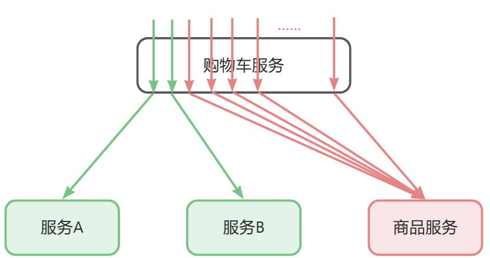

依次类推，整个微服务群中与购物车服务、商品服务等有调用关系的服务可能都会出现问题，最终导致整个集群不可用。

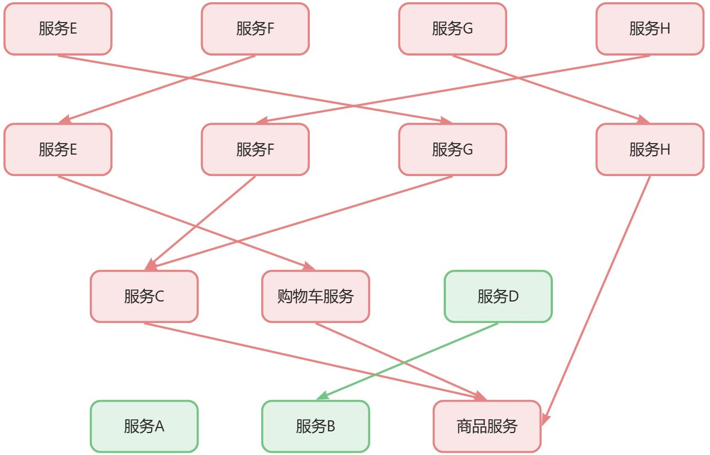

这就是级联失败问题，或者叫服务雪崩问题。

还有跨服务的事务问题：

比如之前的下单业务，下单的过程中需要调用多个微服务：

- 商品服务：扣减库存

- 订单服务：保存订单

- 购物车服务：清理购物车

这些业务全部都是数据库的写操作，我们必须确保所有操作的同时成功或失败。但是这些操作在不同微服务，也就是不同的`Tomcat`，这样的情况如何确保事务特性呢？

这些问题都会在今天找到答案。

今天的内容会分成几部分：

1.微服务保护

- 服务保护方案

- 请求限流

- 隔离和熔断

2.分布式事务

- 初识分布式事务

- Seata

通过今天的学习，你将能掌握下面的能力：

- 知道服务雪崩问题产生原因及常见解决方案

- 能使用`Sentinel`实现服务保护

- 理解分布式事务产生的原因

- 能使用`Seata`解决分布式事务问题

- 理解AT模式基本原理

# 二、微服务保护

保证服务运行的健壮性，避免级联失败导致的雪崩问题，就属于微服务保护。这章我们就一起来学习一下微服务保护的常见方案以及对应的技术。

## 1.服务保护方案

微服务保护的方案有很多，比如：

- 请求限流

- 线程隔离

- 服务熔断

这些方案或多或少都会导致服务的体验上略有下降，比如请求限流，降低了并发上限；线程隔离，降低了可用资源数量；服务熔断，降低了服务的完整度，部分服务变的不可用或弱可用。因此这些方案都属于服务降级的方案。但通过这些方案，服务的健壮性得到了提升，

接下来，我们就逐一了解这些方案的原理。

### 1.1.请求限流

服务故障最重要原因，就是并发太高！解决了这个问题，就能避免大部分故障。当然，接口的并发不是一直很高，而是突发的。因此请求限流，就是限制或控制接口访问的并发流量，避免服务因流量激增而出现故障。

请求限流往往会有一个限流器，数量高低起伏的并发请求曲线，经过限流器就变的非常平稳。这就像是水电站的大坝，起到蓄水的作用，可以通过开关控制水流出的大小，让下游水流始终维持在一个平稳的量。

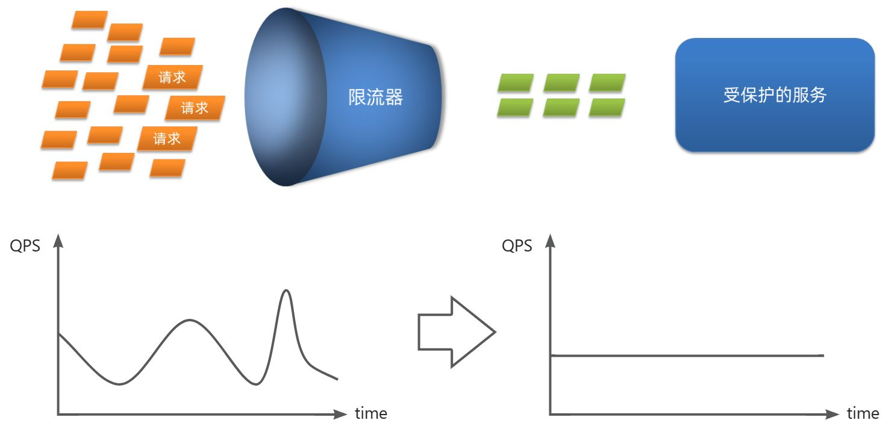

### 1.2.线程隔离

当一个业务接口响应时间长，而且并发高时，就可能耗尽服务器的线程资源，导致服务内的其它接口收到影响。所以我们必须把这种影响降低，或者缩减影响的范围。线程隔离正是解决这个问题的好办法。

线程隔离的思想来自轮船的舱壁模式：

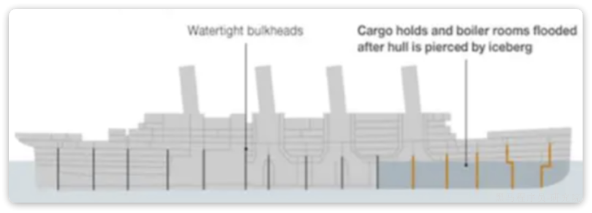

轮船的船舱会被隔板分割为N个相互隔离的密闭舱，假如轮船触礁进水，只有损坏的部分密闭舱会进水，而其他舱由于相互隔离，并不会进水。这样就把进水控制在部分船体，避免了整个船舱进水而沉没。

为了避免某个接口故障或压力过大导致整个服务不可用，我们可以限定每个接口可以使用的资源范围，也就是将其“隔离”起来。

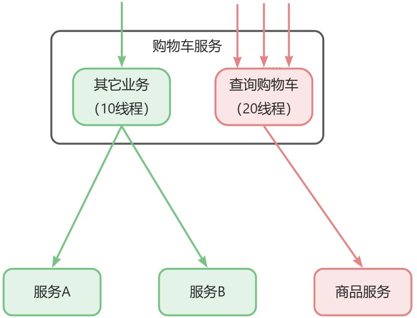

如图所示，我们给查询购物车业务限定可用线程数量上限为20，这样即便查询购物车的请求因为查询商品服务而出现故障，也不会导致服务器的线程资源被耗尽，不会影响到其它接口。

### 1.3.服务熔断

线程隔离虽然避免了雪崩问题，但故障服务（商品服务）依然会拖慢购物车服务（服务调用方）的接口响应速度。而且商品查询的故障依然会导致查询购物车功能出现故障，购物车业务也变的不可用了。

所以，我们要做两件事情：

- 编写服务降级逻辑：就是服务调用失败后的处理逻辑，根据业务场景，可以抛出异常，也可以返回友好提示或默认数据。

- 异常统计和熔断：统计服务提供方的异常比例，当比例过高表明该接口会影响到其它服务，应该拒绝调用该接口，而是直接走降级逻辑。

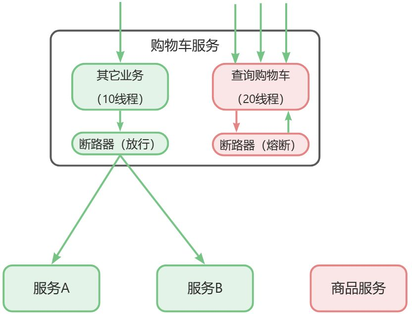

## 2.Sentinel

微服务保护的技术有很多，但在目前国内使用较多的还是`Sentinel`，所以接下来我们学习`Sentinel`的使用。

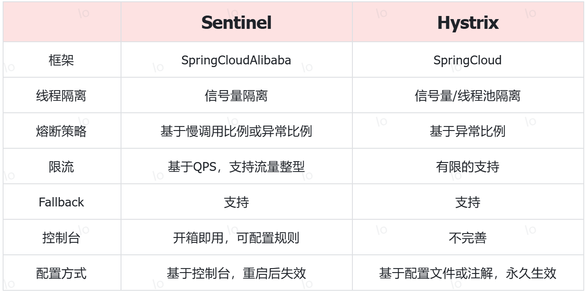

### 2.1.介绍和安装

`Sentinel`是阿里巴巴开源的一款服务保护框架，目前已经加入`SpringCloudAlibaba`中。官方网站：

[https://sentinelguard\.io/zh\-cn/](https://sentinelguard.io/zh-cn/)

`Sentinel `的使用可以分为两个部分:

- 核心库（Jar包）：不依赖任何框架/库，能够运行于 Java 8 及以上的版本的运行时环境，同时对 `Dubbo` / `Spring Cloud `等框架也有较好的支持。在项目中引入依赖即可实现服务限流、隔离、熔断等功能。

- 控制台（Dashboard）：`Dashboard `主要负责管理推送规则、监控、管理机器信息等。

为了方便监控微服务，我们先把`Sentinel`的控制台搭建出来。

1.下载jar包

下载地址：

[https://github\.com/alibaba/Sentinel/releases](https://github.com/alibaba/Sentinel/releases)

也可以直接使用资料提供的版本：

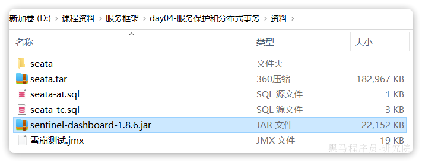

2.运行

将jar包放在任意非中文、不包含特殊字符的目录下，重命名为`sentinel-dashboard-1.8.6.jar`：

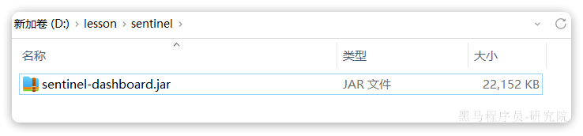

然后运行如下命令启动控制台：

```Bash
java -Dserver.port=8090 -Dcsp.sentinel.dashboard.server=localhost:8090 -Dproject.name=sentinel-dashboard -jar sentinel-dashboard-1.8.6.jar
```

其它启动时可配置参数可参考官方文档：

[https://github\.com/alibaba/Sentinel/wiki/%E5%90%AF%E5%8A%A8%E9%85%8D%E7%BD%AE%E9%A1%B9](https://github.com/alibaba/Sentinel/wiki/%E5%90%AF%E5%8A%A8%E9%85%8D%E7%BD%AE%E9%A1%B9)

3.访问

访问[http://localhost:8090](http://localhost:8090)页面，就可以看到`sentinel`的控制台了：

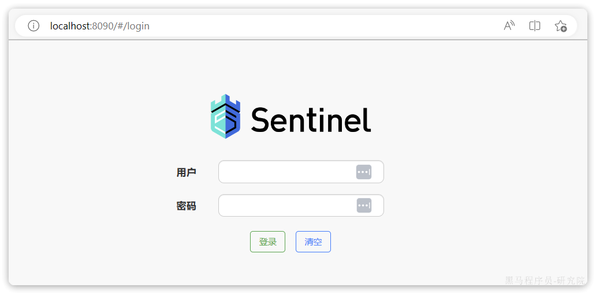

需要输入账号和密码，默认都是：`sentinel`

登录后，即可看到控制台，默认会监控`sentinel-dashboard`服务本身：

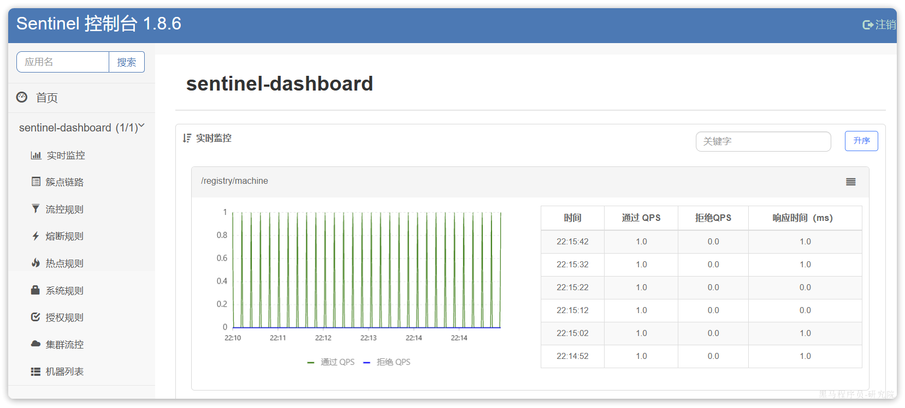

### 2.2.微服务整合

我们在`cart-service`模块中整合`sentinel`，连接`sentinel-dashboard`控制台，步骤如下：
1.引入sentinel依赖

```XML
<!--sentinel-->
<dependency>
    <groupId>com.alibaba.cloud</groupId>
    <artifactId>spring-cloud-starter-alibaba-sentinel</artifactId>
</dependency>
```

2.配置控制台

修改`application.yaml`文件，添加下面内容：

```YAML
spring:
  cloud:
    sentinel:
      transport:
        dashboard: localhost:8090
```

3.访问`cart-service`的任意端点

重启`cart-service`，然后访问查询购物车接口，`sentinel`的客户端就会将服务访问的信息提交到`sentinel-dashboard`控制台。并展示出统计信息：

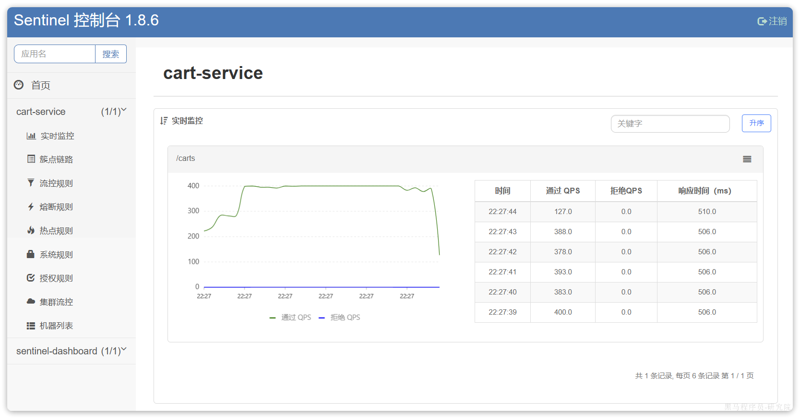

点击簇点链路菜单，会看到下面的页面：

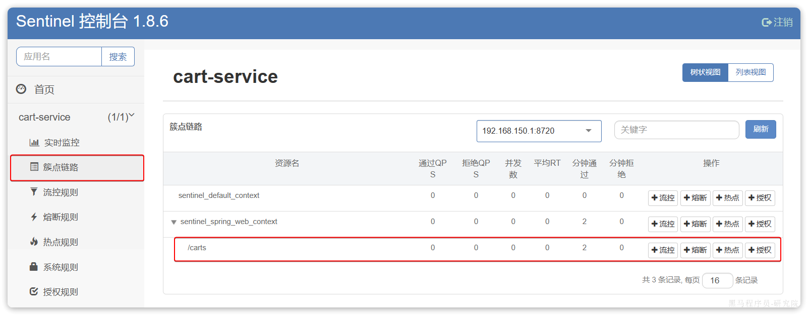

所谓簇点链路，就是单机调用链路，是一次请求进入服务后经过的每一个被`Sentinel`监控的资源。默认情况下，`Sentinel`会监控`SpringMVC`的每一个`Endpoint`（接口）。

因此，我们看到`/carts`这个接口路径就是其中一个簇点，我们可以对其进行限流、熔断、隔离等保护措施。

不过，需要注意的是，我们的`SpringMVC`接口是按照`Restful`风格设计，因此购物车的查询、删除、修改等接口全部都是`/carts`路径：

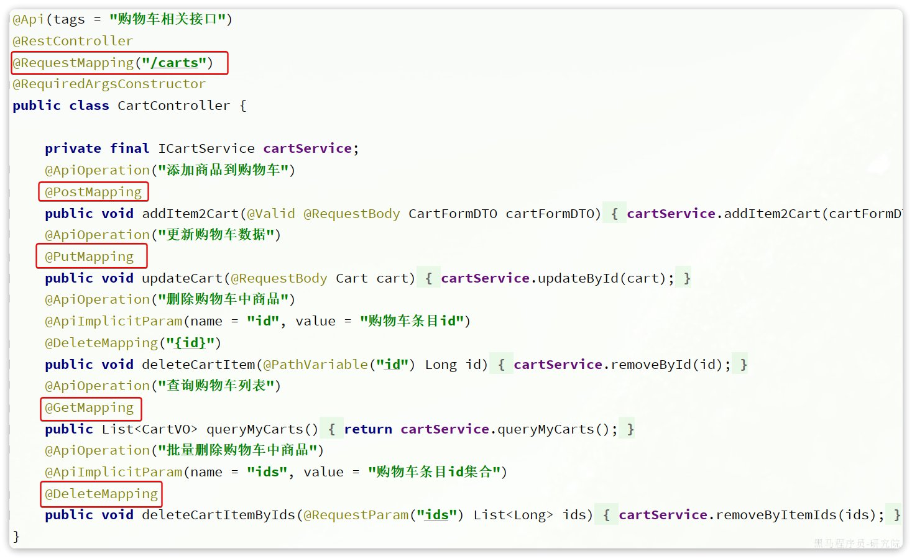

默认情况下`Sentinel`会把路径作为簇点资源的名称，无法区分路径相同但请求方式不同的接口，查询、删除、修改等都被识别为一个簇点资源，这显然是不合适的。

所以我们可以选择打开`Sentinel`的请求方式前缀，把`请求方式 + 请求路径`作为簇点资源名：

首先，在`cart-service`的`application.yml`中添加下面的配置：

```YAML
spring:
  cloud:
    sentinel:
      transport:
        dashboard: localhost:8090
      http-method-specify: true # 开启请求方式前缀
```

然后，重启服务，通过页面访问购物车的相关接口，可以看到`sentinel`控制台的簇点链路发生了变化：

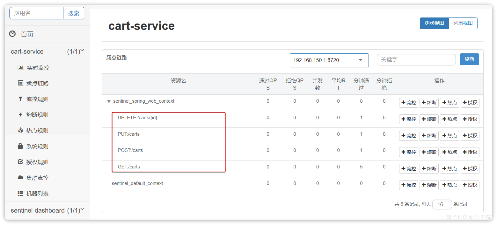

## 3.请求限流

在簇点链路后面点击流控按钮，即可对其做限流配置：

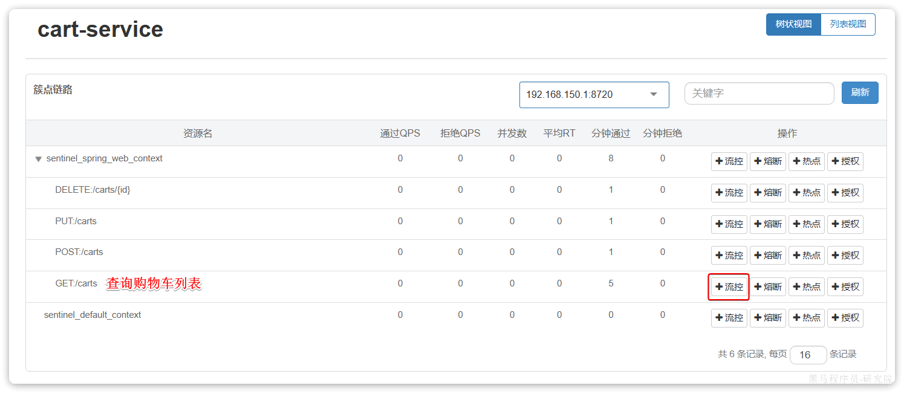

在弹出的菜单中这样填写：

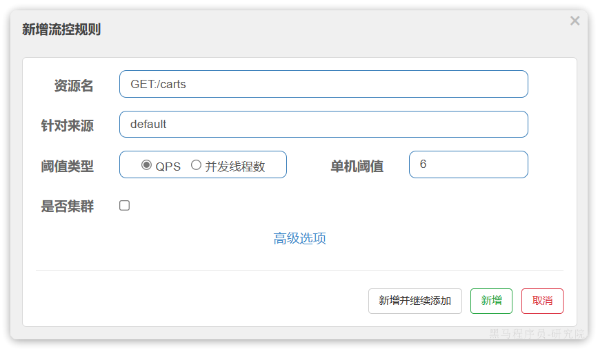

这样就把查询购物车列表这个簇点资源的流量限制在了每秒6个，也就是最大QPS为6\.

我们利用 [Jmeter ](https://lining-lo.github.io/lining-lo-notes/SpringCloud/附录-Jmeter工具.html)做限流测试，我们每秒发出10个请求：

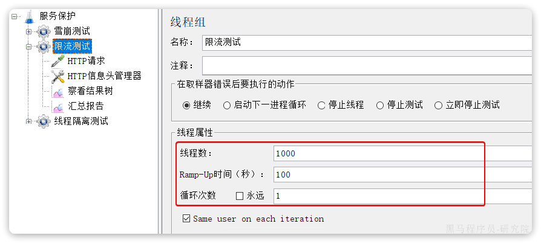

最终监控结果如下：

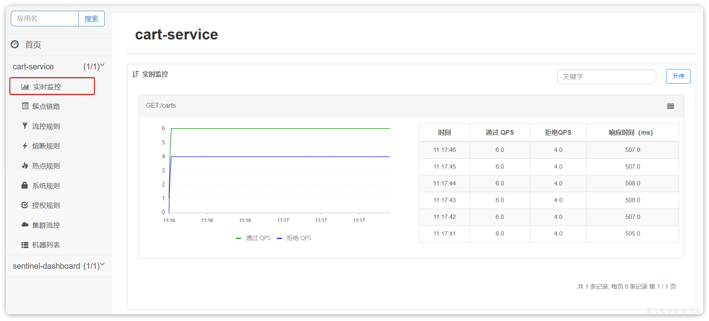

可以看出`GET:/carts`这个接口的通过QPS稳定在6附近，而拒绝的QPS在4附近，符合我们的预期。

补充内容：

- QPS（Query Per Second）：每秒查询数，一般指查询接口，例如分页查询订单列表

- TPS（Transactions Per Second）：每秒事务数，一般指业务操作，例如下单接口、转账接口

- RT（Response Time）：响应时间

## 4.线程隔离

限流可以降低服务器压力，尽量减少因并发流量引起的服务故障的概率，但并不能完全避免服务故障。一旦某个服务出现故障，我们必须隔离对这个服务的调用，避免发生雪崩。

比如，查询购物车的时候需要查询商品，为了避免因商品服务出现故障导致购物车服务级联失败，我们可以把购物车业务中查询商品的部分隔离起来，限制可用的线程资源：


这样，即便商品服务出现故障，最多导致查询购物车业务故障，并且可用的线程资源也被限定在一定范围，不会导致整个购物车服务崩溃。

所以，我们要对查询商品的`FeignClient`接口做线程隔离。

### 4.1.OpenFeign整合Sentinel

修改`cart-service`模块的`application.yml`文件，开启`Feign`的`sentinel`功能：

```YAML
feign:
  sentinel:
    enabled: true # 开启feign对sentinel的支持
```

然后重启`cart-service`服务，可以看到查询商品的`FeignClient`自动变成了一个簇点资源：

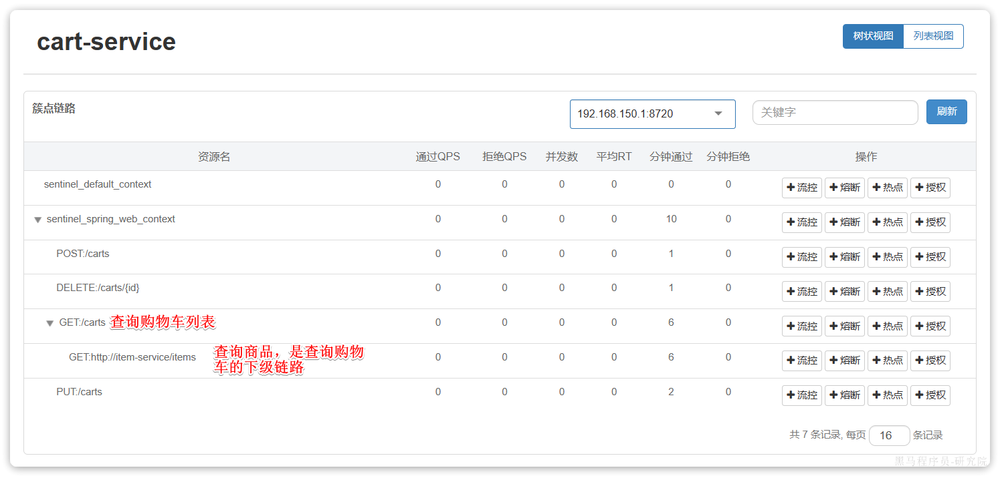

### 4.2.配置线程隔离

接下来，点击查询商品的`FeignClient`对应的簇点资源后面的流控按钮：

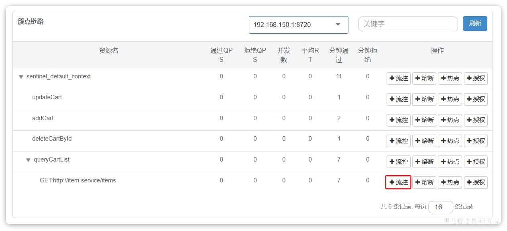

在弹出的表单中填写下面内容：

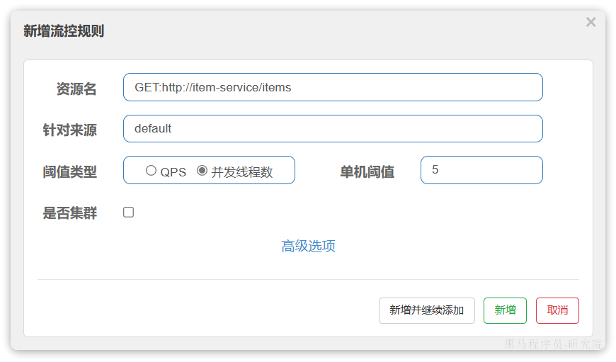

注意，这里勾选的是并发线程数限制，也就是说这个查询功能最多使用5个线程，而不是5QPS。如果查询商品的接口每秒处理2个请求，则5个线程的实际QPS在10左右，而超出的请求自然会被拒绝。同时先暂时删掉对购物车的流控限制

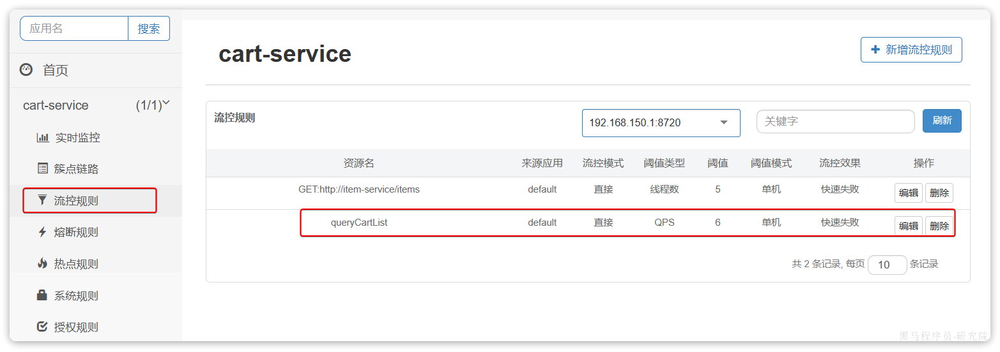

我们将查询商品的请求限制为500毫秒，来模拟一秒只能处理两个请求，然后重启item服务

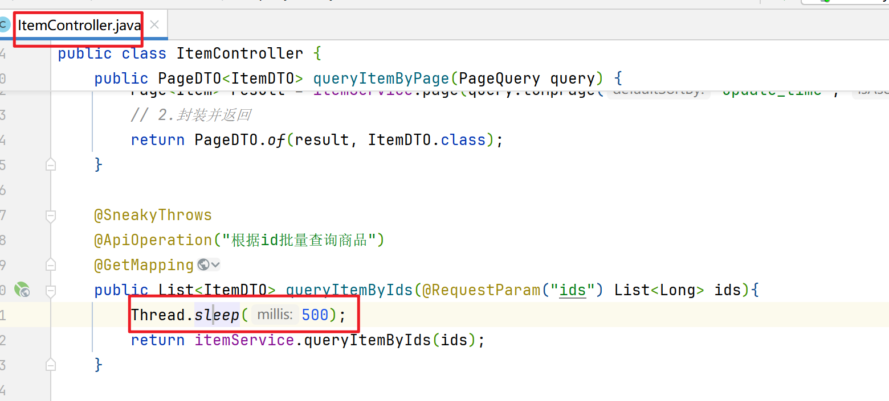

我们利用`Jemeter`测试，每秒发送100个请求：

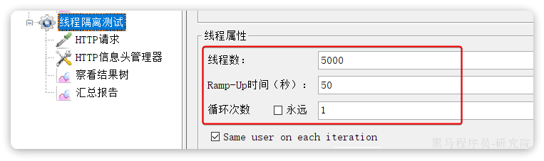

最终测试结果如下：

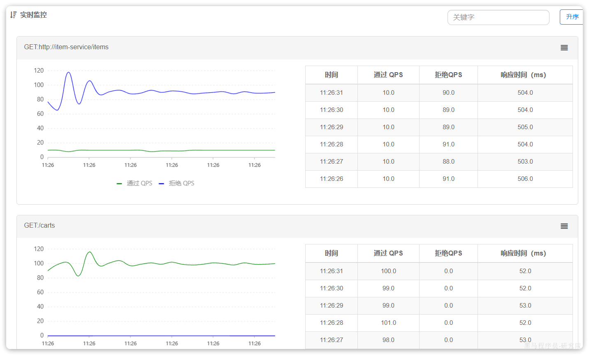

进入查询购物车的请求每秒大概在100，而在查询商品时却只剩下每秒10左右，符合我们的预期。

此时如果我们通过页面访问购物车的其它接口，例如添加购物车、修改购物车商品数量，发现不受影响：

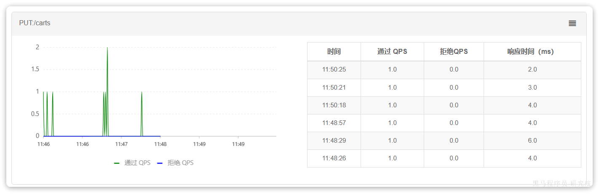

响应时间非常短，这就证明线程隔离起到了作用，尽管查询购物车这个接口并发很高，但是它能使用的线程资源被限制了，因此不会影响到其它接口。

## 5.限流算法

### 5.1.窗口算法

在熔断功能中，需要统计异常请求或慢请求比例，也就是计数。在限流的时候，要统计每秒钟的QPS，同样是计数。可见计数算法在熔断限流中的应用非常多。sentinel中采用的计数器算法就是滑动窗口计数算法。

**固定窗口计数**

要了解滑动窗口计数算法，我们必须先知道固定窗口计数算法，其基本原理如图：

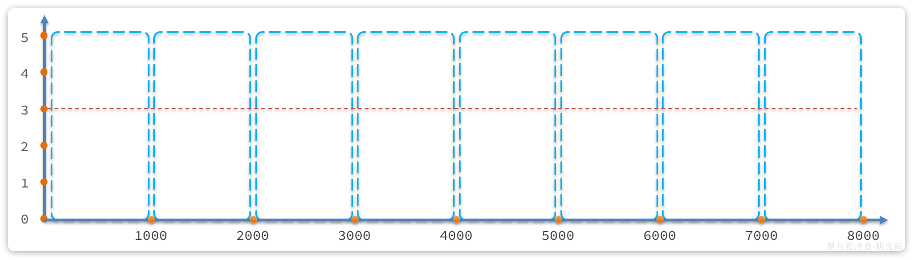

说明：

- 将时间划分为多个窗口，窗口时间跨度称为`Interval`，本例中为1000ms；

- 每个窗口维护1个计数器，每有1次请求就将计数器`+1`。限流就是设置计数器阈值，本例为3，图中红线标记

- 如果计数器超过了限流阈值，则超出阈值的请求都被丢弃。

示例：

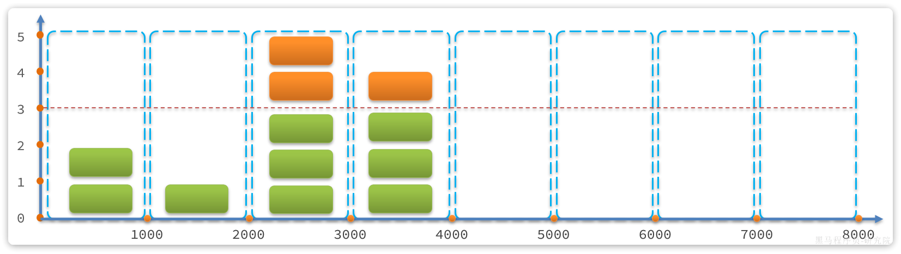

说明：

- 第1、2秒，请求数量都小于3，没问题

- 第3秒，请求数量为5，超过阈值，超出的请求被拒绝

但是我们考虑一种特殊场景，如图：

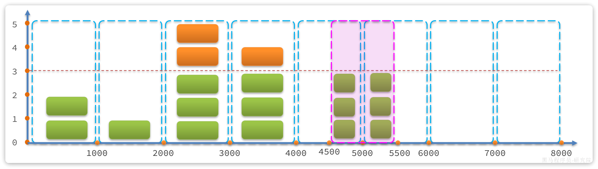

说明：

- 假如在第5、6秒，请求数量都为3，没有超过阈值，全部放行

- 但是，如果第5秒的三次请求都是在4\.5\~5秒之间进来；第6秒的请求是在5\~5\.5之间进来。那么从第4\.5\~5\.之间就有6次请求！也就是说每秒的QPS达到了6，远超阈值。

这就是固定窗口计数算法的问题，它只能统计当前某1个时间窗的请求数量是否到达阈值，无法结合前后的时间窗的数据做综合统计。

因此，我们就需要滑动时间窗口算法来解决。

**滑动窗口计数**

固定时间窗口算法中窗口有很多，其跨度和位置是与时间区间绑定，因此是很多固定不动的窗口。而滑动时间窗口算法中只包含1个固定跨度的窗口，但窗口是可移动动的，与时间区间无关。

具体规则如下：

- 窗口时间跨度`Interval`大小固定，例如1秒

- 时间区间跨度为`Interval / n` ，例如n=2，则时间区间跨度为500ms

- 窗口会随着当前请求所在时间`currentTime`移动，窗口范围从`currentTime-Interval`时刻之后的第一个时区开始，到`currentTime`所在时区结束。

如图所示：

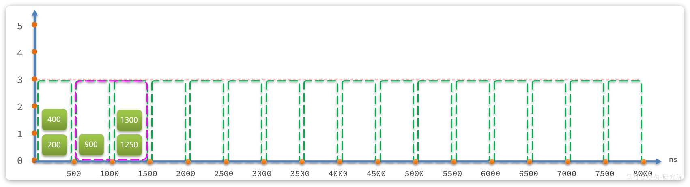

限流阈值依然为3，绿色小块就是请求，上面的数字是其`currentTime`值。

- 在第1300ms时接收到一个请求，其所在时区就是1000\~1500

- 按照规则，currentTime\-Interval值为300ms，300ms之后的第一个时区是500\~1000，因此窗口范围包含两个时区：500\~1000、1000\~1500，也就是粉红色方框部分

- 统计窗口内的请求总数，发现是3，未达到上限。

若第1400ms又来一个请求，会落在1000\~1500时区，虽然该时区请求总数是3，但滑动窗口内总数已经达到4，因此该请求会被拒绝：

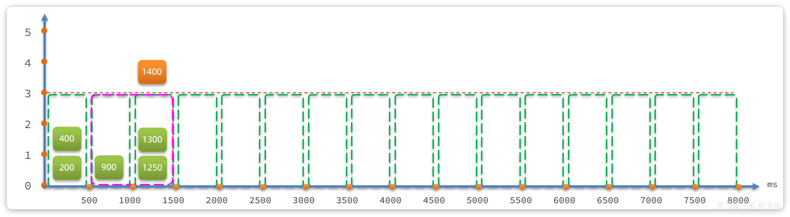

假如第1600ms又来的一个请求，处于1500\~2000时区，根据算法，滑动窗口位置应该是1000\~1500和1500\~2000这两个时区，也就是向后移动：

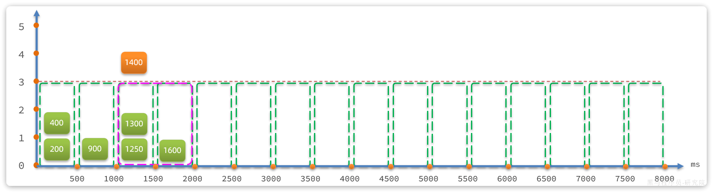

这就是滑动窗口计数的原理，解决了我们之前所说的问题。而且滑动窗口内划分的时区越多，这种统计就越准确。

**对比小结**

1.固定窗口

优点：

- 实现简单，资源消耗低（只需要一个计数器和一个时间戳）

- 适合高并发、对精度要求不高的场景

缺点：

- 边界问题

- 限流不够平滑

2.滑动窗口

优点：

- 精度较高，更真实的反映任意时间窗口内的频率

- 避免了边界问题

缺点：

- 实现复杂（需要请求的时间戳列表）

- 内存/计算开销大（尤其高并发下需要大量的请求时间戳）

### 5.2.桶算法

**令牌桶算法**

限流的另一种常见算法是令牌桶算法。Sentinel中的热点参数限流正是基于令牌桶算法实现的。其基本思路如图：

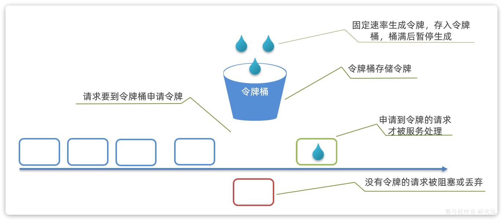

说明：

- 以固定的速率生成令牌，存入令牌桶中，如果令牌桶满了以后，多余令牌丢弃

- 请求进入后，必须先尝试从桶中获取令牌，获取到令牌后才可以被处理

- 如果令牌桶中没有令牌，则请求等待或丢弃

基于令牌桶算法，每秒产生的令牌数量基本就是QPS上限。

当然也有例外情况，例如：

- 某一秒令牌桶中产生了很多令牌，达到令牌桶上限N，缓存在令牌桶中，但是这一秒没有请求进入。

- 下一秒的前半秒涌入了超过2N个请求，之前缓存的令牌桶的令牌耗尽，同时这一秒又生成了N个令牌，于是总共放行了2N个请求。超出了我们设定的QPS阈值。

因此，在使用令牌桶算法时，尽量不要将令牌上限设定到服务能承受的QPS上限。而是预留一定的波动空间，这样我们才能应对突发流量。

**漏桶算法**

漏桶算法与令牌桶相似，但在设计上更适合应对并发波动较大的场景，以解决令牌桶中的问题。

简单来说就是请求到达后不是直接处理，而是先放入一个队列。而后以固定的速率从队列中取出并处理请求。之所以叫漏桶算法，就是把请求看做水，队列看做是一个漏了的桶。

如图：

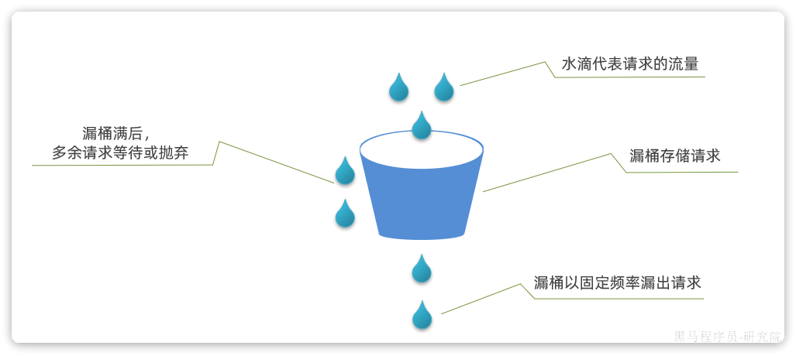

说明：

- 将每个请求视作"水滴"放入"漏桶"进行存储；

- "漏桶"以固定速率向外"漏"出请求来执行，如果"漏桶"空了则停止"漏水”；

- 如果"漏桶"满了则多余的"水滴"会被直接丢弃。

漏桶的优势就是流量整型，桶就像是一个大坝，请求就是水。并发量不断波动，就如图水流时大时小，但都会被大坝拦住。而后大坝按照固定的速度放水，避免下游被洪水淹没。

因此，不管并发量如何波动，经过漏桶处理后的请求一定是相对平滑的曲线：

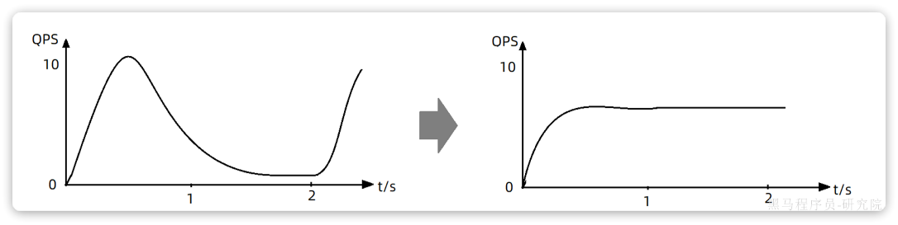

sentinel中的限流中的排队等待功能正是基于漏桶算法实现的。

### 5.3.小结对比

1.令牌桶

优点：

- 支持突发流量，桶内积攒的令牌可应对短时间高峰

- 灵活性较高，可调整令牌速率和桶容量

缺点：

- 可能会对下游进行冲击（突发流量）

- 参数不太好调整（令牌数量）

常见场景：

- WebAPI限流，允许用户突发流量

- 带宽管理

- 云服务配额：例如阿里云的API次数限流

2.漏桶

优点：

- 速率控制严格，下游保护好

- 排队可控：桶容量固定，可明确限制最大等待请求数，避免内存溢出。

缺点：

- 突发流量支持的不好

- 请求需先入桶排队，即使桶空，也需等待 “漏出” 节奏，增加延迟。

常见场景：

- 流媒体、音视频传输：要求输出速率稳定，避免抖动

- 防下游服务过载

- 对延迟不敏感但要求稳定吞吐

## 6.服务熔断

前面我们利用线程隔离对查询购物车业务进行隔离，保护了购物车服务的其它接口。由于查询商品的功能耗时较高（我们模拟了500毫秒延时），再加上线程隔离限定了线程数为5，导致接口吞吐能力有限，最终QPS只有10左右。这就导致了几个问题：

第一，超出的QPS上限的请求就只能抛出异常，从而导致购物车的查询失败。但从业务角度来说，即便没有查询到最新的商品信息，购物车也应该展示给用户，用户体验更好。也就是给查询失败设置一个降级处理逻辑。

第二，由于查询商品的延迟较高（模拟的500ms），从而导致查询购物车的响应时间也变的很长。这样不仅拖慢了购物车服务，消耗了购物车服务的更多资源，而且用户体验也很差。对于商品服务这种不太健康的接口，我们应该直接停止调用，直接走降级逻辑，避免影响到当前服务。也就是将商品查询接口熔断。

### 6.1.编写降级逻辑

触发限流或熔断后的请求不一定要直接报错，也可以返回一些默认数据或者友好提示，用户体验会更好。

给`FeignClient`编写失败后的降级逻辑有两种方式：

- 方式一：`FallbackClass`，无法对远程调用的异常做处理

- 方式二：`FallbackFactory`，可以对远程调用的异常做处理，我们一般选择这种方式。

这里我们演示方式二的失败降级处理。

1.在`hm-api`模块中给`ItemClient`定义降级处理类，实现`FallbackFactory`：

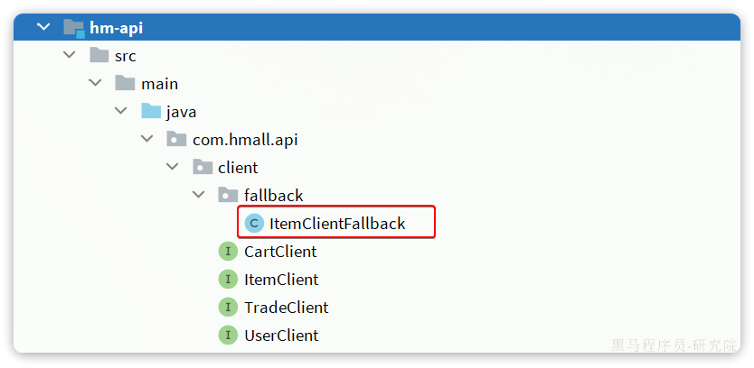

代码如下：

```Java
package com.hmall.api.client.fallback;
import com.hmall.api.client.ItemClient;
import com.hmall.api.dto.ItemDTO;
import com.hmall.api.dto.OrderDetailDTO;
import com.hmall.common.exception.BizIllegalException;
import com.hmall.common.utils.CollUtils;
import lombok.extern.slf4j.Slf4j;
import org.springframework.cloud.openfeign.FallbackFactory;
import java.util.Collection;
import java.util.List;
@Slf4j
public class ItemClientFallback implements FallbackFactory<ItemClient> {
    @Override
    public ItemClient create(Throwable cause) {
        return new ItemClient() {
            @Override
            public List<ItemDTO> queryItemByIds(Collection<Long> ids) {
                log.error("远程调用ItemClient#queryItemByIds方法出现异常，参数：{}", ids, cause);
                // 查询购物车允许失败，查询失败，返回空集合
                return CollUtils.emptyList();
            }
            @Override
            public void deductStock(List<OrderDetailDTO> items) {
                // 库存扣减业务需要触发事务回滚，查询失败，抛出异常
                throw new BizIllegalException(cause);
            }
        };
    }
}
```

2.在`hm-api`模块中的`com.hmall.api.config.DefaultFeignConfig`类中将`ItemClientFallback`注册为一个`Bean`：

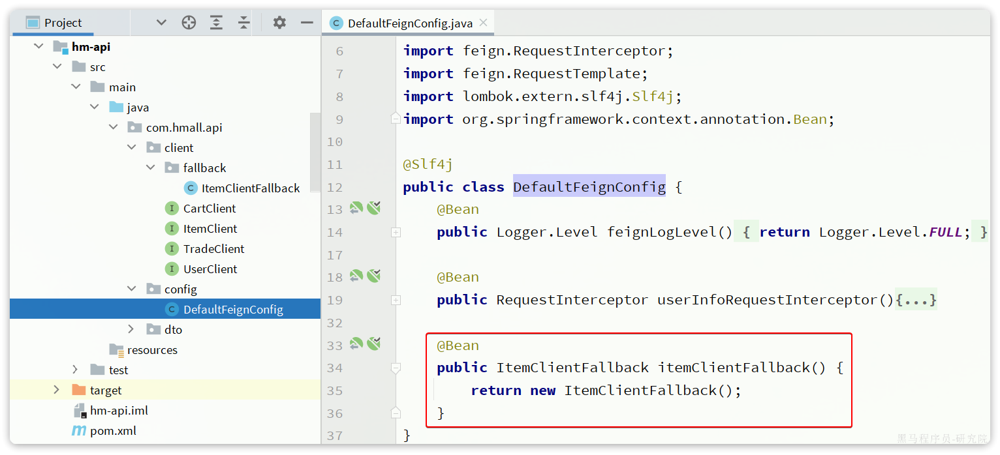

3.在`hm-api`模块中的`ItemClient`接口中使用`ItemClientFallbackFactory`：

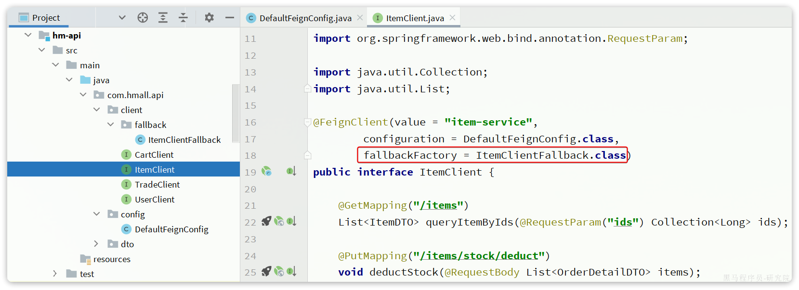

重启后，再次测试，发现被限流的请求不再报错，走了降级逻辑：

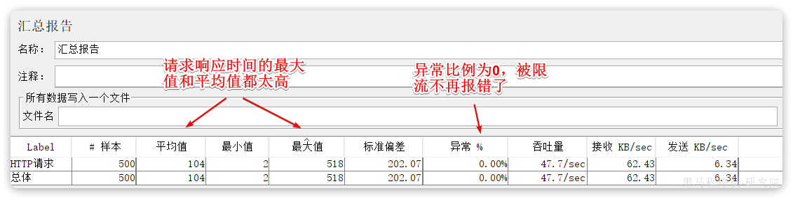

但是未被限流的请求延时依然很高：

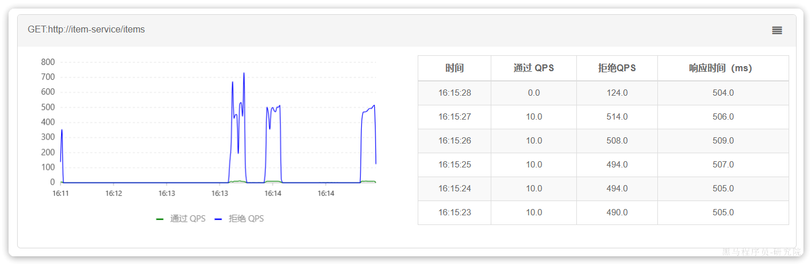

导致最终的平均响应时间较长。

### 6.2.服务熔断

查询商品的RT较高（模拟的500ms），从而导致查询购物车的RT也变得很长。这样不仅拖慢了购物车服务，消耗了购物车服务的更多资源，而且用户体验也很差。

对于商品服务这种不太健康的接口，我们应该停止调用，直接走降级逻辑，避免影响到当前服务。也就是将商品查询接口熔断。当商品服务接口恢复正常后，再允许调用。这其实就是断路器的工作模式了。

`Sentinel`中的断路器不仅可以统计某个接口的慢请求比例，还可以统计异常请求比例。当这些比例超出阈值时，就会熔断该接口，即拦截访问该接口的一切请求，降级处理；当该接口恢复正常时，再放行对于该接口的请求。

断路器的工作状态切换由一个状态机来控制：

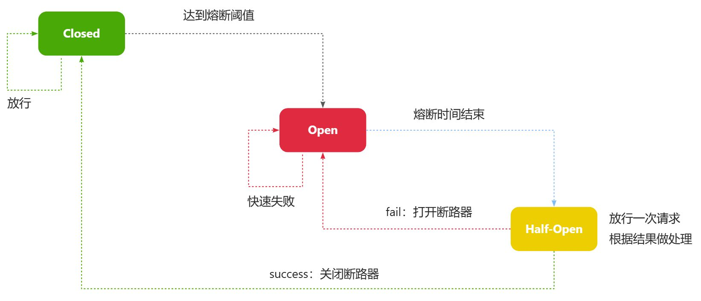

状态机包括三个状态：

1.closed：关闭状态，断路器放行所有请求，并开始统计异常比例、慢请求比例。超过阈值则切换到open状态

2.open：打开状态，服务调用被熔断，访问被熔断服务的请求会被拒绝，快速失败，直接走降级逻辑。open状态持续一段时间后会进入half\-open状态

3.half\-open：半开状态，放行一次请求，根据执行结果来判断接下来的操作。 

- 请求成功：则切换到closed状态

- 请求失败：则切换到open状态

我们可以在控制台通过点击簇点后的`熔断`按钮来配置熔断策略：

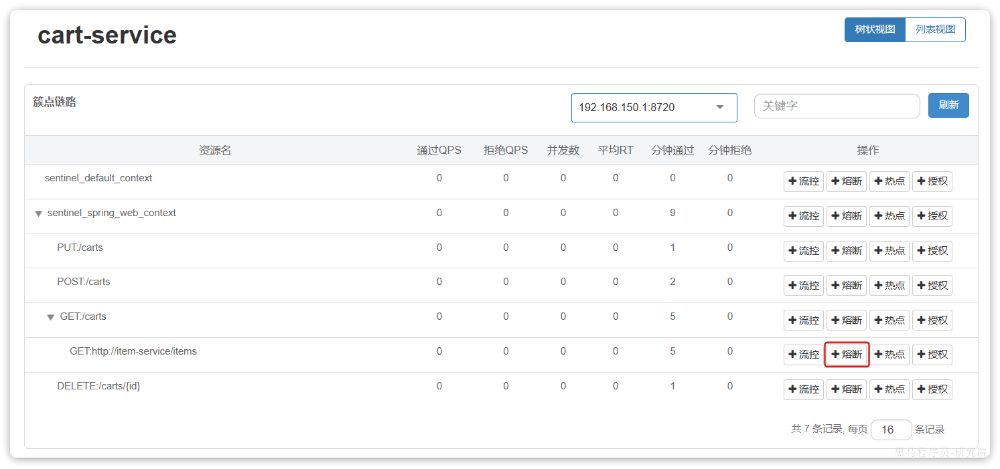

在弹出的表格中这样填写：

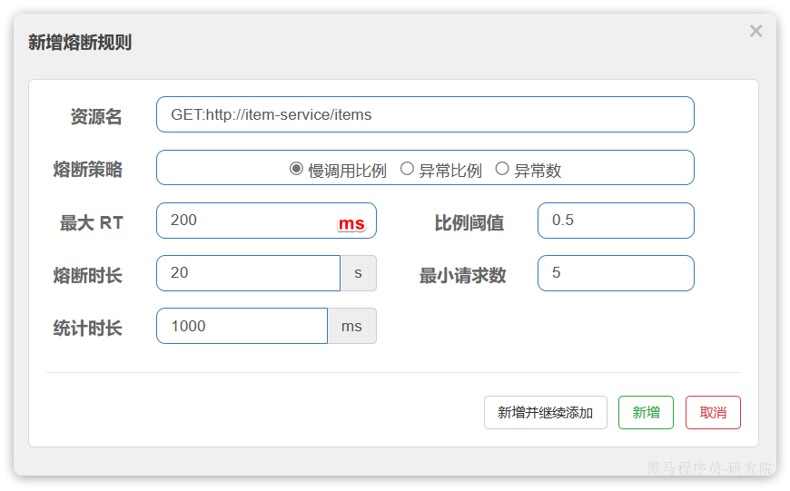

这种是按照慢调用比例来做熔断，上述配置的含义是：

- RT超过200毫秒的请求调用就是慢调用

- 统计最近1000ms内的最少5次请求，如果慢调用比例不低于0\.5，则触发熔断

- 熔断持续时长20s

配置完成后，再次利用`Jemeter`测试，可以发现：

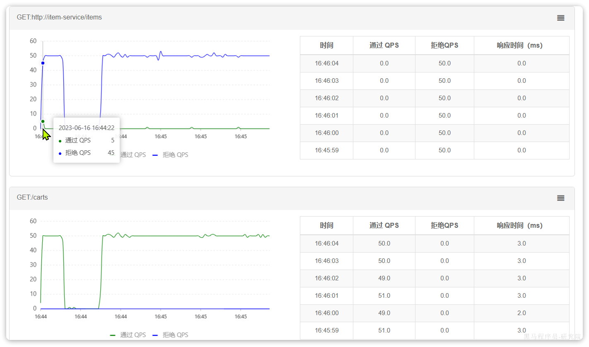

在一开始一段时间是允许访问的，后来触发熔断后，查询商品服务的接口通过QPS直接为0，所有请求都被熔断了。而查询购物车的本身并没有受到影响。

此时整个购物车查询服务的平均RT影响不大：

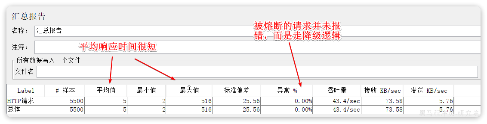

# 三、分布式事务

首先我们看看项目中的下单业务整体流程：

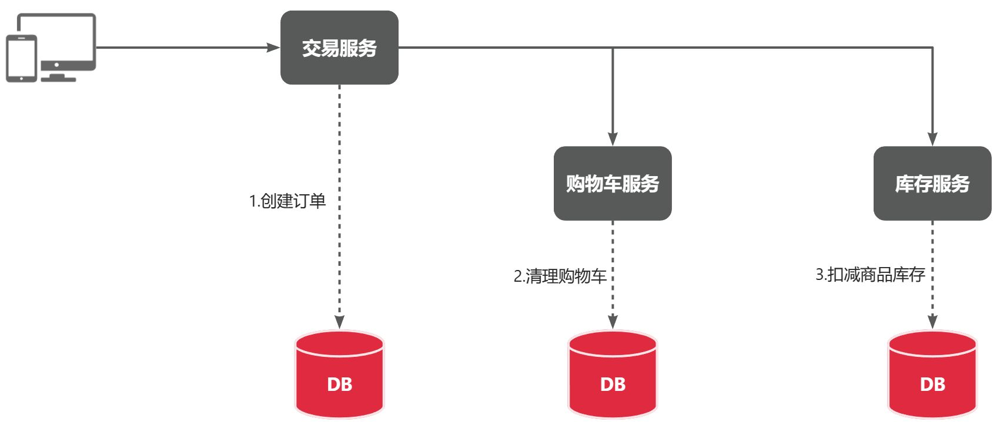


由于订单、购物车、商品分别在三个不同的微服务，而每个微服务都有自己独立的数据库，因此下单过程中就会跨多个数据库完成业务。而每个微服务都会执行自己的本地事务：

- 交易服务：下单事务

- 购物车服务：清理购物车事务

- 库存服务：扣减库存事务

整个业务中，各个本地事务是有关联的。因此每个微服务的本地事务，也可以称为分支事务。多个有关联的分支事务一起就组成了全局事务。我们必须保证整个全局事务同时成功或失败。

我们知道每一个分支事务就是传统的单体事务，都可以满足ACID特性，但全局事务跨越多个服务、多个数据库，是否还能满足呢？

我们来做一个测试，先进入购物车页面：

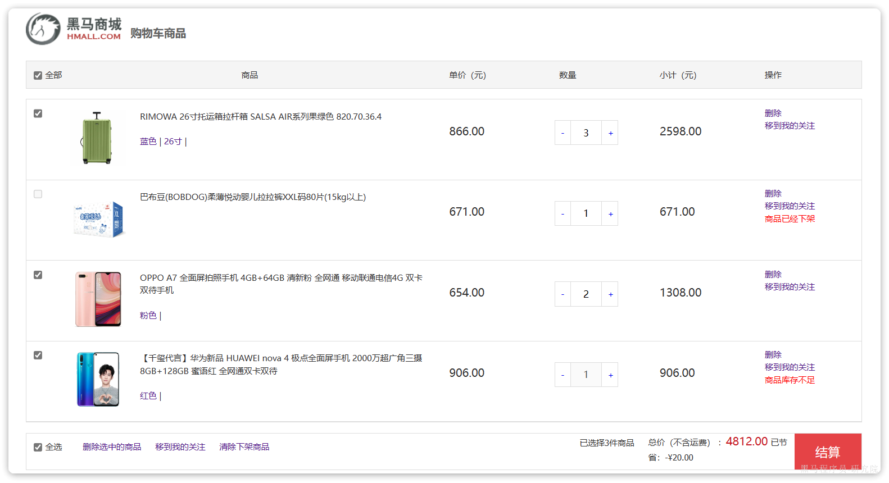

目前有4个购物车，然结算下单，进入订单结算页面：

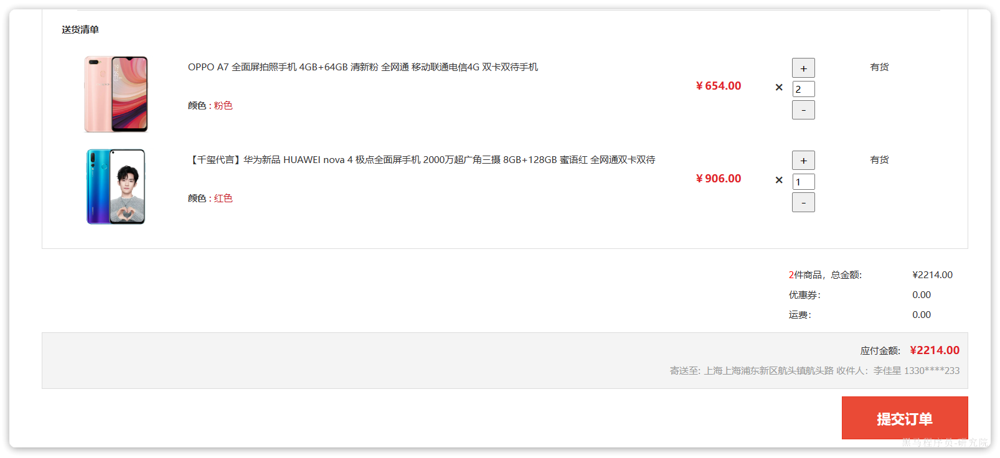

然后，提交订单，我们在商品服务扣减库存的方法抛一个异常出去，就会造成下单失败

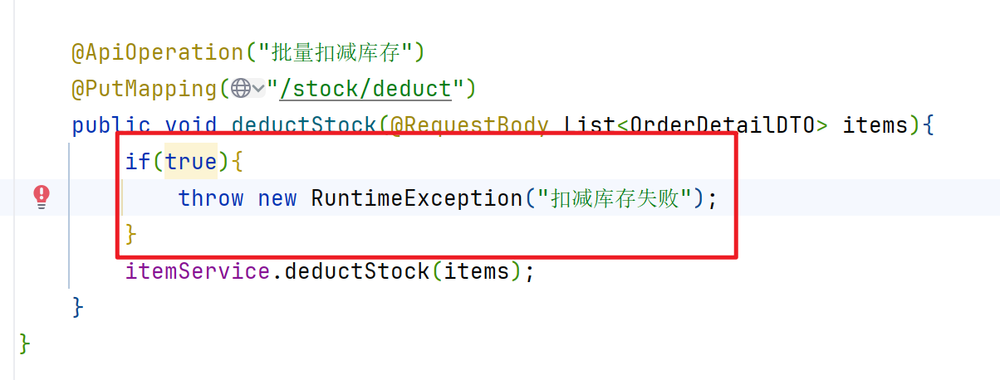

这时所有的操作应该都会回滚

然后我们去查看购物车列表，发现购物车数据依然被清空了，并未回滚：


事务并未遵循ACID的原则，归其原因就是参与事务的多个子业务在不同的微服务，跨越了不同的数据库。虽然每个单独的业务都能在本地遵循ACID，但是它们互相之间没有感知，不知道有人失败了，无法保证最终结果的统一，也就无法遵循ACID的事务特性了。

这就是分布式事务问题，出现以下情况之一就可能产生分布式事务问题：

- 业务跨多个服务实现

- 业务跨多个数据源实现

接下来们就一起来研究下如何解决分布式事务问题。

## 1.认识Seata

解决分布式事务的方案有很多，但实现起来都比较复杂，因此我们一般会使用开源的框架来解决分布式事务问题。在众多的开源分布式事务框架中，功能最完善、使用最多的就是阿里巴巴在2019年开源的`Seata`了。

[https://seata\.io/zh\-cn/docs/overview/what\-is\-seata\.html](https://seata.io/zh-cn/docs/overview/what-is-seata.html)

其实分布式事务产生的一个重要原因，就是参与事务的多个分支事务互相无感知，不知道彼此的执行状态。因此解决分布式事务的思想非常简单：

就是找一个统一的事务协调者，与多个分支事务通信，检测每个分支事务的执行状态，保证全局事务下的每一个分支事务同时成功或失败即可。大多数的分布式事务框架都是基于这个理论来实现的。

`Seata`也不例外，在`Seata`的事务管理中有三个重要的角色：

- TC \(Transaction Coordinator\) \- 事务协调者：维护全局和分支事务的状态，协调全局事务提交或回滚。 

- TM \(Transaction Manager\) \- 事务管理器：定义全局事务的范围、开始全局事务、提交或回滚全局事务。 

- RM \(Resource Manager\) \- 资源管理器：管理分支事务，与TC交谈以注册分支事务和报告分支事务的状态，并驱动分支事务提交或回滚。 

Seata的工作架构如图所示：


其中，TM和RM可以理解为`Seata`的客户端部分，引入到参与事务的微服务依赖中即可。将来TM和RM就会协助微服务，实现本地分支事务与TC之间交互，实现事务的提交或回滚。

而TC服务则是事务协调中心，是一个独立的微服务，需要单独部署。

## 2.部署TC服务

### 2.1.准备数据库表

Seata支持多种存储模式，但考虑到持久化的需要，我们一般选择基于数据库存储。执行资料提供的`《seata-tc.sql》`，导入数据库表：


### 2.2.准备配置文件

资料准备了一个`seata`目录，其中包含了`seata`运行时所需要的配置文件：


其中包含中文注释，大家可以自行阅读。

我们将整个`seata`文件夹拷贝到虚拟机的`/root`目录：


### 2.3.Docker部署

在虚拟机的`/root`目录执行下面的命令：

```Shell
docker run --name seata \
-p 8099:8099 \
-p 7099:7099 \
-e SEATA_IP=192.168.150.101 \
-v ./seata:/seata-server/resources \
--privileged=true \
--network hmall \
--restart=always \
-d \
seataio/seata-server:1.5.2
```

如果镜像下载困难，也可以把资料提供的镜像上传到虚拟机并加载：


## 3.微服务集成Seata

参与分布式事务的每一个微服务都需要集成`Seata`，我们以`trade-service`为例。

### 3.1.引入依赖

为了方便各个微服务集成`seata`，我们需要把`seata`配置共享到`nacos`，因此`trade-service`模块不仅仅要引入`seata`依赖，还要引入`nacos`依赖:

```XML
<!--统一配置管理-->
<dependency>
    <groupId>com.alibaba.cloud</groupId>
    <artifactId>spring-cloud-starter-alibaba-nacos-config</artifactId>
</dependency>
<!--读取bootstrap文件-->
<dependency>
    <groupId>org.springframework.cloud</groupId>
    <artifactId>spring-cloud-starter-bootstrap</artifactId>
</dependency>
<!--seata-->
<dependency>
    <groupId>com.alibaba.cloud</groupId>
    <artifactId>spring-cloud-starter-alibaba-seata</artifactId>
</dependency>
<!--sentinel-->
<dependency>
    <groupId>com.alibaba.cloud</groupId>
    <artifactId>spring-cloud-starter-alibaba-sentinel</artifactId>
</dependency>
```

### 3.2.改造配置

首先在`nacos`上添加一个共享的`seata`配置，命名为`shared-seata.yaml`：


内容如下：

```YAML
seata:
  registry: # TC服务注册中心的配置，微服务根据这些信息去注册中心获取tc服务地址
    type: nacos # 注册中心类型 nacos
    nacos:
      server-addr: 192.168.150.101:8848 # nacos地址
      namespace: "" # namespace，默认为空
      group: DEFAULT_GROUP # 分组，默认是DEFAULT_GROUP
      application: seata-server # seata服务名称
      username: nacos
      password: nacos
  tx-service-group: hmall # 事务组名称
  service:
    vgroup-mapping: # 事务组与tc集群的映射关系
      hmall: "default"
  data-source-proxy-mode: XA # 使用XA模式
```

然后，改造`trade-service`模块，添加`bootstrap.yaml`：


内容如下:

```YAML
spring:
  application:
    name: trade-service # 服务名称
  profiles:
    active: dev
  cloud:
    nacos:
      server-addr: 192.168.150.101 # nacos地址
      config:
        file-extension: yaml # 文件后缀名
        shared-configs: # 共享配置
          - dataId: shared-jdbc.yaml # 共享mybatis配置
          - dataId: shared-log.yaml # 共享日志配置
          - dataId: shared-swagger.yaml # 共享日志配置
          - dataId: shared-seata.yaml # 共享seata配置
```

可以看到这里加载了共享的`seata`配置。

然后改造`application.yaml`文件，内容如下：

```YAML
server:
  port: 8085
feign:
  okhttp:
    enabled: true # 开启OKHttp连接池支持
  sentinel:
    enabled: true # 开启Feign对Sentinel的整合
hm:
  swagger:
    title: 交易服务接口文档
    package: com.hmall.trade.controller
  db:
    database: hm-trade
```

参考上述办法分别改造`hm-cart`和`hm-item`两个微服务模块。

### 3.3.添加数据库表

`seata`的客户端在解决分布式事务的时候需要记录一些中间数据，保存在数据库中。因此我们要先准备一个这样的表。

将资料的`seata-at.sql`分别文件导入`hm-trade`、`hm-cart`、`hm-item`三个数据库中：


结果：


OK，至此为止，微服务整合的工作就完成了。可以参考上述方式对`hm-item`和`hm-cart`模块完成整合改造。

### 3.4.测试

接下来就是测试的分布式事务的时候了。

我们找到`trade-service`模块下的`com.hmall.trade.service.impl.OrderServiceImpl`类中的`createOrder`方法，也就是下单业务方法。

将其上的`@Transactional`注解改为Seata提供的`@GlobalTransactional`：


`@GlobalTransactional`注解就是在标记事务的起点，将来TM就会基于这个方法判断全局事务范围，初始化全局事务。

我们重启`trade-service`、`item-service`、`cart-service`三个服务。再次测试，发现分布式事务的问题解决了！

那么，`Seata`是如何解决分布式事务的呢？

## 4.XA模式

`Seata`支持四种不同的分布式事务解决方案：

- XA

- TCC

- AT

- SAGA

这里我们以`XA`模式和`AT`模式来给大家讲解其实现原理。

`XA` 规范 是`X/Open` 组织定义的分布式事务处理（DTP，Distributed Transaction Processing）标准，XA 规范 描述了全局的`TM`与局部的`RM`之间的接口，几乎所有主流的数据库都对 XA 规范 提供了支持。

### 4.1.两阶段提交

XA是规范，目前主流数据库都实现了这种规范，实现的原理都是基于两阶段提交。

正常情况：


异常情况：


一阶段：

- 事务协调者通知每个事物参与者执行本地事务

- 本地事务执行完成后报告事务执行状态给事务协调者，此时事务不提交，继续持有数据库锁

二阶段：

- 事务协调者基于一阶段的报告来判断下一步操作

- 如果一阶段都成功，则通知所有事务参与者，提交事务

- 如果一阶段任意一个参与者失败，则通知所有事务参与者回滚事务

### 4.2.Seata的XA模型

`Seata`对原始的XA模式做了简单的封装和改造，以适应自己的事务模型，基本架构如图：


`RM`一阶段的工作：

1. 注册分支事务到`TC`

2. 执行分支业务sql但不提交

3. 报告执行状态到`TC`

`TC`二阶段的工作：

`TC`检测各分支事务执行状态

1. 如果都成功，通知所有RM提交事务

2. 如果有失败，通知所有RM回滚事务 

`RM`二阶段的工作：

- 接收`TC`指令，提交或回滚事务

### 4.3.优缺点

`XA`模式的优点是什么？

- 事务的强一致性，满足ACID原则

- 常用数据库都支持，实现简单，并且没有代码侵入

`XA`模式的缺点是什么？

- 因为一阶段需要锁定数据库资源，等待二阶段结束才释放，性能较差

- 依赖关系型数据库实现事务

## 5.AT模式

`AT`模式同样是分阶段提交的事务模型，不过缺弥补了`XA`模型中资源锁定周期过长的缺陷。

### 5.1.Seata的AT模型

基本流程图：


阶段一`RM`的工作：

- 注册分支事务

- 记录`undo-log`（数据快照）

- 执行业务sql并提交

- 报告事务状态

阶段二提交时`RM`的工作：

- 删除`undo-log`即可

阶段二回滚时`RM`的工作：

- 根据undo\-log恢复数据到更新前

### 5.2.流程梳理

我们用一个真实的业务来梳理下AT模式的原理。

比如，现在又一个数据库表，记录用户余额：

其中一个分支业务要执行的SQL为：

```SQL
update tb_account set money = money - 10 where id = 1
```

AT模式下，当前分支事务执行流程如下：

一阶段：

1. `TM`发起并注册全局事务到`TC`

2. `TM`调用分支事务

3. 分支事务准备执行业务SQL

4. `RM`拦截业务SQL，根据where条件查询原始数据，形成快照。

```JSON
{
  "id": 1, "money": 100
}
```

5. `RM`执行业务SQL，提交本地事务，释放数据库锁。此时 money = 90

6. `RM`报告本地事务状态给`TC`

二阶段：

1. `TM`通知`TC`事务结束

2. `TC`检查分支事务状态

    1. 如果都成功，则立即删除快照

    2. 如果有分支事务失败，需要回滚。读取快照数据（\{"id": 1, "money": 100\}），将快照恢复到数据库。此时数据库再次恢复为100

流程图：


### 5.3.AT与XA的区别

简述`AT`模式与`XA`模式最大的区别是什么？

- `XA`模式一阶段不提交事务，锁定资源；`AT`模式一阶段直接提交，不锁定资源。

- `XA`模式依赖数据库机制实现回滚；`AT`模式利用数据快照（undo\_log）实现数据回滚。

- `XA`模式强一致；`AT`模式最终一致

可见，AT模式使用起来更加简单，无业务侵入，性能更好。因此企业90%的分布式事务都可以用AT模式来解决。

## 6.CAP定理

解决分布式事务问题，需要一些分布式系统的基础知识作为理论指导，首先就是CAP定理。

1998年，加州大学的计算机科学家 Eric Brewer 提出，分布式系统有三个指标：

- Consistency（一致性）

- Availability（可用性）

- Partition tolerance （分区容错性）

它们的第一个字母分别是 `C`、`A`、`P`。Eric Brewer认为任何分布式系统架构方案都不可能同时满足这3个目标，这个结论就叫做 CAP 定理。

为什么呢？

### 6.1.一致性

Consistency（一致性）：用户访问分布式系统中的任意节点，得到的数据必须一致。

比如现在包含两个节点，其中的初始数据是一致的：


当我们修改其中一个节点的数据时，两者的数据产生了差异：


要想保住一致性，就必须实现node01 到 node02的数据 同步：


### 6.2.可用性

Availability （可用性）：用户访问分布式系统时，读或写操作总能成功。

只能读不能写，或者只能写不能读，或者两者都不能执行，就说明系统弱可用或不可用。

### 6.2.分区容错

`Partition`，就是分区，就是当分布式系统节点之间出现网络故障导致节点之间无法通信的情况：


如上图，node01和node02之间网关畅通，但是与node03之间网络断开。于是node03成为一个独立的网络分区；node01和node02在一个网络分区。

`Tolerance`，就是容错，即便是系统出现网络分区，整个系统也要持续对外提供服务。

### 6.4.矛盾

在分布式系统中，网络不能100%保证畅通，也就是说网络分区的情况一定会存在。而我们的系统必须要持续运行，对外提供服务。所以分区容错性（`P`）是硬性指标，所有分布式系统都要满足。而在设计分布式系统时要取舍的就是一致性（`C`）和可用性（`A`）了。

假如现在出现了网络分区，如图：


由于网络故障，当我们把数据写入node01时，可以与node02完成数据同步，但是无法同步给node03。现在有两种选择：

- 允许用户任意读写，保证可用性。但由于node03无法完成同步，就会出现数据不一致的情况。满足AP

- 不允许用户写，可以读，直到网络恢复，分区消失。这样就确保了一致性，但牺牲了可用性。满足CP

可见，在分布式系统中，`A`和`C`之间只能满足一个。

## 7.BASE理论

既然分布式系统要遵循CAP定理，那么问题来了，我到底是该牺牲一致性还是可用性呢？如果牺牲了一致性，出现数据不一致该怎么处理？

人们在总结系统设计经验时，最终得到了一些心得：

- Basically Available （基本可用）：分布式系统在出现故障时，允许损失部分可用性，即保证核心可用。

- Soft State（软状态）：在一定时间内，允许出现中间状态，比如临时的不一致状态。

- Eventually Consistent（最终一致性）：虽然无法保证强一致性，但是在软状态结束后，最终达到数据一致。

以上就是BASE理论。

简单来说，BASE理论就是一种取舍的方案，不再追求完美，而是最终达成目标。因此解决分布式事务的思想也是这样，有两个方向：

- AP思想：各个子事务分别执行和提交，无需锁定数据。允许出现结果不一致，然后采用弥补措施恢复，实现最终一致即可。例如`AT`模式就是如此

- CP思想：各个子事务执行后不要提交，而是等待彼此结果，然后同时提交或回滚。在这个过程中锁定资源，不允许其它人访问，数据处于不可用状态，但能保证一致性。例如`XA`模式

## 8.AT模式的脏写问题

我们先回顾一下AT模式的流程，AT模式也分为两个阶段：

第一阶段是记录数据快照，执行并提交事务：


第二阶段根据阶段一的结果来判断：

- 如果每一个分支事务都成功，则事务已经结束（因为阶段一已经提交），因此删除阶段一的快照即可

- 如果有任意分支事务失败，则需要根据快照恢复到更新前数据。然后删除快照


这种模式在大多数情况下（99%）并不会有什么问题，不过在极端情况下，特别是多线程并发访问AT模式的分布式事务时，有可能出现脏写问题，如图：


解决思路就是引入了全局锁的概念。在释放DB锁之前，先拿到全局锁。避免同一时刻有另外一个事务来操作当前数据。


具体可以参考官方文档：

[https://seata\.io/zh\-cn/docs/dev/mode/at\-mode\.html](https://seata.io/zh-cn/docs/dev/mode/at-mode.html)

## 9.TCC模式

TCC模式与AT模式非常相似，每阶段都是独立事务，不同的是TCC通过人工编码来实现数据恢复。需要实现三个方法：

- `try`：资源的检测和预留； 

- `confirm`：完成资源操作业务；要求 `try` 成功 `confirm` 一定要能成功。 

- `cancel`：预留资源释放，可以理解为try的反向操作。 

### 9.1.流程分析

举例，一个扣减用户余额的业务。假设账户A原来余额是100，需要余额扣减30元。

阶段一（ Try ）：检查余额是否充足，如果充足则冻结金额增加30元，可用余额扣除30

初始余额：


余额充足，可以冻结：


此时，总金额 = 冻结金额 \+ 可用金额，数量依然是100不变。事务直接提交无需等待其它事务。

阶段二（Confirm\)：假如要提交（Confirm），之前可用金额已经扣减，并转移到冻结金额。因此可用金额不变，直接冻结金额扣减30即可：


此时，总金额 = 冻结金额 \+ 可用金额 = 0 \+ 70  = 70元

阶段二\(Canncel\)：如果要回滚（Cancel），则释放之前冻结的金额，也就是冻结金额扣减30，可用余额增加30


### 9.2.事务悬挂和空回滚

假如一个分布式事务中包含两个分支事务，try阶段，一个分支成功执行，另一个分支事务阻塞：


如果阻塞时间太长，可能导致全局事务超时而触发二阶段的`cancel`操作。两个分支事务都会执行cancel操作：


要知道，其中一个分支是未执行`try`操作的，直接执行了`cancel`操作，反而会导致数据错误。因此，这种情况下，尽管`cancel`方法要执行，但其中不能做任何回滚操作，这就是空回滚。

对于整个空回滚的分支事务，将来try方法阻塞结束依然会执行。但是整个全局事务其实已经结束了，因此永远不会再有confirm或cancel，也就是说这个事务执行了一半，处于悬挂状态，这就是业务悬挂问题。

以上问题都需要我们在编写try、cancel方法时处理。

### 9.3.总结

1.TCC模式的每个阶段是做什么的？

- Try：资源检查和预留

- Confirm：业务执行和提交

- Cancel：预留资源的释放

2.TCC的优点是什么？

- 一阶段完成直接提交事务，释放数据库资源，性能好

- 相比AT模型，无需生成快照，无需使用全局锁，性能最强

- 不依赖数据库事务，而是依赖补偿操作，可以用于非事务型数据库

3.TCC的缺点是什么？

- 有代码侵入，需要人为编写try、Confirm和Cancel接口，太麻烦

- 软状态，事务是最终一致

- 需要考虑Confirm和Cancel的失败情况，做好幂等处理、事务悬挂和空回滚处理

4.什么时候用AT什么时候用TCC？你们项目用的什么？

使用AT的场景：

- 业务逻辑简单

- 希望对代码侵入小。事务参与者都是关系型数据库（Mysql、Oracle）

使用TCC的场景：

- 业务逻辑复杂，需要精确控制资源释放和预留

- 对性能要求高，希望避免全局锁

- 事务参与者有非数据库资源（第三方接口、缓存、MQ等）

你们项目结合自身情况来说明，大多数是AT
