# 一、基本介绍

JMeter 是 Apache 出品、纯 Java 编写、开源免费的性能 / 压测工具（`.jmx`是 JMeter 测试脚本文件）。

> 一句话：模拟大量用户并发请求，测接口 / 服务扛不扛得住，微服务项目经常用它压测、配合 Sentinel 限流测试。

 能干什么？

1.性能压测（最常用）

> 负载测试：模拟线上正常并发，看系统表现
>
> 压力测试：不断加大并发，找到系统崩溃临界点

模拟 N 个并发用户访问接口，统计：响应时间、QPS 吞吐量、错误率、服务器 CPU / 内存，做负载测试、压力测试。

2.接口功能测试：

单独调用 HTTP 接口，校验返回结果（类似 Postman，但更适合批量、参数化）

3.支持多种协议：

HTTP/HTTPS、JDBC 数据库、TCP、FTP、JMS 消息队列等，SpringBoot 微服务主要测 HTTP 接口Apache JMe...

# 二、安装Jmeter

Jmeter依赖于JDK，所以必须确保当前计算机上已经安装了JDK，并且配置了环境变量。

## 1.下载

可以Apache Jmeter官网下载，地址：http://jmeter.apache.org/download_jmeter.cgi

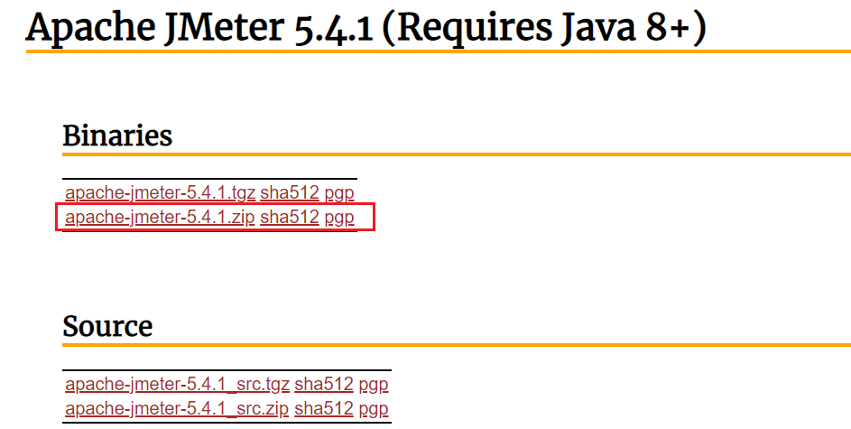

当然，资料也提供了下载好的安装包：

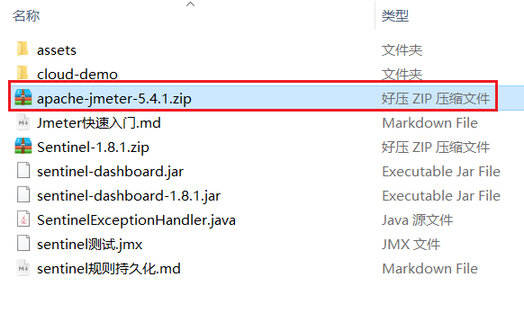

## 2.解压

因为下载的是zip包，解压缩即可使用，目录结构如下：

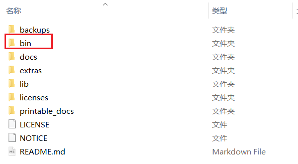

其中的bin目录就是执行的脚本，其中包含启动脚本：

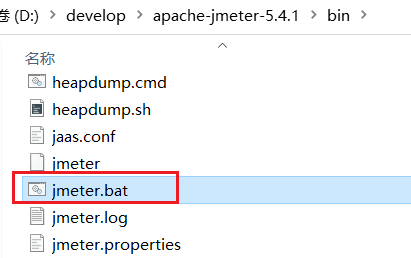

## 3.运行

双击即可运行，但是有两点注意：

- 启动速度比较慢，要耐心等待
- 启动后黑窗口不能关闭，否则Jmeter也跟着关闭了

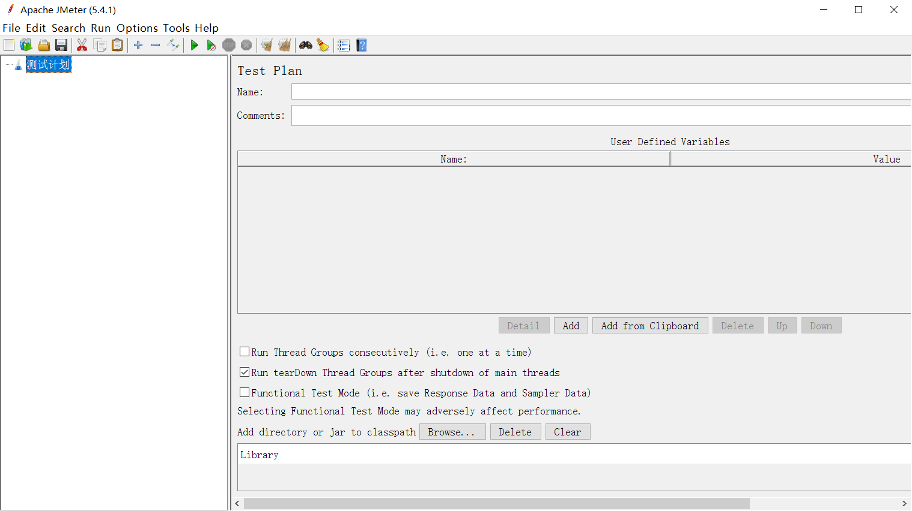

# 二、快速入门

## 1.设置中文语言

默认Jmeter的语言是英文，需要设置：

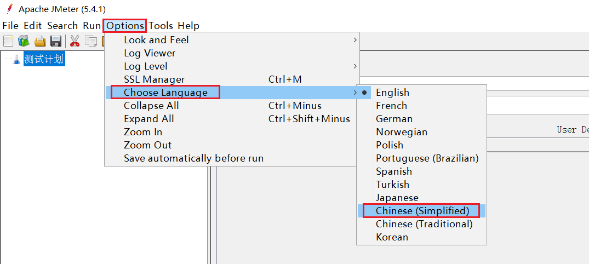

效果：

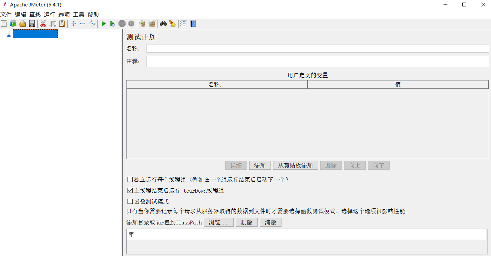

> 注意：上面的配置只能保证本次运行是中文，如果要永久中文，需要修改Jmeter的配置文件

打开jmeter文件夹，在bin目录中找到 jmeter.properties，添加下面配置：

```properties
language=zh_CN
```

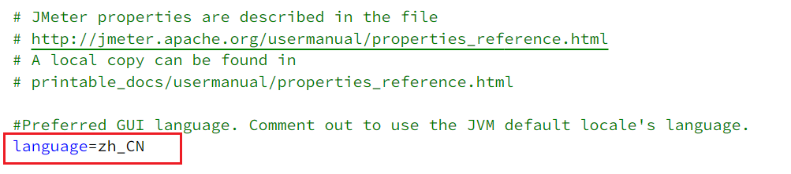

## 2.基本用法

在测试计划上点鼠标右键，选择添加 > 线程（用户） > 线程组：

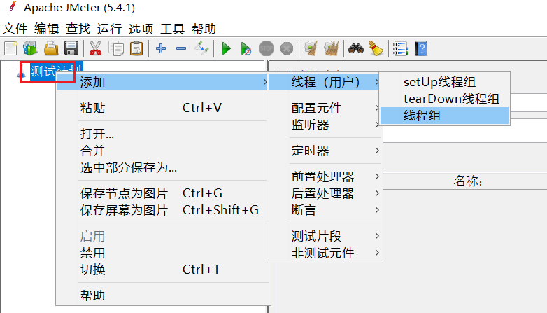

在新增的线程组中，填写线程信息：

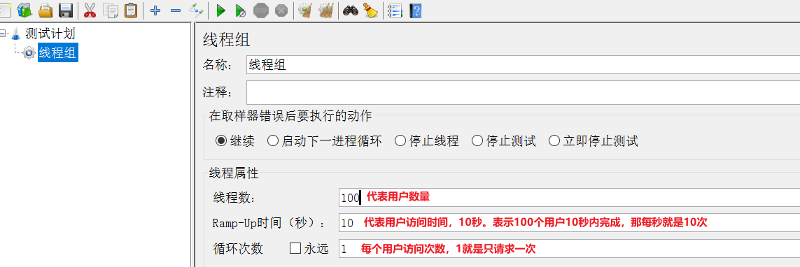

给线程组点鼠标右键，添加http取样器：

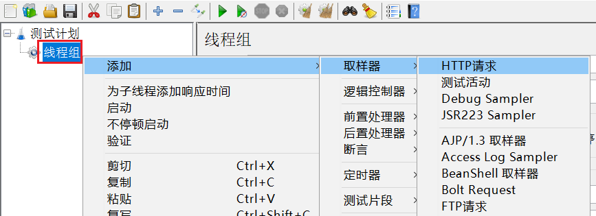

编写取样器内容：

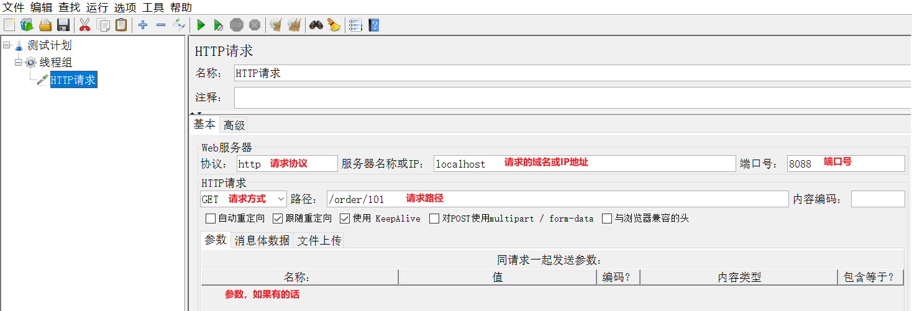

添加监听报告：

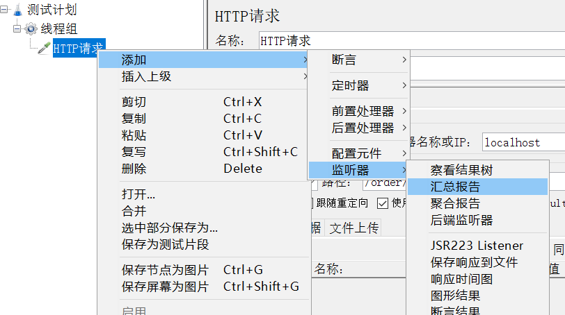

添加监听结果树：

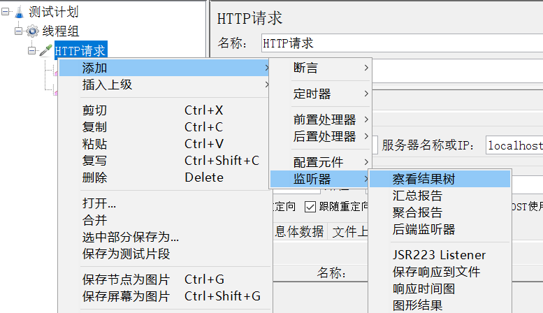

汇总报告结果：

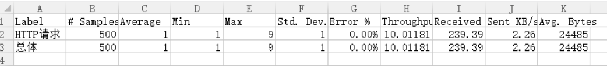

结果树：

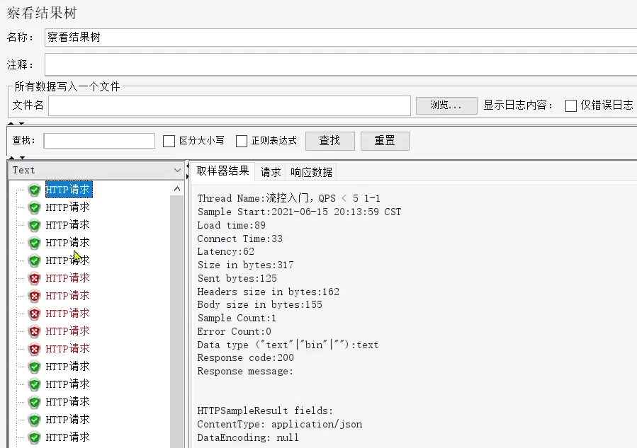
