# 一、项目介绍

## 1.项目概要

> 目标：
>
> 能够说出项目整体业务流程
>

### 1.1.项目背景

2015年国家就提出了"互联网\+"的行动计划，什么是"互联网\+"?


“互联网\+”简单的说就是“互联网\+传统行业”，互联网为传统行业赋能,利用互联网具备的优势特点对传统行业进行优化升级转型，最终推动社会不断地向前发展。

互联网\+的成功案例有很多，像滴滴出行、美团外卖和共享单车等平台将传统出行、餐饮和交通等行业与互联网连接，提供更便捷、经济高效的服务。

云岚到家项目是一个家政服务o2o平台，互联网\+家政是继打车、外卖后的又一个风口，创业者众多，比如：58到家，天鹅到家等，o2o（Online To Offline）是将线下商务的机会与互联网的技术结合在一起，让互联网成为线下交易的前台，同时起到推广和成交的作用。

家政服务o2o市场前景非常好，中国社会的家庭小型化、人口老龄化进程加快，加之二胎政策、三孩政策的推行，创造了大量对于家政服务的潜在需求。艾媒咨询发布《2022\-2023年中国家政服务行业发展剖析及行业投资机遇分析报告》显示，从2015年的2776亿元已提升至2021年的10149亿元，进入万亿级市场行列。

中国家政服务业从业人员数量规模逐年稳步增长


### 1.2.运营模式

我们调研了家政服务O2O平台的运营模式，如下：

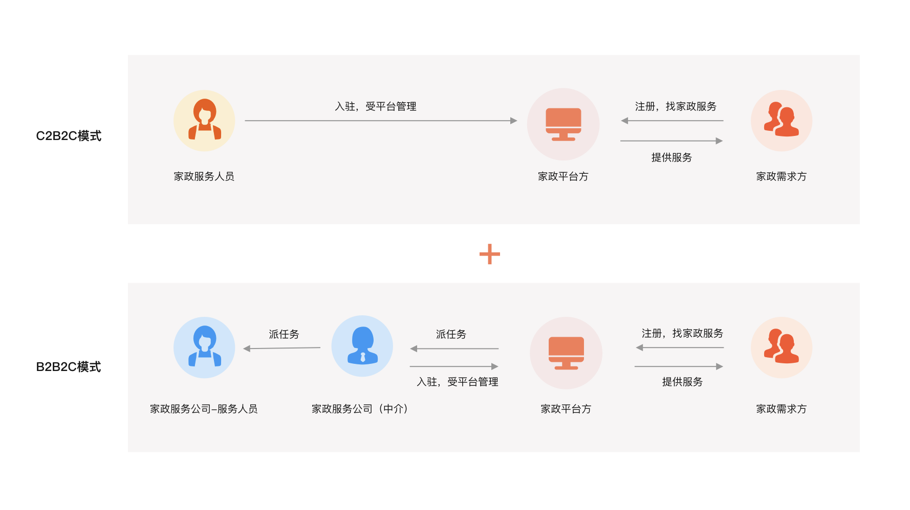

**C2B2C:**

在家政 O2O（Online to Offline，线上到线下）领域中，"Consumer to Business to Consumer"（C2B2C）描述了一个商业模式，消费者不仅可以通过平台获取家政服务，还有机会成为服务提供者。在这个背景下，C2B2C 模式通常指的是：

1.消费者（Consumer）：

最终的家庭用户，他们需要家政服务，例如清洁、保姆、维修等。

2.企业（Business）：

在家政 O2O 中，企业通常是在线平台，提供家政服务的中介。这些平台通过在线渠道为消费者提供了查找、预订、支付等服务，同时也可能为家政服务提供者提供了工作机会。

3.消费者（家政服务提供者）：

在 C2B2C 模式中，一些消费者也可以成为服务的提供者。这些个体可能是独立的家政服务专业人员，他们可以在家政 O2O 平台上注册，提供自己的服务，并被其他需要服务的消费者雇佣。

**B2B2C:**

代表着"Business to Business to Consumer"，即企业到企业到消费者的模式。家政服务平台作为中间商，通过与各种家政服务提供商（家政服务公司）合作，为消费者提供多样化的家政服务选择。

B2B2C与C2B2C的区别是：B2B2C中服务提供者是家政服务中介公司，在C2B2C中是服务提供者是拥有服务技能的服务人员（散户）。

本项目结合了C2B2C和B2B2C模式，个人和家政服务中介都可以通过平台提供家政服务，如下图：

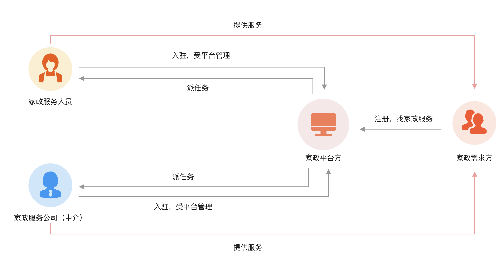

项目包括四个端：用户端\(小程序\)、服务端（app）、机构端\(PC\)、运营管理端\(PC\)，四个端对应四类用户角色：

- 家政需求方：通过用户端小程序完成在线预约下单、支付、评价、投诉、退款等操作。

- 家政服务人员：通过服务端APP完成在线接单、结算等操作。

- 家政服务公司：通过机构端完成在线接单、派单、投诉处理、结算等操作。

- 平台方：通过管理端完成服务人员管理、机构管理、订单管理、财务管理等操作，一笔完成的订单，结算时按照分成比例平台进行抽成。

### 1.3.项目业务流程

项目核心业务流程如下：

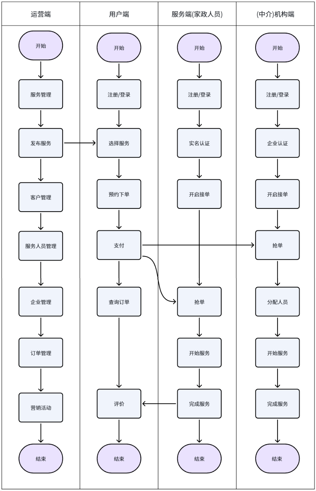

核心流程：

1. 运营端在运营区域上架家政服务，比如：在北京上架 日常保洁、空调维修。

2. 用户端通过定位区域获取当前区域的服务项目，选择家政服务，下单、支付

3. 家政服务人员及家政服务公司（机构）通过平台抢单

4. 家政服务人员现场服务，平台跟踪管理整个服务过程。

5. 服务完成，用户评价、售后服务等。

### 1.4.小结

1.能够说出项目的业务领域

> 你的项目是做什么业务的？
>

2.能够说出项目涉及几类用户角色

> 项目涉及哪些角色？
>

3.能够说出项目整体业务流程

> 说下你的项目的业务流程？
>

## 2.项目内容

> 目标：能够用自己的话介绍自己的项目
>

### 2.1.项目业务模块

项目业务模块图

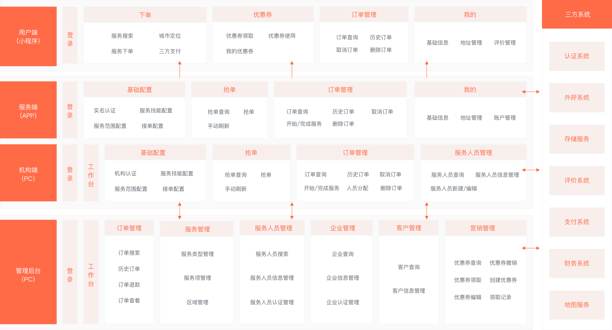

我们根据业务流程去分析各个模块的功能：

- 服务管理：对家政服务项目进行管理，最后在指定区域上架服务后用户可在当前区域购买。

- 下单支付：用户通过小程序完成下单支付，进入小程序首页查询服务，用户选择服务，下单并支付

- 抢单：服务人员和机构进行抢单。首先服务人员和机构设置接单范围、服务技能、开启抢单开关，然后进入抢单界面进行抢单。

- 派单调度：平台根据撮合匹配算法通过任务调度将订单和服务人员进行撮合匹配，促进成交。

- 订单管理：对订单的生命周期进行管理，包括创建订单、取消订单、删除订单、历史订单等。

- 服务人员管理：对服务人员的信息、认证等进行管理。

- 企业管理：对机构的信息、认证进行管理。

- 客户管理：对c端用户的信息、用户的状态等信息进行管理。

- 营销管理：对优惠券活动进行管理。

### 2.2.项目架构

项目是基于Spring Cloud Alibaba框架构建的微服务项目，采用前后端分离模式进行开发，系统架构图如下：

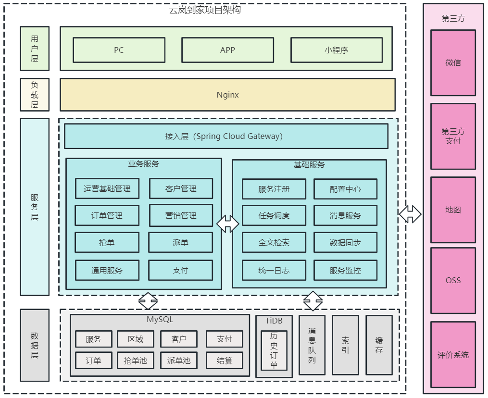

1.用户层：

- 包括四个端：运营端\(PC\)、服务端（APP）、机构端（PC）、用户端（小程序）


2.负载层：

- 反向代理、负载均衡。


3.服务层：包括网关、业务微服务、基础服务。

- 业务微服务：包括运营基础服务、客户管理服务、订单管理服务、抢单服务、派单服务、支付服务等。

- 基础服务：Nacos（服务注册、配置中心）、XXL\-JOB（任务调度）、RabbitMQ（消息队列）、Elasticsearch（全文检索）、Canal（数据同步）、Sentinel（熔断降级、限流）等。

4.数据层：

- MySQL数据库存储：服务信息、区域信息、客户信息、订单信息、支付信息、抢单池、派单池、结算信息等。

- 分库分表：使用ShardingShphere进行分库分表。

- TiDB分布式数据库存储：历史订单信息。

- 消息队列：存储数据同步消息、各类异步消息等。

- 索引：服务信息、服务提供者信息、订单信息等。

- 缓存：服务信息、订单信息、服务单信息等。

项目核心交互流程如下图：

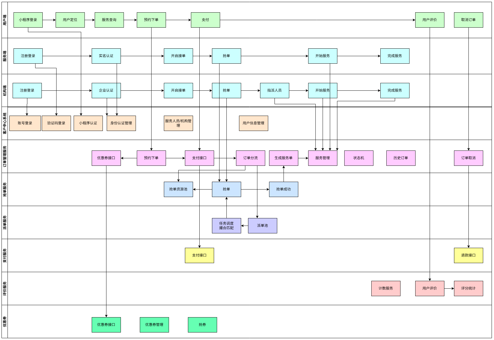

### 2.3.学习收获

前边大概了解了项目情况，学完项目我们可以收获哪些呢？

1. 掌握项目需求分析能力

2. 掌握系统分析与设计的能力

3. 掌握Spring Cloud 在项目中的开发与调优能力

4. 掌握Redis在项目中的应用能力

5. 掌握缓存技术方案的分析与设计能力

6. 掌握Canal\+MQ异构数据同步的开发调试能力

7. 掌握Elasticsearch全文检索与地理搜索的开发能力

8. 掌握ShardingSphere分库分表的方案设计与开发能力

9. 掌握Seata分布式事务控制的开发能力

10. 掌握数据冷热分离技术方案的设计与开发能力

11. 掌握XXL\-JOB\+线程池任务调度方案的设计与开发能力

12. 掌握系统调优与线上故障处理的能力

13. 掌握状态机组件的设计与开发能力

14. 掌握门户业务的设计与开发能力

15. 掌握订单支付业务的系统设计与开发能力

16. 掌握优惠券\&活动管理业务的系统设计与开发能力

17. 掌握秒杀抢购业务的常见设计方案与开发能力

18. 掌握派单调度类业务的系统设计与开发能力

19. 掌握客户管理业务的系统设计与开发能力

20. 掌握活动管理业务的系统设计与开发能力

21. 掌握搜索附近业务的系统设计与开发能力

22. 掌握服务管理\&商品管理业务的系统计与开发能力

23. 掌握统计分析与看板业务的系统设计与开发能力

### 2.4.小结

1.能够说出项目包括哪些业务模块

> 你的项目包括哪些模块？
>

2.能够说出项目用的什么技术架构

> 你的项目用的什么架构？
>

3.能够用自己的话介绍自己的项目

> 说说你的项目吧？
>

4.在面试中被问的第一个问题就是项目介绍。怎么介绍自己的项目呢？

> 从以下几个方面进行项目介绍：
>
> - 项目的背景，包括：是自研还是外包、什么业务、服务的客户群是谁、谁去运营等问题。
> - 项目的核心业务流程或业务模块
>
> - 项目的架构是什么
> - 个人的工作职责，详细说明自己负责的模块，包括模块的设计，所用到的技术方案，以及所遇到的问题和解决方案。
>
> 一个例子：
>
> 我最近参与的项目是我们公司自研的家政服务o2o项目，项目包括四个端：用户端\(小程序\)、服务端（app）、机构端\(PC\)、运营管理端\(PC\)，用户通过平台在线下单、支付，家政服务人员通过平台抢单，平台也会自动派单给服务人员，服务人员接到订单根据预约时间去现场服务，服务完成后用户进行在线评价，以及售后、退款等业务。  项目是基于Spring Cloud Alibaba框架构建的微服务项目，包括了运营基础服务、客户管理服务、订单管理服务、抢单服务、派单服务、优惠券服务、统计服务、评价服务等服务，系统还使用Redis、MQ、XXL\-JOB、Elasticsearch、Canal、MongoDB等中间件。
>
> 我在这个项目中负责了xxx模块的设计与开发\.\.\.
>
> 下边我说下xxx模块的具体设计吧\.\.\.\.

## 3.作业 

参考上边的方法介绍一下你做过的项目：

先写逐字稿，再录制语音，时长5分钟以内。

示例：https://www.bilibili.com/video/BV1j8411N7Bm?p=3&vd_source=81d4489ba9312103debc8ee843169f23

# 二、开发环境搭建

> 目标：理解搭建环境的步骤，参考文档搭建开发环境。
>

参考： [附录-开发环境配置](https://lining-lo.github.io/lining-lo-notes/云岚到家/附录-开发环境配置.html)

最终完成前端和后端搭建，测试通过以下功能：

运营管理前端登录成功。

服务类型查询正常，如下图：

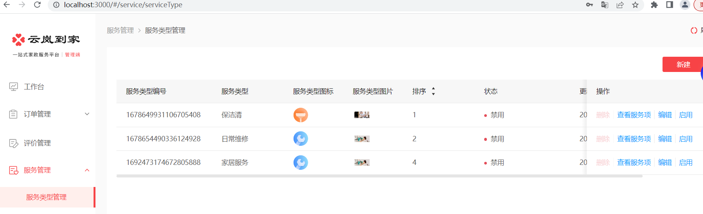

# 三、熟悉项目

进入一家新公司初次接触一个新项目应该从哪里入手呢？怎么做才能快速的去熟悉项目并顺利进入开发工作？

首先去熟悉项目大概情况，包括：项目的背景、项目业务流程、项目架构等。

然后根据自己所分配的业务模块，去理解它的需求及设计。

了解的差不多了就可以进入模块开发，参考同类型的业务模块尝试动手开发。

通常刚到企业中会分配一个独立的模块给你，这个模块一般会有一些业务逻辑但不会太复杂，下边以运营基础管理模块为例进行讲解。

## 1.熟悉需求

> 目标：阅读需求文档，理解基本概念和业务流程。
>

### 1.1.熟悉需求文档

参考 “[附录-需求文档](https://lining-lo.github.io/lining-lo-notes/云岚到家/附录-需求文档.html)” 熟悉需求。

### 1.2.小结

如何去熟悉项目的需求？

根据产品原型、用户需求文档去熟悉项目的需求，如果有测试账号可以登录系统通过测试业务功能去熟悉项目的需求。

1. 什么是服务？

2. 什么是服务类型？

3. 向区域添加服务流程是什么？

4. 区域服务上架的流程是什么？

5. 区域服务下架的流程是什么? 

6. 服务删除的流程是什么？

7. 服务状态转化关系是什么？

## 2.熟悉设计

> 目标：
>
> - 理解运营基本管理模块的表结构。
>
> - 熟悉工程结构。
>
> - 能够对接口进行断点调试。
>

### 2.1.熟悉表结构

根据需求熟悉本模块的核心表，如下图：

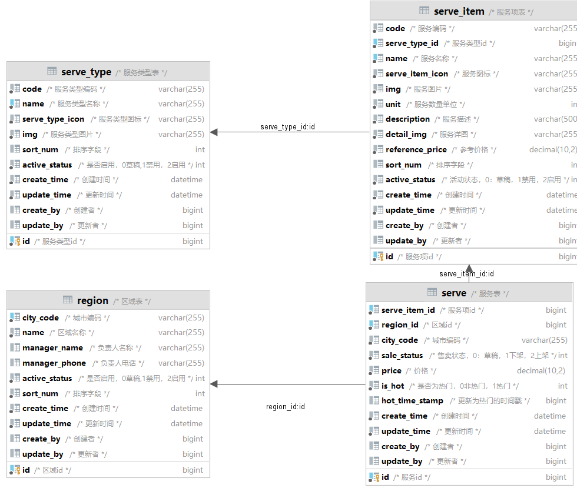

1.serve\_type：服务类型表

2.serve\_item:  服务项表，存储了本平台的家政服务项目

每个服务项都有一个服务类型，一个服务类型下有多个服务项，服务类型与服务项是一对多关系。

3.region：区域表，存储运营地区信息，一般情况区域表行政级别是市。

4.serve:  服务表，存储了各个区域运营的服务及相关信息。

> 注意：这里不要把serve表简单理解为只是区域表和服务项表的中间关系表，因为如果是简单的关联关系表只需记录区域表和服务项表各自的主键Id即可，serve记录的是平台运营服务的信息，凡是与运营相关的信息都要记录在serve表，比如：运营价格。后期也可能会增加其它运营相关的字段。
>

region与serve\_item是什么关系？

> 一个区域下可以设置多个服务项，一个服务项可以被多个区域设置，region与serve\_item是多对多关系。
>

### 2.2.熟悉工程结构

项目的工程列表如下：

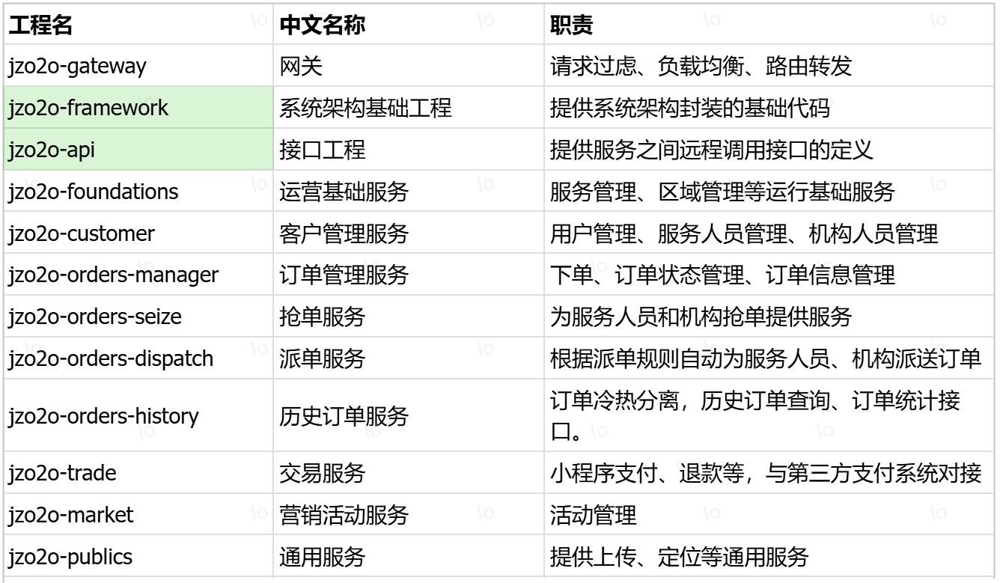

首先熟悉jzo2o\-foundations运营基础服务工程的结构，jzo2o\-foundations工程结构如下图： 

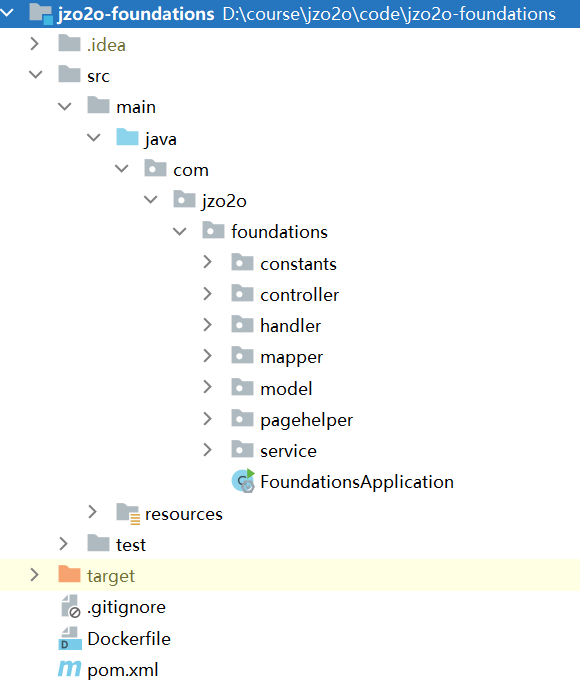

工程目录结构如下：

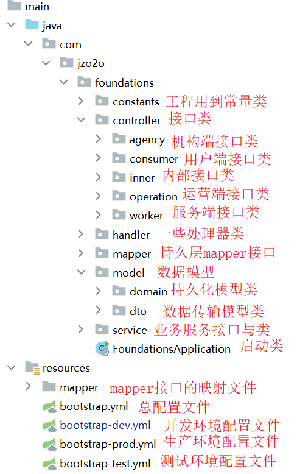

项目依赖：

```XML
 <dependencies>
        <!--服务发现-->
        <dependency>
            <groupId>com.alibaba.cloud</groupId>
            <artifactId>spring-cloud-starter-alibaba-nacos-discovery</artifactId>
        </dependency>
        <!--配置管理-->
        <dependency>
            <groupId>com.alibaba.cloud</groupId>
            <artifactId>spring-cloud-starter-alibaba-nacos-config</artifactId>
        </dependency>
        <!--开启Bootstrap配置文件的支持-->
        <dependency>
            <groupId>org.springframework.cloud</groupId>
            <artifactId>spring-cloud-starter-bootstrap</artifactId>
        </dependency>
        <!--jzo2o-mvc在jzo2o-framework下，针对web开发的依赖-->
        <dependency>
            <groupId>com.jzo2o</groupId>
            <artifactId>jzo2o-mvc</artifactId>
        </dependency>
        <!--knife4j用于生成swagger文档-->
        <dependency>
            <groupId>com.jzo2o</groupId>
            <artifactId>jzo2o-knife4j-web</artifactId>
        </dependency>

        <!--<dependency>-->
        <!--<groupId>com.jzo2o</groupId>-->
        <!--<artifactId>jzo2o-es</artifactId>-->
        <!-- </dependency>-->

        <!--单元测试-->
        <dependency>
            <groupId>org.springframework.boot</groupId>
            <artifactId>spring-boot-starter-test</artifactId>
            <scope>test</scope>
        </dependency>
        <!--api接口,定义了服务之间的远程调用接口-->
        <dependency>
            <groupId>com.jzo2o</groupId>
            <artifactId>jzo2o-api</artifactId>
        </dependency>
        <!--序列化工具库-->
        <dependency>
            <groupId>com.fasterxml.jackson.core</groupId>
            <artifactId>jackson-databind</artifactId>
        </dependency>

        <dependency>
            <groupId>com.jzo2o</groupId>
            <artifactId>jzo2o-redis</artifactId>
        </dependency>
        <!--<dependency>-->
        <!--<groupId>com.jzo2o</groupId>-->
        <!--<artifactId>jzo2o-canal-sync</artifactId>-->
        <!--</dependency>-->
        <!--jzo2o-mysql定义在jzo2o-framework工程，定义了持久层相关的依赖-->
        <dependency>
            <groupId>com.jzo2o</groupId>
            <artifactId>jzo2o-mysql</artifactId>
        </dependency>
        <!--<dependency>-->
        <!--<groupId>com.jzo2o</groupId>-->
        <!--<artifactId>jzo2o-xxl-job</artifactId>-->
        <!--</dependency>-->
    </dependencies>
```

- 持久层：MySQL数据库，mybatis\-plus框架，com\.github\.pagehelper分页组件
- 中间件：Redis、Elasticsearch、xxl\-job
- 服务层：通过Spring进行事务控制，redisson分布式锁、Spring Cache缓存框架
- web层:  SpringMVC框架（基于SpringBoot开发）
- web容器：undertow（Undertow 是一个采用 Java 开发的灵活的高性能 Web 服务器，红帽公司的开源产品），高并发场景下undertow的性能更好。


### 2.3.接口测试

搞清楚了项目的工程结构再通过一个具体的接口去读项目的代码。

具体可以把工程启动起来通过接口测试深入源码搞清楚执行流程。

启动jzo2o\-foundations工程。

通过swagger接口文档去熟悉模块的接口，通过测试接口去理解接口的整个交互流程。

打开接口文档：http://localhost:11509/foundations/doc.html

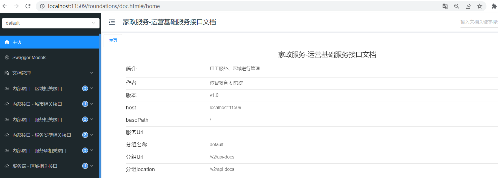

通过左侧菜单找到“运营端\-服务类型相关接口”，如下图：

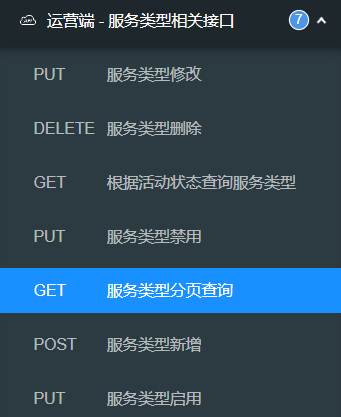

点击“服务类型分页查询”打开接口文档，如下图：

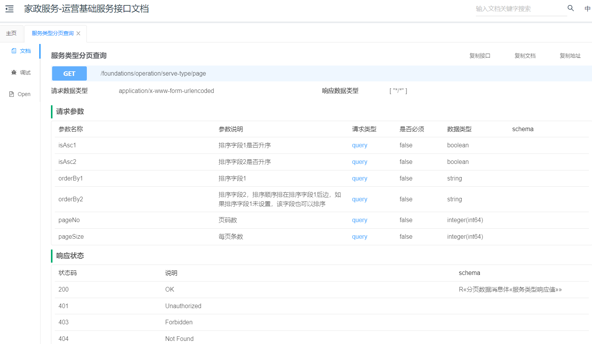

找到接口地址：/foundations/operation/serve\-type/page

- /foundations：微服务的content\-path路径

- /operation：表示给运营端使用的接口

- /serve\-type/page：具体的接口地址


如何定位到接口对应的代码，通过路径'/operation/serve\-type/page'搜索即可，搜索过程参考下图：

Ctrl\+shift\+N

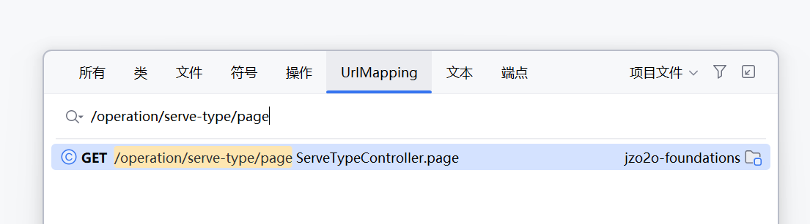

输入关键字如下图，找到了具体的接口类：

继续在ServeTypeController\.java类中找/page接口，如下图：

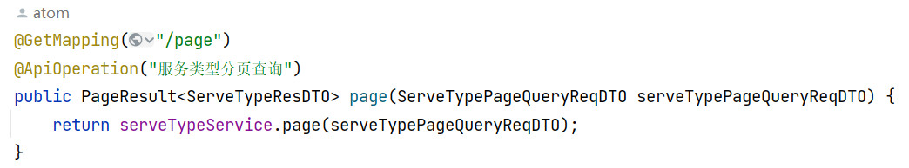

下边debug运行工程，跟踪接口执行的流程：

首先打上断点，如下图：

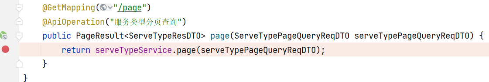

debug运行jzo2o\-foundations工程。

下边通过swagger接口文档测试该接口

进入“调试”窗口，点击“发送”

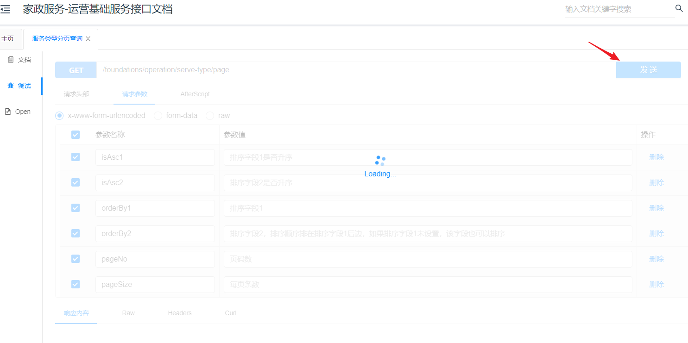

此时代码执行到断点处

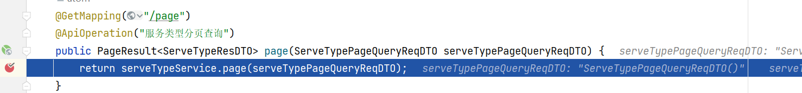

进入service方法继续打断点跟踪：

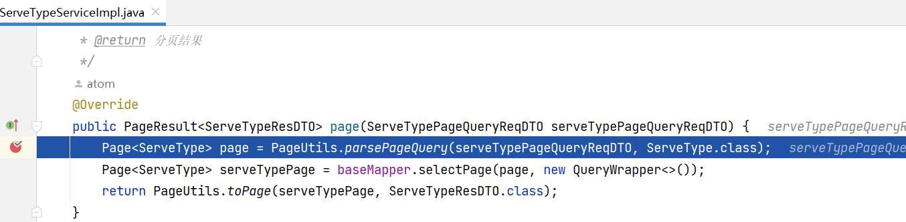

跟踪请求参数：

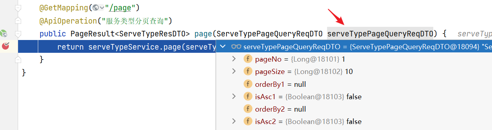

放行继续执行，测试结束，观察响应结果

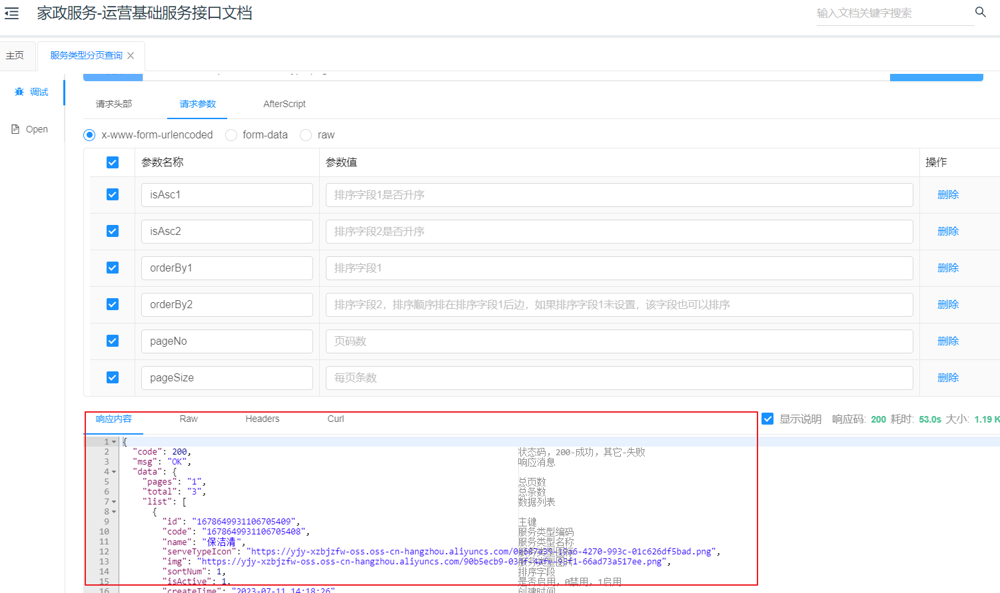

观察idea控制台输出的SQL执行语句

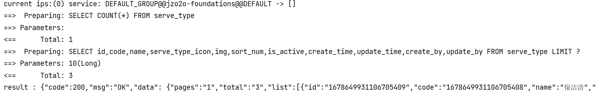

### 2.4.小结

1.如何去熟悉系统的设计？

> 根据需求去熟悉本模块的核心表的结构，核心表搞清楚了再去熟悉其它表。
>
> 熟悉项目工程结构，搞清楚用的基础框架是开源的还是自研的，通过断点测试接口的执行流程阅读读项目的代码。
>
> 具体可以把工程启动起来通过接口测试深入源码搞清楚执行流程。
>

2.如何对现有接口进行断点调试?

3.运营基础工程用到哪些技术？

# 四、开发区域服务模块

## 1.查询区域服务

### 1.1.接口设计

> 目标：设计查询区域服务接口。
>

**梳理接口**

在定义接口前先梳理本模块涉及哪些接口，根据梳理出的接口制定工作计划。

通常对于前后端交互的接口根据界面原型、需求文档去梳理。

通过阅读需求文档在区域服务模块包括以下接口：

1. 区域服务分页查询接口

2. 区域服务新增接口

3. 区域服务删除接口

4. 区域服务价格修改接口

5. 区域服务设置热门接口

6. 区域服务取消热门接口

7. 区域服务上架接口

8. 区域服务下架接口

**接口设计**

下边设计区域服务分页查询接口，企业中前后分离开发通常由java程序员设计接口，设计完成提供接口文档给前端工程师。

如何设计一个接口？

我们根据最终提供的接口文档看看需要设计哪些内容。

接口设计信息如下：

- 接口路径：GET /foundations/operation/serve/page

- 请求数据类型 application/x\-www\-form\-urlencoded

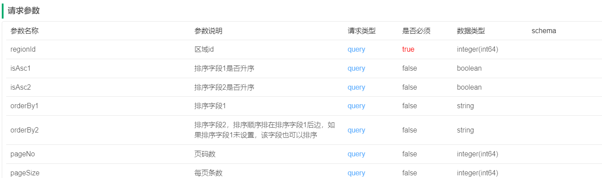

- 响应参数：

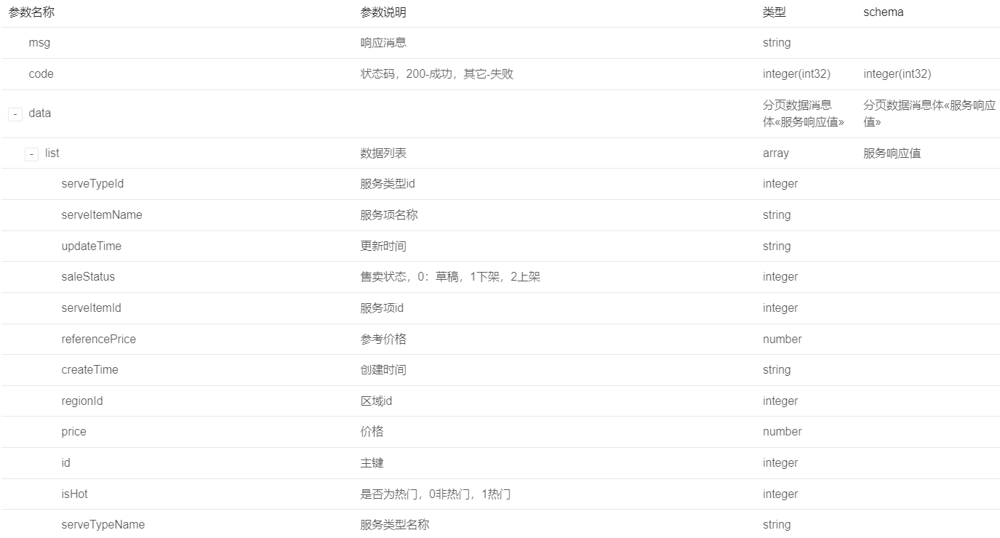


首先明确该接口是一个前后端交互接口，该接口由前端通过HTTP协议进行调用，前端去调用接口需要知道以下内容：

1.HTTP请求方法

2.接口路径

3.请求参数

- 请求参数类型

- 请求参数内容

4.响应结果

- 响应结果消息

- 响应结果状态码

- 响应结果数据内容

所以我们设计接口需要设计这些内容。

1.HTTP请求方法

根据RESTful规范:

- 查询方法用GET

- 新增方法用POST

- 修改方法用PUT

- 删除方法用DELETE

本接口是一个分页查询接口，查询条件我们用GET。

2.接口路径

定义为RESTful风格的路径。

接口路径为：/foundations/operation/serve/page 

可以在类上边使用@RequestMapping指定该类中接口的路径的基础路径。

在方法中指定具体的路径。

3.请求参数类型

请求参数类型

常用的有：

- json格式：

> application/json，传递json格式字符串，当传递的参数是属于一个对象的属性时可用此格式，比如：新增、修改时通常传递的数据是某个对象的信息就可以使用此格式。
>

- 表单格式：

> application/x\-www\-form\-urlencoded，传递key/value串，就是在url后通过？和\&进行拼接的参数，比如：
>
> /foundations/operation/serve/page?pageNo=1\&pageSize=10
>
> 当传递的参数比较杂且不属于某个特定的对象时使用此格式，本接口使用application/x\-www\-form\-urlencoded格式。

- 请求参数内容

>  请求参数的内容根据需求文档和界面原型去识别。
>
> 分页式查询首先有当前页码和每页显示记录数。
>
> 对于查询类的接口还有常用的参数有：排序方式、排序字段。
>
> 再根据需求的梳理，查询某个区域下的服务需要传递一个区域id。
>
> 请求参数如下：
>
> 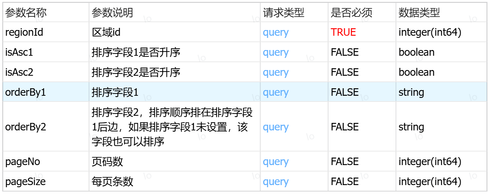

4.响应结果

- 响应结果类型

> 常见的类型有：text/html、text/plain、application/json等。
>
> 本项目统一使用application/json
>

- 响应结果状态码

> HTTP状态码是服务器返回给客户端的数字代码（三位数字），共分为五类：
>
> 1xx: 表示服务器接收到了客户端请求并正在处理
>
> 2xx: 表示成功状态码
>
> 3xx：表示重向定状态码
>
> 4xx：表示客户端错误状态码
>
> 5xx: 表示服务端错误状态码
>
> 当服务端处理成功返回200，其它表示失败。

- 响应结果内容


> 分页查询通用的响应内容有：数据列表、总页数、总记录数
>
> 数据列表中需要分析具体的属性，根据界面原型进行分析：
>
> 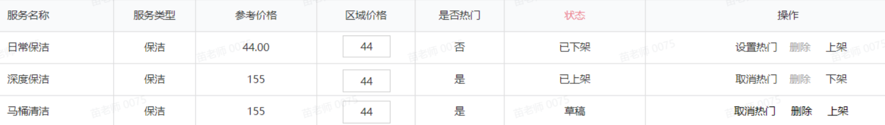
>
>   属性包括：
>
> 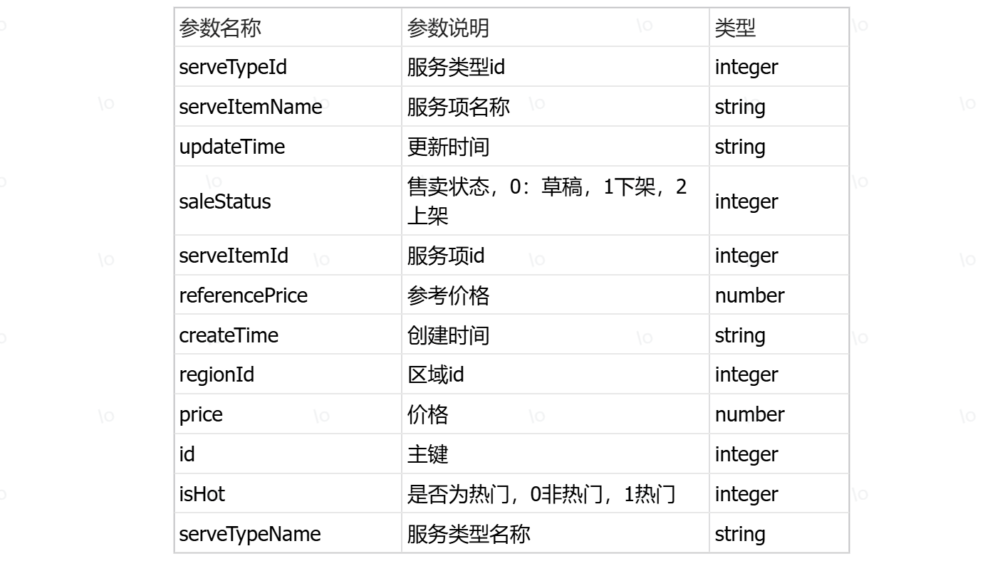
>
>   注意，本项目中所有分页查询通用的响应内容如下：
>
>   msg、code、 data、total、pages是固定的。
>
>   data中List数据的内容对于不同的分页查询会不一样。
> 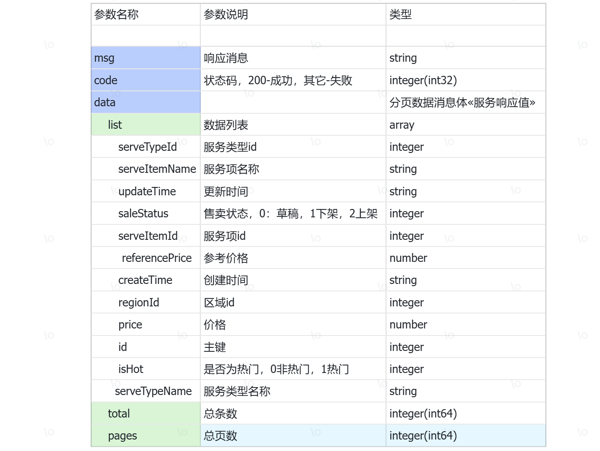
>
>   响应示例
>
> ```json
> {
>     "msg": "OK",
>     "code": 200,
>     "data": {
>         "list": [
>             {
>                 "serveTypeId": 0,
>                 "serveItemName": "",
>                 "updateTime": "",
>                 "saleStatus": 0,
>                 "serveItemId": 0,
>                 "referencePrice": 0,
>                 "createTime": "",
>                 "regionId": 0,
>                 "price": 0,
>                 "id": 0,
>                 "isHot": 0,
>                 "serveTypeName": ""
>             }
>         ],
>         "total": 0,
>         "pages": 0
>     }
> }
> ```

**小结**

设计一个接口需要设计哪些内容？

### 1.2.接口定义

> 目标：掌握定义接口的步骤。
>

具体的代码实现可以找一些现有的类参考，比如：ServeTypeController类

> 参考项目中已有代码，找到相似功能的代码来参考，来编写自己的代码，这种方式就是比葫芦画瓢，是在企业中快速熟悉已有代码编程风格的捷径。
> 

**代码生成工具**

通常一个接口需求明确后从持久层开始开发。

对于一个新模块需要使用工具生成模型类、mapper接口、mapper映射文件等，下边介绍一个工具用于自动生成代码。 

使用MybatisPlus插件自动生成代码

1.安装插件

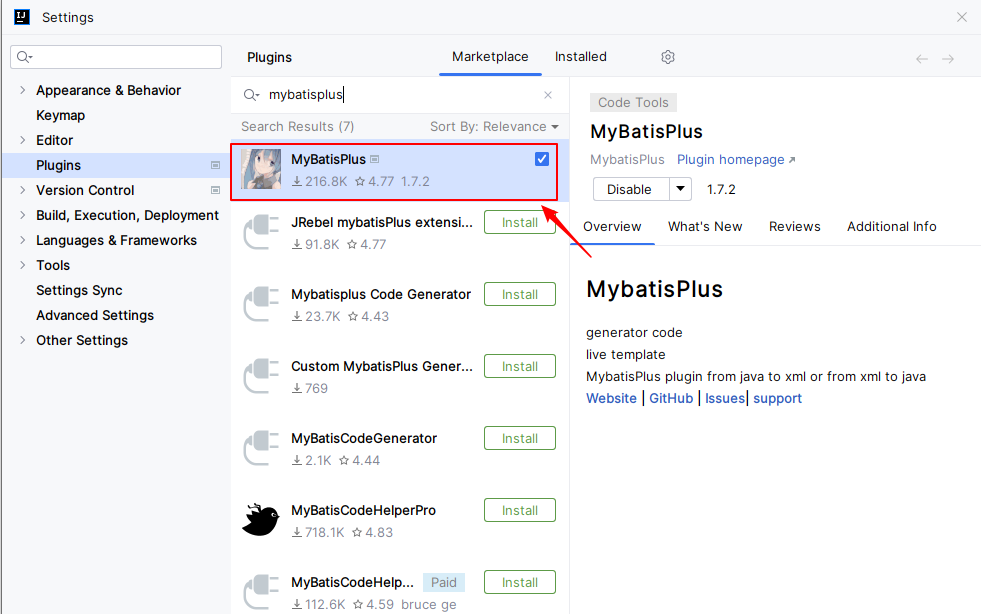

2\.重启IDEA，连接mysql

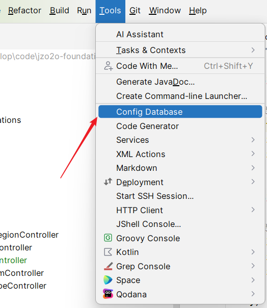

配置连接的数据库

输入连接字符串：jdbc:mysql://192\.168\.101\.68:3306/jzo2o\-foundations?useSSL=false\&serverTimezone=UTC 

账号和密码

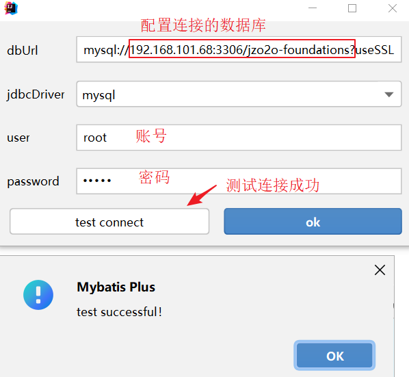

3.配置代码生成规则

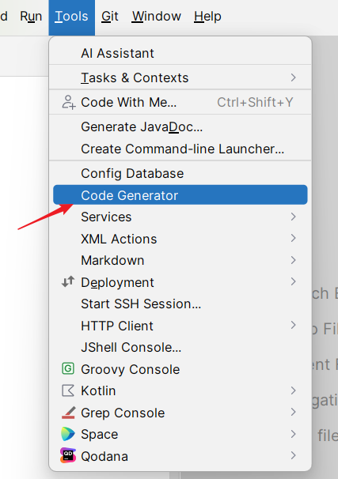

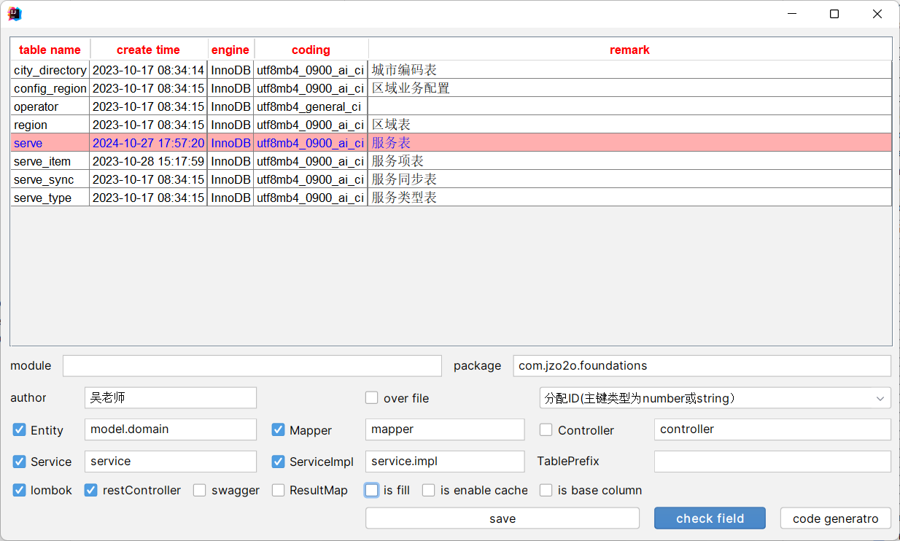

1）选择表：上图选择serve表。

2）设置生成代码的根目录：上图设置generator

3）设置包路径：上图设置为com\.jzo2o\.foundations

4）主键生成策略：根据表中主键的生成策略进行选择，支持的主键生成策略如下图：

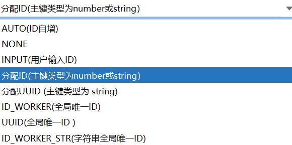

本项目使用的MyBatisPlus版本支持前5个，对应MyBatisPlus源码如下：

```Java
public enum IdType {
    AUTO(0),
    NONE(1),
    INPUT(2),
    ASSIGN_ID(3),
    ASSIGN_UUID(4);
```

- AUTO：基于数据库的自增主键

- NONE: 不设置id生成策略

- INPUT:用户手工输入id

- ASSIGN\_ID:雪花算法生成id\(可兼容数值型与字符串型\)

- ASSIGN\_UUID:以UUID生成算法作为id生成策略

本项目使用ASSIGN\_ID方式，即分配ID。

5）勾选要生成的类及包路径（Entity、Mapper、Service、ServiceImpl）。由于Controller我们自己写了，所以这里就不再勾选。

6）勾选是否生成lombok注解、restController注解、swagger注解等。

点击“check field”选择表中的字段。

点击“code generatro”生成代码。

生成成功在项目工程根目录有一个generator目录，里边为生成的代码，如下图：

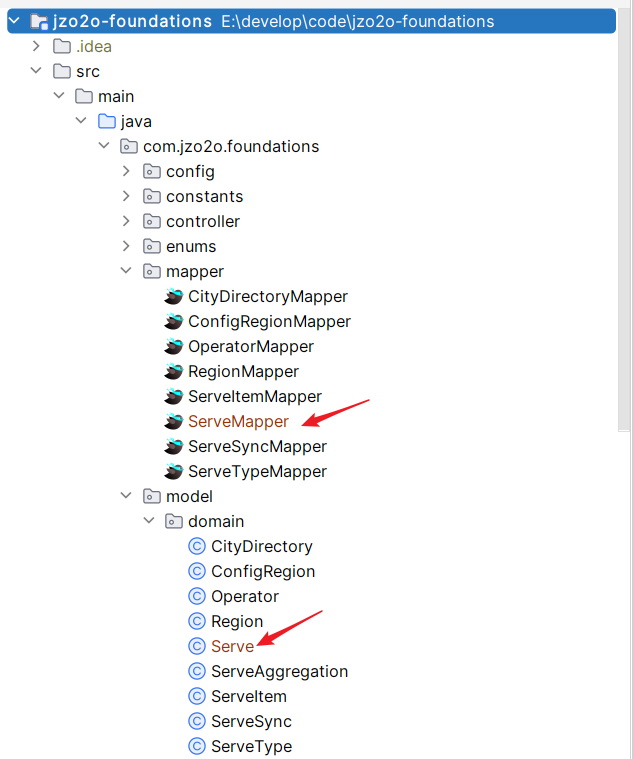

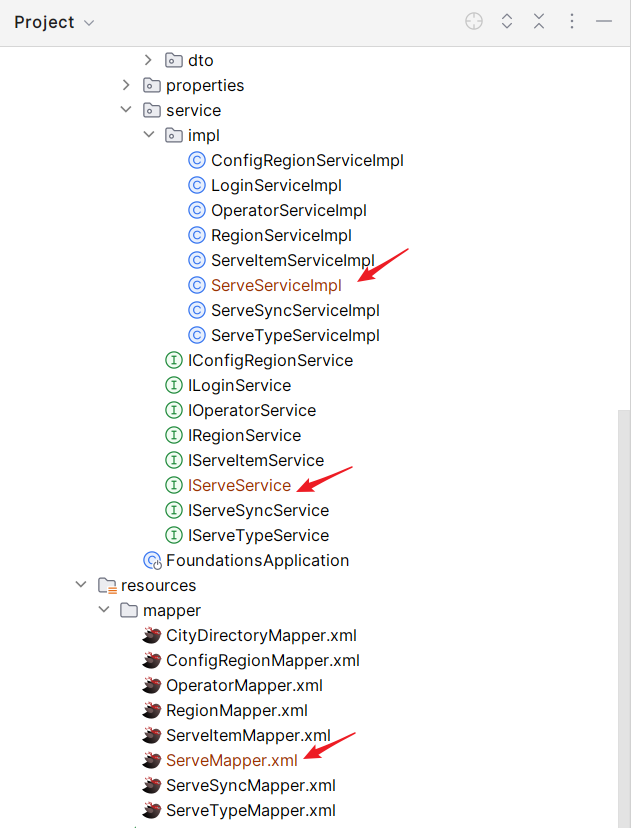

对生成的代码根据自己的需求稍加修改，修改后拷贝到工程相应的包下即可。

**编写controller方法**

根据接口设计的内容编写controller方法，最后通过swagger生成接口文档。

```Java
package com.jzo2o.foundations.controller.operation;


import com.jzo2o.common.model.PageResult;
import com.jzo2o.foundations.model.dto.request.ServePageQueryReqDTO;
import com.jzo2o.foundations.model.dto.response.ServeResDTO;
import io.swagger.annotations.Api;
import io.swagger.annotations.ApiOperation;
import org.springframework.validation.annotation.Validated;
import org.springframework.web.bind.annotation.GetMapping;
import org.springframework.web.bind.annotation.RequestMapping;
import org.springframework.web.bind.annotation.RestController;

@RestController("operationServeController")
@RequestMapping("/operation/serve")
@Api(tags = "运营端 - 区域服务相关接口")
public class ServeController {

    @GetMapping("/page")
    @ApiOperation("区域服务分页查询")
    public PageResult<ServeResDTO> page(ServePageQueryReqDTO servePageQueryReqDTO) {
        PageResult<ServeResDTO> pageResult = serveService.pageList(reqDTO);

        return pageResult;
    }
}
```

> 说明如下：
>
> 当请求参数格式为json需要在方法参数前加@RequestBody注解，这里请求参数类型为from表单格式不用添加此注解。
>
> 分页查询参数类型统一继承PageQueryDTO类型。
>
> 分页查询结果统一使用PageResult类。
>

### 1.3.Service开发

**定义service接口**

service接口是提供controller调用，service接口的参数由controller传入通常controller方法将它的形参直接传入service方法，对于通用的service方法则需要定义更通用的参数，service方法的返回值类型通常可以直接定义为controller方法的返回值类型。

定义如下：

```Java
package com.jzo2o.foundations.service;

import com.baomidou.mybatisplus.extension.service.IService;
import com.jzo2o.common.model.PageResult;
import com.jzo2o.foundations.model.domain.Serve;
import com.jzo2o.foundations.model.dto.request.ServePageQueryReqDTO;
import com.jzo2o.foundations.model.dto.response.ServeResDTO;

public interface IServeService extends IService<Serve> {

    /**
     * 分页查询服务列表
     * @param servePageQueryReqDTO 查询条件
     * @return 分页结果
     */
    PageResult<ServeResDTO> page(ServePageQueryReqDTO servePageQueryReqDTO);
}
```

**定义service实现类**

这里我们使用的Mybatis\-Plus提供的ServiceImpl类，如下代码，在此类中有baseMapper，baseMapper即是ServeMapper实例。

```Java
package com.jzo2o.foundations.service.impl;

import com.baomidou.mybatisplus.extension.service.impl.ServiceImpl;
import com.jzo2o.common.model.PageResult;
import com.jzo2o.foundations.mapper.ServeMapper;
import com.jzo2o.foundations.model.domain.Serve;
import com.jzo2o.foundations.model.dto.request.ServePageQueryReqDTO;
import com.jzo2o.foundations.model.dto.response.ServeResDTO;
import com.jzo2o.foundations.service.IServeService;
import com.jzo2o.mysql.utils.PageHelperUtils;
import org.springframework.stereotype.Service;

import java.util.List;

@Service
public class ServeServiceImpl extends ServiceImpl<ServeMapper, Serve> implements IServeService {

    /**
     * 分页查询
     *
     * @param servePageQueryReqDTO 查询条件
     * @return 分页结果
     */
    @Override
    public PageResult<ServeResDTO> page(ServePageQueryReqDTO servePageQueryReqDTO) {
        //通过baseMapper调用queryServeListByRegionId方法
        
    }

}
```

如何实现分页查询呢？

我们可以参考现有service类实现方法。

分别阅读ServeTypeServiceImpl中的分页查询方法和ServeItemServiceImpl中的分页查询方法。

我们发现两个类中的分页查询方法不一样

ServeTypeServiceImpl的方法如下：

```Java
/**
 * 分页查询
 *
 * @param serveTypePageQueryReqDTO 查询条件
 * @return 分页结果
 */
@Override
public PageResult<ServeTypeResDTO> page(ServeTypePageQueryReqDTO serveTypePageQueryReqDTO) {
    Page<ServeType> page = PageUtils.parsePageQuery(serveTypePageQueryReqDTO, ServeType.class);
    this.page(page);
    return PageUtils.toPage(page, ServeTypeResDTO.class);
}
```

ServeTypeServiceImpl中的分页方法使用的是mybatis\-plus自带的分页方法，通过selectPage方法实现分页。

ServeItemServiceImpl中的分页方法如下：

```Java
/**
 * 分页查询
 *
 * @param serveItemPageQueryReqDTO 查询条件
 * @return 分页结果
 */
@Override
public PageResult<ServeItemResDTO> page(ServeItemPageQueryReqDTO serveItemPageQueryReqDTO) {
    return PageHelperUtils.selectPage(serveItemPageQueryReqDTO,
            () -> baseMapper.queryList(serveItemPageQueryReqDTO.getServeTypeId(),
                    serveItemPageQueryReqDTO.getName(),
                    serveItemPageQueryReqDTO.getActiveStatus()));
}
```

ServeItemServiceImpl中的分页方法使用的是com\.github\.pagehelper分页组件。

我们应该使用哪种方法呢？

第一种：mybatis\-plus自带的分页方法，通过调用selectPage方法实现分页，适用于通过QueryWrapper拼装SQL。

第二种：pagehelper分页组件适用于自定义sql的分页查询。

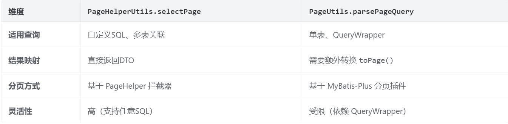

这里我们自定义了查询当前区域服务的sql，所以适用第二种分页方法。

我们先照葫芦画瓢实现service：

```Java

/**
 * 分页查询服务列表
 * @param servePageQueryReqDTO 查询条件
 * @return 分页列表
 */
@Override
public PageResult<ServeResDTO> page(ServePageQueryReqDTO servePageQueryReqDTO) {
    //调用mapper查询数据，这里由于继承了ServiceImpl<ServeMapper, Serve>，使用baseMapper相当于使用ServeMapper
        List<ServeResDTO> serveList = serveMapper.queryServeListByRegionId(reqDTO.getRegionId());
    PageResult<ServeResDTO> pageResult = PageHelperUtils.selectPage(reqDTO, () -> serveMapper.queryServeListByRegionId(reqDTO.getRegionId()));
    return pageResult;
}
```

Mapper:

```java
/**
 * 根据区域id查询服务列表
 *
 * @param regionId 区域id
 * @return 服务列表
 */
List<ServeResDTO> queryServeListByRegionId(@Param("regionId") Long regionId);
```

```SQL
<select id="queryServeListByRegionId" resultType="com.jzo2o.foundations.model.dto.response.ServeResDTO">
    SELECT
        serve.id,
        serve.sale_status,
        serve.serve_item_id,
        item.name AS serve_item_name,
        item.serve_type_id,
        serve.region_id,
        item.reference_price,
        serve.price,
        serve.is_hot,
        serve.create_time,
        serve.update_time,
        type.name AS serve_type_name
    FROM
        serve
            inner JOIN serve_item AS item ON serve.serve_item_id = item.id
            inner JOIN serve_type AS type ON item.serve_type_id = type.id
    WHERE
        serve.region_id = #{regionId}
</select>
```

**小结**

项目的分页查询是怎么实现的？

**测试**

重启服务，通过接口文档工具进行测试。

遇到问题在controller、service中打断点进行调试。

测试时注意请求参数填写是否正确，下边是测试结果

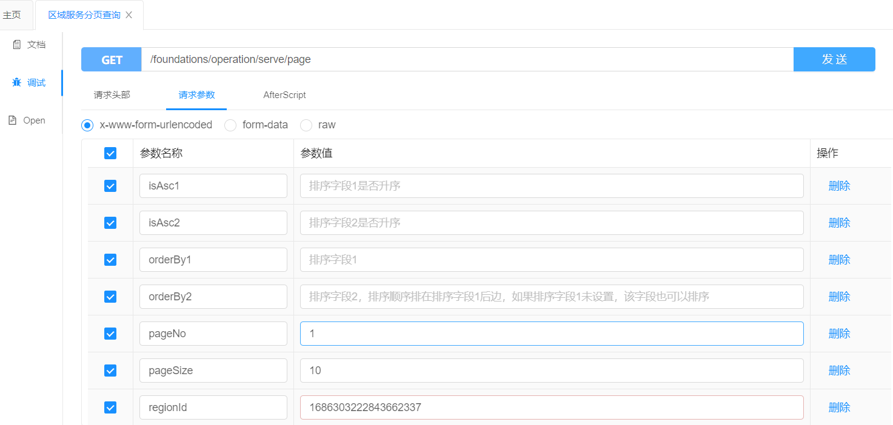

返回结果：

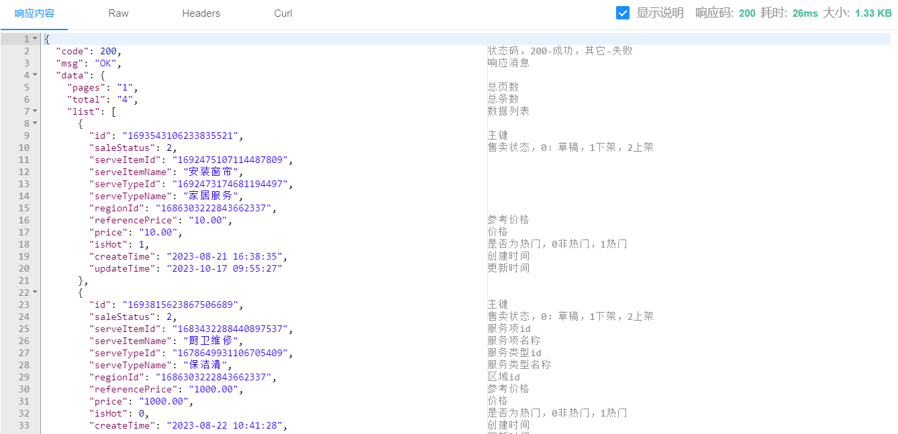

通过修改分页条件测试分页查询结果：

修改为一页显示2条记录，下边查询第一页：

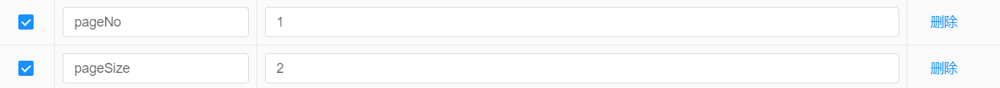

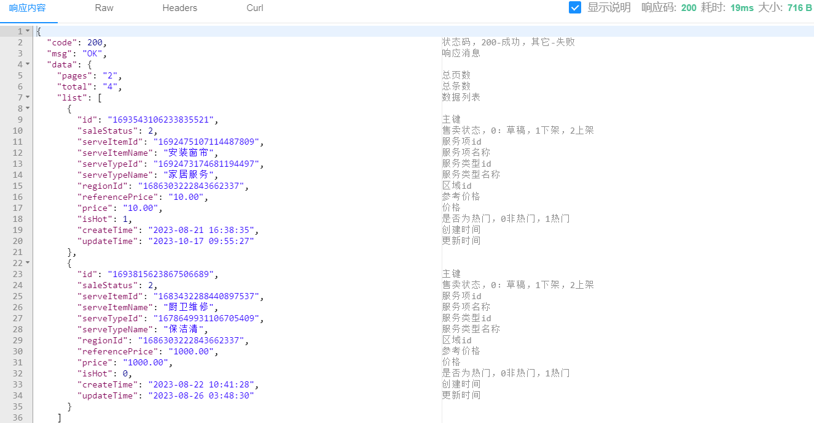

再查询第二页：


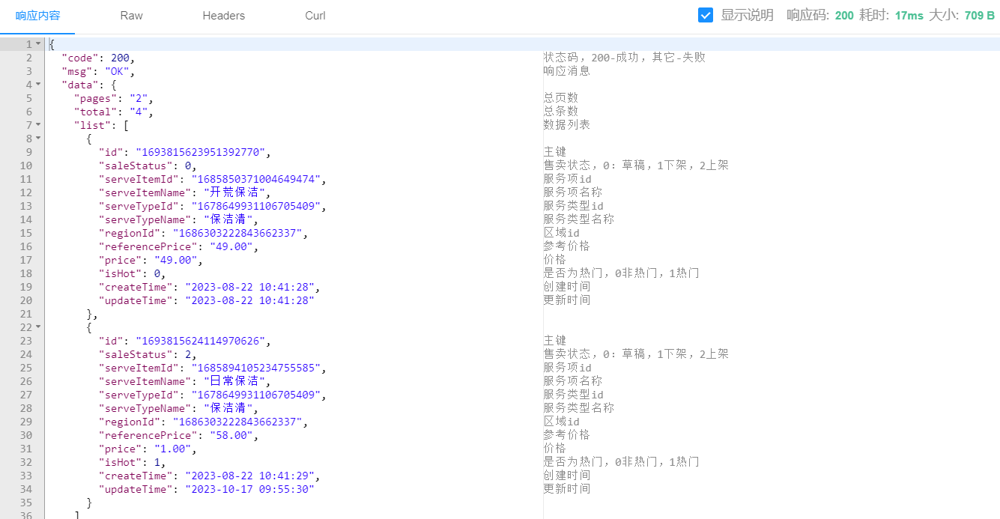

使用com\.github\.pagehelper分页插件实现分页功能，下边介绍它的执行原理（了解即可）。

PageHelperUtils是项目封装的一个工具类，进入selectPage方法，调用PageHelper\.startPage方法设置分页参数，通过一层一层进入源码，最终将分页参数设置到ThreadLocal\<Page\>*LOCAL\_PAGE*=newThreadLocal\(\); 中。

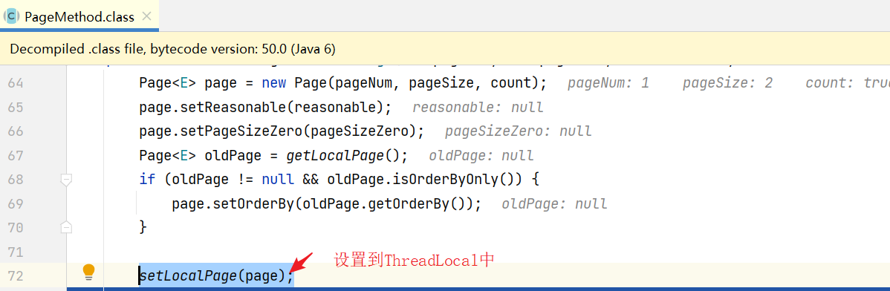

通过PageInterceptor拦截器拦截 MyBatis的Executor 的 query\(\) 方法得到原始的sql语句，首先得到count总数，然后从newThreadLocal中取出分页参数，在原始sql语句中添加分页参数查询分页数据。

部分源码截图如下：

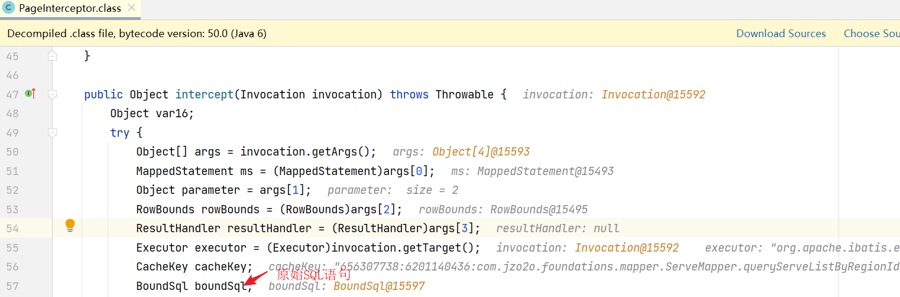

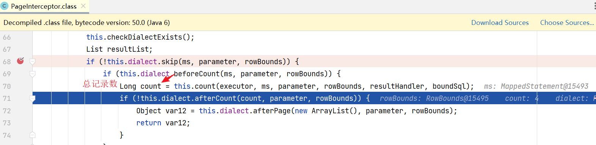

### 1.4.前后端联调

前后端联调是一种类似生产环境的测试，通过前端请求后端接口测试业务功能。

**启动前后端**

启动foundations服务。

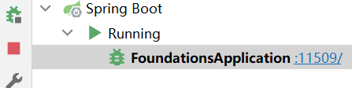

启动前端工程，在项目开发环境配置中我们已经将前端环境配置完成。

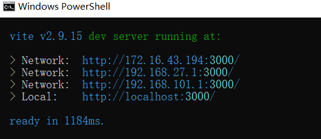

**前后端联调**

根据业务操作流程进行测试。

进入运营管理端，点击“区域管理”菜单，点击“设置服务”


区域服务列表如下图：


程序员在前后端测试时需要跟踪前后端交互数据判断精确判断测试结果及测试问题。

通过浏览器网络记录进行跟踪：

请求参数：

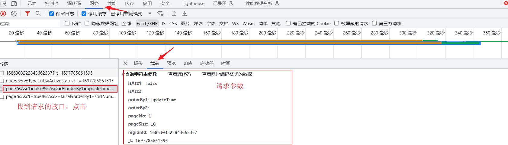

响应结果：

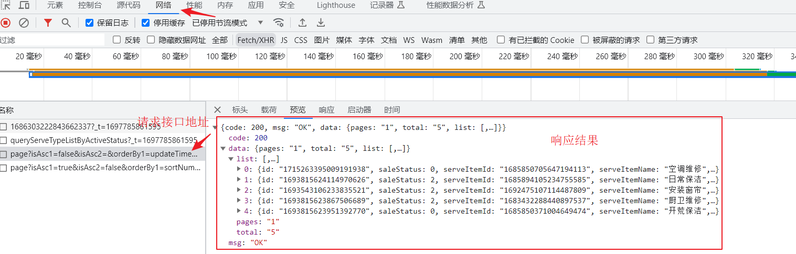

## 2.添加区域服务

### 2.1.接口定义

**接口设计**

下边设计添加区域服务接口，重点设计：传入参数类型、参数内容、响应结果内容。

根据界面原型梳理操作流程：

首先进入某个区域的服务列表:


点击添加服务,如下图：


选择要添加到区域中的服务，点击“添加”按钮。

最终向serve表添加数据，表结构如下：

```sql
CREATE TABLE `serve` (
         `id` bigint NOT NULL COMMENT '服务id',
         `serve_item_id` bigint NOT NULL COMMENT '服务项id',
         `region_id` bigint NOT NULL COMMENT '区域id',
         `city_code` varchar(255) CHARACTER SET utf8mb4 COLLATE utf8mb4_0900_ai_ci NOT NULL COMMENT '城市编码',
         `sale_status` int NOT NULL DEFAULT '0' COMMENT '售卖状态，0：草稿，1下架，2上架',
         `price` decimal(10,2) NOT NULL COMMENT '价格',
         `is_hot` int NOT NULL DEFAULT '0' COMMENT '是否为热门，0非热门，1热门',
         `hot_time_stamp` bigint DEFAULT NULL COMMENT '更新为热门的时间戳',
         `create_time` datetime NOT NULL DEFAULT CURRENT_TIMESTAMP COMMENT '创建时间',
         `update_time` datetime NOT NULL DEFAULT CURRENT_TIMESTAMP ON UPDATE CURRENT_TIMESTAMP COMMENT '更新时间',
         `create_by` bigint DEFAULT NULL COMMENT '创建者',
         `update_by` bigint DEFAULT NULL COMMENT '更新者',
         PRIMARY KEY (`id`) USING BTREE,
         KEY `区域id` (`region_id`) USING BTREE,
         KEY `服务id` (`serve_item_id`) USING BTREE
) ENGINE=InnoDB DEFAULT CHARSET=utf8mb4 COLLATE=utf8mb4_0900_ai_ci ROW_FORMAT=DYNAMIC COMMENT='服务表'
```

serve表存储了区域中开通的服务，根据字段信息思考数据来源：

|字段名|含义|数据来源|
|---|---|---|
|id|服务id|主键，自动生成|
|serve\_item\_id  |服务项id|接口传入|
|region\_id      |区域id|接口传入|
|city\_code      |城市编码|根据区域id查询region表得到|
|sale\_status    |售卖状态|默认为草稿状态,数据库设置了默认值|
|price          |价格|默认为服务项的价格，用户可修改|
|is\_hot         |是否为热门|默认为非热门,数据库设置了默认值|
|hot\_time\_stamp |更新为热门的时间戳|默认空|
|create\_time    |创建时间|数据库设置了默认值|
|update\_time    |更新时间|数据库设置了默认值|
|create\_by      |创建人|由framework的MyBatisAutoFillInterceptor自动处理|
|update\_by      |更新人|由framework的MyBatisAutoFillInterceptor自动处理|

根据上边的分析，通过接口传入服务项id、区域id、价格，支持多个服务传入，实现批量添加。

传入参数内容为数组，所以使用json格式。

传入参数内容包括：服务项id、区域id、价格。

响应结果内容可为空，前端根据状态码判断是否添加成功。

接口设计信息：

接口路径：POST/foundations/operation/serve/batch

请求数据类型  application/json


**接口定义**

编写controller方法，HTTP方法使用POST方式，代码如下：

```Java
@RestController("operationServeController")
@RequestMapping("/operation/serve")
@Api(tags = "运营端 - 区域服务相关接口")
public class ServeController {

    @PostMapping("/batch")
    @ApiOperation("区域服务批量新增")
    public void add(@RequestBody List<ServeUpsertReqDTO> serveUpsertReqDTOList) {
        serveService.batchAdd(serveUpsertReqDTOList);
    }
}
```

如何设计添加接口？

添加接口最终向数据库提交数据，根据界面原型结合表结构进行设计，先分析表中每个字段的数据来源，再分析接口传入参数内容，通常添加接口没有特殊要求可根据状态码判断是否添加成功。

### 2.2.接口开发

**service**

定义service接口：

```Java
public interface IServeService extends IService<Serve> {

/**
 * 批量新增
 *
 * @param serveUpsertReqDTOList 批量新增数据
 */
void batchAdd(List<ServeUpsertReqDTO> serveUpsertReqDTOList);
...
```

定义service实现方法：

```Java
@Override
@Transactional
public void batchAdd(List<ServeUpsertReqDTO> dtoList) {
   for (ServeUpsertReqDTO dto : dtoList) {
        //1.判断服务项是否存在
        ServeItem item = serveItemService.getById(dto.getServeItemId());
        if(ObjectUtils.isEmpty(item)) {
            throw new ForbiddenOperationException("服务项不存在不能添加");
        }
    
        //2.判断服务项是否未启动
        if(item.getActiveStatus()!= FoundationStatusEnum.ENABLE.getStatus()) {
            throw new ForbiddenOperationException("服务项未启动不能添加");
        }
    
        //3.判断服务项是否已添加过
        Integer count = this.lambdaQuery().eq(Serve::getRegionId, dto.getRegionId())
                .eq(Serve::getServeItemId, dto.getServeItemId())
                .count();
        if(count>0) {
            throw new ForbiddenOperationException("服务项不能重复添加");
        }
    
        //4.查询区域信息
        String cityCode = regionService.getById(dto.getRegionId()).getCityCode();
    
        //5.复制服务项为服务信息
        Serve serve = BeanUtils.copyBean(dto, Serve.class);
        serve.setCityCode(cityCode);
    
        //6.新增区域服务信息
        boolean result = this.save(serve);
        if(!result) {
            throw new DBException("添加服务项失败");
        }
    }
}
```

说明：

对于增、删、改类的接口通常会先进行入参校验，校验失败抛出异常，由异常处理器统一对异常进行处理。

我们抛出的异常是自定义异常类型，自定义的异常类型都继承了CommonException类型，在异常处理器中对此类型的异常进行处理。

异常处理器的源码在jzo2o\-framework中，如下图：


通过@RestControllerAdvice注解加@ExceptionHandler注解实现，具体的原理是当controller抛出异常由DispatcherServlet统一拦截处理，再根据异常类型找到@ExceptionHandler标识方法去执行该方法进行异常处理。

**mapper**

添加接口只向serve表添加数据所以使用mybatisplus提供的单表CRUD方法即可无需自定义mapper接口。

**小结**

1.如何开发一个添加接口？

2.如何开发一个接口的service方法？

3.接口的异常处理怎么实现的？

### 2.3.测试

我们通过前后端联调测试添加区域服务接口。

**启动前后端**

启动foundations服务。


启动前端工程，在项目开发环境配置中我们已经将前端环境配置完成。


**前后端联调**

因为代码是我们写的，我们在前后端联调时除了测试成功结果还要测试失败结果。

下边我们先测试成功结果。

进入运营管理端，点击“区域管理”菜单，点击“设置服务”


区域服务列表如下图：


点击添加服务


点击添加服务,如下图：


添加成功查询区域服务列表是否存在已添加的服务。

如果列表没有显示已添加的服务则需要进行排查，可以进入数据库直接查询serve表查看是否添加成功，如果后台的错误日志需要根据错误日志进行排查。

下边测试失败结果，具体测试服务重复添加的异常，由于前端控制无法选择已经添加的服务，我们可以开两个窗口，都停留在添加服务页面：


其中一个窗口添加成功后，另一个窗口也进行提交，此时跟踪前端拿到的响应如下：

```Java
{"code":604,"msg":"空调维修服务已存在","data":null,"requestId":"1715263501921951744"}
```

此测试结果符合我们的预期。

## 3.修改价格

### 3.1.接口设计

根据界面原型设计传入参数类型、参数内容、响应结果内容。

进入修改界面


输入价格进行修改


传入参数内容：价格、区域服务ID（serve表主键）  ，区域服务ID简称为服务ID

根据id更新serve表的价格字段。

传入参数类型：form表单格式

响应结果内容可为空，前端根据状态码判断是否添加成功。

接口设计信息如下：

接口路径：PUT/foundations/operation/serve/\{id\}

请求数据类型 application/x\-www\-form\-urlencoded


### 3.2.接口定义

编写controller方法，HTTP方法使用PUT方式，代码如下：

```Java
@PutMapping("/{id}")
@ApiOperation("区域服务价格修改")
@ApiImplicitParams({
        @ApiImplicitParam(name = "id", value = "服务id", required = true, dataTypeClass = Long.class),
        @ApiImplicitParam(name = "price", value = "价格", required = true, dataTypeClass = BigDecimal.class)
})
public void update(@PathVariable("id") Long id,
                   @RequestParam("price") BigDecimal price) {
    serveService.updatePrice(id, price);
}
```

### 3.3.service

定义service接口：

```Java
public interface IServeService extends IService<Serve> {

    /**
     * 修改服务价格
     * @param id
     * @param price
     */
    void updatePrice(Long id, BigDecimal price);
    ...
```

定义service实现方法：

```Java
@Transactional
@Override
public void updatePrice(Long id, BigDecimal price) {
    //1.判断服务是否存在
    Serve serve = this.getById(id);
    if(ObjectUtils.isEmpty(serve)){
        throw new ForbiddenOperationException("服务不存在，禁止修改");
    }

    //2.更新服务价格
    boolean result = this.lambdaUpdate().set(Serve::getPrice, price).eq(Serve::getId, id).update();
    if(!result) {
        throw new DBException("修改服务价格失败");
    }
```

### 3.4.mapper

修改接口只向serve表更新数据所以使用mybatisplus提供的单表CRUD方法即可无需自定义mapper接口。

### 3.5.测试

略

### 3.6.小结

如何设计修改接口？

> 修改接口最终向数据库提交数据，根据界面原型结合表结构进行设计，分析更新的数据有哪些，再分析更新数据的依据是什么，本接口是根据serve表的主键修改价格字段。
>
> 如果传入的要修改的参数比较多此时可用json格式，如果比较少可用form表单格式即可。通常添加、修改、删除接口没有特殊要求可根据状态码判断是否添加成功，有特殊要求则需要返回json数据。
>

## 4.服务上架

### 4.1.接口定义

**接口设计**

根据业务流程、界面原型进行设计。

在区域服务列表中点击“上架”，此服务在该区域将生效，用户即可对该服务进行下单。


业务流程如下：


在serve表有一个售卖状态sale\_status，服务上架后将状态更改为“上架”，代码为2。

下边分析接口的传入参数类型、参数内容、响应结果内容。

- 传入参数内容：服务Id\(serve表的主键\)，

- 传入参数类型：form表单格式

- 响应结果内容: 内容可为空，前端根据状态码判断是否添加成功。

> 注意：区分 服务id和服务项id，服务id即serve表的主键，服务项id即serve\_item表的主键。
>

接口信息如下：

接口路径：PUT/foundations/operation/serve/onSale/\{id\}

请求数据类型  application/x\-www\-form\-urlencoded


**接口定义**

编写controller方法，HTTP方法使用PUT方式，代码如下：

```Java
@PutMapping("/onSale/{id}")
@ApiOperation("区域服务上架")
@ApiImplicitParams({
        @ApiImplicitParam(name = "id", value = "服务id", required = true, dataTypeClass = Long.class),
})
public void onSale(@PathVariable("id") Long id) {
    serveService.onSale(id);
}
```

### 4.2.接口开发

**service**

定义service接口： 

```Java
public interface IServeService extends IService<Serve> {


/**
 * 上架
 *
 * @param id 服务id
 */
void onSale(Long id);
...
```

定义service实现方法：

```Java
@Transactional
@Override
public void onSale(Long id) {
    //1.判断服务是否存在
    Serve serve = this.getById(id);
    if(ObjectUtils.isEmpty(serve)){
        throw new ForbiddenOperationException("服务不存在，禁止上架");
    }

    //2.判断是否有区域
    if(serve.getRegionId()==null) {
        throw new ForbiddenOperationException("区域未选，禁止上架");
    }

    //3.判断服务是否上架过
    if(serve.getSaleStatus()==FoundationStatusEnum.ENABLE.getStatus()) {
        throw new ForbiddenOperationException("不要重复上架");
    }

    //4.判断服务项是否存在
    ServeItem item = serveItemService.getById(serve.getServeItemId());
    if(ObjectUtils.isEmpty(item)){
        throw new ForbiddenOperationException("服务项不存在，禁止上架");
    }

    //5.判断服务项是否已启动
    if(item.getActiveStatus()!=FoundationStatusEnum.ENABLE.getStatus()) {
        throw new ForbiddenOperationException("服务项未启用，禁止上架");
    }

    //6.修改状态为已上架
    boolean result = this.lambdaUpdate().set(Serve::getSaleStatus, FoundationStatusEnum.ENABLE.getStatus()).eq(Serve::getId, id).update();
    if(!result) {
        throw new DBException("服务上架失败");
    }
}
```

**mapper**

服务上架最终修改serve表的状态，所以使用mybatisplus提供的单表CRUD方法即可无需自定义mapper接口。

**测试**

略

## 5.实战

### 5.1.删除区域服务开发

参考需求文档开发区域服务删除接口。

接口文档如下：


### 5.2.服务下架开发

参考需求文档开发服务下架接口。


### 5.3.设置热门开发

要求：实现更新serve表的是否热门字段。

接口文档：


### 5.4.取消热门开发

要求：实现更新serve表的是否热门字段。

接口文档：


### 5.5.启用区域功能完善

参考业务流程图进行功能完善，如下图：


增加校验：区域下存在上架的服务方可启用。

### 5.6.禁用区域功能完善

参考业务流程图进行功能完善，如下图：


增加校验：区域下不存在上架的服务方可禁用。

### 5.7.禁用服务项功能完善

参考业务流程图进行功能完善，如下图：


增加校验：该服务没有在任何区域上架方可禁用。
