# 一、门户常用的技术方案

> 目标：能说出门户用到的技术方案有哪些
>

## 1.什么是门户

说到门户马上会想到门户网站，中国比较早的门户网站有新浪、网易、搜狐、腾讯等，门户网站为用户提供一个集中的、易于访问的平台，使他们能够方便地获取各种信息和服务。

这里我们说的门户是指一个网站或应用程序的主页，它是用户进入这个网站或系统的入口，主页上通常聚合很多的信息，包括内容导航、热点信息等，比如：门户网站的首页、新闻网站的首页、小程序的首页等。

百度新闻：

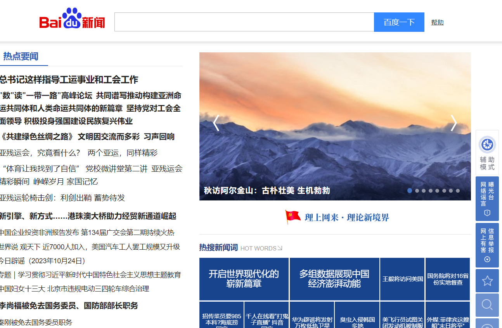

新浪首页：


小程序首页：


## 2.常用的技术方案

实现门户功能用到哪些技术呢？

基于两个需求去分析：

1.门户上的信息是动态的

门户上的信息会按照一定的时间周期去更新，比如一个新闻网站不可能一直显示一样的新闻。

2.门户作为入口其访问频率非常高

对于访问频率高的界面其加载速度是至关重要的，因为它直接影响用户的体验和留存率。一般来说门户网站的首页应该在2至3秒内加载完成，这被认为是一个合理的加载时间目标。

常见的两类门户是：web门户和移动应用门户。

我们针对这两类门户分析技术方案。

**Web门户：**

web门户是最常见的门户类型，比如：新浪、百度新闻等，它们通过PC浏览器访问，用户可以通过桌面电脑、笔记本电脑、平板电脑和智能手机等设备访问。Web门户通常运行在Web浏览器上，用户可以通过输入网址或通过搜索引擎访问。

web门户是通过浏览器访问html网页，虽然html网页上的内容是动态的但是考虑门户作为入口其访问频率非常高所以就需要提高它的加载速度，如果网页上的数据是通过实时查询数据库得到是无法满足要求的，所以针对web门户提高性能的关键是如何提高html文件的访问性能，如何提高查询数据的性能。

1.将门户页面生成静态网页发布到CDN服务器。

纯静态网页通过Nginx加载要比去Tomcat加载快很多。

我们可以使用模板引擎技术将动态数据静态化生成html文件，并通过CDN分发到边缘服务器，可以提高访问效率。

Java模板引擎技术有很多，比如：freemarker、velocity等。

什么是CDN？

CDN 是构建在数据网络上的一种分布式的内容分发网，旨在提高用户访问网站或应用时的性能。

下图中，通过CDN将内容分发到各个城市的CDN节点上，北京的网民请求北京的服务即可拿到资源，提高访问速度。

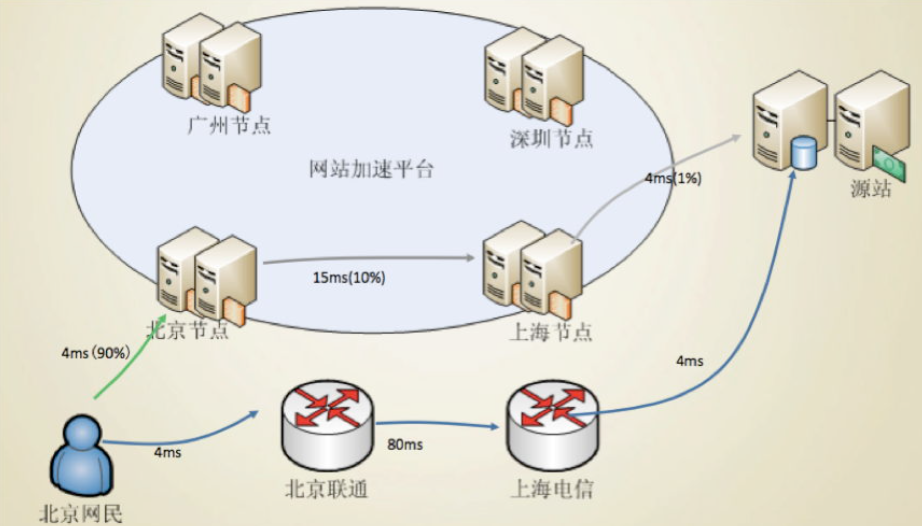

2.html文件上的静态资源比如：图片、视频、CSS、Js等也全部放到CDN服务。

3.html上的动态数据通过异步请求后端缓存服务器加载，不要直接查询数据库，通过Redis缓存提高查询速度。

4.使用负载均衡，通过部署多个Nginx服务器共同提供服务，不仅保证系统的可用性，还可以提高系统的访问性能。


5.在前端也做一部分缓存。

不仅服务端可以做缓存，前端也可以做缓存，前端可以把缓存信息存储到

- LocalStorage： 提供了持久化存储，可以存储大量数据

- SessionStorage： 与 `LocalStorage` 类似，但数据只在当前会话中有效，当用户关闭标签页或浏览器时清空。

- Cookie: 存储在用户计算机上的小型文本文件，可以在客户端和服务器之间传递数据

- 浏览器缓存：通过 HTTP 头部控制，比如：`Cache-Control`头部提供了更灵活的缓存控制选项，可以定义缓存的最大有效时间。

**移动应用门户：**

移动应用门户是专为移动设备（如智能手机和平板电脑）设计的应用程序，比如：小程序、APP等，用户可以通过应用商店下载并安装。这些应用程序提供了更好的用户体验，通常具有更高的性能和交互性，可以直接从设备主屏幕启动。

对于移动应用提高访问效率方法通常有：

1.静态资源要走CDN服务器

2.对所有请求进行负载均衡

3.在前端及服务端缓存门户上显示的动态数据。

根据上边的分析，对于Java程序员需要关注的是缓存服务的开发，主流的缓存服务器是Redis，所以我们接下来的工作重点是使用Redis为门户开发缓存服务接口。

## 3.小结

实现一个门户用到的技术方案有哪些? 

# 二、缓存技术方案

## 1.需求分析

> 目标：明确本项目门户有哪些信息需要缓存
>

### 1.1.界面原型

了解了门户的技术方案，下边通过门户界面原型分析本项目门户包括哪些部分。

本项目小程序门户首页如下图：

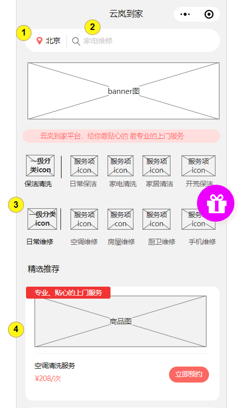

第1部分：用户允许微信授权后，自动获取当前定位，点击地址进入城市选择页面，如下图：

已开通城市是指在区域管理中所有启用的区域信息。

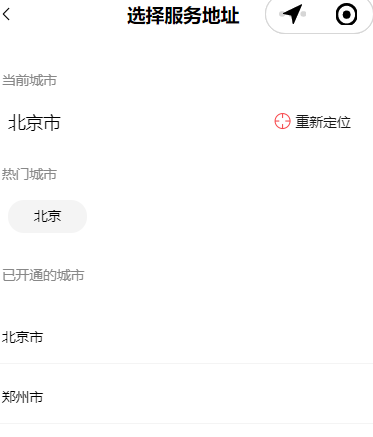


第2部分：触发搜索框进入搜索主页面，如下图：

输入关键字搜索服务信息。

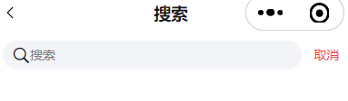

第3部分：首页服务列表

默认展示前两个服务分类，每个服务分类下取前4个服务项（根据后台排序规则显示，如排序相同则按照更新时间倒序排列）

点击一级分类进入【全部服务】页；点击服务项进入【服务项目详情页】

第4部分：热门服务列表

这里显示在区域服务界面设置热门服务的服务项。

第5部分：全部服务

点击首页服务列表的服务分类或直接点击“全部服务”进入全部服务界面，


全部服务界面，如下图：

在全部服务界面需要展示当前区域下的服务分类，点击服务分类查询分类下的服务。


点击服务名称进入服务详情页面：


### 1.2.缓存需求

根据门户的技术方案，为了提高效率门户显示的信息从缓存查询，根据上边的界面原型分析有哪些信息需要缓存？

1\.定位界面上的已开通区域列表

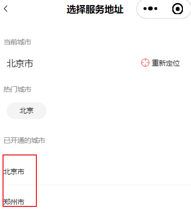

2\.服务搜索

通过Elasticsearch查询，稍后单独分析

3\.首页服务列表

4\.热门服务列表

5\.服务信息

点击某一个服务打开服务详情页面，如下图：


服务的详细信息一部分是服务介绍的图片和内容等，一部分是区域服务信息（比如价格）。

6\.服务分类

在全部服务界面左侧显示服务分类


服务分类下的服务项通过Elasticsearch去查询，稍后单独分析。

### 1.3.小结

经过分析要明确有哪些信息需要缓存。

1.开通城市列表

2.首页服务列表，包括两个服务分类及每个分类下的四个服务项。

3.热门服务列表

4.服务类型列表

5.服务详细信息，内容包括服务项信息、服务信息。

## 2.Spring Cache入门

> 目标：学会使用SpringCache查询缓存注解并理解它的原理
>

### 2.1.Redis访问工具

本项目使用Redis存储缓存数据，如何通过Java去访问Redis？

常用的有Jedis和Lettuce两个访问redis的客户端库，其中Lettuce的性能和并发性要好一些，Spring Boot 默认使用的是 Lettuce 作为 Redis 的客户端。

本项目集成了Spring data redis框架，在项目中可以通过RedisTemplate访问Redis，RedisTemplate提供了方便访问redis的模板方法。

RedisTemplate和Lettuce 是什么关系？

`RedisTemplate` 进行 Redis 操作时，实际上是通过 `Lettuce` 客户端与 Redis 服务器进行通信。

本项目也集成了Spring Cache，Spring Cache是spring的缓存框架，可以集成各种缓存中间件，比如：EhCache、Caffeine、redis。

Spring Cache最终也是通过Lettuce 去访问redis 。

使用Spring Cache的方法很简单，只需要在方法上添加注解即可实现将方法返回数据存入缓存，以及清理缓存等注解的使用。

RedisTemplate适用于灵活操作redis的场景，通过RedisTemplate的API灵活访问Redis。

这两种访问 redis的方法在本项目都有使用。

### 2.2.Spring Cache基本介绍

Spring Cache是Spring提供的一个缓存框架，基于AOP原理，实现了基于注解的缓存功能，只需要简单地加一个注解就能实现缓存功能，对业务代码的侵入性很小。

基于SpringBoot使用Spring Cache非常简单，首先加入依赖：

```xml
<dependency>
    <groupId>org.springframework.boot</groupId>
    <artifactId>spring-boot-starter-cache</artifactId>
    <version>2.7.10</version>
</dependency>
```

本项目在jzo2o\-framework下的jzo2o\-redis工程引入此依赖，其它服务只需要引入jzo2o\-redis的依赖即可。

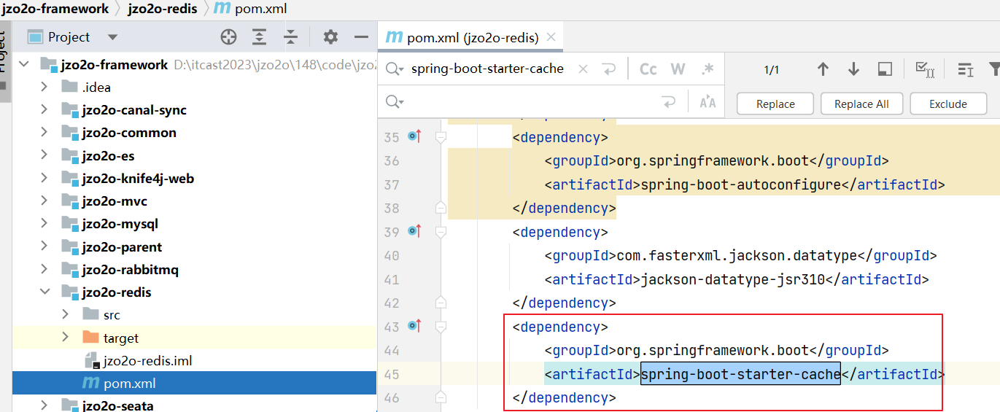

简单认识它的常用注解：

1. @EnableCaching：开启缓存注解功能

2. @Cacheable：查询数据时缓存，将方法的返回值进行缓存。

3. @CacheEvict：用于删除缓存，将一条或多条数据从缓存中删除。

4. @CachePut：用于更新缓存，将方法的返回值放到缓存中

5. @Caching：组合多个缓存注解；

6. @CacheConfig：统一配置@Cacheable中的value值

### 2.3.搭建环境

首先搭建jzo2o\-foundations工程\.

从资料的源码目录解压jzo2o\-foundations\-02\-0\.zip下的代码，拷贝下图中的src和pom\.xml覆盖jzo2o\-foundations目录的代码。

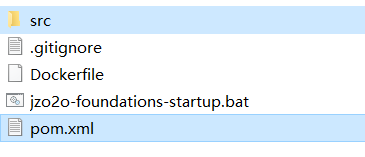

在jzo2o\-foundations工程引入jzo2o\-redis依赖

```xml
<dependency>
    <groupId>com.jzo2o</groupId>
    <artifactId>jzo2o-redis</artifactId>
</dependency>
```

在jzo2o\-foundations工程的bootstrap\.yml中引入redis的配置文件，如下图：

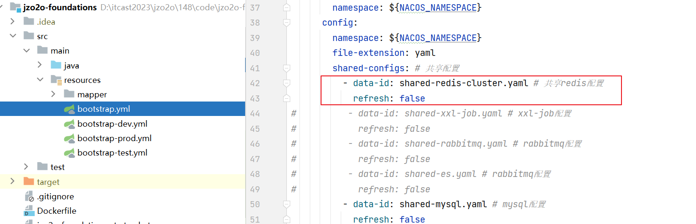

在nacos配置shared\-redis\-cluster\.yaml，开发环境使用redis单机，配置文件如下：

注意配置redis的IP地址、端口和密码。

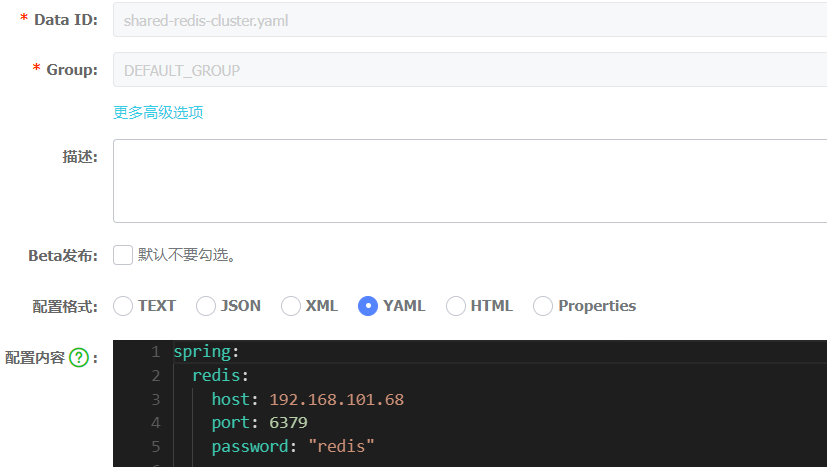

### 2.4.查询数据时缓存

下边使用Cacheable注解实现查询服务信息时对服务信息进行缓存，它的执行流程是：第一次查询服务信息缓存中没有该服务的信息此时去查询数据库，查询数据库拿到服务信息并进行缓存，第二次再去查询该服务信息发现缓存中有该服务的信息则直接查询缓存不再去数据库查询。

流程如下：

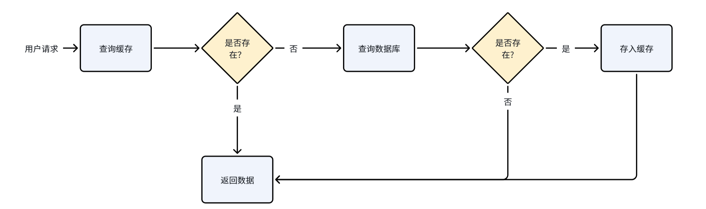

首先在工程启动类中添加@EnableCaching注解，它表示开启Spring cache缓存组件。

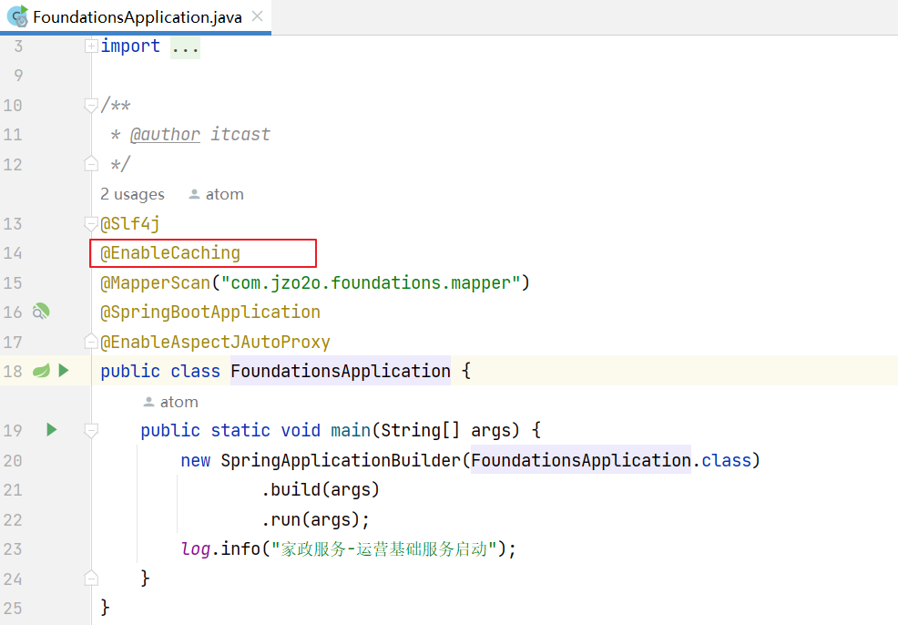

下边实现对区域服务信息查询时进行缓存。

首先找到区域服务信息的service，为了不和原来的getById\(Serializable id\)查询方法混淆，单独定义查询区域服务信息缓存的方法，如下：

在IServeService接口中定义如下接口：

```Java
/**
 * 查询区域服务信息并进行缓存
 * @param id 对应serve表的主键
 * @return 区域服务信息
 */
Serve queryServeByIdCache(Long id);
```

在接口实现类中定义如下方法：

```Java
@Override
public Serve queryServeByIdCache(Long id) {
    return getById(id);
}
```

此时该方法还是查询数据库。

下边在方法中添加Cacheable注解：

```Java
//@Cacheable(value = "JZ_CACHE:SERVE_RECORD",key = "#id")
@Cacheable(value = RedisConstants.CacheName.SERVE,key = "#id")
public Serve queryServeByIdCache(Long id) {
    return getById(id);
}
```

Cacheable注解配置的两项属性说明：

- value：缓存的名称，缓存名称作为缓存key的前缀。

- key: 缓存key，支持SpEL表达式，上述代码表示取参数id的值作为key

最终缓存key为：缓存名称\+“::”\+key，例如：上述代码id为123,最终的key为：JZ\_CACHE:SERVE\_RECORD::123

> SpEL（Spring Expression Language）是一种在 Spring 框架中用于处理字符串表达式的强大工具，它可以实现获取对象的属性，调用对象的方法操作。
>
> 还可以配置一个属性keyGenerator：指定一个自定义的键生成器（实现org\.springframework\.cache\.interceptor\.KeyGenerator 接口的类），用于生成缓存的键。该属性与 key 属性互斥，二者只能选其一。此属性使用较少。
>

### 2.5.测试

对queryServeByIdCache方法进行测试，编写单元测试方法，如下：

```Java
package com.jzo2o.foundations.service;

import com.jzo2o.common.model.PageResult;
import com.jzo2o.foundations.model.domain.Serve;
import com.jzo2o.foundations.model.dto.request.ServePageQueryReqDTO;
import com.jzo2o.foundations.model.dto.response.*;
import lombok.extern.slf4j.Slf4j;
import org.junit.jupiter.api.Test;
import org.springframework.boot.test.context.SpringBootTest;
import org.springframework.util.Assert;

import javax.annotation.Resource;
import java.math.BigDecimal;
import java.util.List;

@SpringBootTest
@Slf4j
class IServeServiceTest {

//区域服务查询
@Test
public void test_queryServeByIdCache(){
    Serve serve = serveService.queryServeByIdCache(1693815623867506689L);
    Assert.notNull(serve,"服务为空");
}
...
```

运行测试方法，观察redis，数据缓存成功，如下图：

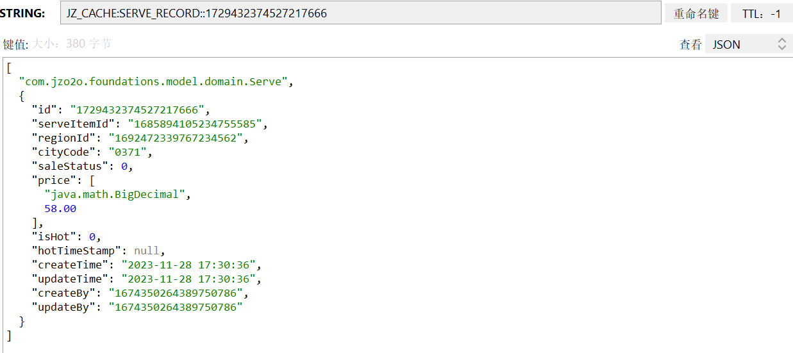

- 缓存key：JZ\_CACHE:SERVE\_RECORD::1693815623867506689

- 缓存value：serve表的记录
- 缓存过期时间：\-1，表示永不过期

仔细核实内容是否符合我们的预期结果。

虽然数据被成功缓存，如果想调整缓存过期时间怎么做呢？

在@Cacheable注解中有一个属性为cacheManager，表示缓存管理器，通过缓存管理器可以设置缓存过期时间。

所有缓存相关的基础类都在jzo2o\-redis工程，在jzo2o\-redis工程定义spring cache需要的缓存管理器，如下：

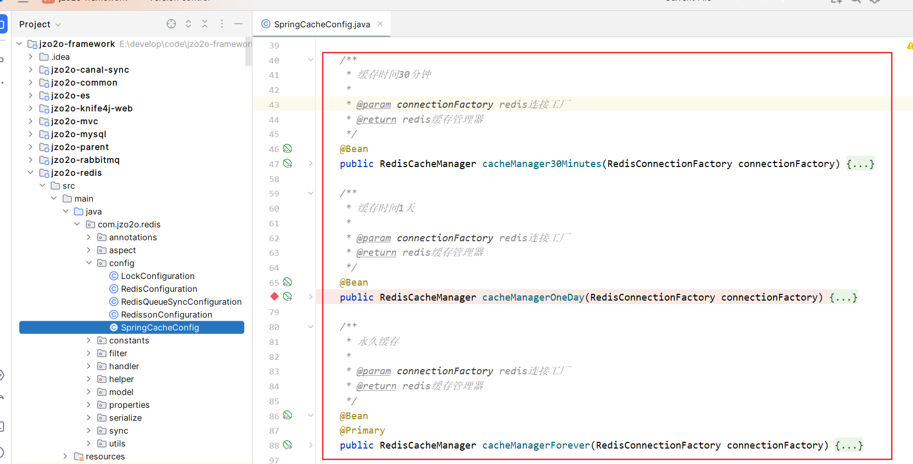

上图中共包括三个缓存管理器：

缓存时间为30分钟、一天、永久，分别对应的bean的名称为：cacheManager30Minutes、cacheManagerOneDay、cacheManagerForever。

下边我们在@Cacheable注解中指定缓存管理器为cacheManagerOneDay，即缓存时间为一天。

```java
@Cacheable(value = RedisConstants.CacheName.SERVE,key="#id",cacheManager = RedisConstants.CacheManager.ONE_DAY)
public Serve queryServeByIdCache(Long id) {
    return getById(id);
}
```

重新运行单元测试方法，我们发现缓存的过期时间没有改变，这是为什么？

原因是根据前边的缓存流程：

先查询缓存，如果缓存存在则直接查询缓存返回数据，不再向缓存存储 数据。

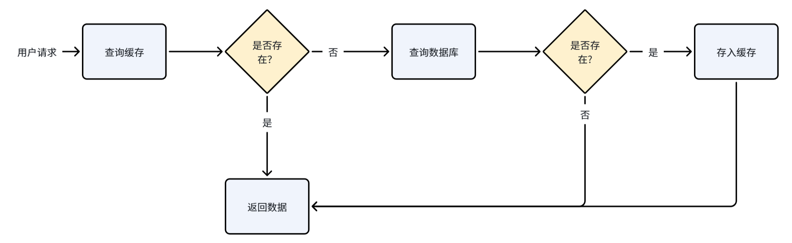

所以我们需要删除缓存，重新运行测试方法：

测试通过，观察redis中的缓存，过期时间已经改变，这说明我们设置的缓存管理器生效。

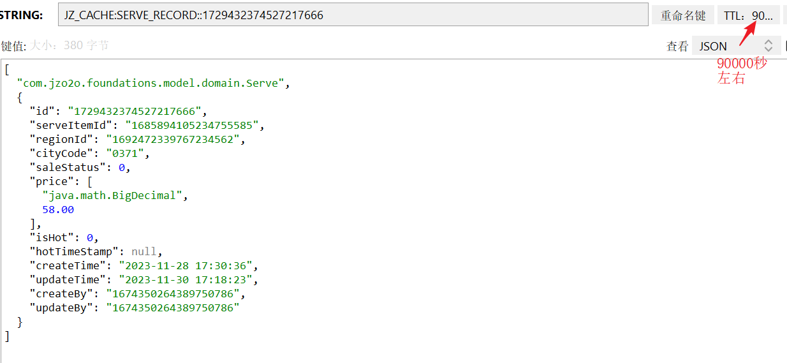

由于缓存时间加了随机数，缓存一天的时间为90000秒左右。

关于缓存时间加随机数的原因稍后讲解。

### 2.6.工作原理 

Spring Cache是基于AOP原理，对添加注解@Cacheable的类生成代理对象，在方法执行前查看是否有缓存对应的数据，如果有直接返回数据，如果没有调用源方法获取数据返回，并缓存起来，下边跟踪Spring Cache的切面类CacheAspectSupport\.java中的private Object execute\(final CacheOperationInvoker invoker, Method method, CacheOperationContexts contexts\)方法。

如下图：

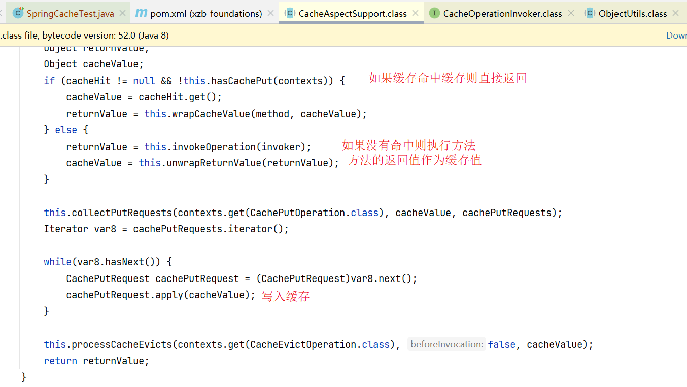

下边打断点调试：

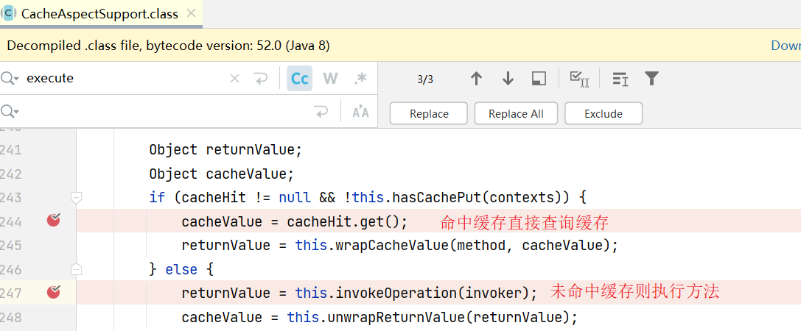

分别测试命中缓存和未命中缓存的情况。

第一次查询（redis中没有缓存）时执行方法查询数据库，第二次命中缓存直接查询redis不再执行方法。

### 2.7.小结

1.Spring Cache 用在项目哪里了？怎么用的？

2.Spring Cache @Cacheable 注解的工作原理？

## 3.测试Spring Cache

> 目标：学会使用@CacheEvict和@CachePut注解
>

在Spring Cache入门中使用了@Cacheable 注解，它实现的是查询时进行缓存。

下边测试另外两个常用 的注解，如下：

@CacheEvict：用于删除缓存，将一条或多条数据从缓存中删除。
@CachePut：用于更新缓存，将方法的返回值放到缓存中

其它注解在项目开中用到时再进行讲解，也可以自行查阅资料测试。

### 3.1.测试@CachePut

CachePut注解实现的是将方法的返回值放到缓存中。

在服务上架后会将区域服务的信息写入缓存，服务下架会从缓存删除，下边我们实现服务上架将服务写入缓存。

找到服务上架的方法，在方法上添加@CachePut注解：

```Java
@Override
@Transactional
@CachePut(value = RedisConstants.CacheName.SERVE, key = "#id",  cacheManager = RedisConstants.CacheManager.ONE_DAY)
public Serve onSale(Long id){
....
```

上边代码同样指定了缓存名称、缓存key及缓存管理器（缓存过期时间为一天）。

编写单元测试方法测试服务上架方法。

找一个草稿或下架状态的服务执行上架操作，也可以在serve表中找一个测试数据更改状态为0。

```Java
//服务上架测试
@Test
public void test_onSale(){
    //从serve表找一条下架的服务（sale_status  '售卖状态，0：草稿，1下架，2上架',）
    Serve serve = serveService.onSale(1715263395009191938L);
    Assert.notNull(serve,"服务为空");
}
```

单元测试方法运行成功查看redis是否写入缓存：

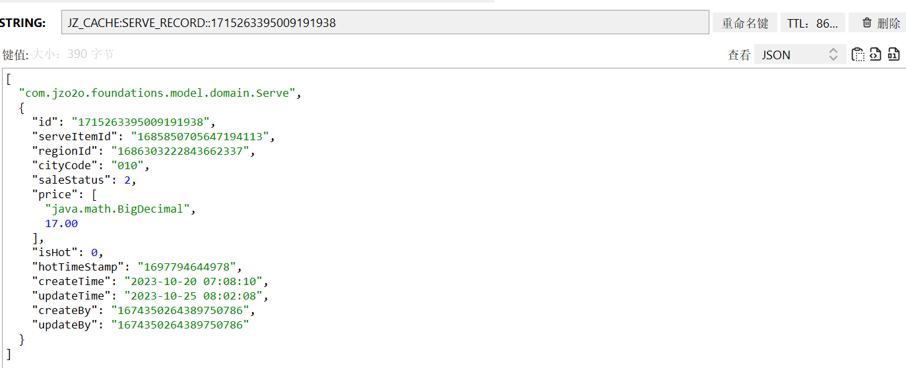

> 最后可再执行一次上架，发现上架失败了。说明方法每次都会被执行，执行前不会查询缓存。
> 

### 3.2.测试@CacheEvict

下边测试服务下架删除缓存。

找到服务下架的方法，添加@CacheEvict注解

```Java
@Override
@Transactional
@CacheEvict(value = RedisConstants.CacheName.SERVE, key = "#id")
public Serve offSale(Long id){
....
```

这里是删除缓存所以不用再指定缓存管理器。

编写单元测试方法进行测试。

```Java
//服务下架测试
@Test
public void test_offSale(){
    //从serve表找一条上架的服务（sale_status  '售卖状态，0：草稿，1下架，2上架',）
    Serve serve = serveService.offSale(1715263395009191938L);
    Assert.notNull(serve,"服务为空");
}
```

单元测试方法运行成功将成功删除对应的缓存。

### 3.3.小结

Spring Cache有哪些常用的注解，都有什么用？

- @EnableCaching：开启缓存注解功能

- @Cacheable：查询数据时缓存，将方法的返回值进行缓存。缓存有会直接返回，没则查表存缓存并返回。

- @CacheEvict：用于删除缓存，将一条或多条数据从缓存中删除。

- @CachePut：用于更新缓存，将方法的返回值放到缓存中

- @Caching：组合多个缓存注解；


## 4.缓存常见问题

### 4.1.缓存穿透问题

> 目标：理解缓存穿透问题，掌握缓存穿透的解决方案。
>

在使用缓存时特别是在高并发场景下会遇到很多问题，常用的问题有缓存穿透、缓存击穿、缓存雪崩以及缓存一致性问题。

下边介绍缓存穿透问题及解决方案。

**什么是缓存穿透问题**

缓存穿透是指请求一个不存在的数据，缓存层和数据库层都没有这个数据，这种请求会穿透缓存直接到数据库进行查询。它通常发生在一些恶意用户可能故意发起不存在的请求，试图让系统陷入这种情况，以耗尽数据库连接资源或者造成性能问题。

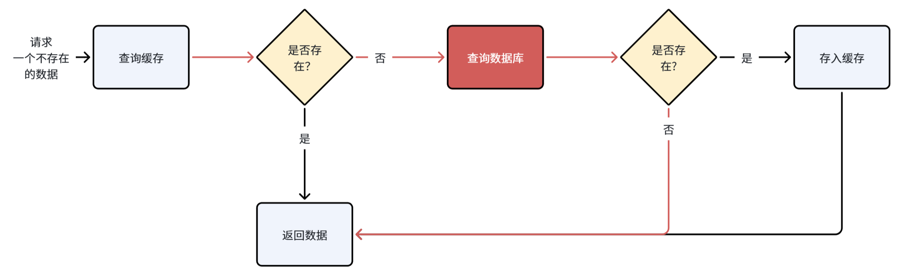

比如：在快速入门程序中，查询一个缓存中不存在的数据将会执行方法查询数据库，数据库也不存在此数据，查询完数据库也没有缓存数据，缓存没有起到作用。

**解决方案**

如何解决缓存穿透?

1.对请求增加校验机制

比如：查询的Id是长整型并且是19位，如果发来的不是长整型或不符合位数则直接返回不再查询数据库。

2.缓存空值或特殊值（本项目使用的方式）

当查询数据库得到的数据不存在，此时我们仍然去缓存数据，缓存一个空值或一个特殊值的数据，避免每次都会查询数据库，避免缓存穿透。

流程如下：

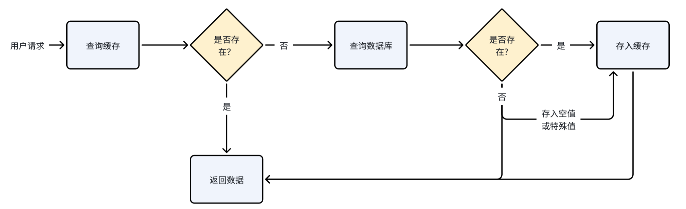

下边通过测试查询区域服务，查询一下不存在的区域服务：

```Java
//区域服务查询
@Test
public void test_queryServeByIdCache2(){
    //指定一个不存在serve表的id
    Serve serve = serveService.queryServeByIdCache(123L);
    Assert.notNull(serve,"服务为空");
}
```

当查询一个数据库不存在的数据时向redis缓存了NullValue对象。

第一次会查询数据库，得到一个空值，缓存一个空值。

第二次不再查询数据库。

我们在queryServeByIdCache方法中打断点：

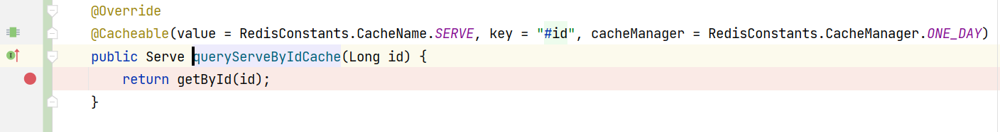

第一次进入方法查询数据库，第二次不进入方法直接从缓存查询出空值。

查看redis，缓存内容如下：

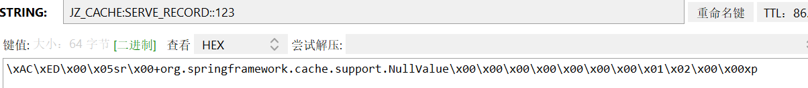

3.使用布隆过滤器

什么是布隆过滤器？

> 布隆过滤器是一种空间效率很高的概率型数据结构\(空间极小、查询极快的概率型数据结构\)，用于判断一个元素是否在一个集合中\(一个元素一定不存在 / 可能存在\) 不存原始数据，只存标记位。它允许快速插入和查询操作，并且有一定的误判率，即存在假阳性（错误地认为元素存在）的可能性，但没有假阴性（错误地认为元素不存在）
>

由两部分组成：

- 二进制位数组（bit array）：一堆 0/1 二进制位，初始全 0；

- k 个不同哈希函数，每个函数把输入元素映射到数组里一个下标。

**插入元素流程（新增数据）**

1.拿元素分别经过 `k` 个哈希函数，算出 `k` 个不同位置；

2.把位数组这 `k` 个位置全部置为 `1`。

举个极简例子：

- 插入 `apple`： 下标 2、5 设为 1

- 插入 `banana`：下标 1、5 设为 1 

- 数组现在：`0 1 1 0 0 1 0 0`

**查询元素流程（判断是否存在）**

1.对查询值执行同样 k 个哈希，得到 k 个下标；

2.只要任意一个下标是 0 → 元素一定不存在；

3.如果所有下标全是 1 → 元素可能存在（存在误判）。

接上例查 `orange`：哈希算出下标 3、7，都是 0 → 肯定没存。

为什么会存在误判？

> 误判的出现是因为布隆过滤器使用多个哈希函数将元素映射到位数组中，不同元素可能产生相同的哈希值，导致位数组中的某些位被错误地标记为1。
>

如何降低误判率？

> 降低误判率可以通过增加位数组的大小、减少元素数量或增加哈希函数的数量来实现。
>

如何使用布隆过滤器？

> 将要查询的元素通过N个散列函数提前全部映射到Bit array中，比如：查询服务信息，需要将全部服务的id提前映射到Bit array中，当去查询元素是否在数据库存在时从布隆过滤器查询即可，如果哈希函数返回0则表示肯定不存在。
>

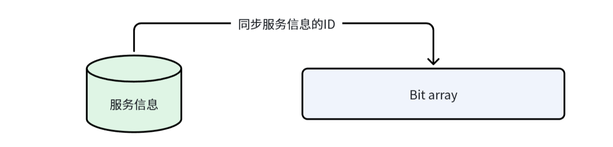

布隆过滤器的优点是：二进制数组占用空间少，插入和查询效率高效。

缺点是存在误判率，并且删除困难，因为同一个位置由于哈希冲突可能存在多个元素，删除某个元素可能删除了其它元素。

布隆过滤器的应用场景？

> 海量数据去重，比如URL去重，搜索引擎爬虫抓取网页，使用布隆过滤器可以快速判定一个URL是否已经被爬取过，避免重复爬取。
>
> 垃圾邮件过滤：使用布隆过滤器可以用于快速判断一个邮件地址是否是垃圾邮件发送者，对于海量的邮件地址，布隆过滤器可以提供高效的判定。
>
> 安全领域：在网络安全中，布隆过滤器可以用于检查一个输入值是否在黑名单中，用于快速拦截一些潜在的恶意请求。
>
> 避免缓存穿透：通过布隆过滤器判断是否不存在，如果不存在则直接返回。

如何代码实现布隆过滤器？\(了解\)

> 使用redis的bitmap位图结构实现。
>
> 使用redisson实现。
>
> 使用google的Guava库实现。

下边举例说明：

引入依赖

```xml
<!-- https://mvnrepository.com/artifact/com.google.guava/guava -->
<dependency>
    <groupId>com.google.guava</groupId>
    <artifactId>guava</artifactId>
    <version>28.2-jre</version>
</dependency>
```

测试代码：

```Java
package com.jzo2o.foundations.service;

import com.google.common.hash.BloomFilter;
import com.google.common.hash.Funnels;

/**
 * 布隆过滤器测试
 */
public class BloomFilterExample {
    public static void main(String[] args) {
        // 创建一个布隆过滤器，预计添加元素数量为 1000，误判率为 0.05
        BloomFilter<Integer> bloomFilter = BloomFilter.create(
                Funnels.integerFunnel(), 1000, 0.05);

        // 添加元素到布隆过滤器
        bloomFilter.put(1);
        bloomFilter.put(2);
        bloomFilter.put(3);

        // 检查元素是否可能在集合中
        System.out.println(bloomFilter.mightContain(1)); // 应该返回 true
        System.out.println(bloomFilter.mightContain(4)); // 可能返回 true（假阳性），也可能返回 false

    }
}
```

在上述代码中，我们创建了一个预期包含1000个元素、误判率为0\.05的布隆过滤器。然后，我们向布隆过滤器中添加了三个元素（1、2 和 3），并测试了几个元素是否在布隆过滤器中。

请注意，误判率是你可以调整的一个参数。较低的误判率通常需要更多的空间和计算资源。

**小结**

1.什么是缓存穿透？如何解决缓存穿透？

2.什么是布隆过滤器？如何使用布隆过滤器？

3.本项目使用缓存空值或特殊值的方法去解决缓存穿透。

### 4.2.缓存击穿问题

> 目标：理解缓存击穿问题，掌握缓存击穿的解决方案。
>

**什么是缓存击穿**

缓存击穿发生在访问热点数据，大量请求访问同一个热点数据，当热点数据失效后同时去请求数据库，瞬间耗尽数据库资源，导致数据库无法使用。

比如某手机新品发布，当缓存失效时有大量并发到来导致同时去访问数据库。

**解决方案**

如何解决缓存击穿？

1.使用锁

单体架构下（单进程内）可以使用同步锁控制查询数据库的代码，只允许有一个线程去查询数据库，查询得到数据库存入缓存。

```Java
synchronized(obj){
  //查询数据库
  //存入缓存
}
```

分布式架构下（多个进程之间）可以使用分布式锁进行控制。

```Java
// 获取分布式锁对象
RLock lock = redisson.getLock("myLock");
try {
    // 尝试加锁，最多等待100秒，加锁后自动解锁时间为30秒
    boolean isLocked = lock.tryLock(100, 30, java.util.concurrent.TimeUnit.SECONDS);
    if (isLocked) {
          //查询数据库
          //存入缓存
    } else {
        System.out.println("获取锁失败，可能有其他线程持有锁");
    }
} catch (InterruptedException e) {
    e.printStackTrace();
} finally {
    // 释放锁
    lock.unlock();
    System.out.println("释放锁...");
}
```

2.热点数据不过期

可以由后台程序提前将热点数据加入缓存，缓存过期时间不过期，由后台程序做好缓存同步。

例如：当服务上架后将服务信息缓存到redis且永不过期，此时需要使用put注解。

3.缓存预热

分为提前预热、定时预热。

提前预热就是提前写入缓存。

定时预热是使用定时程序去更新缓存。

4.热点数据查询降级处理

对热点数据查询定义单独的接口，当缓存中不存在时走降级方法避免查询数据库。

**小结**

1.什么是缓存击穿？如何解决缓存击穿？

2.本项目对热点数据定时预热，使用定时任务刷新缓存保证缓存永不过期，解决缓存穿透问题。

### 4.3.缓存雪崩问题

> 目标：理解缓存雪崩问题，掌握缓存雪崩的解决方案。
>

**什么是缓存雪崩？**

缓存雪崩是缓存中大量key失效后当高并发到来时导致大量请求到数据库，瞬间耗尽数据库资源，导致数据库无法使用。

比如对某信息设置缓存过期时间为30分钟，在大量请求同时查询该类信息时，此时就会有大量的同类信息存在相同的过期时间，一旦失效将同时失效，造成雪崩问题。

**解决方案**

如何解决缓存雪崩？

1.使用锁进行控制

思路同缓存击穿。

2.对同一类型信息的key设置不同的过期时间

通常对一类信息的key设置的过期时间是相同的，这里可以在原有固定时间的基础上加上一个随机时间使它们的过期时间都不相同。

具体实现：在framework工程中定义缓存管理器指定过期时间加上随机数。

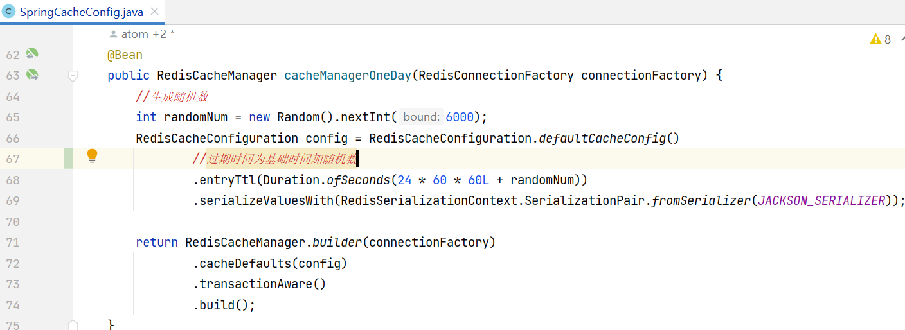

3.缓存定时预热

不用等到请求到来再去查询数据库存入缓存，可以提前将数据存入缓存。使用缓存预热机制通常有专门的后台程序去将数据库的数据同步到缓存。

**小结**

1.什么是缓存雪崩？如何解决缓存雪崩？

2.本项目对key设置不同的过期时间解决缓存雪崩问题。

### 4.4.缓存不一致问题

**什么是缓存不一致问题**

缓存不一致问题是指当发生数据变更后该数据在数据库和缓存中是不一致的，此时查询缓存得到的并不是与数据库一致的数据。

缓存不一致会导致什么后果？比如：查看商品信息的价格与真实价格不一致，影响用户体验，如果直接使用缓存中的价格去计算订单金额更会导致计算结果错误。

造成缓存不一致的原因可能是在写数据库和写缓存两步存在异常，也可能是并发所导致。

写数据库和写缓存导致不一致称为双写不一致，比如：先更新数据库成功了，更新缓存时失败了，最终导致不一致。

并发导致缓存不一致举例如下：

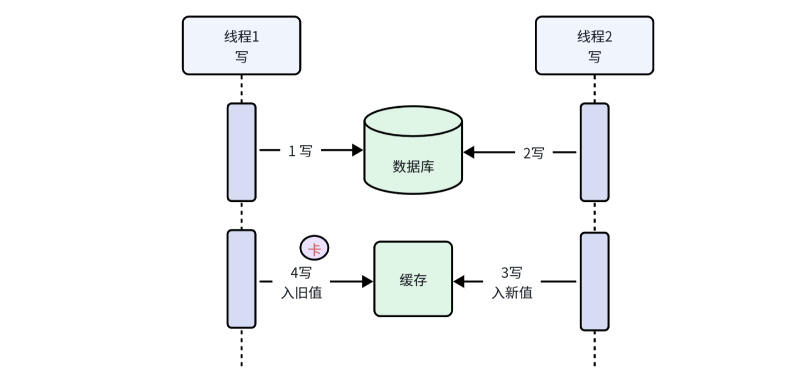

执行流程：

1. 线程1先写入数据库X，当去写入缓存X时网络卡顿

2. 线程2先写入数据库Y

3. 线程2再写入缓存Y

4. 线程1 写入缓存旧值X覆盖了新值Y

即使先写入缓存再写数据在并发环境也可能存在问题，如下图：

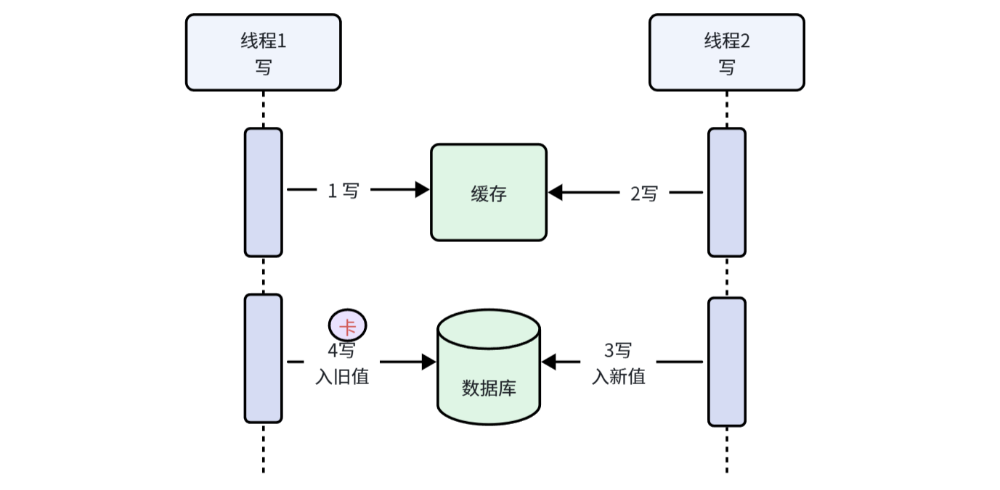

流程：

1. 线程1先写入缓存X，当去写入数据库X时网络卡顿

2. 线程2先写入缓存Y

3. 线程2再写入数据库Y

4. 线程1 写入数据库旧值X覆盖了新值Y

**解决方案**

如何解决并发环境下双写不一致的问题？

1.使用分布式式锁

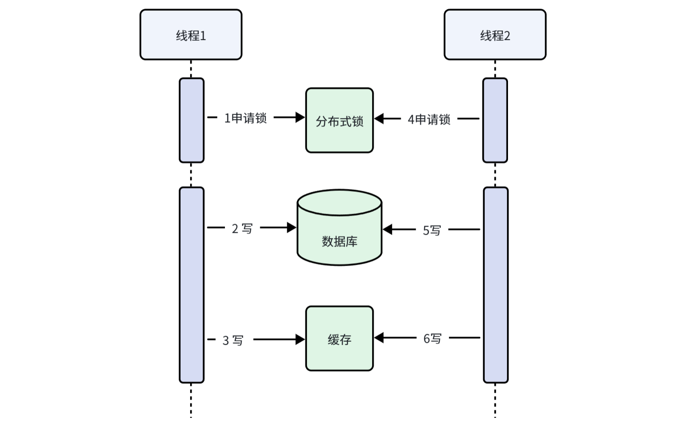

流程：

- 线程1申请分布式锁，拿到锁。此时其它线程无法获取同一把锁。

- 线程1写数据库，写缓存，操作完成释放锁。

- 线程2申请分布锁成功，写数据库，写缓存。

对双写的操作每个线程顺序执行。

对操作异常问题仍需要解决：写数据库成功写缓存失败了，数据库需要回滚，此时就需要使用分布式事务组件。

使用分布式锁解决双写一致性不仅性能低下，复杂度增加。

2.延迟双删

既然双写操作存在不一致，我们把写缓存改为删除缓存呢？

先写数据库再删除缓存，如果删除缓存失败了缓存也就不一致了，那我们改为：先删除缓存再写数据库，如下图：

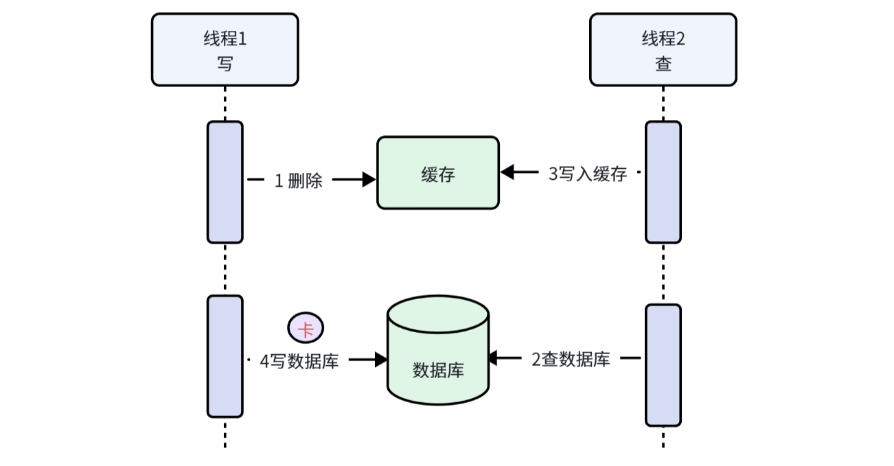

执行流程：

- 线程1删除缓存

- 线程2读缓存发现没有数据此时查询数据库拿到旧数据写入缓存

- 线程1写入数据库

先写数据库再删缓存，如下图：

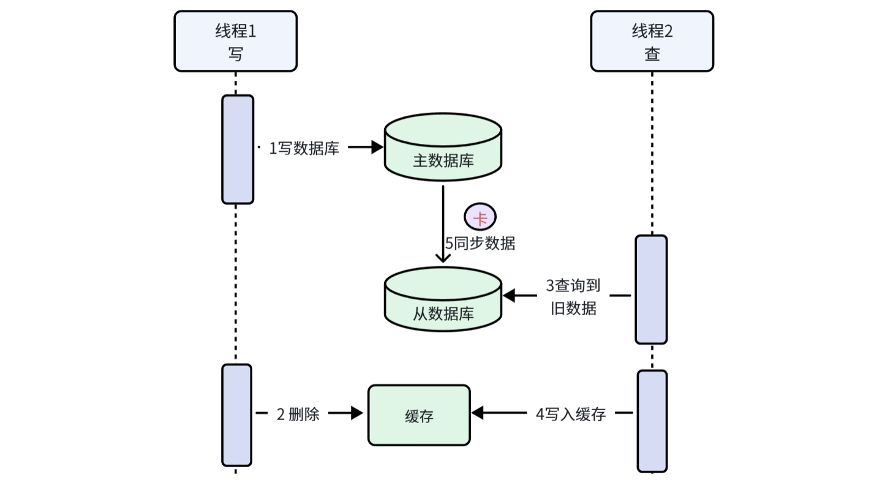

线程1向主数据库写，线程2向从数据库查询，流程如下：

- 线程1删除缓存

- 线程1向主数据库写，数据向从数据库同步

- 线程2查询缓存没有数据，查询从数据库，得到旧数据

- 线程2将旧数据写入缓存

解决上边的问题采用延迟双删：

线程1先删除缓存，再写入主数据库，延迟一定时间再删除缓存。

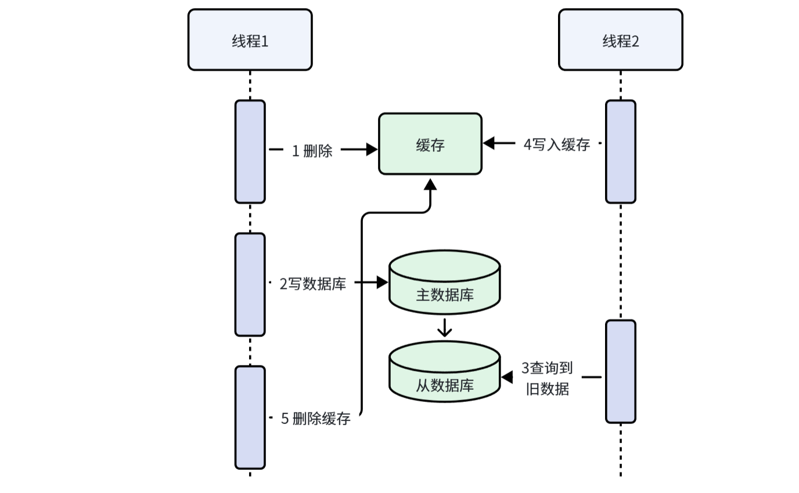

上图线程1的动作简化为下图：

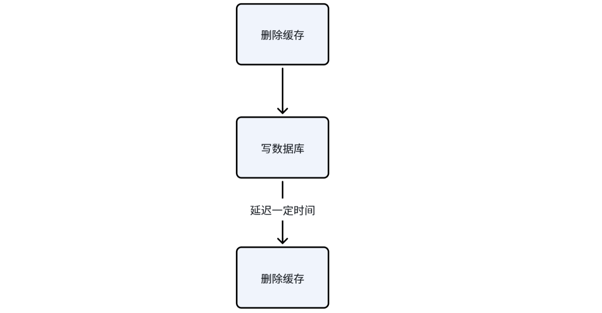

延迟时间一般设置多久？

> 对于主从复制集群，建议设置为 1s \~ 3s。
>
> 由于更新步骤里，没有加锁步骤，高并发情况下，操作redis次数减少，性能还不错，此方案较好，使用公司较多。
>
> 缺点：如果延迟时间设置过长，数据无法及时删掉导致数据没法及时更新一致（实效性会收到影响）
>

3.异步同步

延迟双删的目的也是为了保证最终一致性，即允许缓存短暂不一致，最终保证一致性。

保证最终一致性的方案有很多，比如：通过MQ、Canal、定时任务都可以实现。

Canal是一个数据同步工具，读取MySQL的binlog日志拿到更新的数据，再通过MQ发送给异步同步程序，最终由异步同步程序写到redis。此方案适用于对数据实时性有一定要求的场景。

通过Canal加MQ异步任务方式流程如下：

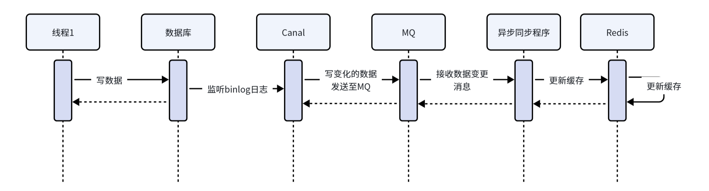

流程如下：

- 线程1写数据库

- canal读取binlog日志，将数据变化日志写入mq

- 同步程序监听mq接收到数据变化的消息

- 同步程序解析消息内容写入redis，写入redis成功正常消费完成，消息从mq删除。

定时任务方式流程如下：

专门启动一个数据同步任务定时读取数据同步到redis，此方式适用于对数据实时性要求不强更新不频繁的数据。

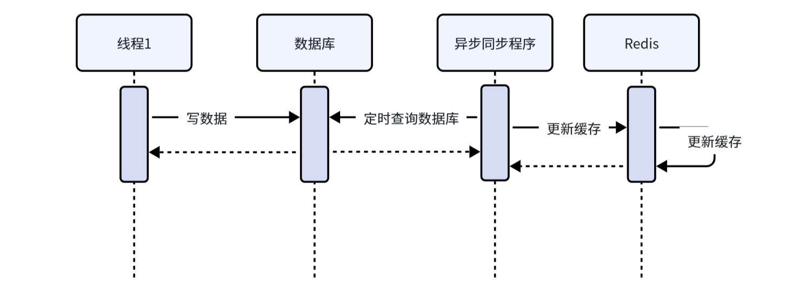

- 线程1写入数据库（业务数据表，变化日志表）

- 同步程序读取数据库（变化日志表），根据变化日志内容写入redis，同步完成删除变化日志。

**小结**

如何保证缓存一致性？

# 三、缓存实现

## 1.开通区域列表缓存实现

> 目标：
>
> 能说出项目中的缓存方案。
>
> 实现开通区域列表缓存（完成查询缓存、删除缓存）。
>

### 1.1.缓存方案分析

根据本项目门户的需求可知共有以下几块信息需要缓存，如下：

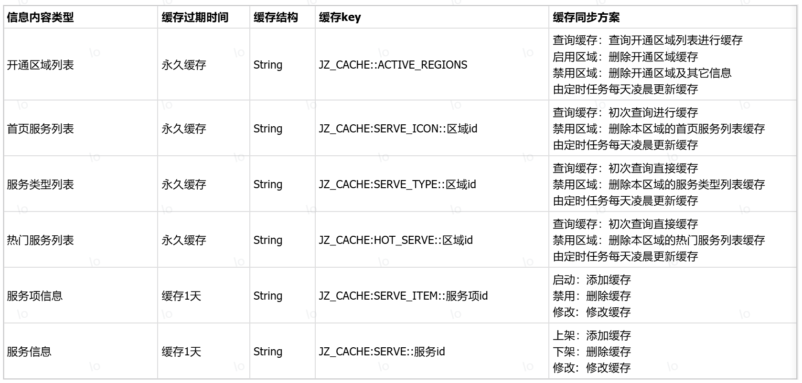

下边分析第一个开通区域列表的缓存方案：

- 查询缓存：查询已开通区域列表，如果没有缓存则查询数据库并将查询结果进行缓存，如果存在缓存则直接返回

- 启用区域：删除开通区域信息缓存（再次查询将缓存新的开通区域列表）。

- 禁用区域：删除开通区域信息缓存，删除该区域下的其它缓存信息，包括：首页服务列表，服务类型列表，热门服务列表。

- 定时任务：每天凌晨缓存已开通区域列表。

### 1.2.查询缓存实现

下边我们先实现开通区域列表查询缓存。

首先把测试环境准备好：

- 启动jzo2o\-gateway（使用bat脚本）

- 启动jzo2o\-publics（使用bat脚本）

- 启动jzo2o\-customer（使用bat脚本,如果已经通过小程序认证可以不用启动）

- 启动jzo2o\-foundations（使用IDEA）

打开小程序开发工具

打开小程序，点击首页左上角的地址进入服务地址城市选择页面，如下图：


在定位界面显示已开通城市列表，已开通城市是指在区域管理中所有启用的区域信息，如下图：


跟踪Network找到开通区域列表的URL:/foundations/consumer/region/activeRegionList

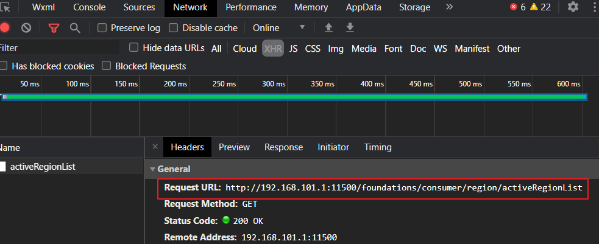

打开jzo2o\-foundations工程，根据接口地址找到具体的代码:

找到接口：

```java
package com.jzo2o.foundations.controller.consumer;


import com.jzo2o.api.foundations.dto.response.RegionSimpleResDTO;
import com.jzo2o.foundations.service.IRegionService;
import io.swagger.annotations.Api;
import io.swagger.annotations.ApiOperation;
import org.springframework.web.bind.annotation.GetMapping;
import org.springframework.web.bind.annotation.RequestMapping;
import org.springframework.web.bind.annotation.RestController;

import javax.annotation.Resource;
import java.util.List;

@RestController("consumerRegionController")
@RequestMapping("/consumer/region")
@Api(tags = "用户端 - 区域相关接口")
public class RegionController {
    @Resource
    private IRegionService regionService;

    @GetMapping("/activeRegionList")
    @ApiOperation("已开通服务区域列表")
    public List<RegionSimpleResDTO> activeRegionList() {
        return regionService.queryActiveRegionListCache();
    }

}
```

找到service方法如下：

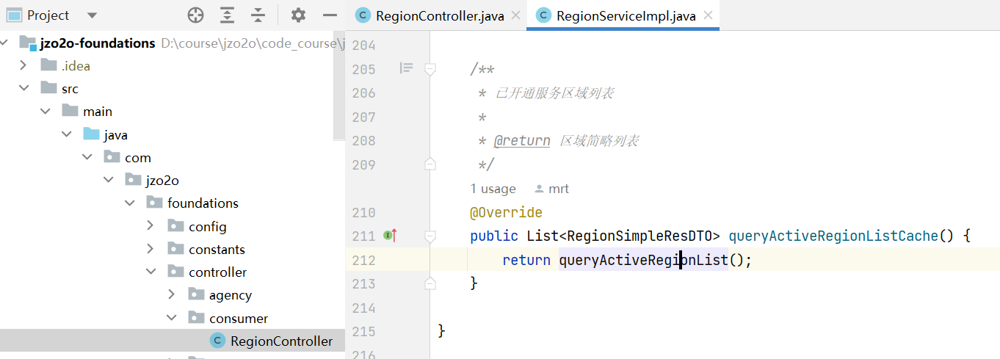

在service方法上添加Spring cache注解：

```Java
@Override
@Cacheable(value = RedisConstants.CacheName.JZ_CACHE, key = "'ACTIVE_REGIONS'", cacheManager = RedisConstants.CacheManager.FOREVER)
public List<RegionSimpleResDTO> queryActiveRegionListCache() {
    return queryActiveRegionList();
}
```

> 说明： 
>
> key: 当key用一个固定字符串时需要在双引号中用单引号括起来，如下所示：
>
> ```Java
> key = "'ACTIVE_REGIONS'"
> ```
>
> cacheManager ：RedisConstants\.CacheManager\.FOREVER设置了缓存永不过期。
>

重启jzo2o\-foundations工程进行测试。

通过小程序访问定位界面，观察Network：

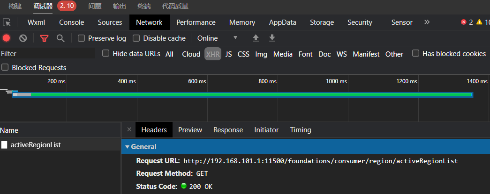

/foundations/consumer/region/activeRegionList接口请求成功。

观察redis成功缓存开通区域列表：

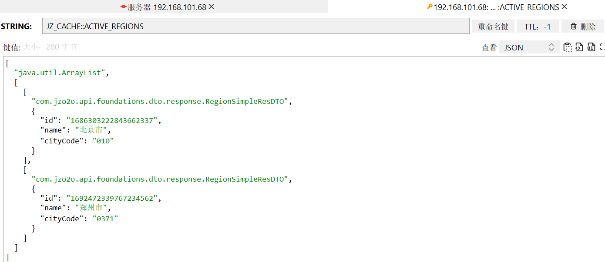

### 1.3.启用区域

启用一个新区域已经开通区域列表需要变更，该如何实现呢？

启用区域后删除已开通区域列表缓存，当去查询开通区域列表时重新缓存最新的开通区域列表。

可通过接口文档 [http://localhost:11509/foundations/doc\.html](http://localhost:11509/foundations/doc.html) 找到启用区域的接口，如下：

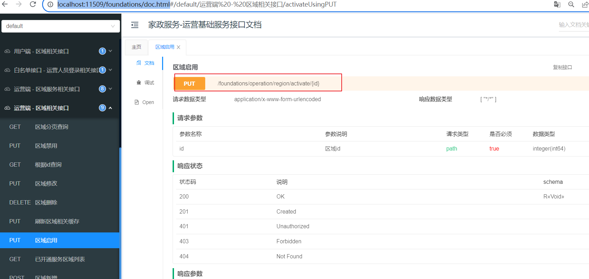

接口的代码如下：

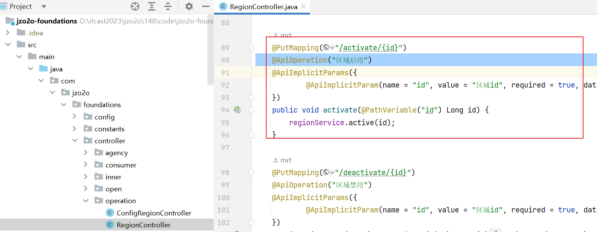

找到service代码，修改如下：

```Java
/**
 * 区域管理
 */
@Service
public class RegionServiceImpl extends ServiceImpl<RegionMapper, Region> implements IRegionService {

/**
 * 区域启用
 *
 * @param id 区域id
 */
@Override
@CacheEvict(value = RedisConstants.CacheName.JZ_CACHE, key = "'ACTIVE_REGIONS'")
public void active(Long id) {
......
```

稍后测试。

### 1.4.禁用区域

如果是禁用一个区域则需要删除开通区域列表缓存。

找到禁用区域的代码，修改如下：

```Java
/**
 * 区域管理
 */
@Service
public class RegionServiceImpl extends ServiceImpl<RegionMapper, Region> implements IRegionService {

    @Override
    @Caching(evict = {
            @CacheEvict(value = RedisConstants.CacheName.JZ_CACHE, key = "'ACTIVE_REGIONS'")
//            todo:删除首页服务列表缓存
    })
    public void deactivate(Long id) {
    ......
```

禁用区域除了删除开通区域列表还需要删除首页服务列表、热门服务列表等，所以这里使用@Caching注解。

### 1.5.测试

下边进行测试：

首先重启foundations服务。

启动运营管理（前端）进行测试

测试禁用区域，找一个区域将区域下边服务全部下架，然后禁用该区域

最初有两个开通区域：

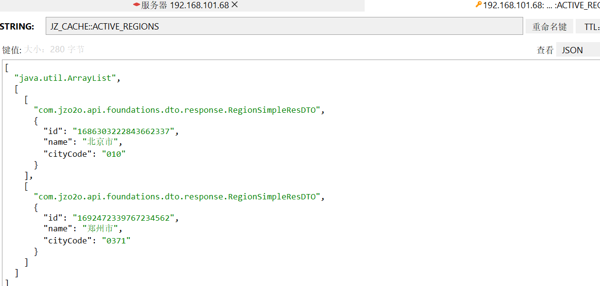

将郑州区域禁用，进入redis查询JZ\_CACHE::ACTIVE\_REGIONS缓存已经删除。

使用小程序进入定位界面查询开通区域列表，观察redis，缓存了最新的开通区域列表

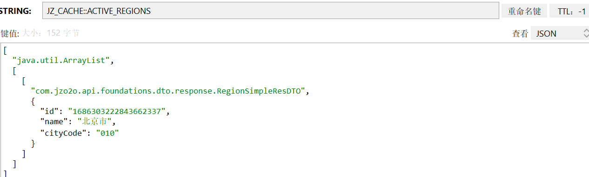

测试启用区域，找一个区域添加服务并上架然后启用这个区域。

下边启用区域“郑州”，启动用区域后再次查询开通区域列表，redis缓存了最新的开通区域列表：


### 1.6.小结

1.项目哪里进行了缓存，缓存方案是什么？

2.项目中如何保证缓存的一致性？

## 2.定时任务更新缓存

### 2.1.搭建XXL\-JOB环境

> 目标：搭建xxl\-job环境
>

**分布式调度平台XXL\-JOB介绍**

对于开通区域列表的缓存数据需要由定时任务每天凌晨更新缓存，如何实现定时任务呢？

1.使用第三方Quartz方式实现

Quartz 是一个功能强大的任务调度框架（项目地址：[https://github\.com/quartz\-scheduler/quartz](https://github.com/quartz-scheduler/quartz)   ），它可以满足更多更复杂的调度需求，Quartz 设计的核心类包括 Scheduler, Job 以及 Trigger。其中，Job 负责定义需要执行的任务，Trigger 负责设置调度策略，Scheduler 将二者组装在一起，并触发任务开始执行。Quartz支持简单的按时间间隔调度、还支持按日历调度方式，通过设置CronTrigger表达式（包括：秒、分、时、日、月、周、年）进行任务调度。

虽然Quartz可以实现按日历调度的方式，但无法支持分布式环境下任务调度。分布式环境下通常一个服务部署多个实例即多个jvm进程，假设运营基础服务部署两个实例每个实例定时执行更新缓存的任务，两个实例就会重复执行。如下图：


2.使用分布式调度平台XXL\-JOB

在分布式环境下进行任务调度需要使用分布式任务调度平台，XXL\-JOB是一个轻量级分布式任务调度平台，其核心设计目标是开发迅速、学习简单、轻量级、易扩展。现已开放源代码并接入多家公司线上产品线，开箱即用。

官网：[https://www\.xuxueli\.com/xxl\-job/](https://www.xuxueli.com/xxl-job/)

文档：[分布式任务调度平台XXL-JOB](https://www.xuxueli.com/xxl-job/#《分布式任务调度平台XXL-JOB》)

XXL\-JOB主要有调度中心、执行器、任务：

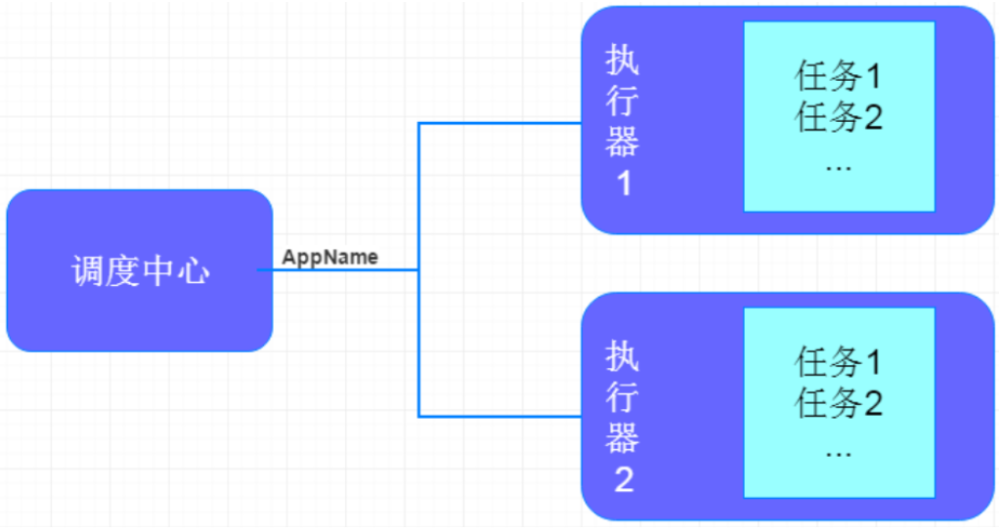

调度中心：

- 负责管理调度信息，按照调度配置发出调度请求，自身不承担业务代码；

- 主要职责为执行器管理、任务管理、监控运维、日志管理等


任务执行器：

- 负责接收调度请求并执行任务逻辑；

- 主要职责是执行任务、执行结果上报、日志服务等


使用XXL\-JOB就可以解决使用多个jvm进程重复执行任务的问题，如下图：

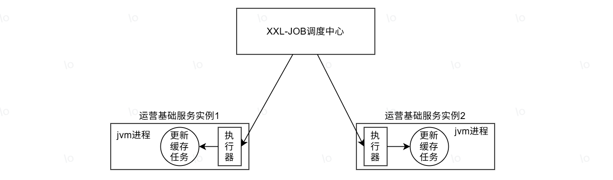

XXL\-JOB调度中心可以配置路由策略，比如：第一个、轮询策略、分片等，它们分别表示的意义如下：

- 第一个：即每次执行任务都由第一个执行器去执行。

- 轮询：即执行器轮番执行。

- 分片：每次执行任务广播给每个执行器让他们同时执行任务。

如果根据需求每次执行任务仅由一个执行器去执行任务可以设置路由策略：第一个、轮询。

如果根据需求每次执行任务由多个执行器同时执行可以设置路由策略为：分片。

**部署调度中心**

1\.查阅xxl\-job的源码

首先下载XXL\-JOB

GitHub：[https://github\.com/xuxueli/xxl\-job](https://github.com/xuxueli/xxl-job)

码云：[https://gitee\.com/xuxueli0323/xxl\-job](https://gitee.com/xuxueli0323/xxl-job)

项目使用2\.3\.1版本： [https://github\.com/xuxueli/xxl\-job/releases/tag/2\.3\.1](https://github.com/xuxueli/xxl-job/releases/tag/2.3.1)

也可从资料目录获取，解压xxl\-job\-2\.3\.1\.zip

使用IDEA打开解压后的目录

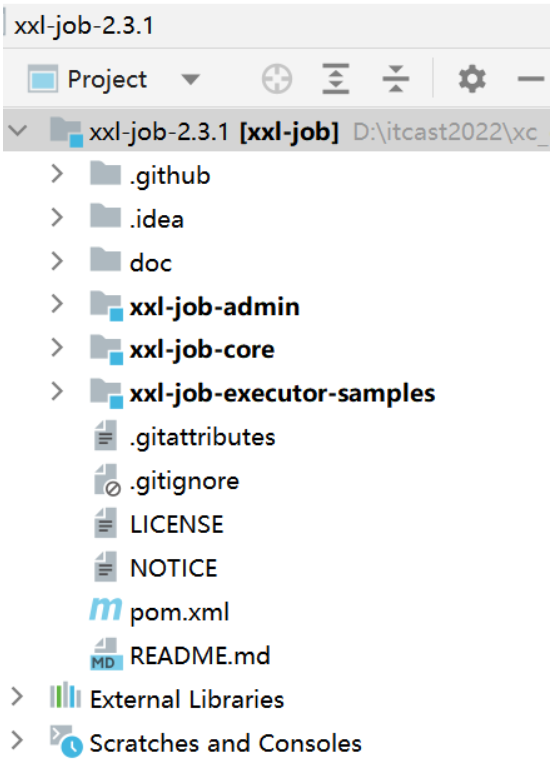

- xxl\-job\-admin：调度中心

- xxl\-job\-core：公共依赖

- xxl\-job\-executor\-samples：执行器Sample示例（选择合适的版本执行器，可直接使用）

- xxl\-job\-executor\-sample\-springboot：Springboot版本，通过Springboot管理执行器，推荐这种方式；

- xxl\-job\-executor\-sample\-frameless：无框架版本；

- doc :文档资料，包含数据库脚本


在下发的虚拟机的MySQL中已经创建了xxl\_job\_2\.3\.1数据库

如下图：

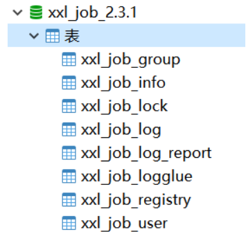

没有使用下发虚拟机请自行安装xxl\-job，参考“第三方软件安装说明”进行安装。

2\.启动xxl\-job

执行docker start xxl\-job\-admin 启动xxl\-job

访问：[http://192\.168\.101\.68:8088/xxl\-job\-admin/](http://192.168.101.68:8088/xxl-job-admin/)

账号和密码：admin/123456

**执行器**

1\.添加执行器依赖

下边配置执行器，执行器负责与调度中心通信接收调度中心发起的任务调度请求，同时负责执行微服务中定义的任务，执行器程序由xxl\-job提供，在微服务中引入下边的依赖即加入了执行器的程序：

```xml
<dependency>
    <groupId>com.xuxueli</groupId>
    <artifactId>xxl-job-core</artifactId>
</dependency>
```

本项目在framework中定义了jzo2o\-xxl\-job工程，它对执行器bean执行了定义：

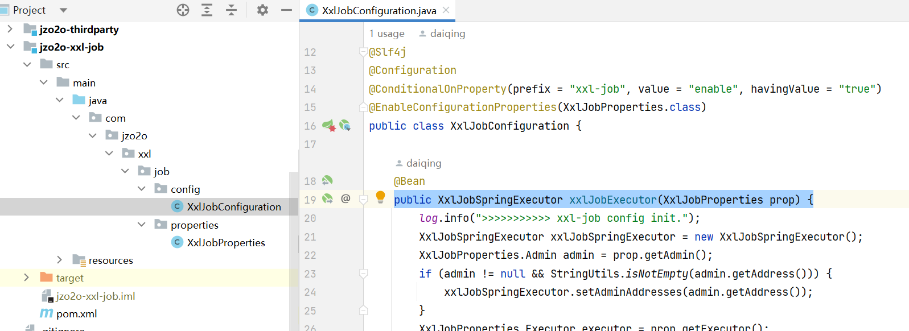

所以在需要使用xxl\-job的微服务中需要引入下边的依赖，在jzo2o\-foundations服务中引入下边的依赖：

```xml
<dependency>
    <groupId>com.jzo2o</groupId>
    <artifactId>jzo2o-xxl-job</artifactId>
</dependency>
```

2\.配置xxl\-job

接下来进入nacos，配置shared\-xxl\-job\.yaml：

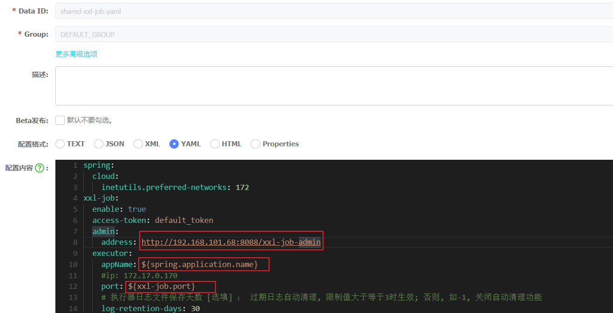

说明：

- address：调度中心的地址

- appName：执行器名称，为spring\.application\.name表示微服务的名称（在bootstrap\.yml中配置）

- port：执行器端口号,通过xxl\-job\.port配置


在jzo2o\-foundations\.yaml中配置执行器的端口：

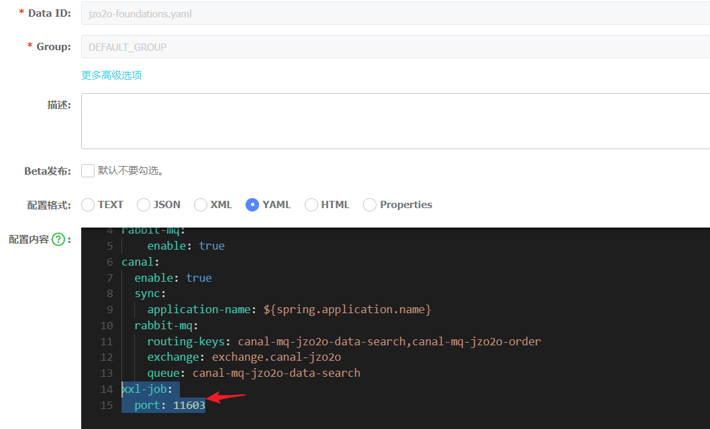

在jzo2o\-foundations中加载shared\-xxl\-job\.yaml：


3.下边进入调度中心添加执行器

进入调度中心，进入执行器管理界面，如下图：


点击新增，填写执行器信息


- AppName：执行名称，在shared\-xxl\-job\.yaml中指定执行器名称就是微服务的应用名。

- 名称：取一个中文名称。

- 注册方式：自动注册，只要执行器和调度中心连通执行器会自动注册到调度中心

- 机器地址：自动注册时不用填写。


找到应用名：jzo2o\-foundations，如下图：


添加成功：


启动jzo2o\-foundations，查看jzo2o\-foundations的控制台：

```java
>>>>>>>>>>> xxl-job remoting server start success, nettype = class com.xxl.job.core.server.EmbedServer, port = 11603 
```

说明执行器启动成功。

稍等片刻进入 xxl\-job调度中心，进入执行器管理界面，执行器注册成功：


点击“查看（1）”，查看执行器的地址，如下图：


**小结**

1.项目为什么要用xxl\-job？

2.xxl\-job的执行器和调度中心有什么区别？

### 2.2.定义缓存更新任务

根据本节的目标，使用xxl\-job定时更新开通区域列表的缓存。

**编写任务方法**

定时执行任务就需要编写任务方法，此任务方法由执行器去调用。

可以参考xxl\-job源码去编写任务方法，从源码目录中找到执行器示例代码：

xxl\-job\-2\.3\.1\\xxl\-job\-executor\-samples\\xxl\-job\-executor\-sample\-springboot\\src\\main\\java\\com\\xxl\\job\\executor\\service\\jobhandler\\SampleXxlJob\.java

部分示例代码如下，下边代码中demoJobHandler\(\)就是一个任务方法，需要使用@XxlJob注解标识，所在类需要由spring去管理，所以加了@Component注解。

```Java
@Component
public class SampleXxlJob {
    private static Logger logger = LoggerFactory.getLogger(SampleXxlJob.class);


    /*
     * 1、简单任务示例（Bean模式）
     */
    @XxlJob("demoJobHandler")
    public void demoJobHandler() throws Exception {
        XxlJobHelper.log("XXL-JOB, Hello World.");

        for (int i = 0; i < 5; i++) {
            XxlJobHelper.log("beat at:" + i);
            TimeUnit.SECONDS.sleep(2);
        }
        // default success
    }
    ....
```

参考上边的代码我们编写更新开通区域列表缓存的任务方法：

先删除开通区域的缓存，再查询开通区域列表进行缓存。

```Java
package com.jzo2o.foundations.handler;

import com.jzo2o.foundations.constants.RedisConstants;
import com.jzo2o.foundations.service.IRegionService;
import com.jzo2o.foundations.service.IServeService;
import com.xxl.job.core.handler.annotation.XxlJob;
import lombok.extern.slf4j.Slf4j;
import org.springframework.data.redis.core.RedisTemplate;
import org.springframework.stereotype.Component;

import javax.annotation.Resource;

/**
 * springCache缓存同步任务
 *
 **/
@Slf4j
@Component
public class SpringCacheSyncHandler {

    @Resource
    private IRegionService regionService;
    @Resource
    private RedisTemplate redisTemplate;

    /**
     * 已启用区域缓存更新
     * 每日凌晨1点执行
     */
    @XxlJob(value = "activeRegionCacheSync")
    public void activeRegionCacheSync() {
        log.info(">>>>>>>>开始进行缓存同步，更新已启用区域");
        //1.清理缓存
        String key = RedisConstants.CacheName.JZ_CACHE + "::ACTIVE_REGIONS";
        redisTemplate.delete(key);

        //2.刷新缓存
        regionService.queryActiveRegionListCache();
        log.info(">>>>>>>>更新已启用区域完成");
    }

}
```

**配置任务**

下边在调度中心配置任务。

进入任务管理，新增任务：


填写任务信息：


说明：

调度类型：


固定速度指按固定的间隔定时调度。

Cron，通过Cron表达式实现更丰富的定时调度策略。

Cron表达式是一个字符串，通过它可以定义调度策略，格式如下：

\{秒数\} \{分钟\} \{小时\} \{日期\} \{月份\} \{星期\} \{年份\(可为空\)\}

xxl\-job提供图形界面去配置：


一些例子如下：

- 0 0 0 \* \* ?  每天0点触发

- 30 10 1 \* \* ?  每天1点10分30秒触发

- 0/30 \* \* \* \* ? 每30秒触发一次

- \* 0/10 \* \* \* ? 每10分钟触发一次

- 为了方便测试这里第5秒执行一次，设置为：0/5 \* \* \* \* ?

运行模式有BEAN和GLUE，bean模式较常用就是在项目工程中编写执行器的任务代码，GLUE是将任务代码编写在调度中心。

JobHandler即任务方法名，填写任务方法上边@XxlJob注解中的名称。

路由策略：

- 第一个：即每次执行任务都由第一个执行器去执行。

- 轮询：即执行器轮番执行。

- 分片：每次执行任务广播给每个执行器让他们同时执行任务。


详细说明xxl\-job源码中的doc目录下的文档：


**启动任务并测试**

任务配置完成，下边启动任务


启动成功：


我们在任务方法上打断点跟踪，任务方法被执行，如下图：


尝试启用或禁用一个区域，观察redis中开通区域列表缓存是否更新。

**小结**

项目中哪里用了xxl\-job？怎么用的？

## 3.首页服务列表实现

我们先实现从数据库查询"首页服务列表"，将整体功能调试通过，再实现查询缓存。

下边我们先实现从数据库查询服务类型列表。

### 3.1.首页服务列表实现

**需求分析**

1\.界面原型

首页服务列表在门户的中心位置，下图红框中为首页服务列表区域：


默认展示前两个服务分类（按后台设置的排序字段进行升序排序），每个服务分类下取前4个服务项（按后台设置的排序字段进行升序排序）如下图：


一级服务分类显示的内容：服务分类的图标，服务分类的名称。

服务分类下的服务项内容：服务项图标，服务项名称。

**接口定义**

定义首页服务列表接口，查询2个一级服务分类，每个服务分类下查询4个服务项。

接口名称：首页服务列表

接口路径：GET/foundations/customer/serve/firstPageServeList


响应示例：

```json
{
    "msg": "OK",
    "code": 200,
    "data": [
        {
            "serveTypeId": 0,
            "cityCode": "",
            "serveTypeIcon": "",
            "serveTypeSortNum": 0,
            "serveResDTOList": [
                {
                    "serveItemSortNum": 0,
                    "serveItemName": "",
                    "serveItemId": 0,
                    "serveItemIcon": "",
                    "id": 0
                }
            ],
            "serveTypeName": ""
        }
    ]
}
```

**controller**

定义controller方法：

门户信息查询类接口统一在FirstPageServeController类中定义，service统一写在HomeService下。

定义FirstPageServeController 类提供门户界面查询类接口。

在controller中调用service查询首页服务列表。

```Java
package com.jzo2o.foundations.controller.consumer;

import com.jzo2o.foundations.model.dto.response.ServeCategoryResDTO;
import com.jzo2o.foundations.service.HomeService;
import io.swagger.annotations.Api;
import io.swagger.annotations.ApiImplicitParam;
import io.swagger.annotations.ApiImplicitParams;
import io.swagger.annotations.ApiOperation;
import org.springframework.validation.annotation.Validated;
import org.springframework.web.bind.annotation.GetMapping;
import org.springframework.web.bind.annotation.RequestMapping;
import org.springframework.web.bind.annotation.RequestParam;
import org.springframework.web.bind.annotation.RestController;

import javax.annotation.Resource;
import java.util.List;

@Validated
@RestController("consumerServeController")
@RequestMapping("/customer/serve")
@Api(tags = "用户端 - 首页服务查询接口")
public class FirstPageServeController {
    @Resource
    private HomeService homeService;

    @ApiOperation("首页服务列表")
    @ApiImplicitParams({
            @ApiImplicitParam(name = "regionId", value = "区域id", required = true, dataTypeClass = Long.class)
    })
    @GetMapping("/firstPageServeList")
    public List<ServeCategoryResDTO> firstPageServeList(@RequestParam("regionId") Long regionId) {
        return homeService.firstPageServeList(regionId);
    }
}
```

**mapper**

数据来源于三张表：serve\_type、serve\_item、serve，区域id是非常重要的限制条件，因为要查询该区域显示在首页的服务列表。

如何查询数据？

可以先查询出服务类型，再根据服务类型id查询下边的服务项，伪代码如下：

```java
//查询服务类型
List<ServeType> serveTypeList =...
for(ServeType serveType: serveTypeList){
      Long serveTypeId = serveType.getId();
     //再根据服务类型id查询下属的服务项信息

}
```

上边的代码会导致1\+n次查询数据库，这种代码要避免。

我们可以一次将符合条件的数据查询出来，再通过java程序对数据进行处理，再封装为接口要求的数据格式，最后返回给前端。

ServeMapper接口类：

```Java
/**
 * 查询出服务类型和对应的服务列表
 * @param regionId
 * @return
 */
List<ServeCategoryResDTO> getServeTypeAndServeList(Long regionId);
```

ServeMapper\.xml文件

```xml
<select id="getServeTypeAndServeList" resultMap="serveListResMap">

    select type.id serve_type_id,
           type.name serve_type_name,
           type.serve_type_icon serve_type_icon,
           type.sort_num serve_type_sort_num,
           serve.city_code city_code,
           serve.id id,
           item.id serve_item_id,
           item.name serve_item_name,
           item.serve_item_icon serve_item_icon,
           item.sort_num serve_item_sort_num
    from serve
             inner join serve_item item on item.id=serve.serve_item_id
             inner join serve_type type on type.id=item.serve_type_id
    where  serve.sale_status=2
      and type.active_status=2
      and item.active_status=2
      and serve.region_id=#{regionId}
    order by type.sort_num,item.sort_num
</select>

<!--手动的映射-->
<resultMap id="serveListResMap" type="com.jzo2o.foundations.model.dto.response.ServeCategoryResDTO">
    <!--id映射主键字段-->
    <id column="serve_type_id" property="serveTypeId"></id>
    <!--result映射普通字段-->
    <result column="serve_type_name" property="serveTypeName"></result>
    <result column="serve_type_icon" property="serveTypeIcon"></result>
    <result column="serve_type_sort_num" property="serveTypeSortNum"></result>
    <result column="city_code" property="cityCode"></result>

    <!--column 数据库中的字段名-->
    <!--property 实体类中对应的属性 该关键字可以省略... -->
    <!--ofType 是javaType中的单个对象类型-->
    <collection property="serveResDTOList" ofType="com.jzo2o.foundations.model.dto.response.ServeSimpleResDTO">
        <id column="id" property="id"></id>
        <result column="serve_item_id" property="serveItemId"></result>
        <result column="serve_item_name" property="serveItemName"></result>
        <result column="serve_item_icon" property="serveItemIcon"></result>
        <result column="serve_item_sort_num" property="serveItemSortNum"></result>
    </collection>
</resultMap>
```

**service**

定义专门用于门户首页查询的service接口,用于实现查询缓存：

```Java
package com.jzo2o.foundations.service;

import com.jzo2o.foundations.model.dto.response.ServeCategoryResDTO;

import java.util.List;

public interface HomeService {

    /**
     * 首页服务列表
     * @param regionId
     * @return
     */
    List<ServeCategoryResDTO> firstPageServeList(Long regionId);
}
```

定义实现类

```Java
package com.jzo2o.foundations.service.impl;

import cn.hutool.core.util.ObjectUtil;
import com.jzo2o.common.expcetions.ForbiddenOperationException;
import com.jzo2o.foundations.constants.RedisConstants;
import com.jzo2o.foundations.mapper.ServeMapper;
import com.jzo2o.foundations.model.domain.Region;
import com.jzo2o.foundations.model.dto.response.ServeCategoryResDTO;
import com.jzo2o.foundations.model.dto.response.ServeSimpleResDTO;
import com.jzo2o.foundations.service.HomeService;
import com.jzo2o.foundations.service.IRegionService;
import org.springframework.cache.annotation.Cacheable;
import org.springframework.cache.annotation.Caching;
import org.springframework.stereotype.Service;

import javax.annotation.Resource;
import java.util.ArrayList;
import java.util.Collections;
import java.util.List;

@Service
public class HomeServiceImpl implements HomeService {

    @Resource
    private IRegionService regionService;

    @Resource
    private ServeMapper serveMapper;


    /**
     * 首页服务列表
     * @param regionId
     * @return
     */
    @Override
    public List<ServeCategoryResDTO> firstPageServeList(Long regionId) {
        //1.检查区域状态是否启用
        Region region = regionService.getById(regionId);
        if(region==null || region.getActiveStatus()!=2){
            throw new ForbiddenOperationException("区域不存在或状态不对");
        }
        //2.根据城市编码查询所有服务类型和服务列表
        List<ServeCategoryResDTO> serveTypeAndServeList = serveMapper.getServeTypeAndServeList(regionId);
        if (ObjectUtil.isEmpty(serveTypeAndServeList)) {
            return Collections.emptyList();
        }
        //3.服务类型取前两个，每个类型下服务项取前4个
        Integer serveTypeSize = serveTypeAndServeList.size()>=2 ? 2:  serveTypeAndServeList.size();
        List<ServeCategoryResDTO> serveCategoryResDTOS = new ArrayList<>(serveTypeAndServeList.subList(0, serveTypeSize));
        serveCategoryResDTOS.forEach(serveType->{
            List<ServeSimpleResDTO> serveResDTOList = serveType.getServeResDTOList();
            Integer serveSize = serveResDTOList.size()>=4 ? 4 : serveResDTOList.size();

            List<ServeSimpleResDTO> serveSimpleResDTOS = new ArrayList<>(serveResDTOList.subList(0, serveSize));
            // serveResDTOList = serveResDTOList.subList(0,serveSize);
            serveType.setServeResDTOList(serveSimpleResDTOS);
        });
        return serveCategoryResDTOS;
    }
}
```

**测试**

重启jzo2o\-foundations服务、网关服务，打开小程序。

观察小程序的访问记录


注意：

如果访问记录中regionId为undefine，如下所示：

[http://192\.168\.101\.1:11500/foundations/customer/serve/firstPageServeList?regionId=undefine](http://192.168.101.1:11500/foundations/customer/serve/firstPageServeList?regionId=undefine)

这时需要重新定位，切换区域


测试预期结果：

在小程序首页正常显示服务列表。

示例：


### 3.2.首页服务列表缓存

**缓存方案分析**

下边是门户的缓存设计：


下边分析首页服务列表的缓存方案：

1.查询缓存：查询首页服务列表，如果缓存没有则查询数据库并缓存，如果缓存有则直接返回

> 注意：缓存时需要考虑缓存穿透问题。

2.禁用区域：删除首页服务列表缓存

3.定时任务：每天凌晨缓存首页服务列表。

**查询缓存**

下边在首页服务列表查询方法上添加Spring Cache注解实现查询缓存。

为了避免缓存穿透，如果服务列表为空则向redis缓存空值，缓存时间为30分钟；不为空则进行永久缓存。

在Cacheable注解中有两个属性可以指定条件进行缓存：

1.condition：指定一个 SpEL 表达式，用于决定是否要进行缓存。只有当条件表达式的结果为 true 时，方法的返回值才会被缓存。例如：

```Java
@Cacheable(value = "myCache", condition = "#id != null")
```

2.unless：与 condition 相反，只有当 SpEL 表达式的结果为 false 时，方法的返回值才会被缓存。

例如：

```Java
@Cacheable(value = "myCache", unless = "#result.length() > 100")
```

\#result 表示方法的返回值，如果返回值结果集的长度大于100不进行缓存。

根据需求，我们需要根据方法的返回值去判断，如果结果集的长度大于0说明服务列表不空，此时缓存时间为永久缓存，否则缓存时间为30分钟。

condition不支持获取方法返回的值，不能识别\#result。

我们使用unless实现。

unless 的特点是符合条件的不缓存。设置技巧：确定要缓存的条件，取反即不缓存的条件。

当方法返回的List的size为0时缓存30分钟，避免缓存穿透，设置为：\#result\.size\(\) \!= 0 

当方法返回的List的size大于0永不过期，设置为：\#result\.size\(\) == 0

代码如下：

```Java
package com.jzo2o.foundations.service.impl;

import cn.hutool.core.collection.CollUtil;
import com.jzo2o.foundations.constants.RedisConstants;
import com.jzo2o.foundations.mapper.ServeMapper;
import com.jzo2o.foundations.model.domain.Region;
import com.jzo2o.foundations.model.dto.response.ServeCategoryResDTO;
import com.jzo2o.foundations.service.HomeService;
import com.jzo2o.foundations.service.IRegionService;
import org.springframework.cache.annotation.Cacheable;
import org.springframework.cache.annotation.Caching;
import org.springframework.stereotype.Service;

import javax.annotation.Resource;
import java.util.List;
import java.util.Objects;
import java.util.stream.Collectors;


@Service
public class HomeServiceImpl implements HomeService {

    @Resource
    private IRegionService regionService;

    @Resource
    private ServeMapper serveMapper;

    @Override
    @Caching(cacheable = {
            // 如果结果集无值，说明缓存穿透，则应设置缓存为空值，有效期为30分钟
            @Cacheable(value = RedisConstants.CacheName.SERVE_ICON, key = "#regionId",
                    unless = "#result.size() != 0", cacheManager = RedisConstants.CacheManager.THIRTY_MINUTES),
            // 如果结果集有值，说明缓存命中，则应设置缓存为结果集，有效期为永久
            @Cacheable(value = RedisConstants.CacheName.SERVE_ICON, key = "#regionId",
                    unless = "#result.size() == 0", cacheManager = RedisConstants.CacheManager.FOREVER)
    })
    public List<ServeCategoryResDTO> firstPageServeList(Long regionId) {

        // 校验区域id是否存在
        Region region = regionService.getById(regionId);
        if (Objects.isNull(region) || region.getActiveStatus() != 2) {
            throw new IllegalArgumentException("区域id不存在或未启用");
        }

        // 查询服务分类列表
        List<ServeCategoryResDTO> serveCategoryResDTOList = serveMapper.firstPageServeList(regionId);
        if (CollUtil.isEmpty(serveCategoryResDTOList)) {
            throw new IllegalArgumentException("区域下无服务分类");
        }

        // 取前两个服务类型
        int serveTypeSize = Math.min(serveCategoryResDTOList.size(), 2);
        List<ServeCategoryResDTO> newServeTypeList = serveCategoryResDTOList.stream().limit(serveTypeSize).collect(Collectors.toList());
        for (ServeCategoryResDTO serveCategoryResDTO : newServeTypeList) {
            int serveItemSize = Math.min(serveCategoryResDTO.getServeResDTOList().size(), 4);
            serveCategoryResDTO.setServeResDTOList(serveCategoryResDTO.getServeResDTOList().stream().limit(serveItemSize).collect(Collectors.toList()));
        }

        return newServeTypeList;
    }
}
```

**查询缓存测试**

下边进行测试:

启动：jzo2o\-foundations服务、网关服务，打开小程序，等待首页服务列表正常显示，进入redis查看首页服务列表是否缓存。

预期结果：首页服务列表正常缓存。

示例：


**定时任务更新缓存**

根据缓存方案的分析，对首页服务列表进行缓存。

编写定时任务代码：

```Java
package com.jzo2o.foundations.handler;

import com.jzo2o.api.foundations.dto.response.RegionSimpleResDTO;
import com.jzo2o.foundations.constants.RedisConstants;
import com.jzo2o.foundations.service.HomeService;
import com.jzo2o.foundations.service.IRegionService;
import com.xxl.job.core.handler.annotation.XxlJob;
import lombok.extern.slf4j.Slf4j;
import org.springframework.data.redis.core.RedisTemplate;
import org.springframework.stereotype.Component;

import javax.annotation.Resource;
import java.util.List;

/**
 * 定时任务处理类
 */
@Slf4j
@Component
public class SpringCacheSyncHandler {

    @Resource
    private RedisTemplate<String,String> redisTemplate;

    @Resource
    private IRegionService regionService;

    @Resource
    private HomeService homeService;


    /**
     * 每日刷新开通区域列表缓存
     */
    @XxlJob("activeRegionCacheSync")
    public void updateActiveRegionsCache(){
        log.info(">>>>>>>>>>>>>>>>>>>活动区域列表缓存更新任务开始执行>>>>>>>>>>>>>>>>>>>>>>>>");
        String redisKey = RedisConstants.CacheName.JZ_CACHE + "::" + "ACTIVE_REGIONS";

        //1.删除原有缓存数据
        redisTemplate.unlink(redisKey);

        //2.添加新的缓存数据
        List<RegionSimpleResDTO> regionList = regionService.queryActiveRegionListCache();

        //3.遍历区域列表
        for (RegionSimpleResDTO region : regionList) {
            String redisServeKey = RedisConstants.CacheName.SERVE_ICON + "::" + region.getId();

            //4.删除原有缓存数据
            redisTemplate.unlink(redisServeKey);

            //5.按照区域缓存服务列表
            homeService.firstPageServeList(region.getId());
        }

        log.info(">>>>>>>>>>>>>>>>>>>活动区域列表缓存更新任务执行完毕>>>>>>>>>>>>>>>>>>>>>>>>");
    }
}
```

**定时任务更新缓存测试**

下边测试定时任务更新缓存：

先将首页服务列表的缓存手动删除。

重启foundations服务，在上边代码中打断点，保证定时任务成功执行。

预期结果：对每个运营区域的首页服务列表进行缓存。

示例：

跟踪断点执行。


编码规范

门户信息查询类接口统一在FirstPageServeController类中定义，service统一写在HomeService下。

首先实现业务接口的功能，测试通过后再去实现缓存。

**禁用区域时删除缓存** 

找到禁用区域代码 ,添加删除首页服务列表缓存的代码，如下： 

```Java
@Service
public class RegionServiceImpl extends ServiceImpl<RegionMapper, Region> implements IRegionService {
...
    @Override
    @Caching(evict = {
            @CacheEvict(value = RedisConstants.CacheName.JZ_CACHE, key = "'ACTIVE_REGIONS'"),
            @CacheEvict(value = RedisConstants.CacheName.SERVE_ICON, key = "#id")
    })
    public void deactivate(Long id) {
```

测试：禁用一个区域观察redis是否删除该区域的首页服务列表缓存。

**小结** 

项目中有做缓存吗？考虑缓存穿透问题了吗？怎么实现的？

## 4.服务类型列表缓存（实战）

### 4.1.分析设计

1\.界面原型

点击首页服务列表的服务分类或直接点击“全部服务”进入全部服务界面，


“全部服务” 界面如下图：

在全部服务界面需要展示当前区域下的服务分类，点击服务分类查询分类下的服务。


服务类型列表数据包括：服务类型的名称、服务类型id。

> 注意：只实现上图左侧显示的服务分类列表
>

2.接口定义

服务类型列表查询接口传入参数为：区域id，输出数据为服务类型列表，列表中元素包括：服务类型的名称、服务类型id，为了可扩展，列表元素包括服务类型的图标、排序字段方便进行展示。

接口名称：服务分类列表

接口路径：GET/foundations/customer/serve/serveTypeList


3.缓存方案分析

下边分析服务类型列表的缓存方案：

- 查询缓存：查询服务类型列表，如果缓存没有则查询数据库并缓存，如果缓存有则直接返回
- 禁用区域：删除服务类型列表缓存
- 定时任务：每天凌晨缓存服务类型列表。

### 4.2.实战要求

根据分析设计进行开发。

开发完成进行前后端联调。

## 5.热门服务列表（实战）

### 5.1.分析设计

1.界面原型

在门户有一块区域叫精选推荐，此信息为热门服务列表，如下图：


热门服务列表是在区域服务管理界面进行设置，如下图：


“设置热门”表示该服务项在本区域为精选推荐。

“取消热门”表示取消该服务项的精选推荐。

- 热门服务列表数据素包括：区域服务价格、价格单位、服务项id、服务项名称、服务项图标、服务详图。

- 信息来源于两张表：serve\_item、serve

- 查询条件：区域id、是否热门（是）、是否上架（是）

- 按服务修改时间降序排序

2.接口设计

接口名称：首页热门服务列表

接口路径：GET/foundations/customer/serve/hotServeList


响应参数：


示例数据：

```Java
{
    "msg": "OK",
    "code": 200,
    "data": {
        "cityCode": "",
        "serveItemName": "",
        "serveItemId": 0,
        "unit": 0,
        "detailImg": "",
        "price": 0,
        "serveItemImg": "",
        "id": 0
    }
}
```

3\. 缓存方案

查询缓存：查询热门服务列表，如果缓存没有则查询数据库并缓存，如果缓存有则直接返回

> 注意：缓存时需要考虑缓存穿透问题。
>

禁用区域：删除热门服务列表缓存

定时任务：每天凌晨缓存热门服务列表。

### 5.2.实战要求

根据分析设计进行开发。

开发完成进行前后端联调。

## 6.服务详情（实战） 

### 6.1.分析设计

1\.界面原型

在首页服务列表区域、热门服务列表区域以及全部服务界面，点击服务项名称进入服务详情页面，如下图：


服务详情页面显示服务相关的信息包括：服务项的名称、服务的运营价格、服务项的图片、服务项名称、价格单位。信息来源于serve\_item表和serve表。

2\.接口设计

接口名称：根据id查询服务

接口路径：GET/foundations/customer/serve/\{id\}

请求参数：服务id，即serve表的主键


3\. 缓存方案

服务详情信息来源于两部分信息：服务项信息、服务信息。

分别对服务项信息、服务信息进行缓存，方案如下：


分别编写方法：根据id查询服务项（已实现），根据id查询服务信息的方法（已实现）

然后实现查询缓存：

在服务详情接口中调用根据id查询服务项的service方法和 根据id查询服务信息的service方法，根据接口要求对两部分数据进行拼装返回。

针对热门服务的服务项信息和服务信息通过定时任务更新缓存，思路如下：

查询出所有热门服务，遍历热门服务列表先删除缓存，再执行查询方法对热门服务信息进行缓存。

### 6.2.实战要求

根据分析设计进行开发。

开发完成进行前后端联调。

# 四、服务搜索

## 1.服务搜索技术方案

> 目标：理解本项目的搜索技术方案
>

### 1.1.需求分析

服务搜索的入口有两处：

1.在门户最上端的搜索入口触发搜索框进入搜索页面，输入关键字进行搜索，如下图：

如下图：


2. 在门户最下方点击“全部服务”进入全部服务界面。

如下图：

点击服务分类查询分类下的服务。


### 1.2.技术方案

使用Elasticsearch进行全文检索

要实现服务搜索使用什么技术呢？

根据需求分析，对服务进行搜索除了根据服务类型查询其下的服务以外还需要根据关键字去搜索与关键字匹配的服务。

通过关键字去匹配服务的哪些信息呢？比如：输入关键字“家庭保洁”，它会去匹配服务相关的信息，比如：服务类型的名称、服务项的名称，甚至根据需要也可能去匹配服务介绍的信息，只要与“家庭保洁”相关的服务都会展示出来。如下效果：


这里最关键的是根据关键字去匹配，使用数据库的like搜索能否实现呢？

上图的搜索效果是一种全文检索方式，在搜索“家庭保洁”关键字时会对关键字先分词，分为“家庭”和“保洁”，再根据分好的词去匹配索引库中的服务类型的名称、服务项的名称、服务项的描述等字段。Like搜索不具有分词功能，它不是一种全文检索的方式。

虽然MySQL也支持全文检索，但是考虑搜索接口具有高性能需求，并且它面向的是C端用户，如果C端用户直接访问数据库在高并发时就会对数据库造成很大的压力，影响接口的性能，同时也会对其它业务使用数据库造成影响，所以一般C端用户的高性能接口不会直接访问数据库。

如果要实现全文检索且对接口性能有一定的要求，最常用的是Elasticsearch，本项目使用ES完成服务搜索功能的开发。

Elasticsearch是基于倒排索引的原理，正排索引是从文章中找词，倒排索引是根据词去找文章，原理如下： 


2.索引同步方案

如果要使用ES去搜索服务信息需要提前对服务信息在ES中创建索引，运营端在管理服务时是将服务信息保存在数据库，如何对数据库中的服务信息去创建索引，保证数据库中的信息与ES的索引信息同步呢，本节对索引同步的方案进行分析与确定。


方案1： 添加服务信息维护索引

在服务项的增删改查Service方法中添加维护ES索引的代码。

在区域服务的增删改查Service方法中添加维护ES索引的代码。

例如下边的代码：

```Java
public Serve onSale(Long id){
    //操作serve表
    //添加向ES创建索引的代码
}
```

首先上边的代码是在原有业务方式的基础上添加索引同步的代码，增加代码的复杂度不方便维护，扩展性差。

其次上边的代码存在分布式事务，操作serve表会访问数据库，添加索引会访问ES，使用数据库本地事务是无法控制整个方法的一致性的，比如：向ES写成功了由于网络问题抛出网络超时异常，最终数据库操作回滚了ES操作没有回滚，数据库的数据和ES中的索引不一致。

方案1：通常在生产中不会使用。

方案2：使用Canal\+MQ

Canal是什么？

canal \[kə'næl\]，译意为水道/管道/沟渠，主要用途是基于 MySQL 数据库增量日志解析，对数据进行同步，如下图：

Canal可与很多数据源进行对接，将数据由MySQL同步到ES、MQ、DB等各个数据源。

Canal的意思是水道/管道/沟渠，它相当于一个数据管道，通过解析MySQL的binlog日志完成数据同步工作。

官方文档：[https://github\.com/alibaba/canal/wiki](https://github.com/alibaba/canal/wiki)


要理解上图中Canal的工作原理需要首先要知道MySQL主从数据同步的原理，如下图：


MySQL主从集群由MySQL主服务器\(master\)和MySQL从服务器\(slave\)组成，MySQL主从数据同步是一种数据库复制技术，进行写数据会先向主服务器写，写成功后将数据同步到从服务器，流程如下：

1.主服务器将所有写操作（INSERT、UPDATE、DELETE）以二进制日志（binlog）的形式记录下来。

2.从服务器连接到主服务器，发送dump 协议,请求获取主服务器上的binlog日志。

MySQL的`dump`协议是MySQL复制协议中的一部分。

3.MySQL master 收到 dump 请求，开始推送 binary log 给 slave

4.从服务器解析日志，根据日志内容更新从服务器的数据库，完成从服务器的数据保持与主服务器同步。

理解了MySQL主从同步的原理，Canal在整个过程充当什么角色呢？

如下图：


工作流程如下：

1.Canal模拟 MySQL slave 的交互协议，伪装自己为 MySQL slave ，向 MySQL master 发送dump 协议

MySQL的`dump`协议是MySQL复制协议中的一部分。

2.MySQL master 收到 dump 请求，开始推送 binary log 给 slave \(即 canal \)。一旦连接建立成功，Canal会一直等待并监听来自MySQL主服务器的binlog事件流，当有新的数据库变更发生时MySQL master主服务器发送binlog事件流给Canal。

3.Canal会及时接收并解析这些变更事件并解析 binary log 

通过以上流程可知Canal和MySQL master主服务器之间建立了长连接。

本方案需要借助Canal和消息队列，具体实现方案如下：

通过上边的技术分析下边对本项目服务搜索方案进行总结。

本项目使用Elasticsearch实现服务的搜索功能，使用Canal\+MQ完成服务信息与ES索引同步。

如下图：


流程如下：

1.运营人员对服务信息进行增删改操作，MySQL记录binlog日志。

2.Canal定时读取binlog 解析出增加、修改、删除数据的记录。

3.Canal将修改记录发送到MQ。

4.同步程序监听MQ，收到增加、修改、删除数据的记录，请求ES创建、修改、删除索引。

5.C端用户请求服务搜索接口从ES中搜索服务信息。

### 1.3.小结

1.项目为什么要用Elasticsearch？数据很多吗？

2.项目中如何进行索引同步的？

## 2.MQ技术方案

> 目标：
>
> 能说出如何保证MQ消息的可靠性？
>
> 能说出如何保证MQ幂等性？或 如何防止重复消费？
>
> 处理消息堆积问题？
>

### 2.1.保证生产消息可靠性

上述技术方案中有一个关键点，首先数据增删改的信息是保证写入binlog的，Canal解析出增删改的信息后写入MQ，同步程序从MQ去读取消息，如果MQ中的消息丢失了数据将无法进行同步。

如何保证MQ消息的可靠性？

保证MQ消息的可靠性分两个方面：保证生产消息的可靠性、保证消费消息的可靠性。

保证生产消息的可靠性：

RabbitMQ提供生产者确认机制保证生产消息的可靠性，技术方案如下 ：


1.首先发送消息的方法如果执行失败会进行重试，重试次数耗尽记录失败消息

项目中抽取了发送消息的工具方法，代码 在jzo2o\-rabbitmq中，如下图：


@Retryable注解可实现方法执行失败进行重试，如下：

```java
@Retryable(value = MqException.class, maxAttempts = 3, backoff = @Backoff(value = 3000, multiplier = 1.5), recover = "saveFailMag")
```

说明如下：

- value：抛出指定异常才会重试

- include：和value一样，默认为空，当exclude也为空时，默认所有异常

- exclude：指定不处理的异常

- maxAttempts：最大重试次数，默认3次

- backoff：重试等待策略，默认使用@Backoff，@Backoff的value默认为1000L，我们设置为3000L；表示第一次失败后等待3秒后重试，multiplier（指定延迟倍数）默认为0，如果把multiplier设置为1\.5表示每次等待重试时间是上一次的1\.5倍，则第一次重试为3秒，第二次为4\.5秒，第三次为6\.75秒。

- Recover: 设置回调方法名，当重试耗尽时，通过recover属性设置回调的方法名。通过@Recover注解定义重试失败后的处理方法，在Recover方法中记录失败消息到数据库。

下边的方法表示将失败消息存储到失败表中

```java
/**
 * @param mqException mq异常消息
 * @param exchange    交换机
 * @param routingKey  路由key
 * @param msg         mq消息
 * @param delay       延迟消息
 * @param msgId       消息id
 */
@Recover
public void saveFailMag(MqException mqException, String exchange, String routingKey, Object msg, Integer delay, String msgId) {
    //发送消息失败，需要将消息持久化到数据库，通过任务调度的方式处理失败的消息
    failMsgDao.save(mqException.getMqId(), exchange, routingKey, JsonUtils.toJsonStr(msg), delay, DateUtils.getCurrentTime() + 10,  ExceptionUtil.getMessage(mqException));
}
```

2.通过MQ的提供的生产者确认机制保证生产消息的可靠性

使用生产者确认机制需要给每个消息指定一个唯一ID，生产者确认机制通过异步回调的方式进行，包括ConfirmCallback和Return回调。

ConfirmCallback：消息发送到Broker会有一个结果返回给发送者表示消息是否处理成功：

- 消息成功投递到交换机，返回ack

- 消息未投递到交换机，返回nack


源代码如下：

在发送消息时指定回调对象


回调类中回调方法源代码：

如果没有返回ack则将消息记录到失败消息表，如果经过重试后返回了ack说明消息发送成功，此时将消息从失败消息表删除。


Return回调：如果消息发送到交换机成功了但是并没有到达队列，此时会调用ReturnCallback回调方法，在回调方法中我们可以收到失败的消息存入失败消息表以便进行补偿。


要使用Return回调需要开启设置：

首先在shared\-rabbitmq\.yaml中配置rabbitMQ参数，如下：

```YAML
spring:
  rabbitmq:
    publisher-confirm-type: correlated
    publisher-returns: true
    template:
      mandatory: true 
```

> 说明：
> publish-confirm-type：开启publisher-confirm，这里支持两种类型：
> simple：同步等待confirm结果，直到超时
> correlated：异步回调，定义ConfirmCallback，MQ返回结果时会回调这个ConfirmCallback
> publish-returns：开启publish-return功能，同样是基于callback机制，不过是定义ReturnCallback
> template.mandatory：定义消息路由失败时的策略。true，则调用ReturnCallback；false：则直接丢弃消息

阅读下边的代码理解写入失败消息表的逻辑。


### 2.2.保证消费消息可靠性

首先设置消息持久化，保证消息发送到MQ消息不丢失。具体需要设置交换机和队列支持持久化，发送消息设置deliveryMode=2。

RabbitMQ是通过消费者回执来确认消费者是否成功处理消息的：消费者获取消息后，应该向RabbitMQ发送ACK回执，表明自己已经处理完成消息，RabbitMQ收到ACK后删除消息。


消费消息失败重试3次，仍失败则将消费失败的消息入库。

通过任务调度扫描失败消息表重新发送，达到一定的次数还未成功则由人工处理。

RabbitMQ提供三个确认模式：

- manual：手动ack，需要在业务代码结束后，调用api发送ack。

- auto：自动ack，由spring监测listener代码是否出现异常，没有异常则返回ack；抛出异常则返回nack

- none：关闭ack，MQ假定消费者获取消息后会成功处理，因此消息投递后立即被删除


由此可知：

- none模式下，消息投递是不可靠的，可能丢失

- auto模式类似事务机制，出现异常时返回nack，消息回滚到mq；没有异常，返回ack

- manual：自己根据业务情况，判断什么时候该ack

一般，我们都是使用默认的auto即可。

在shared\-rabbitmq\.yaml中配置：

```yaml
spring:
    rabbitmq:
       ....
        listener:
            simple:
                acknowledge-mode: auto #，出现异常时返回nack，消息回滚到mq；没有异常，返回ack
                retry:
                    enabled: true # 开启消费者失败重试
                    initial-interval: 1000 # 初识的失败等待时长为1秒
                    multiplier: 10 # 失败的等待时长倍数，下次等待时长 = multiplier * last-interval
                    max-attempts: 3 # 最大重试次数
                    stateless: true # true无状态；false有状态。如果业务中包含事务，这里改为false

```

本项目使用自动ack模式，当消费消息失败会重试，重试3次如果还失败会将消息投递到失败消息队列，由定时任务程序定时读取队列的消息,达到一定的次数还未成功则由人工处理。

### 2.3.保证消息幂等性

消费者在消费消息时难免出现重复消费的情况，比如：消费者没有向MQ返回ack导致重复消费，或者短时间内生产了多次同样的消息，所以消费者需要保证消费消息幂等性。


什么是幂等性？

幂等性是指不论执行多少次其结果是一致的。

举例：

收到消息需要向数据表新增一条记录，如果重复消费则会出现重复添加记录的问题。

下边根据场景分析解决方案：

1.查询操作

本身具有幂等性。

2.添加操作

如果主键是自增则可能重复添加记录。

保证幂等性可以设置数据库的唯一约束，比如：添加学生信息，将学号字段设置为唯一索引，即使重复添加相同的学生同一个学号只会添加一条记录。

3.更新操作

如果是更新一个固定的值，比如: update user set status =1 where id=?，本身具有幂等性。

如果只允许更新成功一次则可以使用token机制，发送消息前生成一个token写入redis，收到消息后解析出token从redis查询token如果成功则说明没有消费，此时更新成功将token从redis删除，当重复消费相同 的消息时由于token已经从redis删除不会再执行更新操作。

另外一种方式可以加锁：

- MySQL的乐观锁

- Redisson的分布式锁

4.删除操作

与更新操作类似，如果是删除某个具体的记录，比如：delete from user where id=?，本身具有幂等性。

如果只允许删除成功一次可以采用更新操作相同的方法。

通过以上分析进行总结：

1.使用数据库的唯一约束去控制。 

2.使用token机制，如下：

消息具有唯一的ID

发送消息时将消息ID写入Redis

消费时根据消息ID查询Redis判断是否已经消费，如果已经消费则不再消费。


### 2.4.小结

1.如何保证MQ消息的可靠性？

2.如何保证MQ幂等性？或 如何防止重复消费？

3.可以百分百保证MQ的消息可靠性吗？

> 保证消息可靠性分三个方面：保证生产消息可靠性、服务端持久化、保证消费消息可靠性。
>
> 1.保证生产消息可靠性：
>
> 生产消息可靠性是通过判断MQ是否发送ack回执，如果发nack表示发送消息失败，此时会进行重发或记录到失败消息表，通过定时任务进行补偿发送。如果Java程序并没有收到回执（如jvm进程异常结束了，或断电等因素），此时将无法保证生产消息的可靠性。
>
> 2.保证服务端持久化：
>
> 交换机、队列和消息都保存到磁盘上
>
> 3.保证消费消息可靠性：
>
> 保证消费消息可靠性方案首先保证发送消息设置为持久化，其次通过MQ的消费确认机制保证消费者消费成功消息后再将消息删除。
>
> 虽然设置了消息持久化，消息进入MQ首先是在缓存存在，MQ会根据一定的规则进行刷盘，比如：每隔几毫秒进行刷盘，如果在消息还没有保存到磁盘时MQ进程终止，此时将会丢失消息。虽然可以使用镜像队列（用于在 RabbitMQ 集群中复制队列的消息，这样做的目的是提高队列的可用性和容错性，以防止在单个节点故障时导致消息的丢失。）但也不能百分百保证消息不丢失。当然也可以使用仲裁队列模式会更好。
>
> 虽然我们加了很多保证可靠性的机制，这样也只是去提高消息的可靠性，不能百分百做的可靠，所以使用MQ的场景要考虑这种问题的存在，做好补偿处理任务。
>

## 3.配置数据同步环境

> 目标：
>
> 理解Canal\+MQ的同步流程
>
> 参考文档配置Canal\+MQ的同步环境
>

### 3.1.Canal\+MQ同步流程

下边回顾Canal的工作原理，如下图：

1.Canal模拟 MySQL slave 的交互协议，伪装自己为 MySQL slave ，向 MySQL master 发送dump 协议

MySQL的`dump`协议是MySQL复制协议中的一部分。

2.MySQL master 收到 dump 请求，开始推送 binary log 给 slave \(即 canal \)。一旦连接建立成功，Canal会一直等待并监听来自MySQL主服务器的binlog事件流，当有新的数据库变更发生时MySQL master主服务器发送binlog事件流给Canal。

3.Canal会及时接收并解析这些变更事件并解析 binary log 

通过以上流程可知Canal和MySQL master主服务器之间建立了长连接。


基于Canal\+MQ数据同步流程：


- 服务管理不仅向serve、serve\_item、serve\_type表写数据，同时也向serve\_sync表写数据，serve\_sync用于Canal同步数据使用。

- 向serve\_sync写数据产生binlog

- Canal请求读取binlog，并解析出serve\_sync表的数据更新日志，并发送至MQ的数据同步队列。

- 异步同步程序监听MQ的数据同步队列，收到消息后解析出serve\_sync表的更新日志。

- 异步同步程序根据serve\_sync表的更新日志请求Elasticsearch添加、更新、删除索引文档。

最终实现了将MySQL中的serve\_sync表的数据同步至Elasticsearch

### 2.3.配置Canal\+MQ数据同步环境

根据Canal\+MQ同步流程，下边进行如下配置：

1. 配置Mysql主从同步，开启MySQL主服务器的binlog

2. 安装Canal并配置，保证Canal连接MySQL主服务器成功

3. 安装RabbitMQ，并配置同步队列。

4. 在Canal中配置RabbitMQ的连接信息，保证Canal收到binlog消息写入MQ

对于异步程序监听MQ通过Java程序中实现。

以上四步配置详细参考“[附录-开发环境配置](https://lining-lo.github.io/lining-lo-notes/云岚到家/附录-开发环境配置.html#7配置canalmq数据同步环境)”。

### 2.4.小结

1.Canal是怎么伪装成 MySQL slave？

2.Canal数据同步异常了怎么处理？

## 4.索引同步

### 4.1.编写同步程序

刚才通过配置Canal\+MQ的数据同步环境实现了Canal从数据库读取binlog并且将数据写入MQ。

下边编写同步程序监听MQ，收到消息后向ES创建索引。

**创建索引结构** 

启动ES和kibana:

如果没有安装参考“第三方软件安装说明”安装elasticsearch7\.17\.7 和 kibana7\.17\.7。

安装完成后进行启动：

```bash
docker start elasticsearch7.17.7 
docker start kibana7.17.7
```

下边创建索引serve\_aggregation，serve\_aggregation索引的结构与jzo2o\-foundations数据库的serve\_sync表结构对应。

首先通过下边的命令查询索引

```bash
GET /_cat/indices?v 
```


查询索引结构

```bashJSON
GET /serve_aggregation/_mapping
```

删除索引结构

```bash
DELETE /serve_aggregation
```

创建索引结构

```json
PUT /serve_aggregation
{
   "mappings" : {
      "properties" : {
        "city_code" : {
          "type" : "keyword"
        },
        "detail_img" : {
          "type" : "text",
          "index" : false
        },
        "hot_time_stamp" : {
          "type" : "long"
        },
        "id" : {
          "type" : "keyword"
        },
        "is_hot" : {
          "type" : "short"
        },
        "price" : {
          "type" : "double"
        },
        "serve_item_icon" : {
          "type" : "text",
          "index" : false
        },
        "serve_item_id" : {
          "type" : "keyword"
        },
        "serve_item_img" : {
          "type" : "text",
          "index" : false
        },
        "serve_item_name" : {
          "type" : "text",
          "analyzer": "ik_max_word",
          "search_analyzer":"ik_smart"
          
        },
        "serve_item_sort_num" : {
          "type" : "short"
        },
        "serve_type_icon" : {
          "type" : "text",
          "index" : false
        },
        "serve_type_id" : {
          "type" : "keyword"
        },
        "serve_type_img" : {
          "type" : "text",
          "index" : false
        },
        "serve_type_name" : {
          "type" : "text",
          "analyzer": "ik_max_word",
          "search_analyzer":"ik_smart"
        },
        "serve_type_sort_num" : {
          "type" : "short"
        }
      }
    }
}
```

查看文档

```bash
GET /serve_aggregation/_search
```

**编写同步程序**

1\.添加依赖

首先在foundations工程添加下边的依赖

```xml
<dependency>
    <groupId>com.jzo2o</groupId>
    <artifactId>jzo2o-canal-sync</artifactId>
</dependency>
<dependency>
    <groupId>com.jzo2o</groupId>
    <artifactId>jzo2o-es</artifactId>
</dependency>
```

2\.配置连接 ES

修改foundations的配置文件：


修改nacos中es的配置文件


修改nacos中rabbitmq的配置文件


3\.编写同步程序

同步程序继承AbstractCanalRabbitMqMsgListener类，泛型中指定同步表对应的类型。

根据数据同步环境去配置监听MQ：

```Java
package com.jzo2o.foundations.handler;

import com.jzo2o.canal.listeners.AbstractCanalRabbitMqMsgListener;
import com.jzo2o.es.core.ElasticSearchTemplate;
import com.jzo2o.foundations.model.domain.ServeSync;
import org.springframework.amqp.core.ExchangeTypes;
import org.springframework.amqp.core.Message;
import org.springframework.amqp.rabbit.annotation.Exchange;
import org.springframework.amqp.rabbit.annotation.Queue;
import org.springframework.amqp.rabbit.annotation.QueueBinding;
import org.springframework.amqp.rabbit.annotation.RabbitListener;
import org.springframework.stereotype.Component;

import javax.annotation.Resource;
import java.util.List;

/**
 * 服务信息同步程序
 *
 **/
@Component
public class ServeCanalDataSyncHandler extends AbstractCanalRabbitMqMsgListener<ServeSync> {

    @Resource
    private ElasticSearchTemplate elasticSearchTemplate;

    //@RabbitListener(queues = "canal-mq-jzo2o-foundations", concurrency = "1")
    @RabbitListener(bindings = @QueueBinding(
            value = @Queue(name = "canal-mq-jzo2o-foundations"),
            exchange = @Exchange(name = "exchange.canal-jzo2o", type = ExchangeTypes.TOPIC),
            key = "canal-mq-jzo2o-foundations"),
            concurrency = "1"
    )
    public void onMessage(Message message) throws Exception {
    }


    @Override
    public void batchSave(List<ServeSync> data) {

    }

    @Override
    public void batchDelete(List<Long> ids) {

    }
}
```

- concurrency = "1"：表示消费线程数为1。

- 在同步程序中需要根据业务需求编写同步方法

- 当服务下架时会删除索引需要重写抽象类中的batchDelete\(List\<Long\> ids\)方法，此方法是当删除serve\_sync表的记录时 对索引执行删除操作。

- 当服务上架后需要添加索引，当服务信息修改时需要修改索引，需要重写抽象类中的batchSave\(List\<ServeSync\> data\)方法，此方法是当向serve\_sync表新增或修改记录时对索引执行添加及修改操作。

完整代码如下：

```Java
package com.jzo2o.foundations.handler;

import com.jzo2o.canal.listeners.AbstractCanalRabbitMqMsgListener;
import com.jzo2o.es.core.ElasticSearchTemplate;
import com.jzo2o.foundations.constants.IndexConstants;
import com.jzo2o.foundations.model.domain.ServeSync;
import lombok.extern.slf4j.Slf4j;
import org.springframework.amqp.core.ExchangeTypes;
import org.springframework.amqp.core.Message;
import org.springframework.amqp.rabbit.annotation.Exchange;
import org.springframework.amqp.rabbit.annotation.Queue;
import org.springframework.amqp.rabbit.annotation.QueueBinding;
import org.springframework.amqp.rabbit.annotation.RabbitListener;
import org.springframework.stereotype.Component;

import javax.annotation.Resource;
import java.util.List;

/**
 * serve_sync表数据同步到ES程序（MQ监听器类）
 */
@Component
@Slf4j
public class ServeCanalDataSyncHandler extends AbstractCanalRabbitMqMsgListener<ServeSync> {

    @Resource
    private ElasticSearchTemplate elasticSearchTemplate;


    @RabbitListener(bindings = @QueueBinding(
                        value = @Queue(name = "canal-mq-jzo2o-foundations",arguments={@Argument(name="x-single-active-consumer", value = "true", type = "java.lang.Boolean") }),
                        exchange = @Exchange(name = "exchange.canal-jzo2o" ,type = ExchangeTypes.TOPIC),
                        key = "canal-mq-jzo2o-foundations"
                    ),
                    concurrency = "1"
    )
    public void listenMsg(Message message) throws Exception {
        parseMsg(message);
    }


    @Override
    public void batchSave(List<ServeSync> data) {
        elasticSearchTemplate.opsForDoc().batchInsert(IndexConstants.SERVE, data);
        log.info("RabbitMQ监听器：serve_sync数据新增或更新到ES完毕");
    }

    @Override
    public void batchDelete(List<Long> ids) {
        elasticSearchTemplate.opsForDoc().batchDelete(IndexConstants.SERVE, ids);
        log.info("RabbitMQ监听器：serve_sync数据从ES中删除完毕");
    }
}
```

**测试**

启动jzo2o\-foundations服务。

启动成功,jzo2o\-foundations服务作为MQ的消费者和MQ建立通道，进入canal\-mq\-jzo2o\-foundations队列的管理界面，查看是否建立 了监听通道。


监听通道建立 成功，下边在同步程序打断点：


手动修改jzo2o\-foundations数据库的serve\_sync表的记录，这里修改了服务项的名称


正常执行同步程序：


放行继续执行到batchSave方法：


保证ES服务正常，同步方法执行成功后进入Kibana查看

执行命令：

```bash
GET /serve_aggregation/_search
```


查询服务信息与数据库serve\_sync表中1686352662791016449记录的信息一致。

下边再将服务项名称恢复。


再进入Kibana查看索引的内容与数据库一致


**小结**

1.编写同步程序的步骤：

> 1.根据数据库同步表的结构 创建索引结构。
>
> 2.同步程序监听MQ的同步队列
>
> 3.同步程序收到数据同步消息写入Elasticsearch，写的失败抛出异常，消息回到MQ。

2.如何保证Canal\+MQ同步消息的顺序性？

> 首先明确Canal解析binlog日志信息按顺序发到MQ的队列中，现在是要保证消费端如何按顺序消费队列中的消息。
>
> 生产中同一个jzo2o\-foundations服务会启动多个jvm进程，每个进程作为canal\-mq\-jzo2o\-foundations的消费者,如下图：
>
> 
>
> 现在对服务名称先修改为aa再修改为bb，在MQ中的有两个消息：
>
> - 修改服务名称为aa
>
> - 修改服务名称为bb
>
>
> 预期：最终将服务名称修改为bb
>
> 此时两条消息会被分发给两个jvm进程，假设“修改服务名称为aa”的消息发给jvm进程1，“修改服务名称为bb”的消息发给jvm进程2，两个进程分别去消费，此时无法控制两个消息的先后顺序，可能导致服务名称最终并非修改为bb。
>
> 解决方法：
>
> - 多个jvm进程监听同一个队列保证只有消费者活跃，即只有一个消费者接收消息。
>
> - 消费队列中的数据使用单线程。
>

3.如何保证只有一个消费者接收消息？

> 队列需要增加x\-single\-active\-consumer参数，表示否启用单一活动消费者模式。
>
> 
>
> 配置完成查保证队列上存在SAC标识，如下图：
>
> 
>
> 当有多个jvm进程都去监听该队列时，只有一个为活跃状态
>
> 
>
> 如果使用x\-single\-active\-consumer参数需要修改为如下代码：
>
> 在Queue中添加：arguments=\{@Argument\(name="x\-single\-active\-consumer", value = "true", type = "java\.lang\.Boolean"\) \}
>
> 如下所示：
>
> ```JSON
>     @RabbitListener(bindings = @QueueBinding(
>             value = @Queue(name = "canal-mq-jzo2o-foundations",arguments={@Argument(name="x-single-active-consumer", value = "true", type = "java.lang.Boolean") }),
>             exchange = @Exchange(name="exchange.canal-jzo2o",type = ExchangeTypes.TOPIC),
>             key="canal-mq-jzo2o-foundations"),
>             concurrency="1"
>     )
>     public void onMessage(Message message) throws Exception{
>         parseMsg(message);
>     }
> ```
>
> concurrency=”1“表示 指定消费线程为1。
>

### 4.2管理同步表

通过测试Canal\+MQ同步流程，只有当serve\_sync表变化时才会触发同步，serve\_sync表什么时候变化 ？

当服务信息变更时需要同时修改serve\_sync表，下边先分析serve\_sync的变化需求，再进行代码实现。

**管理同步表需求**

现在如何去维护serve\_sync这张表呢？

根据serve\_sync表的结构分析：

1.添加：区域服务上架向serve\_sync表添加记录，同步程序新增索引记录。

2.删除：区域服务下架从serve\_sync表删除记录，同步程序删除索引记录。

3.修改：

- 修改服务项修改serve\_sync的记录。

- 修改服务分类修改serve\_sync的记录。

- 修改服务价格修改serve\_sync的记录。

- 设置热门/取消热门修改serve\_sync的记录。

**代码实现**

1.区域服务上架向serve\_sync表添加记录

在ServeServiceImpl增加私有方法，如下：

```Java
/**
 * 新增服务同步数据
 *
 * @param serveId 服务id
 */
private void addServeSync(Long serveId) {
    //服务信息
    Serve serve = baseMapper.selectById(serveId);
    //区域信息
    Region region = regionMapper.selectById(serve.getRegionId());
    //服务项信息
    ServeItem serveItem = serveItemMapper.selectById(serve.getServeItemId());
    //服务类型
    ServeType serveType = serveTypeMapper.selectById(serveItem.getServeTypeId());

    ServeSync serveSync = new ServeSync();
    serveSync.setServeTypeId(serveType.getId());
    serveSync.setServeTypeName(serveType.getName());
    serveSync.setServeTypeIcon(serveType.getServeTypeIcon());
    serveSync.setServeTypeImg(serveType.getImg());
    serveSync.setServeTypeSortNum(serveType.getSortNum());

    serveSync.setServeItemId(serveItem.getId());
    serveSync.setServeItemIcon(serveItem.getServeItemIcon());
    serveSync.setServeItemName(serveItem.getName());
    serveSync.setServeItemImg(serveItem.getImg());
    serveSync.setServeItemSortNum(serveItem.getSortNum());
    serveSync.setUnit(serveItem.getUnit());
    serveSync.setDetailImg(serveItem.getDetailImg());
    serveSync.setPrice(serve.getPrice());

    serveSync.setCityCode(region.getCityCode());
    serveSync.setId(serve.getId());
    serveSync.setIsHot(serve.getIsHot());
    serveSyncMapper.insert(serveSync);
}
```

修改服务上架的方法：

```Java
@Override
@Transactional
@CachePut(value = RedisConstants.CacheName.SERVE, key = "#id",  cacheManager = RedisConstants.CacheManager.ONE_DAY)
public Serve onSale(Long id){
    ...
    //添加同步表
    addServeSync(id);
    return baseMapper.selectById(id);

}
```

2.区域服务下架从serve\_sync表删除记录


3.修改服务项修改serve\_sync的记录

代码已提供，阅读代码。


4.修改服务分类修改serve\_sync的记录

代码已提供，阅读代码。


**测试**

- 测试服务上架添加索引。

- 测试服务下架删除索引。

- 测试修改服务价格修改索引。

- 测试修改服务项名称修改索引。

- 测试修改修改服务分类名称修改索引。

## 5.搜索接口

> 目标：开发搜索接口。
>

### 5.1.定义接口

参数内容：区域编码，服务类型id、关键字

- 区域编码：用户定位成功前端记录区域编码（city\_code），搜索时根据city\_code搜索该区域的服务。

- 服务类型id：在全部服务界面选择一个服务类型查询其它下的服务列表。

- 关键字：输入关键字搜索服务项名称、服务类型名称。

接口名称：服务搜索接口

接口路径：GET/foundations/customer/serve/search


编写controller方法：

```Java
@GetMapping("/search")
@ApiOperation("首页服务搜索")
@ApiImplicitParams({
        @ApiImplicitParam(name = "cityCode", value = "城市编码", required = true, dataTypeClass = String.class),
        @ApiImplicitParam(name = "serveTypeId", value = "服务类型id", dataTypeClass = Long.class),
        @ApiImplicitParam(name = "keyword", value = "关键词", dataTypeClass = String.class)
})
public List<ServeSimpleResDTO> findServeList(@RequestParam("cityCode") String cityCode,
                                             @RequestParam(value = "serveTypeId", required = false) Long serveTypeId,
                                             @RequestParam(value = "keyword", required = false) String keyword) {
    List<ServeSimpleResDTO> serveList = serveAggregationService.search(cityCode, serveTypeId, keyword);
    return serveList;
}
```

### 5.2.搜索方法

首先通过ES的查询语言进行查询，如下：

```JSON
GET /serve_aggregation/_search
{
  "query": {
    "bool": {
      "must": [
        {
          "term": {
            "city_code": {
              "value": "010"
            }
          }
        }
      ],
      "filter": [
        {
          "multi_match": {
            "query": "维修家电",
            "fields": [
              "serve_item_name",
              "serve_type_name"
            ]
          }
        },
        {
          "term": {
            "serve_type_id": "1678654490336124929"
          }
        }
      ]
    }
  },
  "sort": [
    {
      "serve_item_sort_num": {
        "order": "asc"
      }
    }
  ]
}
```

### 5.3.service方法

下边按照ES查询语句编写service方法：

定义service接口：

```java
package com.jzo2o.foundations.service;

import com.jzo2o.foundations.model.dto.response.ServeSimpleResDTO;

import java.util.List;

public interface ServeAggregationService {

    /**
     * 查询服务列表
     *
     * @param cityCode    城市编码
     * @param serveTypeId 服务类型id
     * @param keyword     关键词
     * @return 服务列表
     */
    List<ServeSimpleResDTO> search(String cityCode, Long serveTypeId, String keyword);
}
```

service实现类

```Java
package com.jzo2o.foundations.service.impl;

import co.elastic.clients.elasticsearch._types.SortOrder;
import co.elastic.clients.elasticsearch.core.SearchRequest;
import co.elastic.clients.elasticsearch.core.SearchResponse;
import co.elastic.clients.elasticsearch.core.search.Hit;
import com.jzo2o.common.utils.BeanUtils;
import com.jzo2o.common.utils.CollUtils;
import com.jzo2o.common.utils.StringUtils;
import com.jzo2o.es.core.ElasticSearchTemplate;
import com.jzo2o.foundations.constants.IndexConstants;
import com.jzo2o.foundations.model.domain.ServeAggregation;
import com.jzo2o.foundations.model.dto.response.ServeSimpleResDTO;
import com.jzo2o.foundations.service.IServeAggegationService;
import org.springframework.beans.factory.annotation.Autowired;
import org.springframework.stereotype.Service;

import java.util.ArrayList;
import java.util.List;

@Service
public class ServeAggegationServiceImpl implements ServeAggregationService {

    @Autowired
    private ElasticSearchTemplate elasticSearchTemplate;

    /**
     * 服务搜索
     *
     * @param cityCode
     * @param serveTypeId
     * @param keyword
     * @return
     */
    @Override
    public List<ServeSimpleResDTO> search(String cityCode, Long serveTypeId, String keyword) {

        SearchRequest.Builder searchRequestBuilder = new SearchRequest.Builder();
        //1. 设置索引库名
        searchRequestBuilder.index(IndexConstants.SERVE);

        //2. 设置查询条件： 布尔组合查询
        searchRequestBuilder.query(query->query.bool(bool->{

            //必须的查询条件：根据城市编码term查询
            bool.must(must-> must.term(term->term.field("city_code").value(cityCode)));

            //可能的筛选条件：根据查询关键词multi_match查询
            if(StringUtils.isNotBlank(keyword)){
                bool.filter(filter->filter.multiMatch(multi->multi.fields("serve_item_name","serve_type_name").query(keyword)));
            }
            
            //可能的筛选条件：根据服务类型id精确查询
            if(serveTypeId!=null) {
                bool.filter(filter->filter.term(term->term.field("serve_type_id").value(serveTypeId)));
            }

            //返回bool对象
            return bool;
        }));

        //3. 设置排序：根据序号升序
        searchRequestBuilder.sort(x->x.field(y->y.field("serve_item_sort_num").order(SortOrder.Asc)));

        //4. 执行查询
        SearchResponse<ServeAggregation> searchResponse = elasticSearchTemplate.opsForDoc().search(searchRequestBuilder.build(), ServeAggregation.class);

        //5. 解析响应结果
        List<Hit<ServeAggregation>> hitList = searchResponse.hits().hits();

        List<ServeSimpleResDTO> resultList = new ArrayList<>();
        if(CollUtils.isNotEmpty(hitList)){
            for (Hit<ServeAggregation> hit : hitList) {
                ServeAggregation aggregation = hit.source();
                ServeSimpleResDTO dto = BeanUtils.copyBean(aggregation, ServeSimpleResDTO.class);
                resultList.add(dto);
            }
        }
        return resultList;
    }
}
```

### 5.4.测试

进入小程序，进入搜索界面


跟踪Network


查看response

```JSON
{
    "code": 200,
    "msg": "OK",
    "data": [
        {
            "id": "1693815624114970626",
            "serveItemId": "1685894105234755585",
            "serveItemName": "日常保洁",
            "serveItemIcon": "[https://yjy-xzbjzfw-oss.oss-cn-hangzhou.aliyuncs.com/072e4709-9be3-4df2-96ad-c3e2d5790556.png](https://yjy-xzbjzfw-oss.oss-cn-hangzhou.aliyuncs.com/072e4709-9be3-4df2-96ad-c3e2d5790556.png)",
            "serveItemSortNum": 1
        }
    ]
}
```

点击服务分类查询分类下的服务。


