# 一、预约下单

## 1.需求分析

完成了后台服务管理、服务上架的开发，接下来进入预约下单模块。

在预约下单模块我们需要完成下单接口的设计与开发，对接支付系统完成在线支付。

首先分析预约下单模块的需求。

### 1.1.核心业务流程

首先明确本模块在核心业务流程的位置，下图是项目的核心业务流程：

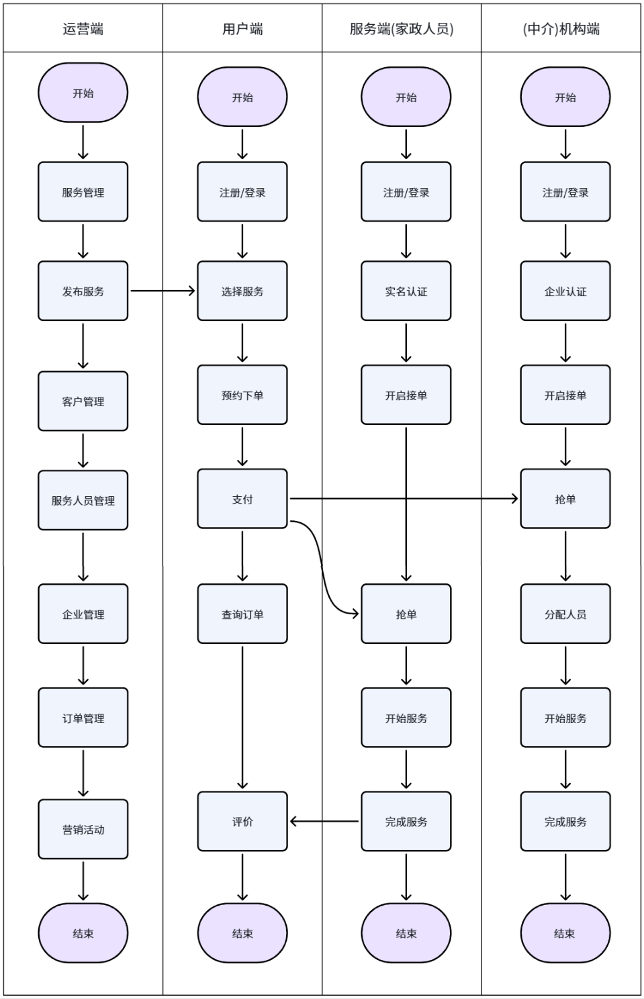

服务上架后用户端即可在小程序搜索到区域下的服务，点击服务进行预约下单和支付。

### 1.2.界面原型

在首页服务列表区域、热门服务列表区域以及全部服务界面，点击服务项名称进入服务详情页面，如下图：

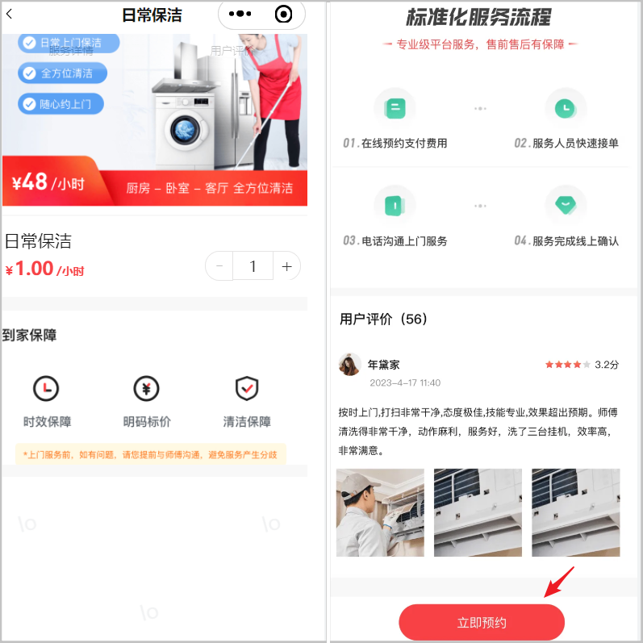

点击立即预约填写预约信息：

选择上门服务地址，此地址从我的地址簿中选择。

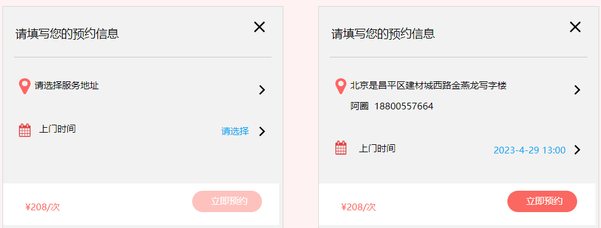

选择上门时间

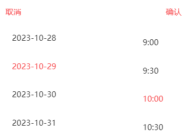

填写完成点击“立即预约”

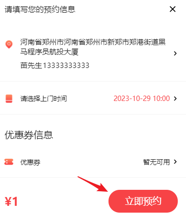

进入支付页面：

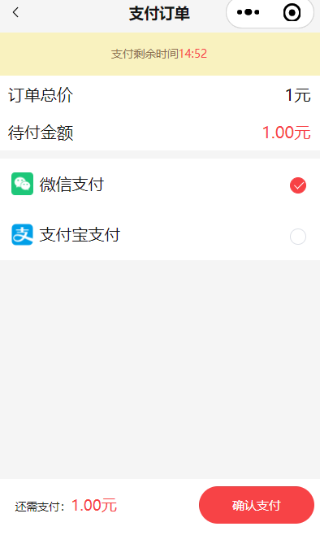

支付成功下单完成。

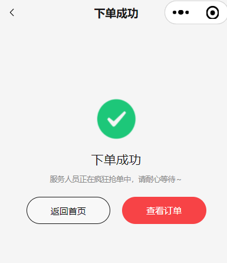

### 1.3.订单状态

订单数据中有一个属性关系到订单的整个流程，就是订单状态。  

本项目订单状态共有7种，如下图：

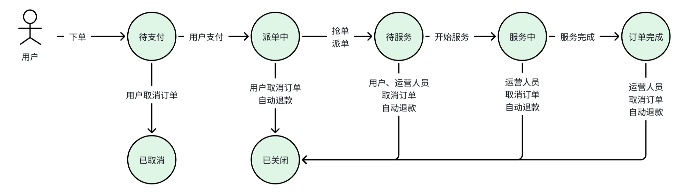

- 待支付：订单的初始状态。

- 派单中：用户支付成功后订单的状态由待支付变为派单中。

- 待服务：服务人员或机构抢单成功订单的状态由派单中变为待服务。

- 服务中：服务人员开始服务，订单状态变为服务中。

- 订单完成：服务人员完成服务订单状态变为订单完成。

- 已取消：订单是待支付状态时用户取消订单，订单状态变为已取消。

- 已关闭：订单已支付状态下取消订单后订单状态变为已关闭。

### 1.4.小结

1.下单业务流程是什么？

2.订单的状态有哪些？

## 2.系统设计

### 2.1.订单表设计

> 目标：能说出订单表的设计方法
>

**订单表设计方案**

在设计订单表时通常采用的结构是订单主表与订单明细表一对多关系结构，比如：在电商系统中，一个订单购买的多件不同的商品，设计订单表和订单明细表：

- 订单表：记录订单号、订单金额、下单人、订单状态等信息。

- 订单明细表：记录该订单购买商品的信息，包括：商品名称、商品价格、交易价格、购买商品数量等。

如下图：


如果系统需求是一个订单只包括一种商品，此时无须记录订单明细，将购买商品的详细信息记录在订单表即可，设计字段包括：订单号、订单金额、下单人、订单状态、商品名称、购买商品数量等。

下边根据需求设计本项目的订单表，本项目用户购买服务没有购物车，选择一个服务开始下单，所以本项目不设计订单明细表只设计订单表。

**表结构设计**

下边设计本项目订单表的表结构。

除了订单号、订单金额、订单状态、下单人ID等字段外，订单表还存储哪些信息？

根据需求梳理预约下单提交的数据如下：

|属性|含义|
|---|---|
|订单所属人|创建订单的用户id|
|服务项|用户选择服务项|
|城市编码|用户定位的城市编码|
|单价|服务的单位|
|购买数量|购买服务的数量|
|订单总金额|单价乘以购买数量|
|优惠金额|根据优惠券计算的优惠金额|
|实际支付金额|订单总金额减去优惠金额|
|服务详细地址|家政服务的具体地址|
|服务开始时间|服务预约时间|
|联系人手机号|购买家政服务联系人的手机号|
|联系人姓名|购买家政服务联系人的姓名|
|经度|家政服务具体地址的经度，来源于我的地址|
|纬度|家政服务具体地址的纬度，来源于我的地址|
|订单状态|订单状态代码，下单后状态是未支付状态|

通过分析，订单表包括以下几部分：

- 订单基础信息：订单号、订单状态、排序字段、是否显示标记等。

- 价格信息：单价、购买数量、优惠金额、订单总金额等。

- 下单人信息：下单人ID、联系方式、位置信息（相当于收货地址）等。

- 服务\(商品\)相关信息：服务类型名称、服务项名称、服务单价、价格单位、购买数量等。

服务信息相当于商品，如果有订单明细表要在订单明细表中存储，本项目将服务相关信息存储在订单表。

1.表结构如下

```sql
create table `jzo2o-orders`.orders
(
    id               bigint                             not null comment '订单id'
        constraint `PRIMARY`
        primary key,
    user_id          bigint                             not null comment '订单所属人',
    serve_type_id    bigint                             null comment '服务类型id',
    serve_type_name  varchar(50)                        null comment '服务类型名称',
    serve_item_id    bigint                             not null comment '服务项id',
    serve_item_name  varchar(50)                        null comment '服务项名称',
    serve_item_img   varchar(255)                       null comment '服务项图片',
    unit             int                                null comment '服务单位',
    serve_id         bigint                             not null comment '服务id',
    orders_status    int                                not null comment '订单状态，0：待支付，100：派单中，200：待服务，300：服务中，400：待评价，500：订单完成，600：已取消，700：已关闭',
    pay_status       int                                null comment '支付状态，2：待支付，4：支付成功',
    refund_status    int                                null comment '退款状态 1退款中 2退款成功 3退款失败',
    price            decimal(10, 2)                     not null comment '单价',
    pur_num          int      default 1                 not null comment '购买数量',
    total_amount     decimal(10, 2)                     not null comment '订单总金额',
    real_pay_amount  decimal(10, 2)                     not null comment '实际支付金额',
    discount_amount  decimal(10, 2)                     not null comment '优惠金额',
    city_code        varchar(20)                        not null comment '城市编码',
    serve_address    varchar(255)                       not null comment '服务详细地址',
    contacts_phone   varchar(20)                        not null comment '联系人手机号',
    contacts_name    varchar(255)                       not null comment '联系人姓名',
    serve_start_time datetime                           not null comment '服务开始时间',
    lon              double(10, 5)                      null comment '经度',
    lat              double(10, 5)                      null comment '纬度',
    pay_time         datetime                           null comment '支付时间',
    evaluation_time  datetime                           null comment '评价时间',
    trading_order_no bigint                             null comment '支付服务交易单号',
    transaction_id   varchar(50)                        null comment '第三方支付的交易号',
    refund_no        bigint                             null comment '支付服务退款单号',
    refund_id        varchar(50)                        null comment '第三方支付的退款单号',
    trading_channel  varchar(50)                        null comment '支付渠道',
    display          int      default 1                 null comment '用户端是否展示，1：展示，0：隐藏',
    sort_by          bigint                             null comment '排序字段，serve_start_time毫秒级时间戳+订单id后六位',
    create_time      datetime default CURRENT_TIMESTAMP not null,
    update_time      datetime default CURRENT_TIMESTAMP not null on update CURRENT_TIMESTAMP
)
    comment '订单表' charset = utf8mb4;
```

2.数据来源分析

| 字段名称         | 中文含义                         | 来源                                               |
| ---------------- | -------------------------------- | -------------------------------------------------- |
| id               | 订单id                           | 自动生成 19位：2位年+2位月+2位日+13位序号          |
| user_id          | 订单所属人id                     | 从token中获取                                      |
| serve_id         | 服务id                           | 前端请求                                           |
| serve_type_id    | 服务类型id                       | 根据服务id远程调用运营基础服务查询                 |
| serve_type_name  | 服务类型名称                     | 根据服务id远程调用运营基础服务查询                 |
| serve_item_id    | 服务项id                         | 根据服务id远程调用运营基础服务查询                 |
| serve_item_name  | 服务项名称                       | 根据服务id远程调用运营基础服务查询                 |
| serve_item_img   | 服务项图片                       | 根据服务id远程调用运营基础服务查询                 |
| unit             | 服务单位                         | 根据服务id远程调用运营基础服务查询                 |
| orders_status    | 订单状态                         | 设置为 未支付                                      |
| pay_status       | 支付状态                         | 设置为 未支付                                      |
| price            | 单价                             | 根据服务id远程调用运营基础服务查询                 |
| pur_num          | 购买数量                         | 前端请求                                           |
| total_amount     | 订单总金额                       | 订单总金额 价格 * 购买数量                         |
| real_pay_amount  | 实际支付金额                     | 实付金额 订单总金额 - 优惠金额                     |
| discount_amount  | 优惠金额                         | 根据优惠券加订单总金额计算优惠金额，暂时为0        |
| city_code        | 城市编码                         | 根据服务id远程调用运营基础服务查询                 |
| serve_address    | 服务详细地址                     | 远程调用客户中心服务查询我的地址获得               |
| contacts_phone   | 联系人手机号                     | 远程调用客户中心服务查询我的地址获得               |
| contacts_name    | 联系人姓名                       | 远程调用客户中心服务查询我的地址获得               |
| serve_start_time | 服务开始时间                     | 前端请求                                           |
| lon              | 经度                             | 远程调用客户中心服务查询我的地址获得               |
| lat              | 纬度                             | 远程调用客户中心服务查询我的地址获得               |
| pay_time         | 支付时间                         | 对接支付服务获取                                   |
| evaluation_time  | 评价时间                         | 用户评价的时间，预留                               |
| trading_order_no | 支付服务交易单号                 | 对接支付服务，支付服务生成的交易单号，支付完成填充 |
| transaction_id   | 第三方支付的交易号               | 微信支付的交易号，支付完成填充                     |
| refund_no        | 支付服务退款单号                 | 对接支付服务，支付服务生成的退款单号，退款完成填充 |
| refund_id        | 第三方支付的退款单号             | 微信支付的退款单号，退款完成填充                   |
| trading_channel  | 支付渠道                         | 微信、支付等，支付完成填充                         |
| display          | 用户端是否展示，1：展示，0：隐藏 | 默认为1                                            |
| sort_by          | 排序字段                         | 根据服务开始时间转为毫秒时间戳+订单后5位           |
| create_time      | 创建时间                         | 数据库控制，默认当前时间                           |
| update_time      | 更新时间                         | 数据库控制，更新时默认当前时间                     |

**小结**

订单表是怎么设计的？

### 2.2.搭建订单工程

> 目标：搭建订单工程。
>

**搭建订单工程**

1.搭建订单工程

整个订单模块包括：订单管理、抢单、派单、历史订单四个小模块，对应的工程如下：

| **工程名**            | **服务名**       | **职责**                                                    |
| --------------------- | ---------------- | ----------------------------------------------------------- |
| jzo2o-orders-base     | 订单模块基础工程 | 提供数据模型、数据访问基础mapper，供其它工程通过maven依赖。 |
| jzo2o-orders-manager  | 订单管理服务     | 预约下单、服务管理、取消订单等订单管理相关的接口。          |
| jzo2o-orders-seize    | 抢单服务         | 为服务人员和机构抢单提供服务。                              |
| jzo2o-orders-dispatch | 派单服务         | 根据派单规则自动为服务人员、机构派送订单。                  |
| jzo2o-orders-history  | 历史订单服务     | 订单冷热分离，历史订单查询接口。                            |

jzo2o\-orders\-base作为其它四个工程的公共工程，提供订单模块基础的mapper接口、数据模型等内容。

当前我们实现的预约下单小模块属于订单管理模块，所以我们共创建两个工程：jzo2o\-orders\-base和jzo2o\-orders\-manager。

从资料的源码目录解压jzo2o\-orders\-01\-0\.zip下的代码到代码目录jzo2o\-orders

使用IDEA打开jzo2o\-orders目录，工程结构如下：

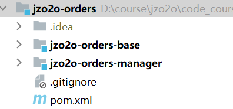

2.创建订单数据库：jzo2o\-orders

从资料下SQL脚本目录获取jzo2o\-orders\-alone\.sql,导入数据，如下：

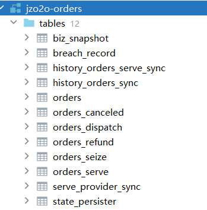

修改nacos中jzo2o\-orders\-manager\.yaml：

屏蔽下边红框中的配置信息。

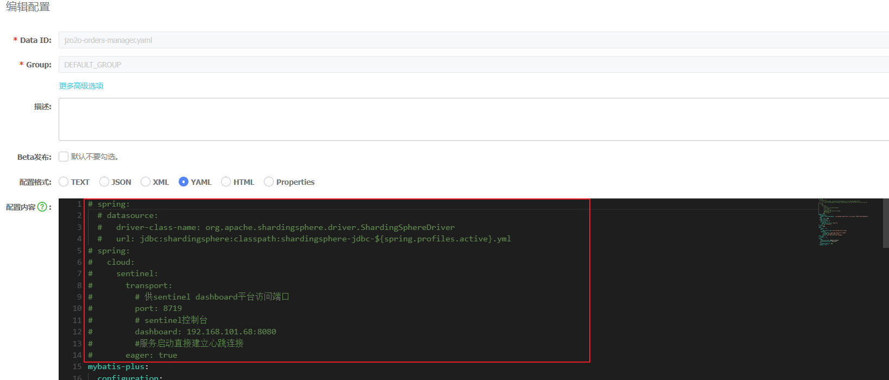

**搭建订单依赖的工程**

1.在jzo2o\-customer工程解压jzo2o\-customer\-02\-0\.zip，进行替换操作 \(删除原来的src和pom\.xml，替换新的src目录和pom\.xml文件\) 。

2.在jzo2o\-foundations工程解压jzo2o\-foundations\.zip进行替换操作 \(删除原来的src和pom\.xml，替换新的src目录和pom\.xml文件\)。

**小结**

1.整个订单工程包括哪几部分？

2.订单工程搭建步骤：

> 搭建订单工程，包括jzo2o\-orders\-base和jzo2o\-orders\-manager
>
> 创建订单数据库（独立数据库）
>
> 搭建订单依赖的工程：jzo2o\-customer、jzo2o\-foundations

### 2.3.接口设计

> 目标：设计下单接口。
>

**设计接口**

根据需求分析及订单表的设计进行接口分析：

除了serve\_id、pur\_num、serve\_start\_time 由前端传入以外还需要传入以下参数：

优惠券ID：用户选择优惠券，系统根据优惠券的信息计算优惠金额，需要前端传入优惠券的Id。

我的地址簿ID：用户从我的地址簿中选择地址，前端传入我的地址簿Id，系统从我的地址簿中查询服务地址及具体的经纬度坐标。

接口定义如下：

- 接口名称：下单接口

- 接口功能：普通用户创建订单

- 接口路径：POST/orders\-manager/consumer/orders/place

- 请求数据类型 application/json

- 请求参数

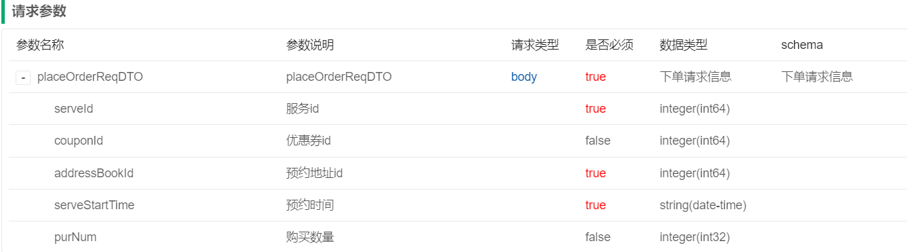

请求示例：

```json
{
  "serveId": 0,
  "couponId": 0,
  "addressBookId": 0,
  "serveStartTime": "",
  "purNum": 0
}
```

响应参数

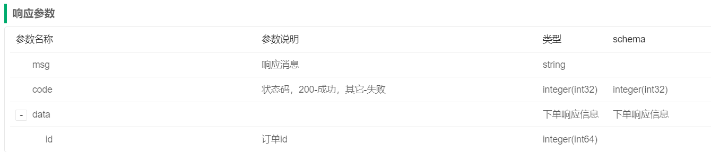

响应示例：

```json
{
  "msg": "OK",
  "code": 200,
  "data": {
    "id": 0
   }
}
```

编写Controller方法：

```Java
package com.jzo2o.orders.manager.controller.consumer;

import com.jzo2o.orders.manager.model.dto.request.PlaceOrderReqDTO;
import com.jzo2o.orders.manager.model.dto.response.PlaceOrderResDTO;
import com.jzo2o.orders.manager.service.IOrdersCreateService;
import io.swagger.annotations.Api;
import io.swagger.annotations.ApiOperation;
import org.springframework.web.bind.annotation.PostMapping;
import org.springframework.web.bind.annotation.RequestBody;
import org.springframework.web.bind.annotation.RequestMapping;
import org.springframework.web.bind.annotation.RestController;

import javax.annotation.Resource;

@RestController("consumerOrdersController")
@Api(tags = "用户端-订单相关接口")
@RequestMapping("/consumer/orders")
public class ConsumerOrdersController {

    @Resource
    private IOrdersCreateService ordersCreateService;

    @ApiOperation("下单接口")
    @PostMapping("/place")
    public PlaceOrderResDTO place(@RequestBody PlaceOrderReqDTO placeOrderReqDTO) {
        PlaceOrderResDTO placeOrderResDTO = ordersCreateService.placeOrder(placeOrderReqDTO);
        return placeOrderResDTO;
    }
}
```

**service实现思路**

下边分析service实现思路，首先定义OrdersCreateServiceImpl 类。

```JSON
package com.jzo2o.orders.manager.service.impl;

import com.baomidou.mybatisplus.extension.service.impl.ServiceImpl;
import com.jzo2o.orders.base.mapper.OrdersMapper;
import com.jzo2o.orders.base.model.domain.Orders;
import com.jzo2o.orders.manager.model.dto.response.PlaceOrderResDTO;
import com.jzo2o.orders.manager.service.IOrdersCreateService;
import lombok.extern.slf4j.Slf4j;
import org.springframework.stereotype.Service;

/**
 * <p>
 * 下单服务类
 * </p>
 */
@Slf4j
@Service
public class OrdersCreateServiceImpl extends ServiceImpl<OrdersMapper, Orders> implements IOrdersCreateService {

    @Override
    public PlaceOrderResDTO placeOrder(PlaceOrderReqDTO placeOrderReqDTO) {

        //1. 调用feign接口（foundations服务的）查询服务信息

        //2. 调用feign接口（customer服务的）查询地址信息

        //3. 封装订单对象信息
    
        //3.1 订单基本信息封装
    
        //3.2 下单人信息封装
    
        //3.3  支付相关信息（暂时不处理）
    
        //3.4 服务信息封装
    
        //3.5 价格信息封装

        //4. 创建订单到订单表
 
        return null;
    }
}
```

**小结**

下单接口的执行流程？

## 3.系统开发

### 3.1.开发远程接口

> 下单接口保存的数据较多，有一些数据需要远程调用来获取：
>
> - 根据地址簿Id远程调用客户中心，查询我的地址簿信息。
>
> - 根据服务Id远程调用运营基础服务，查询服务相关的信息。
>

**查询地址簿远程接口**

微服务之间远程调用的接口统一定义在jzo2o\-api工程。

查询地址簿远程接口是根据地址簿ID查询地址簿信息，接口定义如下：

接口路径：GET/customer/inner/address\-book/\{id\}

请求数据类型 application/x\-www\-form\-urlencoded

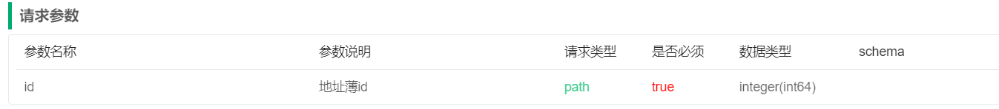

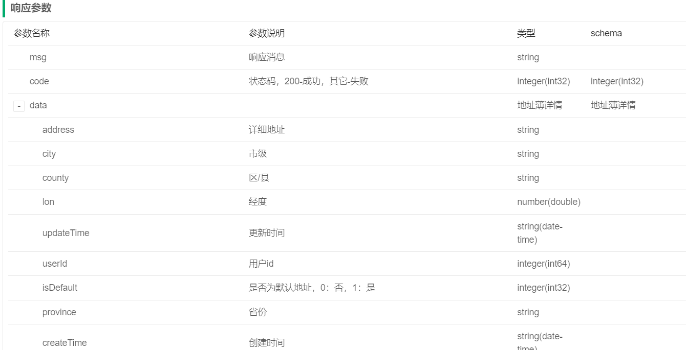

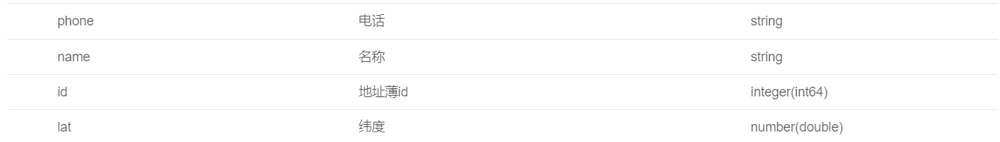

1.在jzo2o\-api工程定义接口

在jzo2o\-api工程定义我的地址簿远程查询接口

这里使用@FeignClient注解实现Feign远程调用，此注解是openfeign下的注解，OpenFeign 是 Spring Cloud 对 Feign 进行了集成，并提供了对 Spring Cloud 注解的支持。

```Java
package com.jzo2o.api.customer;

import com.jzo2o.api.customer.dto.response.AddressBookResDTO;
import com.jzo2o.api.customer.fallback.AddressBookApiFallbackFactory;
import io.swagger.annotations.ApiOperation;
import org.springframework.cloud.openfeign.FeignClient;
import org.springframework.web.bind.annotation.GetMapping;
import org.springframework.web.bind.annotation.PathVariable;
import org.springframework.web.bind.annotation.RequestParam;

import java.util.List;

/**
 * 内部接口 - 地址薄相关接口
 */
//contextId 指定FeignClient实例的上下文id，如果不设置默认为类名，value指定微服务的名称，path:指定接口地址
@FeignClient(contextId = "jzo2o-customer", value = "jzo2o-customer", path = "/customer/inner/address-book")
public interface AddressBookApi {

    @GetMapping("/{id}")
    AddressBookResDTO findById(@PathVariable("id") Long id);
   
}
```

定义完成将jzo2o\-api打包发布到本地仓库

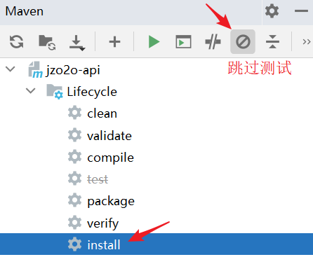


2.在jzo2o\-customer工程定义实现类

```Java
package com.jzo2o.customer.controller.inner;

import cn.hutool.core.bean.BeanUtil;
import com.jzo2o.api.customer.AddressBookApi;
import com.jzo2o.api.customer.dto.response.AddressBookResDTO;
import com.jzo2o.customer.model.domain.AddressBook;
import com.jzo2o.customer.service.IAddressBookService;
import io.swagger.annotations.Api;
import io.swagger.annotations.ApiImplicitParam;
import io.swagger.annotations.ApiImplicitParams;
import io.swagger.annotations.ApiOperation;
import org.springframework.web.bind.annotation.*;

import javax.annotation.Resource;
import java.util.List;

/**
 * 内部接口 - 地址薄相关接口
 *
 **/
@RestController
@RequestMapping("inner/address-book")
@Api(tags = "内部接口 - 地址薄相关接口")
public class InnerAddressBookController implements AddressBookApi {
    @Resource
    private IAddressBookService addressBookService;

    @Override
    @GetMapping("/{id}")
    @ApiOperation("地址薄详情")
    @ApiImplicitParams({
            @ApiImplicitParam(name = "id", value = "地址薄id", required = true, dataTypeClass = Long.class)
    })
    public AddressBookResDTO findById(@PathVariable("id") Long id) {
        AddressBook addressBook = addressBookService.getById(id);
        return BeanUtil.toBean(addressBook, AddressBookResDTO.class);
    }

}
```

3.开发完成启动jzo2o\-customer

通过接口文档进行测试

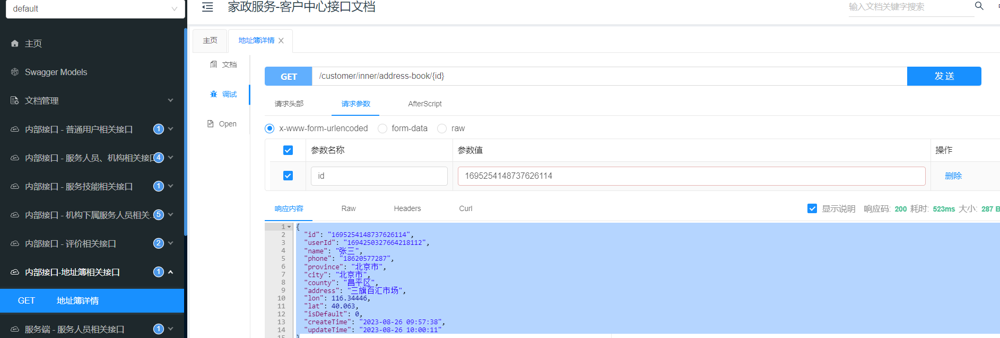

服务调用方orders中单元测试：

```Java
package com.jzo2o.orders.manager.service;

import com.jzo2o.api.customer.AddressBookApi;
import com.jzo2o.api.customer.dto.response.AddressBookResDTO;
import org.junit.jupiter.api.Test;
import org.springframework.boot.test.context.SpringBootTest;

import javax.annotation.Resource;

@SpringBootTest
public class OrderCreateServiceTest {

    @Resource
    private AddressBookApi addressBookApi;

    @Test
    public void testAddressBookDetail(){
        AddressBookResDTO book = addressBookApi.findById(1851093245211365378L);
        System.out.println(book);
    }
}
```

**查询服务信息远程接口**

阅读现有代码。

```Java
package com.jzo2o.api.foundations;

import com.jzo2o.api.foundations.dto.response.ServeAggregationResDTO;
import org.springframework.cloud.openfeign.FeignClient;
import org.springframework.web.bind.annotation.GetMapping;
import org.springframework.web.bind.annotation.PathVariable;
import org.springframework.web.bind.annotation.RequestParam;

import java.util.List;

@FeignClient(contextId = "jzo2o-foundations", value = "jzo2o-foundations", path = "/foundations/inner/serve")
public interface ServeApi {

    @GetMapping("/{id}")
    ServeAggregationResDTO findById(@PathVariable("id") Long id);

}
```

通过接口文档自行测试。

**小结**

1.如何编写一个项目内部调用的远程接口？

> - 项目内部的远程接口统一放在jzo2o\-api工程
>
> - 首先进入jzo2o\-api编写接口，注意使用@FeignClient注解
>
> - 进入服务提供者微服务，编写接口实现类
>

2.Feign和OpenFeign的区别？

> - Feign 是 Netflix 公司开发的一个独立的项目，在使用 Spring Cloud 时，需要单独引入 Feign 的依赖。
>
> - OpenFeign 是 Spring Cloud 对 Feign 进行了集成，并提供了对 Spring Cloud 注解的支持。
>
> - Feign 使用了一套自己的注解，例如 `@FeignClient` 用于声明一个 Feign 客户端，`@RequestMapping` 用于声明请求的映射等。
>
> - OpenFeign 则直接使用了 Spring MVC 注解，例如 `@GetMapping`、`@PostMapping` 等，这使得 OpenFeign 更加和 Spring 生态集成。
>
> - 从spring boot 2\.0之后基本上都是使用OpenFeign 了。
>

### 3.2.熔断降级

**什么是熔断降级**

在微服务架构一定要去预防微服务雪崩问题，微服务雪崩问题是指在微服务架构中，当一个服务出现故障时，由于服务之间的依赖关系，故障可能会传播到其他服务，导致大规模的服务失败，系统无法正常运行。这种情况就像雪崩一样，最初一个小问题最终引发了整个系统的崩溃。简单理解微服务雪崩就是微服务之间相互调用，因为调用链中的一个服务故障，引起整个链路都无法访问的情况。

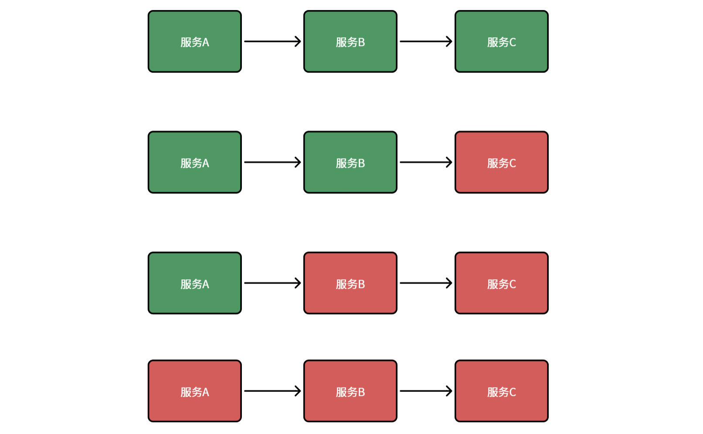

常用的预防微服务雪崩的的方法：

1.超时处理：设定超时时间，请求超过一定时间没有响应就返回错误信息，不会无休止等待。

2.熔断降级：当服务的异常数或异常比例超过了预设的阈值时，熔断器会进入开启状态，暂时中断对该服务的请求，此时走降级方法，能够快速响应，确保系统的基本功能能够继续运行。

3.限流：限制对服务的请求速率，避免短时间内大量的请求导致系统崩溃。

4.线程池隔离：给要请求的资源分配一个线程池，线程池去控制请求数量

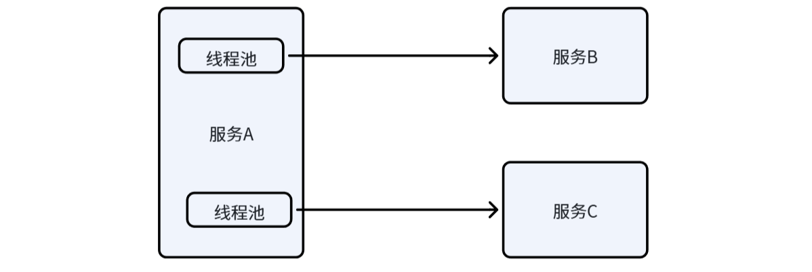

5.信号量隔离：使用计数器模式，记录请求资源的并发线程数量，达到信号量上限时，禁止新的请求。

> 信号量隔离适合同步请求，控制并发数，比如：对文件的下载并发数进行控制。
>
> 大多数场景都适合使用线程池隔离，对于需要同步操作控制并发数的场景可以使用信号量隔离。

**使用sentinel实现熔断降级**

Sentinel是阿里巴巴开源的一款微服务流量治理组件，主要以流量为切入点，从流量限流、熔断降级、系统负载保护等多个维度来帮助开发者保障微服务的稳定性。

本项目使用Sentinel实现限流、熔断等机制预防微服务雪崩。

熔断降级是微服务保护的一种方法，当使用Feign进行远程调用，在客户端通过熔断降级措施进行微服务保护。

如下图：

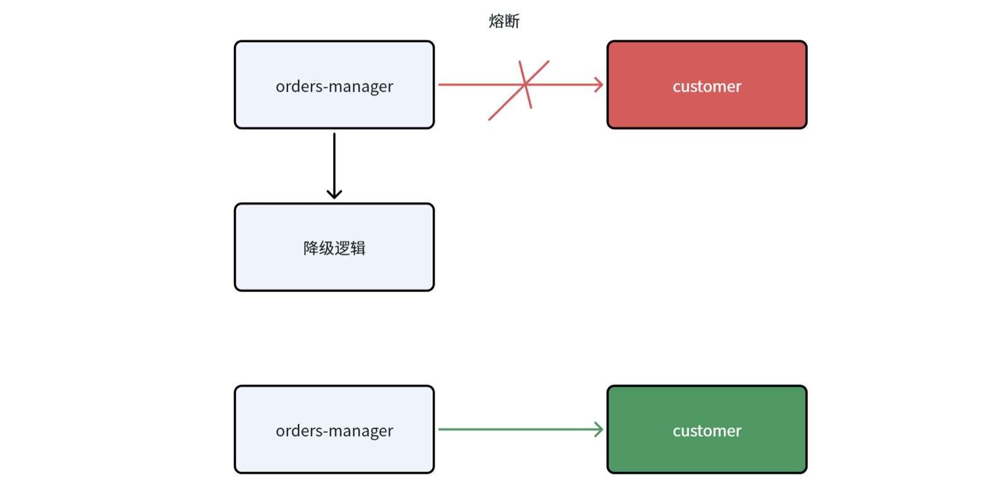

orders\-manager订单服务请求customer查询地址簿，在进行feign远程调用过程出现异常将走降级方法，当异常比例或异常数达到一定的阈值将触发熔断，熔断期间将直接走降级逻辑快速响应。

当customer服务恢复后，熔断时间结束此时会再次尝试请求customer，如果成功请求将关闭熔断，恢复原来的链路。

下边使用sentinel实现熔断、降级。

首先参考“[附录-开发环境配置](https://lining-lo.github.io/lining-lo-notes/云岚到家/附录-开发环境配置.html)” 安装sentinel并在orders\-manager工程中集成sentinel。

根据上图可知，熔断、降级发生在客户端，下边在订单管理服务（调用customer的客户端）定义CustomerClient类用于请求customer服务。

这里是以服务提供者为单独定义远程调用Client类，如果要远程调用jzo2o\-foundations服务则定义FundationsClient 类。

```java
package com.jzo2o.orders.manager.service.client;

import com.alibaba.csp.sentinel.annotation.SentinelResource;
import com.alibaba.csp.sentinel.slots.block.BlockException;
import com.jzo2o.api.customer.dto.AddressBookApi;
import com.jzo2o.api.customer.dto.response.AddressBookResDTO;
import com.jzo2o.orders.manager.service.impl.OrdersCreateServiceImpl;
import lombok.extern.slf4j.Slf4j;
import org.springframework.stereotype.Component;

import javax.annotation.Resource;

@Component
@Slf4j
public class CustomerClient {

    @Resource
    private AddressBookApi addressBookApi;

    @SentinelResource(value = "getAddressBookDetail", fallback = "findAddressDetailByIdFallback", blockHandler = "getAddressBookDetailBlockHandler")
    public AddressBookResDTO findAddressDetailById(Long id) {
        log.info("根据id查询地址簿，id:{}", id);
        // 调用其他微服务方法
        AddressBookResDTO detail = addressBookApi.findById(id);
        return detail;
    }

    //执行异常走
    public AddressBookResDTO findAddressDetailByIdFallback(Long id, Throwable throwable) {
        log.error("非限流、熔断等导致的异常执行的降级方法，id:{},throwable:", id, throwable);
        return null;
    }

    //熔断后的降级逻辑
    public AddressBookResDTO getAddressBookDetailBlockHandler(Long id, BlockException blockException) {
        log.error("触发限流、熔断时执行的降级方法，id:{},blockException:", id, blockException);
        return null;
    }
}
```

> @SentinelResource注解的属性说明：
>
> - value: 用于定义资源的名称，即 Sentinel 会对该资源进行流量控制和熔断降级。
>
> - fallback ：非限流、熔断等导致的异常执行的降级方法
>
> - blockHandler :触发限流、熔断时执行的降级方法
>

下边在下单方法中通过CustomerClient 调用customer：

```Java
package com.jzo2o.orders.manager.service.impl;

import com.baomidou.mybatisplus.extension.service.impl.ServiceImpl;
import com.jzo2o.orders.base.mapper.OrdersMapper;
import com.jzo2o.orders.base.model.domain.Orders;
import com.jzo2o.orders.manager.model.dto.response.PlaceOrderResDTO;
import com.jzo2o.orders.manager.service.IOrdersCreateService;
import lombok.extern.slf4j.Slf4j;
import org.springframework.stereotype.Service;

/**
 * <p>
 * 下单服务类
 * </p>
 */
@Slf4j
@Service
public class OrdersCreateServiceImpl extends ServiceImpl<OrdersMapper, Orders> implements IOrdersCreateService {

    @Autowired
    private CustomerClient  customerClient;
    
    @Override
    public PlaceOrderResDTO placeOrder(PlaceOrderReqDTO placeOrderReqDTO) {

        //1. 调用feign接口（foundations服务的）查询服务信息
    
        //2. 调用feign接口（customer服务的）查询地址信息
        AddressBookResDTO address = customerClient.findAddressDetailById(dto.getAddressBookId());

    
        //3. 封装订单对象信息
    
        //3.1 订单基本信息封装
    
        //3.2 下单人信息封装
    
        //3.3  支付相关信息（暂时不处理）
    
        //3.4 服务信息封装
    
        //3.5 价格信息封装

        //4. 创建订单到订单表
 
        return null;
    }
}
```

项目使用@EnableFeignClients扫描Feign接口，生成代理对象。

具体代码在jzo2o\-api工程：

```java
package com.jzo2o.config;

import com.jzo2o.common.handler.RequestIdHandler;
import com.jzo2o.common.handler.UserInfoHandler;
import com.jzo2o.interceptor.FeignInterceptor;
import lombok.extern.slf4j.Slf4j;
import org.springframework.boot.autoconfigure.condition.ConditionalOnProperty;
import org.springframework.cloud.openfeign.EnableFeignClients;
import org.springframework.context.annotation.Bean;
import org.springframework.context.annotation.Configuration;
import org.springframework.context.annotation.Import;

@Slf4j
@Configuration
@EnableFeignClients(basePackages = "com.jzo2o.api")
@Import({com.jzo2o.utils.MyQueryMapEncoder.class})
@ConditionalOnProperty(prefix = "feign", name = "enable", havingValue = "true")
public class ClientScanConfiguration {
....
```

在CustomerClient 中注入了Feign接口的代理对象，通过Feign进行远程调用。

**测试**

测试流程：

1.通过接口文档测试下单接口，触发customerClient\.getDetail\(addressBookId\);

接口文档地址：http://localhost:11504/orders-manager/doc.html#/home

2.在sentinel中配置熔断规则 

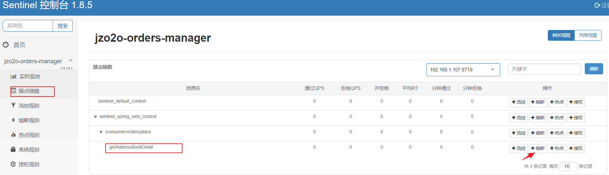

为了方便测试熔断效果配置异常数规则，如下：

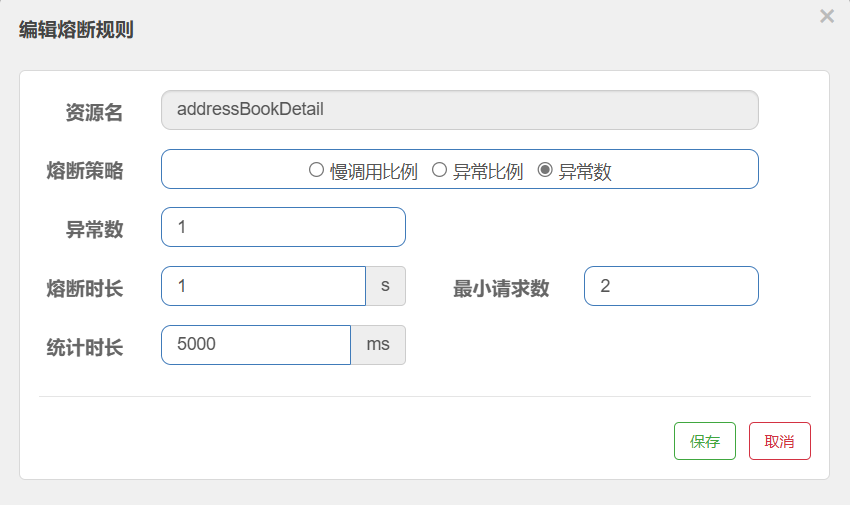

5秒以内最少请求2次，有1次异常则进行熔断。熔断时长为1秒。

3.停止customer服务 

由于customer服务停止导致远程调用异常，调用fallback 方法：

具体流程是：

- 先调用getDetail\(Long id\) 方法，发生异常调用detailFallback\(Long id, Throwable throwable\) 方法。

- 当达到熔断阈值触发熔断，将直接走blockHandler 不再走getDetail\(Long id\) 方法。

通过观察控制台日志判断是否达到测试预期结果。

**小结**

1.微服务保护怎么做？

2.你的项目怎么实现微服务保护的？怎么实现熔断降级的？

3.微服务之间远程调用怎么实现的？

**查询服务信息接口熔断降级\(实战\)**

参考“查询地址簿接口” 的远程调用代码，对查询服务信息接口的远程调用添加熔断、降级的处理方法。

### 3.3.订单号生成规则

**常见的订单号生成规则**

1.自增数字序列

使用数据库的自增主键或者其他递增的数字序列（比如redis的INCR命令）作为订单号的一部分。例如，订单号可以是"20231028000001"，其中"20231028"表示日期，"000001"是自增的订单序号。

2.时间戳\+随机数

将年月日时分秒和一定范围内的随机数组合起来。例如，订单号可以是"20181028124523" \+ "1234"，其中"20181028124523"表示日期和时间，"1234"是随机生成的数字。

使用时间戳\+随机数作为主键有重复的风险。

3.订单类型\+日期\+序号

将订单类型（例如"01"表示普通订单，"02"表示VIP订单等）、日期和序号组合起来。例如，订单号可以是"0120181028000001"，其中"01"表示订单类型，"20181028"表示日期，"00001"是序号。

加上订单类型的好处是方便客户服务，根据订单号就可以知道订单的类型。

4.分布式唯一ID生成器

使用分布式唯一ID生成器（例如Snowflake雪花算法）生成全局唯一的ID作为订单号。这种方法保证了在分布式系统中生成的订单号的唯一性和有序性。 

Snowflake 算法根据机器ID、时间戳、序号等因素生成，保证全局唯一性，它的优势在于生成的 ID 具有趋势递增、唯一性、高效性等特点\.

Snowflake 算法对系统时钟的依赖性较强，如果系统时钟发生回拨，可能会导致 ID 生成出现问题。因此，在使用 Snowflake 算法时，需要定时进行时钟同步，确保系统时钟的稳定性。

**本项目订单号生成规则**

19位：2位年\+2位月\+2位日\+13位序号

例如：2606011000000000001

实现方案：

- 前6位通过当前时间获取。

- 后13位通过Redis的INCR 命令实现。


**代码实现**

定义订单管理的接口

```Java
@Slf4j
@Service
public class OrdersCreateServiceImpl extends ServiceImpl<OrdersMapper, Orders> implements IOrdersCreateService {

    private static final String ORDER_SERIAL_NUM_KEY = "ORDER:SERIAL:NUM";
    
    @Autowired
    private RedisTemplate redisTemplate;
    

    /**
     * 生成唯一订单号（yyMMdd+13位自增序号）
     *
     * @return
     */
    @Override
    public Long generateOrderId() {
        Long serialNum = redisTemplate.opsForValue().increment(ORDER_SERIAL_NUM_KEY);
        Long id =  DateUtils.getFormatDate(LocalDateTime.now(),"yyMMdd") * 10000000000000L + serialNum;
        return id;
    }
    ...
```

单元测试

```Java
package com.jzo2o.orders.manager.service;

import org.junit.jupiter.api.Test;
import org.springframework.boot.test.context.SpringBootTest;

import javax.annotation.Resource;

@SpringBootTest
public class OrderCreateServiceTest {

    @Resource
    private IOrdersCreateService ordersCreateService;

    @Test
    public void testGenerateOrderId(){
        for (int i = 0; i < 100; i++) {
            System.out.println(ordersCreateService.generateOrderId());
        }
    }
}
```

**小结**

常见的订单号生成规则有哪些？

### 3.4.下单接口实现

**Mapper实现**

下单接口向orders表插入一条记录，使用Mybatis\-Plus生成的Service类或Mapper接口即可实现，不用单独定义Mapper接口。

**Service实现**

> 注意：订单表字段较多，封装订单信息时，可参考订单表字段内容编写
> 

```Java
package com.jzo2o.orders.manager.service.impl;

import com.baomidou.mybatisplus.extension.service.impl.ServiceImpl;
import com.jzo2o.api.customer.dto.response.AddressBookResDTO;
import com.jzo2o.api.foundations.dto.response.ServeAggregationResDTO;
import com.jzo2o.common.expcetions.BadRequestException;
import com.jzo2o.common.utils.DateUtils;
import com.jzo2o.mvc.utils.UserContext;
import com.jzo2o.orders.base.enums.OrderPayStatusEnum;
import com.jzo2o.orders.base.enums.OrderStatusEnum;
import com.jzo2o.orders.base.mapper.OrdersMapper;
import com.jzo2o.orders.base.model.domain.Orders;
import com.jzo2o.orders.manager.client.CustomerClient;
import com.jzo2o.orders.manager.client.FoundationsClient;
import com.jzo2o.orders.manager.model.dto.request.PlaceOrderReqDTO;
import com.jzo2o.orders.manager.model.dto.response.PlaceOrderResDTO;
import com.jzo2o.orders.manager.service.IOrdersCreateService;
import lombok.extern.slf4j.Slf4j;
import org.springframework.beans.factory.annotation.Autowired;
import org.springframework.data.redis.core.RedisTemplate;
import org.springframework.stereotype.Service;
import org.springframework.transaction.annotation.Transactional;

import java.math.BigDecimal;
import java.time.LocalDateTime;

/**
 * <p>
 * 下单服务类
 * </p>
 */
@Slf4j
@Service
public class OrdersCreateServiceImpl extends ServiceImpl<OrdersMapper, Orders> implements IOrdersCreateService {

    @Autowired
    private CustomerClient  customerClient;
    
    @Autowired
    private FoundationsClient foundationsClient;
    
    
    /**
     * 预约下单
     *
     * @param dto
     * @return
     */
    @Override
    public PlaceOrderResDTO placeOrder(PlaceOrderReqDTO dto) {
        //1. 调用feign接口（foundations服务的）查询服务信息
        ServeAggregationResDTO serve = foundationsClient.findServeDetailById(dto.getServeId());
        if(serve == null || serve.getSaleStatus()!=2) {
            throw new BadRequestException("非法服务");
        }
    
        //2. 调用feign接口（customer服务的）查询地址信息
        AddressBookResDTO address = customerClient.findAddressDetailById(dto.getAddressBookId());
        if(address==null) {
            throw new BadRequestException("没有选择地址");
        }
    
        //3. 封装订单对象信息
        Orders orders = new Orders();
    
        //3.1 订单基本信息封装
        orders.setId(this.generateOrderId());//订单号：19位组成结构 - 2位年+2位月+2位日+13位序号
        orders.setOrdersStatus(OrderStatusEnum.NO_PAY.getStatus()); // 订单状态代码，下单后状态是未支付状态
        orders.setPayStatus(OrderPayStatusEnum.NO_PAY.getStatus()); // 订单支付状态代码，下单后状态是未支付状态 2：待支付，4：支付成功
        orders.setDisplay(1); //用户端是否展示，1：展示，0：隐藏，默认展示
        orders.setServeStartTime(dto.getServeStartTime());//服务开始时间
        orders.setSortBy(DateUtils.toEpochMilli(dto.getServeStartTime()) + orders.getId() % 10000); //根据服务开始时间转为毫秒时间戳+订单后5位
    
        //3.2 下单人信息封装
        orders.setUserId(UserContext.currentUser().getId());//下单人id
        String serveAddress = new StringBuilder()
                .append(address.getProvince()) //省
                .append(address.getCity())//市
                .append(address.getCounty()) //区
                .append(address.getAddress()) //详细地址
                .toString();
        orders.setServeAddress(serveAddress); // 家政服务的具体地址（省+市+区+详细地址）
        orders.setContactsPhone(address.getPhone());//下单人手机号
        orders.setContactsName(address.getName());//下单人姓名
        orders.setLat(address.getLat());//维度
        orders.setLon(address.getLon());//精度
    
        //3.3  支付相关信息（暂时不处理）
    
        //3.4 服务信息封装
        orders.setServeId(serve.getId());//服务id
        orders.setPrice(serve.getPrice());//服务单价
        orders.setCityCode(serve.getCityCode());//城市编码
        orders.setServeItemId(serve.getServeItemId());//服务项id
        orders.setServeItemName(serve.getServeItemName());//服务项名称
        orders.setServeItemImg(serve.getServeItemImg());//服务项图片
        orders.setServeTypeId(serve.getServeTypeId());//服务类型id
        orders.setServeTypeName(serve.getServeTypeName());//服务类型名称
        orders.setUnit(serve.getUnit());//服务单位
    
        //3.5 价格信息封装
        orders.setPurNum(dto.getPurNum());//服务数量
        orders.setTotalAmount(serve.getPrice().multiply(BigDecimal.valueOf(dto.getPurNum())));//订单总金额 价格 * 购买数量
        orders.setDiscountAmount(BigDecimal.ZERO);//优惠金额，暂时为0
        orders.setRealPayAmount(orders.getTotalAmount().subtract(orders.getDiscountAmount()));//实际支付金额=订单总金额-优惠金额
    
        //4. 创建订单到订单表
        this.save(orders);

        return new PlaceOrderResDTO(orders.getId());
    }
    
    @Transactional(rollbackFor = Exception.class)
    public void add(Orders orders) {
        boolean result = this.save(orders);
        if(!result) {
            throw new DBException("服务预约下单失败");
        }
    }
    
    @Autowired
    private RedisTemplate redisTemplate;
    
    /**
     * 自增序列号的redisKey
     */
    private static final String ID_SERIAL_NUM_KEY = "ID_SERIAL_NUM_KEY";
    
    /**
     * 生成唯一订单ID（订单号）： 年月日+13位自增序列号，长度共计19位
     *
     * @return
     */
    @Override
    public Long generateOrderId() {
    
        //获取订单号的初始值：yyMMdd格式的日期
        Long idInit = DateUtils.getFormatDate(LocalDateTime.now(), "yyMMdd") * 10000000000000L ;
    
        //基于Redis的自增值
        Long increment = redisTemplate.opsForValue().increment(ID_SERIAL_NUM_KEY);
    
        return idInit + increment;
    }
}
```

**Controller实现**

```Java
package com.jzo2o.orders.manager.controller.consumer;

import com.jzo2o.orders.manager.model.dto.request.PlaceOrderReqDTO;
import com.jzo2o.orders.manager.model.dto.response.PlaceOrderResDTO;
import com.jzo2o.orders.manager.service.IOrdersCreateService;
import io.swagger.annotations.Api;
import io.swagger.annotations.ApiOperation;
import org.springframework.web.bind.annotation.PostMapping;
import org.springframework.web.bind.annotation.RequestBody;
import org.springframework.web.bind.annotation.RequestMapping;
import org.springframework.web.bind.annotation.RestController;

import javax.annotation.Resource;

@RestController("consumerOrdersController")
@Api(tags = "用户端-订单相关接口")
@RequestMapping("/consumer/orders")
public class ConsumerOrdersController {

    @Resource
    private IOrdersCreateService ordersCreateService;

    @ApiOperation("下单接口")
    @PostMapping("/place")
    public PlaceOrderResDTO place(@RequestBody PlaceOrderReqDTO placeOrderReqDTO) {
        PlaceOrderResDTO placeOrderResDTO = ordersCreateService.placeOrder(placeOrderReqDTO);
        return placeOrderResDTO;
    }
}
```

**测试**

测试流程：

- 启动jzo2o\-foundations服务

- 启动jzo2o\-customer服务。

- 启动jzo2o\-publics服务。

- 启动jzo2o\-gateway服务。

- 启动jzo2o\-orders\-manager服务。

打开小程序进行下单。

打开小程序，进入首页，点击一个服务进行预约下单。

预期结果：下单成功向orders表写入一条记录，注意观察数据的正确性。

### 3.5.下单代码优化

**事务方法存在远程调用问题**

在事务方法中存在远程调用是否有问题？

下单方法中远程调用查询地址簿信息和服务信息，远程调用涉及网络传输，如果网络传输时间过长会增加数据库事务的时长，如果并发高会把数据库的链接消耗殆尽，导致系统不能正常工作。

将保存订单的代码移动add方法中，add方法只保存订单，去掉placeOrder方法上的@Transactional注解，在add方法上添加@Transactional注解，优化如下：

首先增加add方法用于保存订单：

```java
public interface IOrdersCreateService extends IService<Orders> {


    /**
     * 生成订单
     *
     * @param orders
     */
    void add(Orders orders);
}
```

编写方法实现：

```Java
package com.jzo2o.orders.manager.service.impl;

import com.baomidou.mybatisplus.extension.service.impl.ServiceImpl;
import com.jzo2o.api.customer.dto.response.AddressBookResDTO;
import com.jzo2o.api.foundations.dto.response.ServeAggregationResDTO;
import com.jzo2o.common.expcetions.BadRequestException;
import com.jzo2o.common.expcetions.DBException;
import com.jzo2o.common.utils.DateUtils;
import com.jzo2o.mvc.utils.UserContext;
import com.jzo2o.orders.base.enums.OrderPayStatusEnum;
import com.jzo2o.orders.base.enums.OrderStatusEnum;
import com.jzo2o.orders.base.mapper.OrdersMapper;
import com.jzo2o.orders.base.model.domain.Orders;
import com.jzo2o.orders.manager.client.CustomerClient;
import com.jzo2o.orders.manager.client.FoundationsClient;
import com.jzo2o.orders.manager.model.dto.request.PlaceOrderReqDTO;
import com.jzo2o.orders.manager.model.dto.response.PlaceOrderResDTO;
import com.jzo2o.orders.manager.service.IOrdersCreateService;
import lombok.extern.slf4j.Slf4j;
import org.springframework.beans.factory.annotation.Autowired;
import org.springframework.data.redis.core.RedisTemplate;
import org.springframework.stereotype.Service;
import org.springframework.transaction.annotation.Transactional;

import java.math.BigDecimal;
import java.time.LocalDateTime;

/**
 * <p>
 * 下单服务类
 * </p>
 */
@Slf4j
@Service
public class OrdersCreateServiceImpl extends ServiceImpl<OrdersMapper, Orders> implements IOrdersCreateService {


    @Autowired
    private CustomerClient customerClient;

    @Autowired
    private FoundationsClient foundationsClient;

    /**
     * 下单
     *
     * @param dto
     * @return
     */
    @Override
    public PlaceOrderResDTO placeOrder(PlaceOrderReqDTO dto) {
        //1. 获取服务地址信息（feign接口：调用customer），并判断
        AddressBookResDTO address = customerClient.findAddressDetailById(dto.getAddressBookId());
        if(address==null) {
            throw new BadRequestException("未选择服务地址");
        }

        //2. 获取服务信息（feign接口：调用fundations），并判断
        ServeAggregationResDTO serve = foundationsClient.findServeDetailById(dto.getServeId());
        if(serve==null || serve.getSaleStatus()!= 2) {
            throw new BadRequestException("服务数据有问题");
        }

        //3. 组装订单信息
        Orders orders = new Orders();

        //3.1 订单基本信息（包括订单号）
        orders.setId(this.generateOrderId()); //订单号生成规则 - 19位：2位年+2位月+2位日+13位序号
        orders.setOrdersStatus(OrderStatusEnum.NO_PAY.getStatus()); //订单状态：默认未支付
        orders.setPayStatus(OrderPayStatusEnum.NO_PAY.getStatus());//支付状态：默认未支付
        orders.setDisplay(1);//用户端是否展示，1：展示，0：隐藏，默认为1
        orders.setServeStartTime(dto.getServeStartTime());//服务开始时间
        orders.setSortBy(DateUtils.toEpochMilli(dto.getServeStartTime())+orders.getId()%10000);//根据服务开始时间转为毫秒时间戳+订单后5位


        //3.2 支付信息 - 可暂时不管

        //3.3 下单人信息
        orders.setUserId(UserContext.currentUser().getId());//用户id
        String serveAddres = new StringBuilder()
                .append(address.getProvince())//省
                .append(address.getCity()) //市
                .append(address.getCounty()) //区
                .append(address.getAddress()) //地址
                .toString();
        orders.setServeAddress(serveAddres);//订单服务地址
        orders.setContactsName(address.getName());//用户姓名
        orders.setContactsPhone(address.getPhone());//用户手机号
        orders.setLat(address.getLat());//维度
        orders.setLon(address.getLon());//精度

        //3.4 价格信息
        orders.setPurNum(dto.getPurNum());//数量
        orders.setTotalAmount(serve.getPrice().multiply(BigDecimal.valueOf(dto.getPurNum())));//订单金额
        orders.setDiscountAmount(BigDecimal.ZERO);//优惠金额，暂时为0
        orders.setRealPayAmount(orders.getTotalAmount().subtract(orders.getDiscountAmount()));//支付金额=订单金额-优惠金额

        //3.5 服务信息
        orders.setServeId(serve.getId());//服务id
        orders.setPrice(serve.getPrice());//单价
        orders.setServeTypeId(serve.getServeTypeId());//服务类型id
        orders.setServeTypeName(serve.getServeTypeName());//服务类型名称
        orders.setServeItemId(serve.getServeItemId());//服务项id
        orders.setServeItemName(serve.getServeItemName());//服务项名称
        orders.setServeItemImg(serve.getServeItemImg());//服务项图片
        orders.setUnit(serve.getUnit());//服务单位
        orders.setCityCode(serve.getCityCode());//城市编码
        this.add(orders);

        //4. 创建订单
        return new PlaceOrderResDTO(orders.getId());
    }

    @Transactional(rollbackFor = Exception.class)
    public void add(Orders orders) {
        boolean result = this.save(orders);
        if(!result){
            throw new DBException("下单失败");
        }
        int i = 1/0;
    }

    private static final String ORDER_SERIAL_NUM_KEY = "ORDER:SERIAL:NUM";

    @Autowired
    private RedisTemplate redisTemplate;


    /**
     * 生成唯一订单号（yyMMdd+13位自增序号）
     *
     * @return
     */
    @Override
    public Long generateOrderId() {
        Long serialNum = redisTemplate.opsForValue().increment(ORDER_SERIAL_NUM_KEY);
        Long id =  DateUtils.getFormatDate(LocalDateTime.now(),"yyMMdd") * 10000000000000L + serialNum;
        return id;
    }
}
```

**事务失效问题**

1.测试事务失效问题

现在对优化后的代码进行测试，测试add方法是否可以进行事务控制，在add方法中添加异常代码：

```Java
@Transactional(rollbackFor = Exception.class)
public void add(Orders orders) {
    boolean save = this.save(orders);
    if (!save) {
        throw new DbRuntimeException("下单失败");
    }
    //测试事务失效
    int i=1/0;
}
```

如果事务可以被控制，当抛出异常数据库事务进行回滚，最终保存订单失败。

经过测试发现事务控制失败，当add方法抛出异常数据库事务并没有回滚，订单信息保存成功。

2.解决事务失效问题

这里为什么会事务失效呢？

首先要明白Spring进行事务控制是通过代理对象进行的，在调用add方法之前开启事务，方法执行结束提交事务。

如下图所示：


跟踪add方法调用代码，如下图：

并不是通过代理对象执行的add方法。

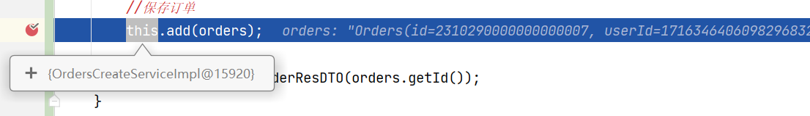

如果是在placeOrder方法上加@Transactional就可以进行事务控制，暂时先在placeOrder方法上添加@Transactional注解，我们跟踪placeOrder方法调用处的代码，在controller方法中调用的placeOrder方法，打断点，如下图：

的确是通过CGLIB代理对象调用的placeOrder方法。

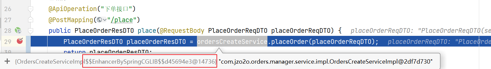

执行完成后控制台抛出了异常，事务被控制，订单数据没有保存成功。

为什么调用add方法处不是通过代理对象调用呢？

下图展示了代理对象与原始对象之间的关系图：

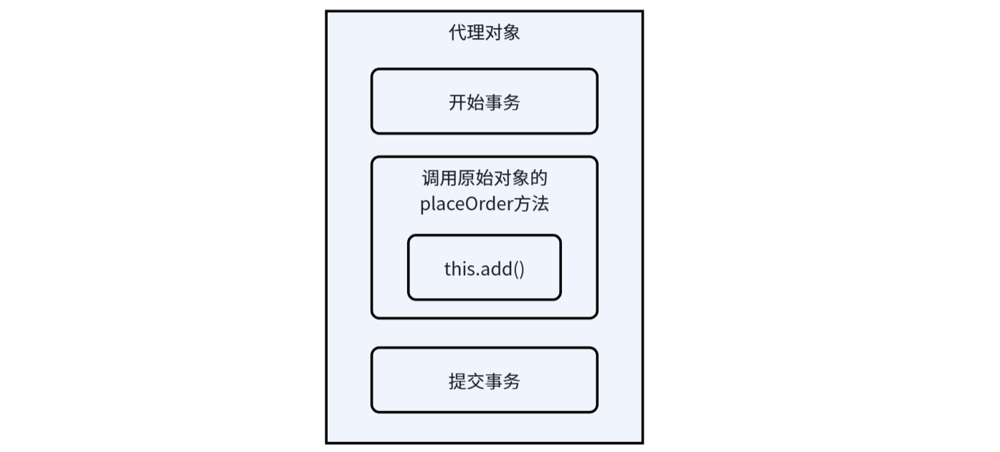

代理对象调用原始对象的placeOrder方法，在placeOrder方法中通过this\.add\(\)调用add方法，this就是原始对象本身并不是代理对象。

如何解决呢？

在OrdersCreateServiceImpl注入OrdersCreateServiceImpl的代理对象，通过代理对象去调用add方法\.

```Java
public class OrdersCreateServiceImpl extends ServiceImpl<OrdersMapper, Orders> implements IOrdersCreateService {

    //将自己的代理对象注入
    @Resource
    private IOrdersCreateService owner;
    
    ...
    
    @Override
    public PlaceOrderResDTO placeOrder(PlaceOrderReqDTO placeOrderReqDTO) {
        ...
        //保存订单
        owner.add(orders);
    
        return new PlaceOrderResDTO(orders.getId());
    }
```

重启订单管理服务继续进行测试，在owner\.add\(orders\);打断点：

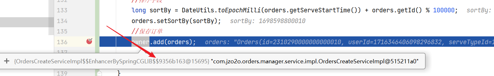

从上图可以看出这次是通过代理对象调用的add方法。

方法执行完成事务控制成功，add方法抛出异常，事务回滚，订单保存失败，符合预期结果。

**小结**

1.下单代码怎么优化的？

> 在数据库事务方法中不要加入网络请求的代码，这样会延长事务时间，占用数据库资源。
>
> 将数据库事务方法单独提到一个独立的方法中，这里存在非事务方法调用事务方法，要通过代理对象去调用事务方法，才能保证事务控制有效。
>

2.service方法事务失效的原因是什么？

3.Spring 如何解决循环依赖？

> 三级缓存
>

# 二、支付服务

## 1.支付接口调研

通常项目的支付业务会开发独立的支付服务，由支付服务对接第三方支付平台，如：微信、支付宝、聚合支付平台等。

对于小程序支付需要对接微信的小程序支付接口，对于APP支付和PC网站支付可以对接微信、支付宝或第三方聚合支付平台。

目标：根据需求调研支付接口，确定本项目需要对接哪些接口。

### 1.1.界面原型

用户下单成功提示用户支付，用户支付成功即下单成功，下单成功后家政服务人员才可以进行抢单，如下图：


用户使用的是微信小程序，所以支付过程是使用微信支付，点击确认支付即弹出微信支付界面，输入支付密码确认支付，支付成功后显示下单成功。

### 1.2.小程序支付调研

参考“[附录-微信支付](https://lining-lo.github.io/lining-lo-notes/云岚到家/附录-微信支付.html)”文档。

交互流程

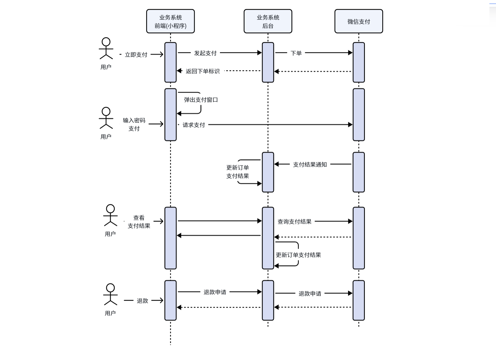

通过调研小程序支付，我们系统需要与 [小程序支付接口对接](https://pay.weixin.qq.com/docs/merchant/products/mini-program-payment/apilist.html)

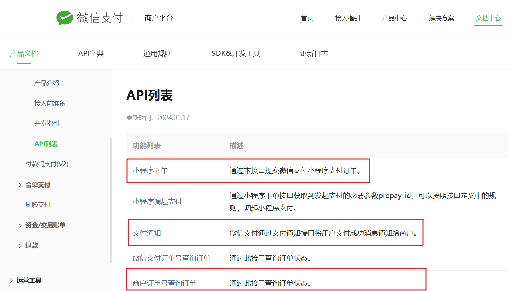

- [小程序下单](https://pay.weixin.qq.com/doc/v3/merchant/4012791897)：家政系统后端调用 微信支付的下单接口。

- [支付通知](https://pay.weixin.qq.com/doc/v3/merchant/4012791902)：微信支付调用家政系统后端接口。\(弱化、了解即可\)

- [商户订单号查询](https://pay.weixin.qq.com/doc/v3/merchant/4012791900)：家政系统后端调用 微信支付的商户订单号查询接口。

> 这里有一个问题：
>
> 就是在小程序调起支付这里，微信会校验小程序的APPID与微信支付商户的ID是否绑定，微信支付商户的ID怎么获取呢？是需要注册商户上传企业资料及法人资料，微信审核通过后方可 注册成功，所以注册成为一个普通商户对大家有限制（也就是以个人身份无法申请为商户）。
>

针对这些限制我们尝试调研其它的接口。

### 1.3.扫码支付调研

下边调研扫码支付支付，此接口不存在小程序端调起支付的限制

> 要注意：
>
> 开发小程序一定要对接微信小程序的支付接口（原因是这里无法演示，所以没法正常使用），我们使用 的扫码支付是不符合小程序支付的用户需求的，这里仅是用于学习。
>
> 参见“[附录-微信支付](https://lining-lo.github.io/lining-lo-notes/云岚到家/附录-微信支付.html)”文档。
>

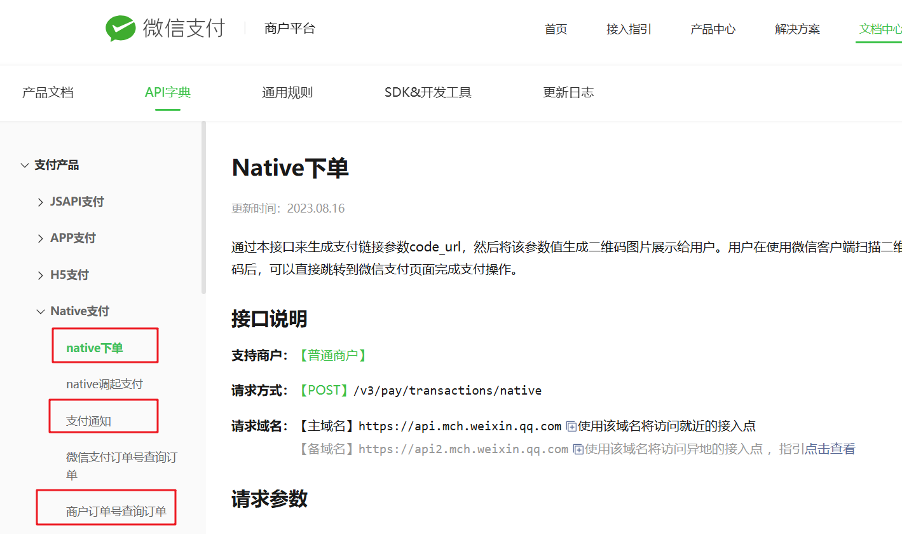

- [native下单](https://pay.weixin.qq.com/doc/v3/merchant/4012791877)：家政系统后端调用 微信支付的下单接口。

- [支付通知](https://pay.weixin.qq.com/doc/v3/merchant/4012791882)：微信支付调用家政系统后端接口。\(弱化、了解即可\)

- [商户订单号查询](https://pay.weixin.qq.com/doc/v3/merchant/4012791880)：家政系统后端调用 微信支付的商户订单号查询接口。

交互流程

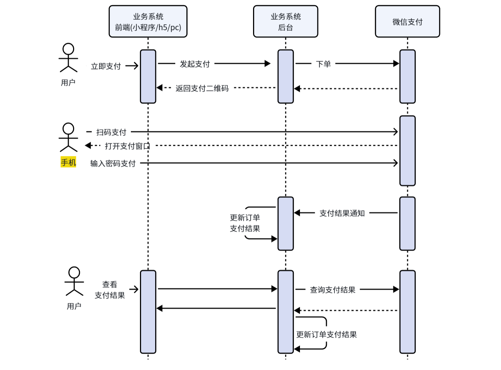

### 1.4.如何保证接口安全性

参见“[附录-微信支付](https://lining-lo.github.io/lining-lo-notes/云岚到家/附录-微信支付.html)”文档。

### 1.5.小结

1.调研了小程序支付接口与扫码支付（Native支付接口）。

> 由于学习的需要本项目使用Native支付接口。
>
> 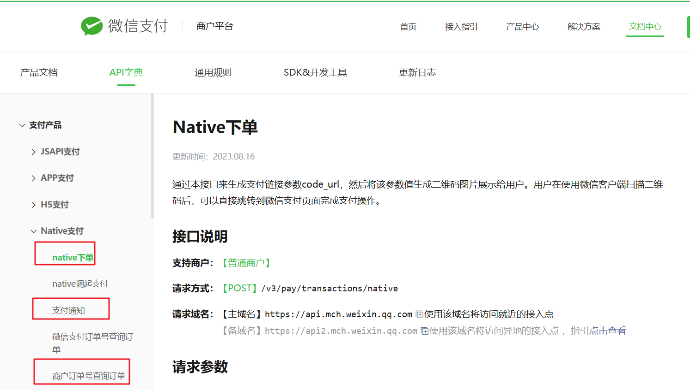
>
> 但是要注意：开发小程序一定要对接微信小程序的支付接口，我们使用 的扫码支付是不符合小程序支付的用户需求的，这里仅是用于学习。
>

2.你们对接的哪个支付接口？怎么对接的？

> 提示：首先说明是对接的小程序支付接口，需要对接哪些接口及与第三方支付平台的交互流程。
>

3.如何保证一个外部接口的安全性？

> https加密：对于登录、支付包含敏感信息的接口一定要使用https进行加密传输。
>
> 签名验签：通过签名、验签防止内容篡改，我们对接第三方支付接口都会进行签名验签的过程，使用非对称加密算法 更安全，比如：SHA256 with RSA算法。
>
> 加密解密：通过加密、解密防止内容暴露，通过非对称加密算法 更安全。

## 2.测试支付接口

### 2.1.认识支付服务

在我们项目中针对支付业务专门开发了支付服务，由支付服务与微信进行接口对接，家政平台的订单服务只需和支付服务对接即可。

本项目的支付服务支持微信和支付宝的Native、jsapi等常用支付方式。

用户发起支付请求订单管理服务，订单管理服务请求支付服务进行支付，项目所有支付业务统一由支付服务去实现。如下图：

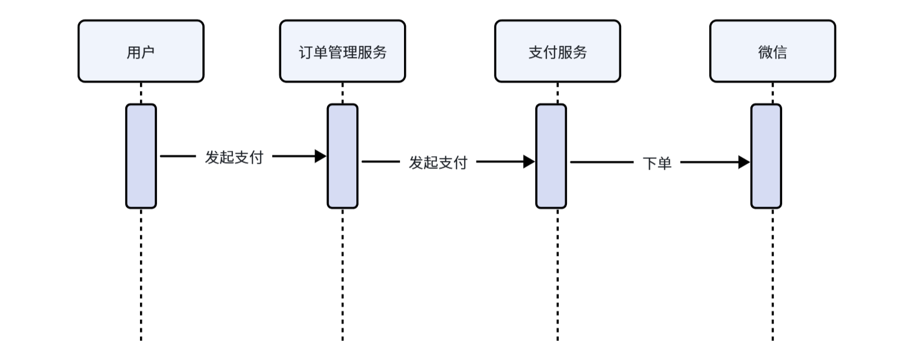

为什么单独开发一个支付服务呢？

一个项目或一个企业通常有很多系统，这些系统有很多都有支付的需求，如果每个系统都和微信、支付宝等这些第三方平台对接一遍很多工作是重复的，抽取了支付服务就是要把这个工作进行简化，简化开发支付业务，通常你到企业中一般都是和现成的支付系统进行对接。

### 2.2.部署支付服务

从资料中解压jzo2o\-trade\.zip，解压到自己的代码目录，用IDEA打开。

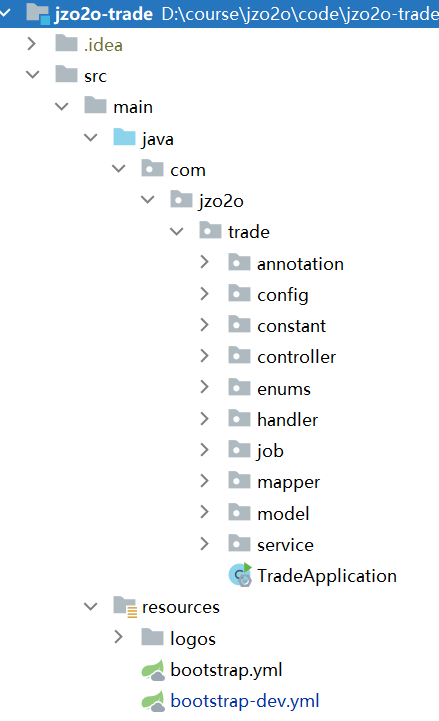

需要注意配置bootstrap\-dev\.yml中的nacos地址。

查看nacos配置文件jzo2o\-trade\.yaml，内容如下：

```JSON
jzo2o:
  job:
    refund:
      count: 100
    trading:
      count: 100
  qrcode:
    back-color: '#ffffff'
    error-correction-level: M
    fore-color: '#000000'
    height: 300
    margin: 2
    width: 300
xxl-job:
  port: 11604
rabbit-mq:
    enable: true
```

示例图：

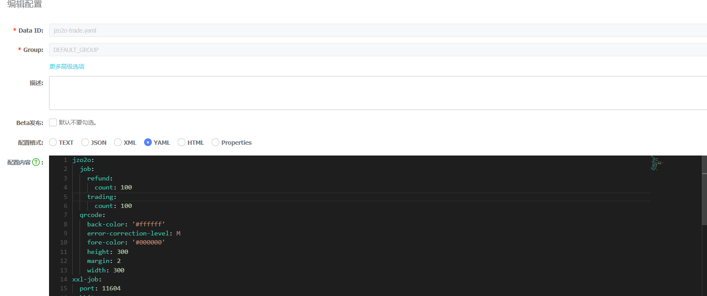

查看本服务操作的数据库jzo2o\-trade及对应的表结构

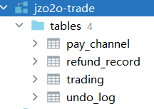

下边启动支付服务，启动成功访问接口文档：http://localhost:11505/trade/doc.html#/home

### 2.3.测试支付接口

1.交互流程

微信支付官方流程：

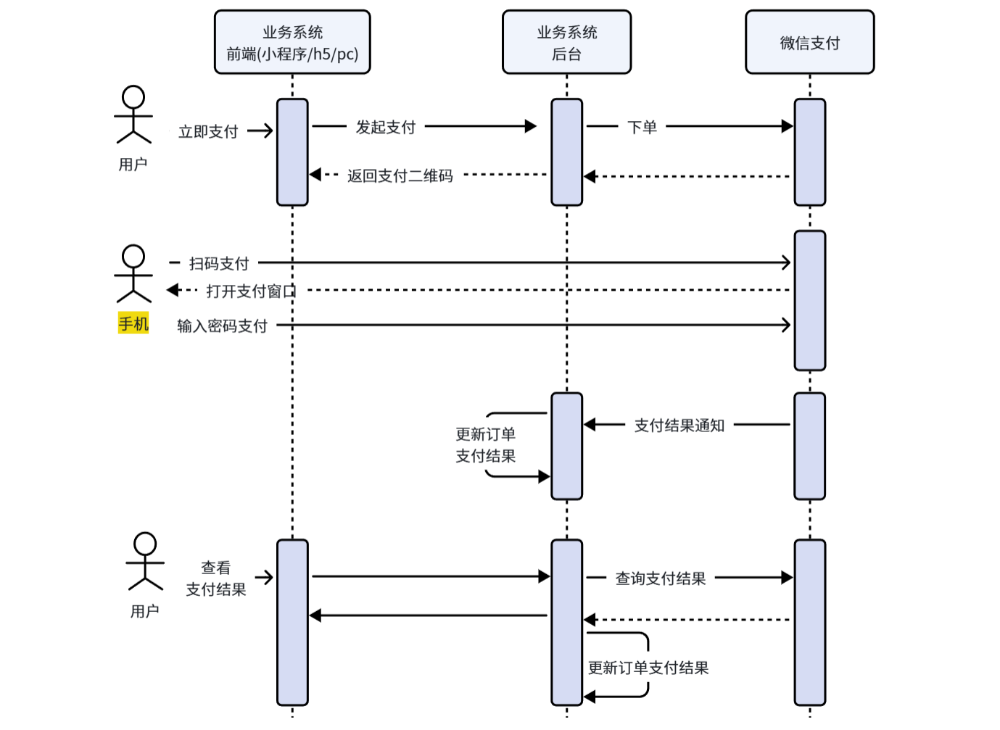

我们项目中的流程如下：

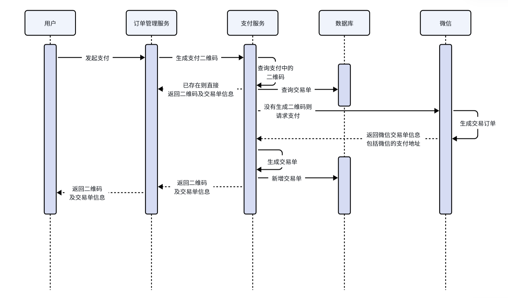

下边我们测试支付接口，用户点击支付按钮，前端请求订单服务，订单服务请求支付服务，最后支付服务请求微信的下单接口。

2.接口定义

下边我们测试支付服务的统一收单线下交易接口。

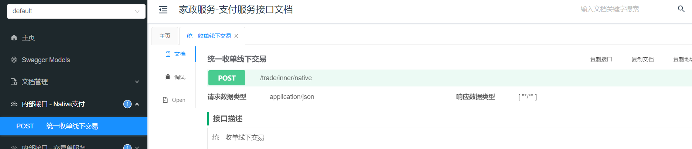

接口定义如下：

接口文档地址：http://localhost:11505/trade/doc.html#/default/%E5%86%85%E9%83%A8%E6%8E%A5%E5%8F%A3%20-%20Native%E6%94%AF%E4%BB%98/createDownLineTradingUsingPOST

接口路径：POST   /trade/inner/native

请求数据类型 application/json

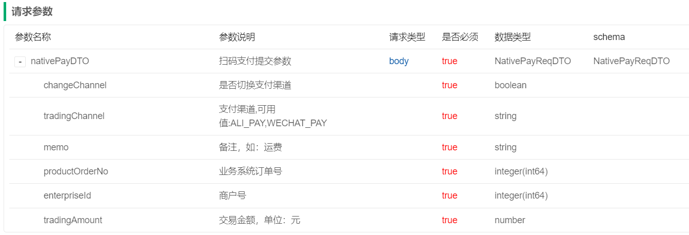

请求参数说明：

- changeChannel：当用户先微信支付，然后又进行支付宝支付表示切换了支付渠道，此时传入true

- tradingChannel：微信支付传入WECHAT\_PAY，支付宝支付传入ALI\_PAY

- memo：备注信息

- productOrderNo：是业务系统的订单号，本项目就是家政服务的订单号。

- enterpriseId：商户号，进入微信或支付宝商户平台获取。

- tradingAmount：支付金额


响应参数说明：

- tradingChannel：微信或支付宝

- tradingOrderNo：支付服务生成的交易号

- productOrderNo：业务系统的订单号，本项目就是家政服务的订单号。

- qrCode：二维码base64

3.接口测试

下边我们使用接口文档的调试功能进行接口测试

请求下边的参数：

> 注意：保证每次请求支付下单传入productOrderNo不一致，productOrderNo表示商品的订单，同一个订单不能重复支付
>

```json
{
  "changeChannel": false,
  "tradingChannel": "WECHAT_PAY",
  "memo": "日常保洁",
  "productOrderNo": 1730520846153,
  "enterpriseId": 1561414331,
  "tradingAmount": 0.01,
   "productAppId": "jzo2o.orders"
}
```

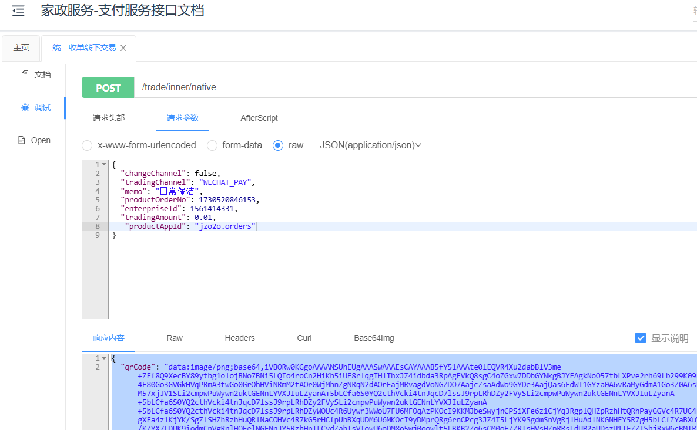

响应结果如下：

```json
{
  "qrCode": "data:image/png;base64,iVBORw0KGgoAAAANSUhEUgAAASwAAAEsCAYAAAB5fY51A...",
  "productOrderNo": "1730520846153",
  "tradingOrderNo": "1852589273727016961",
  "tradingChannel": "WECHAT_PAY"
}
```

> 注意：
>
> 请求参数里，记得将1730520846153这个号改掉一个随机数值
>
> 响应结果要记住支付服务生成的交易单号tradingOrderNo，稍后查询交易结果使用。

复制qrCode的值粘贴到浏览器，出现二维码，如下图：


下边进行扫码支付。

### 2.4.支付结果查询

支付成功，下边测试  “根据交易单号查询交易单的交易结果”接口

接口文档URL：http://localhost:11505/trade/doc.html#/default/%E5%86%85%E9%83%A8%E6%8E%A5%E5%8F%A3%20-%20%E4%BA%A4%E6%98%93%E5%8D%95%E6%9C%8D%E5%8A%A1/findTradResultByTradingOrderNoUsingGET

接口定义如下：

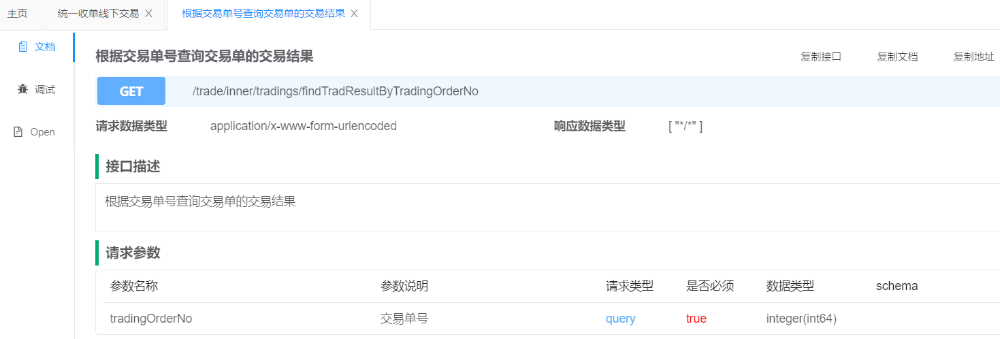

交易单号是支付服务生成的，在下单接口响应中存在。

下边的结果，我们主要关注：

- productOrderNo        业务系统订单号

- tradingOrderNo        支付服务交易单号

- tradingState 交易状态 （4表示已付款）


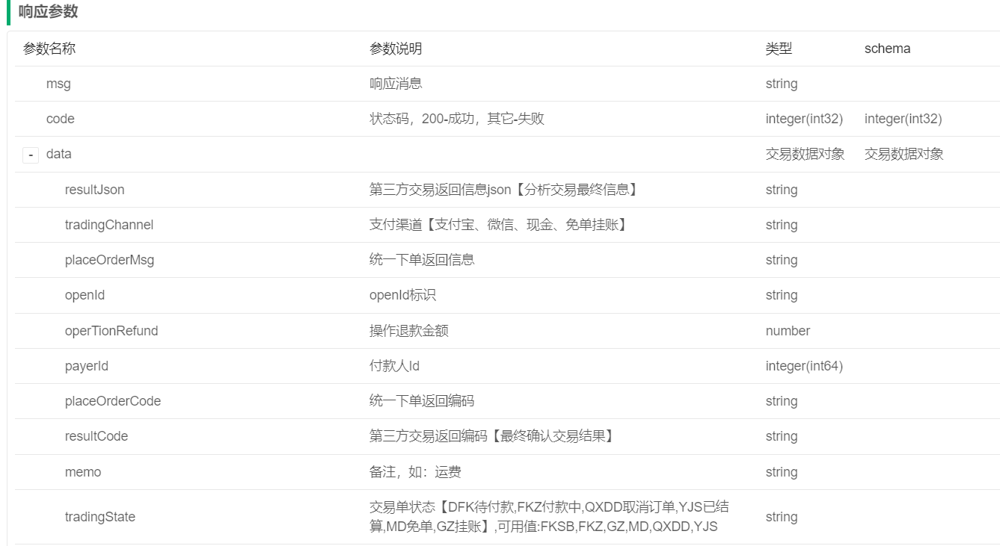

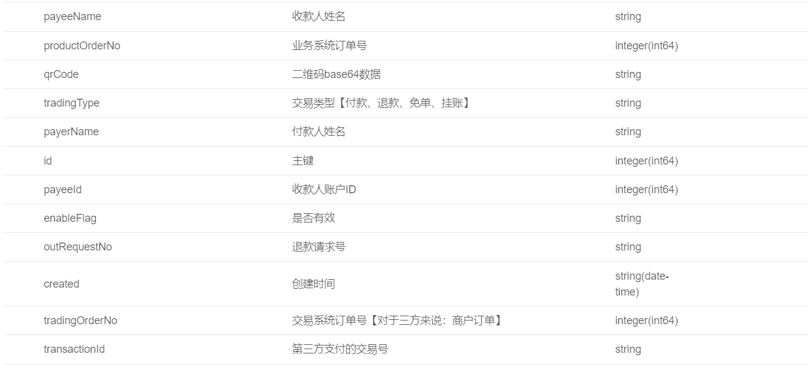

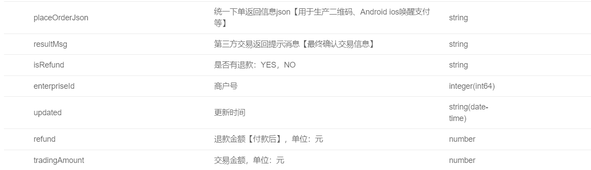

下边进行测试，传入交易单号：

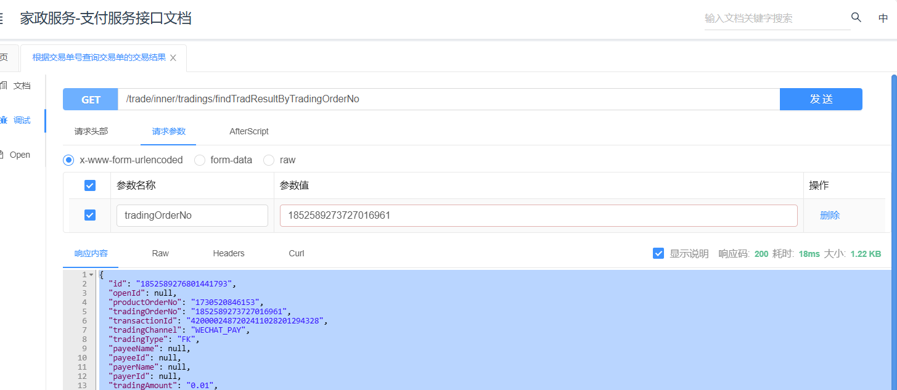

响应结果：

```json
{
  "id": "1852589276801441793",
  "openId": null,
  "productOrderNo": "1730520846153",
  "tradingOrderNo": "1852589273727016961",
  "transactionId": "4200002487202411028201294328",
  "tradingChannel": "WECHAT_PAY",
  "tradingType": "FK",
  "payeeName": null,
  "payeeId": null,
  "payerName": null,
  "payerId": null,
  "tradingAmount": "0.01",
  "refund": null,
  "isRefund": null,
  "resultCode": "SUCCESS",
  "resultMsg": "支付成功",
  "resultJson": "{\"amount\":{\"currency\":\"CNY\",\"payer_currency\":\"CNY\",\"payer_total\":1,\"total\":1},\"appid\":\"wx6592a2db3f85ed25\",\"attach\":\"\",\"bank_type\":\"OTHERS\",\"mchid\":\"1561414331\",\"out_trade_no\":\"1852589273727016961\",\"payer\":{\"openid\":\"otdlR47G1kioMdvJBgbU5RulRJjo\"},\"promotion_detail\":[],\"success_time\":\"2024-11-02T13:52:52+08:00\",\"trade_state\":\"SUCCESS\",\"trade_state_desc\":\"支付成功\",\"trade_type\":\"NATIVE\",\"transaction_id\":\"4200002487202411028201294328\"}",
  "placeOrderCode": "200",
  "placeOrderMsg": "weixin://wxpay/bizpayurl?pr=2qrPU0hz3",
  "placeOrderJson": "{\"body\":\"{\\\"code_url\\\":\\\"weixin://wxpay/bizpayurl?pr=2qrPU0hz3\\\"}\",\"status\":200}",
  "enterpriseId": "1561414331",
  "memo": "日常保洁",
  "qrCode": "",
  "enableFlag": "YES",
  "outRequestNo": null,
  "operTionRefund": null,
  "created": null,
  "updated": null,
  "tradingState": 4
}
```

### 2.5.测试退款接口

退款接口定义：

接口文档URL：http://localhost:11505/trade/doc.html#/default/%E5%86%85%E9%83%A8%E6%8E%A5%E5%8F%A3%20-%20%E9%80%80%E6%AC%BE/refundTradingUsingPOST

接口路径：POST/trade/inner/refund\-record/refund

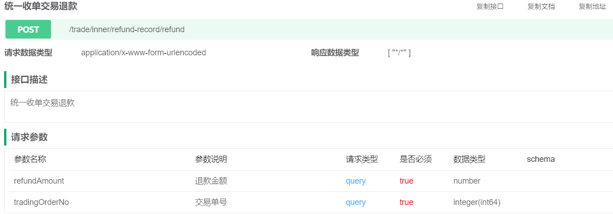

请求参数中：交易单号还是下单时支付服务生成的交易单号，在生成二维码接口中响应。

退款金额：即支付金额。

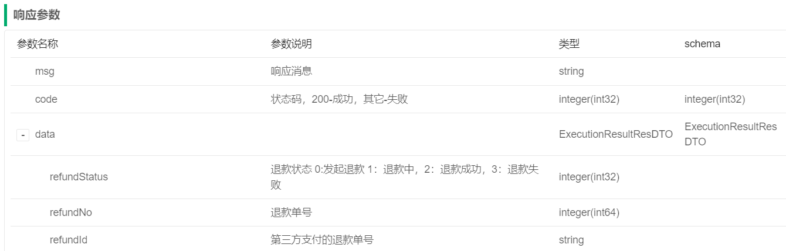

响应结果中有退款状态，还有支付服务忝的退款单号以及第三方支付（微信、支付宝）生成的退款单号。

我们主要关注退款状态：1表示退款中，2表示退款成功 3表示退款失败。

测试接口：

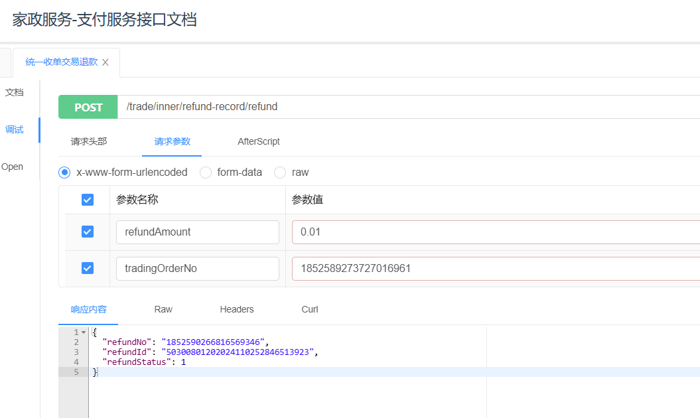

上图中退款状态为1，再次请求退款接口发现退款状态变为2

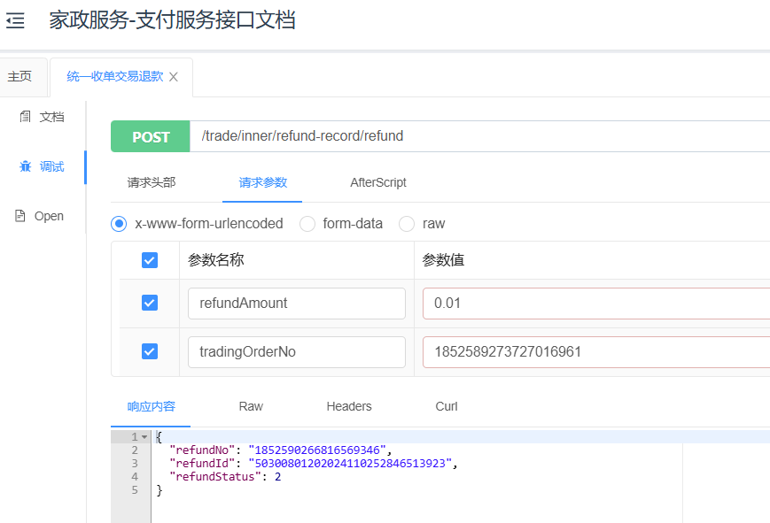

### 2.6.小结

项目的支付服务有哪些接口？

## 3.理解支付服务的设计

### 3.1.表设计

首先熟悉支付服务的数据库表

1.支付渠道表

支付渠道表存储了第三方支付（微信、支付宝）的支付参数，如：商户号、证书序列号、api私钥等信息。

```SQL
create table `jzo2o-trade`.pay_channel
(
    id                   bigint                             not null comment '主键'
    constraint `PRIMARY`
    primary key,
    channel_name         varchar(32)                        null comment '通道名称',
    channel_label        varchar(32)                        null comment '通道唯一标记',
    domain               varchar(255)                       null comment '域名',
    app_id               varchar(32) collate utf8_bin       not null comment '商户appid',
    public_key           varchar(2000) collate utf8_bin     not null comment '支付公钥',
    merchant_private_key varchar(2000) collate utf8_bin     not null comment '商户私钥',
    other_config         varchar(1000)                      null comment '其他配置',
    encrypt_key          varchar(255) charset utf8mb4       null comment 'AES混淆密钥',
    remark               varchar(400)                       null comment '说明',
    notify_url           varchar(255)                       null comment '回调地址',
    enable_flag          varchar(10)                        null comment '是否有效',
    enterprise_id        bigint                             null comment '商户ID【系统内部识别使用】',
    create_time          datetime default CURRENT_TIMESTAMP null comment '创建时间',
    update_time          datetime default CURRENT_TIMESTAMP null on update CURRENT_TIMESTAMP comment '更新时间'
)
    comment '交易渠道表' collate = utf8mb4_unicode_ci;
```

2.交易单表

支付服务请求第三方支付下单成功向交易表写入一条记录

家政服务的一个订单可能对应支付服务的多条交易单，比如：用户用微信支付在交易单表生成一条交易单，如果微信支付失败再用支付宝支付时也会在交易单表中生成一条记录。

用户支付成功后支付服务更新交易单表的支付状态。

```sql
create table `jzo2o-trade`.trading
(
    id               bigint                                 not null comment '主键'
        constraint `PRIMARY`
        primary key,
    product_order_no bigint                                 not null comment '业务系统订单号',
    trading_order_no bigint                                 not null comment '交易系统订单号【对于三方来说：商户订单】',
    transaction_id   varchar(50)                            null comment '第三方支付交易号',
    trading_channel  varchar(32) charset utf8mb4            not null comment '支付渠道【支付宝、微信、现金、免单挂账】',
    trading_type     varchar(22)                            not null comment '交易类型【付款、退款、免单、挂账】',
    trading_state    int                                    not null comment '交易单状态【2-付款中,3-付款失败,4-已结算,5-取消订单,6-免单,7-挂账】',
    payee_name       varchar(50)                            null comment '收款人姓名',
    payee_id         bigint                                 null comment '收款人账户ID',
    payer_name       varchar(50)                            null comment '付款人姓名',
    payer_id         bigint                                 null comment '付款人Id',
    trading_amount   decimal(22, 2)                         not null comment '交易金额，单位：元',
    refund           decimal(12, 2)                         null comment '退款金额【付款后，单位：元',
    is_refund        varchar(32) charset utf8mb4            null comment '是否有退款：YES，NO',
    result_code      varchar(80)                            null comment '第三方交易返回编码【最终确认交易结果】',
    result_msg       varchar(255)                           null comment '第三方交易返回提示消息【最终确认交易信息】',
    result_json      varchar(2000)                          null comment '第三方交易返回信息json【分析交易最终信息】',
    place_order_code varchar(80)                            null comment '统一下单返回编码',
    place_order_msg  varchar(255)                           null comment '统一下单返回信息',
    place_order_json text                                   null comment '统一下单返回信息json【用于生产二维码、Android ios唤醒支付等】',
    enterprise_id    bigint                                 not null comment '商户号',
    memo             varchar(150)                           null comment '备注【订单门店，桌台信息】',
    qr_code          text                                   null comment '二维码base64数据',
    open_id          varchar(36) collate utf8mb4_unicode_ci null comment 'open_id标识',
    enable_flag      varchar(10)                            null comment '是否有效',
    create_time      datetime default CURRENT_TIMESTAMP     null comment '创建时间',
    update_time      datetime default CURRENT_TIMESTAMP     null on update CURRENT_TIMESTAMP comment '更新时间',
    constraint trading_order_no
        unique (trading_order_no) comment '支付订单号'
)
    comment '交易订单表' charset = utf8;
```

3.退款记录表

用户申请退款在退款记录表写一条记录。

退款成功后支付服务更新退款状态。

```sql
create table `jzo2o-trade`.refund_record
(
    id               bigint                             not null comment '主键'
        constraint `PRIMARY`
        primary key,
    trading_order_no bigint                             not null comment '交易系统订单号【对于三方来说：商户订单】',
    product_order_no bigint                             not null comment '业务系统订单号',
    refund_no        bigint                             not null comment '本次退款订单号',
    refund_id        varchar(50)                        null comment '第三方支付的退款单号',
    enterprise_id    bigint                             not null comment '商户号',
    trading_channel  varchar(32) charset utf8mb4        not null comment '退款渠道【支付宝、微信、现金】',
    refund_status    int                                not null comment '退款状态：0-发起退款,1-退款中，2-成功, 3-失败',
    refund_code      varchar(80) charset utf8           null comment '返回编码',
    refund_msg       text charset utf8                  null comment '返回信息',
    memo             varchar(150) charset utf8          null comment '备注【订单门店，桌台信息】',
    refund_amount    decimal(12, 2)                     not null comment '本次退款金额',
    total            decimal(12, 2)                     not null comment '原订单金额',
    create_time      datetime default CURRENT_TIMESTAMP null comment '创建时间',
    update_time      datetime default CURRENT_TIMESTAMP null on update CURRENT_TIMESTAMP comment '更新时间',
    constraint refund_no
        unique (refund_no)
)
    comment '退款记录表' collate = utf8mb4_unicode_ci;
```

### 3.2.数据流

支付接口：收到支付请求后请求第三方支付的下单接口，并向交易单表新增记录。

查询交易结果接口：请求第三方支付的查询支付结果并更新交易单表的支付状态。

接收第三方通知支付结果：更新交易单表的支付状态。

退款接口：新增退款记录

更新退款状态：请求第三方退款结果查询接口查询退款状态，并更新退款状态。


### 3.3.阅读代码

下边阅读支付接口与退款接口的核心代码：

1.支付接口（生成二维码）


首先查询交易单是否生成交易单，如果已生成直接返回


如果切换支付渠道且已存在原有支付渠道的交易单，则先关闭原支付渠道的交易单，避免重复支付。


使用分布式锁防止同一个交易单重复支付：（关于redisson的使用方法在后续章节讲解）


根据支付渠道调用不同的bean请求第三方支付


获取第三方返回的支付URL，支付服务生成支付二维码，插入交易单记录。


2.退款接口


没有退款记录时插入退款记录


请求第三方退款接口


### 3.4.小结

1.支付服务设计了几张表？

2.如何防止重复支付？

# 三、家政订单支付功能

## 1.对接支付接口

### 1.1.支付接口定义

**交互流程**

用户点击支付按钮，前端请求订单服务，订单服务请求支付服务，最后支付服务请求微信的下单接口。

流程如下：


通过交互流程可知：

订单管理服务请求支付服务（支付服务的Feign接口类NativePayApi接口，已经提供好了）生成支付二维码，拿到交易单号将其和支付渠道更新到订单表。

最后订单管理服务将交易单信息及二维码返回给前端。

**支付接口分析**

下边我们实现订单管理服务的下单接口，接口位置如下图：


1.请求参数分析

用户在支付界面点击“确定支付”，弹出支付二维码，用户扫码支付。


要生成二维码需要由订单管理服务请求支付服务的支付接口，支付服务的支付接口如下：

接口路径：POST/trade/inner/native

请求数据类型 application/json


支付服务的支付接口需要以下参数：

```Java
productOrderNo：是业务系统的订单号，本项目就是家政服务的订单号。
tradingAmount：支付金额
enterpriseId：商户号，进入微信或支付宝商户平台获取。
memo: 备注信息
tradingChannel：微信支付传入WECHAT_PAY，支付宝支付传入ALI_PAY
changeChannel：当用户先微信支付，然后又进行支付宝支付表示切换了支付渠道，此时传入true
productAppId: 业务系统标识，服务调用方的标识字符串
```

我们需要根据支付服务的支付接口的参数分析这些参数的数据来源

- productOrderNo：即订单号由前端传入

- tradingAmount：根据订单号查询订单信息即可拿到金额

- enterpriseId：商户号，在nacos配置好

- memo：程序拼装

- tradingChannel：支付渠道，前端传入

- changeChannel：根据订单号查询订单表的trading\_channel字段来判断。第一次支付后将第一次支付的支付渠道更新至订单表，第二次如果切换了支付渠道通过trading\_channel字段可以知道是否切换支付渠道。

- productAppId：业务系统标识，比如`jzo2o.orders`在nacos配置好

所以综上分析，前端请求订单管理服务提供的支付接口需要传入：

- productOrderNo: 订单id

- tradingChannel:支付渠道。

2.分析响应参数

支付服务的支付接口的响应参数如下：

- tradingChannel：微信或支付宝

- tradingOrderNo：支付服务生成的交易号

- productOrderNo：业务系统的订单号，本项目就是家政服务的订单号。

- qrCode：二维码base64

要在前端展示二维码所以一定要响应支付二维码。

如果用户已经支付成功了，此时去点击“确认支付”要能够给前端返回支付结果为成功。

订单管理服务提供的支付接口响应结果如下：

- tradingChannel：微信或支付宝

- tradingOrderNo：支付服务生成的交易号

- productOrderNo：业务系统的订单号，本项目就是家政服务的订单号。

- qrCode：二维码base64

- payStatus：支付状态（待支付、支付成功）

**接口定义如下**

下边定义订单管理服务提供的支付接口：


编写controller:

```Java
@RestController("consumerOrdersController")
@Api(tags = "用户端-订单相关接口")
@RequestMapping("/consumer/orders")
public class ConsumerOrdersController {

    @Resource
    private IOrdersCreateService ordersCreateService;
    @Resource
    private IOrdersManagerService ordersManagerService;

    @PutMapping("/pay/{id}")
    @ApiOperation("订单支付")
    @ApiImplicitParams({
            @ApiImplicitParam(name = "id", value = "订单id", required = true, dataTypeClass = Long.class)
    })
    public OrdersPayResDTO pay(@PathVariable("id") Long id, @RequestBody OrdersPayReqDTO ordersPayReqDTO) {
        OrdersPayResDTO pay = ordersCreateService.pay(id, ordersPayReqDTO);
        return pay;
    }
```

**小结**

1.订单管理服务的支付接口是怎么定义的？

> 根据调用的支付服务的支付接口去定义：
>
> 此支付接口通过支付服务请求微信生成支付二维码。
>
> 传入参数：
>
> - 订单id
>
> - 支付渠道
>
> - 响应结果：
>
> - 支付二维码
>
> - 支付状态（待支付、支付成功）
>
> - 业务系统订单号
>
> - 支付服务交易单号
>
> - 支付渠道信息
>

### 1.2.支付接口实现

下边实现支付接口。

**配置支付参数**

根据支付接口的分析，首先在jzo2o\-orders\-manager\.yaml中配置支付参数

```yaml
jzo2o:
  trade:
    aliEnterpriseId: 2088241317544335
    wechatEnterpriseId: 1561414331
    productAppId: jzo2o.orders
  job:
    autoEvaluateCount: 100
  openPay: false
```

示例如下：


**controller**

```Java
@PutMapping("/pay/{id}")
@ApiOperation("订单支付")
@ApiImplicitParams({
        @ApiImplicitParam(name = "id", value = "订单id", required = true, dataTypeClass = Long.class)
})
public OrdersPayResDTO pay(@PathVariable("id") Long id, @RequestBody OrdersPayReqDTO ordersPayReqDTO) {
    OrdersPayResDTO pay = ordersCreateService.pay(id, ordersPayReqDTO);
    return pay;
}
```

**service**

TradeProperties : 增加


在service定义支付接口：

```Java
public interface IOrdersCreateService extends IService<Orders> {
   ....

    /**
     * 订单支付
     *
     * @param id              订单id
     * @param ordersPayReqDTO 订单支付请求体
     * @return 订单支付响应体
     */
    OrdersPayResDTO pay(Long id, OrdersPayReqDTO ordersPayReqDTO);
    
    
    /**
     * 更新订单
     * @param id
     * @param nativePayResDTO
     */
    void updateOrders(Long id, NativePayResDTO nativePayResDTO);
```

首先在OrdersCreateServiceImpl类注入下边两个bean

- tradeProperties：读取支付参数

- nativePayApi: 远程调用支付服务的feign接口


```Java
@Resource
private TradeProperties tradeProperties;
@Resource
private NativePayApi nativePayApi;
```

OrdersCreateServiceImpl的pay支付方法实现如下：

```Java
package com.jzo2o.orders.manager.service.impl;

import com.baomidou.mybatisplus.extension.service.impl.ServiceImpl;
import com.jzo2o.api.customer.dto.response.AddressBookResDTO;
import com.jzo2o.api.foundations.dto.response.ServeAggregationResDTO;
import com.jzo2o.api.trade.NativePayApi;
import com.jzo2o.api.trade.dto.request.NativePayReqDTO;
import com.jzo2o.api.trade.dto.response.NativePayResDTO;
import com.jzo2o.api.trade.enums.PayChannelEnum;
import com.jzo2o.common.expcetions.BadRequestException;
import com.jzo2o.common.expcetions.CommonException;
import com.jzo2o.common.expcetions.DBException;
import com.jzo2o.common.utils.BeanUtils;
import com.jzo2o.common.utils.DateUtils;
import com.jzo2o.common.utils.ObjectUtils;
import com.jzo2o.mvc.utils.UserContext;
import com.jzo2o.orders.base.enums.OrderPayStatusEnum;
import com.jzo2o.orders.base.enums.OrderStatusEnum;
import com.jzo2o.orders.base.mapper.OrdersMapper;
import com.jzo2o.orders.base.model.domain.Orders;
import com.jzo2o.orders.manager.client.CustomerClient;
import com.jzo2o.orders.manager.client.FoundationsClient;
import com.jzo2o.orders.manager.model.dto.request.OrdersPayReqDTO;
import com.jzo2o.orders.manager.model.dto.request.PlaceOrderReqDTO;
import com.jzo2o.orders.manager.model.dto.response.OrdersPayResDTO;
import com.jzo2o.orders.manager.model.dto.response.PlaceOrderResDTO;
import com.jzo2o.orders.manager.porperties.TradeProperties;
import com.jzo2o.orders.manager.service.IOrdersCreateService;
import lombok.extern.slf4j.Slf4j;
import org.springframework.beans.factory.annotation.Autowired;
import org.springframework.data.redis.core.RedisTemplate;
import org.springframework.stereotype.Service;
import org.springframework.transaction.annotation.Transactional;

import java.math.BigDecimal;
import java.time.LocalDateTime;

/**
 * <p>
 * 下单服务类
 * </p>
 */
@Slf4j
@Service
public class OrdersCreateServiceImpl extends ServiceImpl<OrdersMapper, Orders> implements IOrdersCreateService {

    @Autowired
    private CustomerClient customerClient;

    @Autowired
    private FoundationsClient foundationsClient;

    @Autowired
    private IOrdersCreateService owner;

    @Autowired
    private TradeProperties tradeProperties;
    
    @Autowired
    private NativePayApi nativePayApi;
    
    /**
     * 订单支付
     *
     * @param id
     * @param dto
     * @return
     */
    @Override
    public OrdersPayResDTO pay(Long id, OrdersPayReqDTO dto) {
        //1. 判断订单是否存在
        Orders orders = this.getById(id);
        if(orders==null) {
            throw new BadRequestException("订单不存在");
        }
    
        //2. 判断订单是否已支付成功（支付状态和交易单号）
        if(ObjectUtils.equals(orders.getPayStatus(),OrderPayStatusEnum.PAY_SUCCESS.getStatus())
                && ObjectUtils.isNotNull(orders.getTradingOrderNo())) {
            OrdersPayResDTO ordersPayResDTO = BeanUtils.copyBean(orders, OrdersPayResDTO.class);
            ordersPayResDTO.setProductOrderNo(id);
            return ordersPayResDTO;
        }
    
        //3. 调用支付服务的Feign接口，获取响应数据
    
        //3.1 根据支付渠道获取商户号
        Long enterpriseId = ObjectUtils.equals(dto.getTradingChannel(), PayChannelEnum.WECHAT_PAY) ? tradeProperties.getWechatEnterpriseId()
                : tradeProperties.getAliEnterpriseId();
    
        //3.2 判断是否更换过支付渠道 （订单已有支付渠道，且与本次请求参数的支付渠道不一样，就算更换过）
        boolean changeChannel = false; //默认值：未更换
        if(ObjectUtils.isNotNull(orders.getTradingChannel()) && ObjectUtils.notEqual(orders.getTradingChannel(), dto.getTradingChannel())) {
            changeChannel = true;
        }
    
        //业务系统唯一标识
        String productAppId = tradeProperties.getProductAppId();
    
        //3.3 发起feign接口请求调用支付服务，获取响应数据
        NativePayReqDTO nativePayReqDTO = new NativePayReqDTO();
        nativePayReqDTO.setProductOrderNo(id); //业务系统订单号（订单表的订单ID值）
        nativePayReqDTO.setEnterpriseId(enterpriseId);//商户号
        nativePayReqDTO.setProductAppId(productAppId);//业务系统唯一标识
        nativePayReqDTO.setChangeChannel(changeChannel);//是否更换过支付渠道
        nativePayReqDTO.setMemo(orders.getServeItemName());//商品描述
        //nativePayReqDTO.setTradingAmount(orders.getRealPayAmount());//订单金额：实际支付金额
        nativePayReqDTO.setTradingAmount(BigDecimal.valueOf(0.01));
        nativePayReqDTO.setTradingChannel(dto.getTradingChannel());//支付渠道
    
        NativePayResDTO nativePayResDTO = nativePayApi.createDownLineTrading(nativePayReqDTO);
        if(ObjectUtils.isNull(nativePayResDTO)) {
            throw new BadRequestException("调用支付服务的支付接口失败");
        }
    
        //4. 更新订单表数据（支付渠道和交易单号） update orders set trading_channel=?,trading_order_no=? where id=?
        owner.updateOrders(id,nativePayResDTO);
    
        //5. 封装响应数据
        OrdersPayResDTO ordersPayResDTO = BeanUtils.copyBean(nativePayResDTO, OrdersPayResDTO.class);
        ordersPayResDTO.setPayStatus(orders.getPayStatus());
        return ordersPayResDTO;
    }
    
    @Transactional(rollbackFor = Exception.class)
    public void updateOrders(Long orderId, NativePayResDTO nativePayResDTO){
        boolean result = this.lambdaUpdate().eq(Orders::getId, orderId)
                .set(Orders::getTradingChannel, nativePayResDTO.getTradingChannel())
                .set(Orders::getTradingOrderNo, nativePayResDTO.getTradingOrderNo())
                .update();
        if(!result) {
            throw new DBException("支付失败");
        }
    }
}
```

**接口测试**

1.测试流程：

打开小程序，进入首页，点击一个服务进行预约下单，点击“确定支付”

2.预期结果：

是生成支付二维码，如下图：


向支付服务的交易单号插入一条记录，注意观察记录内容的准确性。

3.下边进行测试：

- 启动jzo2o\-foundations服务

- 启动jzo2o\-customer服务

- 启动jzo2o\-publics服务

- 启动jzo2o\-gateway服务

- 启动jzo2o\-orders\-manager服务

- 启动jzo2o\-trade服务

- 打开小程序进行测试。

**小结**

支付接口是怎么开发的？

## 2.对接查询支付结果

### 2.1.接口定义

**交互流程**

在用户支付后用户点击“完成支付”此时前端请求订单服务的查询支付结果接口，如果支付成功则跳转到支付成功界面。

交互流程如下：


此接口对于支付中的订单最终由支付服务调用微信查询支付结果。

订单管理服务查询到支付结果后更新订单的支付状态。

**接口分析**

1.传入参数 

本接口要调用支付服务的支付结果查询接口，根据支付服务的支付结果查询接口的传入参数分析本接口的传入参数。 

支付服务的支付结果查询接口需要传入交易单号。交易单号在订单表已经保存所以前端传入订单号即可拿到交易单号。

所以传入参数：订单号

2.响应结果

本接口的目的是查询支付结果，所以响应结果中要有支付结果，其它的参数就是订单号、交易单号等相关参数。

**接口定义** 


### 2.2.接口实现

**controller**  

```Java
@GetMapping("/pay/{id}/result")
@ApiOperation("查询订单支付结果")
@ApiImplicitParams({
        @ApiImplicitParam(name = "id", value = "订单id", required = true, dataTypeClass = Long.class)
})
public OrdersPayResDTO payResult(@PathVariable("id") Long id) {
    //支付结果
    OrdersPayResDTO ordersPayResDTO = ordersCreateService.getPayResultFromTradServer(id);
    return ordersPayResDTO;
}
```

**service**

根据接口分析，查询支付结果需要做两部分的工作：

调用支付服务的查询支付结果接口获取支付结果。

将支付结果更新至订单表的支付状态字段。

定义查询支付结果service方法

```Java
public interface IOrdersCreateService extends IService<Orders> {

/**
 * 请求支付服务查询支付结果
 *
 * @param id 订单id
 * @return 订单支付结果
 */
OrdersPayResDTO getPayResultFromTradServer(Long id);

/**
 * 支付成功更新订单
 * @param orderId
 * @param transactionId
 * @param payTime
 */
void paySuccess(Long orderId, String transactionId, LocalDateTime payTime);
...
```

在OrdersCreateServiceImpl中注入tradingApi（远程查询交易单feign接口）：

```Java
@Resource
private TradingApi tradingApi;
```

方法实现如下：

```Java
package com.jzo2o.orders.manager.service.impl;

import com.baomidou.mybatisplus.extension.service.impl.ServiceImpl;
import com.jzo2o.api.customer.dto.response.AddressBookResDTO;
import com.jzo2o.api.foundations.dto.response.ServeAggregationResDTO;
import com.jzo2o.api.trade.NativePayApi;
import com.jzo2o.api.trade.TradingApi;
import com.jzo2o.api.trade.dto.request.NativePayReqDTO;
import com.jzo2o.api.trade.dto.response.NativePayResDTO;
import com.jzo2o.api.trade.dto.response.TradingResDTO;
import com.jzo2o.api.trade.enums.PayChannelEnum;
import com.jzo2o.api.trade.enums.TradingStateEnum;
import com.jzo2o.common.expcetions.BadRequestException;
import com.jzo2o.common.expcetions.CommonException;
import com.jzo2o.common.expcetions.DBException;
import com.jzo2o.common.utils.BeanUtils;
import com.jzo2o.common.utils.DateUtils;
import com.jzo2o.common.utils.ObjectUtils;
import com.jzo2o.mvc.utils.UserContext;
import com.jzo2o.orders.base.enums.OrderPayStatusEnum;
import com.jzo2o.orders.base.enums.OrderStatusEnum;
import com.jzo2o.orders.base.mapper.OrdersMapper;
import com.jzo2o.orders.base.model.domain.Orders;
import com.jzo2o.orders.manager.client.CustomerClient;
import com.jzo2o.orders.manager.client.FoundationsClient;
import com.jzo2o.orders.manager.model.dto.request.OrdersPayReqDTO;
import com.jzo2o.orders.manager.model.dto.request.PlaceOrderReqDTO;
import com.jzo2o.orders.manager.model.dto.response.OrdersPayResDTO;
import com.jzo2o.orders.manager.model.dto.response.PlaceOrderResDTO;
import com.jzo2o.orders.manager.porperties.TradeProperties;
import com.jzo2o.orders.manager.service.IOrdersCreateService;
import lombok.extern.slf4j.Slf4j;
import org.springframework.beans.factory.annotation.Autowired;
import org.springframework.data.redis.core.RedisTemplate;
import org.springframework.stereotype.Service;
import org.springframework.transaction.annotation.Transactional;

import java.math.BigDecimal;
import java.time.LocalDateTime;

/**
 * <p>
 * 下单服务类
 * </p>
 */
@Slf4j
@Service
public class OrdersCreateServiceImpl extends ServiceImpl<OrdersMapper, Orders> implements IOrdersCreateService {

    @Autowired
    private CustomerClient customerClient;

    @Autowired
    private FoundationsClient foundationsClient;

    @Autowired
    private IOrdersCreateService owner;

    @Autowired
    private TradingApi tradingApi;

    /**
     * 查询订单支付结果
     *
     * @param id
     * @return
     */
    @Override
    public OrdersPayResDTO getPayResultFromTradServer(Long id) {
        //1.判断订单是否存在
        Orders orders = this.getById(id);
        if(orders==null) {
            throw new BadRequestException("订单不存在");
        }
    
        //2.判断是否有交易单号
        if(ObjectUtils.isNull(orders.getTradingOrderNo())) {
            throw new BadRequestException("非法订单");
        }
    
        //3.判断是否支付成功
        OrdersPayResDTO ordersPayResDTO = BeanUtils.copyBean(orders, OrdersPayResDTO.class);
        ordersPayResDTO.setProductOrderNo(id);
        if(ObjectUtils.equals(orders.getPayStatus(),OrderPayStatusEnum.PAY_SUCCESS.getStatus())) {
            return ordersPayResDTO;
        }
    
        //4.调用支付服务Feign接口查询支付结果
        TradingResDTO tradingResDTO = tradingApi.findTradResultByTradingOrderNo(orders.getTradingOrderNo());
    
        //5.更新订单表信息（支付时间、第三方交易号、订单状态、支付状态）
        //update orders set pay_time=?,transaction_id=?,order_status=?,pay_status=? where id=?
        if(ObjectUtils.isNotNull(tradingResDTO) && ObjectUtils.equals(tradingResDTO.getTradingState(), TradingStateEnum.YJS)) {
            owner.paySuccess(id,tradingResDTO.getTransactionId(),tradingResDTO.getPaySuccessTime());
    
            //6.封装响应数据
            ordersPayResDTO.setQrCode(tradingResDTO.getQrCode());//支付二维码图片地址
            ordersPayResDTO.setPayStatus(OrderPayStatusEnum.PAY_SUCCESS.getStatus());//支付成功
        }
        return ordersPayResDTO;
    }
    
    @Transactional(rollbackFor = Exception.class)
    public void paySuccess(Long orderId,String transactionId,LocalDateTime payTime) {
        boolean result = this.lambdaUpdate()
                .eq(Orders::getId, orderId)
                .set(Orders::getPayTime, payTime)
                .set(Orders::getTransactionId, transactionId)
                .set(Orders::getOrdersStatus, OrderStatusEnum.DISPATCHING.getStatus())
                .set(Orders::getPayStatus, OrderPayStatusEnum.PAY_SUCCESS.getStatus())
                .update();
        if(!result){
            throw new DBException("更新订单失败");
        }
    
    }
}
```

**前后端联调**

1.测试流程如下：

打开小程序，进入首页，点击一个服务进行预约下单，点击“确定支付”，用户扫码支付后点击“支付完成”。

2.预期结果：

如下图，显示支付成功：


然后界面跳转到下单成功界面。


3.下边开始测试：

- 启动jzo2o\-foundations服务

- 启动jzo2o\-customer服务。

- 启动jzo2o\-publics服务。

- 启动jzo2o\-gateway服务。

- 启动jzo2o\-orders\-manager服务。

- 启动jzo2o\-trade服务。

- 进入小程序进行下单、支付、点击支付完成

4.预期结果：

查询orders表的对应记录，成功更新为：支付状态pay\_status为4表示支付成功，orders\_status状态为100表示派单中、支付服务交易单号trading\_order\_no、第三方交易单号transaction\_id。

支付服务的交易单表对应记录的支付结果字段trading\_state为4表示成功，并且记录了第三方的交易号transaction\_id字段。

## 3.接收支付通知

### 3.1.代码实现

用户支付成功后支付服务 获取支付结果后会通知业务系统，业务系统收到支付结果只处理属于自己的支付通知，根据支付结果更新订单表的支付状态，本节实现订单管理服务接收支付通知更新支付状态功能。

**交互流程**

订单管理服务接收支付通知的交互流程如下：

支付服务将支付结果发送到MQ，订单管理服务监听MQ，收到支付结果，更新订单表的支付状态。


这里有个问题是：支付服务作为项目的公共支付服务，对接支付服务的可能不止家政服务订单还可能有其它收费订单，比如：年会员订单，购买优惠券等等，支付服务如何将属于每个收费订单的支付结果通知给它们呢？

1.首先在请求支付服务支付接口中需要传入product\_app\_id，它表示请求支付业务系统的应用标识

此应用标识会存储到交易单信息


2.支付服务通知支付结果时将交易单中的product\_app\_id一起发给各个监听MQ的微服务。

具体的方法是如下：

支付服务向jzo2o\.exchange\.topic\.trade交换机发送消息，Routing Key=UPDATE\_STATUS

绑定此交换机的有多个队列，每个队列是不同的收费订单支付通知队列，如下图：


当支付服务向jzo2o\.exchange\.topic\.trade交换机发送一条支付通知消息，所有绑定此交换机的队列且Routing Key=UPDATE\_STATUS都会收到支付通知。

业务系统收到支付结果后解析出product\_app\_id，判断是否属于自己的支付结果通知，如果是再进行处理。

整体交互流程如下：


**编写代码**

编写代码监听MQ支付通知，首先需要知道支付服务发送到MQ的消息格式是什么，查看源代码：


通过查阅源代码，支付服务发送的支付通知数据格式是JSON，具体内容是TradeStatusMsg列表（List\<TradeStatusMsg\>）。

下边编写订单管理服务监听MQ支付通知的代码，监听jzo2o\.queue\.orders\.trade\.update\.Status队列，routing Key为UPDATE\_STATUS。

代码如下：

```Java
package com.jzo2o.orders.manager.listener;

import com.alibaba.fastjson.JSON;
import com.jzo2o.api.trade.enums.TradingStateEnum;
import com.jzo2o.common.constants.MqConstants;
import com.jzo2o.common.model.msg.TradeStatusMsg;
import com.jzo2o.common.utils.CollUtils;
import com.jzo2o.orders.manager.porperties.TradeProperties;
import com.jzo2o.orders.manager.service.IOrdersCreateService;
import lombok.extern.slf4j.Slf4j;
import org.springframework.amqp.core.ExchangeTypes;
import org.springframework.amqp.rabbit.annotation.Exchange;
import org.springframework.amqp.rabbit.annotation.Queue;
import org.springframework.amqp.rabbit.annotation.QueueBinding;
import org.springframework.amqp.rabbit.annotation.RabbitListener;
import org.springframework.beans.factory.annotation.Autowired;
import org.springframework.stereotype.Component;

import java.util.List;

@Slf4j
@Component
public class OrderStatusUpdateListener {

    @Autowired
    private TradeProperties tradeProperties;

    @Autowired
    private IOrdersCreateService ordersCreateService;


    @RabbitListener(bindings = @QueueBinding(value = @Queue(name = MqConstants.Queues.ORDERS_TRADE_UPDATE_STATUS),
            exchange = @Exchange(name = MqConstants.Exchanges.TRADE, type = ExchangeTypes.TOPIC),
            key = MqConstants.RoutingKeys.TRADE_UPDATE_STATUS
    ))
    public void listenMsgForPaySuccess(String msg) {

        //1. 将消息JSON字符串转为消息对象列表
        List<TradeStatusMsg> tradeStatusMsgList = JSON.parseArray(msg, TradeStatusMsg.class);
        if (CollUtils.isEmpty(tradeStatusMsgList)) {
            return;
        }

        //2. 遍历消息对象列表筛选归属于订单系统的数据并执行更新订单操作
        tradeStatusMsgList.stream()
                .filter(x -> x.getProductAppId().equals(tradeProperties.getProductAppId())
                        && x.getStatusCode().equals(TradingStateEnum.YJS.getCode()))
                .forEach(y -> ordersCreateService.paySuccess(y.getProductOrderNo(), y.getTransactionId(), y.getPaySuccessTime()));


        log.info("[订单状态变更]支付成功状态变更完毕>>>>>>");
    }

}
```

**小结**

项目中有用到MQ吗？怎么用的？

### 3.2.测试

**支付通知定时任务**

在xxl\-job中配置为支付服务配置支付通知的定时任务

首先配置执行器：


添加任务：


启动任务：


**前后端测试**

1.本次测试流程如下：

打开小程序，进入首页，点击一个服务进行预约下单，点击“确定支付”，生成支付二维码，用户扫码支付。

如下图，注意支付完成不要点击“支付完成”，等待程序自动接收支付通知。


2.下边进行测试：

- 启动jzo2o\-foundations服务

- 启动jzo2o\-customer服务。

- 启动jzo2o\-publics服务。

- 启动jzo2o\-gateway服务。

- 启动jzo2o\-orders\-manager服务。

- 启动jzo2o\-trade服务。

- 打开小程序下单、支付。

> 注意支付完成不要点击“支付完成”，等待程序自动接收支付通知。
>

3..预期结果：

支付服务正常发送消息到MQ，发到 jzo2o\.queue\.orders\.trade\.update\.Status队列。

订单管理服务正常接收到MQ的消息，在TradeStatusListener类中打断点可正常解析消息。

处理完成观察数据库的数据是否正确：

查询orders表的对应记录，成功更新为：支付状态pay\_status为4表示支付成功，orders\_status状态为100表示派单中、支付服务交易单号trading\_order\_no、第三方交易单号transaction\_id。

支付服务的交易单表对应记录的支付结果字段trading\_state为4表示成功，并且记录了第三方的交易号transaction\_id字段。

示例：

订单服务收到支付结果


# 四、家政订单退款功能 

## 1.取消订单设计

### 1.1.需求分析


### 1.2.实现流程分析

**订单取消-简单流程图**

用户下单成功可以取消订单，在订单的不同状态下去取消订单其执行的逻辑是不同的，如下图:


待支付状态下取消订单: 

- 更改订单的状态为已取消

待派单状态下取消订单:  

- 更改订单的状态为已关闭

- 请求支付服务自动退款

**订单取消-详细流程图**


根据需求分析，当订单已支付状态为派单中时取消订单后进行自动退款，此时需要调用支付服务的申请退款接口。

取消订单详细流程解释：

1.更新订单状态

- 待支付状态下：取消订单后更新订单状态为“已取消”

- 派单中状态下：取消订单后更新订单状态为“已关闭”


2.保存取消订单记录，记录取消的原因等信息。

3.派单中状态下：保存退款记录

4.派单中状态下：远程调用支付服务的退款接口申请退款。（及时退款）

5.更新订单信息（退款状态、退款订单号等）

6.删除退款记录

**注意问题**

1.待支付订单超时未支付怎么办？

> 如果在规定时间内未支付，应该在时间到达后自动取消订单
>

2.待派单的订单处理流程较长，性能较差怎么办？

> 异步提速
>

3.待派单的订单申请退款请求失败了怎么办？

> 定时任务扫描退款记录表，对未退款的记录请求支付服务进行退款，退款成功更新订单的退款状态，并删除退款记录。（自动退款）
>

### 1.3.表结构

订单取消记录表：

```sql
create table `jzo2o-orders`.orders_canceled
(
    id             bigint                             not null comment '订单id'
        constraint `PRIMARY`
        primary key,
    canceller_id   bigint                             null comment '取消人',
    canceler_name  varchar(50)                        null comment '取消人名称',
    canceller_type int                                null comment '取消人类型，1：普通用户，4：运营人员',
    cancel_reason  varchar(50)                        null comment '取消原因',
    cancel_time    datetime                           null comment '取消时间',
    create_time    datetime default CURRENT_TIMESTAMP not null comment '创建时间',
    update_time    datetime default CURRENT_TIMESTAMP not null on update CURRENT_TIMESTAMP comment '更新时间'
)
    comment '订单取消表' charset = utf8mb4;
```

订单退款记录表：存储了待退款的记录

```sql
create table `jzo2o-orders`.orders_refund
(
    id               bigint                             not null comment '订单id'
        constraint `PRIMARY`
        primary key,
    trading_order_no bigint                             null comment '支付服务交易单号',
    real_pay_amount  decimal(10, 2)                     null comment '实付金额',
    create_time      datetime default CURRENT_TIMESTAMP null comment '创建时间'
)
    comment '订单退款表' charset = utf8mb4;
```

### 1.4.总结

1.取消订单可分为两种情况的取消

> 手动取消订单 （人为点击取消订单）
>
> 自动取消订单  （超时未支付自动取消订单）

2.待派单订单取消退款也有两种情况：

> 及时退款（人为点击取消订单触发）
>
> 定时退款（作为补偿方案，定任任务触发）

## 2.手动取消订单分析

### 2.1.需求分析

用户在订单列表点击订单信息进入订单详情页面，点击“取消订单”


无论哪种情况， 点击取消订单，都会提示下方界面：


选择取消原因，点击“提交”，发起请求。

### 2.2.接口定义

前端传入的参数：订单id、取消原因。

响应参数：无，前端根据状态码判断是否成功。

接口名称：取消订单

接口路径：PUT /orders\-manager/consumer/orders/cancel


## 3.手动取消未支付订单实现

根据需求，取消订单需要实现两部分功能：

待支付状态下取消订单: 

- 更改订单的状态为已取消

待派单状态下取消订单:  

- 更改订单的状态为已关闭

- 请求支付服务自动退款

下面先实现针对待支付状态下取消订单。

### 3.1.controller方法

```Java
@RestController("consumerOrdersController")
@Api(tags = "用户端-订单相关接口")
@RequestMapping("/consumer/orders")
public class ConsumerOrdersController {

    @PutMapping("/cancel")
    @ApiOperation("取消订单")
    public void cancel(@RequestBody OrderCancelReqDTO dto) {
        ordersManagerService.cancel(dto);
    }
}
```

### 3.2.定义取消订单的service

该service是取消订单的总入口，此service上判断订单状态去执行不同的取消操作逻辑。

定义取消订单的service方法，代码如下：

```Java
public interface IOrdersManagerService extends IService<Orders> {

    /**
     * 取消订单
     *
     * @param dto 取消订单模型
     */
    void cancel(OrderCancelReqDTO dto);
    
    /**
     * 取消未支付订单
     * @param orderId
     * @param cancelReason
     */
    void cancelOrderByNoPay(Long orderId, String cancelReason, boolean isSystem);
    
    /**
     * 取消派单中订单
     * @param orders 订单实体
     * @param cancelReason
     */
    void cancelOrderByDispatching(Orders orders, String cancelReason);
    
    /**
     * 订单退款处理
     * @param ordersRefund 订单退款实体
     */
    void ordersRefundHandle(OrdersRefund ordersRefund);
    
  }
```

方法实现：

```Java
    @Autowired
    private IOrdersManagerService owner;
    @Autowired
    private IOrdersCanceledService ordersCanceledService;
    @Autowired
    private IOrdersRefundService ordersRefundService;
    @Autowired
    private RefundRecordApi refundRecordApi;
    
    /**
     * 取消订单
     *
     * @param dto
     */
    @Override
    public void cancel(OrderCancelReqDTO dto) {
        //1. 判断订单是否存在
        Orders orders = this.getById(dto.getId());
        if(orders==null) {
            throw new BadRequestException("订单不存在");
        }
    
        Integer status = orders.getOrdersStatus();
    
        //2. 判断订单状态是否合法（必须是未支付或派单中）
        Integer noPayStatus = OrderStatusEnum.NO_PAY.getStatus();
        Integer dispatchingStatus = OrderStatusEnum.DISPATCHING.getStatus();
        List<Integer> statusList = Arrays.asList(noPayStatus, dispatchingStatus);
        if(!statusList.contains(status)) {
            throw new BadRequestException("非法状态");
        }
    
        //3. 如果是未支付 - 取消订单
        if(status.equals(noPayStatus)) {
            owner.cancelOrderByNoPay(dto.getId(), dto.getCancelReason(),false);
        } else {
            //4. 如果是待派单 - 关闭订单且退款 
            
        }
    }
```

### 3.3.定义取消未支付订单service

当判断订单状态为未支付，调用 此service执行以下操作：

- 添加取消订单记录。

- 更新订单状态为“已取消”。

代码如下：

```Java
    @Transactional(rollbackFor = Exception.class)
    public void cancelOrderByNoPay(Long orderId, String cancelReason, boolean isSystem) {
        //1. 添加取消记录
        OrdersCanceled ordersCanceled = new OrdersCanceled();
        ordersCanceled.setId(orderId);//订单id
        if(!isSystem){
            ordersCanceled.setCancellerId(UserContext.currentUserId()); //取消人id
            ordersCanceled.setCancellerType(UserContext.currentUser().getUserType());//取消人类型
            ordersCanceled.setCancelerName(UserContext.currentUser().getName());//取消人姓名
        }
        ordersCanceled.setCancelReason(cancelReason);//取消原因
        ordersCanceled.setCancelTime(LocalDateTime.now());//取消时间
        boolean resultCancel = ordersCanceledService.save(ordersCanceled);
        if(!resultCancel) {
            throw new DBException("添加取消记录失败");
        }

        //2. 更新订单状态 update orders set order_status=? where id=?
        boolean resultOrder = this.lambdaUpdate()
                .eq(Orders::getId, orderId)
                .set(Orders::getOrdersStatus, OrderStatusEnum.CANCELED.getStatus())
                .update();
        if(!resultOrder) {
            throw new DBException("更新订单失败");
        }
    }
```

### 3.4.测试

测试流程：

- 新创建一个订单，不进行支付。

- 进入订单列表，点击订单信息进入订单详情页面，点击“取消订单”

预期结果：

- 查看订单表中订单状态改为600（已取消）

- 订单取消记录表orders\_canceled是否成功插入一条记录。

## 4.自动取消未支付订单实现

取消未支付订单除了人工操作外还可以自动取消，下单超过15分钟未支付则自动取消订单。这个需求在很多业务场景都有用到，比如：购买火车票、购买电影票在一定时间内未支付将自动取消。

如何实现自动取消订单操作呢？

这里最关键有一个定时的要求，从下单开始计算15分钟后取消订单。

### 4.1.技术方案 

1.定时任务方式：每分钟将支付过期的订单查询出来进行取消操作。这种方案时效性不高，且影响数据库性能。

2.懒加载方式：当用户查看订单详情时判断如果订单未支付且支付超时，此时触发订单取消操作，这种操作延迟性太久，如果用户长时间不查看订单详情则订单始终处于未支付状态

3.延迟消息方式：这种方案实效性最高，下单生产延迟消息，消费者负责取消未支付订单

- 基于RabbitMQ的死信交换机 \+ TTL 方案，此方案较复杂

- 基于RabbitMQ的延迟交换机方案，此方案较简单，这里采用这种方案

### 4.2.实现

1.声明延迟交换机与队列的绑定关系

a.定义交换机名、队列名和路由key名

在jzo2o\-framework模块中找到MqConstants定义这三个元素

```Java
package com.jzo2o.common.constants;

/**
 * 静态变量
 *
 */
public interface MqConstants {
    /**
     * 默认延时时间为-1
     */
    int DEFAULT_DELAY = -1;

    /**
     * 低延迟时间：5秒
     */
    int LOW_DELAY = 5000;

    /**
     * 标准延迟时间：10秒
     */
    int NORMAL_DELAY = 10000;

    /**
     * 延迟交换机关键字
     */
    String DELAYED_KEYWORD = "delayed";

    /**
     * 表明是延迟队列
     */
    String DELAYED = "true";

    /**
     * 定义消息交换机，约定：1：类型都为topic，2：延迟队列命名由.delayed结尾
     */
    interface Exchanges {

        /**
         * 交易/支付
         */
        String TRADE = "jzo2o.exchange.topic.trade";

        /**
         * 订单管理（新增）
         */
        String ORDERS = "jzo2o.exchange.topic.orders";


        /**
         * 评分
         */
        String EVALUATION_SCORE = "evaluation.score";
    }

    /**
     * 定义消息队列
     */
    interface Queues {

        /**
         * 订单微服务：更新支付状态
         */
        String ORDERS_TRADE_UPDATE_STATUS = "jzo2o.queue.orders.trade.update.Status";

        /**
         * 订单微服务：更新支付状态
         */
        String SCORE_STATISTICS = "jzo2o.queue.customer.score.statistics";


        /**
         * 订单微服务：订单取消队列（新增）
         */
        String ORDERS_CANCEL_QUEUE = "jzo2o.queue.orders.cancel.queue";
    }

    /**
     * 定义路由key
     */
    interface RoutingKeys {

        /**
         * 更新支付状态
         */
        String TRADE_UPDATE_STATUS = "UPDATE_STATUS";

        /**
         * 分数统计
         */
        String SCORE_STATISTICS = "evaluation.score.statistics";

        /**
         * 订单微服务：订单取消队列（新增）
         */
        String ORDERS_CANCEL_KEY = "jzo2o.queue.orders.cancel.key";
    }
}
```

b.声明关系

在orders服务的OrderStatusUpdateListener添加消费者监听消息的方法，声明绑定关系

```Java
package com.jzo2o.orders.manager.listener;

import com.jzo2o.common.constants.MqConstants;
import lombok.extern.slf4j.Slf4j;
import org.springframework.amqp.rabbit.annotation.Exchange;
import org.springframework.amqp.rabbit.annotation.Queue;
import org.springframework.amqp.rabbit.annotation.QueueBinding;
import org.springframework.amqp.rabbit.annotation.RabbitListener;
import org.springframework.stereotype.Component;

/**
 * 订单状态更新的MQ消费者监听器
 *
 */
@Slf4j
@Component
public class OrderStatusUpdateListener {

    /**
     * 未支付订单超时后自动取消
     */
    @RabbitListener(bindings = @QueueBinding(value = @Queue(name = MqConstants.Queues.ORDERS_CANCEL_QUEUE),
            exchange = @Exchange(name = MqConstants.Exchanges.ORDERS, delayed = "true"),
            key = MqConstants.RoutingKeys.ORDERS_CANCEL_KEY
    ))
    public void listenMsgForCancel(String id) {
        
        // todo

    }
    
}
```

2.下单时生产延迟消息

在orders服务的OrdersCreateServiceImpl中，找到下单方法，最后一步生产消息

```Java
/**
 * 预约下单
 *
 * @param dto
 * @return
 */
@Override
public PlaceOrderResDTO placeOrder(PlaceOrderReqDTO dto) {
    //1. 调用feign接口（foundations服务的）查询服务信息
    ServeAggregationResDTO serve = foundationsClient.findServeDetailById(dto.getServeId());
    if(serve == null || serve.getSaleStatus()!=2) {
        throw new BadRequestException("非法服务");
    }

    //2. 调用feign接口（customer服务的）查询地址信息
    AddressBookResDTO address = customerClient.findAddressDetailById(dto.getAddressBookId());
    if(address==null) {
        throw new BadRequestException("没有选择地址");
    }

    //3. 封装订单对象信息
    Orders orders = new Orders();

    //3.1 订单基本信息封装
    orders.setId(this.generateOrderId());//订单号：19位组成结构 - 2位年+2位月+2位日+13位序号
    orders.setOrdersStatus(OrderStatusEnum.NO_PAY.getStatus()); // 订单状态代码，下单后状态是未支付状态
    orders.setPayStatus(OrderPayStatusEnum.NO_PAY.getStatus()); // 订单支付状态代码，下单后状态是未支付状态 2：待支付，4：支付成功
    orders.setDisplay(1); //用户端是否展示，1：展示，0：隐藏，默认展示
    orders.setServeStartTime(dto.getServeStartTime());//服务开始时间
    orders.setSortBy(DateUtils.toEpochMilli(dto.getServeStartTime()) + orders.getId() % 10000); //根据服务开始时间转为毫秒时间戳+订单后5位


    //3.2 下单人信息封装
    orders.setUserId(UserContext.currentUser().getId());//下单人id
    String serveAddress = new StringBuilder()
            .append(address.getProvince()) //省
            .append(address.getCity())//市
            .append(address.getCounty()) //区
            .append(address.getAddress()) //详细地址
            .toString();
    orders.setServeAddress(serveAddress); // 家政服务的具体地址（省+市+区+详细地址）
    orders.setContactsPhone(address.getPhone());//下单人手机号
    orders.setContactsName(address.getName());//下单人姓名
    orders.setLat(address.getLat());//维度
    orders.setLon(address.getLon());//精度

    //3.3  支付相关信息（暂时不处理）

    //3.4 服务信息封装
    orders.setServeId(serve.getId());//服务id
    orders.setPrice(serve.getPrice());//服务单价
    orders.setCityCode(serve.getCityCode());//城市编码
    orders.setServeItemId(serve.getServeItemId());//服务项id
    orders.setServeItemName(serve.getServeItemName());//服务项名称
    orders.setServeItemImg(serve.getServeItemImg());//服务项图片
    orders.setServeTypeId(serve.getServeTypeId());//服务类型id
    orders.setServeTypeName(serve.getServeTypeName());//服务类型名称
    orders.setUnit(serve.getUnit());//服务单位

    //3.5 价格信息封装
    orders.setPurNum(dto.getPurNum());//服务数量
    orders.setTotalAmount(serve.getPrice().multiply(BigDecimal.valueOf(dto.getPurNum())));//订单总金额 价格 * 购买数量
    orders.setDiscountAmount(BigDecimal.ZERO);//优惠金额，暂时为0
    orders.setRealPayAmount(orders.getTotalAmount().subtract(orders.getDiscountAmount()));//实际支付金额=订单总金额-优惠金额

    //4. 创建订单到订单表
    owner.add(orders);

    //5. 生产延迟15分钟消费的消息（新增）
    rabbitClient.sendMsg( MqConstants.Exchanges.ORDERS,
            MqConstants.RoutingKeys.ORDERS_CANCEL_KEY,
            orders.getId().toString(),60000,//为了方便测试这里写了延迟60秒
            IdUtils.getSnowflakeNextId(),false);

    return new PlaceOrderResDTO(orders.getId());
}
```

3.完善消费者方法

在orders服务的OrderStatusUpdateListener中补充如下

```Java
package com.jzo2o.orders.manager.listener;

import com.jzo2o.common.constants.MqConstants;
import com.jzo2o.common.utils.ObjectUtils;
import com.jzo2o.orders.base.enums.OrderStatusEnum;
import com.jzo2o.orders.base.model.domain.Orders;
import com.jzo2o.orders.manager.service.IOrdersManagerService;
import lombok.extern.slf4j.Slf4j;
import org.springframework.amqp.rabbit.annotation.Exchange;
import org.springframework.amqp.rabbit.annotation.Queue;
import org.springframework.amqp.rabbit.annotation.QueueBinding;
import org.springframework.amqp.rabbit.annotation.RabbitListener;
import org.springframework.beans.factory.annotation.Autowired;
import org.springframework.stereotype.Component;

/**
 * 订单状态更新的MQ消费者监听器
 */
@Slf4j
@Component
public class OrderStatusUpdateListener {

    @Autowired
    private IOrdersManagerService ordersManagerService;

    /**
     * 未支付订单超时后自动取消
     */
    @RabbitListener(bindings = @QueueBinding(value = @Queue(name = MqConstants.Queues.ORDERS_CANCEL_QUEUE),
            exchange = @Exchange(name = MqConstants.Exchanges.ORDERS, delayed = "true"),
            key = MqConstants.RoutingKeys.ORDERS_CANCEL_KEY
    ))
    public void listenMsgForCancel(String id) {

        //1.判断参数是否为空
        if(id==null){
            return;
        }

        //2.判断订单是否存在
        Orders orders = ordersManagerService.getById(Long.valueOf(id));
        if(orders==null){
            return;
        }

        //3.判断订单状态是否未支付
        if(!ObjectUtils.equals(orders.getOrdersStatus(), OrderStatusEnum.NO_PAY.getStatus())) {
            return;
        }

        //4.取消订单
        ordersManagerService.cancelOrderByNoPay(orders.getId(), "超时未支付自动取消", true);
        log.info("[订单状态变更]订单超时自动取消状态变更完毕>>>>>>");
    }

}
```

### 4.3.测试

小程序端，找个服务，点击详情，预约下单，选好地址和服务时间后确认下单，到下个页面后不要支付。

等待60秒过后，查看订单状态及表中数据的变化

## 5.手动取消派单中订单实现


当订单状态为派单中，取消此类订单需要进行退款操作，根据退款流程，需要作以下操作：

- 添加取消订单记录。

- 更新订单状态为“已关闭”。

- 添加退款记录。

定义service方法实现上边3个操作，并且进行事务控制。

代码如下：

接口类：

```Java
public interface IOrdersManagerService extends IService<Orders> {

    /**
     * 取消派单中订单
     * @param orders
     * @param cancelReason
     */
    void cancelOrderByDispatching(Orders orders, String cancelReason);
    
  }
```

实现类：

```Java
public class OrdersManagerServiceImpl extends ServiceImpl<OrdersMapper, Orders> implements IOrdersManagerService {

    @Autowired
    private IOrdersRefundService ordersRefundService;
    
    /**
     * 取消派单中订单
     *
     * @param orders
     * @param cancelReason
     */
    @Transactional(rollbackFor = Exception.class)
    @Override
    public void cancelOrderByDispatching(Orders orders, String cancelReason) {
        //1. 添加取消记录
        OrdersCanceled ordersCanceled = new OrdersCanceled();
        ordersCanceled.setId(orders.getId());//订单id
        ordersCanceled.setCancellerId(UserContext.currentUser().getId()); //取消人id
        ordersCanceled.setCancellerType(UserContext.currentUser().getUserType());//取消人类型
        ordersCanceled.setCancelerName(UserContext.currentUser().getName());//取消人姓名
        ordersCanceled.setCancelReason(cancelReason);//取消原因
        ordersCanceled.setCancelTime(LocalDateTime.now());//取消时间
        boolean resultCancel = ordersCanceledService.save(ordersCanceled);
        if(!resultCancel) {
            throw new DBException("添加取消记录失败");
        }
    
        //2. 更新订单状态 update orders set order_status=?,refund_status=? where id=?
        boolean resultOrder = ordersManagerService.lambdaUpdate()
                .eq(Orders::getId, orders.getId())
                .set(Orders::getOrdersStatus, OrderStatusEnum.CLOSED.getStatus()) //已关闭
                .set(Orders::getRefundStatus, RefundStatusEnum.SENDING.getCode()) //退款中
                .update();
        if(!resultOrder) {
            throw new DBException("更新订单失败");
        }
    
        //3. 添加退款记录
        OrdersRefund ordersRefund = new OrdersRefund();
        ordersRefund.setId(orders.getId());
        ordersRefund.setTradingOrderNo(orders.getTradingOrderNo());
        //ordersRefund.setRealPayAmount(orders.getRealPayAmount());
        ordersRefund.setRealPayAmount(BigDecimal.valueOf(0.01));//由于前面测试支付都是0.01，这里为方便演示也只能写0.01。 不要使用new BigDecimal(double)，这种会精度丢失
        boolean resultRefund = ordersRefundService.save(ordersRefund);
        if(!resultRefund) {
            throw new DBException("添加退款记录失败");
        }
    
        //4. 申请退款
       owner.ordersRefundHandle(ordersRefund);
    }
  }
```

完善取消订单service

```Java
/**
 * 取消订单
 *
 * @param orderCancelDTO 取消订单模型
 */
@Override
public void cancel(OrderCancelDTO orderCancelDTO) {
    //1. 判断订单是否存在
    Orders orders = this.getById(dto.getId());
    if(orders==null) {
        throw new BadRequestException("订单不存在");
    }
    
    Integer status = orders.getOrdersStatus();
    
    //2. 判断订单状态是否合法（必须是未支付或派单中）
    Integer noPayStatus = OrderStatusEnum.NO_PAY.getStatus();
    Integer dispatchingStatus = OrderStatusEnum.DISPATCHING.getStatus();
    List<Integer> statusList = Arrays.asList(noPayStatus, dispatchingStatus);
    if(!statusList.contains(status)) {
        throw new BadRequestException("非法状态");
    }
    
    //3. 如果是未支付 - 取消订单
    if(status.equals(noPayStatus)) {
        owner.cancelOrderByNoPay(dto.getId(), dto.getCancelReason(),false);
    } else {
        //4. 如果是待派单 - 关闭订单且退款（x）
        owner.cancelOrderByDispatching(orders, dto.getCancelReason());
    }

}
```

申请退款接口:

```Java
@Override
@Transactional(rollbackFor = Exception.class)
public void ordersRefundHandle(OrdersRefund ordersRefund) {

    //1.调用支付服务的Feign接口进行退款申请
    ExecutionResultResDTO executionResultResDTO = null;
    try {
        executionResultResDTO = refundRecordApi.refundTrading(ordersRefund.getTradingOrderNo(), ordersRefund.getRealPayAmount());
    } catch (Exception e) {
        log.error("[订单退款处理]退款申请接口调用失败，退款信息：{}，异常信息", ordersRefund, e);
        throw new BadRequestException("[订单退款处理]退款申请接口调用失败");
    }

    //2.从响应结果中获取退款处理状态
    Integer refundStatus = executionResultResDTO.getRefundStatus();

    //3.如果是退款中，则再查询一次退款结果
    if(ObjectUtils.equals(refundStatus, OrderRefundStatusEnum.REFUNDING.getStatus())) {
        try {
            TimeUnit.SECONDS.sleep(10);
        } catch (InterruptedException e) {
            e.printStackTrace();
        }

        //再发起一次退款请求，就是查询退款结果了
        executionResultResDTO = refundRecordApi.refundTrading(ordersRefund.getTradingOrderNo(), ordersRefund.getRealPayAmount());
        refundStatus = executionResultResDTO.getRefundStatus();
    }

    //4.更新订单表退款字段信息（退款状态、支付服务退款订单号、第三方退款订单号）
    boolean resultOrder = owner.lambdaUpdate()
            .eq(Orders::getId, ordersRefund.getId()) //更新条件
            .ne(Orders::getRefundStatus, refundStatus)//更新条件
            .set(Orders::getRefundStatus, refundStatus) //退款状态
            .set(Orders::getRefundNo, executionResultResDTO.getRefundNo()) //支付服务退款订单号
            .set(Orders::getRefundId, executionResultResDTO.getRefundId()) //第三方退款订单号
            .update();
    if(!resultOrder){
        log.error("[订单退款处理]订单表退款状态更新失败，退款信息：{}", ordersRefund);
        return;
    }

    //5.删除退款记录
    boolean resultRefund = ordersRefundService.removeById(ordersRefund.getId());
    if(!resultRefund){
        log.error("[订单退款处理]删除退款记录失败，退款信息：{}", ordersRefund);
    }

    log.info("[订单退款处理]退款处理成功，退款信息：{}，退款状态：{}", ordersRefund, refundStatus);
}
```

## 6.自动退款取消派单中的订单

取消派单中的订单进行自动退款，这里通过定时任务请求退款接口：

在OrdersJob类中定义定时任务方法。

定时任务根据退款记录去请求第三方支付服务的退款接口，根据退款结果进行处理，如果退款成功将更新订单的退款状态、删除退款记录。

```Java
package com.jzo2o.orders.manager.job;

import com.jzo2o.api.trade.RefundRecordApi;
import com.jzo2o.api.trade.dto.response.ExecutionResultResDTO;
import com.jzo2o.common.expcetions.BadRequestException;
import com.jzo2o.common.utils.CollUtils;
import com.jzo2o.common.utils.ObjectUtils;
import com.jzo2o.orders.base.enums.OrderRefundStatusEnum;
import com.jzo2o.orders.base.model.domain.Orders;
import com.jzo2o.orders.base.model.domain.OrdersRefund;
import com.jzo2o.orders.manager.service.IOrdersCanceledService;
import com.jzo2o.orders.manager.service.IOrdersManagerService;
import com.jzo2o.orders.manager.service.IOrdersRefundService;
import com.xxl.job.core.handler.annotation.XxlJob;
import lombok.extern.slf4j.Slf4j;
import org.springframework.beans.factory.annotation.Autowired;
import org.springframework.context.ApplicationContext;
import org.springframework.stereotype.Component;
import org.springframework.transaction.annotation.Transactional;

import java.util.List;
import java.util.concurrent.TimeUnit;

/**
 * 订单管理微服务的定时任务
 */
@Slf4j
@Component
public class OrderJob {

    @Autowired
    private IOrdersRefundService ordersRefundService;
    
    @Autowired
    private IOrdersManagerService ordersManagerService;;

    /**
     * 定时自动退款
     */
    @XxlJob("handleRefundOrders")
    public void batchOrderRefund(){
        //1.查询退款记录列表（每次查100条）
        List<OrdersRefund> ordersRefundList = ordersRefundService.lambdaQuery().last("limit 100").list();
        if(CollUtils.isEmpty(ordersRefundList)) {
            return;
        }
        
        //2.遍历退款记录列表，逐一进行退款处理
        for (OrdersRefund ordersRefund : ordersRefundList) {
            ordersManagerService.ordersRefundHandle(ordersRefund);
        }
    }
}
```

测试：

1.配置xxl\-job


2.测试流程：

新创建一个订单，并支付成功。

进入订单列表，点击订单信息进入订单详情页面，点击“取消订单”

3.点击取消订单预期结果：

订单取消记录表orders\_canceled是否成功插入一条记录。

退款记录表orders\_refund中是否成功插入一条记录

更新订单状态为已关闭（已关闭），退款状态为退款中。

4.定时任务执行后预期结果：

请求支付服务的退款接口成功，微信退款成功。

退款成功后删除orders\_refund中记录。

更新订单表中的退款状态（退款成功或退款失败）、支付服务的退款单号、微信的退款单号。

## 7.手动取消及时退款

> 待派单的订单处理流程较长，性能较差怎么办？
>
> 异步提速，可以使用线程池技术实现，将整个方法放到异步任务中执行
>

### 7.1.新增线程池配置类

配置类：

```Java
package com.jzo2o.orders.manager.config;

import org.springframework.context.annotation.Bean;
import org.springframework.context.annotation.Configuration;
import org.springframework.scheduling.annotation.EnableAsync;
import org.springframework.scheduling.concurrent.ThreadPoolTaskExecutor;

import java.util.concurrent.ThreadPoolExecutor;

@EnableAsync
@Configuration
public class ThreadPoolConfig {

    /**
     * 声明线程池
     */
    @Bean
    public ThreadPoolTaskExecutor taskExecutor(){

        //实例化线程池对象
        ThreadPoolTaskExecutor threadPoolTaskExecutor=new ThreadPoolTaskExecutor();
        //设置核心线程数
        threadPoolTaskExecutor.setCorePoolSize(5);
        //设置最大线程数
        threadPoolTaskExecutor.setMaxPoolSize(100);
        //设置线程等待超时时间
        threadPoolTaskExecutor.setKeepAliveSeconds(60);
        //设置任务等待队列的大小
        threadPoolTaskExecutor.setQueueCapacity(100);
        //设置线程池内现成的名字前缀 -----阿里编码规约推荐---- 方便后期错误调试
        threadPoolTaskExecutor.setThreadNamePrefix("myThreadPool_");
        //设置任务拒绝策略
        threadPoolTaskExecutor.setRejectedExecutionHandler(new ThreadPoolExecutor.AbortPolicy());
        //初始化线程池
        threadPoolTaskExecutor.initialize();
        //返回线程池对象
        return threadPoolTaskExecutor;
    }
}
```

### 7.2.抽离异步任务的方法

handleRefundOrder 方法上添加@Async

orderManageService中解决事务失效方式是通过注入自身实现的,这里增加了@Async异步注解之后会产生循环引用问题,解决方式,将自身注入改为延迟加载

```Java
//    @Autowired
//    private IOrdersManagerService ordersManagerService;

    @Autowired
    @Lazy   // 解决自注入 + 代理问题（新增）
    private IOrdersManagerService ordersManagerService;
```

```Java
@Override
@Async("taskExecutor") // s（新增）
@Transactional(rollbackFor = Exception.class)
public void ordersRefundHandle(OrdersRefund ordersRefund) {

    //1.调用支付服务的Feign接口进行退款申请
    ExecutionResultResDTO executionResultResDTO = null;
    try {
        executionResultResDTO = refundRecordApi.refundTrading(ordersRefund.getTradingOrderNo(), ordersRefund.getRealPayAmount());
    } catch (Exception e) {
        log.error("[订单退款处理]退款申请接口调用失败，退款信息：{}，异常信息", ordersRefund, e);
        throw new BadRequestException("[订单退款处理]退款申请接口调用失败");
    }

    //2.从响应结果中获取退款处理状态
    Integer refundStatus = executionResultResDTO.getRefundStatus();

    //3.如果是退款中，则再查询一次退款结果
    if(ObjectUtils.equals(refundStatus, OrderRefundStatusEnum.REFUNDING.getStatus())) {
        try {
            TimeUnit.SECONDS.sleep(10);
        } catch (InterruptedException e) {
            e.printStackTrace();
        }

        //再发起一次退款请求，就是查询退款结果了
        executionResultResDTO = refundRecordApi.refundTrading(ordersRefund.getTradingOrderNo(), ordersRefund.getRealPayAmount());
        refundStatus = executionResultResDTO.getRefundStatus();
    }

    //4.更新订单表退款字段信息（退款状态、支付服务退款订单号、第三方退款订单号）
    boolean resultOrder = owner.lambdaUpdate()
            .eq(Orders::getId, ordersRefund.getId()) //更新条件
            .ne(Orders::getRefundStatus, refundStatus)//更新条件
            .set(Orders::getRefundStatus, refundStatus) //退款状态
            .set(Orders::getRefundNo, executionResultResDTO.getRefundNo()) //支付服务退款订单号
            .set(Orders::getRefundId, executionResultResDTO.getRefundId()) //第三方退款订单号
            .update();
    if(!resultOrder){
        log.error("[订单退款处理]订单表退款状态更新失败，退款信息：{}", ordersRefund);
        return;
    }

    //5.删除退款记录
    boolean resultRefund = ordersRefundService.removeById(ordersRefund.getId());
    if(!resultRefund){
        log.error("[订单退款处理]删除退款记录失败，退款信息：{}", ordersRefund);
    }

    log.info("[订单退款处理]退款处理成功，退款信息：{}，退款状态：{}", ordersRefund, refundStatus);
}
```

1.测试：

暂时关闭退款定时任务。

2.测试流程：

新创建一个订单，并支付成功。

进入订单列表，点击订单信息进入订单详情页面，点击“取消订单”

3.预期结果：

订单取消记录表orders\_canceled是否成功插入一条记录。

退款记录表orders\_refund中是否成功插入一条记录

更新订单状态为已关闭（已关闭），退款状态为退款中。

请求支付服务的退款接口成功，微信退款成功。

> 注意：
>
> 可能存在微信退款到账了但是订单中的退款状态未更改的情况，并且退款记录仍然存在，这是因为调用支付服务退款接口申请退款可能不会立即拿到退款成功的结果，但其它第三方已经发起退款了。
>
> 解决这个问题就需要定时任务再去请求支付服务的退款接口，如果拿到退款结果为退款完成将会更新订单的退款状态并且删除退款记录。
