# 一、项目介绍

## 1.项目简介

即刻体检是一个健康体检预约服务平台，其主要功能包含：套餐管理、订单管理、用户预约等功能。该项目分为管理端（PC）和用户端\(H5\)。管理端主要用于管理人员进行预约设置、订单信息管理，用户端主要用于用户查询套餐、预约下单、查询订单。

系统结构图如下：

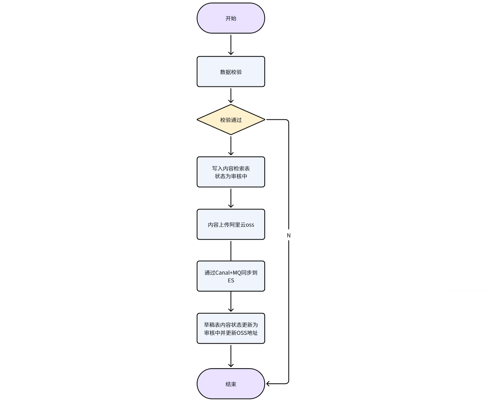

业务流程：

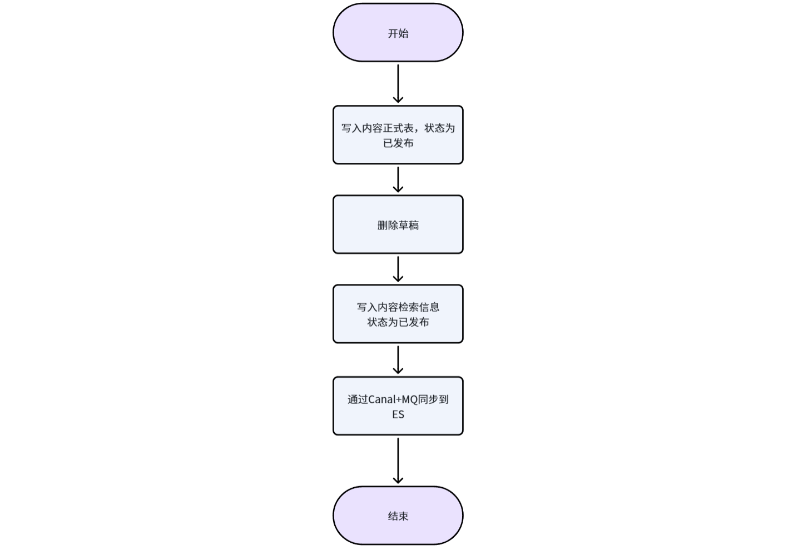

体检预约详细流程：


## 2.界面原型

本次实战的核心是预约下单、支付流程，下边介绍与其相关核心功能的界面原型，以便于理解项目的核心业务流程。

1.套餐查询

用户首次进入用户端首页，如图展示以下模块：

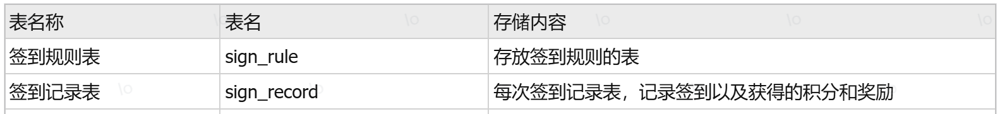

点击“体检预约”查看热门套餐列表，如下图：

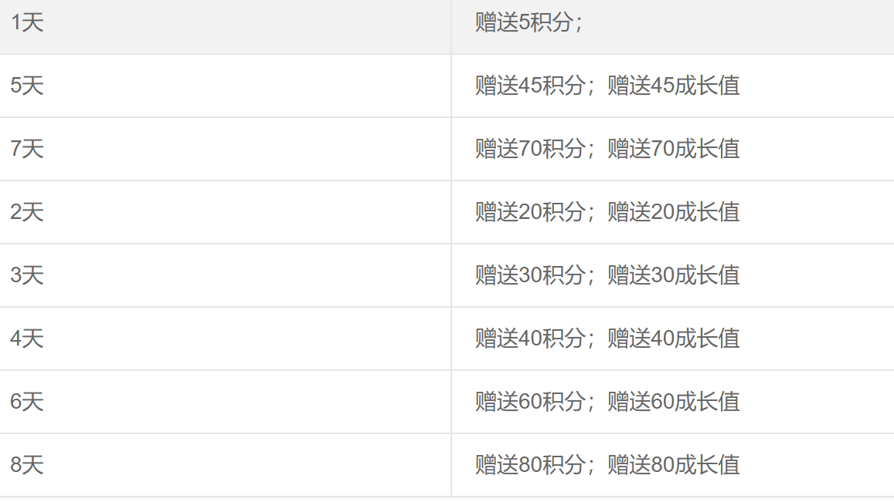

选择需要的体检套餐，点击查看套餐详情，如下图：

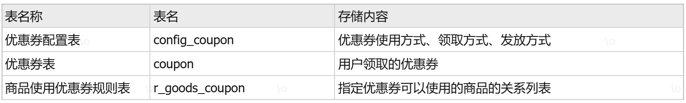


2.预约设置

管理端进行预约设置，填写预约人数。

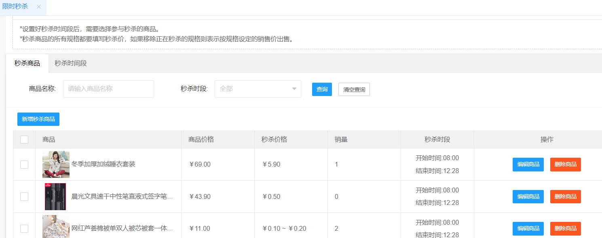

3.用户端下单

在体检套餐界面，点击“立即预约”即可填写体检各项信息进行下单。

首先选择好套餐，填写预约信息：

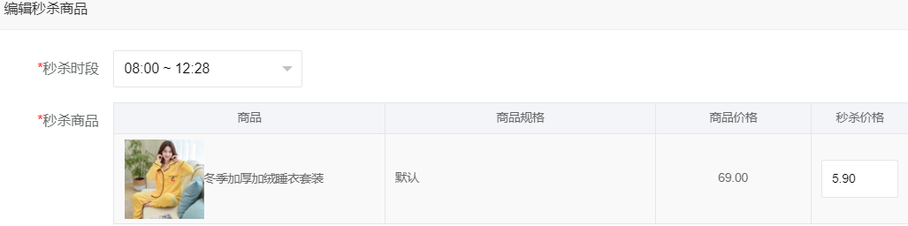

点击“体检日期”需要选择可以预约的日期（即显示“充足”的日期）：


填写完成，点击“支付并预约”即可完成下单：

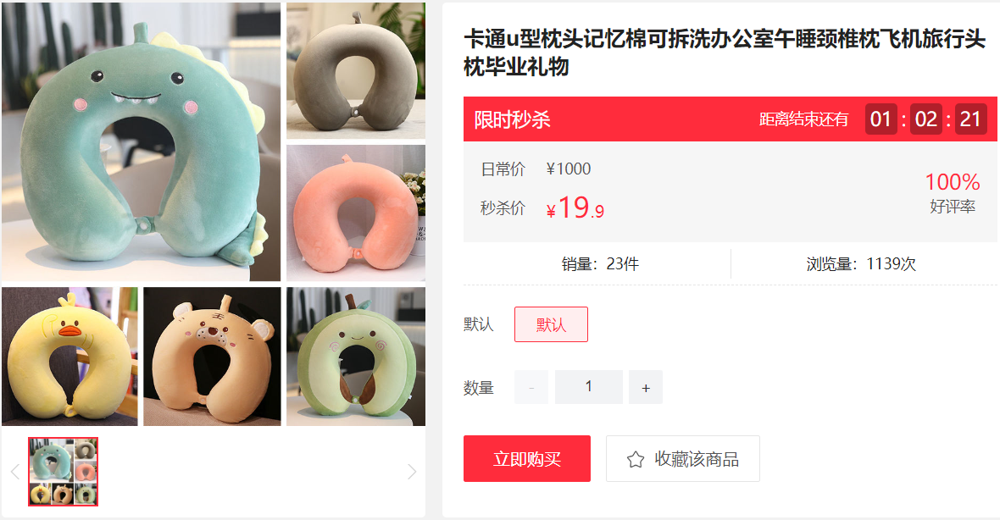

点击“支付并预约”，如下图：


选择任意支付渠道后，会生成支付二维码，用户需扫码支付，如下图：

注意：这里是为了方便学习使用了扫码支付，实际项目使用的是H5支付。

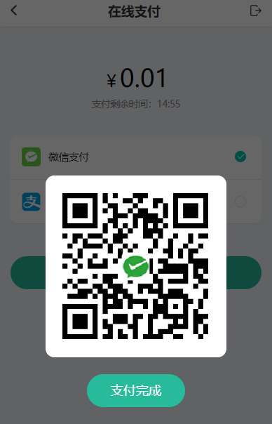

用户扫码支付完成后，需要点击“支付完成”，后端查询支付结果进行确认：

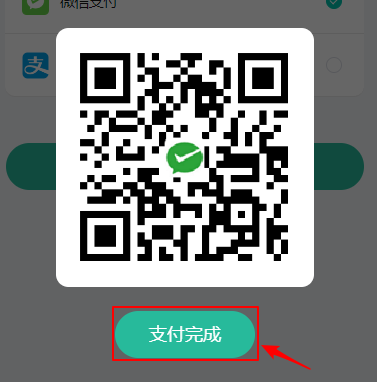

支付结果被确认成功后，跳转到支付成功页面：


用户进入“我的订单”查询订单

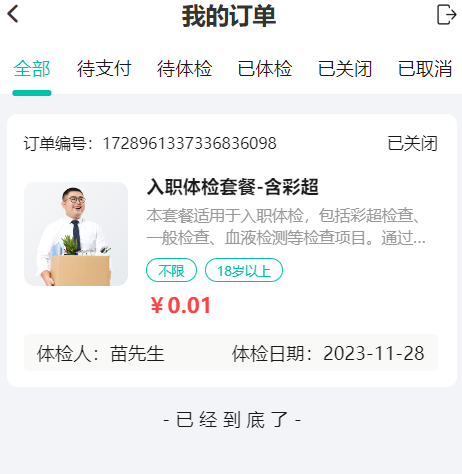

点击订单名称查看订单详情

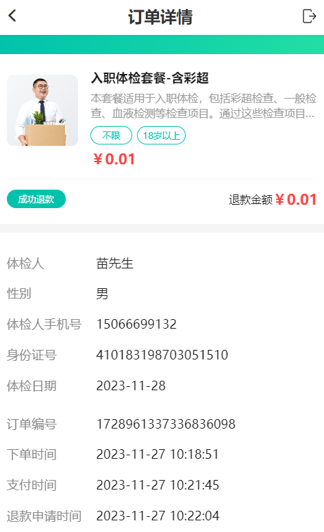

管理端进入订单管理查询订单：

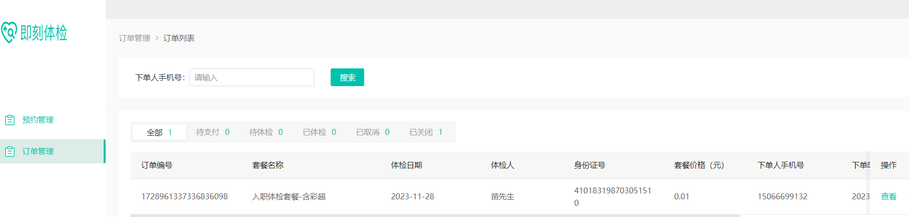

## 3.实战目标

1.项目边界

作为实战练习仅提供与实战内容相关的前端及后端代码。

1）前端：

管理端：包括预约管理（支持导入方式进行预约设置、预约设置查询、预约设置）、订单管理（订单列表查询、订单详情查询、根据状态统计订单数量）。

用户端：套餐查询、预约下单、生成支付二维码、确认支付结果、我的订单列表查询、订单详情查询、订单取消。

2）后端：

实战前提供项目原始工程：包括套餐查询接口涉及的代码、所有接口文档。

2.实战目标

通过实战进一步提高下单支付业务的设计及开发能力，积累开发经验。

实战内容边界：

前端工程：无需开发。

后端工程：除了已提供的代码以外，剩余代码均需要开发，参考后边的实战章节内容进行分析、开发、测试。

## 4.小结

本次实战的项目是什么？实战目标是什么？

# 二、搭建实战环境

## 1.服务端

即刻体检项目依赖家政项目的网关（jzo2o\-gateway）、支付服务（jzo2o\-trade）、公共服务（jzo2o\-publics），具体如下：

下单支付依赖支付服务（jzo2o\-trade）。

验证码依赖公共服务（jzo2o\-publics）。

如下图：

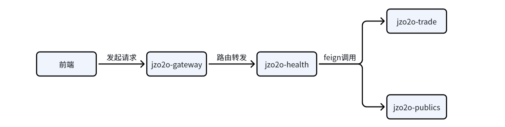

下边部署后端服务：

首先创建体检项目的数据库jzo2o\-health，从资料下的“即刻体检项目实战”目录获取jzo2o\-health\-init\.sql，并导入数据库，导入后数据库结构如下图：

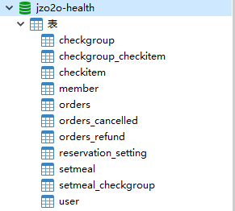

数据库创建完成，下边导入Java工程\.

首先创建Git远程仓库：jzo2o\-health

从资料下的“即刻体检项目实战”目录获取jzo2o\-health\-01\-0\.zip，解压到自己的代码目录下。

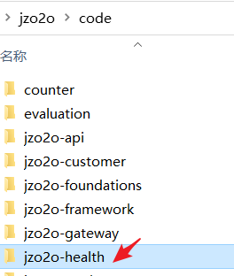

将jzo2o\-health目录上传到Git仓库：

进入jzo2o\-health目录执行下边的命令：

```shell
git init 
git add .
git commit -m "初始项目工程"
git remote add origin git仓库地址
git push -u origin "master"
```

使用IDEA打开jzo2o\-health目录，熟悉代码。

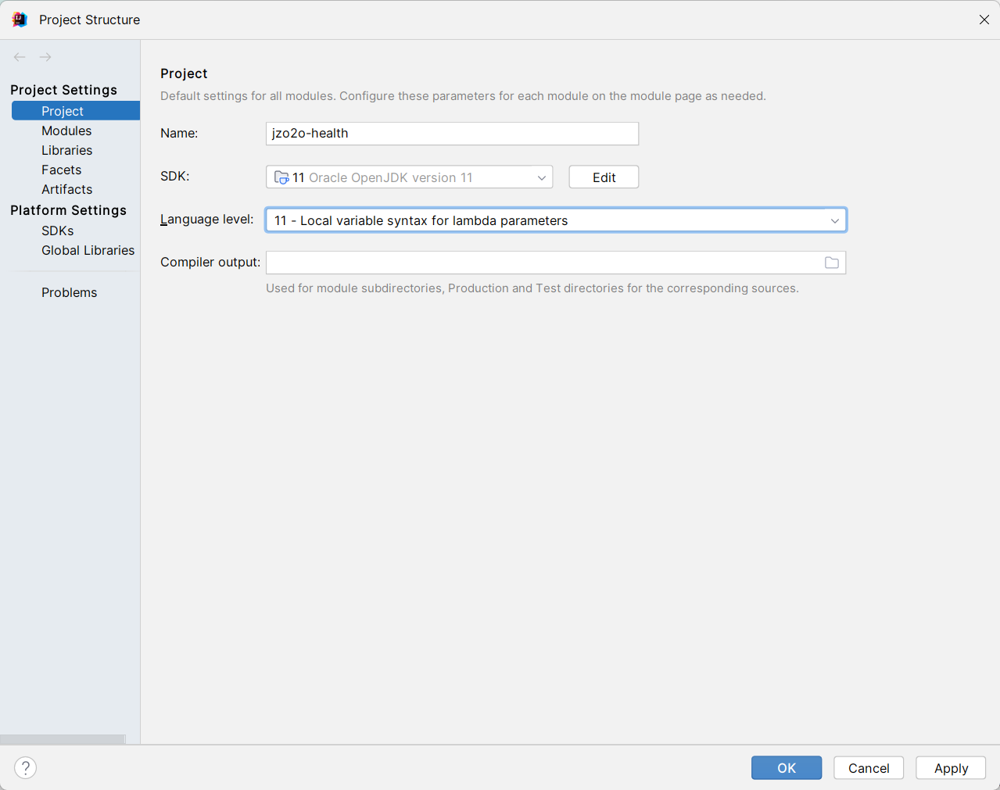

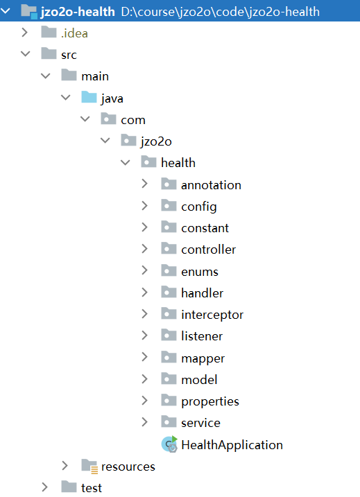

下边在nacos创建配置jzo2o\-health\.yaml文件

进入nacos创建jzo2o\-health\.yaml

> 注意：选择namespace为“75a593f5\-33e6\-4c65\-b2a0\-18c403d20f63”的命名空间添加配置文件 。
>

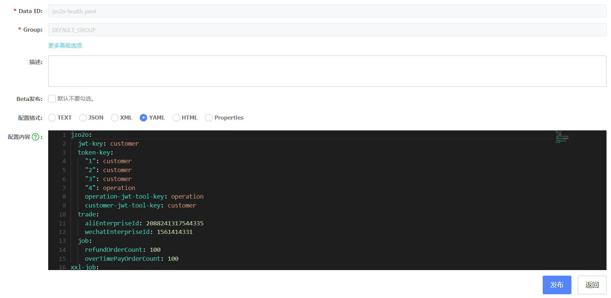

配置文件内容如下：

```YAML
jzo2o:
  jwt-key: customer
  token-key:
    "1": customer
    "2": customer
    "3": customer
    "4": operation
    operation-jwt-tool-key: operation
    customer-jwt-tool-key: customer
  trade:
    aliEnterpriseId: 2088241317544335
    wechatEnterpriseId: 1561414331
  job:
    refundOrderCount: 100
    overTimePayOrderCount: 100
xxl-job:
  port: 21600
```

## 2.管理端前端工程

下边部署管理端\(前端\)，部署完成通过浏览器运行。

从资料下的“即刻体检项目实战”目录中获取前端代码压缩包`project-jktj-admin-vue3-java`\.zip，并解压到自己的代码目录中

首先需要配置网关地址：

修改`~\project-jktj-admin-vue3-java\vite.config.ts` 文件配置网关地址，如下图：

修改红框内的ip地址为本地局域网IP地址。

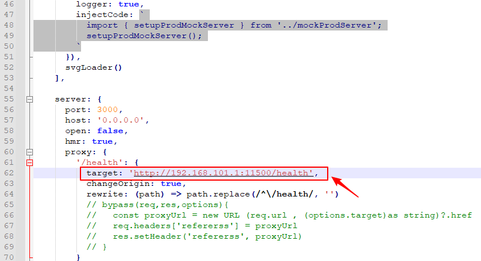

修改`~\project-jktj-admin-vue3-java\src\config\proxy.ts` 文件中的ip地址为本地局域网IP地址，如下图：

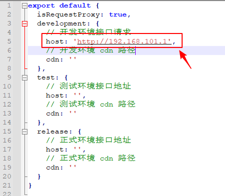

在根目录下使用cmd，执行部署命令：

```Shell
npm run dev
```

如果直接运行上边的命令不行，通过下边命令操作：

1.删除node\_modules目录

2.执行下边的命令

```shell
cnpm install || yarn 
npm run dev
```

接下来浏览器中会自动打开管理端登录页面，如下图：


## 3.用户端前端工程

下边部署用户端\(前端\)，部署完成通过浏览器运行。

从资料下的“即刻体检项目实战”目录中获取前端代码压缩包project\-jktj\-H5\-uniapp\-java\.zip，并解压到自己的代码目录中

首先需要配置网关地址，修改根目录下vite\.config\.js文件，如下图：

修改红框内的ip地址为本地局域网IP地址。

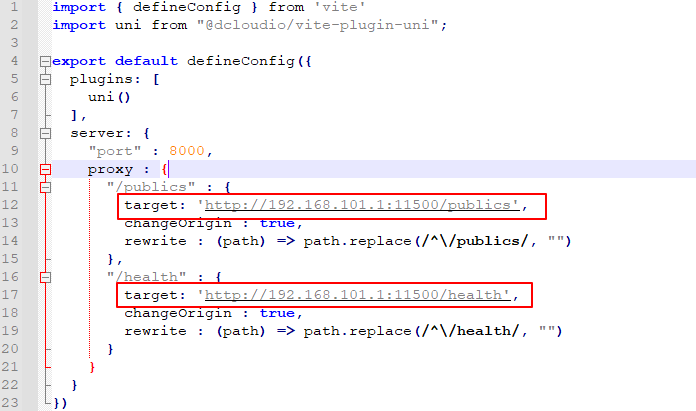

在根目录下使用cmd，执行部署命令：

```Shell
cnpm run dev:h5
```

如果直接运行上边的命令不行，通过下边命令操作：

1.删除node\_modules目录

2.执行下边的命令

```shell
npm install || yarn 
##或
cnpm install || yarn 

cnpm run dev:h5
```

接下来需要浏览器中输入`localhost:8000`手动打开用户端首页，如下图：

> 注意：为了适配手机大小，需要按“F12”打开开发者调试窗口，点击右侧红框，切换为手机页面适配，并可以切换不同尺寸手机
>

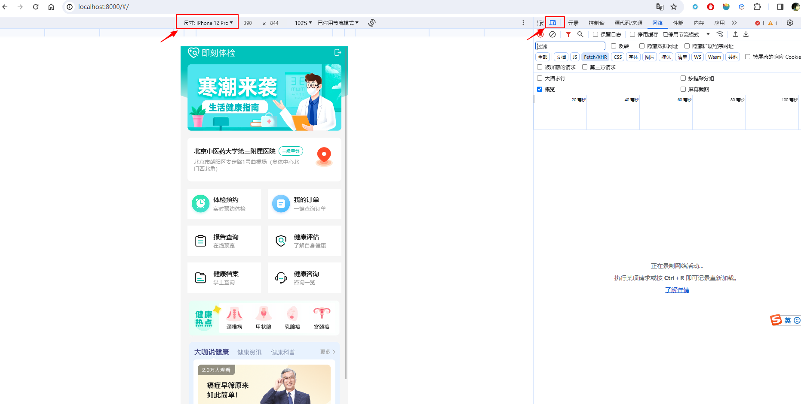

## 4.测试

1.首先启动项目：

- 启动jzo2o\-gateway网关

- 启动jzo2o\-publics公共服务

- 启动jzo2o\-health体检服务

- 启动管理端（前端）

- 启动用户端（前端）

2.测试管理端：

进入登录页面，使用默认的账号和密码登录。

预期结果：登录成功进入下边的界面

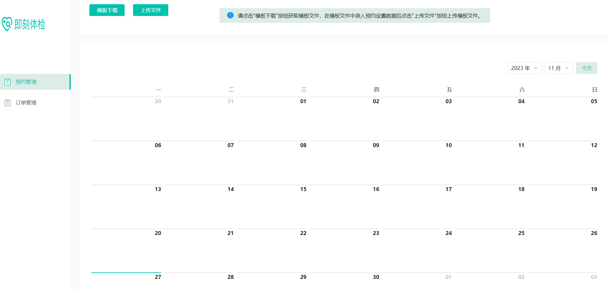

3.测试用户端：

进入用户端，点击登录按钮进行登录


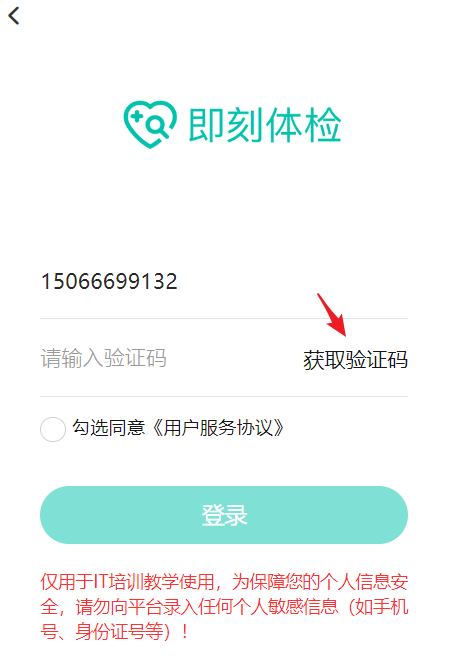

点击“获取验证码”，

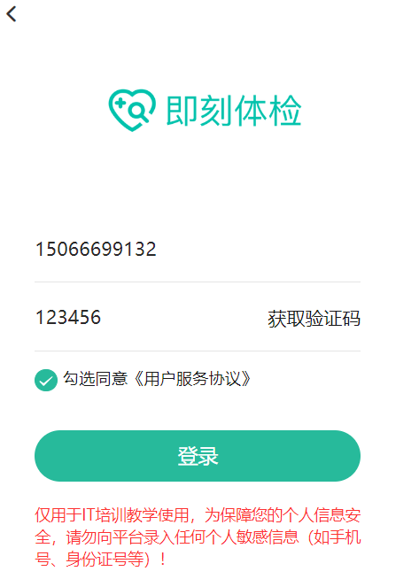

点击登录，登录成功进入首页：


点击“体检预约”查询套餐

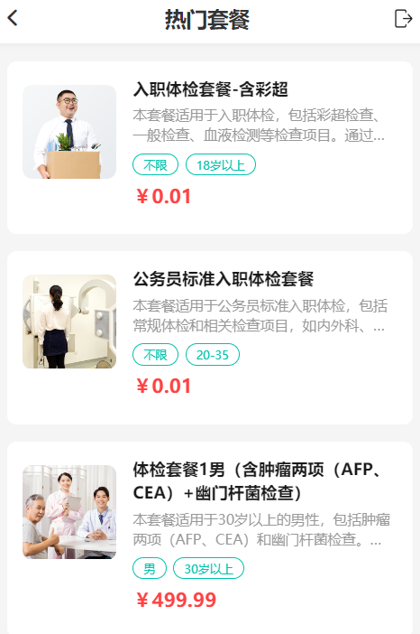

## 5.小结

实战环境需要部署哪些内容？

# 三、熟悉项目代码

## 1.接口文档

本项目初始工程代码包括了登录、套餐查询接口，下边熟悉项目已有的代码及设计。

首先阅读接口文档，根据接口文档内容去阅读代码。

接口文档地址：http://localhost:21500/health/doc.html#/home

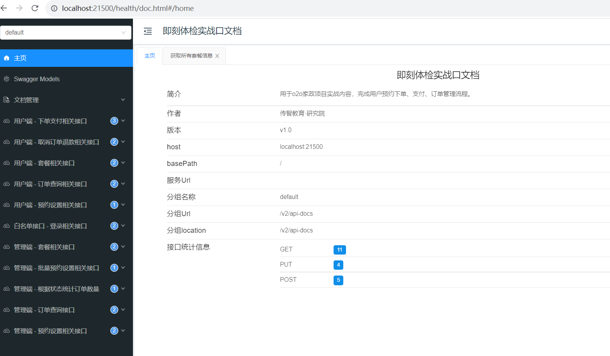

## 2.登录接口

找到登录接口文档

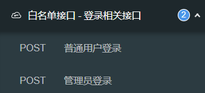

找到对应的代码

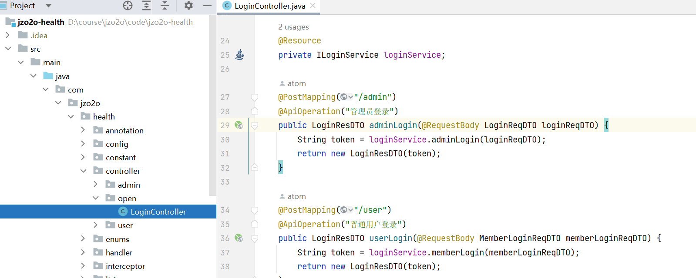

1.管理员登录：

管理员进入前端登录界面：

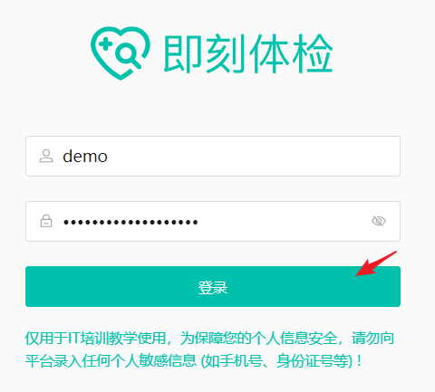

输入账号和密码：

- 账号：demo

- 密码：888itcast\.CN764%\.\.\.


在前端界面默认了demo账号和密码。

点击登录：

请求管理登录接口，执行下边的service方法。

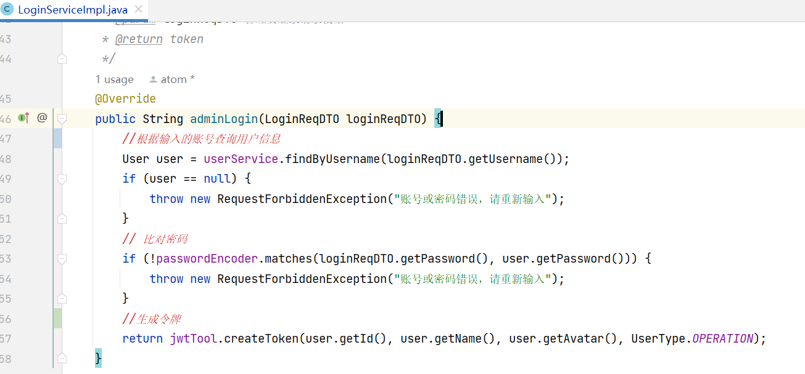

2.用户登录

用户进入前端登录界面

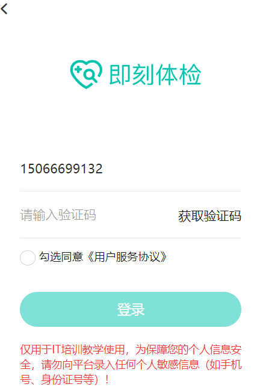

首先获取验证码，请求publics服务（ /publics/sms\-code/send） 获取验证码。

请求下边的参数：

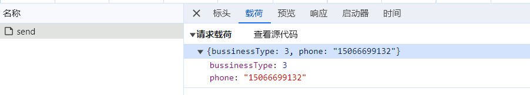

这里为了测试方便已将publics服务发送验证码改为固定发送123456。

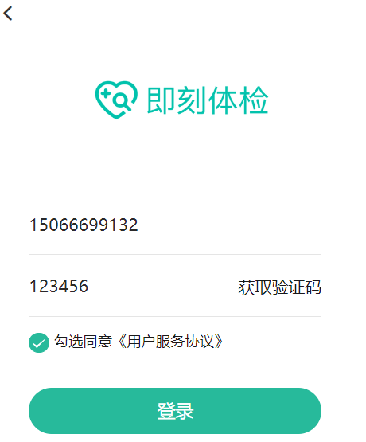

点击“登录”请求普通用户登录接口，请求下边的service方法

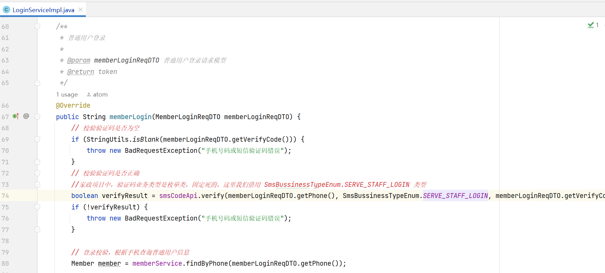

执行流程是：

- 先校验验证码是否为空，校验验证码的正确性。

- 再判断手机号是否存在，如果不存在则自动注册。

- 最后生成令牌。

## 3.套餐查询

我们查看用户端套餐查询相关接口。

找到接口文档：

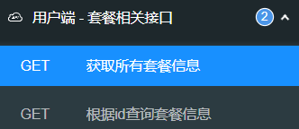

找到对应的代码

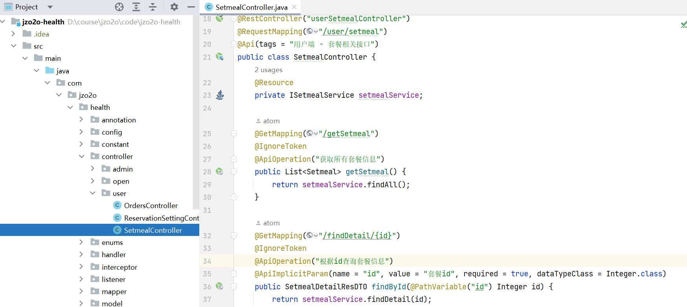

获取所有套餐信息：

进入用户端首页，点击“体检预约”进入套餐查询界面

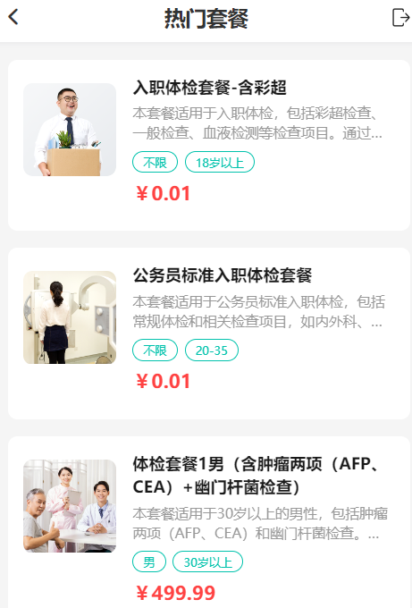

通过查阅代码，套餐信息来源setmeal表。

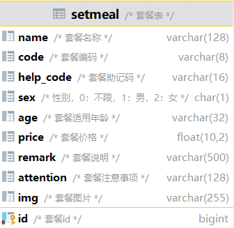

获取所有套餐接口将该表的所有记录全部查出。

根据id查询套餐信息：

点击“套餐名称”请求根据id查询套餐信息接口。


找到service方法

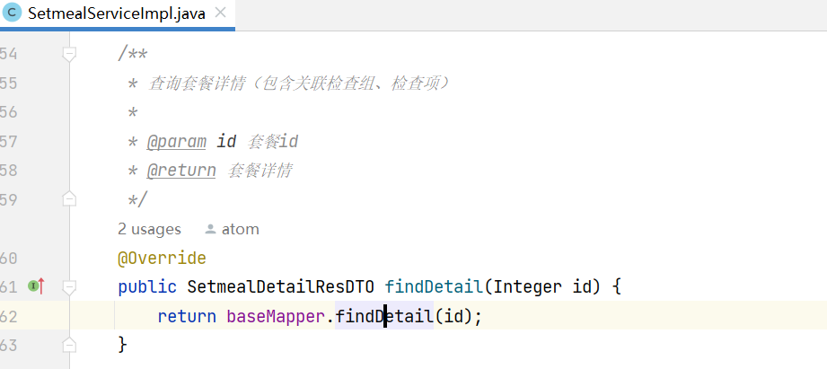

继续找到持久层方法

下边的方法通过两次一对多映射最终拿到套餐信息：

- 套餐下边的检查组信息

- 检查组下边的检查项目信息


```xml
<select id="findDetail" resultMap="SetmealDetailMap">
    SELECT
        s.id AS id,
        s.name AS name,
        s.sex,
        s.age,
        s.price,
        s.img,
        s.remark,
        g.id AS group_id,
        g.name AS group_name,
        i.id AS item_id,
        i.name AS item_name
    FROM
        setmeal AS s
            LEFT JOIN setmeal_checkgroup ON setmeal_checkgroup.setmeal_id = s.id
            LEFT JOIN checkgroup AS g ON setmeal_checkgroup.checkgroup_id = g.id
            LEFT JOIN checkgroup_checkitem ON checkgroup_checkitem.checkgroup_id = g.id
            LEFT JOIN checkitem AS i ON checkgroup_checkitem.checkitem_id = i.id
    WHERE
        s.id = #{id}
</select>

<!--手动的映射-->
<resultMap id="SetmealDetailMap" type="com.jzo2o.health.model.dto.response.SetmealDetailResDTO">
    <!--id映射主键字段-->
    <id column="id" property="id"></id>
    <!--result映射普通字段-->
    <result column="name" property="name"></result>
    <result column="sex" property="sex"></result>
    <result column="age" property="age"></result>
    <result column="price" property="price"></result>
    <result column="img" property="img"></result>
    <result column="remark" property="remark"></result>

    <!--column 数据库中的字段名-->
    <!--property 实体类中对应的属性 该关键字可以省略... -->
    <!--ofType 是javaType中的单个对象类型-->
    <collection property="checkGroupList"  resultMap="CheckGroupDetailMap">

    </collection>
</resultMap>


<!--手动的映射-->
<resultMap id="CheckGroupDetailMap" type="com.jzo2o.health.model.dto.response.CheckGroupDetailResDTO">
    <!--id映射主键字段-->
    <id column="group_id" property="id"></id>
    <!--result映射普通字段-->
    <result column="group_name" property="name"></result>

    <!--column 数据库中的字段名-->
    <!--property 实体类中对应的属性 该关键字可以省略... -->
    <!--ofType 是javaType中的单个对象类型-->
    <collection property="checkItemList"  ofType="com.jzo2o.health.model.dto.response.CheckItemResDTO">
        <id column="item_id" property="id"></id>
        <result column="item_name" property="name"></result>
    </collection>
</resultMap>
```

通过代码找到对应的表，如下：

- 检查项：最细粒度的检查项目，如身高、体重。

- 检查组：多个检查项形成一个检查组，如视力色觉检查组包含裸视力（右）、裸视力（左）等等检查项。

- 套餐：多个检查组形成一个套餐，如入职体检套餐包含视力色觉检查组、血常规检查组等等。

检查项与检查组之间是多对多关系。

检查组和套餐之间是多对多关系。

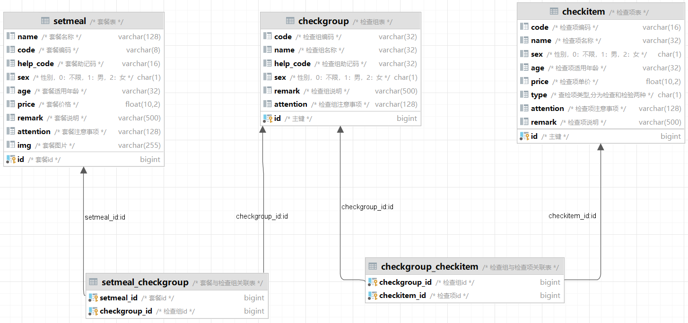


## 4.小结

检查套餐包括几张表，它们之间的关系是什么？

# 四、预约管理

在预约业务中，管理后台需要设置每日预约人数上限，用户端需要查询可预约日期，同时用户下单也需要选择预约日期，下单依赖预约设置，所以该模块需要在实战中优先完成。

## 1.需求分析

管理员需要在后台设置每日预约人数上限，目前有两种方式可以设置：手动编辑某个日期预约设置、上传预约设置文件。

手动编辑某个日期预约设置便于精细化调整预约设置，上传预约设置文件用于批量更新预约人数上限。

### 1.1.管理端查询预约设置

在预约管理页面可以按月查询到预约设置信息，预约设置信息以日历方式呈现，如下图：

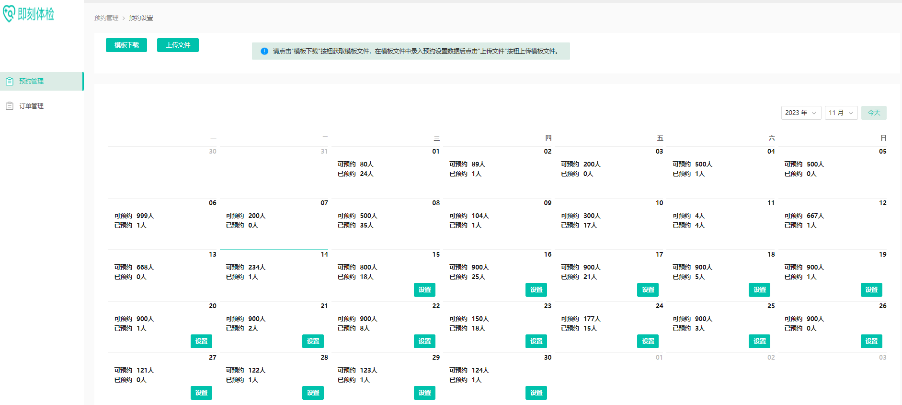

这里会按月查询预约设置数据，并在查询界面上显示。

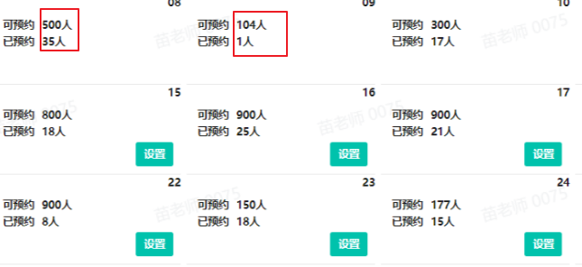

### 1.2.管理端编辑预约设置

管理员登录管理端（前端），点击“预约管理”查询预约设置信息。

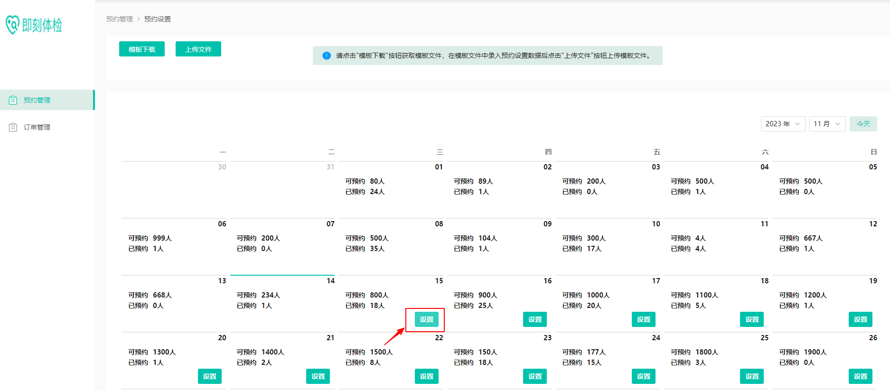

任选今日以后日期点击“设置”，打开预约人数设置窗口：

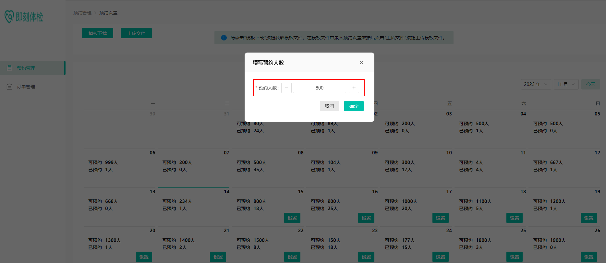

填写预约人数，然后点击“确定”：

注意：

- 填写的预约人数需要大于0，小于1000

- 填写的预约人数需要大于等于已预约人数


### 1.3.管理端批量预约设置

管理端通过上传预约设置的excel文件，进行批量设置。

管理端登录后，在“预约管理”\-\-\>“模板下载”中下载模板文件：

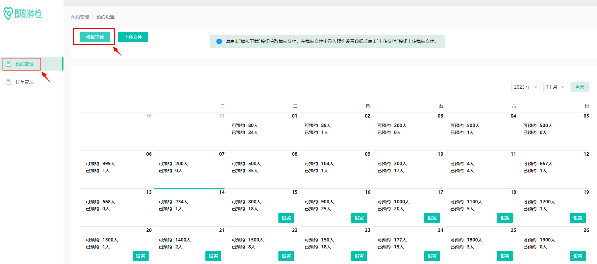

从浏览器下载文件中，打开刚刚下载的模板文件，填写预约设置：

注意：当前及之前的日期不可设置，即使设置了也不生效

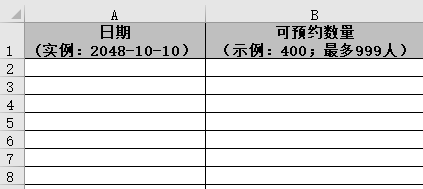

之后需要将填写好的文件进行上传：

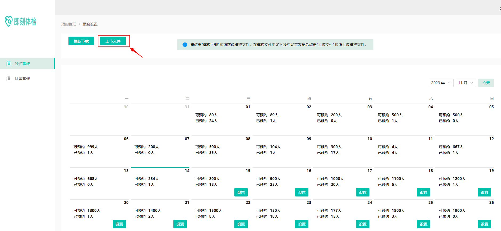

批量预约设置的逻辑是：

如果已存在预约设置数据则更新，否则进行新增。

### 1.4.用户端查询可预约时间

用户端在预约时需要选择预约日期，在预约界面查询可预约日期。

选择好套餐，点击“立即预约”，进入预约信息填写页面，如下图：

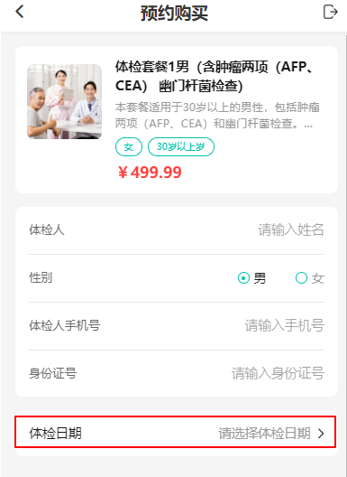

点击“体检日期”，可以查询到可预约日期，如下图：


如果对应日期仍有预约名额，则显示“充足”；如果没有预约名额或后台未设置该日期预约人数，则显示“不可约”。

## 2.数据表设计

预约设置信息保存在reservation\_setting表：

结构如下：

```SQL
CREATE TABLE `reservation_setting` (
        `id` INT(10) NOT NULL AUTO_INCREMENT COMMENT '主键',
        `order_date` DATE NOT NULL COMMENT '预约日期',
        `number` INT(10) NOT NULL COMMENT '可预约人数',
        `reservations` INT(10) NOT NULL DEFAULT '0' COMMENT '已预约人数',
        PRIMARY KEY (`id`) USING BTREE,
        UNIQUE INDEX `order_date` (`order_date`) USING BTREE
)
COMMENT='预约设置'
COLLATE='utf8_general_ci'
ENGINE=InnoDB;
```

## 3.接口设计

详细内容参考接口文档，地址：http://localhost:21500/health/doc.html#/home

### 3.1.管理端查询预约设置

接口名称：按月查询预约设置

接口路径：GET   /health/admin/reservation\-setting/getReservationSettingByMonth

请求数据类型 application/x\-www\-form\-urlencoded


示例：

```JSON
{
    "code":200,
    "msg":"OK",
    "data":[
        {
            "date":"2023-12-01",
            "number":20,
            "reservations":0
        },
        {
            "date":"2023-12-02",
            "number":50,
            "reservations":0
        }
    ]
}
```

### 3.2.管理端编辑预约设置

接口名称：编辑预约设置

接口路径：PUT  /health/admin/reservation\-setting/editNumberByDate

请求数据类型 application/json


### 3.3.管理端批量预约设置

接口名称：上传预约设置文件

接口路径：POST  /health/admin/reservation\-setting/upload

请求数据类型 multipart/form\-data


### 3.4.用户端预约设置查询

接口名称：按月查询可预约日期

接口路径：GET   /health/user/reservation\-setting/getReservationDateByMonth

请求数据类型 application/x\-www\-form\-urlencoded


示例：

```JSON
{
    "code":200,
    "msg":"OK",
    "data":{
        "dateList":[
            "2023-12-01",
            "2023-12-02",
            "2023-12-03"
        ]
    }
}
```

# 五、订单管理

## 1.整体需求分析

完成了套餐管理、预约管理，接下来进入订单管理模块。

### 1.1.业务流转

首先我们需要熟悉订单的业务流转，如下图：


说明：

1.立即预约这一步需要用户进行登录，如果用户没有登录则会跳转到登录页面

2.因为立即预约可能是并发情况，需要校验是否还有预约名额，名额耗尽则会失败

3.从“立即预约”到“订单支付”有15分钟倒计时，必须在15分钟内支付，否则会被系统认为支付超时，自动取消

4.从“订单支付”到“到院核销”过程不作为实战内容

5.只实现用户端的订单取消和订单退款

### 1.2.状态流转

1.订单状态流转

订单数据中有一个属性关系到订单的整个流程，就是订单状态。

本项目中订单有5种状态，如下图：


- 待支付：用户填写完预约信息后，提交订单但未进行支付

- 待体检：用户已支付成功，未线下体检

- 已体检：已线下核销预约信息（已体检的订单不能发起退款）

- 已关闭：在待体检时取消预约，订单自动退款

- 已取消：在待支付的状态下，手动取消订单 或 订单超时15分钟

2.支付状态流转

另外订单流转过程中涉及支付和退款，所以我们使用支付状态标记订单的支付和退款情况。

本项目中存在5种支付状态，其对照订单状态流转，如下图：


- 未支付：用户未支付订单

- 已支付：用户支付订单，且支付成功

- 退款中：用户已发起退款，但钱未原路退回

- 退款成功：发起退款后，钱已原路返回

- 退款失败：发起退款后，钱未退回

## 2.详细需求分析

### 2.1.用户端预约下单

用户在登录以后，选择套餐即可预约下单，下面我们分析具体流程。

首先选择好套餐，填写预约信息：


点击“体检日期”需要选择可以预约的日期（即显示“充足”的日期）：


填写完成，点击“支付并预约”即可完成下单：


### 2.2.用户端生成支付二维码

用户完成“支付并预约”后，需要进行支付，支付入口有三个：预约购买页面点击“支付并预约”按钮、订单列表页面点击“去支付”、订单详情页面点击“去支付”。它们支付页面一致，如下图：


选择任意支付渠道后，会生成支付二维码，用户需扫码支付，如下图：


### 2.3.用户端确认支付结果

用户扫码支付完成后，需要点击“支付完成”，后端查询支付结果进行确认：


支付结果被确认成功后，跳转到支付成功页面：


### 2.4.接收支付通知

经过了“云岚到家”项目的学习，我们知道支付结果我们不仅能够通过主动请求的方式获取，还可以通过支付服务通知的方式被动获取。

用户支付成功后，支付服务会获取支付结果，之后通过MQ发消息的方式通知业务系统，业务系统收到消息后处理属于自己的支付通知。

注：

- 请求支付服务获取二维码需要传入product\_app\_id

- 不同的业务系统接收MQ消息，需要定义不同的队列名称


上述两者本项目均已定义好，参见：`com.jzo2o.health.constant.TradeConstants`

### 2.5.用户端取消未支付订单

用户下单后为待支付状态，可以取消订单，在此情况下订单状态变化：待支付\-\-\>已取消

同时该操作需要取消预约，例如：用户预约日期为2023年10月1日，已预约人数为100人，该操作会导致已预约人数变更为99人。

该操作可以在订单列表页面点击“取消预约”或者在订单详情页面点击“取消预约”来完成，如下图：

订单列表页面：


订单详情页面：


点击“取消预约”后，需要选择取消原因：


点击“确认提交”即完成取消订单操作。

### 2.6.自动取消未支付订单

取消未支付订单除了人工操作外还可以自动取消，下单超过15分钟未支付自动取消订单。这个需求在很多业务场景都有用到，比如：购买火车票、购买电影票在一定时间内未支付将自动取消。

本项目中我们通过定时任务加被处理的方式来完成该操作：

定时任务：每分钟将支付过期的订单查询出来进行取消操作。

懒加载方式：当用户查看订单详情时判断是否到达过期时间，如果到达过期时间则执行取消操作。

延迟消息机制：基于RabbitMQ的延迟交换机

基于需求分析，我们需要分别在用户查询订单操作和定时任务中加入取消订单的代码，实现逻辑可参考云岚到家项目。

### 2.7.用户端订单退款

我们定义订单支付状态为“已支付”状态下才可以发起退款，本项目中，用户付款后订单状态进入“待体检”状态，此状态下用户可发起退款。

执行该操作后，订单状态变化为：待体检\-\-\>已关闭，支付状态变化为：已支付\-\-\>退款中

同样的，该操作也会导致预约取消，对应日期已预约人数自减1。

该操作可以在订单列表页面点击“申请退款”或者在订单详情页面点击“申请退款”来完成，如下图：

订单列表页面：


订单详情页面：


### 2.8.退款定时任务

用户执行订单退款操作，此时订单支付状态转变为“退款中”状态，在数据存储层面，订单数据进入了订单退款表。接下来，需要通过定时任务，根据退款记录去请求第三方支付服务的退款接口，根据退款结果进行处理，如果退款成功将更新订单的退款状态、删除退款记录。

```java
@Slf4j
@Component
public class OrdersHandler {

    @Resource
    private RefundRecordApi refundRecordApi;
    //解决同级方法调用，事务失效问题
    @Resource
    private OrdersHandler orderHandler;
    @Resource
    private IOrdersRefundService ordersRefundService;
    @Resource
    private OrdersJobProperties ordersJobProperties;
    @Resource
    private IOrdersService ordersService;

    /**
     * 订单退款异步任务
     */
    @XxlJob(value = "handleRefundOrders")
    public void handleRefundOrders() {
        //订单退款程序
    }
}
```

### 2.9.用户端分页查询订单

上述流程已经分析完了全部的订单状态流转，现在我们需要查询订单。在用户端，用户查询的是自己下的单，需要通过“首页”\-\-\>“我的订单”来查看，同时基于订单状态划分了不同的tab标签（全部、待支付、待体检、已体检、已关闭、已取消），用户可点击不同的tab标签查询不同状态下的订单列表。

需要注意的是用户端订单列表排序方式为按照下单时间倒序，在数据库中我们定义了sort\_by字段，这个字段是订单创建时间的时间戳。用户每次进行翻页，前端需要传入最后一个订单的sort\_by字段值（查询第一页，无需传值）。


### 2.10.用户端查询订单详情

在“我的订单”列表页点击任一订单即可进入订单详情，如下图：


### 2.11.管理端分页查询订单

管理端登录后在订单管理页面即可查看订单列表：


### 2.12.管理端根据状态统计订单数量

管理端订单管理页面在每个状态上展示对应订单数量


### 2.13.管理端查询订单详情

在订单列表中，点击左侧操作中的“查看”即可查看对应订单的详细信息，其中包含了订单信息、支付记录、退款信记录。

需要注意的是，在支付记录中，其支付状态和数据库中订单表的支付状态字段不一致，其对应关系为：

当订单表中支付状态为“未支付”时，这里支付状态为“未支付”；

当订单表中支付状态不是“未支付”时，这里支付状态为“已支付”；


## 3.数据表设计

### 3.1.订单表

```SQL
CREATE TABLE `orders` (
        `id` BIGINT(19) NOT NULL COMMENT '订单id',
        `order_status` INT(10) NOT NULL COMMENT '订单状态，0：未支付，100：待体检，200：已体检，300：已关闭，400：已取消',
        `pay_status` INT(10) NOT NULL COMMENT '支付状态，0：未支付，1：已支付，2：退款中，3：退款成功，4：退款失败',
        `setmeal_id` BIGINT(19) NOT NULL DEFAULT '0' COMMENT '套餐id',
        `setmeal_name` VARCHAR(50) NOT NULL COMMENT '套餐名称' COLLATE 'utf8mb4_general_ci',
        `setmeal_sex` INT(10) NOT NULL COMMENT '套餐适用性别，0：不限，1：男，2：女',
        `setmeal_age` VARCHAR(50) NOT NULL COMMENT '套餐适用年龄' COLLATE 'utf8mb4_general_ci',
        `setmeal_img` VARCHAR(100) NOT NULL COMMENT '套餐图片' COLLATE 'utf8mb4_general_ci',
        `setmeal_remark` VARCHAR(100) NOT NULL COMMENT '套餐说明' COLLATE 'utf8mb4_general_ci',
        `setmeal_price` DECIMAL(10,2) NOT NULL COMMENT '套餐价格',
        `reservation_date` DATE NOT NULL COMMENT '预约日期，格式：yyyy-MM',
        `checkup_person_name` VARCHAR(50) NOT NULL COMMENT '体检人姓名' COLLATE 'utf8mb4_general_ci',
        `checkup_person_sex` INT(10) NOT NULL COMMENT '体检人性别，0：不限，1：男，2女',
        `checkup_person_phone` VARCHAR(50) NOT NULL COMMENT '体检人电话' COLLATE 'utf8mb4_general_ci',
        `checkup_person_idcard` VARCHAR(50) NOT NULL COMMENT '体检人身份证号' COLLATE 'utf8mb4_general_ci',
        `member_id` BIGINT(19) NOT NULL COMMENT '用户id',
        `member_phone` VARCHAR(50) NOT NULL COMMENT '用户电话' COLLATE 'utf8mb4_general_ci',
        `pay_time` DATETIME NULL DEFAULT NULL COMMENT '支付时间',
        `trading_channel` VARCHAR(50) NULL DEFAULT NULL COMMENT '支付渠道' COLLATE 'utf8mb4_general_ci',
        `trading_order_no` BIGINT(19) NULL DEFAULT NULL COMMENT '支付服务交易单号',
        `transaction_id` VARCHAR(50) NULL DEFAULT NULL COMMENT '第三方支付的交易号' COLLATE 'utf8mb4_general_ci',
        `refund_no` BIGINT(19) NULL DEFAULT NULL COMMENT '支付服务退款单号',
        `refund_id` VARCHAR(50) NULL DEFAULT NULL COMMENT '第三方支付的退款单号' COLLATE 'utf8mb4_general_ci',
        `sort_by` BIGINT(19) NULL DEFAULT NULL COMMENT '排序字段（取创建时间的时间戳）',
        `create_time` DATETIME NOT NULL DEFAULT CURRENT_TIMESTAMP COMMENT '创建时间',
        `update_time` DATETIME NOT NULL DEFAULT CURRENT_TIMESTAMP ON UPDATE CURRENT_TIMESTAMP COMMENT '更新时间',
        PRIMARY KEY (`id`) USING BTREE,
        INDEX `order_status_member_id_sort_by` (`order_status`, `member_id`, `sort_by`) USING BTREE
)
COMMENT='订单表'
COLLATE='utf8mb4_general_ci'
ENGINE=InnoDB;
```

下单时会产生member\_id字段，可以从UserThreadLocal中获取

### 3.2.订单取消表

订单取消或退款时，会将取消/退款相关信息保存到该表中

```SQL
CREATE TABLE `orders_cancelled` (
        `id` BIGINT(19) NOT NULL COMMENT '订单id',
        `canceller_id` BIGINT(19) NULL DEFAULT NULL COMMENT '取消人',
        `canceller_name` VARCHAR(50) NULL DEFAULT NULL COMMENT '取消人名称' COLLATE 'utf8mb4_0900_ai_ci',
        `canceller_type` INT(10) NULL DEFAULT NULL COMMENT '取消人类型，0：系统，1：普通用户，4管理员',
        `cancel_reason` VARCHAR(50) NULL DEFAULT NULL COMMENT '取消原因' COLLATE 'utf8mb4_0900_ai_ci',
        `cancel_time` DATETIME NULL DEFAULT NULL COMMENT '取消时间',
        `create_time` DATETIME NOT NULL DEFAULT CURRENT_TIMESTAMP COMMENT '创建时间',
        `update_time` DATETIME NOT NULL DEFAULT CURRENT_TIMESTAMP ON UPDATE CURRENT_TIMESTAMP COMMENT '更新时间',
        PRIMARY KEY (`id`) USING BTREE
)
COMMENT='订单取消表'
COLLATE='utf8mb4_0900_ai_ci'
ENGINE=InnoDB
ROW_FORMAT=DYNAMIC;
```

### 3.3.订单退款表

订单退款时，会将退款信息保存到该表中，以便退款定时任务读取

```SQL
CREATE TABLE `orders_refund` (
        `id` BIGINT(19) NOT NULL COMMENT '订单id',
        `trading_order_no` BIGINT(19) NULL DEFAULT NULL COMMENT '支付服务交易单号',
        `real_pay_amount` DECIMAL(10,2) NULL DEFAULT NULL COMMENT '实付金额',
        `create_time` DATETIME NULL DEFAULT CURRENT_TIMESTAMP COMMENT '创建时间',
        PRIMARY KEY (`id`) USING BTREE
)
COMMENT='订单退款表'
COLLATE='utf8mb4_0900_ai_ci'
ENGINE=InnoDB;
```

## 4.接口设计

详细内容参考接口文档，地址：http://localhost:21500/health/doc.html#/home

### 4.1.用户端预约下单

接口名称：下单接口

接口路径：POST  /health/user/orders/place

请求数据类型 application/json


### 4.2.用户端生成支付二维码

接口名称：订单支付

接口路径：PUT  /health/user/orders/pay/\{id\}

请求数据类型 application/x\-www\-form\-urlencoded


### 4.3.用户端确认支付结果

接口名称：查询订单支付结果

接口路径：GET  /health/user/orders/pay/\{id\}/result

请求数据类型 application/x\-www\-form\-urlencoded


### 4.4.用户端取消未支付订单

接口名称：查询订单支付结果

接口路径：PUT  /health/user/orders/cancel

请求数据类型 application/json


### 4.5.用户端订单退款

接口名称：订单退款

接口路径：PUT  /health/user/orders/refund

请求数据类型 application/json


### 4.6.用户端分页查询订单

接口名称：滚动分页查询

接口路径：GET  /health/user/orders/page

请求数据类型 application/x\-www\-form\-urlencoded


### 4.7.用户端查询订单详情

接口名称：根据订单id查询

接口路径：GET  /health/user/orders/\{id\}

请求数据类型 application/x\-www\-form\-urlencoded


### 4.8.管理端分页查询订单

接口名称：分页查询

接口路径：GET  /health/admin/orders/page

请求数据类型 application/x\-www\-form\-urlencoded


### 4.9.管理端根据状态统计订单数量

接口名称：根据状态统计数量

接口路径：GET  /health/admin/orders/countByStatus

请求数据类型 application/x\-www\-form\-urlencoded

请求参数：无


### 4.10.管理端查询订单详情

接口名称：根据订单id查询

接口路径：GET  /health/admin/orders/\{id\}

请求数据类型 application/x\-www\-form\-urlencoded


# 六、实战要求 

实战初始代码: jzo2o\-health\-01\-0\.zip  ，从资料下的“即刻体检项目实战”目录获取。

仔细阅读需求及设计内容，确定每个接口的具体实现逻辑。

实战形式：可按下边的模块进行

- 管理端预约管理（管理端预约查询、用户端查询预约设置、管理端手动预约设置）

- 管理端批量预约设置

- 管理端和用户端订单查询（订单列表、订单详情）

- 管理端根据订单状态统计数量

- 用户端下单及支付（预约下单接口、生成支付二维码接口、确认支付结果接口）

- 通过MQ接收支付结果

- 用户端订单取消与退款\(取消未支付订单、订单退款接口、支付超时处理\)

所有开发完成后测试整体业务流程。

实战完成要能说出：

1.你负责模块的怎么设计的

> 介绍业务流程、表设计、接口设计
>

2.在开发中你遇到了什么问题
