# 一、模块需求分析

## 1.业务流程

优惠券是最常用的一种营销活动，优惠券模块涉及到优惠券活动管理、抢券、优惠券核销三部分，涉及到的用户角色有运营人员和用户，下图是优惠券模块的整体业务流程。

1.优惠券活动管理：

运营人员在后台添加优惠券活动，包括：新增优惠券活动、修改优惠券活动、撤销优惠券活动等操作。

2.抢券：

优惠券到达发放时间用户领取优惠券，因为优惠券的数量有限，当到达发放时间后平台所有用户都可以抢券，先到先得。

3.优惠券核销：

用户抢到优惠券即可在下单时使用优惠券，享受优惠，如果取消订单将退回优惠券，优惠券退回后可用于其它订单。

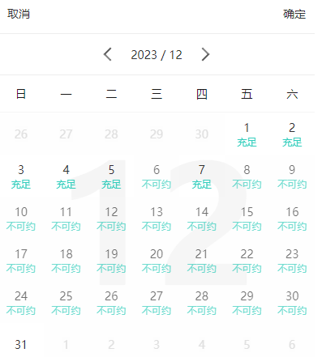

## 2.界面原型

查询优惠券活动信息：

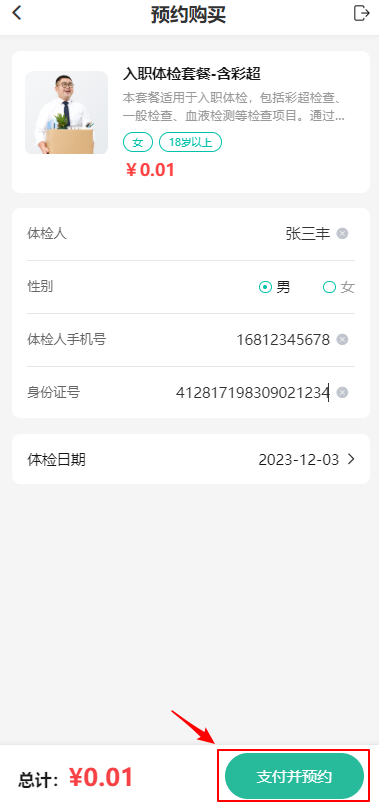

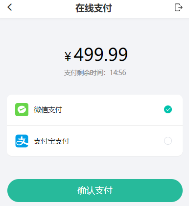

新增优惠券活动：


抢券：

到达优惠券发放时间用户开始抢券，在抢券界面列出了进行中的活动和即将开始的活动。


用券：

在下单时选择优惠券：

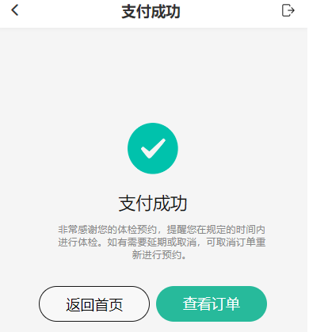


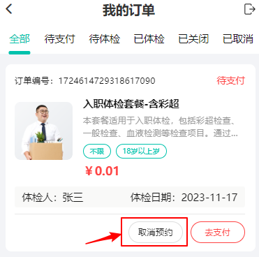

支付金额减去优惠金额：


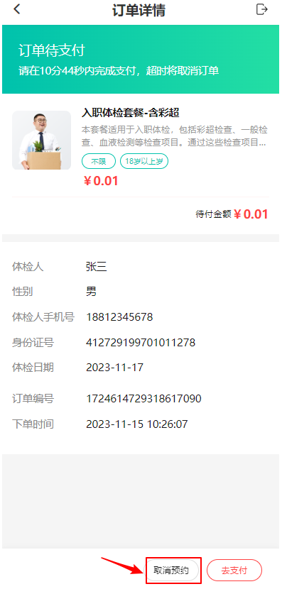

## 3. 业务模块

根据流程分析，优惠券模块可分为三个小模块，如下：

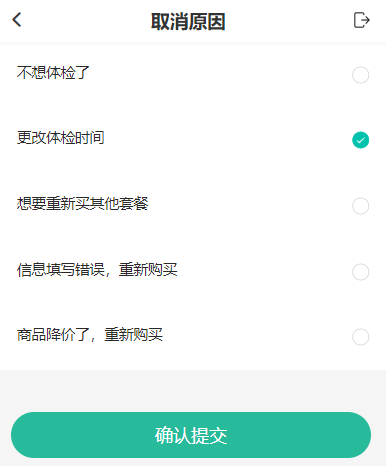

1.优惠券活动管理：

对优惠券活动进行管理，运营人员新增优惠券活动、修改优惠券活动、撤销优惠券活动及优惠券统计等。

2.抢券：

到了优惠券发放时间用户进行抢券，抢券过程对优惠券库存、对用户领取优惠券数量等进行校验，抢券成功记录用户领取优惠券的记录。

3.核销：

用户在下单时使用优惠券得到优惠金额，实付金额等于订单金额减去优惠金额，下单成功优惠券核销成功。

优惠券核销是指：顾客在购买商品使用优惠券，当此次消费符合优惠券的条件时提交订单后将优惠券的折扣应用到顾客的订单中，最后将优惠券标记为已使用或作废。

优惠券核销后还可以取消核销，如果用户取消订单会将优惠券取消核销即退回优惠券，退回优惠券后可以继续使用。

## 4.小结

优惠券包括几个模块？

# 二、模块设计

## 1.数据流

根据需求分析优惠券模块的数据流如下：

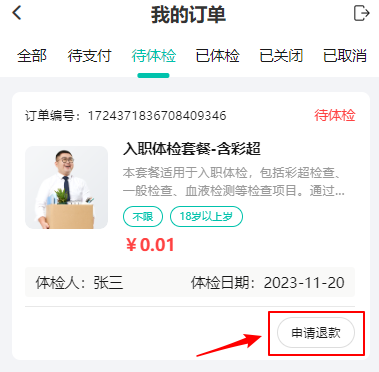

1.优惠券活动表：

优惠券活动管理模块主要操作优惠券活动表。

优惠券活动记录优惠券活动信息，运营人员新增优惠券活动将写入此表，此表是优惠券管理主要维护的表。

关键字段：活动id、活动名称、优惠券类型、折扣、发放时间等。

2.优惠券表：

抢券模块主要操作优惠券表。

优惠券表记录用户领取的优惠券，用户抢券存在限制，每种优惠券一个用户只允许领取一张，优惠券的总数有限制。

关键字段：用户id、活动id、折扣、优惠券类型、有效期等。

举例：一个优惠券活动发放100张优惠券最多有100个用户去领取，每人领取一张，每个用户领取的一张优惠券会记录在优惠券表中，即该优惠券活动对应优惠券表最多100条记录。

3.优惠券核销表: 

在使用优惠券模块当用户成功使用一张优惠券会在优惠券核销表记录一条记录，记录是哪个用户的哪个订单使用了哪个优惠券。

关键字段 ：用户id、优惠券id、订单id，核销时间。

4.优惠券退回表：

如果用户取消订单，则会退回优惠券，具体操作是向优惠券退回表添加一条记录（记录用户退回优惠券的信息），并向优惠券核销表删除一条对应的记录，表示取消优惠券的核销。

关键字段：用户id、优惠券id、退回时间。

## 2.表结构设计

1.优惠券活动表设计

记录优惠券活动信息，运营人员新增优惠券活动将写入此表，此表是优惠券管理主要维护的表。

结构如下：

```Java
create table `jzo2o-market`.activity
(
    id                    bigint                                 not null comment '活动id'
        constraint `PRIMARY`
        primary key,
    name                  varchar(100) default '0'               not null comment '活动名称',
    type                  int                                    not null comment '优惠券类型，1：满减，2：折扣',
    amount_condition      decimal(10, 2)                         not null comment '使用条件，0：表示无门槛，其他值：最低消费金额',
    discount_rate         int          default 0                 not null comment '折扣率，折扣类型的折扣率，8折就是存80',
    discount_amount       decimal(10, 2)                         null comment '优惠金额，满减或无门槛的优惠金额',
    validity_days         int          default 0                 not null comment '优惠券有效期天数，0：表示有效期是指定有效期的',
    distribute_start_time datetime                               not null comment '发放开始时间',
    distribute_end_time   datetime                               not null comment '发放结束时间',
    status                int                                    not null comment '活动状态，1：待生效，2：进行中，3：已失效 4：作废',
    total_num             int          default 0                 not null comment '发放数量，0：表示无限量，其他正数表示最大发放量',
    stock_num             int          default 0                 not null comment '库存',
    create_time           datetime     default CURRENT_TIMESTAMP not null comment '创建时间',
    update_time           datetime     default CURRENT_TIMESTAMP not null on update CURRENT_TIMESTAMP comment '更新时间',
    create_by             bigint                                 null comment '创建人',
    update_by             bigint                                 null comment '更新人',
    is_deleted            tinyint      default 0                 not null comment '逻辑删除'
)
    charset = utf8mb4;
```

说明：

- amount\_condition：0表示无门槛，其它值表示最低消费金额。

- discount\_rate：当优惠券类型为2折扣时在此字段中存储折扣率。

- discount\_amount：当优惠券类型为1满减时在此字段中存储优惠券金额。

- status：活动状态字段值包括：1：待生效，2：进行中，3：已失效 4：作废 几种，优惠券活动的初始状态是待生效，当到达优惠券发放时间时状态将改为进行中，当到达结束时间时状态改为已失效，当撤销活动后状态为作废。

2.优惠券表设计

记录用户领取的优惠券，结构如下：

```Java
create table `jzo2o-market`.coupon
(
    id               bigint                             not null comment '优惠券id'
        constraint `PRIMARY`
        primary key,
    name             varchar(255)                       not null comment '优惠券名称',
    user_id          bigint                             not null comment '优惠券的拥有者',
    user_name        varchar(50)                        null comment '用户姓名',
    user_phone       varchar(20)                        null comment '用户手机号',
    activity_id      bigint                             not null comment '活动id',
    type             int                                not null comment '使用类型，1：满减，2：折扣',
    discount_rate    int      default 0                 null comment '折扣',
    discount_amount  decimal(10, 2)                     null comment '优惠金额',
    amount_condition decimal(10, 2)                     not null comment '满减金额',
    validity_time    datetime                           null comment '有效期',
    use_time         datetime                           null comment '使用时间',
    status           tinyint                            not null comment '优惠券状态，1:未使用，2:已使用，3:已失效',
    orders_id        varchar(50)                        null comment '订单id',
    create_time      datetime default CURRENT_TIMESTAMP not null comment '创建时间',
    update_time      datetime default CURRENT_TIMESTAMP not null on update CURRENT_TIMESTAMP comment '更新时间',
    is_deleted       tinyint  default 0                 not null comment '逻辑删除'
)
    charset = utf8mb4;

create index user_my_query_index
    on `jzo2o-market`.coupon (user_id, status)
    comment '用户查询我的优惠券快捷索引';
```

3.优惠券核销表

用户成功使用优惠券的记录，记录是哪个用户的哪个订单使用了哪个优惠券。

结构如下：

```Java
create table `jzo2o-market`.coupon_write_off
(
    id                  bigint      not null
        constraint `PRIMARY`
        primary key,
    coupon_id           bigint      not null comment '优惠券id',
    user_id             bigint      not null comment '用户id',
    orders_id           bigint      not null comment '核销时使用的订单号',
    activity_id         bigint      not null comment '活动id',
    write_off_time      datetime    not null comment '核销时间',
    write_off_man_phone varchar(20) not null comment '核销人手机号',
    write_off_man_name  varchar(50) not null comment '核销人姓名'
)
    comment '优惠券核销表' charset = utf8mb4;
```

4.优惠券退回表

用户取消订单后成功退回优惠券的记录，记录哪个用户退回了哪个优惠券。

结构如下：

```Java
create table `jzo2o-market`.coupon_use_back
(
    id             bigint   not null comment '回退记录id'
        constraint `PRIMARY`
        primary key,
    coupon_id      bigint   not null comment '优惠券id',
    user_id        bigint   not null comment '用户id',
    use_back_time  datetime not null comment '回退时间',
    write_off_time datetime null comment '核销时间'
)
    comment '优惠券使用回退记录' charset = utf8mb4;
```

## 3.创建数据库

创建数据库：jzo2o\-market

导入：jzo2o\-market\-init\.sql

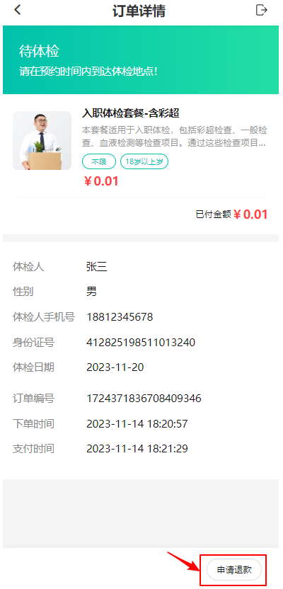

## 4.创建工程

从资料中获取源码：jzo2o\-market\-01\-0\.zip，解压源码到jzo2o\-market目录。

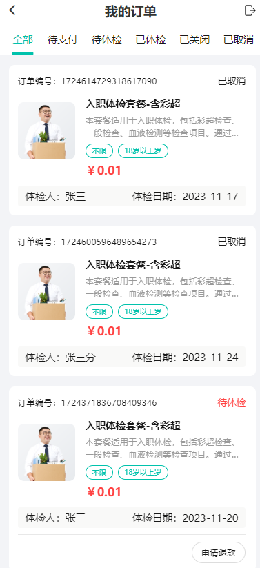

下边在nacos创建配置jzo2o\-market\.yaml文件

进入nacos创建jzo2o\-market\.yaml

> 注意：选择namespace为“75a593f5\-33e6\-4c65\-b2a0\-18c403d20f63”的命名空间添加配置文件 。
>

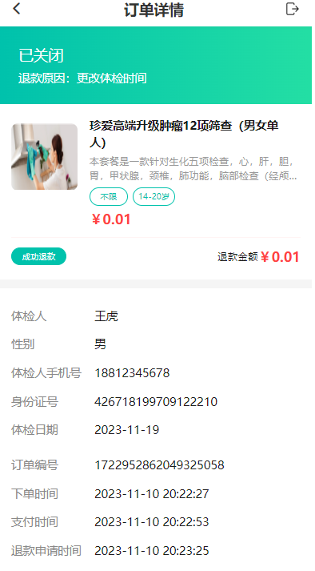

配置文件内容如下：

```yaml
rabbit-mq:
    enable: true
xxl-job:
  executor:
    port: 11610
```

## 5.小结

优惠券模块的核心表的哪些，是怎么设计的？

# 三、优惠券活动管理

## 1.需求分析

### 1.1.新增优惠券活动

**界面原型**

运营人员进入优惠券活动管理界面，点击“新增优惠券”进入如下界面。

优惠券新增页包括两部分内容：配置优惠券活动的基本信息和发放规则。

1.选择满减

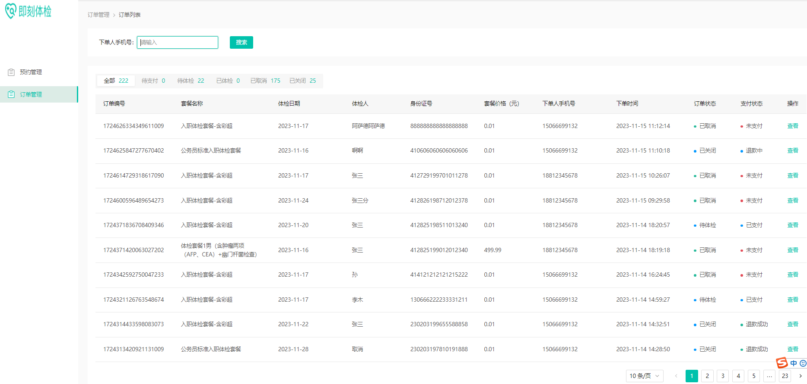

2.选择折扣

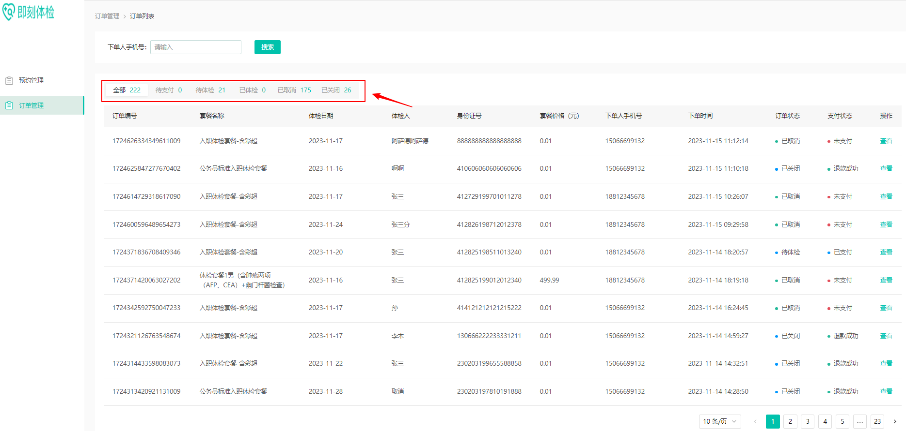

优惠券类型说明

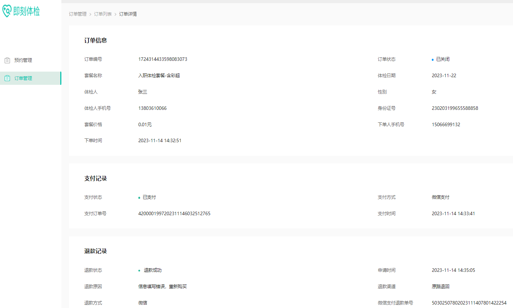

**数据分析**

表单内容如下：

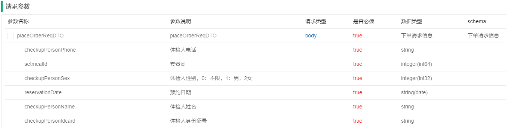

**数据校验**

本项目优惠券只支持满减与折扣两种类型。

优惠券类型，1：满减，2：折扣

如果满减：

- 折扣金额必须输入
- 折扣金额必须大于0的整数

如果是折扣：

- 折扣比例必须输入
- 折扣比例必须大于0，小于100的整数

发放时间开始时间不能小于当前时间

发放结束时间不能早于发放开始时间

### 1.2.查询优惠券活动

**界面原型**

登录运营端进入“优惠券管理”界面，如下图：

按条件查询优惠券活动信息。

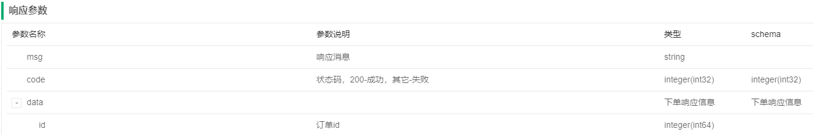

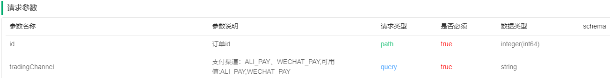

### 1.3.修改优惠券活动

**界面原型**

待生效的活动信息可以进行修改。

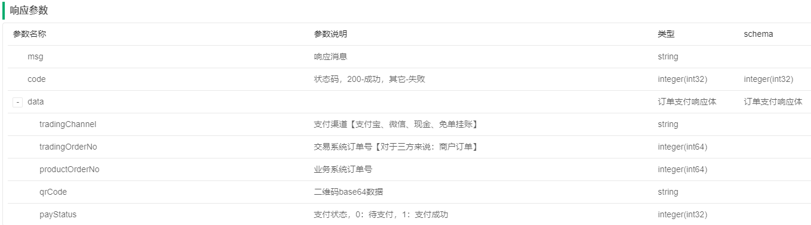

进入修改页面进行修改：

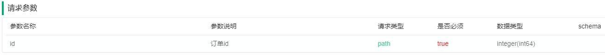

**数据分析**

参考新增优惠券。

**数据校验**

注意：只允许对待生效的的活动进行修改，且发放开始时间不能早于当前时间。

本项目优惠券只支持满减与折扣两种类型。

优惠券类型，1：满减，2：折扣

如果满减：

- 折扣金额必须输入

- 折扣金额必须大于0的整数


如果是折扣：

- 折扣比例必须输入

- 折扣比例必须大于0，小于100的整数


发放时间开始时间不能小于当前时间

发放结束时间不能早于发放开始时间

### 1.4.查询领取记录

**界面原型**

进入优惠券活动查询界面，点击“领取记录”可查看用户领取优惠券的记录，如下图：

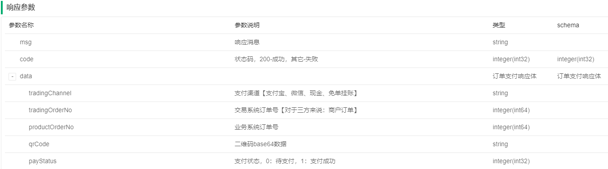

**数据分析**

数据计算：

- 发放数量 = 新增优惠券时指定的发放总数

- 领取数量 = 领取该优惠券的数量，领取数量\<=发放数量

- 使用数量 = 用户领取优惠券后使用数量，使用数量\<=领取数量

- 发放率= 领取数量/发放数量\*100%；

- 使用率=使用数量/领取数量\*100%；

- 用户手机号：领取优惠券的用户手机号

- 领取时间：领取优惠券的时间

- 使用时间：使用优惠券的时间

- 优惠券状态：待使用，已使用

- 使用订单：使用优惠券的订单号


显示规则：

- 列表内数据倒序进行展示；

- 发放率、使用率最多显示两位小数；

- 单页最多显示5条，没有分页，超过5条出滚动条，无限向下滚；


### 1.5.撤销活动

对于待生效及进行中的活动如果要进行终止可以执行撤销操作，执行后活动状态改为作废，用户已抢到还未使用的优惠券将作废。

**界面原型**

对于待生效及进行中的活动如果要进行终止可以执行撤销操作，执行后此活动将终止，用户已抢到还未使用的优惠券将作废。

点击【撤销】，出现【确认撤销】弹窗，如下：

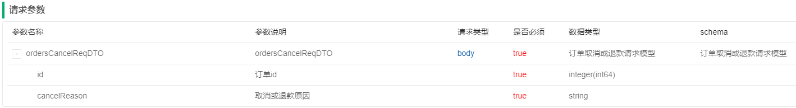

撤销的活动可以选择发放状态：作废，进行查询

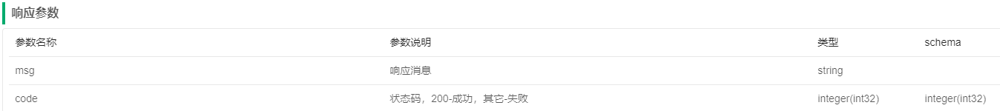

**数据校验**

只允许对待生效及进行中的活动进行撤销。

### 1.6.自动变更活动状态

状态变更的需求如下：

优惠券活动表的状态字段值包括：1：待生效，2：进行中，3：已失效 4：作废 几种，优惠券活动的初始状态是待生效，当到达优惠券发放时间状态将改为进行中，当到达结束时间状态改为已失效，当撤销活动后状态为作废。

状态变更不需要依赖人工操作，可由定时任务实现，每分钟更新一次状态：

1.对待生效的活动更新为进行中

到达发放开始时间状态改为“进行中”。

2.对待生效及进行中的活动更新为已失效

到达发放结束时间状态改为“已失效”

### 1.7.我的优惠券

**界面原型**

用户抢到优惠券后进入“我的”\-\-\>"我的优惠券"查询已抢到的优惠券，按抢券时间降序显示当前用户抢到的优惠券，

本查询为滚动查询，向上拖屏幕查询下一屏，一屏显示10条。

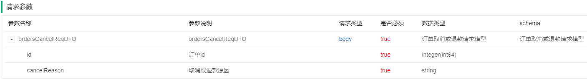

用户抢到优惠券有三个状态：

1.未使用：未过有效期的优惠券。

优惠券的有效期：从领取优惠券的时间加上优惠券的使用期限（“使用期限”在优惠券活动管理界面进行设置）。

2.已使用：已经在订单中使用的优惠券。

3.已过期：未使用且已过有效期的优惠券，已过期的优惠券将无法使用。

查询未使用的优惠券

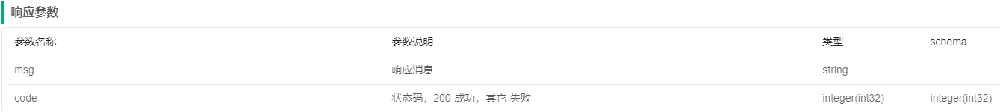

查询已使用的优惠券：

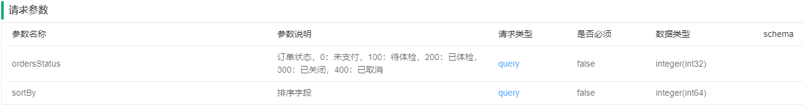

查询已过期的优惠券：

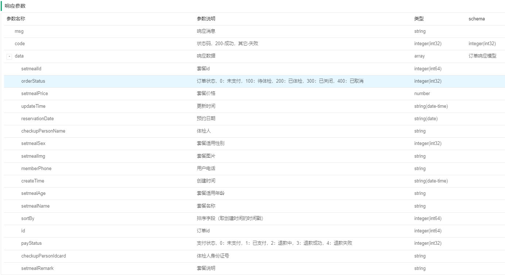

## 2.运营端接口设计

优惠券活动管理模块涉及如下接口，请自行阅读接口文档完成功能开发。

### 2.1.新增优惠券活动

接口名称：保存优惠券活动

接口功能：新增或修改一个优惠券活动信息，本接口支持新和修改。

接口地址：POST/market/operation/activity/save

请求数据类型： application/json

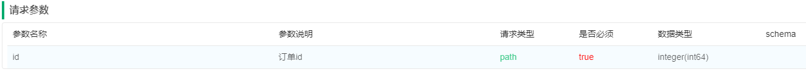

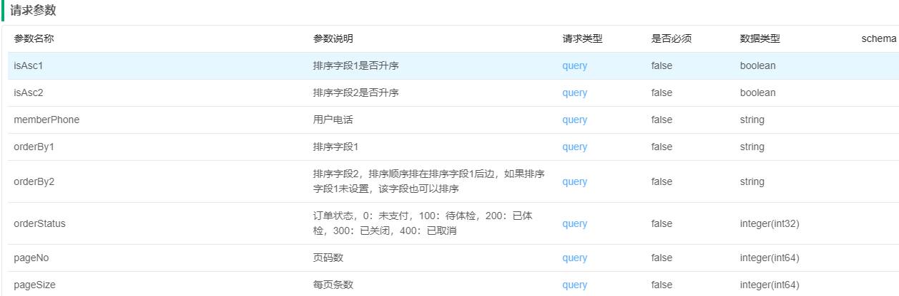

### 2.2. 查询优惠券活动

接口名称：分页查询优惠券活动

接口功能：运营端分页查询优惠券活动

接口地址：GET/market/operation/activity/page

请求数据类型： application/x\-www\-form\-urlencoded

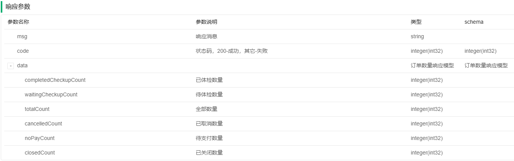

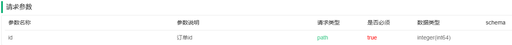

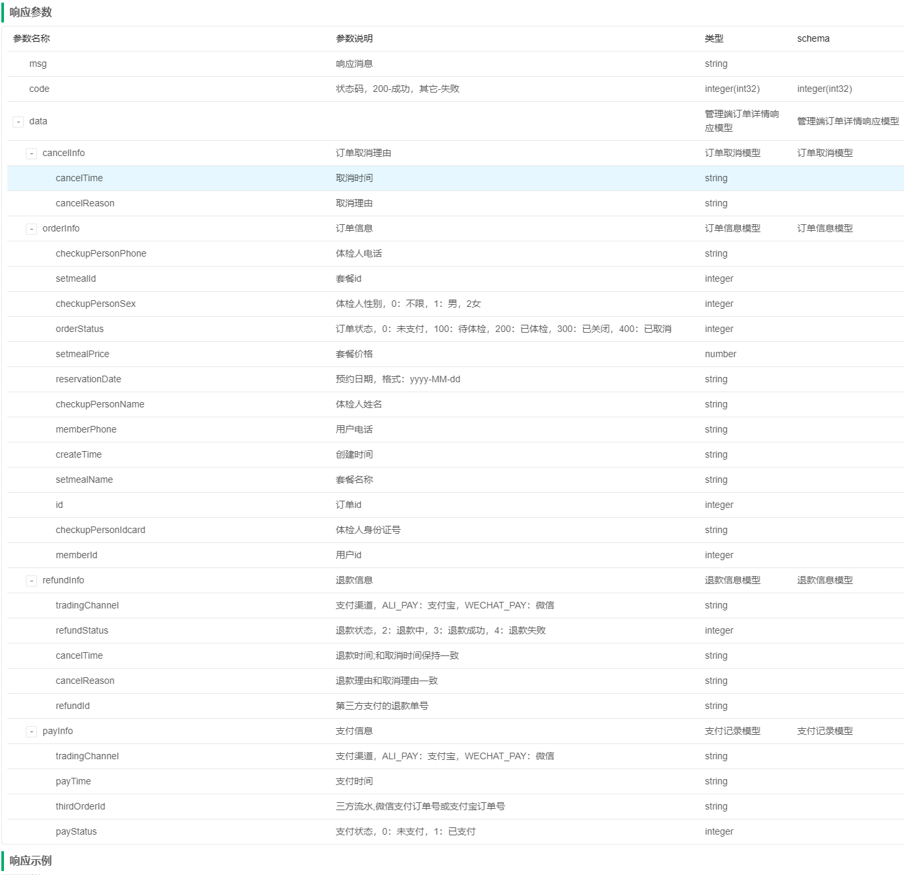

### 2.3.修改优惠券活动

**查询优惠券活动详情接口**

接口名称：查询优惠券活动详情

接口功能：进入修改页面首先调用此接口根据活动id查询优惠券活动详情在页面显示

接口地址：GET/market/operation/activity/\{id\}

请求数据类型 application/x\-www\-form\-urlencoded

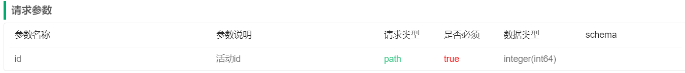

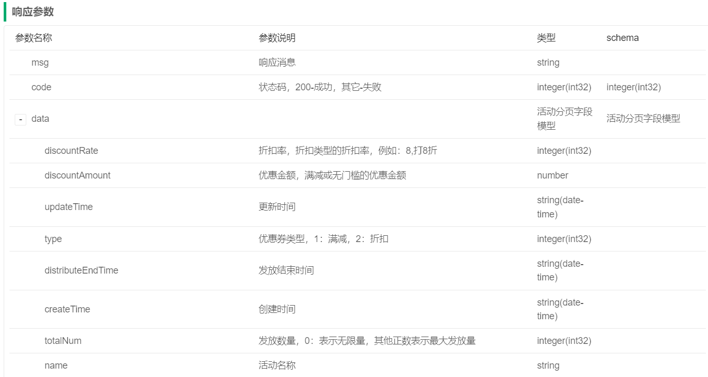

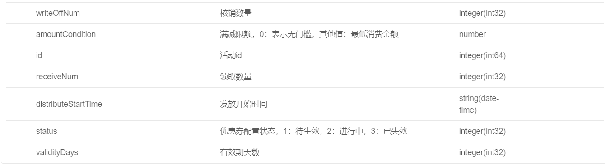

**保存优惠券活动接口**

修改优惠券活动信息后请求保存优惠券活动接口。

修改优惠券活动与新增优惠券活动调用同一个接口：保存优惠券活动接口，参考新增优惠券活动章节的描述。

### 2.4.查询领取记录

在查询领取记录页面共有两部分信息需要调用两个接口获取：优惠券活动信息，领取记录。

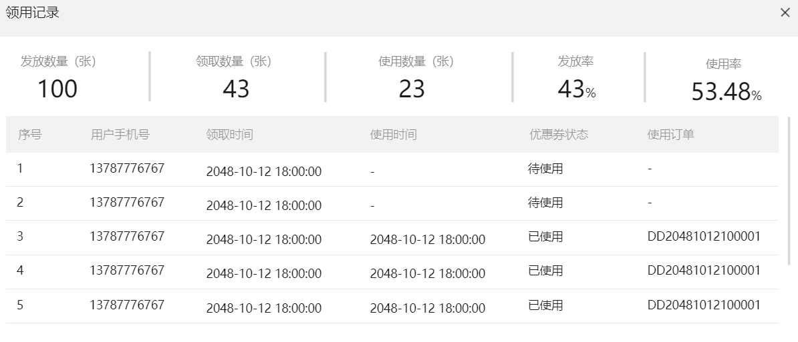

**查询优惠券活动详情接口**

接口名称：查询优惠券活动详情

接口功能：进入修改页面首先调用此接口根据活动id查询优惠券活动详情在页面显示

接口地址：GET/market/operation/activity/\{id\}

请求数据类型 application/x\-www\-form\-urlencoded


**查询领取记录**

接口名称：根据活动ID查询优惠券领取记录

接口功能：根据活动ID查询优惠券领取记录

接口地址：GET/market/operation/coupon/page

请求数据类型 application/x\-www\-form\-urlencoded

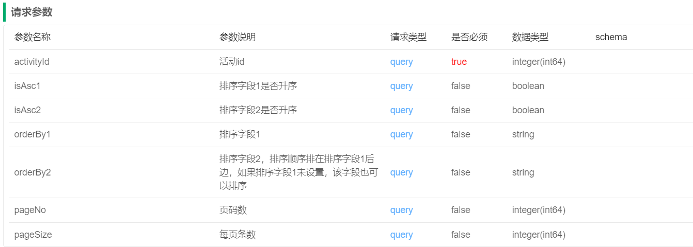

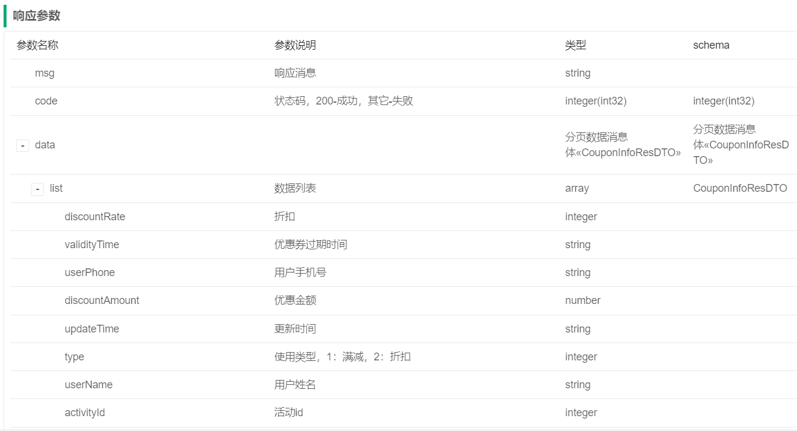

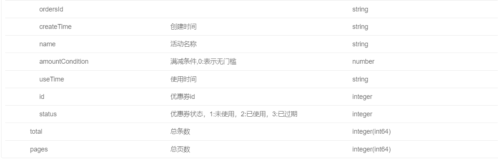

### 2.5.撤销活动

接口名称：撤销活动

接口功能：撤销一个优惠券活动，对于待生效及进行中的活动如果要进行终止可以执行撤销操作，执行后活动状态改为作废，用户已抢到还未使用的优惠券将作废。

接口地址：POST/market/operation/activity/revoke/\{id\}

请求数据类型 application/x\-www\-form\-urlencoded


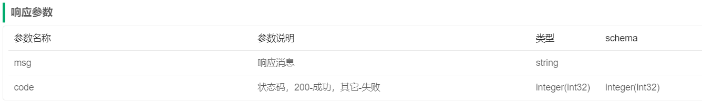

> 注意：本接口除了更新活动状态为作废，还需要将所有抢到本活动优惠券的状态为未使用的记录的状态更改为“已失效” 。
>

## 3.用户端接口设计

**我的优惠券列表接口**

接口名称：我的优惠券列表

接口功能：用户查询自己领取的优惠券

接口地址：GET/market/consumer/coupon/my

请求数据类型 application/x\-www\-form\-urlencoded

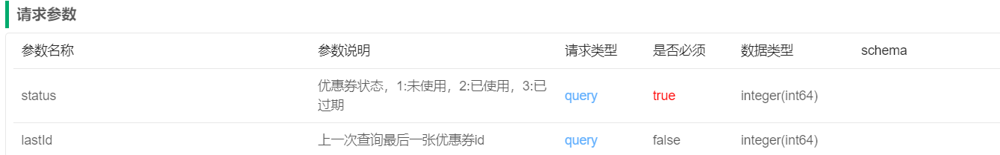

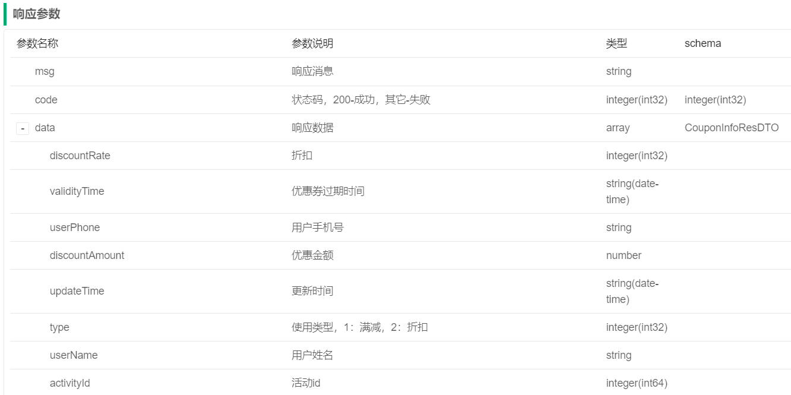

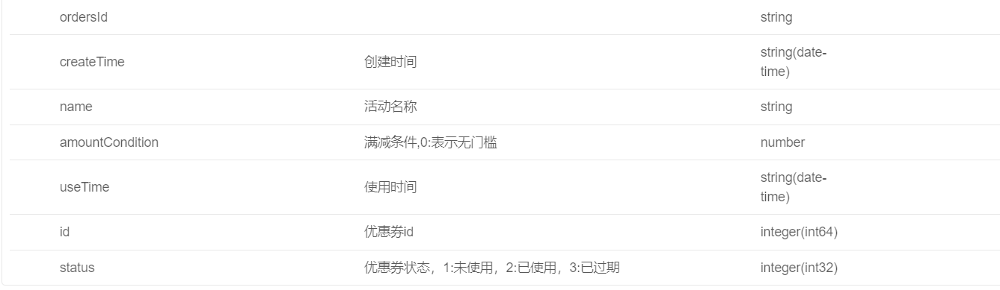

## 4.定时任务

### 4.1.活动状态变更定时任务

活动状态包括：1：待生效，2：进行中，3：已失效 4: 作废'

对于待生效的活动：到达发放开始时间状态改为“进行中”。

对于待生效及进行中的活动：到达发放结束时间状态改为“已失效”

使用xxl\-job定义定时任务，每分钟执行一次。

### 4.1.已领取优惠券自动过期

用户领取的优惠券如果到达有效期仍然没有使用自动改为“已失效”

使用xxl\-job定义定时任务，每小时执行一次。

# 四、实战要求

实战初始代码：jzo2o\-market\-01\-0\.zip

阅读需求及设计内容先设计表，再确定每个接口的具体实现。

本次实战模块如下，按下边的模块进行开发：

- 新增、查询、修改活动信息
- 查询领取记录
- 撤销活动

- 用户端我的优惠券列表接口

- 定时任务

实战完成要能说出：

1.你负责模块的怎么设计的

> 介绍业务流程、表设计、接口设计
>

2.在开发中你遇到了什么问题
