# 一、状态机

## 1.什么是状态机

> 目标：能说出什么是状态机
>

### 1.1.当前存在的问题

在预约下单模块设计订单状态共有7种，如下图：

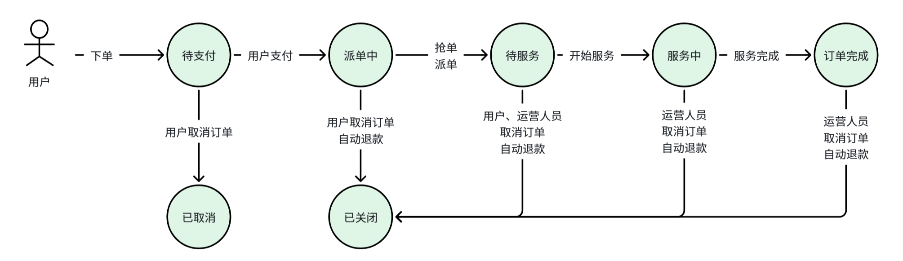

目前我们使用了待支付、派单中两种状态，在代码中我们发现存在对订单状态进行硬编码的情况：

```Java
public void paySuccess(TradeStatusMsg tradeStatusMsg) {
  ...
  //订单状态为待支付时当支付成功更新为派单中
    if (ObjectUtil.equal(0, orders.getOrdersStatus())) {
       ...
       update(id,派单中)
    }

}
```

随着开发的深入这种代码会越来越多，比如在实现对订单进行关闭时代码会写成如下的形式：

```Java
if(订单状态==派单中{
  //运营人员在订单完成时取消订单
  //执行此场景下的业务逻辑
  //更新订单状态为派单中
  update(id,已关闭)
}

if(订单状态==服务中){
  //运营人员在服务中时取消订单
  //执行此场景下的业务逻辑
  //更新订单状态为已关闭
  update(id,已关闭)
)
...
```

以上代码存在问题如下：

在业务代码中对订单状态进行硬编码如果有一天更改了业务逻辑就需要更改代码，不方便进行系统扩展和维护。

另外对订单状态的管理是散落在很多地方不方便对订单状态进行统一管理和维护。

### 1.2.使用状态机解决问题

针对以上问题如何解决呢？

我们可以使用状态机对订单状态进行统一管理。

什么是状态机？

上图在UML中叫状态图（又叫状态机图），UML是软件开发中的一种建模语言，用来辅助进行软件设计，常用的如：类图、对象、状态图、序列图等，注意状态机图并不是状态机，状态机是一种数学模型，应用在自动化控制、计算机科学、通信等很多领域，简单理解状态机就是对状态进行统一管理的数学模型。

我们画的状态图是状态机在计算机科学中的应用方法，还有状态机设计模式也是状态机在软件领域的应用方法。

状态机设计模式是状态机在软件中的应用，状态机设计模式描述了一个对象在内部状态发生变化时如何改变其行为，将状态之间的变更定义为事件，将事件暴露出去，通过执行状态变更事件去更改状态，这是状态机设计模式的核心内容。

理解 [状态机设计模式](https://baike.baidu.com/item/%E7%8A%B6%E6%80%81%E6%9C%BA/6548513?fr=ge_ala) 需要理解四个要素：现态、事件、动作、次态。

1.现态：是指当前所处的状态。

2.事件（条件）：当一个条件被满足，状态会由现态变为新的状态，事件发生会触发一个动作，或者执行一次状态的迁移。

3.动作：发生事件执行的动作，动作执行完毕后，可以迁移到新的状态，也可以仍旧保持原状态。动作不是必需的，当条件满足后，也可以不执行任何动作，直接迁移到新状态。

4.次态：条件满足后要迁往的新状态。

我们拿待支付状态到派单中状态举例：

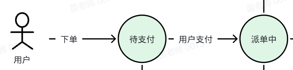

- 现态：订单当前处于待支付状态那么现态为待支付。

- 事件：用户支付成功为事件，支付成功是条件，当条件满足进行状态迁移。

- 动作：将订单状态由待支付更改为派单中。

- 次态：派单中。

使用状态机优化代码：

使用状态机之后对代码进行以下优化。

支付成功更改订单状态的代码优化如下：

```Java
if(支付状态==支付成功){
    //调用状态机执行支付成功事件
    orderStateMachine.changeStatus(id,支付成功事件);
}
```

订单取消的代码优化如下：

```Java
orderStateMachine.changeStatus(id,订单完成时取消订单事件);
```

我们发现使用状态机的代码并没有对订单状态进行硬编码，只是指定了订单id和事件名称，执行changeStatus方法后自动更改订单的状态。

### 1.3.小结

什么是状态机，它解决了什么问题？

## 2.编写订单状态机

> 目标：
>
> 能够基于状态机组件实现订单状态机
>

### 2.1.添加状态机组件依赖

本项目基于状态机设计模式开发了状态机组件，代码在jzo2o\-framework中，如果在订单管理服务中实现订单状态机需要添加状态机的依赖。

在jzo2o\-orders\-base工程的pom\.xml中添加状态机组件的依赖

```xml
<dependency>
    <groupId>com.jzo2o</groupId>
    <artifactId>jzo2o-statemachine</artifactId>
    <version>1.0-SNAPSHOT</version>
</dependency>
```

添加完成刷新pom\.xml

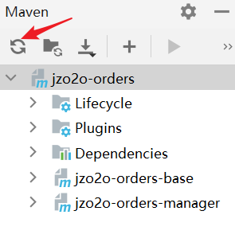

下边使用状态机组件管理订单状态。

### 2.2.订单状态枚举类

阅读订单状态枚举类，它实现了StatusDefine 状态接口，不论是现态还是次态都需要实现状态接口。

定义每个枚举需要注意见名知意，比如：`NO_PAY(0, "待支付", "NO_PAY")`表示待支付状态。

订单状态枚举类如下：

```Java
package com.jzo2o.orders.base.enums;

import com.jzo2o.statemachine.core.StatusDefine;
import lombok.AllArgsConstructor;
import lombok.Getter;

@Getter
@AllArgsConstructor
public enum OrderStatusEnum implements StatusDefine {
    NO_PAY(0, "待支付", "NO_PAY"),
    DISPATCHING(100, "派单中", "DISPATCHING"),
    NO_SERVE(200, "待服务", "NO_SERVE"),
    SERVING(300, "服务中", "SERVING"),
    FINISHED(500, "已完成", "FINISHED"),
    CANCELED(600, "已取消", "CANCELED"),
    CLOSED(700, "已关闭", "CLOSED");

    private final Integer status;
    private final String desc;
    private final String code;

    /**
     * 根据状态值获得对应枚举
     *
     * @param status 状态
     * @return 状态对应枚举
     */
    public static OrderStatusEnum codeOf(Integer status) {
        for (OrderStatusEnum orderStatusEnum : values()) {
            if (orderStatusEnum.status.equals(status)) {
                return orderStatusEnum;
            }
        }
        return null;
    }
}
```

### 2.3.订单状态变更事件枚举类

所有状态之间存在的变更都需要定义状态变更事件，它实现了StatusChangeEvent 状态变更事件接口，事件对应状态机四要素的事件

代码如下，重点看 `PAYED：PAYED(OrderStatusEnum.NO_PAY, OrderStatusEnum.DISPATCHING, "支付成功", "payed")`

表示由NO\_PAY（未支付）状态变化为DISPATCHING（派单中）状态，事件名称为"支付成功"\(payed\)。

```Java
package com.jzo2o.orders.base.enums;

import com.jzo2o.statemachine.core.StatusChangeEvent;
import lombok.AllArgsConstructor;
import lombok.Getter;
 
@Getter
@AllArgsConstructor
public enum OrderStatusChangeEventEnum implements StatusChangeEvent {
    PAYED(OrderStatusEnum.NO_PAY, OrderStatusEnum.DISPATCHING, "支付成功", "payed"),
    DISPATCH(OrderStatusEnum.DISPATCHING, OrderStatusEnum.NO_SERVE, "接单/抢单成功", "dispatch"),
    START_SERVE(OrderStatusEnum.NO_SERVE, OrderStatusEnum.SERVING, "开始服务", "start_serve"),
    COMPLETE_SERVE(OrderStatusEnum.SERVING, OrderStatusEnum.FINISHED, "完成服务", "complete_serve"),
//    EVALUATE(OrderStatusEnum.NO_EVALUATION, OrderStatusEnum.FINISHED, "评价完成", "evaluate"),
    CANCEL(OrderStatusEnum.NO_PAY, OrderStatusEnum.CANCELED, "取消订单", "cancel"),
    SERVE_PROVIDER_CANCEL(OrderStatusEnum.NO_SERVE, OrderStatusEnum.DISPATCHING, "服务人员/机构取消订单", "serve_provider_cancel"),
    CLOSE_DISPATCHING_ORDER(OrderStatusEnum.DISPATCHING, OrderStatusEnum.CLOSED, "派单中订单关闭", "close_dispatching_order"),
    CLOSE_NO_SERVE_ORDER(OrderStatusEnum.NO_SERVE, OrderStatusEnum.CLOSED, "待服务订单关闭", "close_no_serve_order"),
    CLOSE_SERVING_ORDER(OrderStatusEnum.SERVING, OrderStatusEnum.CLOSED, "服务中订单关闭", "close_serving_order"),
//    CLOSE_NO_EVALUATION_ORDER(OrderStatusEnum.NO_EVALUATION, OrderStatusEnum.CLOSED, "待评价订单关闭", "close_no_evaluation_order"),
    CLOSE_FINISHED_ORDER(OrderStatusEnum.FINISHED, OrderStatusEnum.CLOSED, "已完成订单关闭", "close_finished_order");
    /**
     * 源状态
     */
    private final OrderStatusEnum sourceStatus;

    /**
     * 目标状态
     */
    private final OrderStatusEnum targetStatus;

    /**
     * 描述
     */
    private final String desc;

    /**
     * 代码
     */
    private final String code;
}
```

### 2.4.定义订单快照类

快照是订单变化瞬间的状态及相关信息。

比如：001号订单创建成功此时记录它的快照信息（订单号、下单人、订单详细信息、订单状态等），当001号订单支付成功由待支付状态变化为派单中状态此时也会记录它的快照信息（订单号、下单人、支付状态、支付相关信息，订单状态等相关信息），由此可以看出订单快照可以追溯订单的历史变化信息，只要状态发生变化便会记录快照。

快照基础类型是StateMachineSnapshot，如果我们要实现订单快照则需要定义一个订单快照类OrderSnapshotDTO 去继承StateMachineSnapshot类型，代码如下：

```Java
package com.jzo2o.orders.base.model.dto;

import com.jzo2o.statemachine.core.StateMachineSnapshot;
import io.swagger.annotations.ApiModelProperty;
import lombok.AllArgsConstructor;
import lombok.Builder;
import lombok.Data;
import lombok.NoArgsConstructor;

import java.math.BigDecimal;
import java.time.LocalDateTime;

/**
 * 订单快照
 **/
@Data
@Builder
@NoArgsConstructor
@AllArgsConstructor
public class OrderSnapshotDTO extends StateMachineSnapshot {
    //....原来的内容保持不变,添加以下代码
    
    @Override
    public String getSnapshotId() {
        return String.valueOf(id);
    }
    
    @Override
    public Integer getSnapshotStatus() {
        return ordersStatus;
    }
    
    @Override
    public void setSnapshotId(String snapshotId) {
        this.id = Long.parseLong(snapshotId);
    }
    
    @Override
    public void setSnapshotStatus(Integer snapshotStatus) {
        this.ordersStatus = snapshotStatus;
    }

}
```

### 2.5.定义订单状态变更事件动作类

当执行状态变更，事件会伴随着执行具体的动作，此部分对应状态机四要素中的动作。

定义订单支付成功动作类，实现StatusChangeHandler接口，泛型中指定快照类型。

此动作是订单支付成功执行的动作。

动作类的bean名称为"状态机名称\_事件名称"，例如下边的动作类bean的名称为order\_payed，表示order状态机的payed事件。

```Java
package com.jzo2o.orders.base.handler;

import cn.hutool.db.DbRuntimeException;
import com.jzo2o.orders.base.enums.OrderPayStatusEnum;
import com.jzo2o.orders.base.enums.OrderStatusEnum;
import com.jzo2o.orders.base.model.dto.OrderSnapshotDTO;
import com.jzo2o.orders.base.model.dto.OrderUpdateStatusDTO;
import com.jzo2o.orders.base.service.IOrdersCommonService;
import com.jzo2o.statemachine.core.StateMachineSnapshot;
import com.jzo2o.statemachine.core.StatusChangeEvent;
import com.jzo2o.statemachine.core.StatusChangeHandler;
import lombok.extern.slf4j.Slf4j;
import org.springframework.stereotype.Component;

import javax.annotation.Resource;
import java.time.LocalDateTime;

/**
 * 订单支付成功处理器
 **/
@Slf4j
@Component("order_payed")
public class OrderPayedHandler implements StatusChangeHandler<OrderSnapshotDTO> {
    @Resource
    private IOrdersCommonService ordersService;

    /**
     * 订单支付处理逻辑
     *
     * @param bizId   业务id
     * @param bizSnapshot 快照
     */
    @Override
    public void handler(String bizId, StatusChangeEvent statusChangeEventEnum, OrderSnapshotDTO bizSnapshot) {
        log.info("支付成功事件处理逻辑开始，订单号：{}", bizId);
        
    }
}
```

### 2.6.定义订单状态机类

AbstractStateMachine状态机抽象类是状态机的核心类，是具体的状态机要继承的抽象类，比如我们实现订单状态机就需要继承AbstractStateMachine抽象类。

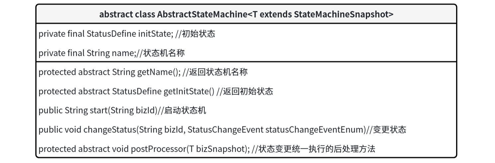

成员变量：

- 初始状态：设置初始状态，比如订单的初始状态为待支付。

- 状态机名称：返回的状态机的标识，比如订单状态机返回“order”作为订单状态机的名称。

方法：

- 返回状态机名称：返回状态机的名称

- 返回初始状态：返回初始状态

- 启动状态机：开始进行状态机管理，通常在新建实例时调用此方法，比如：新建一个订单调用此方法将订单状态设置为初始状态，传入参数：业务主键（如订单id）

- 变更状态：调用此方法更改状态

- 后处理方法：当状态变更后统一执行的逻辑。

下边定义订单状态机类继承此抽象类，代码如下：

```Java
package com.jzo2o.orders.base.config;

/**
 * 订单状态机
 **/
@Component
public class OrderStateMachine extends AbstractStateMachine<OrderSnapshotDTO> {

    public OrderStateMachine(StateMachinePersister stateMachinePersister, BizSnapshotService bizSnapshotService, RedisTemplate redisTemplate) {
        super(stateMachinePersister, bizSnapshotService, redisTemplate);
    }

    /**
     * 设置状态机名称
     *
     * @return 状态机名称
     */
    @Override
    protected String getName() {
        return "order";
    }

    @Override
    protected void postProcessor(OrderSnapshotDTO orderSnapshotDTO) {

    }

    /**
     * 设置状态机初始状态
     *
     * @return 状态机初始状态
     */
    @Override
    protected OrderStatusEnum getInitState() {
        return OrderStatusEnum.NO_PAY;
    }

}
```

### 2.7.状态机表设计

状态机使用MySQL对状态进行持久化，涉及到如下表：

状态机持久化表：

每个订单对应状态机表中的一条记录。

- state\_machine\_name ：针对订单的状态机起个名称叫order，针对服务单的状态机可以起个名称为serve。

- biz\_id：存储订单id

- state：记录该订单的当前状态\(最新状态\)

```sql
create table `jzo2o-orders`.state_persister
(
    id                 bigint auto_increment comment '主键'
        constraint `PRIMARY`
        primary key,
    state_machine_name varchar(255)                       null comment '状态机名称',
    biz_id             varchar(255)                       null comment '业务id',
    state              varchar(255)                       null comment '状态',
    create_time        datetime default CURRENT_TIMESTAMP null comment '创建时间',
    update_time        datetime default CURRENT_TIMESTAMP null on update CURRENT_TIMESTAMP comment '更新时间',
    constraint 唯一索引
        unique (state_machine_name, biz_id)
)
    comment '状态机持久化表' charset = utf8mb4;
```

状态机快照表：

一个订单在快照表有多条记录，每变一个状态会记录该状态下的快照信息（即订单相关的详细信息）便于查询订单变化的历史记录。

- state\_machine\_name ：同上

- biz\_id ：同上

- db\_shard\_id：暂时用不到

- state：对应快照的状态\(变更后状态\)

- biz\_data：快照信息（json格式），用在订单状态机就是记录订单相关的信息。

```sql
create table `jzo2o-orders`.biz_snapshot
(
    id                 bigint auto_increment comment '主键'
        constraint `PRIMARY`
        primary key,
    state_machine_name varchar(50)                        null comment '状态机名称',
    biz_id             varchar(50)                        null comment '业务id',
    db_shard_id        bigint                             null comment '分库键',
    state              varchar(50)                        null comment '状态代码',
    biz_data           varchar(5000)                      null comment '业务数据',
    create_time        datetime default CURRENT_TIMESTAMP not null comment '创建时间',
    update_time        datetime default CURRENT_TIMESTAMP not null on update CURRENT_TIMESTAMP comment '更新时间'
)
    comment '业务数据快照' charset = utf8mb4;
```

### 2.8.小结

如何实现一个订单状态机？

## 3.测试订单状态机

> 目标：
>
> 测试状态机的方法实现订单状态变更。
>
> 能说出如何实现一个订单状态机。
>

### 3.1.加载订单状态机

在orders\-base工程的AutoImportConfiguration类中配置导入订单状态机。

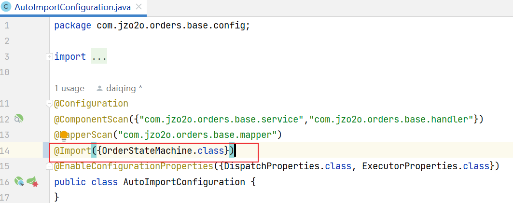

### 3.2.测试启动状态机

下边在jzo2o\-orders\-manager下编写测试代码。

调用OrderStateMachine的start\(\)方法启动一个订单的状态机，启动状态机表示订单用状态机管理状态，启动状态机后会设置订单的初始状态。

```Java
package com.jzo2o.orders.manager.service;

import com.baomidou.mybatisplus.core.conditions.query.LambdaQueryWrapper;
import com.jzo2o.orders.base.config.OrderStateMachine;
import com.jzo2o.orders.base.model.domain.Orders;
import lombok.extern.slf4j.Slf4j;
import org.junit.jupiter.api.Test;
import org.springframework.boot.test.context.SpringBootTest;

import javax.annotation.Resource;
import java.util.List;

@SpringBootTest
@Slf4j
public class OrderStateMachineTest {

    @Resource
    private OrderStateMachine orderStateMachine;

    @Test
    public void test_start() {
        //启动状态机，指定订单id
        String start = orderStateMachine.start("101");
        log.info("返回初始状态:{}", start);
    }
}
```

执行测试方法，对101订单启动状态机管理，启动后101号订单的状态为NO\_PAY待支付状态。

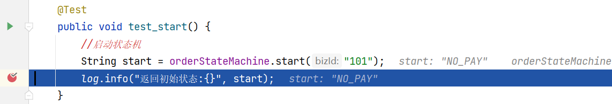

观察state\_persister表有一条101号订单的状态持久化记录，每条订单对应state\_persister表的一条记录。

观察biz\_snapshot表有一条101号订单的快照信息，一条订单在biz\_snapshot表对应多个条记录，每次订单状态变更都会产生一个快照。

> 注意：如果报错：“java\.lang\.IllegalStateException: 已存在状态，不可初始化”  ，说明101号订单的状态机已启动，可以更改101为其他值测试其它订单状态机启动。
>

### 3.3.测试状态变更方法

根据状态变更事件定义可知，执行测试方法后101订单的状态由NO\_PAY（待支付）变更为DISPATCHING（派单中）。

定义测试方法

```Java
@Test
public void test_changeStatus() {
    //状态变更 （事件名有，但是没有对应订单状态变更事件动作处理器类 ）， 执行结果会提示：不存在‘order_payed_test’StatusChangeHandler
    //orderStateMachine.changeStatus("101",OrderStatusChangeEventEnumTest.PAYED_TEST);

    //状态变更 （事件名有，有对应订单状态变更事件动作处理器类 ）
    orderStateMachine.changeStatus("101",OrderStatusChangeEventEnum.PAYED);
}
```

执行此方法，预期结果：

state\_persister表中101订单的状态变更为DISPATCHING。

biz\_snapshot表多了一条101号订单的快照信息。

观察输出日志，如果输出“支付事件处理逻辑开始，订单号\.\.\.”表示此处理器已正常执行。

下边对102号订单进行状态机管理

```Java
@Test
public void test_orderStatMmachine() {
    //启动状态机
    String start = orderStateMachine.start("102");
    //状态变更
    orderStateMachine.changeStatus("102",OrderStatusChangeEventEnum.PAYED);
}
```

执行测试：

1. 观察状态机持久化表是否有102订单的状态记录。

2. 观察快照表是否有102订单的记录。

3. 观察控制台，订单事件变更动作处理器类的执行信息是否输出，有输出说明处理器已执行


### 3.4.阅读源码

进入jzo2o\-framework下的jzo2o\-statemachine工程，阅读AbstractStateMachine类的源码，通过阅读代码理解状态机组件的运行过程。

阅读启动状态机方法：

首先判断该订单是否启动状态，如果没有启动则向状态机表插入记录，否则抛出异常"已存在状态，不可初始化"\.

接下来保存订单快照。

```JSON
/**
 * 状态机初始化,不保存快照
 *
 * @param bizId 业务id
 * @return 初始化状态代码
 */
public String start(String bizId) {
    return start(null, bizId, initState, null);
}

/**
 * 启动状态机，并设置当前状态和保存业务快照，快照分库分表
 *
 * @param dbShardId    分库键
 * @param bizId        业务id
 * @param statusDefine 当前状态
 * @param bizSnapshot  快照
 * @return 当前状态代码
 */
public String start(Long dbShardId, String bizId, StatusDefine statusDefine, T bizSnapshot) {

    //1.初始化状态机状态
    String currentState = stateMachinePersister.getCurrentState(name, bizId);
    if (ObjectUtil.isEmpty(currentState)) {
        stateMachinePersister.init(name, bizId, statusDefine);
    } else {
        throw new IllegalStateException("已存在状态，不可初始化");
    }

    //2.保存业务快照
    if (bizSnapshot == null) {
        bizSnapshot = ReflectUtil.newInstance(getSnapshotClass());
    }
    //设置快照id
    bizSnapshot.setSnapshotId(bizId);
    //设置快照状态
    bizSnapshot.setSnapshotStatus(statusDefine.getStatus());
    //快照转json
    String bizSnapshotString = JSONUtil.toJsonStr(bizSnapshot);
    if (ObjectUtil.isNotEmpty(bizSnapshot)) {
        bizSnapshotService.save(dbShardId, name, bizId, statusDefine, bizSnapshotString);
    }
    //执行后处理方法
    postProcessor(bizSnapshot);

    return statusDefine.getCode();
}
```

阅读状态变更方法：

状态变更前会判断订单的当前状态是否和事件定义的源状态一致，如果不一致则说明当前订单的状态不能通过该事件去更新状态，此时将终止状态变更，否则将通过状态变更处理器更新订单的状态。

```JSON
/**
 * 变更状态并保存快照，快照不进行分库
 *
 * @param bizId                 业务id
 * @param statusChangeEventEnum 状态变换事件
 */
public void changeStatus(String bizId, StatusChangeEvent statusChangeEventEnum) {
    changeStatus(null, bizId, statusChangeEventEnum, null);
}
/**
 * 变更状态并保存快照，快照分库分表
 *
 * @param dbShardId             分库键
 * @param bizId                 业务id
 * @param statusChangeEventEnum 状态变换事件
 * @param bizSnapshot           业务数据快照（json格式）
 */
public void changeStatus(Long dbShardId, String bizId, StatusChangeEvent statusChangeEventEnum, T bizSnapshot) {
    //1.查询当前状态
    String statusCode = getCurrentState(bizId);

    //2.校验起止状态是否与事件匹配
    if (ObjectUtil.isNotEmpty(statusChangeEventEnum.getSourceStatus()) && ObjectUtil.notEqual(statusChangeEventEnum.getSourceStatus().getCode(), statusCode)) {
        throw new CommonException(HTTP_INTERNAL_ERROR, "状态机起止状态与事件不匹配");
    }

    //3.获取状态处理程序bean
    //事件代码
    String eventCode = statusChangeEventEnum.getCode();
    StatusChangeHandler bean = null;
    try {
        bean = SpringUtil.getBean(name + "_" + eventCode, StatusChangeHandler.class);
    } catch (Exception e) {
        log.info("不存在‘{}’StatusChangeHandler", name + "_" + eventCode);
    }
    if (bizSnapshot == null) {
        bizSnapshot = ReflectUtil.newInstance(getSnapshotClass());
    }
    //设置快照id
    bizSnapshot.setSnapshotId(bizId);
    //设置目标状态
    bizSnapshot.setSnapshotStatus(statusChangeEventEnum.getTargetStatus().getStatus());
    if (ObjectUtil.isNotNull(bean)) {
        //4.执行状态变更
        bean.handler(bizId, statusChangeEventEnum, bizSnapshot);
    }

    //5.状态持久化
    stateMachinePersister.persist(name, bizId, statusChangeEventEnum.getTargetStatus());

    //6、存储快照
    if (ObjectUtil.isNotEmpty(bizSnapshot)) {
        //构建新的快照信息
        bizSnapshot = buildNewSnapshot(bizId, bizSnapshot, statusChangeEventEnum.getSourceStatus());
        String newBizSnapShotString = JSONUtil.toJsonStr(bizSnapshot);
        bizSnapshotService.save(dbShardId, name, bizId, statusChangeEventEnum.getTargetStatus(), newBizSnapShotString);
    }

    //7.清理快照缓存
    String key = "JZ_STATE_MACHINE:" + name + ":" + bizId;
    redisTemplate.delete(key);

    //执行后处理方法
    postProcessor(bizSnapshot);
}
```

### 3.5.小结

1.本节测试了状态机的两个方法：

> 1）启动状态机
>
> 启动状态机表示开始用状态机管理状态，并且设置初始状态。
>
> 2）状态变更
>
> 使用状态机进行状态变更只需要指定状态变更事件即可消除在业务代码中硬编码。

2.能说出如何实现一个订单状态机。

## 4.使用订单状态机

> 目标：
>
> 下单时使用状态机
>
> 在支付成功时使用状态机
>

### 4.1.下单时启动状态机

下单后创建一个新订单，使用状态机的启动方法表示用状态机对该订单的状态开始进行管理。

首先在OrdersCreateServiceImpl中注入状态机：

```Java
@Resource
private OrderStateMachine orderStateMachine;
```

代码如下：

```Java
@Autowired
private OrderStateMachine orderStateMachine;

@Transactional(rollbackFor = Exception.class)
public void add(Orders orders) {
    boolean result = this.save(orders);
    if(!result) {
        throw new DBException("服务预约下单失败");
    }
    OrderSnapshotDTO orderSnapshotDTO = BeanUtils.copyBean(orders,OrderSnapshotDTO.class);
    orderStateMachine.start(null,orders.getId().toString(), orderSnapshotDTO);
}
```

> 注意：状态机的操作方法放在业务方法中且和业务方法处于一个事务中。
>

### 4.2.支付成功使用状态机

支付成功通过状态机将订单状态由待支付更新派单中。

1.定义状态变更动作类

在动作类中更新订单的状态，在动作类中更新订单的状态要比在多处业务代码中对订单状态硬编码要强的多，因为可以在动作类中统一对订单状态进行管理。

除了更新订单状态以外还需要填充订单快照的相关信息，这里主要是支付相关的信息，包括：支付状态、支付时间、支付服务的交易单号、第三方支付的交易单号等。

代码如下：

> 注意：动作类的bean名称规则是：状态机名称\_事件名称
>
> order\_payed：状态机名称为order，中间用“\_”分隔，payed为状态变更事件名称（从OrderStatusChangeEventEnum中查找）
>

```Java
package com.jzo2o.orders.base.handler;

import com.jzo2o.common.expcetions.DBException;
import com.jzo2o.orders.base.enums.OrderPayStatusEnum;
import com.jzo2o.orders.base.enums.OrderStatusEnum;
import com.jzo2o.orders.base.model.domain.Orders;
import com.jzo2o.orders.base.model.dto.OrderSnapshotDTO;
import com.jzo2o.orders.base.service.IOrdersCommonService;
import com.jzo2o.statemachine.core.StatusChangeEvent;
import com.jzo2o.statemachine.core.StatusChangeHandler;
import lombok.extern.slf4j.Slf4j;
import org.springframework.beans.factory.annotation.Autowired;
import org.springframework.stereotype.Component;

/**
 * 订单状态变更事件动作处理类
 */
@Slf4j
@Component("order_payed")
public class OrderPayedHandler implements StatusChangeHandler<OrderSnapshotDTO> {

    @Autowired
    private IOrdersCommonService ordersCommonService;

    /**
     * 支付成功状态变更
     * @param bizId 订单id
     * @param statusChangeEventEnum 订单状态变更事件枚举类
     * @param bizSnapshot 订单快照
     */
    @Override
    public void handler(String bizId, StatusChangeEvent statusChangeEventEnum, OrderSnapshotDTO bizSnapshot) {
        log.info("订单支付成功，订单状态开始变更，订单ID：{}", bizId);

        boolean result = ordersCommonService.lambdaUpdate()
                .eq(Orders::getId, Long.valueOf(bizId))
                .set(Orders::getPayTime, bizSnapshot.getPayTime())
                .set(Orders::getTransactionId, bizSnapshot.getTransactionId())
                .set(Orders::getOrdersStatus, OrderStatusEnum.DISPATCHING.getStatus())
                .set(Orders::getPayStatus, OrderPayStatusEnum.PAY_SUCCESS.getStatus())
                .update();
        if(!result){
            throw new DBException("更新订单失败");
        }


        log.info("订单支付成功，订单状态变更完毕，订单ID：{}", bizId);
    }
}
```

2.在支付成功方法中使用状态机

使用状态机执行支付成功状态变更。

```Java
 @Transactional(rollbackFor = Exception.class)
    public void paySuccess(Long orderId,String transactionId,LocalDateTime payTime) {
//        boolean result = this.lambdaUpdate()
//                .eq(Orders::getId, orderId)
//                .set(Orders::getPayTime, payTime)
//                .set(Orders::getTransactionId, transactionId)
//                .set(Orders::getOrdersStatus, OrderStatusEnum.DISPATCHING.getStatus())
//                .set(Orders::getPayStatus, OrderPayStatusEnum.PAY_SUCCESS.getStatus())
//                .update();
//        if(!result){
//            throw new DBException("更新订单失败");
//        }

        //构建快照数据
        OrderSnapshotDTO orderSnapshotDTO = new OrderSnapshotDTO();
        orderSnapshotDTO.setId(orderId);
        orderSnapshotDTO.setTransactionId(transactionId);
        orderSnapshotDTO.setPayTime(payTime);

        //调用状态机的变更状态方法（表明触发支付成功事件）
        orderStateMachine.changeStatus(orderId.toString(), OrderStatusChangeEventEnum.PAYED, orderSnapshotDTO);
    }
```

### 4.3.测试

1.测试流程：

- 创建一个订单

- 进行支付，支付成功


2.预期结果：

1）创建订单

新创建一个订单，观察状态机持久化表和状态机快照表是否有订单相关的记录。

示例：

状态机持久化表：

```JSON
{
  "id": 1731873761497014273,
  "state_machine_name": "order",
  "biz_id": "2312050000000000058",
  "state": "NO_PAY",
  "create_time": "2023-12-05 11:11:47",
  "update_time": "2023-12-05 11:11:47"
}
```

状态机快照表：

```JSON
{
  "id": 1731873761516351488,
  "state_machine_name": "order",
  "biz_id": "2312050000000000058",
  "db_shard_id": 1,
  "state": "NO_PAY",
  "biz_data": "{\"ordersStatus\":0,\"cityCode\":\"010\",\"serveItemName\":\"日常保洁\",\"serveId\":1693815624114970626,\"discountAmount\":0,\"lon\":\"116.23189\",\"serveAddress\":\"北京市北京市昌平区北京市昌平区城北街道北京市昌平区政府信息公开办公室北京市昌平区人民政府\",\"contactsName\":\"苗先生\",\"serveItemId\":1685894105234755585,\"price\":1,\"serveItemImg\":\"https://yjy-xzbjzfw-oss.oss-cn-hangzhou.aliyuncs.com/aa6489e5-cd92-42f0-837a-952c99653b8b.png\",\"realPayAmount\":1,\"serveStartTime\":1701757800000,\"id\":2312050000000000058,\"lat\":\"40.221\",\"serveTypeId\":1678649931106705409,\"updateTime\":1701745907000,\"userId\":1716346406098296832,\"totalAmount\":1,\"unit\":1,\"contactsPhone\":\"13333333333\",\"createTime\":1701745907000,\"payStatus\":2,\"purNum\":1,\"serveTypeName\":\"保洁清洗\"}",
  "create_time": "2023-12-05 11:11:47",
  "update_time": "2023-12-05 11:11:47"
}
```

订单表：

```JSON
{
  "id": 2312050000000000058,
  "user_id": 1716346406098296832,
  "serve_type_id": 1678649931106705409,
  "serve_type_name": "保洁清洗",
  "serve_item_id": 1685894105234755585,
  "serve_item_name": "日常保洁",
  "serve_item_img": "https://yjy-xzbjzfw-oss.oss-cn-hangzhou.aliyuncs.com/aa6489e5-cd92-42f0-837a-952c99653b8b.png",
  "unit": 1,
  "serve_id": 1693815624114970626,
  "orders_status": 0,
  "pay_status": 2,
  "refund_status": null,
  "price": 1.00,
  "pur_num": 1,
  "total_amount": 1.00,
  "real_pay_amount": 1.00,
  "discount_amount": 0.00,
  "city_code": "010",
  "serve_address": "北京市北京市昌平区北京市昌平区城北街道北京市昌平区政府信息公开办公室北京市昌平区人民政府",
  "contacts_phone": "13333333333",
  "contacts_name": "苗先生",
  "serve_start_time": "2023-12-05 14:30:00",
  "lon": 116.23189,
  "lat": 40.221,
  "pay_time": null,
  "evaluation_time": null,
  "evaluation_status": 0,
  "trading_order_no": null,
  "transaction_id": null,
  "refund_no": null,
  "refund_id": null,
  "trading_channel": null,
  "display": 1,
  "sort_by": 1701757800058,
  "real_serve_end_time": null,
  "create_time": "2023-12-05 11:11:47",
  "update_time": "2023-12-05 11:11:47"
}
```

2）支付成功

- 观察该订单的状态是否变为派单中。

- 观察状态机持久化表中该订单状态是否为派单中。

- 观察状态机快照表中该订单的快照信息是否正确。


示例：

状态机持久化表

```JSON
{
  "id": 1731873761497014273,
  "state_machine_name": "order",
  "biz_id": "2312050000000000058",
  "state": "DISPATCHING",
  "create_time": "2023-12-05 11:11:47",
  "update_time": "2023-12-05 11:14:31"
}
```

状态机快照表：

```JSON
{
  "id": 1731873761516351488,
  "state_machine_name": "order",
  "biz_id": "2312050000000000058",
  "db_shard_id": 1,
  "state": "NO_PAY",
  "biz_data": "{\"ordersStatus\":0,\"cityCode\":\"010\",\"serveItemName\":\"日常保洁\",\"serveId\":1693815624114970626,\"discountAmount\":0,\"lon\":\"116.23189\",\"serveAddress\":\"北京市北京市昌平区北京市昌平区城北街道北京市昌平区政府信息公开办公室北京市昌平区人民政府\",\"contactsName\":\"苗先生\",\"serveItemId\":1685894105234755585,\"price\":1,\"serveItemImg\":\"https://yjy-xzbjzfw-oss.oss-cn-hangzhou.aliyuncs.com/aa6489e5-cd92-42f0-837a-952c99653b8b.png\",\"realPayAmount\":1,\"serveStartTime\":1701757800000,\"id\":2312050000000000058,\"lat\":\"40.221\",\"serveTypeId\":1678649931106705409,\"updateTime\":1701745907000,\"userId\":1716346406098296832,\"totalAmount\":1,\"unit\":1,\"contactsPhone\":\"13333333333\",\"createTime\":1701745907000,\"payStatus\":2,\"purNum\":1,\"serveTypeName\":\"保洁清洗\"}",
  "create_time": "2023-12-05 11:11:47",
  "update_time": "2023-12-05 11:11:47"
},
{
  "id": 1731874449264766976,
  "state_machine_name": "order",
  "biz_id": "2312050000000000058",
  "db_shard_id": 1,
  "state": "DISPATCHING",
  "biz_data": "{\"tradingChannel\":\"WECHAT_PAY\",\"ordersStatus\":100,\"payTime\":1701746020020,\"cityCode\":\"010\",\"serveItemName\":\"日常保洁\",\"serveId\":1693815624114970626,\"discountAmount\":0,\"lon\":\"116.23189\",\"serveAddress\":\"北京市北京市昌平区北京市昌平区城北街道北京市昌平区政府信息公开办公室北京市昌平区人民政府\",\"contactsName\":\"苗先生\",\"serveItemId\":1685894105234755585,\"price\":1,\"serveItemImg\":\"https://yjy-xzbjzfw-oss.oss-cn-hangzhou.aliyuncs.com/aa6489e5-cd92-42f0-837a-952c99653b8b.png\",\"thirdOrderId\":\"4200002069202312059443886005\",\"realPayAmount\":1,\"serveStartTime\":1701757800000,\"id\":2312050000000000058,\"lat\":\"40.221\",\"serveTypeId\":1678649931106705409,\"updateTime\":1701745907000,\"userId\":1716346406098296832,\"tradingOrderNo\":1731874360980430850,\"totalAmount\":1,\"unit\":1,\"contactsPhone\":\"13333333333\",\"createTime\":1701745907000,\"payStatus\":2,\"purNum\":1,\"serveTypeName\":\"保洁清洗\"}",
  "create_time": "2023-12-05 11:14:31",
  "update_time": "2023-12-05 11:14:31"
}
```

订单的状态

```JSON
{
  "id": 2312050000000000058,
  "user_id": 1716346406098296832,
  "serve_type_id": 1678649931106705409,
  "serve_type_name": "保洁清洗",
  "serve_item_id": 1685894105234755585,
  "serve_item_name": "日常保洁",
  "serve_item_img": "https://yjy-xzbjzfw-oss.oss-cn-hangzhou.aliyuncs.com/aa6489e5-cd92-42f0-837a-952c99653b8b.png",
  "unit": 1,
  "serve_id": 1693815624114970626,
  "orders_status": 100,
  "pay_status": 4,
  "refund_status": null,
  "price": 1.00,
  "pur_num": 1,
  "total_amount": 1.00,
  "real_pay_amount": 1.00,
  "discount_amount": 0.00,
  "city_code": "010",
  "serve_address": "北京市北京市昌平区北京市昌平区城北街道北京市昌平区政府信息公开办公室北京市昌平区人民政府",
  "contacts_phone": "13333333333",
  "contacts_name": "苗先生",
  "serve_start_time": "2023-12-05 14:30:00",
  "lon": 116.23189,
  "lat": 40.221,
  "pay_time": "2023-12-05 11:13:40",
  "evaluation_time": null,
  "evaluation_status": 0,
  "trading_order_no": 1731874360980430850,
  "transaction_id": "4200002069202312059443886005",
  "refund_no": null,
  "refund_id": null,
  "trading_channel": "WECHAT_PAY",
  "display": 1,
  "sort_by": 1701757800058,
  "real_serve_end_time": null,
  "create_time": "2023-12-05 11:11:47",
  "update_time": "2023-12-05 11:14:31"
}
```

### 4.4.复制订单状态变更事件动作类

通过订单状态变更事件类OrderStatusChangeEventEnum可以清楚订单状态之间变更的情况。

```Java
public enum OrderStatusChangeEventEnum implements StatusChangeEvent {
    PAYED(OrderStatusEnum.NO_PAY, OrderStatusEnum.DISPATCHING, "支付成功", "payed"),
    DISPATCH(OrderStatusEnum.DISPATCHING, OrderStatusEnum.NO_SERVE, "接单/抢单成功", "dispatch"),
    START_SERVE(OrderStatusEnum.NO_SERVE, OrderStatusEnum.SERVING, "开始服务", "start_serve"),
    COMPLETE_SERVE(OrderStatusEnum.SERVING, OrderStatusEnum.NO_EVALUATION, "完成服务", "complete_serve"),
    //EVALUATE(OrderStatusEnum.NO_EVALUATION, OrderStatusEnum.FINISHED, "评价完成", "evaluate"),
    CANCEL(OrderStatusEnum.NO_PAY, OrderStatusEnum.CANCELED, "取消订单", "cancel"),
    SERVE_PROVIDER_CANCEL(OrderStatusEnum.NO_SERVE, OrderStatusEnum.DISPATCHING, "服务人员/机构取消订单", "serve_provider_cancel"),
    CLOSE_DISPATCHING_ORDER(OrderStatusEnum.DISPATCHING, OrderStatusEnum.CLOSED, "派单中订单关闭", "close_dispatching_order"),
    CLOSE_NO_SERVE_ORDER(OrderStatusEnum.NO_SERVE, OrderStatusEnum.CLOSED, "待服务订单关闭", "close_no_serve_order"),
    CLOSE_SERVING_ORDER(OrderStatusEnum.SERVING, OrderStatusEnum.CLOSED, "服务中订单关闭", "close_serving_order"),
    //CLOSE_NO_EVALUATION_ORDER(OrderStatusEnum.NO_EVALUATION, OrderStatusEnum.CLOSED, "待评价订单关闭", "close_no_evaluation_order"),
    CLOSE_FINISHED_ORDER(OrderStatusEnum.FINISHED, OrderStatusEnum.CLOSED, "已完成订单关闭", "close_finished_order");
```

每个事件关联一个动作类，从资料下的源码目录找到“订单状态变更事件动作类” 将所有的动作类拷贝到订单管理工程

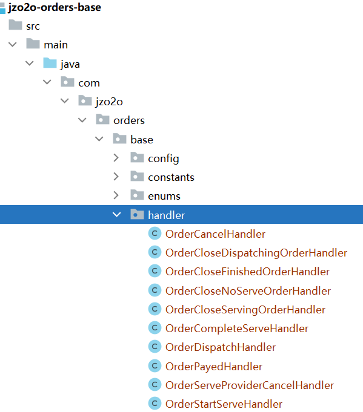

### 4.5.小结

项目使用状态机实现什么功能？为什么这样做？

## 5. 取消订单使用状态机

> 参考 支付成功使用状态机的代码在取消订单处使用状态机。
>

提示：

1.使用状态机变更订单状态，指定好事件名称。

共有两个事件：

> CANCEL(OrderStatusEnum.NO_PAY, OrderStatusEnum.CANCELED, "取消订单", "cancel")
>
> 动作类：OrderCancelHandler：对未支付订单进行取消

> CLOSE_DISPATCHING_ORDER(OrderStatusEnum.DISPATCHING, OrderStatusEnum.CLOSED, "派单中订单关闭", "close_dispatching_order"),
>
> 动作类：OrderCloseDispatchingOrderHandler：对派单中的订单进行关闭

2.修改

```Java
    @Autowired
    private OrderStateMachine orderStateMachine;
    
  /**
     * 取消派单中订单
     *
     * @param orders
     * @param cancelReason
     */
    @Async("taskExecutor")
    @Transactional(rollbackFor = Exception.class)
    public void cancelOrderByDispatching(Orders orders, String cancelReason, CurrentUserInfo userInfo) {
        //1. 添加取消记录
        OrdersCanceled ordersCanceled = new OrdersCanceled();
        ordersCanceled.setId(orders.getId());//订单id
        ordersCanceled.setCancellerId(userInfo.getId()); //取消人id
        ordersCanceled.setCancellerType(userInfo.getUserType());//取消人类型
        ordersCanceled.setCancelerName(userInfo.getName());//取消人姓名
        ordersCanceled.setCancelReason(cancelReason);//取消原因
        ordersCanceled.setCancelTime(LocalDateTime.now());//取消时间
        boolean resultCancel = ordersCanceledService.save(ordersCanceled);
        if(!resultCancel) {
            throw new DBException("添加取消记录失败");
        }

        //2. 更新订单状态 update orders set order_status=?,refund_status=? where id=?
//        boolean resultOrder = ordersManagerService.lambdaUpdate()
//                .eq(Orders::getId, orders.getId())
//                .set(Orders::getOrdersStatus, OrderStatusEnum.CLOSED.getStatus()) //已关闭
//                .set(Orders::getRefundStatus, RefundStatusEnum.SENDING.getCode()) //退款中
//                .update();
//        if(!resultOrder) {
//            throw new DBException("更新订单失败");
//        }

        //2.调用状态机的变更状态方法（表明触发订单取消事件）
        orderStateMachine.changeStatus(orders.getId().toString(), OrderStatusChangeEventEnum.CLOSE_DISPATCHING_ORDER);

        //3. 添加退款记录
        OrdersRefund ordersRefund = new OrdersRefund();
        ordersRefund.setId(orders.getId());
        ordersRefund.setTradingOrderNo(orders.getTradingOrderNo());
        //ordersRefund.setRealPayAmount(orders.getRealPayAmount());
        ordersRefund.setRealPayAmount(BigDecimal.valueOf(0.01));//由于前面测试支付都是0.01，这里为方便演示也只能写0.01。 不要使用new BigDecimal(double)，这种会精度丢失
        boolean resultRefund = ordersRefundService.save(ordersRefund);
        if(!resultRefund) {
            throw new DBException("添加退款记录失败");
        }

        // 4.处理退款
        ordersManagerService.ordersRefundHandle(ordersRefund);
    }
```

3.测试

测试流程：下单、未支付状态取消订单

预期结果：

1）下单成功：

检查状态机state\_persister表和biz\_snapshot表是否成功插入记录。

2）未支付状态取消订单：

观察state\_persister表中状态是否变更为CANCELED（已取消）

观察biz\_snapshot表中是否多了条快照信息。

# 二、分库分表

## 1.什么是分库分表

### 1.1.当前遇到的问题

随着订单数据的增加，当MySQL单表存储数据达到一定量时其存储及查询性能会下降，在阿里的《Java 开发手册》中提到MySQL单表行数超过 500 万行或者单表容量超过 2GB时建议进行分库分表，分库分表可以简单理解为原来一个表存储数据现在改为通过多个数据库及多个表去存储，这就相当于原来一台服务器提供服务现在改成多台服务器组成集群共同提供服务，从而增加了服务能力。

这里说的500 万行或单表容量超过 2GB并不是定律，只是根据生产经验而言，为什么MySQL单表当达到一定数量时性能会下降呢？我们知道为了提高表的查询性能会增加索引，MySQL在使用索引时会将索引加入内存，如果数据量非常大内存肯定装不下，此时就会从磁盘去查询索引就会产生很多的磁盘IO，从而影响性能，这些和表的设计及服务器的硬件配置都有关，所以如果当表的数据量达到一定程度并且还在不断的增加就需要考虑进行分库分表了。

### 1.2.什么是分库分表

下边通过一个例子来说明什么是分库分表。

下边是一个电商系统的数据库，涉及了店铺、商品的相关业务。

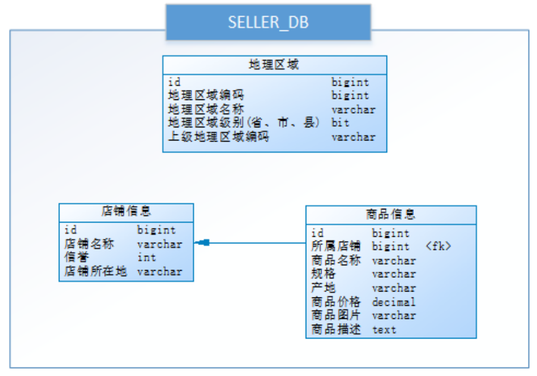

随着公司业务快速发展，数据库中的数据量猛增，访问性能也变慢了，如何优化呢？

我们可以把数据分散在不同的数据库中，使得单一数据库的数据量变小来缓解单一数据库的性能问题，从而达到提升数据库性能的目的，如下图：将电商数据库拆分为若干独立的数据库，并且对于大表也拆分为若干小表，通过这种数据库 拆分的方法来解决数据库的性能问题

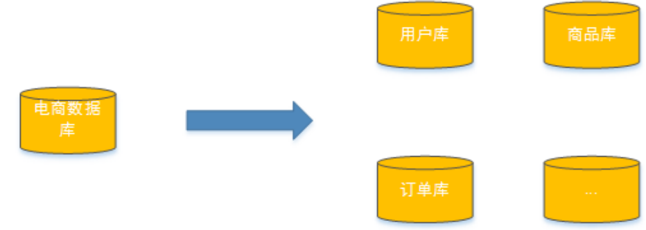

分库分表就是为了解决由于数据量过大而导致数据库性能降低的问题，将原来独立的数据库拆分成若干数据库组成 

，将数据大表拆分成若干数据表组成，使得单一数据库、单一数据表的数据量变小，从而达到提升数据库性能的目的。

### 1.3.分库分表的四种方式 

分库分表包括分库和分表两个部分，在生产中通常包括：垂直分库、水平分库、垂直分表、水平分表四种方式。

**垂直分库**

通过分表性能得到了一定程度的提升，但是还没有达到要求，并且磁盘空间也快不够了，因为数据还是始终限 

只在一台服务器，库内垂直分表只解决了单一表数据量过大的问题，但没有将表分布到不同的服务器上，因此每个 

表还是竞争同一个物理机的CPU、内存、网络IO、磁盘。 

经过思考，他把原有的SELLER\_DB\(卖家库\)，分为了PRODUCT\_DB\(商品库\)和STORE\_DB\(店铺库\)，并把这两个库分 散到不同服务器，如下图： 

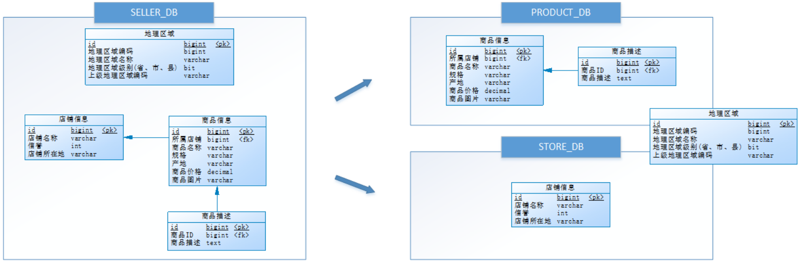

由于商品信息与商品描述业务耦合度较高，因此一起被存放在PRODUCT\_DB\(商品库\)；而店铺信息相对独立，因此 单独被存放在STORE\_DB\(店铺库\)。

垂直分库是指按照业务将表进行分类，分布到不同的数据库上面，每个库可以放在不同的服务器上，它的核心理念 

是专库专用，微服务架构下通常会对数据库进行垂直分库，不同业务数据放在单独的数据库中，比如：客户信息数据库、订单数据库等。

它带来的提升是： 

1.解决业务层面的耦合，业务清晰 

2.能对不同业务的数据进行分级管理、维护、监控、扩展等 

3.高并发场景下，垂直分库一定程度的提升IO、降低单机硬件资源的瓶颈。

垂直分库通过将表按业务分类，然后分布在不同数据库，并且可以将这些数据库部署在不同服务器上，从而达到多 

个服务器共同分摊压力的效果，但是依然没有解决单表数据量过大的问题。

**垂直分表**

下图是商品查询列表：


用户在浏览商品列表时，只有对某商品感兴趣时才会查看该商品的详细描述。因此，商品信息中商品描述字段访问 

频次较低，且该字段存储占用空间较大，访问单个数据IO时间较长；商品信息中商品名称、商品图片、商品价格等 其他字段数据访问频次较高。 

由于这两种数据的特性不一样，因此考虑将商品信息表拆分如下： 

将访问频次低的商品描述信息单独存放在一张表中，访问频次较高的商品基本信息单独放在一张表中。

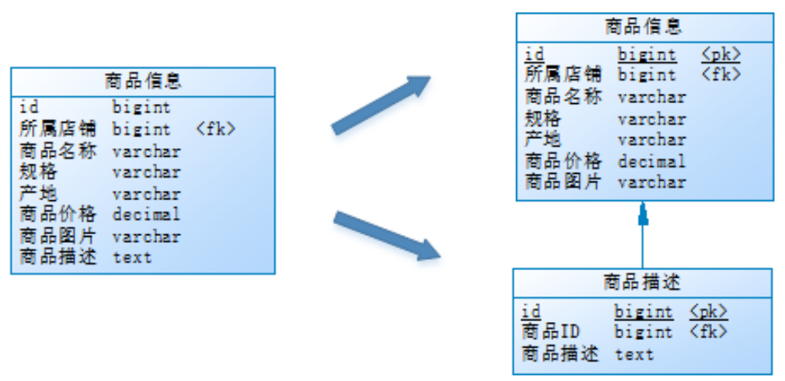

垂直分表是将一个表按照字段分成多表，每个表存储其中一部分字段，比如按冷热字段进行拆分。

垂直分表带来的好处是：充分发挥热门数据的操作效率，商品基本信息的高效率不会被商品描述的低效率所拖累。 

通常我们按以下原则进行垂直拆分: 

- 把不常用的字段单独放在一张表; 

- 把text，blob等大字段拆分出来放在附表中; 

- 经常组合查询的列放在一张表中; 

**水平分库** 

经过垂直分库后，数据库性能问题得到一定程度的解决，但是随着业务量的增长，PRODUCT\_DB\(商品库\)单库存储

数据已经超出预估。粗略估计，目前有8w店铺，每个店铺平均150个不同规格的商品，再算上增长，那商品数量得 

往1500w\+上预估，并且PRODUCT\_DB\(商品库\)属于访问非常频繁的资源，单台服务器已经无法支撑。此时该如何 

优化？

再次分库？但是从业务角度分析，目前情况已经无法再次垂直分库。 

尝试水平分库，将店铺ID为单数的和店铺ID为双数的商品信息分别放在两个库中。 

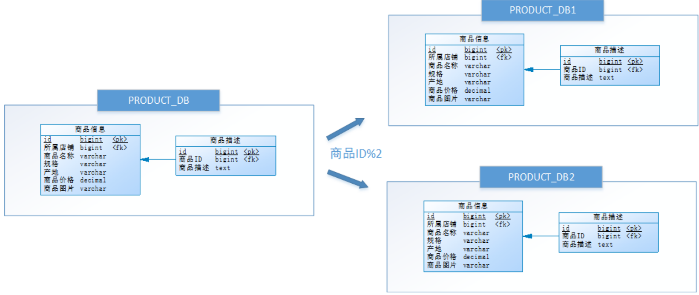

也就是说，要操作某条数据，先分析这条数据所属的店铺ID。如果店铺ID为双数，将此操作映射至 

RRODUCT\_DB1\(商品库1\)；如果店铺ID为单数，将操作映射至RRODUCT\_DB2\(商品库2\)。

水平分库是把同一个表的数据按一定规则拆到不同的数据库中，每个库可以放在不同的服务器上，比如：单数订单在db\_orders\_0数据库，偶数订单在db\_orders\_1数据库。 

它带来的提升是： 

1.解决了单库大数据，高并发的性能瓶颈。 

2.提高了系统的稳定性及可用性。 

当一个应用难以再细粒度的垂直切分，或切分后数据量行数巨大，存在单库读写、存储性能瓶颈，这时候就需要进 行水平分库了，经过水平切分的优化，往往能解决单库存储量及性能瓶颈。但由于同一个表被分配在不同的数据 库，需要额外进行数据操作的路由工作，因此大大提升了系统复杂度。 

**水平分表**

按照水平分库的思路把PRODUCT\_DB\_X\(商品库\)内的表也可以进行水平拆分，其目的也是为解决单表数据量大 的问题，如下图：

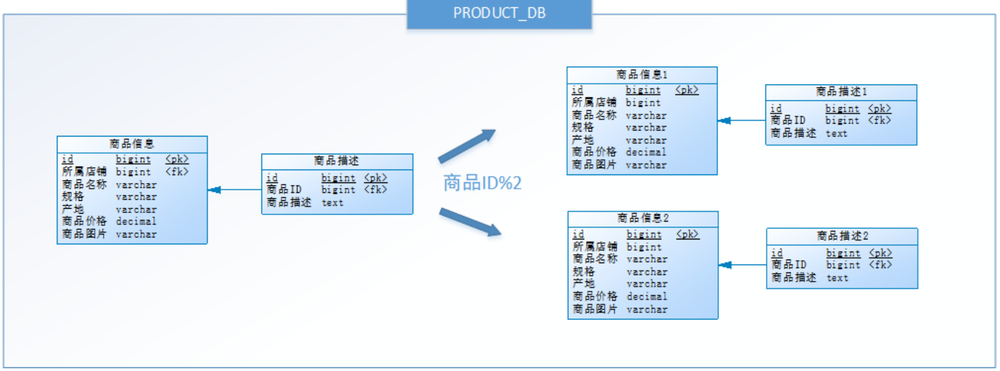

与水平分库的思路类似，不过这次操作的目标是表，商品信息及商品描述被分成了两套表。如果商品ID为双数，将 此操作映射至商品信息1表；如果商品ID为单数，将操作映射至商品信息2表。此操作要访问表名称的表达式为商品 信息\[商品ID%2 \+ 1\] 

水平分表是在同一个数据库内，把同一个表的数据按一定规则拆到多个表中，比如：0到500万的订单在orders\_0数据、500万到1000万的订单在orders\_1数据表。

水平分表优化了单一表数据量过大而产生的性能问题  

一般来说，在系统设计阶段就应该根据业务耦合松紧来确定垂直分库，垂直分表方案，在数据量及访问压力不是特别大的情况，首先考虑缓存、读写分离、索引技术等方案。若数据量极大，且持续增长，再考虑水平分库水平分表 

方案。 

### 1.4.小结

1.项目为什么进行分库分表？

2.分库分表有哪些形式？

## 2.搭建分库分表环境

### 2.1.分库分表方案

对订单数据进行分表分表。

1.Hash方式

拿分库举例：将订单号除以数据库个数求余数，假如有3台数据库，计算表达式为：db\_订单号%3， 比如：10号订单会存入到db\_1数据库，11号订单存储到db\_2数据库。

此方式的优点是：数据均匀。

缺点：扩容时需要迁移数据。比如：3台数据库改为4台数据库，此时计算表达式为：db\_订单号%4，10号订单存储到db\_2数据库，11号订单存储到db\_3数据库，此时就需要进行数据迁移，将10号订单由db\_1迁移到db\_2。

2.rang方式（范围方式）

比如：0到500万到db\_1数据库，500万到1000万到db\_2数据库，依次类推。

此方式的优点：扩容时不需要迁移数据。

缺点：存在数据热点问题，因为订单号是从0开始依次往上累加，前期所有的数据都是访问db\_1数据库，db\_1的压力较大。

3.综合方案

综合1、2方案的优缺点制定综合方案。

分库方案：设计三个数据库，根据用户id哈希，分库表达式为：db\_用户id % 3

参考历史经验，前期设计三个数据库，每个数据库使用主从结构部署，可以支撑项目几年左右的运行，虽然哈希存在数据迁移问题，在很长一段时间也不用考虑这个问题。

分表方案：根据订单范围分表，0\-\-\-1500万落到table\_0，1500万\-\-\-3000万落到table\_1，依次类推。

根据范围分表不存在数据库迁移问题，方便系统扩容。

整体方案如下图：

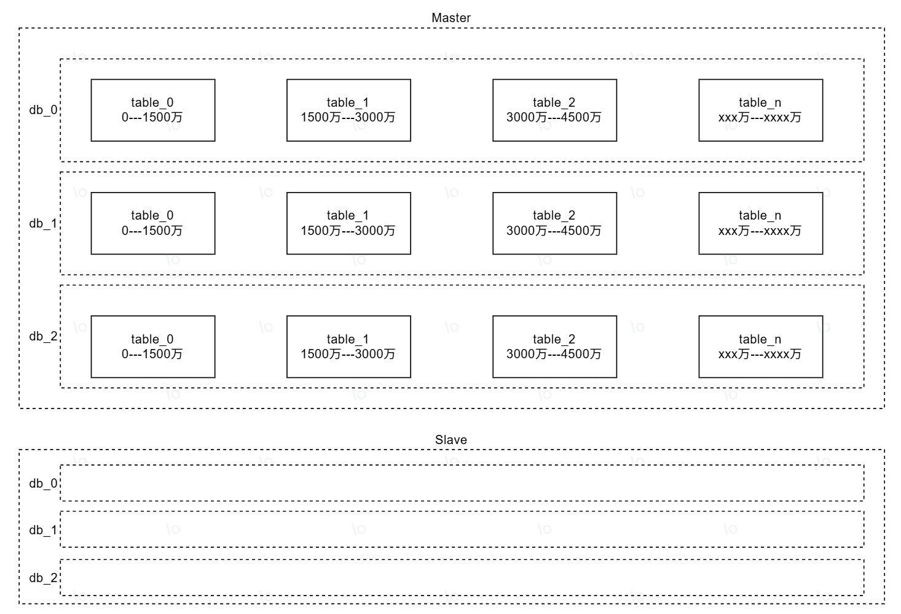

### 2.2.ShardingSphere

Apache ShardingSphere 是一个开源的分布式数据库中间件，提供数据库分片、分库分表、数据路由、分布式事务、数据脱敏等功能。它可以在不修改应用代码的情况下，为应用提供透明的分库分表支持，简化了分布式数据库的管理和维护。

Apache ShardingSphere 由 ShardingSphere\-JDBC 和 ShardingSphere\-Proxy 这 2 款既能够独立部署，又支持混合部署配合使用的产品组成。 它们均提供标准化的基于数据库作为存储节点的增量功能，可适用于如 Java 同构、异构语言、云原生等各种多样化的应用场景。

官方文档：https://shardingsphere.apache.org/document/current/cn/overview/

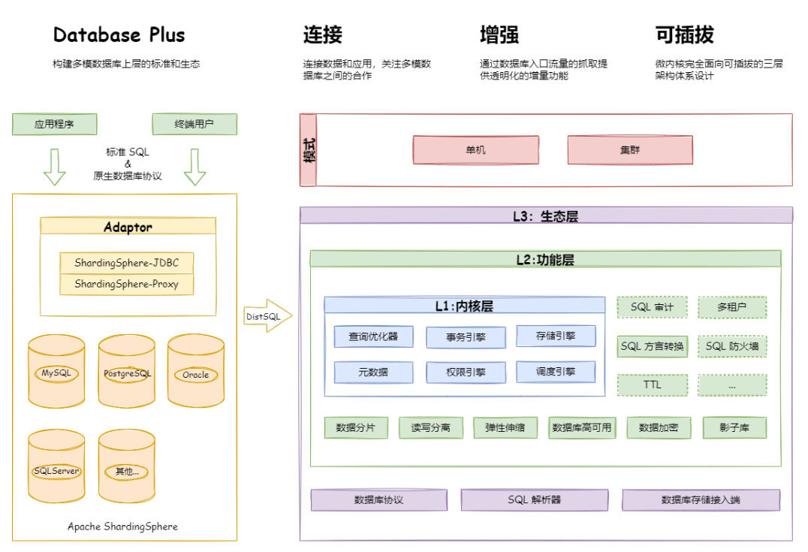

****

本项目使用ShardingSphere\-JDBC方式

ShardingSphere\-JDBC 定位为轻量级 Java 框架，在 Java 的 JDBC 层提供的额外服务。 它使用客户端直连数据库，以 jar 包形式提供服务，无需额外部署和依赖，可理解为增强版的 JDBC 驱动，完全兼容 JDBC 和各种 ORM 框架。

适用于任何基于 JDBC 的 ORM 框架，如：JPA, Hibernate, Mybatis, Spring JDBC Template 或直接使用 JDBC；

支持任何第三方的数据库连接池，如：DBCP, C3P0, BoneCP, HikariCP 等；

支持任意实现 JDBC 规范的数据库，目前支持 MySQL，PostgreSQL，Oracle，SQLServer 以及任何可使用 JDBC 访问的数据库。

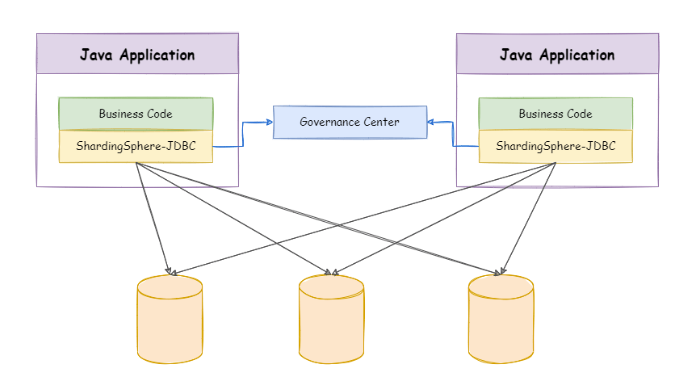

### 2.3.创建数据库

订单数据库分为三个库 :jzo2o\-orders\-0、jzo2o\-orders\-1、jzo2o\-orders\-2


下边分别向三个数据库导入jzo2o\-orders\-sharding\.sql（从资料下的SQL脚本目录获取）。

每个数据库对orders、biz\_snapshot、orders\_serve进行分表（暂分3个表），其它表为广播表\(即在每个数据库都存在且数据是完整的\)，如下图：

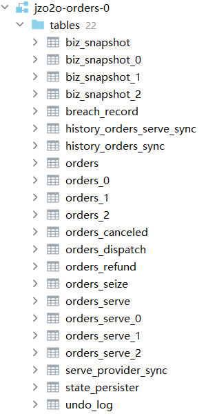

### 2.4.添加依赖

在jzo2o\-framework下的jzo2o\-shardingsphere\-jdbc中添加了具体shardingsphere的依赖，在orders\-base工程引入jzo2o\-shardingsphere\-jdbc的依赖即可，如下：

```XML
<dependency>
    <groupId>com.jzo2o</groupId>
    <artifactId>jzo2o-shardingsphere-jdbc</artifactId>
</dependency>
```

### 2.5.配置文件

在orders\-base工程的resources下配置shardingsphere\-jdbc\-dev\.yml（可直接拷贝项目源码目录下的shardingsphere\-jdbc\-dev\.yml）。

配置文件如下：

jzo2o\-orders\-0、jzo2o\-orders\-1、jzo2o\-orders\-2表示三个数据源对应三个订单数据库。

每个数据库中对orders、orders\_serve、biz\_snapshot进行分表。

详细如下：

```YAML
# Sharding-JDBC 分库分表配置文件
# 数据源配置：3个订单分片库 jzo2o-orders-0 / 1 / 2
dataSources:
  # 分片库0数据源
  jzo2o-orders-0:
    dataSourceClassName: com.zaxxer.hikari.HikariDataSource
    jdbcUrl: jdbc:mysql://192.168.101.68:3306/jzo2o-orders-0?useUnicode=true&characterEncoding=UTF-8&autoReconnect=true&serverTimezone=Asia/Shanghai
    username: root
    password: mysql
  # 分片库1数据源
  jzo2o-orders-1:
    dataSourceClassName: com.zaxxer.hikari.HikariDataSource
    jdbcUrl: jdbc:mysql://192.168.101.68:3306/jzo2o-orders-1?useUnicode=true&characterEncoding=UTF-8&autoReconnect=true&serverTimezone=Asia/Shanghai
    username: root
    password: mysql
  # 分片库2数据源
  jzo2o-orders-2:
    dataSourceClassName: com.zaxxer.hikari.HikariDataSource
    jdbcUrl: jdbc:mysql://192.168.101.68:3306/jzo2o-orders-2?useUnicode=true&characterEncoding=UTF-8&autoReconnect=true&serverTimezone=Asia/Shanghai
    username: root
    password: mysql

# Sharding-JDBC 核心规则配置
rules:
  # 分布式事务规则
  - !TRANSACTION
    defaultType: BASE
  # 分库分表核心规则
  - !SHARDING
    # 分片表定义
    tables:
      # 订单主表 orders
      orders:
        # 真实节点：3库 × 3表 = 9张子表 jzo2o-orders-0.orders_0 ~ jzo2o-orders-2.orders_2
        actualDataNodes: jzo2o-orders-${0..2}.orders_${0..2}
        # 分表策略
        tableStrategy:
          standard:
            shardingColumn: id                  # 分表字段：订单主键id
            shardingAlgorithmName: orders_table_inline  # 绑定分表算法
        # 分库策略
        databaseStrategy:
          standard:
            shardingColumn: user_id             # 分库字段：下单用户ID
            shardingAlgorithmName: orders_database_inline # 绑定分库算法

      # 服务单表 orders_serve
      orders_serve:
        actualDataNodes: jzo2o-orders-${0..2}.orders_serve_${0..2}
        tableStrategy:
          standard:
            shardingColumn: id                  # 分表字段：服务单主键id
            shardingAlgorithmName: orders_serve_table_inline
        databaseStrategy:
          standard:
            shardingColumn: serve_provider_id   # 分库字段：服务服务商ID
            shardingAlgorithmName: orders_serve_database_inline

      # 业务状态快照表 biz_snapshot（状态机快照表，存储每次状态变更完整快照）
      biz_snapshot:
        actualDataNodes: jzo2o-orders-${0..2}.biz_snapshot_${0..2}
        tableStrategy:
          standard:
            shardingColumn: biz_id              # 分表字段：业务单据ID（订单ID/服务单ID）
            shardingAlgorithmName: biz_snapshot_table_inline
        databaseStrategy:
          standard:
            shardingColumn: db_shard_id         # 分库字段：分片标记ID，对齐业务单据所在库
            shardingAlgorithmName: biz_snapshot_database_inline

    # 分片算法集合
    shardingAlgorithms:
      ########################### 订单相关分片算法 ###########################
      # orders 分库算法：按user_id取模3分到0/1/2库
      orders_database_inline:
        type: INLINE
        props:
          algorithm-expression: jzo2o-orders-${user_id % 3}
          allow-range-query-with-inline-sharding: true # 允许分片字段范围查询

      # orders 分表算法：id分段分表，每1500万一条分表区间，共3张表 先取余再向下取整
      orders_table_inline:
        type: INLINE
        props:
          algorithm-expression: orders_${(int)Math.floor(id % 10000000000 / 15000000)}
          allow-range-query-with-inline-sharding: true

      ########################### 服务单相关分片算法 ###########################
      # orders_serve 分库算法：服务商ID取模3分库
      orders_serve_database_inline:
        type: INLINE
        props:
          algorithm-expression: jzo2o-orders-${serve_provider_id % 3}
          allow-range-query-with-inline-sharding: true

      # orders_serve 分表算法：服务单id分段，1500万一张子表
      orders_serve_table_inline:
        type: INLINE
        props:
          algorithm-expression: orders_serve_${(int)Math.floor(id % 10000000000 / 15000000)}
          allow-range-query-with-inline-sharding: true

      ########################### 业务快照分片算法 ###########################
      # biz_snapshot 分库算法：db_shard_id取模3，和对应业务单据同库
      biz_snapshot_database_inline:
        type: INLINE
        props:
          algorithm-expression: jzo2o-orders-${db_shard_id % 3}
          allow-range-query-with-inline-sharding: true

      # biz_snapshot 分表算法：biz_id分段分表，对齐订单/服务单分表逻辑
      biz_snapshot_table_inline:
        type: INLINE
        props:
          algorithm-expression: biz_snapshot_${(int)Math.floor((Long.valueOf(biz_id))  % 10000000000 / 15000000)}
          allow-range-query-with-inline-sharding: true

    # 分布式主键生成器：雪花算法
    keyGenerators:
      snowflake:
        type: SNOWFLAKE

  # 广播表规则：所有分片库都创建一份完整表，多库数据完全同步
  - !BROADCAST
    tables:
      - breach_record                # 违约记录表
      - orders_canceled              # 订单取消表
      - orders_refund                # 订单退款表
      - orders_dispatch              # 订单派单表
      - orders_seize                 # 订单抢占锁定表
      - serve_provider_sync          # 服务商同步表
      - state_persister              # 状态机持久化主表（单条记录存储单据最新状态）
      - orders_dispatch_receive      # 派单接收记录表
      - undo_log                     # 分布式事务undo回滚日志
      - history_orders_sync          # 历史订单同步表
      - history_orders_serve_sync    # 历史服务单同步表

# 全局属性配置
props:
  sql-show: true # 打印执行SQL，开发调试用，生产建议关闭
```

1.配置项说明参考：[官方文档](https://shardingsphere.apache.org/document/current/cn/user-manual/shardingsphere-jdbc/yaml-config/rules/sharding/)

- dataSources：数据源
- jzo2o\-orders\-x：与actualDataNodes对应。

2.下边以orders表为例说明分库分表策略：

分库键：user\_id

分库表达式：jzo2o\-orders\-$\{user\_id % 3\}

根据用户id计算落到哪个数据库

分表键：id 

分表表达式：orders\_$\{\(int\)Math\.floor\(id % 10000000000 / 15000000\)\}

按1500万为单位进行分表，比如：订单号2311020000000000019，为19位，对10000000000 值为19，19除15000000的结果为0\.00000126，结果向下取整，因此表达式结果为0，匹配表orders\_0，如果表达式的值大于1500万小于3000万匹配表orders\_1。

```YAML
  tables:
    orders:
      #由数据源名 + 表名组成（参考 Inline 语法规则）
      actualDataNodes: jzo2o-orders-${0..2}.orders_${0..2}
      tableStrategy:#分表策略
        standard:
          shardingColumn: id #分片列名称
          shardingAlgorithmName: orders_table_inline  # 分片算法名称
      databaseStrategy:#分库策略
        standard:
          shardingColumn: user_id
          shardingAlgorithmName: orders_database_inline
   shardingAlgorithms:
    # 订单-分库算法
    orders_database_inline:
      type: INLINE
      props:
        # 分库算法表达式
        algorithm-expression: jzo2o-orders-${user_id % 3}
        # 分库支持范围查询
        allow-range-query-with-inline-sharding: true
    # 订单-分表算法
    orders_table_inline:
      type: INLINE
      props:
        # 分表算法表达式
        algorithm-expression: orders_${(int)Math.floor(id % 10000000000 / 15000000)}
        # 允许范围查询
        allow-range-query-with-inline-sharding: true    
```

\!BROADCAST：指定广播表

广播表在jzo2o\-orders\-0、jzo2o\-orders\-1、jzo2o\-orders\-2每个数据库的数据一致。

### 2.6.小结

项目的分库分表是怎么做的？

## 3.测试分库分表

### 3.1.配置数据源

进入nacos在jzo2o\-orders\-manager\.yaml中配置数据源使用ShardingSphereDriver：

```yaml
spring:
  datasource:
    driver-class-name: org.apache.shardingsphere.driver.ShardingSphereDriver
    url: jdbc:shardingsphere:classpath:shardingsphere-jdbc-${spring.profiles.active}.yml
```

如下图：

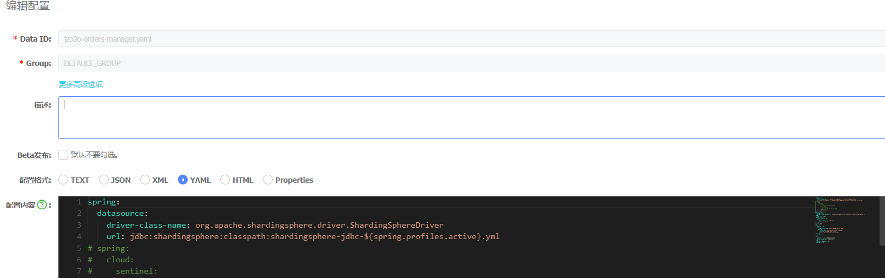

完整配置如下：

```YAML
spring:
  datasource:
    driver-class-name: org.apache.shardingsphere.driver.ShardingSphereDriver
    url: jdbc:shardingsphere:classpath:shardingsphere-jdbc-${spring.profiles.active}.yml
mybatis-plus:
  configuration:
    default-enum-type-handler: com.baomidou.mybatisplus.core.handlers.MybatisEnumTypeHandler
  page:
    max-limit: 1000
  global-config:
    field-strategy: 0
    db-config:
      logic-delete-field: isDeleted
      id-type: assign_id
xxl-job:
  port: 9998
canal:
    enable: true
    sync:
        application-name: ${spring.application.name}
    rabbit-mq:
        routing-keys: canal-mq-jzo2o-orders-manager
        exchange: exchange.canal-jzo2o
        queue: canal-mq-jzo2o-orders-manager
rabbit-mq:
    enable: true
jzo2o:
  trade:
    aliEnterpriseId: 2088241317544335
    wechatEnterpriseId: 1561414331
  job:
    autoEvaluateCount: 100
  openPay: true
```

### 3.2.状态机分库分表

由于对状态机进行了分库分表，需要修改创建订单方法中启动状态机代码：

使用start\(Long dbShardId, String bizId, T bizSnapshot\) 方法启动状态机，传入分片键user\_id。

```Java
@Transactional(rollbackFor = Exception.class)
public void add(Orders orders) {
    boolean result = this.save(orders);
    if(!result) {
        throw new DBException("服务预约下单失败");
    }
    OrderSnapshotDTO orderSnapshotDTO = BeanUtils.copyBean(orders,OrderSnapshotDTO.class);
    orderStateMachine.start(orders.getUserId(),orders.getId().toString(), orderSnapshotDTO);
}
```

支付成功和取消订单都会调用状态机变更状态方法：

使用：changeStatus\(Long dbShardId, String bizId, StatusChangeEvent statusChangeEventEnum, T bizSnapshot\)变更状态, 传入分片键user\_id。

OrdersCreateServiceImpl：

```Java
   @Transactional(rollbackFor = Exception.class)
    public void paySuccess(Long orderId,String transactionId,LocalDateTime payTime) {
//        boolean result = this.lambdaUpdate()
//                .eq(Orders::getId, orderId)
//                .set(Orders::getPayTime, payTime)
//                .set(Orders::getTransactionId, transactionId)
//                .set(Orders::getOrdersStatus, OrderStatusEnum.DISPATCHING.getStatus())
//                .set(Orders::getPayStatus, OrderPayStatusEnum.PAY_SUCCESS.getStatus())
//                .update();
//        if(!result){
//            throw new DBException("更新订单失败");
//        }

        //构建快照数据
        OrderSnapshotDTO orderSnapshotDTO = new OrderSnapshotDTO();
        orderSnapshotDTO.setId(orderId);
        orderSnapshotDTO.setTransactionId(transactionId);
        orderSnapshotDTO.setPayTime(payTime);

        Orders orders = this.getById(orderId);
        //调用状态机的变更状态方法（表明触发支付成功事件）
        orderStateMachine.changeStatus(orders.getUserId(), orderId.toString(), OrderStatusChangeEventEnum.PAYED, orderSnapshotDTO);
    }
```

OrdersJob 

```Java
 @Autowired
    private OrderStateMachine orderStateMachine;


    /**
     * 取消派单中订单
     *
     * @param orders
     * @param cancelReason
     */
    @Async("taskExecutor")
    @Transactional(rollbackFor = Exception.class)
    public void cancelOrderByDispatching(Orders orders, String cancelReason, CurrentUserInfo userInfo) {
        //1. 添加取消记录
        OrdersCanceled ordersCanceled = new OrdersCanceled();
        ordersCanceled.setId(orders.getId());//订单id
        ordersCanceled.setCancellerId(userInfo.getId()); //取消人id
        ordersCanceled.setCancellerType(userInfo.getUserType());//取消人类型
        ordersCanceled.setCancelerName(userInfo.getName());//取消人姓名
        ordersCanceled.setCancelReason(cancelReason);//取消原因
        ordersCanceled.setCancelTime(LocalDateTime.now());//取消时间
        boolean resultCancel = ordersCanceledService.save(ordersCanceled);
        if(!resultCancel) {
            throw new DBException("添加取消记录失败");
        }

        //2. 更新订单状态 update orders set order_status=?,refund_status=? where id=?
//        boolean resultOrder = ordersManagerService.lambdaUpdate()
//                .eq(Orders::getId, orders.getId())
//                .set(Orders::getOrdersStatus, OrderStatusEnum.CLOSED.getStatus()) //已关闭
//                .set(Orders::getRefundStatus, RefundStatusEnum.SENDING.getCode()) //退款中
//                .update();
//        if(!resultOrder) {
//            throw new DBException("更新订单失败");
//        }

        //2.调用状态机的变更状态方法（表明触发订单取消事件）
        orderStateMachine.changeStatus(orders.getUserId(), orders.getId().toString(), OrderStatusChangeEventEnum.CLOSE_DISPATCHING_ORDER);

        //3. 添加退款记录
        OrdersRefund ordersRefund = new OrdersRefund();
        ordersRefund.setId(orders.getId());
        ordersRefund.setTradingOrderNo(orders.getTradingOrderNo());
        //ordersRefund.setRealPayAmount(orders.getRealPayAmount());
        ordersRefund.setRealPayAmount(BigDecimal.valueOf(0.01));//由于前面测试支付都是0.01，这里为方便演示也只能写0.01。 不要使用new BigDecimal(double)，这种会精度丢失
        boolean resultRefund = ordersRefundService.save(ordersRefund);
        if(!resultRefund) {
            throw new DBException("添加退款记录失败");
        }

        OrderJob owner = applicationContext.getBean(OrderJob.class);
        //4. 申请退款
        owner.ordersRefundHandle(ordersRefund);
    }
```

### 3.3.测试

1.测试流程：下单、支付、取消订单

2.下单预期结果：

- 下单成功：根据用户id分库，写入jzo2o\-orders\-x的其中一个数据库，根据订单号分表，写入orders\_x其中一个订单表。

- 状态机：根据用户id分库，写入jzo2o\-orders\-x的其中一个数据库，根据biz\_id字段分表，写入biz\_snapshot\_x中一个状态表机。state\_persister为广播表不进行分表在三个数据库数据一致。


正常情况下，只要下单预期结果OK，支付及取消订单预期结果也是没问题的，可自行测试。

orders\_canceled表为广播表不进行分表在三个数据库数据一致。

# 三、订单查询优化

## 1.订单查询优化方案

### 1.1.为什么要优化订单查询

1.订单查询是一个高频接口，并且订单数据非常大。

2.面向C端用户的订单查询接口其访问量非常大。

3.对于运营端的订单查询接口虽然访问量不大但由于订单数据较多也需要进行优化，提高查询性能。

### 1.2.确定优化方向 

面向查询类的接口的优化方向是什么呢？

1.使用缓存

将查询的订单数据进行缓存，提高查询性能。

2.优化数据库索引提高查询性能

当缓存中没有时或缓存过期时会从数据库查询数据，通过添加数据库索引去提高数据库的查询性能。

### 1.3.订单详情优化方案

针对单条订单信息查询接口可以使用缓存进行优化。

对于单条订单信息查询接口通过快照查询接口查询订单的详情信息。

参考AbstractStateMachine类的String getCurrentSnapshotCache\(String bizId\)快照查询方法，将快照信息缓存到 redis提供查询效率。

根据订单Id查询缓存信息，先从缓存查询如果缓存没有则查询快照表的数据然后保存到缓存中。缓存设置了过期时间是30分钟。

当订单状态变更，此时订单最新状态的快照有变更，会删除快照缓存，当再次查询快照时从数据库查询最新的快照信息进行缓存。

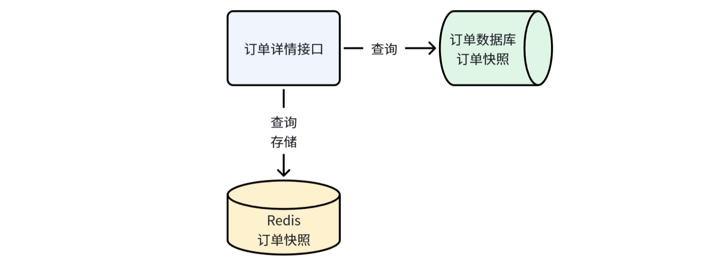

### 1.4.用户端订单列表优化方案

用户端通过小程序查询订单列表，界面上没有分页查询的按钮，用户端查询订单列表可采用滚动查询的方法。

滚动查询就是一次查询指定数量的记录，不用进行count查询，省去count查询的消耗。

具体方案如下：

1.首先查询符合条件的订单ID。

由于是滚动查询需要传入滚动ID，这里我们在订单表使用排序字段sort\_by作为滚动ID。

滚动ID是一种递增的序列号，按服务预约时间降序排列且滚动ID具有唯一性，滚动ID的规则是：服务预约时间\+订单号后5位。

滚动查询方式： 按SORT\_BY降序，取小于SORT\_BY的n条记录 第一页传入SORT\_BY参数为空 从第二页开始传入上一页最后一条记录的SORT\_BY

示例：

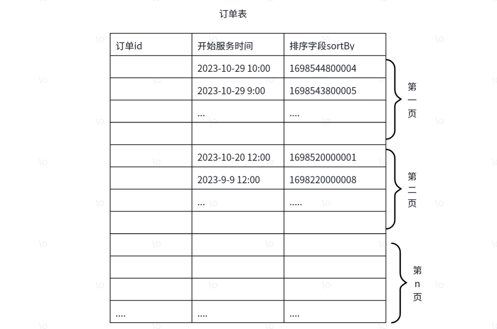

2.使用覆盖索引优化

根据查询条件查询符合条件的订单ID，这里使用覆盖索引优化的方法。

我们知道在InnoDB存储引擎中有两种索引存储形式：

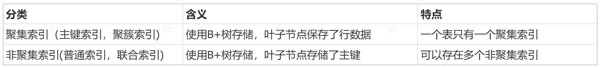

聚集索引：查询条件只有主键的情况会通过聚集索引查询。

非聚集索引：查询条件有多个，此时为了提高查询效率可以创建多个字段的联合索引，根据非聚集索引找到符合条件主键，如果要查询的列只有索引字段则通过非聚集索引直接拿到字段值返回，如果要查询列有一部分在索引之外此时会进行回表查询聚集索引最终拿到数据。

示例：

user表（id、name、 age、address）

对name、age创建联合索引。

sql1：

select id、name、age  from  user where name=? and age =? 

该查询直接从索引中拿到符合条件的数据，不存在回表查询。

sql2：

select \*  from  user where name=? and age =? 

该查询列是select \* ，address没有包含在索引中，where条件通过联合索引找到符合条件的主键，再通过主键回表查询聚集索引，最终拿到数据。

覆盖索引是什么呢？

覆盖索引是一种优化手段，上边的sql1就是实现了覆盖索引。

覆盖索引（covering index）指一个查询语句的执行只需要从非聚集索引中就可以得到查询记录，而不需要回表去查询聚集索引，可以称之为实现了索引覆盖。

根据上边的需求，我们根据查询条件建立联合索引，通过联合索引找到符合条件的订单ID（主键），从索引中找到的符合条件的订单ID无需回表查询聚集索引。

3.使用订单ID匹配缓存，如果有缓存则直接获取否则从数据库查询。

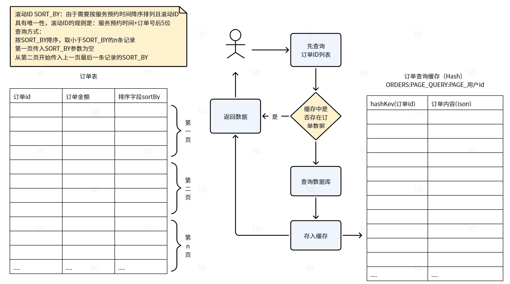

### 1.5.运营端订单列表优化方案

运营端订单列表由于访问量不大这里无需使用缓存，实现方案是首先通过覆盖索引查询符合条件的订单ID，再根据订单ID查询聚集索引拿到数据。

我们根据查询条件创建的联合字段索引是非聚集索引，先从非聚集索引中查询到符合条件的ID，再根据订单ID从聚集索引中查找数据。

### 1.6.小结

订单查询是如何优化的？

## 2.订单详情优化

### 2.1.阅读状态机快照查询代码

在jzo2o\-framework的状态机工程jzo2o\-statemachine中提供了查询快照缓存的方法，具体在状态机抽象类AbstractStateMachine中，如下图：

此方法查询的是当前状态下的快照。

```Java
/**
 * 获取当前状态的快照缓存
 *
 * @param bizId 业务id
 * @return 快照信息
 */
public String getCurrentSnapshotCache(String bizId) {
    //先查询缓存，如果缓存没有就查询数据库然后存缓存
    String key = "JZ_STATE_MACHINE:" + name + ":" + bizId;
    Object object = redisTemplate.opsForValue().get(key);
    if (ObjectUtil.isNotEmpty(object)) {
        return object.toString();
    }

    String bizSnapshot = getCurrentSnapshot(bizId);
    redisTemplate.opsForValue().set(key, bizSnapshot, 30, TimeUnit.MINUTES);
    return bizSnapshot;
}
```

状态机在会在生成快照的地方进行清理快照缓存，保证再次查询快照缓存时可以查询到最新的快照信息。

在saveSnapshot\(\)方法中保存快照方法和changeStatus\(\)方法中提供了清理快照的代码。

具体方法如下：

```Java
public void saveSnapshot(Long dbShardId, String bizId, StatusDefine statusDefine, T bizSnapshot) 

public void changeStatus(Long dbShardId, String bizId, StatusChangeEvent statusChangeEventEnum, T bizSnapshot) 
```

### 2.2.订单详情查询优化

找到“根据订单id查询”接口，找到调用的查询订单详情的service方法：

```Java
@Override
public OrderResDTO getDetail(Long id) {
    Orders orders = queryById(id);
    OrderResDTO orderResDTO = BeanUtil.toBean(orders, OrderResDTO.class);
    return BeanUtils.copyBean(orderSnapshotDTO, OrderResDTO.class);
}
```

上边的代码是查询数据库，现在改为查询快照缓存方法，如下：

```Java
@Override
public OrderResDTO getDetail(Long id) {
    //Orders orders = queryById(id);
    //OrderResDTO orderResDTO = BeanUtil.toBean(orders, OrderResDTO.class);
    String snapshotCache = orderStateMachine.getCurrentSnapshotCache(id.toString());
    OrderSnapshotDTO orderSnapshotDTO = JsonUtils.toBean(snapshotCache, OrderSnapshotDTO.class);
    return BeanUtils.copyBean(orderSnapshotDTO, OrderResDTO.class);
}
```

### 2.3.测试

1.测试流程：

进入小程序订单列表界面，找到一个未支付或派单中的订单点击进入订单详情页面。

观察redis是否有快照缓存数据。

2.预期结果：

查询一次订单信息后快照信息正常缓存，缓存key为：JZ\_STATE\_MACHINE:order\+订单id

示例：

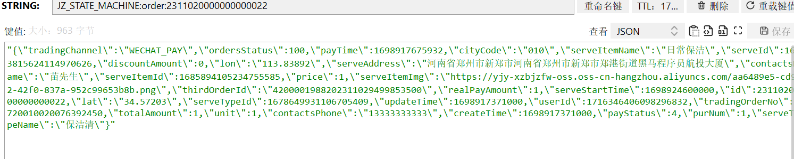

订单变更状态后再次查询订单信息可以得到最新的状态，这说明最新数据已经同步到缓存中。

### 2.4.小结

订单快照是怎么实现的？

## 3.优化用户端订单列表

### 3.1.创建索引

**理解滚动ID**

滚动ID在用户端订单列表查询中至关重要，由于需要按服务预约时间降序排列且滚动ID具有唯一性，滚动ID的规则是：服务预约时间\+订单号后5位

根据上边的方案查询滚动ID的规则如下伪代码：

```SQL
select * from 订单表 where 滚动ID<? and 用户id=? order by 滚动ID desc
```

在创建订单时向订单表保存滚动ID为：服务开始时间（毫秒）\+订单后5位

如下代码：

```Java
// LocalDateTime → 毫秒时间戳
long sortBy = DateUtils.toEpochMilli(orders.getServeStartTime()) + orders.getId() % 100000;
orders.setSortBy(sortBy);
```

**创建联合索引**

在创建索引之前需要明确最终执行的SQL语句，如下：

```SQL
SELECT id
FROM orders_0
WHERE (orders_status = ? AND user_id = ? AND display = 1 and sort_by<? )
ORDER BY sort_by DESC
LIMIT 10
```

在查询全部订单时 “orders\_status = ?” 条件不需要，即执行SQL

```SQL
SELECT id
FROM orders_0
WHERE ( user_id = ? AND display = 1 and sort_by<? )
ORDER BY sort_by DESC
LIMIT 10
```

按照最左前缀法则，查询条件必须包括最左边的索引列并将索引字段的顺序和SQL语句where 条件字段的顺序一致，下边创建两个联合索引：

创建索引query\_index\_0，满足最上边的SQL语句。

```SQL
create index query_index_0
    on `jzo2o-orders-1`.orders_0 (orders_status asc, user_id asc, display asc, sort_by desc);
```

创建索引query\_index\_1，满足最下边的SQL语句。

```SQL
create index query_index_1
    on `jzo2o-orders-1`.orders_0 (user_id asc, display asc, sort_by desc);
```

并且要注意上边两个SQL的查询都是按sort\_by 降序排列，所以索引中 sort\_by 为desc降序。

**执行计划**

1.什么是执行计划

索引创建完成如何知道这个SQL语句是否用到这个索引呢？并且跟踪我们的需求最终要实现覆盖索引。

通过MySQL的执行计划即可知道该SQL语句是否用上了我们创建的索引。

MySQL 的执行计划（Execution Plan）是 MySQL 查询优化器生成的一个描述查询执行方式的计划。它是一个详细的执行策略，指示 MySQL 数据库引擎如何执行查询以及如何获取所需的数据。

当你执行一个 SQL 查询时，MySQL 查询优化器负责决定如何最有效地执行这个查询。优化器会考虑多个因素，包括表的索引、表的大小、查询中的过滤条件等，然后生成一个执行计划，描述了查询的执行步骤和顺序。

使用 `EXPLAIN` 关键字来获取 MySQL 查询的执行计划，语法格式如下：

```SQL
EXPLAIN  sql语句 
```

下边我们获取第一个SQL的执行计划，第二个SQL的执行计划大家可以自行测试。

对第一个SQL我们加上一些模拟的参数，使用explain获取它的执行计划：

```SQL
explain
SELECT id
FROM orders_0
WHERE (orders_status = 0 AND user_id = 1716346406098296832 AND display = 1 and sort_by<1698924600022)
ORDER BY sort_by DESC
LIMIT 10
```

输出：

```Java
[
  {
    "id": 1,
    "select_type": "SIMPLE",
    "table": "orders_0",
    "partitions": null,
    "type": "range",
    "possible_keys": "query_index_0,query_index_1",
    "key": "query_index_0",
    "key_len": "26",
    "ref": null,
    "rows": 1,
    "filtered": 100,
    "Extra": "Using where; Using index"
  }
]
```

每项的说明：

id： 每个查询步骤的唯一标识符。

select\_type： 查询的类型，例如 SIMPLE（简单查询）或 PRIMARY（主查询，嵌套子查询的最外层查询

table： 查询涉及的表。

partitions： 使用的分区（如果有分区表的话）。

type： 查询使用的连接类型

- system：表中只有一行数据（相当于系统表），是const类型的特例。

- const：通过索引一次命中，匹配一行数据，性能非常快，通常用于主键或唯一索引的查询。

- eq\_ref：唯一性索引扫描，对于每个索引键，表中只有一条记录与之匹配，常用于主键或唯一索引的等值查询。

- ref：非唯一性索引扫描，返回匹配某个单独值的所有行，常用于普通索引的等值查询。

- fulltext：使用全文索引进行查询，适用于对文本字段进行全文搜索的场景。

- ref\_or\_null：类似于ref，但查询条件中可能包含NULL值，MySQL会进行额外查询。

- index\_merge：使用索引合并优化，表示查询使用了多个索引来检索数据。

- unique\_subquery：子查询中的IN语句，且IN语句中的查询字段为数据表的主键或唯一索引字段。

- index\_subquery：与unique\_subquery类似，但IN语句中的查询字段为数据表中的非唯一索引字段。

- range：索引范围扫描，表示MySQL会根据索引上的范围条件来找到匹配的记录，常用于范围查询（如BETWEEN、\<、\>等）。

- index：索引扫描，表示MySQL会使用索引来扫描表，但不一定按索引顺序查找数据行，通常比全表扫描快。

- ALL：全表扫描，表示MySQL会扫描全表来找到匹配的记录，性能最差，应尽量避免。

possible\_keys： 可能用于此查询的键列表。

key： 实际用于此查询的键。

key\_len： 使用的索引长度。

ref： 显示索引的哪一列被用于查询。

rows： MySQL 估计将需要读取的行数。

filtered： 在表中的行数的百分比，表示查询的条件有多少行满足。

Extra： 其他的额外信息，例如使用了哪些索引、是否使用了文件排序等。

如果key、key\_len为null说明没有用到索引。

上边的输出说明：使用了query\_index\_0索引。

另外重点关注 Extra：

- Using where： 表示MySQL正在对检索出来的行进行额外的WHERE条件过滤，最终返回满足WHERE条件的行。

- Using index： 这部分表示MySQL使用了索引来加速查询，但不必回表读取实际的数据行。这种情况通常发生在覆盖索引的情况下，即索引包含了查询所需的所有列，因此MySQL不需要回到数据表中去获取数据，从而提高了查询的性能。

- Using filesort：是MySQL一种优化手段，表示 MySQL 需要进行额外的排序操作，而不是直接从索引中读取已排序的数据。Using filesort 可能会导致查询性能下降，因为它需要额外的内存或磁盘空间来进行排序。

- Using index condition：是MySQL一种优化手段，先从索引中查找满足条件的记录，索引中没有的数据再回表查询，可以有效减少回表的次数，大大提升了查询的效率。性能肯定不如全部使用索引。

"Using where; Using index"表示使用了覆盖索引，使用了WHERE子句来过滤数据，能够高效地找到并返回满足查询条件的行，而不必浪费资源读取不必要的数据。

2.根据执行计划调试SQL

如果我们把SQL改为如下内容，不仅查询ID还查询user\_id:

```SQL
explain
SELECT id,user_id
FROM orders_0
WHERE (orders_status = 0 AND user_id = 1716346406098296832 AND display = 1 and sort_by<1698924600022)
ORDER BY sort_by DESC
LIMIT 10
```

我们发现输出"Extra"仍然是 "Using where; Using index"

这是因为id、user\_id都是索引中的字段，仍然满足覆盖索引。

如果改为查询列中是索引中不存在字段呢？下边的SQL添加了serve\_item\_name查询列。

```SQL
explain
SELECT id,user_id,serve_item_name
FROM orders_0
WHERE (orders_status = 0 AND user_id = 1716346406098296832 AND display = 1 and sort_by<1698924600022)
ORDER BY sort_by DESC
LIMIT 10
```

输出：

```Java
[
  {
    "id": 1,
    "select_type": "SIMPLE",
    "table": "orders_0",
    "partitions": null,
    "type": "range",
    "possible_keys": "query_index_0,query_index_1",
    "key": "query_index_0",
    "key_len": "26",
    "ref": null,
    "rows": 1,
    "filtered": 100,
    "Extra": "Using index condition"
  }
]
```

从key、key\_len可以看出使用了索引query\_index\_0，虽然serve\_item\_name在索引中不存在但是也使用了query\_index\_0索引，先从索引中查找满足条件的记录，索引中没有的数据再回表查询。

Using index condition表示：是MySQL一种优化手段，先从索引中查找满足条件的记录，索引中没有的数据再回表查询，可以有效减少回表的次数，大大提升了查询的效率。性能肯定不如全部使用索引。

如果我们想实现Extra为Using index的效果即覆盖索引该怎么实现呢？

可以在索引中添加serve\_item\_name字段，

```SQL
create index query_index_2
    on `jzo2o-orders-0`.orders_0 (orders_status asc, user_id asc, display asc, sort_by desc, serve_item_name asc);
```

执行完测试后删除query\_index\_2这个索引

```SQL
drop index query_index_2 on `jzo2o-orders-2`.orders_0;
```

3.全表扫描

如果我们把SQL语句改为如下方式：

```Java
explain
SELECT id,user_id,serve_item_name
FROM orders_0
WHERE (display = 1 and sort_by<1698924600022)
ORDER BY sort_by DESC
LIMIT 10
```

输出：

```Java
[
  {
    "id": 1,
    "select_type": "SIMPLE",
    "table": "orders_0",
    "partitions": null,
    "type": "ALL",
    "possible_keys": null,
    "key": null,
    "key_len": null,
    "ref": null,
    "rows": 10,
    "filtered": 10,
    "Extra": "Using where; Using filesort"
  }
]
```

type: ALL

key和key\_len为null

说明整个查询是全表查询没有用到索引。虽然我们创建的两个索引中包括了display 和sort\_by，根据最左前缀法则 查询条件中没有包含索引中最左边的列，索引无效。

> 开发中，大部分时候，应该尽量避免使用全表扫描，性能非常差，能优化就尽量优化。
> 

全表扫描通常会比较耗费情况，但也不是绝对的，有时候，尽管全表扫描看起来需要访问更多的数据，但由于其他因素（如内存中的缓存、磁盘I/O的局部性等）的影响，优化器可能会认为全表扫描是更经济的选择。

**创建索引（如果已有，则忽略）**

在三个数据库中对三个订单表创建query\_index\_0索引，执行下边的脚本：

```sql
create index query_index_0
    on `jzo2o-orders-0`.orders (orders_status asc, user_id asc, display asc, sort_by desc);
create index query_index_0
    on `jzo2o-orders-0`.orders_0 (orders_status asc, user_id asc, display asc, sort_by desc);
create index query_index_0
    on `jzo2o-orders-0`.orders_1 (orders_status asc, user_id asc, display asc, sort_by desc);
create index query_index_0
    on `jzo2o-orders-0`.orders_2 (orders_status asc, user_id asc, display asc, sort_by desc);

create index query_index_0
    on `jzo2o-orders-1`.orders (orders_status asc, user_id asc, display asc, sort_by desc);
create index query_index_0
    on `jzo2o-orders-1`.orders_0 (orders_status asc, user_id asc, display asc, sort_by desc);
create index query_index_0
    on `jzo2o-orders-1`.orders_1 (orders_status asc, user_id asc, display asc, sort_by desc);
create index query_index_0
    on `jzo2o-orders-1`.orders_2 (orders_status asc, user_id asc, display asc, sort_by desc);


create index query_index_0
    on `jzo2o-orders-2`.orders (orders_status asc, user_id asc, display asc, sort_by desc);
create index query_index_0
    on `jzo2o-orders-2`.orders_0 (orders_status asc, user_id asc, display asc, sort_by desc);
create index query_index_0
    on `jzo2o-orders-2`.orders_1 (orders_status asc, user_id asc, display asc, sort_by desc);
create index query_index_0
    on `jzo2o-orders-2`.orders_2 (orders_status asc, user_id asc, display asc, sort_by desc);
```

在三个数据库中对三个订单表创建query\_index\_1索引，执行下边的脚本：

```sql
create index query_index_1
    on `jzo2o-orders-0`.orders (user_id asc, display asc, sort_by desc);
create index query_index_1
    on `jzo2o-orders-0`.orders_0 (user_id asc, display asc, sort_by desc);
create index query_index_1
    on `jzo2o-orders-0`.orders_1 (user_id asc, display asc, sort_by desc);
create index query_index_1
    on `jzo2o-orders-0`.orders_2 (user_id asc, display asc, sort_by desc);

create index query_index_1
    on `jzo2o-orders-1`.orders (user_id asc, display asc, sort_by desc);
create index query_index_1
    on `jzo2o-orders-1`.orders_0 (user_id asc, display asc, sort_by desc);
create index query_index_1
    on `jzo2o-orders-1`.orders_1 (user_id asc, display asc, sort_by desc);
create index query_index_1
    on `jzo2o-orders-1`.orders_2 (user_id asc, display asc, sort_by desc);


create index query_index_1
    on `jzo2o-orders-2`.orders (user_id asc, display asc, sort_by desc);
create index query_index_1
    on `jzo2o-orders-2`.orders_0 (user_id asc, display asc, sort_by desc);
create index query_index_1
    on `jzo2o-orders-2`.orders_1 (user_id asc, display asc, sort_by desc);
create index query_index_1
    on `jzo2o-orders-2`.orders_2 (user_id asc, display asc, sort_by desc);
```

注意在执行上边脚本时由于创建的索引较多，可能部分索引已存在报错，点击忽略错误让其执行完

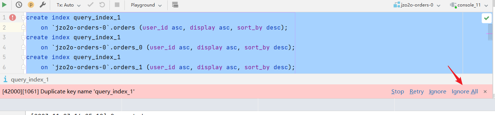

也可以登录mysql容器执行：

```bash
docker exec -it mysql /bin/bash
进入容器输入以命令：
mysql -uroot -pmysql
mysql>在mysql命令提示符下粘贴上边的创建索引命令。
```

**小结**

1.什么是聚集索引和非聚集索引？

2.什么是回表查询？

3.什么是覆盖索引？

### 3.2.查询订单ID列表

**优化Service方法**

下边根据优化方案优化原来的订单查询方法。

下边是原来的代码：

```Java
/**
 * 滚动分页查询
 *
 * @param currentUserId 当前用户id
 * @param ordersStatus  订单状态，0：待支付，100：派单中，200：待服务，300：服务中，400：待评价，500：订单完成，600：已取消，700：已关闭
 * @param sortBy        排序字段
 * @return 订单列表
 */
@Override
public List<OrderSimpleResDTO> consumerQueryList(Long currentUserId, Integer ordersStatus, Long sortBy) {
    //1.构件查询条件
    LambdaQueryWrapper<Orders> queryWrapper = Wrappers.<Orders>lambdaQuery()
            .eq(ObjectUtils.isNotNull(ordersStatus), Orders::getOrdersStatus, ordersStatus)
            .lt(ObjectUtils.isNotNull(sortBy), Orders::getSortBy, sortBy)
            .eq(Orders::getUserId, currentUserId)
            .eq(Orders::getDisplay, EnableStatusEnum.ENABLE.getStatus());
    Page<Orders> queryPage = new Page<>();
    queryPage.addOrder(OrderItem.desc(SORT_BY));
    queryPage.setSearchCount(false);

    //2.查询订单列表
    Page<Orders> ordersPage = baseMapper.selectPage(queryPage, queryWrapper);
    List<Orders> records = ordersPage.getRecords();
    List<OrderSimpleResDTO> orderSimpleResDTOS = BeanUtil.copyToList(records, OrderSimpleResDTO.class);
    return orderSimpleResDTOS;

}
```

优化后的代码：

```Java
/**
 * 滚动分页查询
 *
 * @param currentUserId 当前用户id
 * @param ordersStatus  订单状态，0：待支付，100：派单中，200：待服务，300：服务中，400：待评价，500：订单完成，600：已取消，700：已关闭
 * @param sortBy        排序字段
 * @return 订单列表
 */
@Override
public List<OrderSimpleResDTO> consumerQueryList(Long currentUserId, Integer ordersStatus, Long sortBy) {
    //1.构件查询条件
    LambdaQueryWrapper<Orders> queryWrapper = Wrappers.<Orders>lambdaQuery()
            .eq(ObjectUtils.isNotNull(ordersStatus), Orders::getOrdersStatus, ordersStatus)
            .lt(ObjectUtils.isNotNull(sortBy), Orders::getSortBy, sortBy)
            .eq(Orders::getUserId, currentUserId)
            .eq(Orders::getDisplay, EnableStatusEnum.ENABLE.getStatus())
            .select(Orders::getId) //只查ID
            ;
    Page<Orders> queryPage = new Page<>();
    queryPage.addOrder(OrderItem.desc(SORT_BY));
    queryPage.setSearchCount(false);

    //2.查询订单列表
    Page<Orders> ordersPage = baseMapper.selectPage(queryPage, queryWrapper);
    List<Long> orderIdList = CollUtils.getFieldValues(ordersPage.getRecords(), Orders::getId);
    if(CollUtils.isEmpty(orderIdList)) {
        return CollUtils.emptyList();
    }

    //List<Orders> records = ordersPage.getRecords();

    //TODO 先查询缓存，缓存没有再查询数据库
    List<Orders> records =  this.batchQuery(orderIdList);

    List<OrderSimpleResDTO> orderSimpleResDTOS = BeanUtil.copyToList(records, OrderSimpleResDTO.class);
    return orderSimpleResDTOS;

}
```

**测试**

1.测试查询全部订单

打开小程序进入我的订单列表，查询全部订单，从IDEA控制台日志中获取执行的SQL语句并查看执行计划。

示例：

查询订单ID

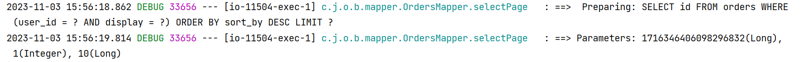

根据订单ID查询订单信息

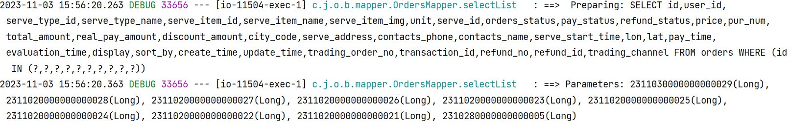

复制日志中的SQL，使用explain获取执行计划

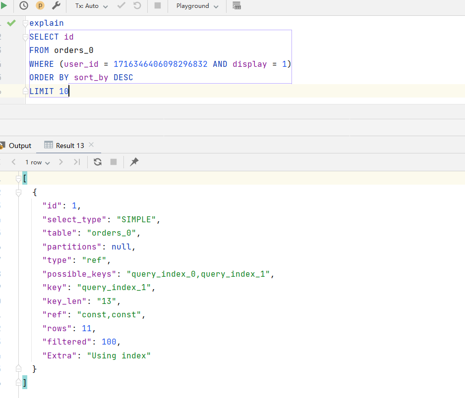

从输出可以看出使用了覆盖索引。

第二个SQL是根据id主键查询详细信息，如下：

```sql
explain
SELECT id,
       user_id,
       serve_type_id,
       serve_type_name,
       serve_item_id,
       serve_item_name,
       serve_item_img,
       unit,
       serve_id,
       orders_status,
       pay_status,
       refund_status,
       price,
       pur_num,
       total_amount,
       real_pay_amount,
       discount_amount,
       city_code,
       serve_address,
       contacts_phone,
       contacts_name,
       serve_start_time,
       lon,
       lat,
       pay_time,
       evaluation_time,
       display,
       sort_by,
       create_time,
       update_time,
       trading_order_no,
       transaction_id,
       refund_no,
       refund_id,
       trading_channel
FROM orders_0

WHERE (id IN (2311030000000000029, 2311020000000000028, 2311020000000000027, 2311020000000000026, 2311020000000000023, 2311020000000000025, 2311020000000000024, 2311020000000000022, 2311020000000000021, 2310280000000000005))
```

输出：

```json
[
  {
    "id": 1,
    "select_type": "SIMPLE",
    "table": "orders_0",
    "partitions": null,
    "type": "ALL",
    "possible_keys": "PRIMARY",
    "key": null,
    "key_len": null,
    "ref": null,
    "rows": 10,
    "filtered": 100,
    "Extra": "Using where"
  }
]
```

从key、key\_len可以看出并没有使用索引，possible\_keys显示可能会使用主键索引（聚集索引），但最终没有使用索引。

这是因为MySQL器判断上边的SQL进行全表扫描要比使用索引效率高。

如果我们去掉一些id IN \(\)中的参数，比如：我们只留三个ID，如下：

```sql
explain
SELECT id,
       user_id,
       serve_type_id,
       serve_type_name,
       serve_item_id,
       serve_item_name,
       serve_item_img,
       unit,
       serve_id,
       orders_status,
       pay_status,
       refund_status,
       price,
       pur_num,
       total_amount,
       real_pay_amount,
       discount_amount,
       city_code,
       serve_address,
       contacts_phone,
       contacts_name,
       serve_start_time,
       lon,
       lat,
       pay_time,
       evaluation_time,
       display,
       sort_by,
       create_time,
       update_time,
       trading_order_no,
       transaction_id,
       refund_no,
       refund_id,
       trading_channel
FROM orders_0

WHERE (id IN (2311030000000000029, 2311020000000000028, 2311020000000000027))
```

输出：

```json
[
  {
    "id": 1,
    "select_type": "SIMPLE",
    "table": "orders_0",
    "partitions": null,
    "type": "range",
    "possible_keys": "PRIMARY",
    "key": "PRIMARY",
    "key_len": "8",
    "ref": null,
    "rows": 3,
    "filtered": 100,
    "Extra": "Using where"
  }
]
```

从输出可以看出此时使用了聚集索引。

2.查询待支付订单

参考上边的方法自行测试。

**小结**

如何知道一个SQL有没有使用索引？

### 3.3.订单数据缓存

**缓存结构**

缓存订单数据使用Hash结构，如下：

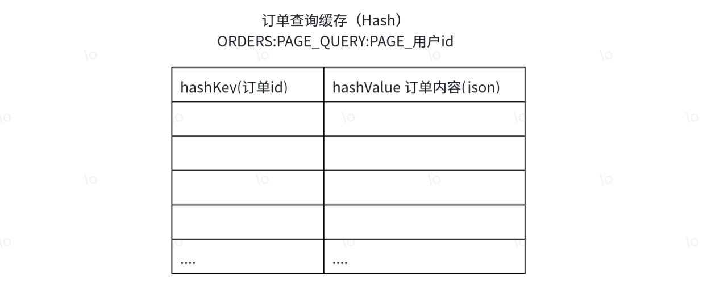

我们需求是首先拿多个订单ID去缓存查询，如果有些key在缓存中不存在，此时去查询数据库，查询到数据再存入缓存。

执行过程如下图：

示例：

查询100、101、102、103

缓存中已存在100、101的数据，现需要从数据库查询102、103的数据，查询到存储到缓存中。

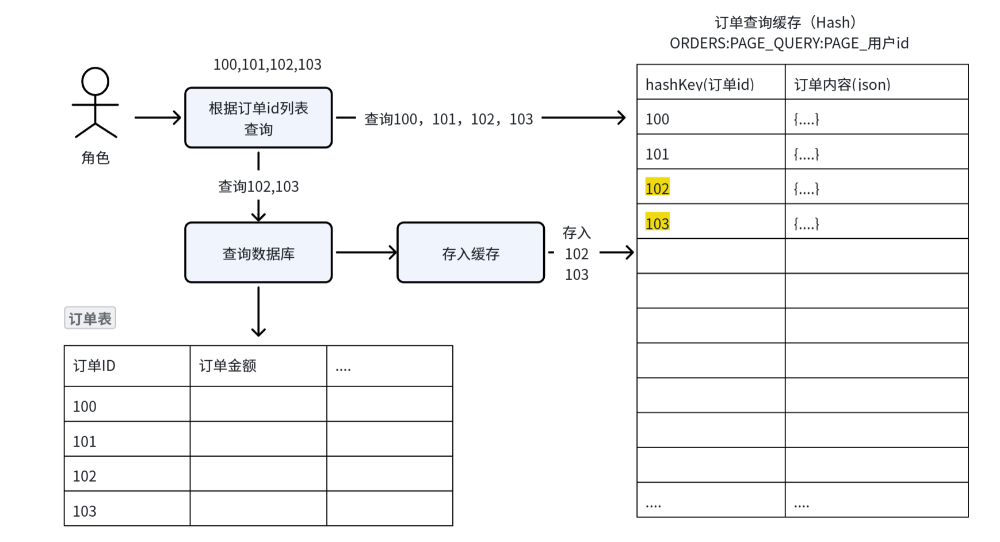

**编码**

根据缓存需求我们开发了缓存工具类CacheHelper ：在framework中

```Java
@Component
public class CacheHelper {

/**
 * 批量获取缓存数据，按照id列表顺序返回目标数据,如果缓存不存在则查询数据库
 *
 * @param dataType               目标数据类型，CACHE_加dataType 为redisKey
 * @param objectIds              目标数据唯一id
 * @param batchDataQueryExecutor 批量目标数据获取执行器用于当缓存数据不存在时查询数据库
 * @param clazz                  目标数据类型class
 * @param ttl                    目标数据整体过期时间(ttl大于0才会设置有效期)
 * @param <K>                    目标数据id数据类型
 * @param <T>                    目标数据类型
 * @return
 * <K, T>：方法泛型声明
 * 这是方法级泛型，仅作用于当前 getAll 方法，和类泛型区分开；
 * K：Key 的泛型占位符（通常代表批次查询的主键 / 查询条件类型，比如 Long、String）；
 * T：目标实体类型占位符（你最终要查询、返回的数据实体，比如 OrderDO、UserDTO）；
 * 作用：让这个方法可以复用，不用为每一种实体单独写一套批量查询逻辑。
 */
public <K, T> List<T> batchGet(String dataType, List<K> objectIds, BatchDataQueryExecutor<K, T> batchDataQueryExecutor, Class<T> clazz, Long ttl) {
    ......
}
```

下边使用CacheHelper 实现订单查询缓存，代码如下：

```Java
/**
 * 滚动分页查询
 *
 * @param currentUserId 当前用户id
 * @param ordersStatus  订单状态，0：待支付，100：派单中，200：待服务，300：服务中，400：待评价，500：订单完成，600：已取消，700：已关闭
 * @param sortBy        排序字段
 * @return 订单列表
 */
@Override
public List<OrderSimpleResDTO> consumerQueryList(Long currentUserId, Integer ordersStatus, Long sortBy) {
    //1.构件查询条件
    LambdaQueryWrapper<Orders> queryWrapper = Wrappers.<Orders>lambdaQuery()
            .eq(ObjectUtils.isNotNull(ordersStatus), Orders::getOrdersStatus, ordersStatus)
            .lt(ObjectUtils.isNotNull(sortBy), Orders::getSortBy, sortBy)
            .eq(Orders::getUserId, currentUserId)
            .eq(Orders::getDisplay, EnableStatusEnum.ENABLE.getStatus())
            .select(Orders::getId) //只查ID
            ;
    Page<Orders> queryPage = new Page<>();
    queryPage.addOrder(OrderItem.desc(SORT_BY));
    queryPage.setSearchCount(false);

    //2.查询订单列表
    Page<Orders> ordersPage = baseMapper.selectPage(queryPage, queryWrapper);
    List<Long> orderIdList = CollUtils.getFieldValues(ordersPage.getRecords(), Orders::getId);
    if(CollUtils.isEmpty(orderIdList)) {
        return CollUtils.emptyList();
    }

    //List<Orders> records = ordersPage.getRecords();

    //先查询缓存，缓存没有再查询数据库
    //参数1：redisKey的一部分
    String redisKey = String.format(RedisConstants.RedisKey.ORDERS, currentUserId);
    //参数2：订单id列表
    //参数3：batchDataQueryExecutor 当缓存中没有时执行batchDataQueryExecutor从数据库查询
    // batchDataQueryExecutor的方法：Map<K, T> execute(List<K> objectIds, Class<T> clazz); objectIds表示缓存中未匹配到的id，clazz指定map中value的数据类型
    //参数4：返回List中的数据类型
    //参数5：过期时间
    List<OrderSimpleResDTO> orderSimpleResDTOS = cacheHelper.<Long, OrderSimpleResDTO>batchGet(redisKey, orderIdList, (noCacheIds, clazz) -> {
        List<Orders> ordersList = batchQuery(noCacheIds);
        if (CollUtils.isEmpty(ordersList)) {
            //为了防止缓存穿透返回空数据
            return new HashMap<>();
        }
        Map<Long, OrderSimpleResDTO> collect = ordersList.stream().collect(Collectors.toMap(Orders::getId, o -> BeanUtil.toBean(o, OrderSimpleResDTO.class)));
        return collect;
    }, OrderSimpleResDTO.class, ORDERS_PAGE_TTL);
    return orderSimpleResDTOS;

}
```

**测试**

1.测试流程：

下单

查询全部订单

查询待支付订单

2.预期结果：

下单成功有一条待支付订单。

查询全部订单在小程序正常显示，查询redis是否成功缓存

示例：

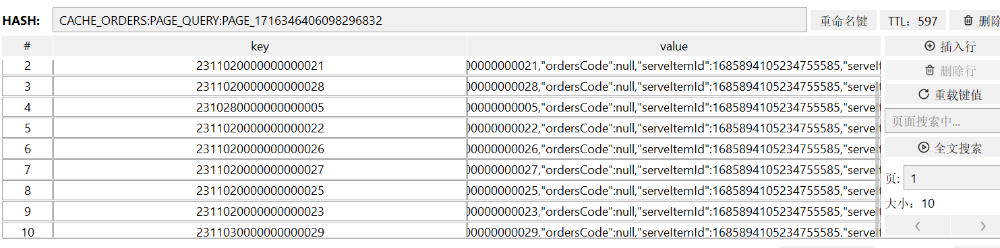

将此缓存全部删除

再查询待支付订单，此时缓存了待支付订单

示例：

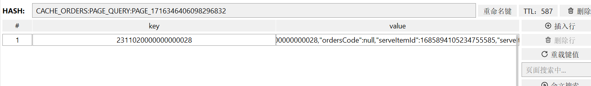

此时再查询全部订单，redis将查询的到订单进行了缓存

如下图：


根据缓存需求，当有几条数据在缓存没有时会查询数据库，我们在代码中打断点：

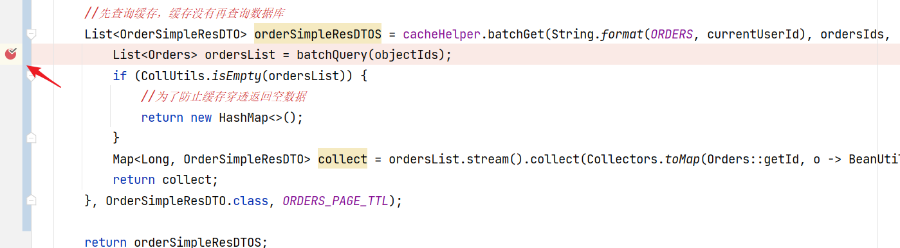

我们将缓存中的部分记录删除

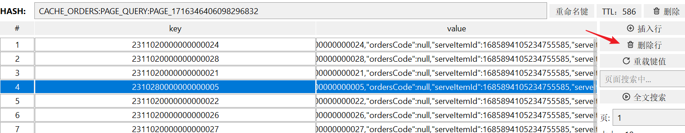

再去查询全部订单观察代码是否走断点：

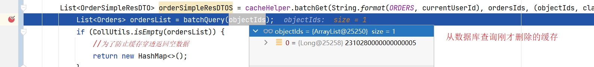

## 4.运营端订单列表优化

运营端订单列表由于访问量不大这里无需使用缓存，实现方案是首先通过覆盖索引查询符合条件的订单ID，再根据订单ID查询聚集索引拿到数据。

要求在OperationOrdersController类中实现下边的接口。

接口定义如下：

接口路径：GET/orders\-manager/operation/orders/page

请求数据类型 application/x\-www\-form\-urlencoded

请求参数：

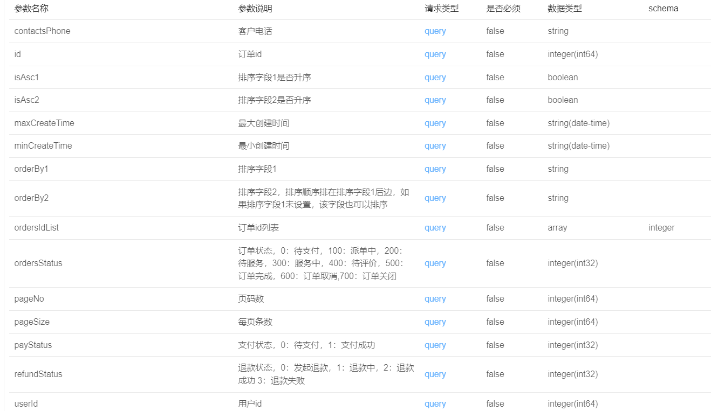

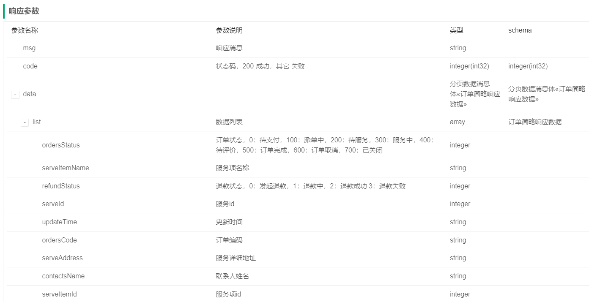

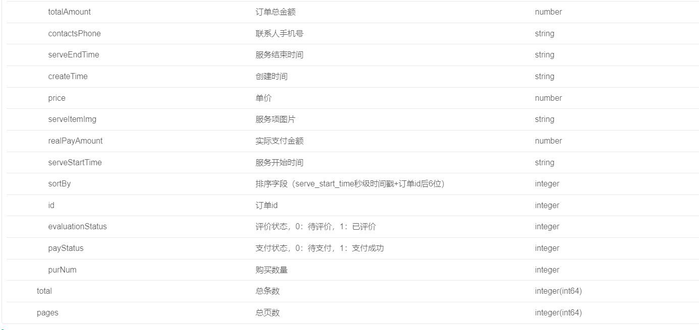

响应示例：

```JSON
{
    "msg": "OK",
    "code": 200,
    "data": {
        "list": [
            {
                "ordersStatus": 0,
                "serveItemName": "",
                "refundStatus": 0,
                "serveId": 0,
                "updateTime": "",
                "ordersCode": "",
                "serveAddress": "",
                "contactsName": "",
                "serveItemId": 0,
                "totalAmount": 0,
                "contactsPhone": "",
                "serveEndTime": "",
                "createTime": "",
                "price": 0,
                "serveItemImg": "",
                "realPayAmount": 0,
                "serveStartTime": "",
                "sortBy": 0,
                "id": 0,
                "evaluationStatus": 0,
                "payStatus": 0,
                "purNum": 0
            }
        ],
        "total": 0,
        "pages": 0
    }
}

```
