# 一、秒杀抢购介绍

## 1.秒杀抢购业务特点

秒杀抢购是电商平台的一种业务模式，它可以聚焦流量和吸引注意力，通过秒杀活动长时间吸引人群，最终吸引用户下单。

秒杀抢购业务有哪些特点呢？

- 时间限制： 秒杀抢购活动通常在特定的时间段内进行，例如1小时或更短的时间。在这个时间段内，消费者可以购买特定商品或服务，通常是限量销售。

- 限量销售： 秒杀抢购商品通常数量有限，销售数量是提前确定的。一旦库存售罄，抢购活动就结束，未能购买的消费者需要等待下一次活动。

- 价格优惠： 秒杀抢购商品通常以折扣价格销售，价格较平时低廉。这种价格优势是吸引消费者参与抢购的重要因素。

- 高并发和服务器压力： 抢购开始时大量用户会同时访问在线商城，导致网站服务器承受巨大压力。因此，网站的服务器和网络基础设施需要具备高并发处理能力，以应对瞬时大量的用户请求。

- 技术要求高： 秒杀抢购业务对技术要求非常高，包括网站性能优化、数据库优化、缓存技术、负载均衡等方面的技术应用。

如今秒杀抢购不仅应用在电商平台，随着互联网用户的增加在餐饮、旅游、娱乐等很多领域都有应用，比如：12306抢票、抢优惠券、骑手抢单、酒店预定等。

## 2.常用技术方案

实现秒杀抢购业务会用到哪些技术呢？可以参考行业上一些成熟的解决方案。

1.缓存方案

使用缓存技术（如Redis）来存储热点数据，例如商品信息和库存数量。这样可以减轻数据库的压力，提高读取数据的速度。

2.异步处理方案

当用户成功秒杀后，将抢购信息发送到队列，然后由消费者多线程异步处理订单，减轻系统的实时压力，使用Redis、RabbitMQ等技术都可以实现队列。

3.防止超卖方案

超卖是最终下单购买数量大于库存数量，比如：库存１00个用户最终购买了101个，多出这一个就是超卖了，在秒杀抢购业务中这也是需要解决的问题，可以使用分布式锁、Redis等技术都可以防止超卖。

4.限流与防刷方案

使用限流算法（如令牌桶、漏桶算法）来控制请求的并发数，防止服务器被过多请求压垮。可以在服务端使用限流技术，比如：sentinel、nginx、验证码等技术。

5.数据库优化方案

对数据库进行优化，包括索引的设计、SQL语句的优化、数据库连接池的使用等，以提高数据库的查询和更新速度。

6.数据库分库分表方案

在数据库层面进行分库分表，将数据分散存储在不同的数据库实例或表中，提高数据库的读写性能。

7.负载均衡

使用负载均衡技术，例如Nginx、Spring Cloud Gateway等，将请求分发到多个服务器上，增加系统的处理能力。

8.CDN加速

CDN（Content DeliveryNetwork）即内容分发网络，CDN用于加速静态资源的访问，将内容分发到CDN节点就近为客户提供服务。

如下图所示，通过CDN用户访问就近节点，提高访问速度。

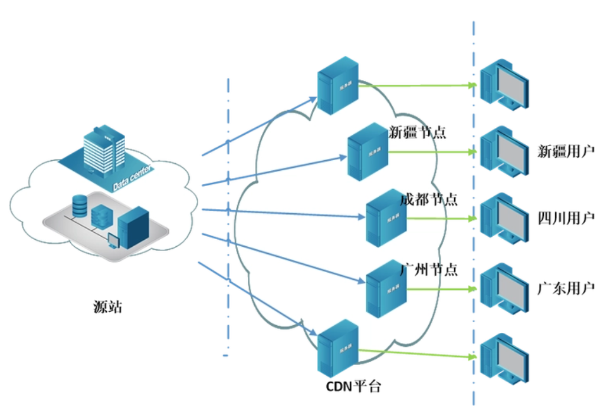

9.安全性处理

确保系统的安全性，防止SQL注入、XSS攻击（跨站脚本攻击）等，同时在后端实现防刷、验证码等安全措施，保护系统免受恶意攻击。

## 3.本章目标

通过抢券、抢单两个模块的学习掌握秒杀抢购业务的技术方案。

## 4.小结

秒杀抢购常用的技术方案有哪些？

# 二、抢券

## 1.需求分析

用户进行抢券经过三个过程：

### 1.1.抢券界面

用户进入抢券界面如下图。

“疯抢中”界面展示进行中还未到结束的优惠券活动，按照开始时间升序排列，不进行分页。

“即将开始”界面是展示1个月内待发放的优惠券活动，按照开始时间升序排列，不进行分页。


在抢券界面显示如下信息：

1.优惠券活动名称

2.优惠券满减或折扣信息

3.活动的起止时间

4.是否抢光。

5.活动的状态。

### 1.2.进行抢券

优惠券到达发放时间后，用户点击“立即领取”进行抢券。

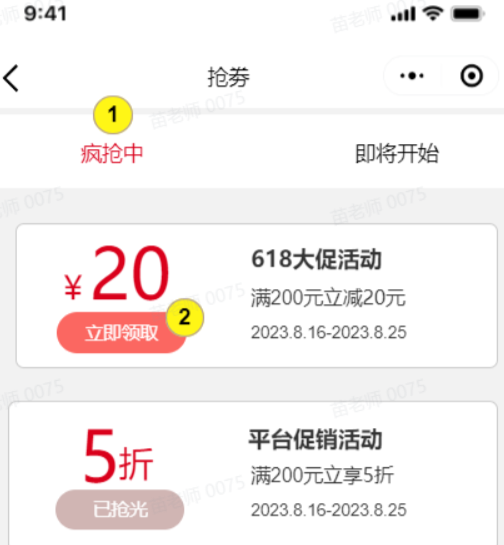

抢券成功提示“领取成功”，如果领取失败会提示失败信息。

用户点击立即领取进行抢券，以下情况无法抢券：

1.已抢光

“已抢光”表示发放的优惠券已领取完，该优惠券的领取数量等于发放数量。

2.未到开始时间或已到结束时间

3.用户已领（每个用户限领一张）

4.活动已撤销

### 1.3.我的优惠券列表

用户抢券成功在我的优惠券列表查看。

用户进入【我的】\-【优惠券】查看已抢到的优惠券，按抢券时间降序显示当前用户抢到的优惠券。

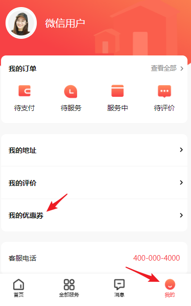

本查询为滚动查询，向上拖屏幕查询下一屏，一屏显示10条。

如下图：

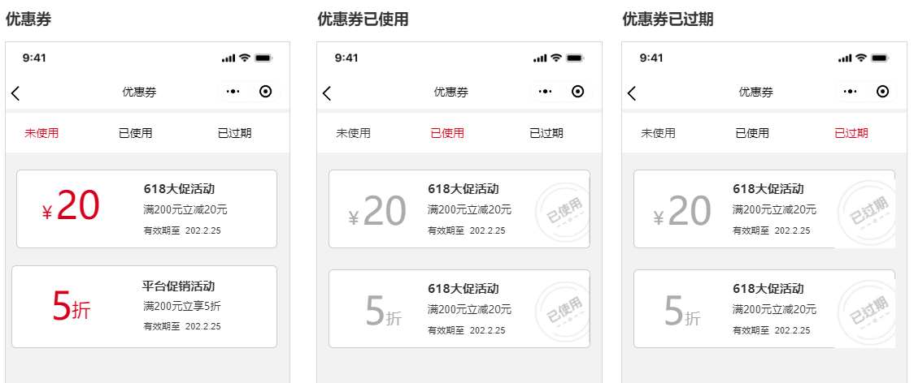

对优惠券的三个状态说明如下：

1.未使用：未过有效期的优惠券。

优惠券的有效期：从领取优惠券的时间加上优惠券的使用期限（“使用期限”在优惠券活动管理界面进行设置）。

2.已使用：已经在订单中使用的优惠券。

3.已过期：未使用且已过有效期的优惠券，已过期的优惠券将无法使用。

### 1.4.小结

根据需求分析抢券模块包括三部分的内容：

1.活动查询

进入抢券页面查询优惠券活动信息。

2.抢券

点击抢券按钮进行抢券。

3.我的优惠券

抢券成功进入我的优惠券页面查询抢到的优惠券。

下边按顺序开发每一部分。

## 2.活动查询

### 2.1.系统设计

**活动查询分析**

下边根据需求分析对抢券界面的活动查询功能进行分析与设计，如下图：

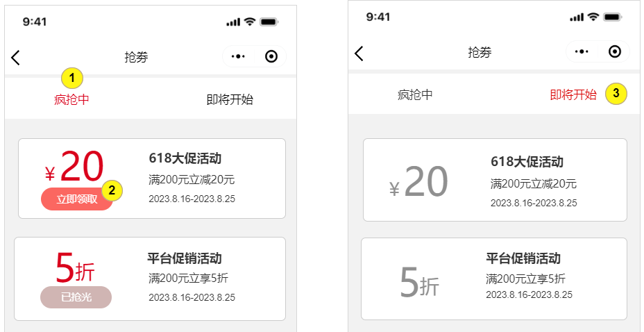

1.活动查询界面显示了哪些数据？

活动信息：

包括两个部分数据：

- 进行中还未到结束的优惠券活动。

- 1个月内待开始的优惠券活动。

信息内容包括：

- 优惠券活动名称

- 优惠券满减或折扣信息

- 活动的起止时间

- 是否抢光（根据库存剩余量判断）

- 活动的状态。

2.面向高并发如何提高活动查询性能？

此部分信息来源于优惠券活动表，由于抢券页面面向C端用户且请求并发量大，如何在高并发下提高活动查询的性能呢?

如果直接查询数据库无法满足需求并且对数据库造成巨大的压力从而影响其它功能使用数据库，我们可以使用缓存，将优惠券活动信息存入缓存，比如Redis，从Redis查询避免查询数据库。

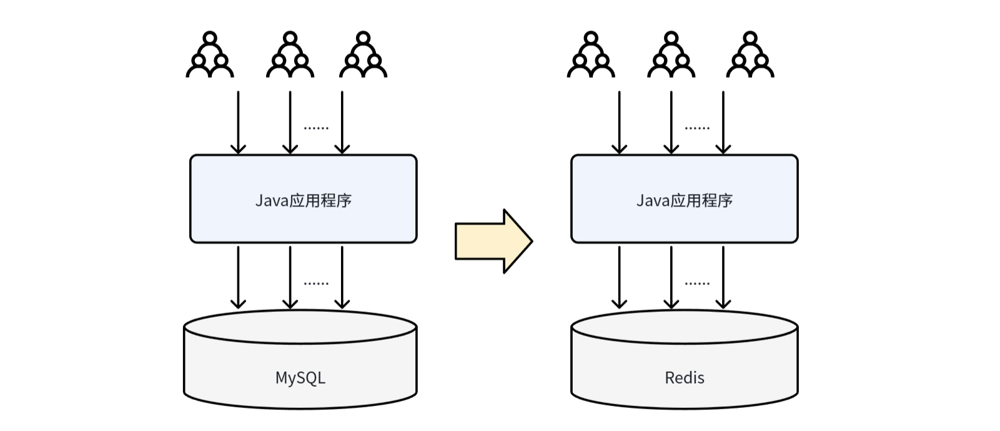

3.如何保证缓存一致性？

抢券页面列出的活动信息属于热点信息，定时预热程序定时将活动信息存入Redis, 防止缓存击穿

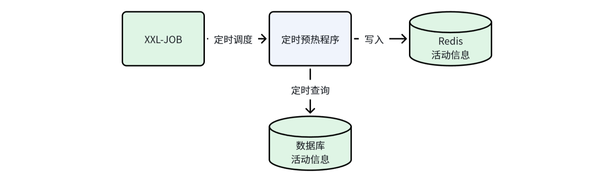

**数据流**

根据以上分析设计数据流如下：

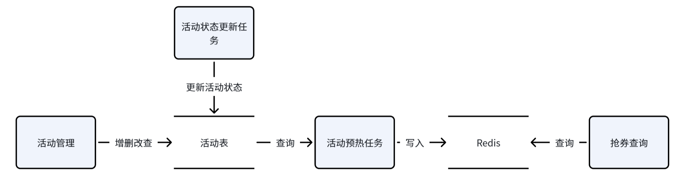

- 活动管理：运营人员进行优惠券活动管理，对活动表进行增删改查操作。

- 活动状态更新任务：根据活动的开始和结束时间更新活动状态。

- 活动预热任务：定时查询活动表信息存入Redis

- 抢券查询：从Redis查询活动预热信息。

**Redis数据结构设计**

活动预热任务定时查询活动表信息存入Redis，下边设计活动信息的缓存结构：

根据需求可知在抢券查询界面需要的数据全部来源于活动表，因为要预热的活动信息内容有限，我们可以将要预热的活动信息转为json串存入redis，活动查询程序读取json串也方便进行解析。

活动信息缓存结构设计如下：

- redis结构：String类型

- key: "ACTIVITY:LIST"

- value: 符合条件的优惠券活动列表JSON数据。

- 过期时间：永不过期


- 缓存一致性方案：通过预热程序保证缓存一致性

**如何保证活动状态自动改变**

在活动查询界面如何保证活动状态实时改变，当到达活动开始时间活动状态变为“进行中”，在“疯抢中”界面显示，当活动结束在“疯抢中”界面将无法查询到。

关于活动状态的改变，在“优惠券活动管理实战”中完成了通过定时任务自动更新活动的状态，实现了如下需求：

1.对待生效的活动更新为进行中

到达发放开始时间状态改为“进行中”。

2.对待生效及进行中的活动更新为已失效

到达发放结束时间状态改为“已失效”

具体代码如下：

Service接口实现

```Java
@Override
public void updateStatus() {
    LocalDateTime now = DateUtils.now();
    // 1.更新已经进行中的状态
    lambdaUpdate()
            .set(Activity::getStatus, ActivityStatusEnum.DISTRIBUTING.getStatus())//更新活动状态为进行中
            .eq(Activity::getStatus, NO_DISTRIBUTE.getStatus())//检索待生效的活动
            .le(Activity::getDistributeStartTime, now)//活动开始时间小于等于当前时间
            .gt(Activity::getDistributeEndTime,now)//活动结束时间大于当前时间
            .update();
    // 2.更新已经结束的
    lambdaUpdate()
            .set(Activity::getStatus, LOSE_EFFICACY.getStatus())//更新活动状态为已失效
            .in(Activity::getStatus, Arrays.asList(DISTRIBUTING.getStatus(), NO_DISTRIBUTE.getStatus()))//检索待生效及进行中的活动
            .lt(Activity::getDistributeEndTime, now)//活动结束时间小于当前时间
            .update();
}
```

定时任务方法：

```Java
@Component
public class XxlJobHandler {

/**
 * 活动状态修改，
 * 1.活动进行中状态修改
 * 2.活动已失效状态修改
 * 1分钟一次
 */
@XxlJob("updateActivityStatus")
public void updateActivitySatus(){
    log.info("定时修改活动状态...");
    try {
        activityService.updateStatus();
    } catch (Exception e) {
        e.printStackTrace();
    }
}
...
```

通过上边的定时任务无法实现状态的实时改变，每分钟执行一次状态变更理论上存在最多1分钟的状态变更延迟。

如何实现在页面到达活动开始时间立即变更活动状态？

- 在前端进行控制，根据活动开始时间进行倒计时，达到开始时间将活动移到进行中界面。

- 请求后端查询数据，根据当前时间和活动开始、活动结束时间判断活动的状态。

当活动开始时间小于等于当前时间并且结束时间大于当前时间说明活动已经开始并且还没有结束，活动状态为进行中。

当活动结束时间小于当前时间说明活动结束，活动状态为失效。

**小结**

1.抢券查询的缓存是怎么做的？

2.如何实现活动状态的自动改变？

> 通过定时任务每几分钟更新活动状态
>
> 对于待生效的活动，当活动开始时间小于等于当前时间并且结束时间大于当前时间，将活动状态更新为进行中。
>
> 对于待生效和进行中的活动，当活动结束时间小于当前时间，将活动状态更新为失效。
>

3.如何实现状态变化的实时性，当到达活动开始时间状态立即变化？

> 两种方法结合：
>
> 前端请求后端接口查询活动信息，后端根据活动时间（开始、结束时间）及当前时间得到活动当前准确的状态，并将状态返回给前端。
>
> 前端进行控制，根据活动开始时间进行倒计时，达到开始时间将活动移到进行中界面。

### 2.2.定时预热程序

**搭建环境**

从资料中获取源码：jzo2o\-market\-01\-1\.zip，此源码是优惠券活动管理实战后的代码。

**明确需求**

根据需求预热的活动信息包括两个部分：

- 进行中还未到结束的优惠券活动。

- 1个月内待开始的优惠券活动。

**编写Service方法**

下边定义Service接口从数据库查询要预热的活动信息，存入redis。

代码如下：

```Java
package com.jzo2o.market.service;

import com.jzo2o.common.model.PageResult;
import com.jzo2o.market.model.domain.Activity;
import com.baomidou.mybatisplus.extension.service.IService;
import com.jzo2o.market.model.dto.request.ActivityQueryForPageReqDTO;
import com.jzo2o.market.model.dto.request.ActivitySaveReqDTO;
import com.jzo2o.market.model.dto.response.ActivityInfoResDTO;
import com.jzo2o.market.model.dto.response.SeizeCouponInfoResDTO;

import java.util.List;

/**
 * <p>
 *  服务类
 * </p>
 */
public interface IActivityService extends IService<Activity> {

/**
 * 活动预热
 */
void preHeat();
...
```

Service接口实现：

```Java
/**
 * 活动缓存处理
 */
@Override
public void preHeat() {
    //1.查询活动列表（30天内进行中的和待开始的），结果根据活动开始时间倒序
    //select * from activity where status in (1,2)
    // and distribute_start_time<date_add(now(),interval 30 day)
    //  order by distribute_start_time desc

    List<Activity> activityList = this.lambdaQuery()
            .in(Activity::getStatus, NO_DISTRIBUTE.getStatus(), DISTRIBUTING.getStatus())
            .lt(Activity::getDistributeStartTime, DateUtils.now().plusDays(30))
            .orderByDesc(Activity::getDistributeStartTime)
            .list();
    if (CollUtils.isEmpty(activityList)) {
        activityList = new ArrayList<>();
    }

    //2.转为前端需要的对象列表
    List<ActivityInfoResDTO> activityInfoResDTOList = BeanUtils.copyToList(activityList, ActivityInfoResDTO.class);

    //3.将对象列表转为JSON字符串
    String activityListJSON = JsonUtils.toJsonStr(activityInfoResDTOList);

    //4.保存到Redis缓存中（永不过期）
    redisTemplate.opsForValue().set(RedisConstants.RedisKey.ACTIVITY_CACHE_LIST, activityListJSON);
}
```

**定义XXL\-Job调度方法**

下边定义定时任务方法，执行定时预热程序。每小时执行一次。

```Java
package com.jzo2o.market.handler;

import com.jzo2o.market.service.IActivityService;
import com.jzo2o.market.service.ICouponService;
import com.jzo2o.redis.annotations.Lock;
import com.jzo2o.redis.constants.RedisSyncQueueConstants;
import com.jzo2o.redis.sync.SyncManager;
import com.xxl.job.core.handler.annotation.XxlJob;
import org.springframework.stereotype.Component;

import javax.annotation.Resource;

import static com.jzo2o.market.constants.RedisConstants.Formatter.*;
import static com.jzo2o.market.constants.RedisConstants.RedisKey.COUPON_SEIZE_SYNC_QUEUE_NAME;

@Component
public class XxlJobHandler {

    @Resource
    private IActivityService activityService;

    /**
     * 活动预热，整点预热
     *
     */
    @XxlJob("activityPreheat")
    public void activityPreHeat() {
        log.info("优惠券活动定时预热...");
        try {
            activityService.preHeat();
        } catch (Exception e) {
           e.printStackTrace();
        }
    }
    ...
```

**配置定时任务**

下边在XXL\-JOB中配置调度方法进行测试：

通常生产中会提前一周去策划活动并在系统中创建活动，所以在生产中每小时执行一次预热程序，开发中为了测试方便5秒执行一次。

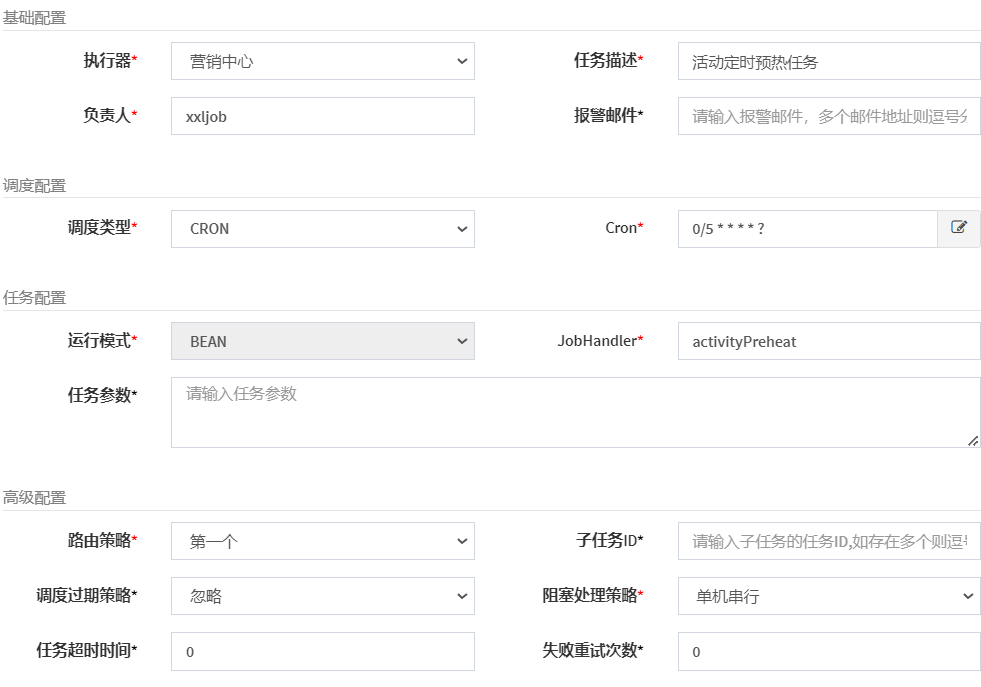

**预热程序测试**

测试流程如下：

首先在运营端创建优惠券活动，创建一个月内即将开始的活动

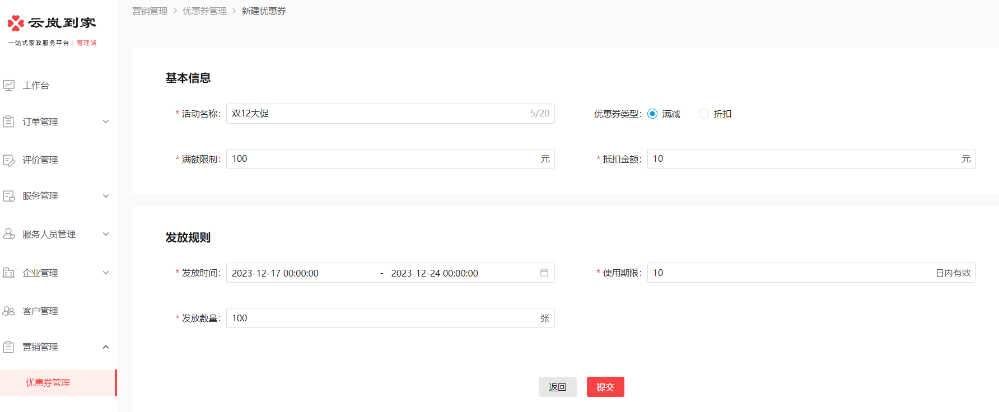

创建成功，活动为待生效


再创建一个活动：

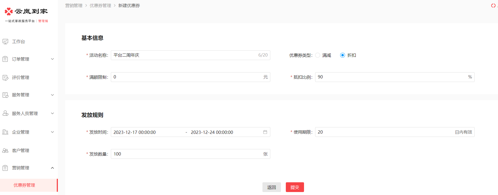

创建成功，进入jzo2o\-market数据库，找到活动表activity中该记录，修改活动开始时间为昨天，如下图：

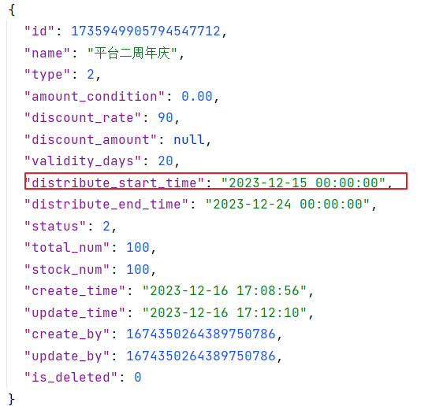

通过活动状态自动更新程序，自动将“平台二周年庆”活动状态改为进行中。

测试通过如下图：

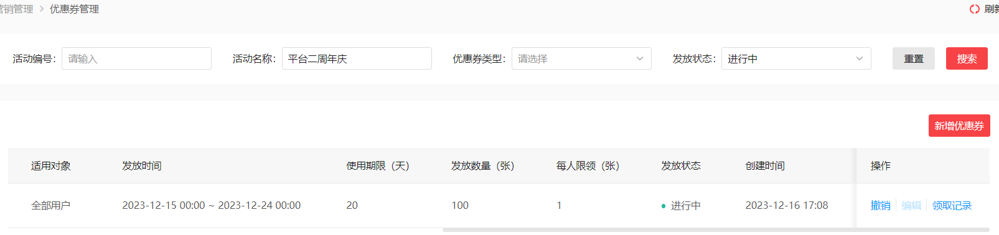

通过定时预热程序将一个月以内即将开始的活动及进行中的活动写入redis：

根据以上数据范围判断存入到redis的活动信息是否正确。

预热成功在redis成功存储上边添加的两个活动：

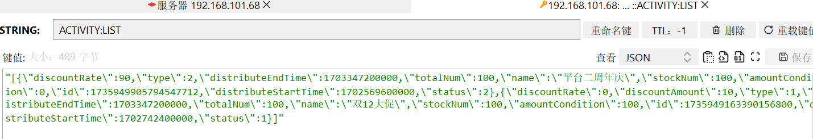

**小结** 

活动定时预热程序是怎么做的？

> 首先说明缓存方案 （参考问题：抢券查询的缓存是怎么做的？）
>
> 使用xxl\-job定时执行活动预热程序，从数据库查询出符合条件的活动信息存储到redis中。

### 2.3.活动查询接口

**接口分析**

根据界面原型分析接口：


界面有两个tab，疯抢中和即将开始，前端传入后端一个参数标记是查询进行中的活动还是即将开始的活动。

后端需要给前端返回以下数据：

- 活动id

- 活动名称

- 优惠券类型，1：满减，2：折扣

- 满减限额，0：表示无门槛，其他值：最低消费金额

- 折扣率，折扣类型的折扣率，例如：8,打8折

- 优惠金额，满减或无门槛的优惠金额

- 发放开始时间

- 发放结束时间

- 活动状态，1：待生效，2：进行中，3：已失效

- 优惠券剩余数量

这些信息在预热的活动信息缓存中都存在，但是有两个字段不够实时：活动状态，优惠券剩余数量。

活动状态：通过定时任务更新活动状态，写入活动表，定时预热程序读出活动信息存储到Redis，由于是通过定时任务更新活动状态、定时预热程序更新活动信息缓存，最终从redis取出的活动状态于实际的活动状态存在延迟，导致实际活动的状态与页面显示的状态不一致。

示例：活动开始时间为8点钟，当前时间已过了8点钟，查看抢券页面活动状态仍然显示“即将开始”。

优惠券剩余数量：在抢券模块会操作此字段，这里暂不考虑此字段。

如何解决活动状态延迟问题？

请求后端查询数据，根据当前时间和活动开始、活动结束时间判断活动的状态。

当活动开始时间小于等于当前时间并且结束时间大于当前时间说明活动已经开始并且还没有结束，活动状态为进行中。

当活动结束时间小于当前时间说明活动结束，活动状态为失效。

**接口定义**

接口名称：用户端抢券列表分页接口

接口路径：GET/market/consumer/activity/list

请求数据类型 application/x\-www\-form\-urlencoded

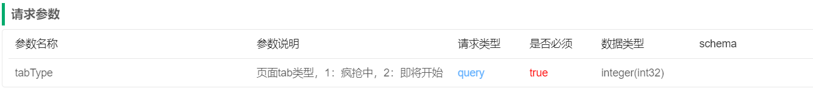

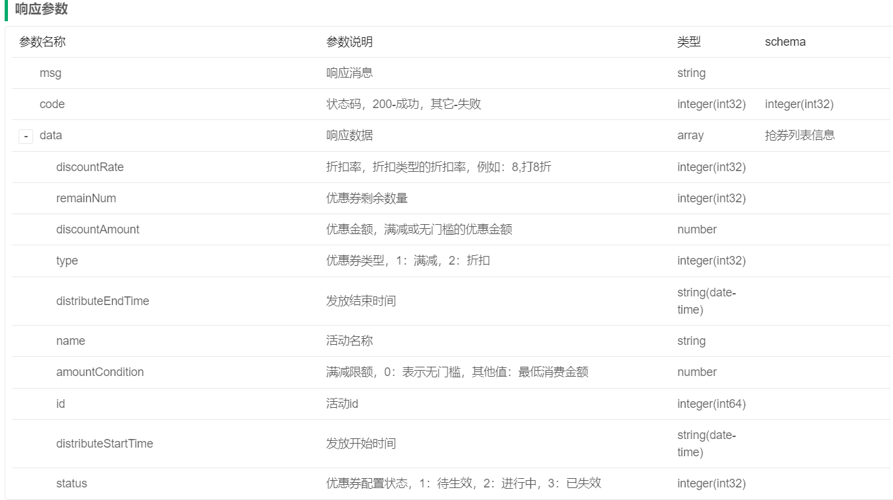

定义controller方法：

```Java
package com.jzo2o.market.controller.consumer;

import com.jzo2o.common.model.PageResult;
import com.jzo2o.market.model.dto.request.ActivityQueryForPageReqDTO;
import com.jzo2o.market.model.dto.request.ActivitySaveReqDTO;
import com.jzo2o.market.model.dto.response.ActivityInfoResDTO;
import com.jzo2o.market.model.dto.response.SeizeCouponInfoResDTO;
import com.jzo2o.market.service.IActivityService;
import io.swagger.annotations.Api;
import io.swagger.annotations.ApiImplicitParam;
import io.swagger.annotations.ApiImplicitParams;
import io.swagger.annotations.ApiOperation;
import org.springframework.validation.annotation.Validated;
import org.springframework.web.bind.annotation.*;

import javax.annotation.Resource;
import java.util.List;

@RestController("consumerActivityController")
@RequestMapping("/consumer/activity")
@Api(tags = "用户端-活动相关接口")
public class ActivityController {

    @Resource
    private IActivityService activityService;

    @GetMapping("/list")
    @ApiOperation("用户端抢券列表分页接口")
    @ApiImplicitParams({
            @ApiImplicitParam(name = "tabType", value = "页面tab类型，1：疯抢中，2：即将开始", required = true, dataTypeClass = Integer.class)})
    public List<ActivityInfoResDTO> queryForPage(@RequestParam(value = "tabType",required = true) Integer tabType) {
        return null;
    }
}
```

**接口实现**

1.service接口

```Java
public interface IActivityService extends IService<Activity> {

/**
 * 用户端抢券列表分页查询活动信息
 *
 * @param tabType 页面类型
 * @return
 */
 List<ActivityInfoResDTO> queryForListFromCache(Integer tabType);
```

实现类：

```Java
/**
 * 查询活动列表（基于缓存，并实时同步活动状态）
 *
 * @param tabType
 * @return
 */
@Override
public List<ActivityInfoResDTO> queryForListFromCache(Integer tabType) {

    //1.从redis中查询活动列表JSON字符串
    Object activityObj = redisTemplate.opsForValue().get(RedisConstants.RedisKey.ACTIVITY_CACHE_LIST);
    if (ObjectUtils.isNull(activityObj)) {
        return CollUtils.emptyList();
    }

    //2.将JSON字符串转为对象列表
    List<ActivityInfoResDTO> activityList = JsonUtils.toList(activityObj.toString(), ActivityInfoResDTO.class);

    //3.遍历对象，筛选出用户要选的活动列表
    //用户所选类型对应的活动状态
    Integer selectStatus = ObjectUtils.equal(tabType, TabTypeConstants.SEIZING) ? DISTRIBUTING.getStatus() : NO_DISTRIBUTE.getStatus();
    //活动中活动当前最实时的状态（可通过原始状态和原始数据的开始时间、结束时间一起算）

    List<ActivityInfoResDTO> activityListSelect = activityList.stream()
            .filter(x -> ObjectUtils.equals(selectStatus, getCurrentRealStatus(x.getStatus(), x.getDistributeStartTime(), x.getDistributeEndTime())))
            .peek(x -> {
                x.setRemainNum(x.getStockNum());//优惠券剩余数量等于优惠券库存数量
                x.setStatus(selectStatus);
            })
            .collect(Collectors.toList());

    return activityListSelect;
}


/**
 * 获取活动实时状态
 *
 * @param originStatus
 * @param distributeStartTime
 * @param distributeEndTime
 * @return
 */
public Integer getCurrentRealStatus(Integer originStatus, LocalDateTime distributeStartTime, LocalDateTime distributeEndTime) {

    if (ObjectUtils.equals(originStatus, NO_DISTRIBUTE.getStatus())
            && distributeStartTime.isBefore(DateUtils.now())
            && distributeEndTime.isAfter(DateUtils.now())
    ) {
        return DISTRIBUTING.getStatus(); //待开始状态的订单，时间已到，获取最新状态为发放中
    } else if (ObjectUtils.equals(originStatus, NO_DISTRIBUTE.getStatus())
            && distributeEndTime.isBefore(DateUtils.now())
    ) {
        return LOSE_EFFICACY.getStatus(); //待开始状态的订单，时间已过，获取最新状态为已失效
    } else if (ObjectUtils.equals(originStatus, DISTRIBUTING.getStatus())
            && distributeEndTime.isBefore(DateUtils.now())
    ) {
        return LOSE_EFFICACY.getStatus(); //进行中状态的订单，时间已过，获取最新状态为已失效
    }
    return originStatus;
}
```

2.controller

```Java
@GetMapping("/list")
@ApiOperation("用户端抢券列表分页接口")
@ApiImplicitParams({
        @ApiImplicitParam(name = "tabType", value = "页面tab类型，1：疯抢中，2：即将开始", required = true, dataTypeClass = Integer.class)})
public List<ActivityInfoResDTO> queryForPage(@RequestParam(value = "tabType",required = true) Integer tabType) {
    return activityService.queryForListFromCache(tabType);
}
```

**活动查询测试**

1.测试流程如下：

启动网关

启动优惠券工程

参考预热程序测试的方法，创建活动信息，启动xxl\-job，保证定时预热程序正常执行。

打开小程序，点击优惠券图标。

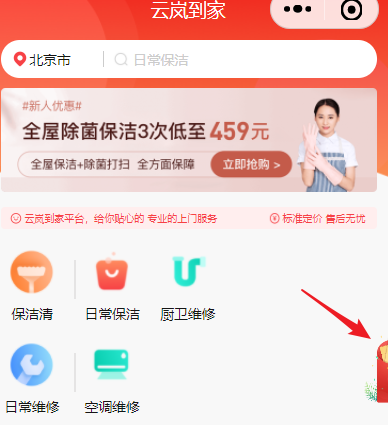


进入抢券查询界面，通过选择不同的类型查询活动信息，如下图：

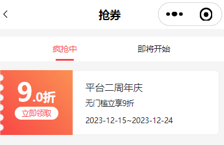

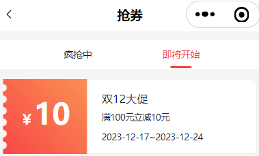

2.下边测试状态实时性：

首先停止活动的状态更新任务。

手动修改上述记录在活动表的开始或结束时间，使用实际的活动状态与数据库中记录的不一样

3.预期结果：

通过预热程序将活动提前加入缓存，前端请求查询活动信息，后端程序根据活动时间设定活动准确的活动状态。

示例：

修改上图中“ 双12大促” 活动的开始时间使该活动已开始。

测试效果如下图：

“ 双12大促” 活动在界面上显示“疯抢中”

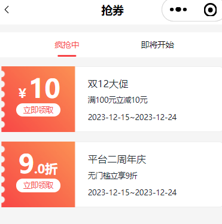

下边再修改数据库中的库存，设置为0，预期测试效果为“已抢光”，如下图：

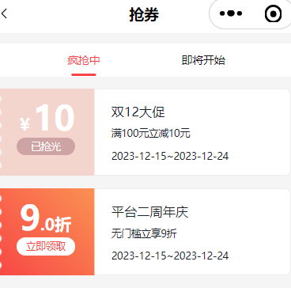

**小结**

通过定时任务更新活动状态，如何解决活动状态实时更新的问题？

> 前端请求后端接口查询活动信息
>
> 后端接口从redis查询活动信息，并根据活动开始和结束时间判断活动的最新状态
>
> 最后将活动信息及最新状态返回给前端。

## 3. 抢券

### 3.1. 解决超卖问题

**系统需求**

在抢券模块中需要实现下边两个需求：

1.提升高并发吞吐量

抢券类似抢购、秒杀等业务场景具有时效性的特点，提前规定好用户在什么时间可以抢购，用户访问集中，这样就会给系统造成高并发，抢券模块在设计时要以提升系统在高并发下的吞吐量为目标，吞吐量表示单位时间内系统处理的总请求数量，吞吐量高意味着系统处理能力强。

衡量系统吞吐量的常用指标有哪些？

1）QPS（Queries Per Second）：

每秒查询数（Queries Per Second），它表示系统在每秒内能够处理的查询或请求的数量，是衡量一个系统处理请求的性能和吞吐量的指标。

计算公式：总请求数/时间窗口大小

示例：

在10秒内处理1万个请求，QPS为1000。每个请求处理的时间越短，QPS越大。

假设：一个网站有10万用户，有2万日活跃用户，并发量是4000，每个用户每秒平均发起2个请求，那么总请求数就是 2\*4000，那么QPS就是 8000，如果单机支持2000的qps理论上需要4台服务器。

qps指标是需要根据服务器硬件性能、及具体的业务场景去测试，比如：门户查询数据如果直接走Nginx静态服务器则QPS可以达到上万，如果请求查询Tomcat，并且通过数据库去查询数据库返回，此时QPS会远低于查询Nginx静态服务器的QPS值，如果不走数据库,而是从Redis查询数其QPS也会大大提升。

2）TPS（Transactions Per Second）：

表示系统每秒完成的事务数，与QPS不同，TPS更关注系统的事务处理能力，而不仅仅是单纯的查询或请求，一次事务通常会包括多个请求。在高度事务性的系统中，如在线交易系统、支付系统等，TPS是一个关键指标，用于衡量系统的处理能力。

TPS指标通常会涉及业务处理及数据库存储，在测试时也需要根据服务器硬件性能、及具体的业务场景去测试，拿下单举例：单机支持几十到几百的TPS指标属于正常。

在开发中，对以上性能指标的优化，可通过CDN、缓存、异步处理、数据库优化、多线程、集群、负载均衡等技术去提高系统的吞吐量。当然，再优化也不要忘记系统保护，通过限流技术根据系统的性能指标进行限流保护。

2.解决超卖问题

抢购、秒杀等业务场景还需要解决超卖问题，超卖是最终下单购买数量大于库存数量，比如：库存有１00个，用户最终购买了101个，多出这一个就是超卖了，结合抢券业务即用户最终抢到的优惠券总数大于优惠券库存数。

下边先分析超卖问题的解决方案。

**什么是超卖问题**

超卖是最终下单购买数量大于库存数量，比如：库存１00个用户最终购买成功了101个，多出这一个就是超卖了，结合抢券业务，用户最终抢到的优惠券总数大于优惠券库存数就出现了超卖问题。

导致超卖问题的原因是什么呢？

下边举例说明超卖问题并分析导致超卖问题的原因。

下图是两个线程更新数据库的库存字段。

线程1：先查询库存为1，判断是否大于0，如果大于则库存减1，最后更新数据库库存字段。

线程2：先查询库存为1，判断是否大于0，如果大于则库存减1，最后更新数据库库存字段。

线程1和线程2查询到的库存都是1，两个线程分别减1得到剩余库存数0，由于线程2并不是基于线程1扣减库存后的值进行扣减，线程2更新库存覆盖了线程1更新的库存值。

上边的例子就出现了超卖的问题。

造成超卖问题的原因是在高并发场景下对库存这个共享资源进行操作存在线程不安全所导致。

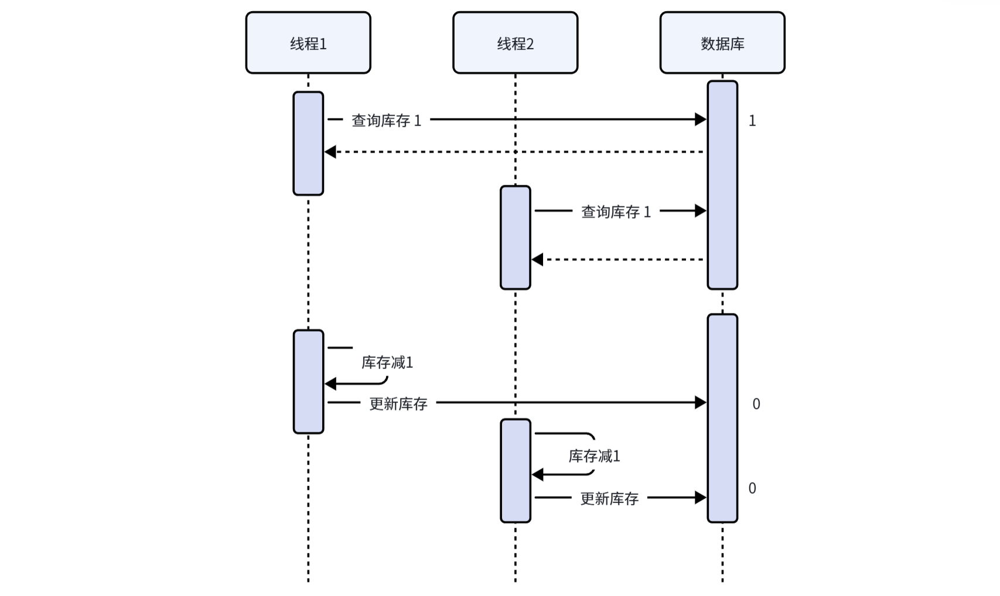

**悲观锁与乐观锁**

提到解决线程安全问题大家想到了锁，下边复习下关于锁的基本概念。

jvm提供了很多锁，比如：synchronized、reentrantLock、CAS等，它们都可以解决线程安全问题，synchronized、reentrantLock可以实现悲观锁，CAS可以实现乐观锁，关于这些锁的知识掌握不牢固的一定要自行复习。下边理解悲观锁与乐观锁的概念。

1.悲观锁

悲观锁是一种悲观思想，总认为会有其它线程修改数据，为了保证线程安全所以在操作前总是先加锁，操作完成后释放锁，其它线程只有当锁释放后才可以获取锁继续操作数据。synchronized和ReentrantLock都可以实现悲观锁。

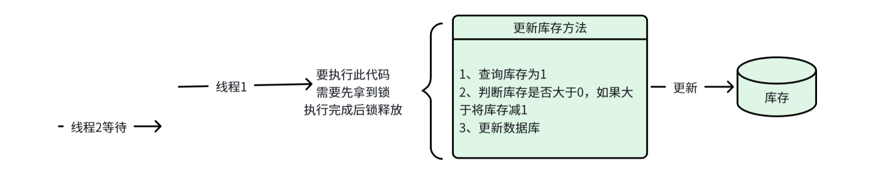

使用悲观锁后原来的多线程并发执行改为了顺序（同步）执行，当线程2去执行时查询到库存发现为0，不满足条件更新库存失败。

2.乐观锁

乐观锁则是一种乐观思想，认为不会有太多线程去并发修改数据，所以谁都可以去执行代码。

Java提供的CAS机制可以实现乐观锁，CAS即Compare And Swap 比较并交换，在修改数据前先比较版本号，如果数据的版本号没有变化说明数据没有修改，此时再去更改数据。

示例如下：

库存数据对应一个版本，库存每次变化则版本号跟着变化，如下：

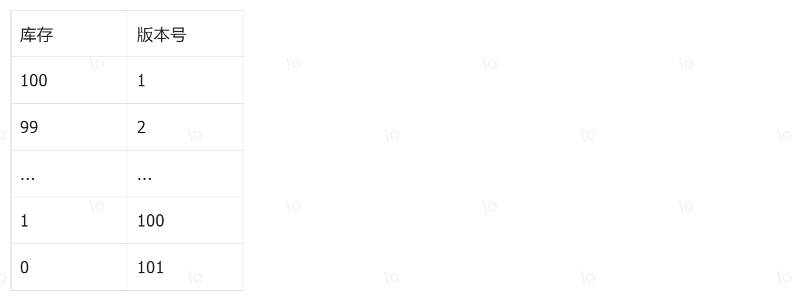

线程1修改库存前拿到库存及对应的版本号：1和100。

线程1判断库存如果大于0则将库存减1，准备更新库存。

更新库存时要校验当前库存的版本是否和自己之前拿到的一致，如果版本号为1说明自己在执行的这过程没有其它线程去修改过库存，此时将库存更新为99并将库存加1为2。

线程2执行和线程1一样的逻辑，线程2去更新库存时发现库存的版本号为2与自己之前拿到的不一致，更新库存失败。

3.结论

悲观锁和乐观锁都是一种解决共享资源的线程安全问题的方法，悲观锁是在读数据时就加锁，如果读比较多则加锁频繁影响性能，相比而言乐观锁性能比悲观锁要好。

**数据库行锁控制方案**

数据库的行级锁可以实现悲观锁也可以实现乐观锁。

1.实现悲观锁（排他锁）

执行select … for update 实现加锁，select … for update 会锁住符合条件的行的数据，如下语句会锁一行的数据

```sql
select * from 库存表 where id=? for update
```

通常此语句放在事务中，开启事务开始执行此语句获取锁，事务提交或回滚自动锁释放，保证在事务处理过程中没有其它线程去修改数据。

测试：

使用一个线程执行下边的命令：

```sql
start transaction;

select ... for update;

COMMIT;
```

另一个线程修改数据，如果上边不释放锁将无法修改。

高并发场景不推荐使用select … for update方法，同时也可能存在死锁的潜在风险。

2.实现乐观锁

数据库的行级锁也可以实现乐观锁，通用的做法是在表中添加一个version版本字段，在更新时对比版本号，更新成功将版本号加1，SQL为：

```sql
update 表名 set 字段=值,version=version+1 where  id =? and version =? 
```

针对扣减库存业务扣减库存SQL：

```sql
update 库存表 set 库存=库存-1 where 库存>0 and id =? 
```

多线程执行上边的SQL，假如线程1先执行会添加排他锁，当事务没有结束前其它线程去更新同一条记录会被阻塞，等到线程1更新结束其它线程才可以更新库存。

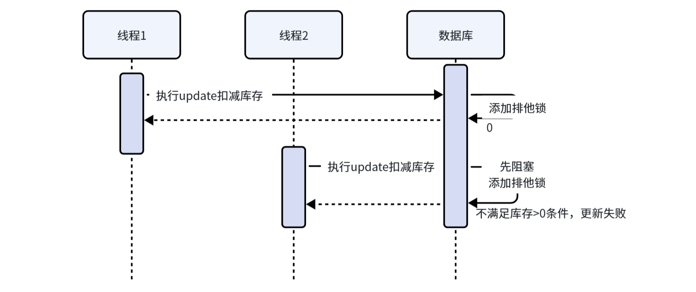

当执行update后返回影响的记录行数为1表示更新成功即扣减库存成功，返回0表示没有更新记录行，即扣减库存失败。

3.结论

悲观锁在查询时就开始加锁，如果读比较多则加锁频繁影响性能，相比而言乐观锁性能比悲观锁要好。

对于并发不高的场景可以使用数据乐观锁去控制扣减库存，由于抢购业务并发较高且对性能要求也高，如果使用数据库行锁去控制，并发高就会对数据造成压力，如果进行限流控制并发数又无法满足性能要求，所以对于抢购业务使用数据库行锁进行控制是不适合的。

**Redis分布式锁方案**

数据库乐观锁不适用高并发场景，我们能否将库存数据放在Redis，并且通过JVM锁去控制扣减库存呢？

上边介绍的synchronized、reentrantLock、CAS只控制了JVM本身的线程争抢同一个锁，无法控制多个JVM之间争抢同一个锁。

如下图，有两个JVM进程，每个JVM进程都有一个Lock01锁，这两个JVM进程中的线程1仍然会同时去修改库存：

线程1：先查询库存为1，判断是否大于0，如果大于则库存减1，最后更新Redis库存数据。

线程2：先查询库存为1，判断是否大于0，如果大于则库存减1，最后更新Redis库存数据。

此时就会出现修改库存数据的线程不安全问题。

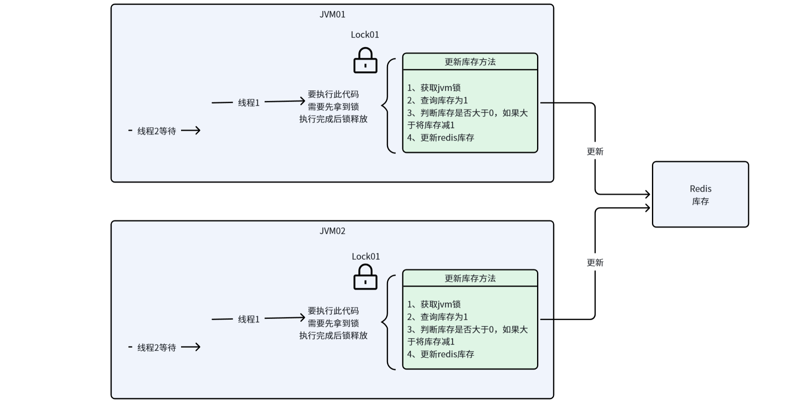

所以，如果是单机环境下，使用JVM的锁在内存加锁可以解决资源并发访问的线程安全问题。

微服务架构的项目在部署时每个微服务会部署多个实例（JVM），每个实例就是一个JVM，如果要控制多个JVM之间争抢资源需要用到分布式锁，分布式锁是由一个统一的服务提供分布式锁服务，比如：使用redis、数据库都可以实现分布式锁，下边介绍分布式锁控制争抢资源的方法。

如下图：每个JVM中的线程去争抢同一个分布式锁，在扣减库存前先获取分布式锁，拿到锁再扣减库存，执行完释放锁之后其它JVM的线程才可以获取锁继续扣减库存，如下图：

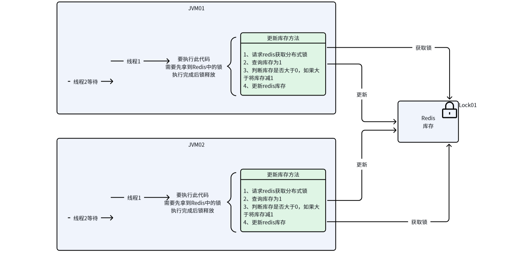

上边的方案将库存放在Redis中避免与数据库交互，很大的提高的了执行效率，在分布式场景下使用分布式锁是一种常用的控制共享资源的方案。

分布式锁需要搭建独立的分布式锁服务（例如Redis、Zookeeper等），每次操作需要远程与分布式锁服务交互获取锁、释放锁，还有没有性能更高的方案呢？

**Redis原子操作方案**

上边使用分布式锁的方案每次操作需要远程与分布式锁服务交互获取锁、释放锁，有没有优化的方法避免申请锁与释放锁的交互呢？

在分布式锁方案中是在java程序扣减库存最后更新redis库存的值，能否使用redis的decr命令去扣减库存呢？

Redis Decr 命令将 key 中储存的数字值减一，并且具有原子性，Redis中所有命令都具有原子性。

原子性表示该命令在执行过程中是不被中断的，也就实现了多线程去执行decr命令扣减库存是顺序执行的，假如库存原来是100，扣减到0结束，多线程并发执行decr命令不会出现扣减次数超过100次，如下图：

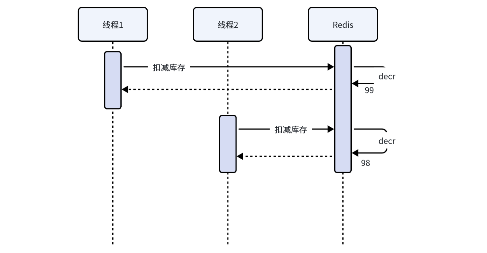

基于这个思想可以对分布式锁方案优化如下：

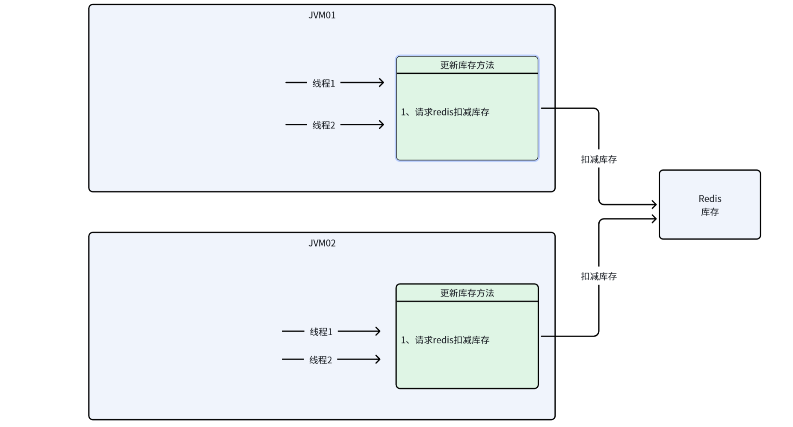

此方案中没有使用分布式锁，而是基于Redis命令具有原子性的特点实现。

本项目使用Redis原子操作控制超卖问题。

**小结**

1.解决超卖问题有哪些方案？

2.什么是悲观锁和乐观锁？

3.数据库的怎么实现悲观锁和乐观锁？

### 3.2.Redis原子操作方案

在Redis原子操作方案中扣减库存使用decr命令实现，decr命令具有原子性，如果在扣减库存操作中有多个操作 ，那么整体还是原子性吗？如下图：

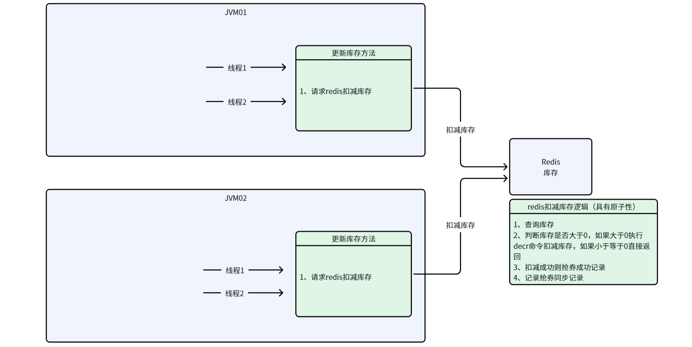

扣减库存逻辑如下：

1.首先查询库存

2.判断库存大小，如果大于0则扣减库存，否则 直接返回

3.记录抢券成功的记录，用于判断用户不能重复抢券的依据。

4.记录抢券同步的记录，用于后续的异步处理，将抢券结果保存到数据库。

如果上述四步整体不具有原子性仍然没有办法控制超卖问题，所以必须保证1、2、3步逻辑放在一起整体具有原子性。

如何保证多个Redis命令具有原子性呢？本节介绍两个保证Redis多个命令具有原子性的方法。

**通过  MULTI 事务命令实现**

对于redis单个命令都是原子操作，现在要求扣减库存、写入抢券成功队列及写入同步队列保证原子性，多个redis命令如何保证原子性呢？

1.通过  MULTI 事务命令实现

下边的命令执行流程如下：

执行MULTI 标记首先标记一个事务块开始。

然后将要执行的命令加入队列。

将“HSET key1 field1 value2 field2 value2” 命令放入队列中，表示向key1中写入两个hashkey。

将“INCR key2”命令放入队列中，表示对key2自增1。

运行EXEC命令按顺序执行，整体保证原子性。

```sql
MULTI
HSET key1 field1 value2 field2 value2
INCR key2
EXEC
```

测试如下：

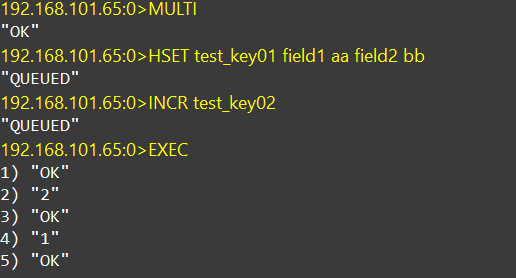

测试结果：

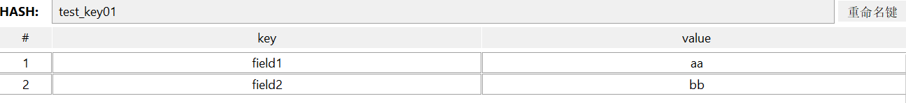

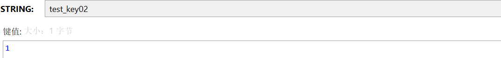

**了解Pipeline与MULTI 的区别**

学习过Redis的同学听说过pipline管道命令，pipline也可实现批量执行多个 redis命令，pipline与multi的区别是：

pipeline 是把多个redis指令一起发出去，redis并没有保证这些命令的执行是原子的；multi实现的是将多个命令作为事务块去执行，保证整个操作的原子性。

如果仅是执行多个命令不保证原子性那么使用pipeline 的性能要比multi要高，但是针对本项目要保证多个命令实现原子性的需求那么pipeline 不符合要求。

**Redis\+Lua实现**

Lua 是一种强大、高效、轻量级、可嵌入的脚本语言，Lua体积小、启动速度快，从而适合嵌入在别的程序里，Lua可以用于web开发、游戏开发、嵌入式开发等领域。

参考：[http://www.lua.org/docs.html](http://www.lua.org/docs.html)，或者去百度搜索Lua中文教程。

对于Lua脚本语法非常容易理解，先不用系统的去学习，先把本项目使用的Lua脚本读懂即可，实际工作中用到时再参考本项目的脚本去写即可，不会的再查Lua 的语法。

先看一个例子，对上边的例子编写Lua脚本，如下：

```Java
local ret = redis.call('hset', KEYS[1], ARGV[1], ARGV[2], ARGV[3], ARGV[4]);
redis.call('incr', KEYS[2]);
return ret..'';
```

> 说明：
>
> KEYS：表示在脚本中所用到的那些 Redis 键\(key\)，这些键名参数可以在 Lua 中通过全局变量 KEYS 数组，KEYS\[1\]表示第一个key，KEYS\[2\]表示第2个key，依次类推。
>
> ARGV：表示在脚本中所用到的参数，在 Lua 中通过全局变量 ARGV 数组访问，访问的形式和 KEYS 变量类似\( ARGV\[1\] 、 ARGV\[2\] ，诸如此类\)，ARGV\[1\]表示第一个参数，ARGV\[2\]表示第二个参数，依次类推。
>

如何执行上边的Lua脚本呢？

使用EVAL 命令执行Lua脚本。

EVAL是redis的命令本身具有原子性，整个脚本的执行具有原子性。

```Java
EVAL script numkeys key [key ...] arg [arg ...] 
```

参数说明：

- script： 是一段 Lua 5\.1 脚本程序。

- numkeys： 用于指定键名参数的个数。

- key \[key \.\.\.\]： 从 EVAL 的第三个参数开始算起，表示在脚本中所用到的那些 Redis 键\(key\)，这些键名参数可以在 Lua 中通过全局变量 KEYS 数组，用 1 为基址的形式访问\( KEYS\[1\] ， KEYS\[2\] ，以此类推\)。

- arg \[arg \.\.\.\]： 附加参数，在 Lua 中通过全局变量 ARGV 数组访问，访问的形式和 KEYS 变量类似\( ARGV\[1\] 、 ARGV\[2\] ，诸如此类\)。

执行下边的命令：

```Java
eval "local ret = redis.call('hset', KEYS[1], ARGV[1], ARGV[2], ARGV[3], ARGV[4]);redis.call('incr', KEYS[2]);return ret..'';" 2 test_key01 test_key02 field1 aa field2 bb
```

> 说明：
>
> eval后边的script参数即脚本程序，将上边的Lua脚本使用双引号括起来。
>
> numkeys：为2表示2个key
>
> 之后传入key的名称（多key中间用空格分隔）：test\_key01 test\_key02
>
> key后边再传入ARGV 参数（多ARGV 中间用空格分隔）：field1 aa field2 bb
>

测试结果如下所示：

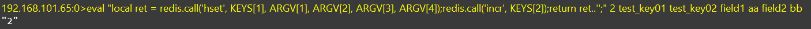

返回2表示向hash中写入2个key

下边是使用RedisTemplate执行Lua脚本的方法：

```Java
<T> T execute(RedisScript<T> script, List<K> keys, Object... args)
```

通过第一个参数类型指定要执行的Lua脚本，RedisScript的实现类是DefaultRedisScript，下边查阅DefaultRedisScript的源代码。

第一种方法是将Lua脚本的内容作为字符串传入DefaultRedisScript对象并且指定返回值类型，代码如下：

```Java
public DefaultRedisScript(String script, @Nullable Class<T> resultType) {
    this.shaModifiedMonitor = new Object();
    this.setScriptText(script);
    this.resultType = resultType;
}
```

如果脚本内容比较多使用第一种方法显得很麻烦。

第二种方法是指定Lua脚本的位置，通过DefaultRedisScript的setScriptSource方法完成，如下：

```Java
public void setScriptSource(ScriptSource scriptSource) {
    this.scriptSource = scriptSource;
}
```

本项目使用第二种方法，在RedisLuaConfiguration中定义DefaultRedisScript bean

```Java
package com.jzo2o.market.config;

import org.springframework.context.annotation.Bean;
import org.springframework.context.annotation.Configuration;
import org.springframework.core.io.ClassPathResource;
import org.springframework.data.redis.core.script.DefaultRedisScript;
import org.springframework.scripting.support.ResourceScriptSource;

@Configuration
public class RedisLuaConfiguration {
    
    @Bean("luaScript")
    public DefaultRedisScript<Integer> defaultRedisScript(){
        DefaultRedisScript<Integer> defaultRedisScript = new DefaultRedisScript<>();
        defaultRedisScript.setScriptSource(new ResourceScriptSource(new ClassPathResource("scripts/test.lua")));
        defaultRedisScript.setResultType(Integer.class);
        return defaultRedisScript;
    }

}
```

创建lua脚本


创建RedisTest测试类:

注入上边定义的DefaultRedisScript，注意注入时指定名称“luaScript”。

```Java
package com.jzo2o.market.service;

import org.junit.jupiter.api.Test;
import org.springframework.beans.factory.annotation.Autowired;
import org.springframework.boot.test.context.SpringBootTest;
import org.springframework.data.redis.core.RedisTemplate;
import org.springframework.data.redis.core.script.DefaultRedisScript;

import javax.annotation.Resource;
import java.util.Arrays;
import java.util.List;

/**
 * Redis+Lua保证多个命令原子性测试
 */
@SpringBootTest
public class RedisLuaTest {

    @Autowired
    private RedisTemplate redisTemplate;


    @Resource(name = "luaScript")
    private DefaultRedisScript luaScript;


    @Test
    public void testLuaScript(){
        List keys = Arrays.asList("test05", "test06");
        Object result = redisTemplate.execute(luaScript, keys, "f5", "v5", "f6", "v6");
        System.out.println("执行结果：" + result);
    }
}
```

执行test\_Luafirst\(\) 测试方法。

**选择方案**

上边学习了Multi和Redis\+Lua两种实现Redis原子操作的方案，在本项目你会选择哪一种方案？

你肯定会说是第一种方案，因为简单，使用Lua脚本还要写Lua脚本，去学习它的语法。

不过，在实际使用中要根据具体的需求去确定方案，比如下边的Lua脚本在执行过程中就会有一些业务逻辑判断，不满足条件提前返回结果，而MULTI 执行命令是执行完成最后一起拿到所有命令的执行结果，并且MULTI 不适合写带有业务逻辑的脚本内容。

下边的lua脚本实现了项目抢券功能，可以尝试阅读，稍后会详细讲解。

```Java
-- 抢券Lua实现
-- key: 抢券同步队列，资源库存,抢券成功列表
-- argv：活动id,用户id

--优惠券是否已经抢过
local couponNum = redis.call("HGET", KEYS[3], ARGV[2])
-- hget 获取不到数据返回false而不是nil
if couponNum ~= false and tonumber(couponNum) >= 1
then
    return "-1";
end
-- --库存是否充足校验
local stockNum = redis.call("HGET",KEYS[2], ARGV[1])
if stockNum == false or  tonumber(stockNum) < 1
then
    return "-2";
end
--抢券列表
local listNum = redis.call("HSET",KEYS[3], ARGV[2], 1)
if listNum == false or  tonumber(listNum) < 1
then
    return "-3";
end

--减库存
stockNum = redis.call("HINCRBY",KEYS[2], ARGV[1], -1)
if tonumber(stockNum) < 0
then
    return "-4"
end
-- 抢单结果写入同步队列
local result = redis.call("HSETNX", KEYS[1], ARGV[2],ARGV[1])
if result > 0
then
    return ARGV[1] ..""
end
return "-5"
```

根据需求本项目使用Redis执行Lua脚本的方式保证多命令的原子性，完成抢券功能。

**使用Lua脚本注意点**

Lua脚本在redis集群上执行需要注意什么？

在redis集群下执行redis命令会根据key求哈希，确定具体的槽位（slot），然后将命令路由到负责该槽位的 Redis 节点上。

执行一次Lua脚本会涉及到多个key，在redis集群下执行lua脚本要求多个key必须最终落到同一个节点，否则调用Lua脚本会报错：ERR eval/evalsha command keys must be in same slot。

如何保证多个key落地到一个redis节点呢？

只要保证多个key的哈希值一致即可保证多个key落到一个redis节点上，这个如何实现呢？

解决方法：一次执行Lua脚本的所有key中使用大括号‘\{\}’且保证大括号中的内容相同，此时会根据大括号中的内容求哈希，因为内容相同所以求得的哈希数据相同所以就落在了同一个Redis节点。

测试如下：

在key名称后边添加\{\}，大括号中写一个固定的值。

```Java
package com.jzo2o.market.service;

import org.junit.jupiter.api.Test;
import org.springframework.beans.factory.annotation.Autowired;
import org.springframework.boot.test.context.SpringBootTest;
import org.springframework.data.redis.core.RedisTemplate;
import org.springframework.data.redis.core.script.DefaultRedisScript;

import javax.annotation.Resource;
import java.util.Arrays;
import java.util.List;

/**
 * Redis+Lua保证多个命令原子性测试
 *
 */
@SpringBootTest
public class RedisLuaTest {

    @Autowired
    private RedisTemplate redisTemplate;


    @Resource(name = "luaScript")
    private DefaultRedisScript luaScript;


    @Test
    public void testLuaScript(){
        List keys = Arrays.asList("test05{abc}", "test06{abc}");
        Object result = redisTemplate.execute(luaScript, keys, "f5", "v5", "f6", "v6");
        System.out.println("执行结果：" + result);
    }
}
```

执行测试成功，观察redis多了两个key："test\_key01\{111\}"和"test\_key02\{111\}"

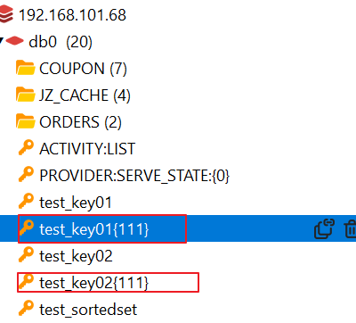


**小结**

项目中保证Redis原子操作用什么方案？

### 3.3.抢券整体方案

**抢券方案分析**

抢券的架构设计思想同抢券查询，将库存保存在Redis，避免抢券操作请求数据库，通过异步任务将Redis中的抢券结果同步到数据库。

抢券的交互流程如下：

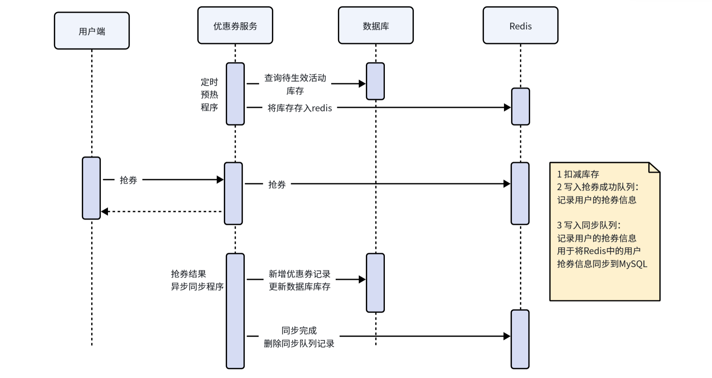

如下图：

说明如下：

1.由预热程序将待生效库存同步到redis\(活动开始将不允许更改库存\)

2.活动开始后，抢券程序请求Redis扣减库存，扣减库存成功向抢券成功队列和抢券同步队列写入记录

Redis中两个队列的作用如下：

抢券成功队列：为了校验用户是否抢过该优惠券。

抢券同步队列：将抢券结果同步到数据库

3.通过定时任务程序根据Redis中同步队列记录的用户抢券结果信息将数据同步到MySQL，具体操作如下：

向优惠券表插入用户抢券记录。

更新优惠券活动表的库存。

写入数据库完成后删除Redis中同步队列的相应记录，删除后表示同步完成，如果同步过程失败将保留Redis同步队列的相应记录。

**数据流**

根据交互流程分析数据流如下：

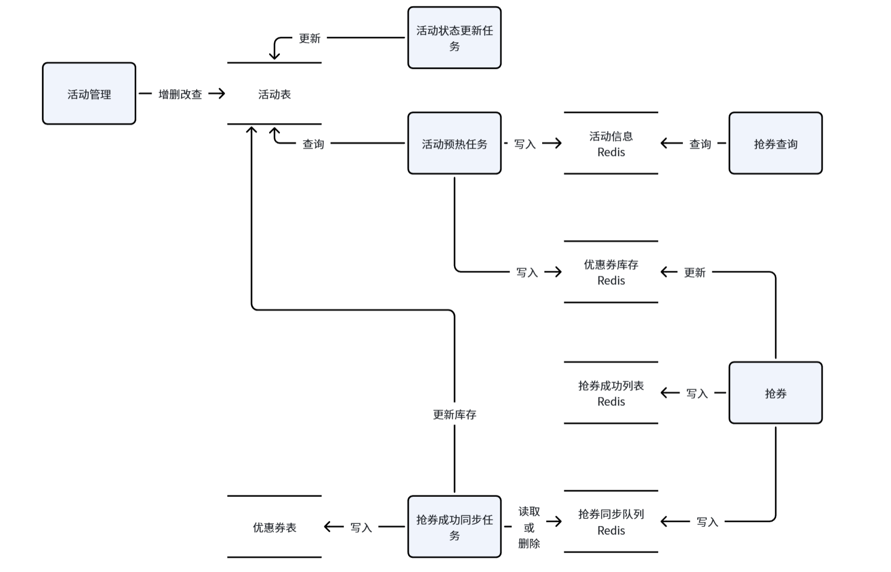

**Redis数据结构**

1.活动信息

缓存结构：String类型:

key: "ACTIVITY:LIST"

value: 符合条件的优惠券活动列表JSON数据。

过期时间：永不过期

缓存一致性方案：通过预热程序保证缓存一致性

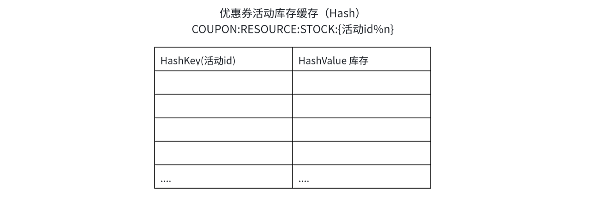

2.优惠券活动库存

缓存结构：Hash

RedisKey：COUPON:RESOURCE:STOCK:\{活动id%10\}

\{活动id%10\}表示根据活动id除以10求余，通过这种方法将key分散到不同的redis服务器上，通过“活动id%10”表达式可知优惠券活动库存hash最多有10个。 

HashKey：活动id

HashValue: 库存

过期时间：永不过期

缓存一致性方案：通过预热程序保证缓存一致性

举例：

如果n为10，1号活动的库存是100，将1号活动库存存储Redis的效果如下：

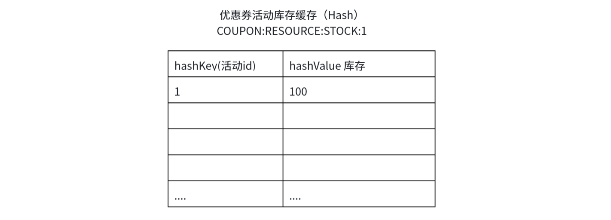

3.抢券成功队列

缓存结构：Hash

RedisKey：COUPON:SEIZE:LIST:活动id\_\{活动id%10\}

HashKey：用户id

HashValue:1

过期时间：永不过期

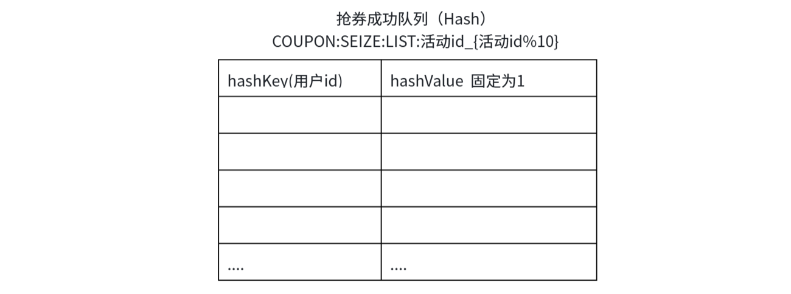

4.抢券同步队列

缓存结构：Hash

RedisKey：QUEUE:COUPON:SEIZE:SYNC:\{活动id%10\}

HashKey：用户id

HashValue:活动id

过期时间：永不过期

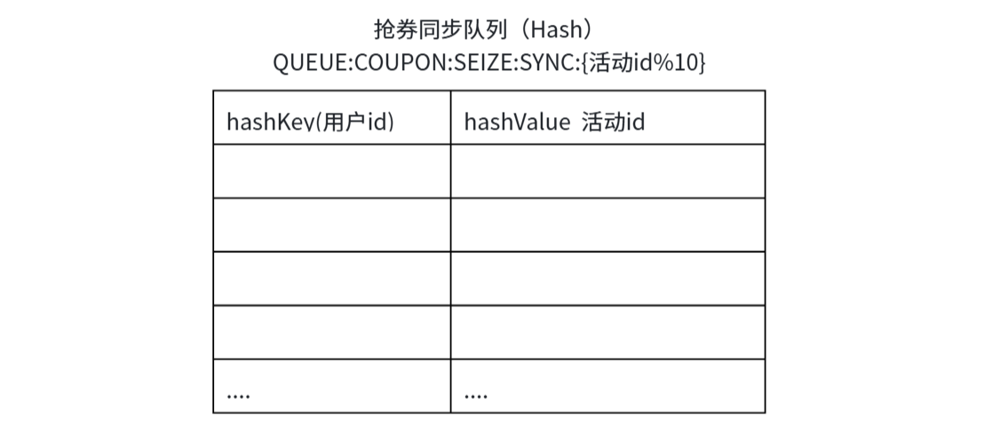

**小结**

1.抢券是怎么做的？或方案是什么？

2.抢券业务的Redis数据结构用的什么？具体说说

3.秒杀系统中如何进行流量削峰？

> 在秒杀系统中进行流量削峰是非常重要的，因为瞬时的高流量可能会导致系统崩溃或性能下降。以下是一些常见的流量削峰策略：
>
> 1）限流措施：通过控制请求的发放速率，可以有效地平滑流量，避免瞬时的高并发。
>
> 2）队列缓冲： 使用消息队列来缓冲请求，将瞬时的高并发请求进行缓存和排队。秒杀系统可以异步地从队列中取出请求进行处理，以平滑处理流量。
>
> 3）分批处理：将瞬时的高并发请求分批处理。不需要一次性处理所有请求，可以将请求按照一定的规模分批处理，以减轻数据库和系统的压力。
>
> 4）负载均衡：采用多节点部署，通过负载均衡器将流量分发到不同的服务器上。
>
> 5）熔断机制：
>
> 熔断策略： 实现熔断机制，当系统达到一定的负载阈值时，暂时停止接受新的请求，防止系统崩溃。等到系统恢复后再重新开启。
>
> 6）缓存预热：在秒杀开始之前，提前将秒杀商品的信息加载到缓存中，减轻数据库的压力。
>
> 7）验证码和身份验证：引入验证码和身份验证机制，防止机器人或恶意请求，减少无效请求对系统的冲击。
>
> 8）数据库优化：对于秒杀系统，数据库通常是瓶颈之一。通过优化数据库结构、建立索引、使用缓存等手段来提高数据库的读写性能。 

### 3.4.库存同步

**系统设计**

根据整体方案分析，用户抢券要在Redis扣减库存，所以需要提前将优惠券活动的库存同步到Redis。

可以通过定时预热程序中将优惠券活动的库存同步到Redis，同步规则如下：

- 对于待生效的活动更新库存。

- 对于已生效的活动如果库存已经同步则不再同步，只更新没有同步库存的活动。

做第二点的原因是为了避免时间差问题，活动状态更改为进行中了但是库存还没有同步到*Redis。*

当用户抢券成功，Redis中的库存有了变化，如何将最新库存由Redis同步MySQL呢？

根据整体方案分析，在抢券结果同步程序中根据抢券结果修改数据库中的库存，此部分在抢券结果同步章节再确定具体的方法。

交互流程如下：

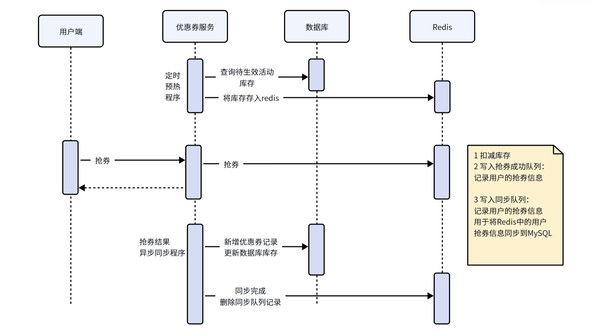

**预热程序中同步库存**

下边实现在预热程序中同步库存。

在预热程序中添加：

```java
/**
 * 活动缓存处理
 */
@Override
public void preHeat() {
    //1.查询活动列表（30天内进行中的和待开始的），结果根据活动开始时间倒序
    //select * from activity where status in (1,2)
    // and distribute_start_time<date_add(now(),interval 30 day)
    //  order by distribute_start_time desc

    List<Activity> activityList = this.lambdaQuery()
            .in(Activity::getStatus, NO_DISTRIBUTE.getStatus(), DISTRIBUTING.getStatus())
            .lt(Activity::getDistributeStartTime, DateUtils.now().plusDays(30))
            .orderByDesc(Activity::getDistributeStartTime)
            .list();
    if (CollUtils.isEmpty(activityList)) {
        activityList = new ArrayList<>();
    }

    //2.转为前端需要的对象列表
    List<ActivityInfoResDTO> activityInfoResDTOList = BeanUtils.copyToList(activityList, ActivityInfoResDTO.class);

    //3.将对象列表转为JSON字符串
    String activityListJSON = JsonUtils.toJsonStr(activityInfoResDTOList);

    //4.保存到Redis缓存中（永不过期）
    redisTemplate.opsForValue().set(RedisConstants.RedisKey.ACTIVITY_CACHE_LIST, activityListJSON);

    //5.待生效的活动库存同步到Redis
    activityList.stream()
            .filter(x->ObjectUtils.equals(
                    NO_DISTRIBUTE.getStatus(),
                    getCurrentRealStatus(x.getStatus(),x.getDistributeStartTime(),x.getDistributeEndTime()))
                    )
            .forEach(x->{
                String redisKey = String.format(RedisConstants.RedisKey.COUPON_RESOURCE_STOCK,x.getId()%10);
                Object hashKey = x.getId(); //活动ID
                Object value = x.getStockNum();//库存数量
                redisTemplate.opsForHash().put(redisKey, hashKey, value);
            });

    //6.进行中的活动但是没同步过Redis才执行同步
    activityList.stream()
            .filter(x->ObjectUtils.equals(
                    DISTRIBUTING.getStatus(),
                    getCurrentRealStatus(x.getStatus(),x.getDistributeStartTime(),x.getDistributeEndTime()))
            )
            .forEach(x->{
                String redisKey = String.format(RedisConstants.RedisKey.COUPON_RESOURCE_STOCK,x.getId()%10);
                Object hashKey = x.getId(); //活动ID
                Object value = x.getStockNum();//库存数量
                redisTemplate.opsForHash().putIfAbsent(redisKey, hashKey, value);
            });
}
```

> 说明：
>
> 对于待生效的活动库存使用put方法，可以对已设置的记录进行更改。
>
> 对已生效的活动库存使用putIfAbsent实现，当key不存在时才执行设置操作。
>
> String.format(COUPON_RESOURCE_STOCK, v.getId() % 10) 用来拼装 key，库存的redis key为：
>
> COUPON:RESOURCE:STOCK:{活动id%10}。

**测试**

测试流程：

启动定时预热程序任务。

观察redis中是否成功存储库存信息。

示例：

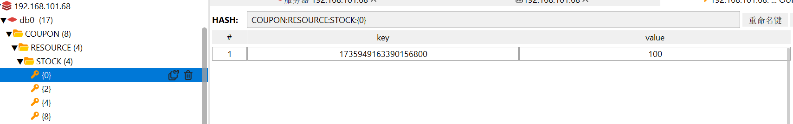


**小结**

库存怎么同步到redis？

> 通过定时预热程序将活动库存信息同步到redis。
>
> 对于待生效的活动库存使用put方法，可以对已设置的记录进行更改。
>
> 对已生效的活动库存使用putIfAbsent实现，当key不存在时才执行设置操作。
>

### 3.5.抢券Lua脚本

**抢券Lua脚本**

本节对抢券Lua脚本进行阅读并测试，理解抢券的过程。

1\. 阅读下边的Lua脚本

```Lua
-- 抢券lua实现
-- key: 抢券同步队列，资源库存,抢券成功列表
-- argv：活动id,用户id

--优惠券是否已经抢过
local couponNum = redis.call("HGET", KEYS[3], ARGV[2])
-- hget 获取不到数据返回false而不是nil
if couponNum ~= false and tonumber(couponNum) >= 1
then
    return "-1";
end
-- --库存是否充足校验
local stockNum = redis.call("HGET",KEYS[2], ARGV[1])
if stockNum == false or  tonumber(stockNum) < 1
then
    return "-2";
end
--抢券列表
local listNum = redis.call("HSET",KEYS[3], ARGV[2], 1)
if listNum == false or  tonumber(listNum) < 1
then
    return "-3";
end

--减库存
stockNum = redis.call("HINCRBY",KEYS[2], ARGV[1], -1)
if tonumber(stockNum) < 0
then
    return "-4"
end
-- 抢券结果写入同步队列
local result = redis.call("HSETNX", KEYS[1], ARGV[2],ARGV[1])
if result > 0
then
    return ARGV[1] ..""
end
return "-5"
```

错误代码：

- \-1： 限领一张

- \-2： 已抢光

- \-3： 写入抢券成功队列失败，返回给用户为：抢券失败

- \-4：  已抢光

- \-5： 写入抢券同步队列失败，返回给用户为：抢券失败


**测试**

编写测试方法，准备好调用抢券Lua脚本需要传入的key和参数。

代码如下：

RedisLuaConfiguration配置类

```Java
package com.jzo2o.market.config;

import org.springframework.context.annotation.Bean;
import org.springframework.context.annotation.Configuration;
import org.springframework.core.io.ClassPathResource;
import org.springframework.data.redis.core.script.DefaultRedisScript;
import org.springframework.scripting.support.ResourceScriptSource;

@Configuration
public class RedisLuaConfiguration {

    @Bean("seizeCouponScript")
    public DefaultRedisScript<Integer> seizeCouponScript() {
        DefaultRedisScript<Integer> redisScript = new DefaultRedisScript<>();
        //resource目录下的scripts文件下的seizeCouponScript.lua文件
        redisScript.setScriptSource(new ResourceScriptSource(new ClassPathResource("scripts/seizeCouponScript.lua")));
        redisScript.setResultType(Integer.class);
        return redisScript;
    }

    @Bean("luaScript")
    public DefaultRedisScript<Integer> defaultRedisScript(){
        DefaultRedisScript<Integer> defaultRedisScript = new DefaultRedisScript<>();
        defaultRedisScript.setScriptSource(new ResourceScriptSource(new ClassPathResource("scripts/test.lua")));
        defaultRedisScript.setResultType(Integer.class);
        return defaultRedisScript;
    }

}
```

RedisLuaTest 单元测试类：

```Java
package com.jzo2o.market.service;

import com.jzo2o.market.constants.RedisConstants;
import org.junit.jupiter.api.Test;
import org.springframework.beans.factory.annotation.Autowired;
import org.springframework.boot.test.context.SpringBootTest;
import org.springframework.data.redis.core.RedisTemplate;
import org.springframework.data.redis.core.script.DefaultRedisScript;

import javax.annotation.Resource;
import java.util.Arrays;
import java.util.List;

/**
 * Redis+Lua保证多个命令原子性测试
 */
@SpringBootTest
public class RedisLuaTest {

    @Autowired
    private RedisTemplate redisTemplate;

    @Resource(name = "luaScript")
    private DefaultRedisScript luaScript;

    @Test
    public void testLuaScript(){
        List keys = Arrays.asList("test05{abc}", "test06{abc}");
        Object result = redisTemplate.execute(luaScript, keys, "f5", "v5", "f6", "v6");
        System.out.println("执行结果：" + result);
    }

    @Resource(name = "seizeCouponScript")
    private DefaultRedisScript seizeCouponScript;

    @Test
    public void testSeizeCouponScript(){
        Long activityId = 1869936536392499200L;//ARGV[1] 活动id
        Long userId = 1863401904184369152L; //ARGV[2] 用户id
        List keys = Arrays.asList(
                //KEYS[1] 抢券同步队列 RedisKey
                String.format(RedisConstants.RedisKey.COUPON_SEIZE_SYNC_QUEUE_NAME, activityId%10),
                //KEYS[2] 优惠券活动库存 RedisKey
                String.format(RedisConstants.RedisKey.COUPON_RESOURCE_STOCK, activityId%10),
                //KEYS[3] 抢券成功队列 RedisKey
                String.format(RedisConstants.RedisKey.COUPON_SEIZE_LIST, activityId, activityId%10)
        );
        Object result = redisTemplate.execute(seizeCouponScript, keys, activityId, userId);
        System.out.println("执行结果：" + result);
    }
}
```

执行成功，观察redis:

示例：

库存是否减少：

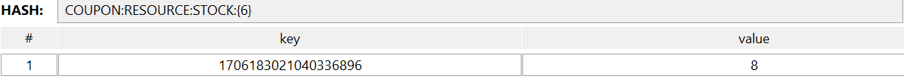

抢券成功队列是否存在相应记录：

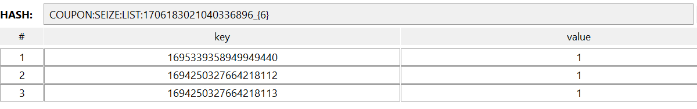

抢券同步队列是否存在相应记录：

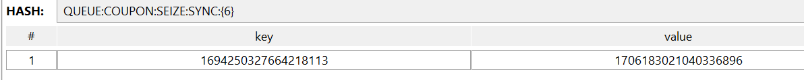

**小结**

抢券的Lua脚本做的什么工作？

> 判断用户是否在该活动抢过券。
>
> 判断库存是否充足
>
> 写入抢券成功列表
>
> 扣减库存
>
> 写入抢券同步列表

### 3.6.抢券接口开发

**接口定义**

下边进行接口分析，定义抢券接口。

在下边的界面中点击“立即领取”即开始抢券。

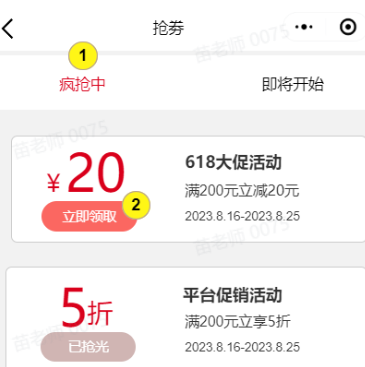

请求哪些参数？

抢券需要明确两个元素： 哪个用户抢的是哪个活动的优惠券。

用户的身份信息在token中由前端传入服务端。

所以，本接口需要传入服务端的参数是活动ID。

传入参数：活动ID。

响应结果：无，通过状态码判断。

接口定义如下：

接口名称：抢券接口

接口路径：POST/market/consumer/coupon/seize

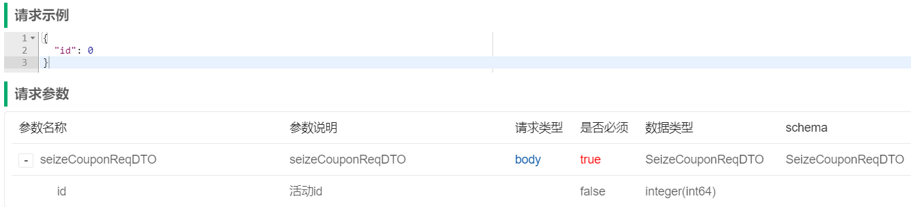

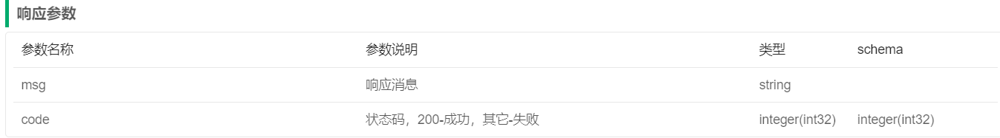

编写controller方法：

```Java
@RestController("consumerCouponController")
@RequestMapping("/consumer/coupon")
@Api(tags = "用户端-优惠券相关接口")
public class CouponController {

@PostMapping("/seize")
public void seizeCoupon(@RequestBody SeizeCouponReqDTO seizeCouponReqDTO) {
    
}
．．．
```

**校验活动有效性**

下边定义service方法，在service方法中需要做哪些事？

- 校验活动是否有效

- 调用Lua脚本执行抢券

本节实现第一步，校验活动的有效性。

定义 service接口如下：

```Java
public interface ICouponService extends IService<Coupon> {

/**
 * 抢券
 */
void seizeCoupon(Long id);
...
```

实现类：

```java
@Override
public void seizeCoupon(Long id) {
    //1. 查询优惠券活动，判断是否存在

    //2. 判断优惠券的状态是否有效（非发放中都不行）

    //3. 判断优惠券活动的时间段是否有效（未开始或已结束都不行）

    //4. 准备Lua脚本的key和argv

    //5. 调用lua脚本执行抢券处理

    //6. 根据Lua脚本执行结果进行处理
}
```

如何校验活动是否有效？

1.从缓存中查询指定活动的信息

抢券接口避免与数据库交互。

2.根据活动时间校验活动状态是否发放中及活动是否未开始或者已经结束，非法状态和时间不允许抢券

实现方法如下：

**定义从缓存查询指定活动信息的方法**

```Java
/**
 * 根据活动id从缓存中找到对应活动信息
 * @param id
 * @return
 */
private ActivityInfoResDTO getActivityFromCache(Long id) {
    String activityRedisKey = RedisConstants.RedisKey.ACTIVITY_CACHE_LIST;
    Object activityObject = redisTemplate.opsForValue().get(activityRedisKey);
    if(ObjectUtils.isNull(activityObject)) {
        return null;
    }
    List<ActivityInfoResDTO> activityInfoResDTOList = JsonUtils.toList(activityObject.toString(), ActivityInfoResDTO.class);
    return activityInfoResDTOList.stream().filter(x->ObjectUtils.equals(x.getId(),id)).findFirst().orElse(null);
}
```

**抢券service方法**

下边编写抢券的service方法

```Java
/**
 * 抢券 （避免直接操作数据库，基于缓存和Lua）
 *
 * @param id
 */
@Override
public void seizeCoupon(Long id) {
    //1. 查询优惠券活动，判断是否存在
    ActivityInfoResDTO activity = getActivityFromCache(id);
    if(ObjectUtils.isNull(activity)) {
        throw new CommonException("优惠券活动不存在");
    }

    //2.判断优惠券的状态是否有效（非发放中都不行）
    Integer status = activityService.getCurrentRealStatus(activity.getStatus(), activity.getDistributeStartTime(), activity.getDistributeEndTime());
    if(ObjectUtils.notEqual(status, ActivityStatusEnum.DISTRIBUTING.getStatus())) {
        throw new CommonException("活动非法状态");
    }

    //3. 判断优惠券活动的时间段是否有效（未开始或已结束都不行）
    if(DateUtils.now().isBefore(activity.getDistributeStartTime()) || DateUtils.now().isAfter(activity.getDistributeEndTime())) {
        throw new CommonException("非法时间段");
    }

    //4. 准备Lua脚本的key和argv
    Long activityId = id;//ARGV[1] 活动id
    Long userId = UserContext.currentUser().getId(); //ARGV[2] 用户id
    List keys = Arrays.asList(
            //KEYS[1] 抢券同步队列 RedisKey
            String.format(RedisConstants.RedisKey.COUPON_SEIZE_SYNC_QUEUE_NAME, activityId%10),
            //KEYS[2] 优惠券活动库存 RedisKey
            String.format(RedisConstants.RedisKey.COUPON_RESOURCE_STOCK, activityId%10),
            //KEYS[3] 抢券成功队列 RedisKey
            String.format(RedisConstants.RedisKey.COUPON_SEIZE_LIST, activityId, activityId%10)
    );

    //5. 调用lua脚本执行抢券处理
    Object result = redisTemplate.execute(seizeCouponScript, keys, activityId, userId);

    //6. 根据Lua脚本执行结果进行处理
    if(ObjectUtils.isNull(result)) {
        throw new CommonException("抢券失败");
    }
    Long code = Long.valueOf(result.toString());
    if(code>0) {
        return; //抢券成功
    }
    if(code==-1) {
        throw new CommonException("限领一张");
    }

    if(code==-2 || code==-4) {
        throw new CommonException("已抢光");
    }

    if(code==-3 || code==-5) {
        throw new CommonException("抢券失败");
    }

}

/**
 * 根据活动id从缓存中找到对应活动信息
 * @param id
 * @return
 */
private ActivityInfoResDTO getActivityFromCache(Long id) {
    String activityRedisKey = RedisConstants.RedisKey.ACTIVITY_CACHE_LIST;
    Object activityObject = redisTemplate.opsForValue().get(activityRedisKey);
    if(ObjectUtils.isNull(activityObject)) {
        return null;
    }
    List<ActivityInfoResDTO> activityInfoResDTOList = JsonUtils.toList(activityObject.toString(), ActivityInfoResDTO.class);
    return activityInfoResDTOList.stream().filter(x->ObjectUtils.equals(x.getId(),id)).findFirst().orElse(null);
}
```

**抢券controller方法**

```Java
@ApiOperation("抢券接口")
@PostMapping("/seize")
public void seizeCoupon(@RequestBody SeizeCouponReqDTO seizeCouponReqDTO) {
    couponService.seizeCoupon(seizeCouponReqDTO.getId());
}
```

**抢券测试**

启动网关

启动优惠券活动管理工程

启动xxl\-job

打开小程序，进入抢券页面

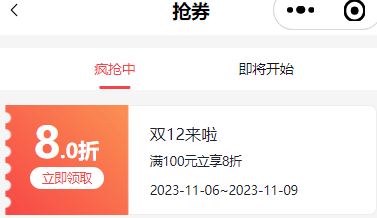

点击领取，观察写入redis的数据是否正确：

示例：

抢券成功存入redis抢券成功队列：


存入redis抢券同步队列：


抢券失败情况测试：

限领一张提示：


已抢光：

手动修改redis库存为0，进行测试，示例如下：


**小结**

项目是怎么实现抢券功能的？

> 1）将优惠券活动的库存同步到Redis
>
> 2\)  用户抢券先进行活动状态和时间段判断，再请求redis，执行Lua脚本，具体如下：
>
> 先判断当前用户是否抢过该优惠券，如果抢过则返回\-1
>
> 判断库存是否充足，如果不充足返回\-2
>
> 向抢券成功列表写入记录
>
> 扣减库存
>
> 向抢券同步列表写入记录
>
> 3）由异步任务将redis抢券成功记录同步到数据库中

## 4.抢券结果同步

### 4.1.Redis到MySQL同步方案分析

如何将Redis中的抢券结果同步到MySQL的优惠券表（coupon）呢？

 **整体思路**

基本思路: 遍历Redis中的抢券结果同步队列，拿到一个元素就向数据库的优惠券表插入记录，插入完成后删除Redis中的这条记录。

下图是存储抢券结果同步数据的Hash表。


我们可以一次从Hash表中拿一批数据，每个元素包括了用户id和活动id，根据这两个参数插入coupon表。

从下图可以看出，只要拿到用户id和活动id即可向优惠券表插入一条记录。


基本思路清楚，现在需要考虑：系统有多个活动，如何提高同步程序的处理性能呢？

假如同步队列的key为：QUEUE:COUPON:SEIZE:SYNC:\{活动id % 10\}，这说明最多有10个同步列表。

我们可以用多线程，每个线程处理一个同步队列。


由定时任务去调度，每隔1分钟由多线程对同步队列中的数据进行处理。

**如何使用线程池？**

根据我们需求，假如同步队列个数为10我们需要定义一个最多有10个活跃线程的线程池，满负荷工作下每个线程处理一个同步队列，当满负荷工作时如果再有新的任务线程池拒绝任务。

定义一个线程池需要以下参数：

1.corePoolSize（核心线程数）： 核心线程一直存活的线程池中，即使它们是空闲的也会被保留在池中。在执行新任务时，如果线程池中的线程数小于 `corePoolSize`，将会创建一个新的线程来执行任务。

2.maximumPoolSize（最大线程数）： 池中允许的最大线程数。如果队列满了，并且活动线程数小于 `maximumPoolSize`，则会创建新的线程来处理任务。

3.keepAliveTime（线程空闲时间）： 当线程池中的线程数量超过 `corePoolSize` 时，多余的空闲线程的存活时间如果超过这个时间会被终止，直到线程数量不超过 `corePoolSize`。这样可以确保在低负载时最小化资源消耗。

4.unit（时间单位）：`keepAliveTime` 的时间单位，可以是 `TimeUnit.SECONDS`、`TimeUnit.MINUTES` 等。

5.workQueue（阻塞队列）： 用于保存等待执行的任务的阻塞队列。

常用的阻塞队列：

- LinkedBlockingQueue：链表结构，无界队列。

- ArrayBlockingQueue：数组结构，有界队列。

- SynchronousQueue：容量为1，在没有线程去消费时不会保存任务。


6.线程池的拒绝策略（RejectedExecutionHandler）：定义了当线程池无法执行新任务时应该采取的策略。当线程池中的工作队列已满，并且线程池中的线程数已达到最大值时，新任务的处理方式由拒绝策略来确定。如下：

- ThreadPoolExecutor\.AbortPolicy 是默认的饱和策略。当任务添加到线程池中被拒绝时，会抛出 RejectedExecutionException 异常。

- ThreadPoolExecutor\.CallerRunsPolicy 当任务被拒绝时，会使用调用线程池的线程来执行被拒绝的任务。
- ThreadPoolExecutor\.DiscardPolicy 当任务被拒绝时，会默默地丢弃被拒绝的任务，不会抛出异常也不会执行被拒绝的任务。
- ThreadPoolExecutor\.DiscardOldestPolicy 当任务被拒绝时，会丢弃队列中最老的一个任务，并尝试重新提交被拒绝的任务。

定义线程如下：

```Java
package com.jzo2o.market.config;

import org.springframework.context.annotation.Bean;
import org.springframework.context.annotation.Configuration;
import org.springframework.scheduling.annotation.EnableAsync;
import org.springframework.scheduling.concurrent.ThreadPoolTaskExecutor;

import java.util.concurrent.ThreadPoolExecutor;

@EnableAsync
@Configuration
public class ThreadPoolConfig {

    /**
     * 声明线程池
     */
    @Bean
    public ThreadPoolTaskExecutor taskExecutor(){

        //实例化线程池对象
        ThreadPoolTaskExecutor threadPoolTaskExecutor=new ThreadPoolTaskExecutor();
        //设置核心线程数
        threadPoolTaskExecutor.setCorePoolSize(10);
        //设置任务等待队列的大小
        threadPoolTaskExecutor.setQueueCapacity(5);
        //设置最大线程数
        threadPoolTaskExecutor.setMaxPoolSize(30);
        //设置线程等待超时时间
        threadPoolTaskExecutor.setKeepAliveSeconds(120);
        //设置线程池内线程的名字前缀 -----阿里编码规约推荐---- 方便后期错误调试
        threadPoolTaskExecutor.setThreadNamePrefix("jzo2o_thread_");
        //设置任务拒绝策略
        threadPoolTaskExecutor.setRejectedExecutionHandler(new ThreadPoolExecutor.DiscardOldestPolicy());
        //初始化线程池
        threadPoolTaskExecutor.initialize();
        //返回线程池对象
        return threadPoolTaskExecutor;
    }
}
```

下边编写任务类：

```Java
package com.jzo2o.market.task;

import lombok.extern.slf4j.Slf4j;
import java.util.List;
import java.util.Map;

/**
 * 同步数据的异步处理类
 */
@Component
@Slf4j
public class SyncMessageTask {


    /**
     * 批量获取缓存同步数据
     * 将同步数据同步到DB
     * @param index 索引号的值，就是 活动id%10的结果
     * @return
     */
    @Async("taskExecutor")
    public void  batchHandeSyncMessage(Integer index){
        //执行任务
        log.info("{}执行任务:{}",Thread.currentThread().getName(),index);
        try {
            Thread.sleep(2000);
        } catch (InterruptedException e) {
            throw new RuntimeException(e);
        }
    }
}
```

然后提交任务，每轮提交10个任务。

```Java
package com.jzo2o.market.thread;

import com.jzo2o.market.task.SyncMessageTask;
import lombok.extern.slf4j.Slf4j;
import org.junit.jupiter.api.Test;
import org.springframework.beans.factory.annotation.Autowired;
import org.springframework.boot.test.context.SpringBootTest;
import org.springframework.scheduling.concurrent.ThreadPoolTaskExecutor;

@SpringBootTest
@Slf4j
public class SyncThreadPoolTest {

    @Autowired
    private SyncMessageTask syncMessageTask;

    @Test
    public void testThreadPool() throws InterruptedException {
        for (long i = 0; i < 10; i++) {
            syncMessageTask.batchHandeSyncMessage(i);
        }
        for (long i = 10; i < 20; i++) {
            syncMessageTask.batchHandeSyncMessage(i);
        }
        //主线程休眠一定的时间防止程序结束
        Thread.sleep(9999999);
    }
 }
```

**如何从Redis 批量取数据？**

使用线程池处理的任务的代码完成测试，下边需要解决的是每个任务如何从Hash中拿一批数据呢？

我们使用redisTemplate\.opsForHash\(\)\.scan\(H key, ScanOptions options\)方法，scan方法通过游标的方式实现从hash中批量获取数据。

测试代码如下：

```Java
package com.jzo2o.market.task;

import com.jzo2o.common.utils.CollUtils;
import com.jzo2o.market.constants.RedisConstants;
import com.jzo2o.redis.model.SyncMessage;
import lombok.extern.slf4j.Slf4j;
import org.redisson.api.RLock;
import org.redisson.api.RedissonClient;
import org.springframework.beans.factory.annotation.Autowired;
import org.springframework.data.redis.core.Cursor;
import org.springframework.data.redis.core.RedisTemplate;
import org.springframework.data.redis.core.ScanOptions;
import org.springframework.scheduling.annotation.Async;
import org.springframework.stereotype.Component;

import java.util.List;
import java.util.Map;
import java.util.concurrent.TimeUnit;
import java.util.stream.Collectors;

/**
 * 同步数据的异步处理类
 */
@Component
@Slf4j
public class SyncMessageTask{


    /**
     * 批量获取缓存同步数据
     * 将同步数据同步到DB
     * @param index 索引号的值，就是 活动id%10的结果
     * @return
     */
    @Async("taskExecutor")
    public void  batchHandeSyncMessage(Long index){
        //执行任务
        log.info("{}执行任务:{}",Thread.currentThread().getName(), index);
        String redisKey = String.format(RedisConstants.RedisKey.COUPON_SEIZE_SYNC_QUEUE_NAME, index);
        List<SyncMessage<Object>> syncMessageList = this.batchGetSyncMessage(redisKey);
        if(CollUtils.isNotEmpty(syncMessageList)) {
            syncMessageList.forEach(System.out::println);
        }
    }


    @Autowired
    private RedisTemplate redisTemplate;


    /**
     * 从同步数据队列中批量取出数据
     * @param redisKey
     */
    public List<SyncMessage<Object>> batchGetSyncMessage(String redisKey) {

        //通过游标方式批量获取Hash中的游标对象
        Cursor<Map.Entry<String,Object>> cursor = null;

        List<SyncMessage<Object>> syncMessageList = null;
        try {
            cursor = redisTemplate.opsForHash().scan(redisKey, ScanOptions.scanOptions().count(10).build());

            //解析游标对象中的数据
            syncMessageList = cursor.stream().map(x -> SyncMessage.builder()
                    .key(x.getKey().toString())
                    .value(x.getValue())
                    .build()
            ).collect(Collectors.toList());
        } catch (Exception e) {
            throw new RuntimeException(e);
        } finally {
            //关闭游标对象
            if(cursor!=null) {
                cursor.close();
            }
        }
        return syncMessageList;
    }
}
```

下边进行测试：

保证存在“QUEUE:COUPON:SEIZE:SYNC:\{%s\}”的队列且其中有数据

再次运行单元测试

```Java
package com.jzo2o.market.thread;

import com.jzo2o.market.task.SyncMessageTask;
import lombok.extern.slf4j.Slf4j;
import org.junit.jupiter.api.Test;
import org.springframework.beans.factory.annotation.Autowired;
import org.springframework.boot.test.context.SpringBootTest;
import org.springframework.scheduling.concurrent.ThreadPoolTaskExecutor;

@SpringBootTest
@Slf4j
public class SyncThreadPoolTest {

    @Autowired
    private SyncMessageTask syncMessageTask;

    @Test
    public void testThreadPool() throws InterruptedException {
        Long activityId = 1869936536392499200L;
        Long index = activityId % 10;
        //for (long i = 0; i < 10; i++) {
        //    syncMessageTask.batchHandeSyncMessage(index);
        //}
        //for (long i = 10; i < 20; i++) {
        //    syncMessageTask.batchHandeSyncMessage(index);
        //}
        syncMessageTask.batchHandeSyncMessage(index);
        //主线程休眠一定的时间防止程序结束
        Thread.sleep(9999999);
    }
 }
```

观察控制台的日志"\{\}获取\{\}队列的数据\{\}条"，并观察是否输出了从Hash表中拿到的数据。

输出日志示例：

```JSON
2024-12-20 16:29:49.371  INFO 13316 --- [ jzo2o_thread_1] com.jzo2o.market.thread.DemoTask         : jzo2o_thread_1执行任务:1
SyncMessage(key=1863401904184369152, value=1869936536392499200, data=null)
```

**小结**

1.本节我们分析了从Redis到MySQL同步方案

> 1）使用线程池从多个同步队列中查询数据，每个线程处理一个同步队列。
>
> 注意：同步队列的个数可以灵活配置，但不宜过多，因为同步队列个数为最大线程数，通常配置10到20即可。
>
> 2）使用redisTemplate\.opsForHash\(\)\.scan\(H key, ScanOptions options\)方法从hash表获取数据。
>
> 这里需要注意游标的使用，一定要在finally 中关闭游标。
>

2.项目中如何定义的线程池？

### 4.2.Redisson分布式锁

**问题分析**

多线程在执行任务时，如果多个线程从同一个Redis Hash中获取数据就会出现重复处理数据的问题。

下边的情况出现这个问题：

定时任务每隔1分钟调用线程池处理一个数据同步任务，假如同步队列1的数据非常多，一轮结束后线程1还在处理同步队列1的数据，此时当第二轮开始又会从同步队列1开始分配线程去处理，将会找一个空闲线程去处理同步队列1的数据，此时将会有多个线程处理一个同步队列的数据。

如下图：


这个问题如何解决呢？

在前边我们介绍超卖方案时提到了使用锁去控制共享资源访问，对于分布式系统我们使用分布式锁去控制。

如下图：每个同步队列使用一把锁进行控制，当线程1还没有处理完时锁不进行释放，这样线程2就无法获取同步队列1的锁，解决了多个线程处理同一个队列的问题。


**Redisson实现分布式锁**

实现分布式锁的方案有很多：Redis、数据库、Zookeeper等，我们使用Redis实现分布式锁，使用Redis实现分布式锁可以使用的它的setNx命令，也可以使用Redisson工具去实现，本项目使用Redission去实现，关于setNx的知识可以参考视频\([https://www.bilibili.com/video/BV1j8411N7Bm?p=181](https://www.bilibili.com/video/BV1j8411N7Bm?p=181)\)自学。

Redisson 是一个用于 Java 开发的 Redis 客户端和分布式锁框架，它不仅可以实现分布式锁，还可以实现分布式集合（如 List、Set、Map 等）和分布式对象（如 AtomicInteger、AtomicLong、CountDownLatch 等），简单理解就是将JVM中内存存储的List、Set、AtomicInteger这些对象使用Redis去存储和管理。

使用Redisson的基本用法如下：

```Java
// 创建Redisson客户端
RedissonClient redissonClient = Redisson.create();
// 获取名为myLock的分布式锁实例，通过此实例进行加锁、解锁
RLock lock = redissonClient.getLock("myLock");
 try {
    // 尝试获取锁，最多等待3秒，持锁时间为5秒
    boolean isLockAcquired = lock.tryLock(3, 5, TimeUnit.SECONDS);
    if (isLockAcquired) {
        // 获取锁成功，执行业务逻辑
    } else {
        // 获取锁失败，处理相应逻辑
    }
} catch (InterruptedException e) {
    // 处理中断异常
} finally {
    // 释放锁
    lock.unlock();
}
```

说明：

lock\.tryLock方法是一种非阻塞获取锁的方式，没有获取锁可以直接返回，而lock\.lock\(\)是一种阻塞获取锁的方法，多个线程通过lock\(\)方法获取锁，只有一个线程获取到锁，其它线程将阻塞等待。

通常lock\.tryLock方法使用的更广泛。

1.使用tryLock方法获取锁时传3个参数：

`Redisson`的lock对象的三种获取锁方法

1）`tryLock()` 方法

- 获取锁失败后不重试

- 获取不到锁立即失败

- 默认锁过期时间为30秒，过期剩余到20秒时看门狗会自动续期到30秒，以防止锁因持有线程意外阻塞或崩溃而提前释放。

2）`tryLock(long waitTime, TimeUnit timeUnit)` 方法

- waitTime：获取锁的等待时间。当获取锁失败后可以多次重试，直到waitTime时间耗尽。waitTime默认\-1，即失败后立刻返回，不重试。

- TimeUnit：时间单位

- 默认锁过期时间为30秒，过期剩余到20秒时看门狗会自动续期到30秒，以防止锁因持有线程意外阻塞或崩溃而提前释放。

3）`tryLock(long waitTime, long leaseTime, TimeUnit timeUnit)` 方法

- waitTime：获取锁的等待时间。当获取锁失败后可以多次重试，直到waitTime时间耗尽。waitTime默认\-1，即失败后立刻返回，不重试。

- leaseTime：锁超时释放时间。默认是30秒，同时会利用WatchDog来不断更新超时时间。如果通过`tryLock`方法手动设置了锁的过期时间（即`leaseTime`参数不为\-1， \-1表示不设置锁的自动释放时间，即锁将一直有效），那么看门狗的自动续期机制将不会生效。这意味着锁将在指定的`leaseTime`后自动释放，无论持有线程是否仍然活跃。

- TimeUnit：时间单位

2.`tryLock ` 方法返回值：

- true：获取到了锁

- false：未获取到锁


3.注意释放锁

`lock.tryLock` 代码放在try中，在finally 中释放锁。

下边进行测试：

我们实现一个队列只有一个线程去处理数据，锁的粒度为队列，每个锁与队列对应，我们定义锁名称为"Lock:"加队列名称。

代码如下：

```Java
package com.jzo2o.market.task;

import com.jzo2o.common.utils.CollUtils;
import com.jzo2o.market.constants.RedisConstants;
import com.jzo2o.redis.model.SyncMessage;
import lombok.extern.slf4j.Slf4j;
import org.redisson.api.RLock;
import org.redisson.api.RedissonClient;
import org.springframework.beans.factory.annotation.Autowired;
import org.springframework.data.redis.core.Cursor;
import org.springframework.data.redis.core.RedisTemplate;
import org.springframework.data.redis.core.ScanOptions;
import org.springframework.scheduling.annotation.Async;
import org.springframework.stereotype.Component;

import java.util.List;
import java.util.Map;
import java.util.concurrent.TimeUnit;
import java.util.stream.Collectors;

/**
 * 同步数据的异步处理类
 */
@Component
@Slf4j
public class SyncMessageTask {
    
    @Autowired
    private RedisTemplate redisTemplate;

    @Autowired
    private RedissonClient redissonClient;

    /**
     * 批量获取缓存同步数据
     * 将同步数据同步到DB
     * @param index 索引号的值，就是 活动id%10的结果
     * @return
     */
    @Async("taskExecutor")
    public void batchHandeSyncMessage(Long index){
        //执行任务
        log.info("{}执行任务:{}",Thread.currentThread().getName(), index);
        String redisKey = String.format(RedisConstants.RedisKey.COUPON_SEIZE_SYNC_QUEUE_NAME, index);

        //基于队列名获取锁实例
        RLock lock = redissonClient.getLock("LOCK:" + redisKey);
        //对队列名尝试加锁
        List<SyncMessage<Object>> syncMessageList = null;
        try {
            boolean result = lock.tryLock(3, 80, TimeUnit.SECONDS);
            //加锁失败，拒绝执行业务
            if(!result) {
                log.error("线程：{}加锁失败，" , Thread.currentThread().getName());
            } else {
                log.info("线程：{}加锁成功，" , Thread.currentThread().getName());
                //加锁成功可执行业务
                syncMessageList = this.batchGetSyncMessage(redisKey);
            }
        } catch (InterruptedException e) {
            e.printStackTrace();
        } finally {
            //暂不释放锁，业务还未处理完，将来这里还要操作数据库，操作后再手动释放锁。 80秒后自动释放。
            //lock.unlock();
        }

        if(CollUtils.isNotEmpty(syncMessageList)) {
            syncMessageList.forEach(System.out::println);
        }
    }


    /**
     * 从同步数据队列中批量取出数据
     * @param redisKey
     */
    public List<SyncMessage<Object>> batchGetSyncMessage(String redisKey) {

        //通过游标方式批量获取Hash中的游标对象
        Cursor<Map.Entry<String,Object>> cursor = null;

        List<SyncMessage<Object>> syncMessageList = null;
        try {
            cursor = redisTemplate.opsForHash().scan(redisKey, ScanOptions.scanOptions().count(10).build());

            //解析游标对象中的数据
            syncMessageList = cursor.stream().map(x -> SyncMessage.builder()
                    .key(x.getKey().toString())
                    .value(x.getValue())
                    .build()
            ).collect(Collectors.toList());
        } catch (Exception e) {
            throw new RuntimeException(e);
        } finally {
            //关闭游标对象
            if(cursor!=null) {
                cursor.close();
            }
        }
        return syncMessageList;
    }
}
```

编写测试方法：

```Java
package com.jzo2o.market.thread;

import com.jzo2o.market.task.SyncMessageTask;
import lombok.extern.slf4j.Slf4j;
import org.junit.jupiter.api.Test;
import org.springframework.beans.factory.annotation.Autowired;
import org.springframework.boot.test.context.SpringBootTest;
import org.springframework.scheduling.concurrent.ThreadPoolTaskExecutor;

@SpringBootTest
@Slf4j
public class SyncThreadPoolTest {

    @Autowired
    private ThreadPoolTaskExecutor taskExecutor;

    @Autowired
    private SyncMessageTask syncMessageTask;

    @Test
    public void testThreadPool() throws InterruptedException {
        Long activityId = 1869936536392499200L;
        Long index = activityId % 10;
        for (long i = 0; i < 10; i++) {
            syncMessageTask.batchHandeSyncMessage(index);
        }
        //主线程休眠一定的时间防止程序结束
        Thread.sleep(9999999);
    }
 }
```

运行上边的单元测试，预期结果：

只有一个线程加锁成功，其他线程加锁失败

示例如下：

```JSON
2024-12-20 17:06:31.524  INFO 19348 --- [ jzo2o_thread_9] com.jzo2o.market.thread.DemoTask         : jzo2o_thread_9执行任务:9
2024-12-20 17:06:31.524  INFO 19348 --- [ jzo2o_thread_7] com.jzo2o.market.thread.DemoTask         : jzo2o_thread_7执行任务:7
2024-12-20 17:06:31.524  INFO 19348 --- [jzo2o_thread_10] com.jzo2o.market.thread.DemoTask         : jzo2o_thread_10执行任务:10
2024-12-20 17:06:31.524  INFO 19348 --- [ jzo2o_thread_2] com.jzo2o.market.thread.DemoTask         : jzo2o_thread_2执行任务:2
2024-12-20 17:06:31.524  INFO 19348 --- [ jzo2o_thread_5] com.jzo2o.market.thread.DemoTask         : jzo2o_thread_5执行任务:5
2024-12-20 17:06:31.524  INFO 19348 --- [ jzo2o_thread_4] com.jzo2o.market.thread.DemoTask         : jzo2o_thread_4执行任务:4
2024-12-20 17:06:31.524  INFO 19348 --- [ jzo2o_thread_8] com.jzo2o.market.thread.DemoTask         : jzo2o_thread_8执行任务:8
2024-12-20 17:06:31.524  INFO 19348 --- [ jzo2o_thread_3] com.jzo2o.market.thread.DemoTask         : jzo2o_thread_3执行任务:3
2024-12-20 17:06:31.524  INFO 19348 --- [ jzo2o_thread_1] com.jzo2o.market.thread.DemoTask         : jzo2o_thread_1执行任务:1
2024-12-20 17:06:31.524  INFO 19348 --- [ jzo2o_thread_6] com.jzo2o.market.thread.DemoTask         : jzo2o_thread_6执行任务:6
2024-12-20 17:06:31.552  INFO 19348 --- [ jzo2o_thread_5] com.jzo2o.market.thread.DemoTask         : 线程：jzo2o_thread_5加锁成功，
SyncMessage(key=1863401904184369152, value=1869936536392499200, data=null)
2024-12-20 17:06:34.530 ERROR 19348 --- [ jzo2o_thread_3] com.jzo2o.market.thread.DemoTask         : 线程：jzo2o_thread_3加锁失败，
2024-12-20 17:06:34.531 ERROR 19348 --- [ jzo2o_thread_1] com.jzo2o.market.thread.DemoTask         : 线程：jzo2o_thread_1加锁失败，
2024-12-20 17:06:34.530 ERROR 19348 --- [jzo2o_thread_10] com.jzo2o.market.thread.DemoTask         : 线程：jzo2o_thread_10加锁失败，
2024-12-20 17:06:34.530 ERROR 19348 --- [ jzo2o_thread_4] com.jzo2o.market.thread.DemoTask         : 线程：jzo2o_thread_4加锁失败，
2024-12-20 17:06:34.530 ERROR 19348 --- [ jzo2o_thread_2] com.jzo2o.market.thread.DemoTask         : 线程：jzo2o_thread_2加锁失败，
2024-12-20 17:06:34.531 ERROR 19348 --- [ jzo2o_thread_8] com.jzo2o.market.thread.DemoTask         : 线程：jzo2o_thread_8加锁失败，
2024-12-20 17:06:34.530 ERROR 19348 --- [ jzo2o_thread_6] com.jzo2o.market.thread.DemoTask         : 线程：jzo2o_thread_6加锁失败，
2024-12-20 17:06:34.530 ERROR 19348 --- [ jzo2o_thread_7] com.jzo2o.market.thread.DemoTask         : 线程：jzo2o_thread_7加锁失败，
2024-12-20 17:06:34.534 ERROR 19348 --- [ jzo2o_thread_9] com.jzo2o.market.thread.DemoTask         : 线程：jzo2o_thread_9加锁失败，
```

**看门狗机制（了解）**

1.什么是Redisson看门狗

学习了Redisson的基本使用现在有一个问题：

当设置了leaseTime的时间为10秒，结果任务执行了20秒，会出现什么问题？

由于锁的自动释放时间为10秒，当到达到10秒即使任务还没有结束锁将自动释放，此时就会有新线程获取该锁去执行任务，设置分布式锁的本意是当前只有一个线程去执行，出现这个问题会导致多个线程共同去执行任务，可能在并发处理上存在问题。

当执行任务的时间可以控制在一个范围就可以指定leaseTime锁自动释放时间，如果执行任务的时间不容易通过leaseTime去设置，此时可以使用Redisson的看门狗机制避免在任务没有完成时自动释放锁的问题发生。

Redisson的"看门狗机制"（Watchdog）是一种用于监测和维护锁的超时时间的机制，它可以确保在任务没有完成时对锁的过期时间进行自动续期，以避免任务没有完成时锁自动释放的问题。

开启看门狗后针对当前锁创建一个线程执行延迟任务，默认每隔10秒将锁的过期时间重新续期为30秒。

看门狗线程会首先判断锁是否存在，如果不存在将不再续期，当程序执行unlock\(\)方法释放锁时会将该锁的对应的延迟任务取消，此时看门狗线程结束任务。

注意：任务结束一定要执行unlock\(\)方法释放锁，否则看门狗线程一直进行续期，导致锁无法释放。

2.看门狗生效方法

调用下边的方法都可以开启看门狗：

```java
方法1：tryLock(long waitTime, TimeUnit unit)
方法2：tryLock(long waitTime, -1,TimeUnit unit)
```

方法2正是上边讲解Redisson基本使用时用的方法，传入leaseTime参数为\-1可以开启看门狗。

下边进行测试：

修改tryLock的方法，leaseTime参数传入\-1，开启看门狗。

```JSON
boolean result = lock.tryLock(3, -1, TimeUnit.SECONDS); //看门狗测试
```

 **小结**

项目分布式锁怎么实现的？

### 4.3.抢券结果同步开发

**编写定时任务方法**

项目使用定时任务完成数据从Redis的Hash结构同步到MySQL中。

定时任务内需要完成这四件事情：

- 批量获取同步队列中的数据

- 插入优惠券表

- 扣减库存

- 从同步队列中删除处理过的数据

其中第一步已经处理完毕，后3步还未做，且首先要务是在XxlJobHandler类中新增定时任务方法

1.编写定时任务方法：

```java
@Autowired
private SyncMessageTask syncMessageTask;

/**
 * 抢券数据同步到优惠券表中并扣减库存，每分钟执行一次
 */
@XxlJob("seizeCouponSyncJob")
public void seizeCouponSyncJob(){
    log.info("[抢券结果同步任务]开始执行");
    //开启10个线程，每个线程各处理一个同步队列的数据
    for (long i = 0; i < 10; i++) {
        syncMessageTask.batchHandeSyncMessage(i);
    }
    log.info("[抢券结果同步任务]执行完毕");
}
```

2.下边在xxl\-job配置定时任务


3.完善SyncMessageTask

```Java
package com.jzo2o.market.task;

import com.jzo2o.api.customer.CommonUserApi;
import com.jzo2o.api.customer.dto.response.CommonUserResDTO;
import com.jzo2o.common.expcetions.CommonException;
import com.jzo2o.common.expcetions.DBException;
import com.jzo2o.common.utils.CollUtils;
import com.jzo2o.common.utils.DateUtils;
import com.jzo2o.common.utils.ObjectUtils;
import com.jzo2o.market.constants.RedisConstants;
import com.jzo2o.market.enums.CouponStatusEnum;
import com.jzo2o.market.model.domain.Activity;
import com.jzo2o.market.model.domain.Coupon;
import com.jzo2o.market.service.IActivityService;
import com.jzo2o.market.service.ICouponService;
import com.jzo2o.redis.model.SyncMessage;
import lombok.extern.slf4j.Slf4j;
import org.redisson.api.RLock;
import org.redisson.api.RedissonClient;
import org.springframework.beans.factory.annotation.Autowired;
import org.springframework.context.ApplicationContext;
import org.springframework.data.redis.core.Cursor;
import org.springframework.data.redis.core.RedisTemplate;
import org.springframework.data.redis.core.ScanOptions;
import org.springframework.scheduling.annotation.Async;
import org.springframework.stereotype.Component;
import org.springframework.transaction.annotation.Transactional;

import java.util.List;
import java.util.Map;
import java.util.concurrent.TimeUnit;
import java.util.stream.Collectors;

/**
 * 同步数据的异步处理类
 */
@Component
@Slf4j
public class SyncMessageTask {

    @Autowired
    private ApplicationContext applicationContext;
    
    @Autowired
    private IActivityService activityService;

    @Autowired
    private CommonUserApi commonUserApi;

    @Autowired
    private ICouponService couponService;
    
    @Autowired
    private RedisTemplate redisTemplate;

    @Autowired
    private RedissonClient redissonClient;

    /**
     * 批量获取缓存同步数据
     * 将同步数据同步到DB
     * @param index 索引号的值，就是 活动id%10的结果
     * @return
     */
    @Async("taskExecutor")
    public void  batchHandeSyncMessage(Long index){
        //执行任务
        log.info("{}执行任务:{}",Thread.currentThread().getName(), index);
        String redisKey = String.format(RedisConstants.RedisKey.COUPON_SEIZE_SYNC_QUEUE_NAME, index);

        //基于队列名获取锁实例
        RLock lock = redissonClient.getLock("LOCK:" + redisKey);
        //对队列名尝试加锁
        List<SyncMessage<Object>> syncMessageList = null;
        try {
            boolean result = lock.tryLock(3, 30, TimeUnit.SECONDS);
            //加锁失败，拒绝执行业务
            if(!result) {
                log.error("线程：{}加锁失败，" , Thread.currentThread().getName());
            } else {
                log.info("线程：{}加锁成功，" , Thread.currentThread().getName());
                //加锁成功可执行业务
                syncMessageList = this.batchGetSyncMessage(redisKey);
            }
        } catch (InterruptedException e) {
            e.printStackTrace();
        } finally {
            if(CollUtils.isNotEmpty(syncMessageList)) {
                int size = syncMessageList.size();
                syncMessageList.forEach(x->log.info("同步队列[{}]，同步数据数量{}，同步完毕", redisKey, size));

                SyncMessageTask owner = applicationContext.getBean(SyncMessageTask.class);
                owner.syncMessageToDB(syncMessageList);

                // 从hash表中删除数据
                syncMessageList.forEach(x->{
                    redisTemplate.opsForHash()
                            .delete(redisKey, x.getKey());
                });

                // 最后释放锁
                if(lock!=null) {
                    lock.unlock();
                    log.info("线程：{}释放锁成功，" , Thread.currentThread().getName());
                }
            }
        }
    }

    /**
     * 从同步数据队列中批量取出数据
     * @param redisKey
     */
    public List<SyncMessage<Object>> batchGetSyncMessage(String redisKey) {

        //通过游标方式批量获取Hash中的游标对象
        Cursor<Map.Entry<String,Object>> cursor = null;

        List<SyncMessage<Object>> syncMessageList = null;
        try {
            cursor = redisTemplate.opsForHash().scan(redisKey, ScanOptions.scanOptions().count(10).build());

            //解析游标对象中的数据
            syncMessageList = cursor.stream().map(x -> SyncMessage.builder()
                    .key(x.getKey().toString())
                    .value(x.getValue())
                    .build()
            ).collect(Collectors.toList());
        } catch (Exception e) {
            throw new RuntimeException(e);
        } finally {
            //关闭游标对象
            if(cursor!=null) {
                cursor.close();
            }
        }
        return syncMessageList;
    }

    @Transactional(rollbackFor = Exception.class)
    public void syncMessageToDB(List<SyncMessage<Object>> syncMessageList) {
        syncMessageList.forEach(x->{
            Long userId = Long.valueOf(x.getKey()); //用户id
            Long activityId = Long.valueOf(x.getValue().toString()); //活动id

            //根据用户ID查询用户信息
            CommonUserResDTO user = commonUserApi.findById(userId);
            if(ObjectUtils.isNull(user)) {
                throw new CommonException("用户不存在");
            }

            //根据活动ID查询活动信息
            Activity activity = activityService.getById(activityId);
            if(ObjectUtils.isNull(activity)){
                throw new CommonException("活动不存在");
            }

            Coupon coupon = new Coupon();
            //设置用户信息
            coupon.setUserId(userId);
            coupon.setUserName(user.getNickname());
            coupon.setUserPhone(user.getPhone());

            //设置活动信息
            coupon.setActivityId(activityId);
            coupon.setType(activity.getType());
            coupon.setDiscountRate(activity.getDiscountRate());
            coupon.setDiscountAmount(activity.getDiscountAmount());
            coupon.setAmountCondition(activity.getAmountCondition());
            coupon.setValidityTime(DateUtils.now().plusDays(activity.getValidityDays()));
            coupon.setName(activity.getName());
            coupon.setStatus(CouponStatusEnum.NO_USE.getStatus());


            //新增优惠券
            boolean resultForCoupon = couponService.save(coupon);
            if(!resultForCoupon) {
                throw new DBException("优惠券新增失败");
            }

            //扣减库存
            boolean resultForActivity = activityService.decrStockNum(activityId);
            if(!resultForActivity) {
                throw new DBException("扣减活动库存失败");
            }
        });
    }
}
```

补充扣减库存代码

IActivityService 类

```Java
package com.jzo2o.market.service;

import com.baomidou.mybatisplus.extension.service.IService;
import com.jzo2o.market.model.domain.Activity;

/**
 * <p>
 *  服务类
 * </p>
 */
public interface IActivityService extends IService<Activity> {

    /**
     * 扣减库存数量
     * @param activityId
     */
    boolean decrStockNum(Long activityId);
}
```

ActivityServiceImpl类

```Java
package com.jzo2o.market.service.impl;

import com.baomidou.mybatisplus.core.conditions.query.LambdaQueryWrapper;
import com.baomidou.mybatisplus.extension.plugins.pagination.Page;
import com.baomidou.mybatisplus.extension.service.impl.ServiceImpl;
import com.jzo2o.common.model.PageResult;
import com.jzo2o.common.utils.*;
import com.jzo2o.market.constants.RedisConstants;
import com.jzo2o.market.constants.TabTypeConstants;
import com.jzo2o.market.enums.ActivityStatusEnum;
import com.jzo2o.market.mapper.ActivityMapper;
import com.jzo2o.market.model.domain.Activity;
import com.jzo2o.market.model.dto.request.ActivityQueryForPageReqDTO;
import com.jzo2o.market.model.dto.request.ActivitySaveReqDTO;
import com.jzo2o.market.model.dto.response.ActivityInfoResDTO;
import com.jzo2o.market.service.IActivityService;
import com.jzo2o.market.service.ICouponService;
import com.jzo2o.market.service.ICouponWriteOffService;
import com.jzo2o.mysql.utils.PageUtils;
import org.springframework.data.redis.core.RedisTemplate;
import org.springframework.stereotype.Service;
import org.springframework.transaction.annotation.Transactional;

import javax.annotation.Resource;
import java.time.LocalDateTime;
import java.util.ArrayList;
import java.util.Arrays;
import java.util.List;
import java.util.stream.Collectors;

import static com.jzo2o.market.enums.ActivityStatusEnum.*;

/**
 * <p>
 * 服务实现类
 * </p>
 */
@Service
public class ActivityServiceImpl extends ServiceImpl<ActivityMapper, Activity> implements IActivityService {
   
    /**
     * 扣减库存数量
     *
     * @param activityId
     */
    @Override
    public boolean decrStockNum(Long activityId) {
       return this.lambdaUpdate()
                .setSql(" stock_num=stock_num-1")
                .eq(Activity::getId, activityId)
                .gt(Activity::getStockNum, 0)
                .update();
    }
}
```

**抢券结果同步测试**

测试流程：

启动客户管理工程（需要根据用户id查询抢券人的信息）

抢券测试，点击立即领取

观察控制台日志、Redis和MySQL的数据变化是否一致，以及库存是否一致

**小结**

秒杀异步处理怎么实现的？

# 三、优惠券核销

## 1.需求分析

### 1.1.界面原型


用户在下单时使用优惠券得到优惠金额，实付金额等于订单金额减去优惠金额，下单成功优惠券核销成功。

下边通过界面原型进行分析。

在下单时选择可用的优惠券：


可用优惠券列表：是用户抢到的优惠券且符合满减规则的优惠券，如：满200减20元优惠券只能用在订单金额大于200元的订单。


用户选择一张优惠券，界面显示优惠金额，订单金额减去优惠金额为实际支付金额：


一张优惠券使用完毕将不能用在其它订单。 

当订单取消后已使用的优惠券会重新退回到我的优惠券，此时用户又可以使用该优惠券。

### 1.2.可用优惠券列表数据分析

可用优惠券列表根据以下条件对用户的优惠券进行筛选：

1.属于当前用户的优惠券

2.符合下边条件的优惠券：

- 订单金额大于等于满减金额

- 优惠金额小于订单金额

- 优惠券还没有过期

- 优惠券还没有使用


3.可用优惠券列表的信息包括：

- 活动名称

- 优惠券类型

- 满减金额

- 折扣率

- 针对该订单的优惠金额（需要根据订单金额和优惠券去计算得出，前端需要此数据）

- 优惠券过期时间（已过期的优惠券无法使用）

在可用优惠券列表中前端需要拿到优惠金额，从而计算出订单实付金额。

订单的实付金额=订单金额\-优惠金额。

4.根据订单金额和优惠券的优惠金额可以计算优惠金额：

- 针对满减：优惠券的优惠金额

- 针对折扣：订单金额乘以（1\-折扣率）

### 1.3.核销优惠券

优惠券核销是指：顾客在购买商品时使用优惠券，当此次订单的消费符合优惠券的条件时在下单会使用该优惠券在原有订单金额基础上进行优惠，优惠券使用后标记为“已使用”。

优惠券核销后还可以取消核销，如果用户取消订单会将优惠券的状态改为“未使用”  退回的优惠券可以继续使用。

### 1.4.小结

1.可用优惠券列表的数据信息有哪些？

2.优惠券核销是什么意思？

> 顾客在购买商品时使用优惠券，当此次订单的消费符合优惠券的条件时在下单会使用该优惠券在原有订单金额基础上进行优惠，优惠券使用后标记为“已使用”。
>
> 优惠券核销后还可以取消核销，如果用户取消订单会将优惠券的状态改为“未使用”  退回的优惠券可以继续使用。
>

## 2.获取可用优惠券

根据需求分析，用户在下单时首先选择一张可用的优惠券，再提交订单进行优惠券核销。

下边先开发获取可以优惠券功能。

### 2.1.查询可用优惠券接口

**交互流程**

根据需求，查询可用的优惠券列表从优惠券表（coupon）中进行查询，筛选规则如下：

1.属于当前用户的优惠券

2.符合下边条件的优惠券：

- 订单金额大于等于满减金额

- 优惠金额小于订单金额

- 优惠券还没有过期

- 优惠券还没有使用


要筛选到用户可用的优惠券列表需要根据订单金额和用户ID进行筛选，现在有一个问题是：

是前端直接请求优惠券服务查询可用的优惠券列表还是请求订单管理服务再由订单管理服务通过内部接口调用服务拿结果，下图是左边的方案还是右边的方案？


本项目用右边的方案。

因为订单管理服务和优惠券服务的基本职责不同，订单管理服务属于业务方，优惠券服务为业务方提供优惠券服务。

虽然优惠券服务中管理了优惠券，但是最终决定是否给用户优惠的是订单服务，比如：用户购买VIP会员，用户是否可以用优惠券是由会员系统去决定。

所以前端请求查询可用优惠券列表的交互流程如下：


用户端进入下单页面，请求订单管理服务获取可用优惠券，订单管理服务远程请求优惠券服务获取可用优惠券。

**查询可用优惠券接口定义**

根据交互流程，先在优惠券服务定义“查询可用优惠券接口”。

根据刚才分析的需求，要筛选到用户可用的优惠券列表需要根据订单金额和用户ID。

当前用户ID是通过token传递。

订单金额通过参数传入。

接口定义如下：

接口名称：获取可用优惠券（内部接口）

接口功能：根据用户ID和订单金额查询可用优惠券列表

接口路径：GET/market/inner/coupon/getAvailable

请求数据类型 application/x\-www\-form\-urlencoded


由于是内部接口需要先在jzo2o\-api中定义接口：

```java
package com.jzo2o.api.market;

import com.jzo2o.api.market.dto.response.AvailableCouponsResDTO;
import org.springframework.cloud.openfeign.FeignClient;
import org.springframework.web.bind.annotation.GetMapping;
import org.springframework.web.bind.annotation.RequestParam;

import java.math.BigDecimal;
import java.util.List;

@FeignClient(contextId = "jzo2o-market", value = "jzo2o-market", path = "/market/inner/coupon")
public interface CouponApi {

    /**
     * 获取可用优惠券列表，并按照优惠金额从大到小排序
     * @param totalAmount 总金额，单位分
     */
    @GetMapping("/getAvailable")
    List<AvailableCouponsResDTO> getAvailable(@RequestParam("totalAmount") BigDecimal totalAmount);
}
```

api编写好需要上传到本地仓库


下边在优惠券服务进行实现：

```java
package com.jzo2o.market.controller.inner;

import com.jzo2o.api.market.CouponApi;
import com.jzo2o.api.market.dto.response.AvailableCouponsResDTO;
import io.seata.spring.annotation.GlobalTransactional;
import io.swagger.annotations.Api;
import io.swagger.annotations.ApiImplicitParam;
import io.swagger.annotations.ApiOperation;
import org.springframework.web.bind.annotation.GetMapping;
import org.springframework.web.bind.annotation.RequestMapping;
import org.springframework.web.bind.annotation.RequestParam;
import org.springframework.web.bind.annotation.RestController;

import java.math.BigDecimal;
import java.util.List;

@RestController("innerCouponController")
@RequestMapping("/inner/coupon")
@Api(tags = "内部接口-优惠券相关接口")
public class CouponController implements CouponApi {


    @Override
    @GetMapping("/getAvailable")
    @ApiOperation("获取可用优惠券列表")
    @ApiImplicitParam(name = "totalAmount", value = "总金额，单位分", required = true, dataTypeClass = BigDecimal.class)
    public List<AvailableCouponsResDTO> getAvailable(@RequestParam("totalAmount") BigDecimal totalAmount) {
        return null;
    }
}
```

重启优惠券服务查看接口文档是否正确。

**定义service接口**

下边定义service接口，查询可用优惠券列表：

```Java
package com.jzo2o.market.service;

import com.jzo2o.api.market.dto.request.CouponUseBackReqDTO;
import com.jzo2o.api.market.dto.request.CouponUseReqDTO;
import com.jzo2o.api.market.dto.response.AvailableCouponsResDTO;
import com.jzo2o.api.market.dto.response.CouponUseResDTO;
import com.jzo2o.common.model.PageResult;
import com.jzo2o.market.model.domain.Coupon;
import com.baomidou.mybatisplus.extension.service.IService;
import com.jzo2o.market.model.dto.request.CouponOperationPageQueryReqDTO;
import com.jzo2o.market.model.dto.request.SeizeCouponReqDTO;
import com.jzo2o.market.model.dto.response.CouponInfoResDTO;

import java.math.BigDecimal;
import java.util.List;

/**
 * <p>
 *  服务类
 * </p>
 */
public interface ICouponService extends IService<Coupon> {
/**
 * 获取可用优惠券列表
 * @param totalAmount
 * @return
 */
List<AvailableCouponsResDTO> getAvailable(BigDecimal totalAmount);
...
```

service接口实现如下：

```Java
@Override
public List<AvailableCouponsResDTO> getAvailable(BigDecimal totalAmount) {
   //1.获取满足条件的优惠券列表
    //条件：用户id、未使用、未过期、满减金额（门槛）<=总金额
    List<Coupon> couponList = this.lambdaQuery()
            .eq(Coupon::getUserId, UserContext.currentUserId())
            .eq(Coupon::getStatus, CouponStatusEnum.NO_USE.getStatus())
            .gt(Coupon::getValidityTime, DateUtils.now())
            .le(Coupon::getAmountCondition, totalAmount)
            .list();
    if(CollUtils.isEmpty(couponList)){
        return CollUtils.emptyList();
    }
    
    
    //2.对优惠券列表进一步优化
    //优化：计算优惠金额、筛选合适的优惠券、转换类型、按照优惠金额倒序
    List<AvailableCouponsResDTO> availableCouponsResDTOList = couponList.stream()
            .peek(x -> x.setDiscountAmount(CouponUtils.calDiscountAmount(x, totalAmount)))
            .filter(x -> x.getDiscountAmount().compareTo(new BigDecimal("0")) > 0 && x.getDiscountAmount().compareTo(totalAmount) <= 0)
            .map(x -> BeanUtils.copyBean(x, AvailableCouponsResDTO.class))
            .sorted(Comparator.comparing(AvailableCouponsResDTO::getDiscountAmount).reversed())
            .collect(Collectors.toList());
    return availableCouponsResDTOList;
}
```

阅读根据订单金额和优惠券信息计算优惠券金额的工具类：

```java
package com.jzo2o.market.utils;

import com.jzo2o.market.enums.ActivityTypeEnum;
import com.jzo2o.market.model.domain.Coupon;

import java.math.BigDecimal;
import java.math.RoundingMode;

/**
 * 优惠券相关工具
 */
public class CouponUtils {

    /**
     * 计算优惠金额
     *
     * @param coupon 优惠券
     * @param totalAmount 订单金额
     * @return
     */
    public static BigDecimal calDiscountAmount(Coupon coupon, BigDecimal totalAmount) {
        // 满减优惠
        if (ActivityTypeEnum.AMOUNT_DISCOUNT.equals(coupon.getType())) {
            //满减金额
            BigDecimal amountCondition = coupon.getAmountCondition();
            //优惠金额
            BigDecimal discountAmount = coupon.getDiscountAmount();
            //如果订单金额小于满减金额不满足优惠条件
            if(totalAmount.compareTo(amountCondition) < 0 ){
                return BigDecimal.ZERO;
            }
            return discountAmount;
        } else {//折扣优惠
            //折扣率
            Integer discountRate = coupon.getDiscountRate();
            //折扣率非法
            if(discountRate>=100 || discountRate<=0)  return BigDecimal.ZERO;
            //优惠率
            BigDecimal rate = new BigDecimal(100 - coupon.getDiscountRate()).divide(new BigDecimal(100), 2, RoundingMode.DOWN);
            //优惠金额
            BigDecimal discountAmount = totalAmount.multiply(rate);
            return  discountAmount;
        }
    }
}
```

**controller方法**

```Java
package com.jzo2o.market.controller.inner;

import com.jzo2o.api.market.CouponApi;
import com.jzo2o.api.market.dto.request.CouponUseBackReqDTO;
import com.jzo2o.api.market.dto.request.CouponUseReqDTO;
import com.jzo2o.api.market.dto.response.AvailableCouponsResDTO;
import com.jzo2o.api.market.dto.response.CouponUseResDTO;
import com.jzo2o.market.service.ICouponService;
import io.seata.spring.annotation.GlobalTransactional;
import io.swagger.annotations.Api;
import io.swagger.annotations.ApiImplicitParam;
import io.swagger.annotations.ApiOperation;
import org.springframework.web.bind.annotation.*;

import javax.annotation.Resource;
import java.math.BigDecimal;
import java.util.List;

@RestController("innerCouponController")
@RequestMapping("/inner/coupon")
@Api(tags = "内部接口-优惠券相关接口")
public class CouponController implements CouponApi {

    @Resource
    private ICouponService couponService;

    @Override
    @GetMapping("/getAvailable")
    @ApiOperation("获取可用优惠券列表")
    @ApiImplicitParam(name = "totalAmount", value = "总金额，单位分", required = true, dataTypeClass = BigDecimal.class)
    public List<AvailableCouponsResDTO> getAvailable(@RequestParam("totalAmount") BigDecimal totalAmount) {
        return couponService.getAvailable(totalAmount);
    }
}
```

**测试**

使用swagger文档测试本接口，测试过程略。

**小结**

下单时如何拿到可用的优惠券列表？

### 2.2.订单管理服务查询可用优惠券

下边在订单管理服务定义可用优惠券查询接口。

**查询可用优惠券接口**

订单管理需要调用优惠券服务，传入订单金额。

用户还没有下单，订单金额需要根据服务ID和数量获取。

如下图，购买1台空调维护的订单金额是17元。


前端需要将服务ID和数量传给订单管理服务，计算出订单金额，再调用优惠券服务获取可用优惠券列表。

接口定义如下：

接口名称：获取可用优惠券

接口功能：用户下单，小程序请求订单管理服务接口查询可用的优惠券

接口路径：GET /orders\-manager/consumer/orders/getAvailableCoupons

请求数据类型 application/x\-www\-form\-urlencoded


在订单管理服务编写controller定义可用优惠券查询接口：

```java
@RestController("consumerOrdersController")
@Api(tags = "用户端-订单相关接口")
@RequestMapping("/consumer/orders")
public class ConsumerOrdersController {

@GetMapping("/getAvailableCoupons")
@ApiOperation("获取可用优惠券")
@ApiImplicitParams({
        @ApiImplicitParam(name = "serveId", value = "服务id", required = true, dataTypeClass = Integer.class),
        @ApiImplicitParam(name = "purNum", value = "购买数量，默认1", required = false, dataTypeClass = Long.class)
})
public List<AvailableCouponsResDTO> getCoupons(@RequestParam(value = "serveId", required = true) Long serveId,
                                               @RequestParam(value = "purNum", required = false, defaultValue = "1") Integer purNum) {
    return null;
}
```

重启订单管理服务查看接口文档是否正确。

**定义service接口** 

```Java
package com.jzo2o.orders.manager.service;

import com.baomidou.mybatisplus.extension.plugins.pagination.Page;
import com.baomidou.mybatisplus.extension.service.IService;
import com.jzo2o.api.market.dto.request.CouponUseBackReqDTO;
import com.jzo2o.api.market.dto.response.AvailableCouponsResDTO;
import com.jzo2o.api.orders.dto.response.OrderResDTO;
import com.jzo2o.api.orders.dto.response.OrderSimpleResDTO;
import com.jzo2o.common.model.PageResult;
import com.jzo2o.common.model.msg.TradeStatusMsg;
import com.jzo2o.orders.base.model.domain.Orders;
import com.jzo2o.orders.manager.model.dto.OrderCancelDTO;
import com.jzo2o.orders.manager.model.dto.request.OrderPageQueryReqDTO;
import com.jzo2o.orders.manager.model.dto.request.OrdersPayReqDTO;
import com.jzo2o.orders.manager.model.dto.request.PlaceOrderReqDTO;
import com.jzo2o.orders.manager.model.dto.response.OperationOrdersDetailResDTO;
import com.jzo2o.orders.manager.model.dto.response.OrdersPayResDTO;
import com.jzo2o.orders.manager.model.dto.response.PlaceOrderResDTO;

import java.util.List;

/**
 * <p>
 * 订单表 服务类
 * </p>
 */
public interface IOrdersCreateService extends IService<Orders> {

    /**
     * 获取可用优惠券
     *
     * @param serveId 服务id
     * @param purNum  购买数量
     * @return 可用优惠券列表
     */
    List<AvailableCouponsResDTO> getAvailableCoupons(Long serveId, Integer purNum);
    ...
```

定义降级类

```java
package com.jzo2o.orders.manager.client;

import com.alibaba.csp.sentinel.annotation.SentinelResource;
import com.alibaba.csp.sentinel.slots.block.BlockException;
import com.jzo2o.api.market.dto.CouponApi;
import com.jzo2o.api.market.dto.response.AvailableCouponsResDTO;
import lombok.extern.slf4j.Slf4j;
import org.springframework.beans.factory.annotation.Autowired;
import org.springframework.stereotype.Component;

import java.math.BigDecimal;
import java.util.List;

/**
 * 服务保护组件类：保护market的Feign调用过程
 */
@Slf4j
@Component
public class MarketClient {

    @Autowired
    private CouponApi couponApi;


    /**
     * sentinel资源方法
     * @param totalAmount
     * @return
     */
    @SentinelResource(value = "addressDetail", fallback = "getAvailableFallback", blockHandler = "getAvailableBlockHandler")
    public List<AvailableCouponsResDTO> getAvailable(BigDecimal totalAmount){
        List<AvailableCouponsResDTO> couponsResDTOList = couponApi.getAvailable(totalAmount);
        return couponsResDTOList;
    }

    /**
     * 非熔断限流造成的异常而执行的降级方法
     * @param totalAmount
     * @param throwable
     * @return
     */
    public List<AvailableCouponsResDTO> getAvailableFallback(BigDecimal totalAmount, Throwable throwable) {
        log.error("[customer的feign接口]非熔断限流造成的异常而执行的降级方法", throwable);
        return null;
    }

    /**
     * 触发熔断或限流执行的降级方法
     * @param totalAmount
     * @param e
     * @return
     */
    public List<AvailableCouponsResDTO> getAvailableBlockHandler(BigDecimal totalAmount, BlockException e) {
        log.error("[customer的feign接口]触发熔断或限流执行的降级方法", e);
        return null;
    }
}
```

定义service接口实现

```Java
@Service
public class OrdersCreateServiceImpl extends ServiceImpl<OrdersMapper, Orders> implements IOrdersCreateService {
...
@Resource
private ServeApi serveApi;

@Resource
private CouponApi couponApi;

@Override
public List<AvailableCouponsResDTO> getAvailableCoupons(Long serveId, Integer purNum) {
    //1. 调用feign接口（foundations服务的）查询服务信息
    ServeAggregationResDTO serve = foundationsClient.findServeDetailById(serveId);
    if(serve==null || serve.getSaleStatus()!=2) {
        throw new BadRequestException("非法服务");
    }
    
    //2. 计算总金额
    BigDecimal totalAmount = serve.getPrice().multiply(BigDecimal.valueOf(purNum));
    
    //3. 调用feign接口（market服务的）获取可用优惠券列表
    List<AvailableCouponsResDTO> couponsResDTOList = marketClient.getAvailable(totalAmount);
    return couponsResDTOList;
}
```

**定义controller方法**

```Java
package com.jzo2o.orders.manager.controller.consumer;

import cn.hutool.core.bean.BeanUtil;
import com.jzo2o.api.market.dto.response.AvailableCouponsResDTO;
import com.jzo2o.api.orders.dto.request.OrderCancelReqDTO;
import com.jzo2o.api.orders.dto.response.OrderResDTO;
import com.jzo2o.api.orders.dto.response.OrderSimpleResDTO;
import com.jzo2o.common.model.CurrentUserInfo;
import com.jzo2o.mvc.utils.UserContext;
import com.jzo2o.orders.manager.model.dto.OrderCancelDTO;
import com.jzo2o.orders.manager.model.dto.request.OrdersPayReqDTO;
import com.jzo2o.orders.manager.model.dto.request.PlaceOrderReqDTO;
import com.jzo2o.orders.manager.model.dto.response.OrdersPayResDTO;
import com.jzo2o.orders.manager.model.dto.response.PlaceOrderResDTO;
import com.jzo2o.orders.manager.service.IOrdersManagerService;
import io.swagger.annotations.Api;
import io.swagger.annotations.ApiImplicitParam;
import io.swagger.annotations.ApiImplicitParams;
import io.swagger.annotations.ApiOperation;
import org.springframework.web.bind.annotation.*;

import javax.annotation.Resource;
import java.util.List;

@RestController("consumerOrdersController")
@Api(tags = "用户端-订单相关接口")
@RequestMapping("/consumer/orders")
public class ConsumerOrdersController {
    @Resource
    private IOrdersCreateService  ordersCreateService;

    @GetMapping("/getAvailableCoupons")
    @ApiOperation("获取可用优惠券")
    @ApiImplicitParams({
            @ApiImplicitParam(name = "serveId", value = "服务id", required = true, dataTypeClass = Integer.class),
            @ApiImplicitParam(name = "purNum", value = "购买数量，默认1", required = false, dataTypeClass = Long.class)
    })
    public List<AvailableCouponsResDTO> getCoupons(@RequestParam(value = "serveId", required = true) Long serveId,
                                                   @RequestParam(value = "purNum", required = false, defaultValue = "1") Integer purNum) {
        return ordersCreateService.getAvailableCoupons(serveId, purNum);
    }
    ...
```

**接口测试**

1.测试流程：

启动优惠券服务

启动客户管理服务

启动订单服务

启动网关

启动运营管理前端

创建优惠券活动，设置门槛比较低或者创建折扣类的优惠券。

用户抢券成功

打开小程序进行下单，在选择优惠券界面跟踪“查询可用优惠券”接口。

2.预期：

查到可用的优惠券。

3.示例：

创建两个优惠券活动：全场八折、全场七折，注意活动开始时间设置和当前时间很近。


开始抢券，抢券全场八折和全场七折。


在下单界面查看可用的优惠券


优惠金额最大的排在最上边：


## 3.优惠券核销

### 3.1.优惠券核销接口设计

**系统交互流程**


说明如下：

1.优惠券核销

用户端请求订单管理服务创建订单信息，订单管理服务远程调用优惠券服务核销优惠券，下单成功且优惠券核销成功。

优惠券核销执行以下操作：

- 限制1：优惠券必须是自己的

- 限制2：优惠券未使用

- 限制3：优惠券未过期

- 限制4：订单金额需大于等于满减金额。

- 根据优惠券id标记优惠券表中该优惠券已使用、使用时间、订单id等。

- 向优惠券核销表添加记录。

核销成功返回最终优惠的金额。

3.优惠券退回

用户端取消订单，订单管理服务执行取消订单逻辑，如果该订单使用了优惠券则请求优惠券服务退回优惠券。

优惠券退回执行以下操作：

- 添加优惠券退回记录。

- 更新优惠券，如果优惠券已过期则标记该优惠券已作废

- 更新优惠券，如果优惠券未过期，标记该优惠券未使用，清空订单id字段及使用时间字段。

- 删除核销记录。

**数据流**


**表设计**

优惠券核销表：

```sql
create table `jzo2o-market`.coupon_write_off
(
    id                  bigint      not null
        primary key,
    coupon_id           bigint      not null comment '优惠券id',
    user_id             bigint      not null comment '用户id',
    orders_id           bigint      not null comment '核销时使用的订单号',
    activity_id         bigint      not null comment '活动id',
    write_off_time      datetime    not null comment '核销时间',
    write_off_man_phone varchar(20) null comment '核销人手机号',
    write_off_man_name  varchar(50) null comment '核销人姓名'
)
    comment '优惠券核销表' charset = utf8mb4;
```

优惠券退回表：

```sql
create table `jzo2o-market`.coupon_use_back
(
    id             bigint   not null comment '回退记录id'
        primary key,
    coupon_id      bigint   not null comment '优惠券id',
    user_id        bigint   not null comment '用户id',
    use_back_time  datetime not null comment '回退时间',
    write_off_time datetime null comment '核销时间'
)
    comment '优惠券使用回退记录' charset = utf8mb4;
```

**优惠券核销接口定义**

优惠券服务提供优惠券核销接口、优惠券退回接口。

1.核销接口执行以下动作：

- 根据优惠券id标记优惠券表中该优惠券已使用。

- 向优惠券核销表添加记录。

2.请求参数：

根据订单总金额判断是否符合优惠券规则，传入订单金额。

核销接口核销优惠券需要传入优惠券ID。

需要记录具体的订单ID，需要传入订单ID。

3.响应结果：

核销后返回优惠金额。

4.核销接口定义如下：

接口名称：核销优惠券（内部接口）

接口功能：下单时调用此接口核销优惠券

接口路径：POST/market/inner/coupon/use

请求数据类型 application/json


在jzo2o\-api工程下定义接口：

```java
package com.jzo2o.api.market;

import com.jzo2o.api.market.dto.request.CouponUseBackReqDTO;
import com.jzo2o.api.market.dto.request.CouponUseReqDTO;
import com.jzo2o.api.market.dto.response.AvailableCouponsResDTO;
import com.jzo2o.api.market.dto.response.CouponUseResDTO;
import io.swagger.annotations.ApiOperation;
import org.springframework.cloud.openfeign.FeignClient;
import org.springframework.web.bind.annotation.GetMapping;
import org.springframework.web.bind.annotation.PostMapping;
import org.springframework.web.bind.annotation.RequestBody;
import org.springframework.web.bind.annotation.RequestParam;

import java.math.BigDecimal;
import java.util.List;

@FeignClient(contextId = "jzo2o-market", value = "jzo2o-market", path = "/market/inner/coupon")
public interface CouponApi {

    /**
     * 优惠券使用,并返回优惠金额
     * @param couponUseReqDTO
     */
    @PostMapping("/use")
    CouponUseResDTO use(@RequestBody CouponUseReqDTO couponUseReqDTO);
    ...
```

编写controller方法：

```java
@RestController("innerCouponController")
@RequestMapping("/inner/coupon")
@Api(tags = "内部接口-优惠券相关接口")
public class CouponController implements CouponApi {

    @Override
    @PostMapping("/use")
    @ApiOperation("使用优惠券，并返回优惠金额")
    public CouponUseResDTO use(@RequestBody CouponUseReqDTO couponUseReqDTO) {
        return null;
    }

 }
```

**优惠券退回接口定义**

1.请求参数：

优惠券ID

需要记录退回优惠券用户的信息，传入用户ID

需要记录退回优惠券的订单ID，传入订单ID

2.响应结果：无

3.退回优惠券接口定义如下：

接口名称：退回优惠券（内部接口）

接口功能：取消订单调用此接口退回优惠券

接口路径：POST/market/inner/coupon/useBack


这些内部接口定义在jzo2o\-api下

```java
package com.jzo2o.api.market;

import com.jzo2o.api.market.dto.request.CouponUseBackReqDTO;
import com.jzo2o.api.market.dto.request.CouponUseReqDTO;
import com.jzo2o.api.market.dto.response.AvailableCouponsResDTO;
import com.jzo2o.api.market.dto.response.CouponUseResDTO;
import io.swagger.annotations.ApiOperation;
import org.springframework.cloud.openfeign.FeignClient;
import org.springframework.web.bind.annotation.GetMapping;
import org.springframework.web.bind.annotation.PostMapping;
import org.springframework.web.bind.annotation.RequestBody;
import org.springframework.web.bind.annotation.RequestParam;

import java.math.BigDecimal;
import java.util.List;

@FeignClient(contextId = "jzo2o-market", value = "jzo2o-market", path = "/market/inner/coupon")
public interface CouponApi {

    /**
     * 优惠券退款回退
     */
    @PostMapping("/useBack")
    void useBack(@RequestBody CouponUseBackReqDTO couponUseBackReqDTO);

...
```

编写controller方法：

```java
@RestController("innerCouponController")
@RequestMapping("/inner/coupon")
@Api(tags = "内部接口-优惠券相关接口")
public class CouponController implements CouponApi {
    
    @Override
    @PostMapping("/useBack")
    @ApiOperation("优惠券退回接口")
    public void useBack(@RequestBody CouponUseBackReqDTO couponUseBackReqDTO) {
    
    }
 }
```

**小结**

优惠券核销的交互流程是什么？

### 3.2.优惠券核销接口实现

下边根据核销接口定义实现接口。

**定义service方法**

编写service接口

```Java
package com.jzo2o.market.service;

import com.jzo2o.api.market.dto.request.CouponUseBackReqDTO;
import com.jzo2o.api.market.dto.request.CouponUseReqDTO;
import com.jzo2o.api.market.dto.response.AvailableCouponsResDTO;
import com.jzo2o.api.market.dto.response.CouponUseResDTO;
import com.jzo2o.common.model.PageResult;
import com.jzo2o.market.model.domain.Coupon;
import com.baomidou.mybatisplus.extension.service.IService;
import com.jzo2o.market.model.dto.request.CouponOperationPageQueryReqDTO;
import com.jzo2o.market.model.dto.request.SeizeCouponReqDTO;
import com.jzo2o.market.model.dto.response.CouponInfoResDTO;

import java.math.BigDecimal;
import java.util.List;

/**
 * <p>
 *  服务类
 * </p>
 */
public interface ICouponService extends IService<Coupon> {

/**
 * 使用优惠券
 * @param couponUseReqDTO
 */
CouponUseResDTO use(CouponUseReqDTO couponUseReqDTO);
```

定义service实现类

```Java
@Override
@Transactional(rollbackFor = Exception.class)
public CouponUseResDTO use(CouponUseReqDTO dto) {
  Long ordersId = dto.getOrdersId(); //订单id
    BigDecimal totalAmount = dto.getTotalAmount();//总金额
    Long couponId = dto.getId();//优惠券id
    
    //1. 判断参数是否为空
    if(ObjectUtils.isNull(ordersId) || ObjectUtils.isNull(totalAmount) || ObjectUtils.isNull(couponId)) {
        throw new BadRequestException("非法参数");
    }
    
    //2. 判断是否我的优惠券
    Coupon coupon = this.getById(couponId);
    //2.1 优惠券是否存在
    if(ObjectUtils.isNull(coupon)) {
        throw new CommonException("优惠券不存在");
    }
    
    Long userId = UserContext.currentUserId();
    
    //2.2 是否我的优惠券
    if(ObjectUtils.notEqual(userId,coupon.getUserId())) {
        throw new CommonException("只能核销自己的优惠券");
    }
    
    //2.3 优惠券是否未使用
    if(ObjectUtils.notEqual(coupon.getStatus(),CouponStatusEnum.NO_USE.getStatus())) {
        throw new CommonException("优惠券状态非法");
    }
    
    //2.4 优惠券是否还未过期
    if(DateUtils.now().isAfter(coupon.getValidityTime())) {
        throw new CommonException("优惠券已过期");
    }
    
    //2.5 总金额是否大于等于满减金额
    if(coupon.getAmountCondition().compareTo(totalAmount)>0) {
        throw new CommonException("满减金额不能超过订单总额");
    }
    
    
    //3. 更新优惠券 update coupon set status=2,order_id=?,use_time=? where id=?
    boolean resultForCoupon = this.lambdaUpdate()
            .eq(Coupon::getId, couponId)
            .set(Coupon::getStatus, CouponStatusEnum.USED.getStatus())
            .set(Coupon::getOrdersId, ordersId)
            .set(Coupon::getUseTime, DateUtils.now())
            .update();
    if(!resultForCoupon) {
        throw new CommonException("核销优惠券失败");
    }
    
    //4. 新增优惠券核销记录
    CouponWriteOff couponWriteOff = new CouponWriteOff();
    couponWriteOff.setOrdersId(ordersId);
    couponWriteOff.setCouponId(couponId);
    couponWriteOff.setActivityId(coupon.getActivityId());
    couponWriteOff.setUserId(userId);
    couponWriteOff.setWriteOffManName(coupon.getName());
    couponWriteOff.setWriteOffManPhone(coupon.getUserPhone());
    couponWriteOff.setWriteOffTime(DateUtils.now());
    boolean resultForWriteOff = couponWriteOffService.save(couponWriteOff);
    if(!resultForWriteOff) {
        throw new CommonException("核销优惠券失败");
    }
    
    CouponUseResDTO couponUseResDTO = new CouponUseResDTO();
    couponUseResDTO.setDiscountAmount(CouponUtils.calDiscountAmount(coupon,totalAmount));
    return couponUseResDTO;

}
```

**定义controller方法**

```Java
package com.jzo2o.market.controller.inner;

import com.jzo2o.api.market.CouponApi;
import com.jzo2o.api.market.dto.request.CouponUseBackReqDTO;
import com.jzo2o.api.market.dto.request.CouponUseReqDTO;
import com.jzo2o.api.market.dto.response.AvailableCouponsResDTO;
import com.jzo2o.api.market.dto.response.CouponUseResDTO;
import com.jzo2o.market.service.ICouponService;
import io.seata.spring.annotation.GlobalTransactional;
import io.swagger.annotations.Api;
import io.swagger.annotations.ApiImplicitParam;
import io.swagger.annotations.ApiOperation;
import org.springframework.web.bind.annotation.*;

import javax.annotation.Resource;
import java.math.BigDecimal;
import java.util.List;

@RestController("innerCouponController")
@RequestMapping("/inner/coupon")
@Api(tags = "内部接口-优惠券相关接口")
public class CouponController implements CouponApi {

    @Resource
    private ICouponService couponService;


    @Override
    @PostMapping("/use")
    @ApiOperation("使用优惠券，并返回优惠金额")
    public CouponUseResDTO use(@RequestBody CouponUseReqDTO couponUseReqDTO) {
        CouponUseResDTO use = couponService.use(couponUseReqDTO);
        return use;
    }
```

**测试**

1.测试流程：

重启优惠券服务

启动网关服务

抢券成功，确定要核销的优惠券。

使用swagger文档进行接口测试。

2.示例：

抢券成功，确定要核销的优惠券，下边是一个优惠券测试数据。

```JSON
{
  "id": 1722556410543214592,
  "name": "全场七折",
  "user_id": 1716346406098296832,
  "user_name": "普通用户72135",
  "user_phone": null,
  "activity_id": 1722555839446781952,
  "type": 2,
  "discount_rate": 70,
  "discount_amount": null,
  "amount_condition": 0.00,
  "validity_time": "2023-12-09 18:07:06",
  "use_time": null,
  "status": 1,
  "orders_id": null,
  "create_time": "2023-11-09 18:08:00",
  "update_time": "2023-11-09 18:08:00",
  "is_deleted": 0
}
```

打开swagger文档，输入测试数据：

id：将上边优惠券ID填入

totalAmount：填写一个满足优惠规则的金额

ordersId：随便填写一个订单id


核销优惠券还需要用户的token，从小程序开发平台获取


在swagger文档中添加全局参数，配置当前用户的认证信息：

参数名：Authorization

参数值：上图复制的token

如下图：


添加成功：


添加成功后需要重新打开接口，查看请求头部分是否有上图添加的信息

注意：在url前加上网关地址，通过网关解析token。


3.下边开始测试

在核销优惠券service中打断点

点击发送进行测试，通过断点跟踪代码执行过程。

继续运行代码，执行成功返回优惠金额：


### 3.3.下单进行优惠券核销

**修改下单方法**

根据需求，下边在下单接口中调用优惠券核销接口。

定义使用优惠券下单的接口

```java
public interface IOrdersCreateService extends IService<Orders> {
    /**
     * 使用优惠券下单
     * @param orders 订单信息
     * @param couponId 优惠券id
     */
    public void addWithCoupon(Orders orders, Long couponId);
    ...
```

service实现方法：

```Java
@Service
@Slf4j
public class OrdersCreateServiceImpl extends ServiceImpl<OrdersMapper, Orders> implements IOrdersCreateService {

    @Resource
    private CouponApi couponApi;
    
    /**
     * 核销优惠券且创建订单
     *
     * @param orders
     */
    @Override
    @Transactional(rollbackFor = Exception.class)
    public void addWithCoupon(Orders orders, Long couponId) {
    
        //4.1 调用feign接口核销优惠券
        CouponUseReqDTO couponUseReqDto = new CouponUseReqDTO();
        couponUseReqDto.setId(couponId);
        couponUseReqDto.setOrdersId(orders.getId());
        couponUseReqDto.setTotalAmount(orders.getTotalAmount());
        CouponUseResDTO use = couponApi.use(couponUseReqDto);
    
        //4.2 设置订单优惠金额
        orders.setDiscountAmount(use.getDiscountAmount());
        orders.setRealPayAmount(orders.getTotalAmount().subtract(orders.getDiscountAmount()));//实际支付金额=订单总金额-优惠金额
        boolean result = this.save(orders);
        if(!result) {
            throw new DBException("服务预约下单失败");
        }
    
        //4.3. 启动订单状态机
        OrderSnapshotDTO orderSnapshotDTO = BeanUtils.copyBean(orders, OrderSnapshotDTO.class);
        orderStateMachine.start(orders.getUserId(), orders.getId().toString(), orderSnapshotDTO);
    }
```

修改原有下单方法：

```Java
/**
 * 预约下单
 *
 * @param dto
 * @return
 */
@Override
public PlaceOrderResDTO placeOrder(PlaceOrderReqDTO dto) {
    //1. 调用feign接口（foundations服务的）查询服务信息
    ServeAggregationResDTO serve = foundationsClient.findServeDetailById(dto.getServeId());
    if(serve == null || serve.getSaleStatus()!=2) {
        throw new BadRequestException("非法服务");
    }

    //2. 调用feign接口（customer服务的）查询地址信息
    AddressBookResDTO address = customerClient.findAddressDetailById(dto.getAddressBookId());
    if(address==null) {
        throw new BadRequestException("没有选择地址");
    }

    //3. 封装订单对象信息
    Orders orders = new Orders();

    //3.1 订单基本信息封装
    orders.setId(this.generateOrderId());//订单号：19位组成结构 - 2位年+2位月+2位日+13位序号
    orders.setOrdersStatus(OrderStatusEnum.NO_PAY.getStatus()); // 订单状态代码，下单后状态是未支付状态
    orders.setPayStatus(OrderPayStatusEnum.NO_PAY.getStatus()); // 订单支付状态代码，下单后状态是未支付状态 2：待支付，4：支付成功
    orders.setDisplay(1); //用户端是否展示，1：展示，0：隐藏，默认展示
    orders.setServeStartTime(dto.getServeStartTime());//服务开始时间
    orders.setSortBy(DateUtils.toEpochMilli(dto.getServeStartTime()) + orders.getId() % 10000); //根据服务开始时间转为毫秒时间戳+订单后5位


    //3.2 下单人信息封装
    orders.setUserId(UserContext.currentUser().getId());//下单人id
    String serveAddress = new StringBuilder()
            .append(address.getProvince()) //省
            .append(address.getCity())//市
            .append(address.getCounty()) //区
            .append(address.getAddress()) //详细地址
            .toString();
    orders.setServeAddress(serveAddress); // 家政服务的具体地址（省+市+区+详细地址）
    orders.setContactsPhone(address.getPhone());//下单人手机号
    orders.setContactsName(address.getName());//下单人姓名
    orders.setLat(address.getLat());//维度
    orders.setLon(address.getLon());//精度

    //3.3  支付相关信息（暂时不处理）

    //3.4 服务信息封装
    orders.setServeId(serve.getId());//服务id
    orders.setPrice(serve.getPrice());//服务单价
    orders.setCityCode(serve.getCityCode());//城市编码
    orders.setServeItemId(serve.getServeItemId());//服务项id
    orders.setServeItemName(serve.getServeItemName());//服务项名称
    orders.setServeItemImg(serve.getServeItemImg());//服务项图片
    orders.setServeTypeId(serve.getServeTypeId());//服务类型id
    orders.setServeTypeName(serve.getServeTypeName());//服务类型名称
    orders.setUnit(serve.getUnit());//服务单位

    //3.5 价格信息封装
    orders.setPurNum(dto.getPurNum());//服务数量
    orders.setTotalAmount(serve.getPrice().multiply(BigDecimal.valueOf(dto.getPurNum())));//订单总金额 价格 * 购买数量
    orders.setDiscountAmount(BigDecimal.ZERO);//优惠金额，暂时为0
    orders.setRealPayAmount(orders.getTotalAmount().subtract(orders.getDiscountAmount()));//实际支付金额=订单总金额-优惠金额

    //4. 创建订单到订单表
    if(ObjectUtils.isNotNull(dto.getCouponId())) {
        owner.addWithCoupon(orders, dto.getCouponId()); //使用优惠券且创建订单
    } else {
        owner.add(orders); //没有使用优惠券直接创建订单
    }

    //5. 生产延迟时间的消息（15分钟）
    rabbitClient.sendMsg(MqConstants.Exchanges.ORDERS,MqConstants.RoutingKeys.ORDERS_CANCEL_KEY,
            orders.getId().toString(),
                 60000, //这里是为了方便测试，才写60秒
            IdUtils.getSnowflakeNextId(),
            false);

    return new PlaceOrderResDTO(orders.getId());
}
```

**测试**

首先保证用户当前有未使用的优惠券。

> 技巧：找一个可用的优惠券，可以进入优惠券表找一个已用过的优惠券，修改优惠券的状态为“未使用”，删除核销记录。
>

1.测试流程：

启动jzo2o\-foundations服务

启动jzo2o\-customer服务。

启动jzo2o\-publics服务。

启动jzo2o\-gateway服务。

启动jzo2o\-orders\-manager服务。

启动jzo2o\-market服务。

打开小程序进行下单。

打开小程序，进入首页，点击一个服务进行预约下单。

用户在下单界面选择一个优惠券

提交订单

2.示例：

启动


选择一张优惠券：


提交订单：


提交成功查看优惠券信息：

- status：状态改为已使用

- orders\_id：使用优惠券的订单id

- use\_time：使用优惠券时间


查看优惠券核销表：


## 4.分布式事务

### 4.1.优惠券核销事务控制方案

**当前遇到的问题**

下单时核销优惠券，创建订单和核销优惠券需要保证事务一致性，要么两者都成功，要么两者都失败，

现在的代码如下：

```Java
/**
 * 核销优惠券且创建订单
 *
 * @param orders
 */
@Override
@Transactional(rollbackFor = Exception.class)
public void addWithCoupon(Orders orders, Long couponId) {

    //4.1 调用feign接口核销优惠券
    CouponUseReqDTO couponUseReqDto = new CouponUseReqDTO();
    couponUseReqDto.setId(couponId);
    couponUseReqDto.setOrdersId(orders.getId());
    couponUseReqDto.setTotalAmount(orders.getTotalAmount());
    CouponUseResDTO use = couponApi.use(couponUseReqDto);

    //4.2 设置订单优惠金额
    orders.setDiscountAmount(use.getDiscountAmount());
    orders.setRealPayAmount(orders.getTotalAmount().subtract(orders.getDiscountAmount()));//实际支付金额=订单总金额-优惠金额
    boolean result = this.save(orders);
    if(!result) {
        throw new DBException("服务预约下单失败");
    }

    //4.3. 启动订单状态机
    OrderSnapshotDTO orderSnapshotDTO = BeanUtils.copyBean(orders, OrderSnapshotDTO.class);
    orderStateMachine.start(orders.getUserId(), orders.getId().toString(), orderSnapshotDTO);
}
```

当调用couponApi\.use\(couponUseReqDTO\)成功表示优惠券核销成功，当此方法向下继续执行如果抛出异常那么订单信息进行回滚，优惠券核销信息是否会回滚？

创建订单在订单管理服务，优惠券核销在优惠券服务，业务数据处在两个数据库中，创建订单和优惠券核销互为分布式事务，对上边addWithCoupon方法进行事务控制只是控制了订单数据库的事务，而没有控制优惠券数据库的事务。

如下图：


我们可以进行测试：

在addWithCoupon方法保存订单下边添加模拟异常代码。

```Java
/**
 * 核销优惠券且创建订单
 *
 * @param orders
 */
@Override
@Transactional(rollbackFor = Exception.class)
public void addWithCoupon(Orders orders, Long couponId) {

    //4.1 调用feign接口核销优惠券
    CouponUseReqDTO couponUseReqDto = new CouponUseReqDTO();
    couponUseReqDto.setId(couponId);
    couponUseReqDto.setOrdersId(orders.getId());
    couponUseReqDto.setTotalAmount(orders.getTotalAmount());
    CouponUseResDTO use = couponApi.use(couponUseReqDto);

    //4.2 设置订单优惠金额
    orders.setDiscountAmount(use.getDiscountAmount());
    orders.setRealPayAmount(orders.getTotalAmount().subtract(orders.getDiscountAmount()));//实际支付金额=订单总金额-优惠金额
    boolean result = this.save(orders);
    if(!result) {
        throw new DBException("服务预约下单失败");
    }
    int i = 1/0;

    //4.3. 启动订单状态机
    OrderSnapshotDTO orderSnapshotDTO = BeanUtils.copyBean(orders, OrderSnapshotDTO.class);
    orderStateMachine.start(orders.getUserId(), orders.getId().toString(), orderSnapshotDTO);
}
```

下边进行下单发现优惠券核销成功，订单创建失败。


查看优惠券表发现已经核销：


在订单数据库中 2311090000000000034是不存在的，此时数据不一致。

要解决这个问题需要理解什么是分布式事务并且去学习分布式事务的处理方案。

**优惠券核销满足AP还是CP？**

根据我们的需求，创建订单和优惠券核销两个操作构成分布式事务，要对它们进行分布式事务控制基于CAP理论我们要满足CP还是AP？

如下图：


满足CP的要求：

创建订单和优惠券核销要么都成功要么都失败，不能存在一个成功一个失败，如果要实现CP需要在下单和核销优惠券操作前进行一次预操作，如果预操作成功将优惠券锁定避免在执行事务期间优惠券被其它订单使用。

满足AP的要求：

创建订单和优惠券核销要么都成功要么都失败，可以暂时存在一个成功一个失败，最终要保证数据的一致性，如果要实现AP，不需要提前锁定资源，在执行事务期间有一个失败则么另一个操作回滚即可，最终实现数据一致性。

基于上边的分析，实现CP更麻烦，实现AP同样满足的需求，本项目优惠券核销操作实现AP。

**用什么技术方案实现AP**

1.一方先成功另一方最终成功

对于一方先成功另一方最终成功的需求，比如：注册成功送积分，支付成功发送短信等这些场景，注册成功后向MQ发送消息，积分服务接收到消息后增加积分。


针对上边的需求还可以使用定时任务完成。


2.一方成功另一个方失败，成功方进行回滚

对于一方成功另一方失败，为保证最终一致性，成功一方需要回滚，如：下单扣库存，下单成功扣减库存失败此时下单业务回滚；优惠券核销，下单成功优惠券核销失败,此时下单操作回滚，或者下单失败，优惠券核销成功此时优惠券核销操作回滚。

针对上边的需求使用Seata进行分布式事务控制。

Seata提供了四种不同的分布式事务解决方案：

- XA模式：强一致性分阶段事务模式，牺牲了一定的可用性，无业务侵入

- TCC模式：最终一致的分阶段事务模式，有业务侵入

- AT模式：最终一致的分阶段事务模式，无业务侵入，也是Seata的默认模式

- SAGA模式：长事务模式，有业务侵入

下边说明Seata的AT模式：

首先理解Seata事务管理中有三个重要的角色：

- TC \(Transaction Coordinator\) \- 事务协调者：维护全局和分支事务的状态，协调全局事务提交或回滚。

- TM \(Transaction Manager\) \- 事务管理器：定义全局事务的范围、开始全局事务、提交或回滚全局事务。

- RM \(Resource Manager\) \- 资源管理器：管理分支事务处理的资源，与TC交互注册分支事务和报告分支事务的状态，并驱动分支事务提交或回滚。

如下图：

> 说明：
>
> - 事务管理器（TM）请求TC开启全局事务
>
> - 事务管理器（TM）请求RM执行分支事务
>

下单RM：先向事务协调器（TC）注册下单分支事务，并执行sql\(记录undo log\)，并向TC报告事务状态

undo log：用于回滚事务，seata根据undo log会生成反向sql进行事务回滚，举例：下单sql正常是向订单插入一条数据，seata生成的反向sql即删除订单记录，通过执行反向sql实现事务回滚。

优惠券RM：先向事务协调器（TC）注册优惠券核销分支事务，并执行sql\(记录undo log\)，并向TC报告事务状态

3.事务管理器（TM）请求TC提交全局事务

4.TC检查分支事务状态，如果发现都成功则请求每个RM删除undo log，如果发现其中有失败记录则请求每个RM回滚事务，RM回滚事务的方法是通过undo log执行反向sql。

Seata执行的细节如下：


**小结**

1.优惠券核销满足AP还是CP？

2.实现AP的技术方案有哪些？

> 基于MQ的方案
>
> 基于定时任务的方案
>
> 使用Seata

3.本项目实现优惠券核销使用什么技术方案？

> 采用Seata的AT模式实现分布式事务控制

### 4.2.优惠券核销事务控制实现

**启动seata 的事务协调器**

启动seata容器\(TC\)： docker start seata\-server 

如果没有使用下发的虚拟机需要自行安装Seata，下面是安装步骤：

拉取镜像：

docker pull seataio/seata\-server:1\.5\.2

创建目录：

mkdir \-p /data/soft/seata\-jzo2o/data /data/soft/seata\-jzo2o/config

将配置resources\.tar 上传到服务器解压到/data/soft/seata\-jzo2o/config

解压resources\.tar : `tar xvf resources.tar`

注意修改resources中application\.yml中nacos的配置

```yaml
server:
  port: 7091

spring:
  application:
    name: seata-server

console:
  user:
    username: seata
    password: seata

logging:
  config: classpath:logback-spring.xml
  file:
    path: ${user.home}/logs/seata

seata:
  config:
    # support: nacos 、 consul 、 apollo 、 zk  、 etcd3
    type: nacos
    nacos:
      server-addr: 192.168.101.68:8848
      namespace: 75a593f5-33e6-4c65-b2a0-18c403d20f63
      group: DEFAULT_GROUP
      username: nacos
      password: nacos
      ##if use MSE Nacos with auth, mutex with username/password attribute
      #access-key: ""
      #secret-key: ""
      data-id: seata-server.properties
  registry:
    # support: nacos 、 eureka 、 redis 、 zk  、 consul 、 etcd3 、 sofa
    type: nacos
    #preferred-networks: 30.240.*
    nacos:
      application: seata-server
      server-addr: 192.168.101.68:8848
      group: DEFAULT_GROUP
      namespace: 75a593f5-33e6-4c65-b2a0-18c403d20f63
      cluster: default
      username: nacos
      password: nacos
      ##if use MSE Nacos with auth, mutex with username/password attribute
      #access-key: ""
      #secret-key: ""
      
  server:
    service-port: 8091 #If not configured, the default is '${server.port} + 1000'
    max-commit-retry-timeout: -1
    max-rollback-retry-timeout: -1
    rollback-retry-timeout-unlock-enable: false
    enableCheckAuth: true
    retryDeadThreshold: 130000
    xaerNotaRetryTimeout: 60000
    recovery:
      handle-all-session-period: 1000
    undo:
      log-save-days: 7
      log-delete-period: 86400000
    session:
      branch-async-queue-size: 5000 #branch async remove queue size
      enable-branch-async-remove: false #enable to asynchronous remove branchSession
      
  metrics:
    enabled: false
    registry-type: compact
    exporter-list: prometheus
    exporter-prometheus-port: 9898
  transport:
    rpc-tc-request-timeout: 30000
    enable-tc-server-batch-send-response: false
    shutdown:
      wait: 3
    thread-factory:
      boss-thread-prefix: NettyBoss
      worker-thread-prefix: NettyServerNIOWorker
      boss-thread-size: 1
  security:
    secretKey: SeataSecretKey0c382ef121d778043159209298fd40bf3850a017
    tokenValidityInMilliseconds: 1800000
    ignore:
      urls: /,//*.css,//*.js,//*.html,//*.map,//*.svg,//*.png,//*.ico,/console-fe/public/,/api/v1/auth/login

```

创建seata数据库，导入seata\.sql


登录nacos配置seata\-server\.properties配置文件,内容如下：

```properties
store.mode = db
store.db.datasource = druid
store.db.dbType = mysql
store.db.driverClassName = com.mysql.cj.jdbc.Driver
store.db.url = jdbc:mysql://192.168.101.68:3306/seata?useUnicode=true&characterEncoding=utf8&autoReconnect=true&allowMultiQueries=true&useSSL=false
store.db.user = root
store.db.password = mysql
store.db.minConn = 5
store.db.maxConn = 100
store.db.globalTable = global_table
store.db.branchTable = branch_table
store.db.lockTable = lock_table
store.db.distributedLockTable = distributed_lock
store.db.queryLimit = 100
store.db.maxWait = 5000
#seata.tm.global_transaction_timeout = 60000
#seata.tm.beginTimeout = 5000
```

创建容器，seata端口号：8091（程序交互端口，根据情况进行修改），7091（管理端工具端口，根据情况进行修改）

```Shell
docker run -d \
--name seata-server \
--restart always \
-p 8091:8091 \
-p 7091:7091 \
-v /data/soft/seata-jzo2o/config/resources:/seata-server/resources  \
-e SEATA_IP=192.168.101.65 \
seataio/seata-server:1.5.2
```

测试,登录地址 [http://192\.168\.101\.68:7091](http://192\.168\.101\.68:7091), 账号和密码均为seata/seata，首次登录可能会慢稍等1\-2分钟


**配置seata环境**

修改订单管理服务的bootstrap\.yml，添加seata配置文件


在订单基础工程jzo2o\-orders\-base和优惠券工程jzo2o\-market中添加seata依赖

```xml
<dependency>
    <groupId>com.jzo2o</groupId>
    <artifactId>jzo2o-seata</artifactId>
</dependency>
```

在订单的三个数据库和优惠券数据库中创建undo\_log表，此表记录每个分支事务的undo\_log信息。

```JSON
create table `数据库名`.undo_log
(
    id            bigint auto_increment
        constraint `PRIMARY`
        primary key,
    branch_id     bigint       not null,
    xid           varchar(100) not null,
    context       varchar(128) not null,
    rollback_info longblob     not null,
    log_status    int          not null,
    log_created   datetime     not null,
    log_modified  datetime     not null,
    ext           varchar(100) null,
    constraint ux_undo_log
        unique (xid, branch_id)
)
    charset = utf8;
```

**开启全局事务测试**

修改下单方法，在核销优惠券方法中开启全局事务

```java
@GlobalTransactional
public void addWithCoupon(Orders orders, Long couponId) {
    CouponUseReqDTO couponUseReqDTO = new CouponUseReqDTO();
    couponUseReqDTO.setOrdersId(orders.getId());
    couponUseReqDTO.setId(couponId);
    couponUseReqDTO.setTotalAmount(orders.getTotalAmount());
    //优惠券核销
    CouponUseResDTO couponUseResDTO = couponApi.use(couponUseReqDTO);
    // 设置优惠金额
    orders.setDiscountAmount(couponUseResDTO.getDiscountAmount());
    // 计算实付金额
    BigDecimal realPayAmount = orders.getTotalAmount().subtract(orders.getDiscountAmount());
    orders.setRealPayAmount(realPayAmount);
    //保存订单
    add(orders);
    //模拟异常
    int i=1/0;
}
```

上边的方法仍然有模拟异常的代码，下边进行测试分布式事务控制。

重启订单管理服务和优惠券服务

重新下单，选择一个优惠券提交订单

预期结果：

下单异常，优惠券核销回滚

进入优惠券控制台查看关于seata事务回滚的日志：

```bash
2023-11-09 21:23:08.472  INFO 9288 --- [h_RMROLE_1_5_16] i.s.c.r.p.c.RmBranchRollbackProcessor    : rm handle branch rollback process:xid=192.168.101.68:8091:27476477017228330,branchId=27476477017228332,branchType=AT,resourceId=jdbc:mysql://192.168.101.68:3306/jzo2o-market,applicationData={"autoCommit":false}
2023-11-09 21:23:08.472  INFO 9288 --- [h_RMROLE_1_5_16] io.seata.rm.AbstractRMHandler            : Branch Rollbacking: 192.168.101.68:8091:27476477017228330 27476477017228332 jdbc:mysql://192.168.101.68:3306/jzo2o-market
2023-11-09 21:23:08.494  INFO 9288 --- [h_RMROLE_1_5_16] i.s.r.d.undo.AbstractUndoLogManager      : xid 192.168.101.68:8091:27476477017228330 branch 27476477017228332, undo_log deleted with GlobalFinished
2023-11-09 21:23:08.495  INFO 9288 --- [h_RMROLE_1_5_16] io.seata.rm.AbstractRMHandler            : Branch Rollbacked result: PhaseTwo_Rollbacked
```

通过日志Branch Rollbacked result: PhaseTwo\_Rollbacked可以看出分布式事务回滚完成。

## 5.退回优惠券

取消订单退回优惠券。（手动取消和超时未支付自动取消）

根据需求分析实现优惠券退回逻辑，且添加分布式事务解决方案。

# 四、抢单

## 1.需求分析

完成了预约下单、支付业务的开发，接下来进入抢单模块。

首先我们对抢单模块进行需求分析。

### 2.1.核心业务流程

首先明确本模块在核心业务流程的位置，下图是项目的核心业务流程：

用户下单后服务人员通过app进行抢单，机构通过pc进行抢单，抢单成功后服务人员开始现场服务。


### 2.2.服务端抢单原型

服务人员在平台注册后需要进行实名认证、服务技能设置、服务范围设置、开启接单，这四项准备工作完成后方可在平台接单。

1.服务技能设置

服务技能即服务人员服务范围，比如：服务人员A提供日常保洁、日常维修服务。设置服务技能后服务人员可以抢与自己的技能匹配的订单，比如：服务人员A提供日常保洁、日常维修服务，所以它只能抢日常保洁、日常维修服务的订单。


2.服务范围设置

设置服务范围后能抢服务范围内的订单，下图中的服务城市是北京，接单范围是朱辛庄地铁站，在抢单查询时以接单范围为中心点查询方圆几公里的用户创建的订单，具体方圆公里数在查询条件中选择。


3.接单设置

开启接单后方可抢单。


4.开始抢单

进入抢单页面，选择服务距离和服务类型查询订单，点击“立即抢单”进行抢单。

服务距离：距离服务人员接单范围的距离。

服务类型：


5.抢单成功查询订单

服务人员抢单成功在我的订单中查询


### 2.3.机构端抢单原型

机构端抢单与服务端抢单的区别是：

1.机构使用pc端，服务端使用app

2.机构端抢单成功后订单状态为待分配，表示待将订单分配给机构下的服务人员；服务端抢单成功后订单状态为待服务，因为服务人员抢到的订单服务人员就是自己。

3.抢单数量限制不同

抢单数量限制是当前拥有的进行中的服务单的最大数量。服务人员默认是10，机构默认是100。

抢单数量限制的目的是规避恶意抢单。

因为机构下的服务人员较多所以机构的抢单数量限制大于服务人员。

下边说明机构端抢单的界面原型：

机构端也需要进行实名认证、服务技能与服务范围设置、开启接单后方可在平台接单。

1.服务技能与服务范围设置


2.开启接单


3.抢单页面


上图中除了服务费用以外其它字段均为订单表中的信息，服务费是订单金额的30%（可设置）。

### 2.4.服务单状态

1.服务人员抢单成功或系统派单成功将生成订单对应的服务单，服务单状态如下：


服务单初始状态：待分配或待服务

机构抢单成功：待分配。

服务人员抢单成功：待服务。

2.开始服务：
待服务  ——>   服务中

3.服务完成：

服务中  ——>   服务完成

4.用户取消订单：

待分配  ——>   已取消

待服务  ——>   已取消

5.运营人员取消订单：

服务中  ——>   已取消

服务完成  ——>   已取消

### 2.5.小结

通过需求分析，抢单模块分如下子模块：

1.抢单设置子模块

设置服务技能、服务范围、开启抢单。

2.抢单查询子模块

查询抢单池中的订单

3.抢单子模块

点击“立即抢单”开始抢单。

抢单成功后生成服务单，服务单的状态包括：待分配、待服务、服务中、服务完成、已取消。

## 2.系统整体设计

### 2.1.整体分析

根据抢单需求，抢单的流程和抢券的流程很相似，核心内容也包括三部分：

1.抢单查询（对应到抢券查询）

在抢单界面查询抢单池中的订单，订单属于抢购的资源，在抢券中优惠券也属于争抢的资源，此处的查询存在高并发需要使用缓存技术进行优化。

查询抢单池中的订单可以根据下单用户的地理位置进行搜索订单，此功能类似“搜索附近”的业务，比如：搜索附近的酒店、搜索附近的房源信息等。

结合上边的要求，本项目使用Elasticsearch查询抢单资源，使用ES的基于地理坐标搜索功能完成“搜索附近”功能的开发，Elasticsearch通过全文检索技术提高查询性能。

如果要使用Elasticsearch查询抢单池信息就需要将待派单的订单同步到Elasticsearch，这里我们使用Canal\+MQ的方式实现数据同步，如下图：


> 说明：
>
> 下单支付成功通过订单分流程序将订单信息写入抢单池，满足系统自动派单需求的订单同时写入派单池，派单部分在后边章节讲解。
>
> 通过Canal将抢单池的信息同步到Elasticsearch。
>
> 抢单查询从Elasticsearch中查询订单信息，使用ES的基于地理坐标搜索功能完成搜索附近的订单。
>

2.抢单（技术方案同领取优惠券）

我们在分析抢单技术方案时结合 抢券 的技术方案进行分析，多个人争抢同一个订单，这里仍然存在超卖问题，我们使用同抢券一样的技术方案去解决超卖问题。

下图中加入了抢单的交互流程：


> 说明：
>
> 参考抢券的方案，使用Redis\+Lua的技术解决超卖问题，这里将抢单库存同步到Redis，每个订单的库存就是1。
>
> 抢单执行Lua脚本完成抢单，具体包括：扣减库存、抢单成功写入同步队列。
>
> 抢单同步队列的作用是通过异步任务将抢单结果信息同步到数据库。
>

3.抢单结果异步处理（技术方案同抢券结果异步处理）

秒杀抢购业务的并发高，为了避免直接操作数据库这里使用异步任务的方式将抢单结果同步到数据库。

抢单成功创建服务单，异步任务的主要职责是根据抢单结果创建服务单，并且更新订单的状态。

抢单结果同步异步任务的具体的内容如下：

创建服务单：

服务单记录了服务人员进行家政服务的信息，关键字段有：订单ID、订单金额、服务人员ID、服务单状态、服务时间、服务照片等。

服务单初始状态：待分配或待服务

机构抢单成功：待分配。

服务人员抢单成功：待服务。

服务单的详细状态如下图：


更新订单的状态：

用户下单并支付完成后订单的状态为“派单中”，服务人员抢单成功订单状态为“待服务”，机构抢单成功订单状态为“待分配”。

订单状态图如下，详细说明请参见第四章内容。


抢单结果同步成功删除抢单池等相关信息：

抢单结果同步成功后删除抢单池中该订单的信息，这样服务人员在抢单界面无法查询到该订单。

删除数据库中抢单池的记录，将Elasticsearch中对应的抢单记录删除。

删除Redis中该订单的库存信息。

删除Redis中抢单同步队列中的记录。

交互流程如下：


### 2.2.数据流

下边分析整体的数据流：

具体的表结构在各个模块中进行设计。


说明：

1.下单

向订单表添加记录。

2.支付成功

更新订单状态为派单中

向抢单池表新增记录

3.Canal同步

将数据库中抢单池的信息同步到Elasticsearch中。

4.抢单查询

请求Elasticsearch查询抢单池信息

5.抢单

请求Redis扣减库存、添加抢单同步记录

6.抢单结果异步处理

创建服务单

更新订单状态

删除抢单池记录

删除Redis同步队列记录

删除Redis库存记录

### 2.3.小结

能够说出本项目抢单的实现方案？

> 用户下单且支付成功，订单信息进入抢单池
>
> 通过Canal\+MQ将抢单池的信息同步到Elasticsearch、同步到Redis中。
>
> 服务人员或机构进入抢单界面，请求Elasticsearch查询订单信息，这里可以根据地理坐标搜索附近的订单
>
> 服务人员或机构点击抢单、请求Redis执行Lua脚本完成抢单。
>
> 通过定时任务将Redis中抢单成功的结果同步到数据库。

## 3.抢单设置

根据需求，机构和服务人员都需要作抢单前的准备工作方可抢单。

准备工作包括：实名认证、服务技能设置、服务范围设置、开启接单。关于实名认证的业务流程请参考第二章，下边通过阅读代码理解服务技能设置、服务范围设置、开启接单的设置。

下边以服务端为例说明。

### 3.1.需求分析

1.服务技能设置

服务人员新注册账号后进入下边的界面：


通过此界面进行服务技能设置、服务范围设置、接单设置。

点击上图中的“去设置”进入服务技能设置界面：


点击编辑开始设置服务技能：


选择服务技能，点击保存。

2.服务范围设置

进入服务范围设置界面：


### 3.2.准备环境

从资料中解压jzo2o\-orders\-02\-0\.zip的代码拷贝覆盖掉原来工程


### 3.3.表设计

服务技能表：存储服务提供者的技能信息。

结构如下：

```JSON
create table `jzo2o-customer`.serve_skill
(
    id                  bigint                             not null comment '主键'
        constraint `PRIMARY`
        primary key,
    serve_provider_id   bigint                             null comment '服务人员/机构id',
    serve_provider_type int                                null comment '类型，2：服务人员，3：服务机构',
    serve_type_id       bigint                             null comment '服务类型id',
    serve_type_name     varchar(50)                        null comment '服务类型名称',
    serve_item_id       bigint                             null comment '服务项id',
    serve_item_name     varchar(50)                        null comment '服务项名称',
    create_time         datetime default CURRENT_TIMESTAMP not null comment '创建时间',
    update_time         datetime default CURRENT_TIMESTAMP not null on update CURRENT_TIMESTAMP comment '更新时间',
    is_delete           int      default 0                 not null comment '是否已删除，0：未删除，1：已删除'
)
    comment '服务技能表' charset = utf8mb4;
```

服务提供者设置表：存储服务提供者的服务范围等信息。

```JSON
create table `jzo2o-customer`.serve_provider_settings
(
    id              bigint                                not null comment '服务人员/机构id'
        constraint `PRIMARY`
        primary key,
    city_code       varchar(20) default ''                null comment '城市码',
    city_name       varchar(64)                           null comment '城市名称',
    lon             double(10, 5)                         null comment '经度',
    lat             double(10, 5)                         null comment '纬度',
    intention_scope varchar(100)                          null comment '意向单范围',
    have_skill      int         default 0                 null comment '是否有技能',
    can_pick_up     int         default -1                null comment '是否可以接单，-0：关闭接单，1：开启接单',
    create_time     datetime    default CURRENT_TIMESTAMP null,
    update_time     datetime    default CURRENT_TIMESTAMP null on update CURRENT_TIMESTAMP,
    is_deleted      int         default 0                 null
)
    comment '服务人员/机构附属信息' charset = utf8mb4;
```

服务人员与机构表：存储服务人员与机构的注册信息。

当服务技能、服务范围、接单设置全部设置完成会将settings\_status 字段更新为1 

```JSON
create table `jzo2o-customer`.serve_provider
(
    id                  bigint                             not null comment '主键'
        constraint `PRIMARY`
        primary key,
    code                varchar(255)                       null comment '编号',
    type                int                                not null comment '类型，2：服务人员，3：服务机构',
    name                varchar(255)                       null comment '姓名',
    phone               varchar(255)                       not null comment '电话',
    avatar              varchar(255)                       null comment '头像',
    status              int                                not null comment '状态，0：正常，1：冻结',
    settings_status     int      default 0                 null comment '首次设置状态，0：未完成设置，1：已完成设置',
    password            varchar(255)                       null comment '机构登录密码',
    account_lock_reason varchar(255)                       null comment '账号冻结原因',
    score               double                             null comment '综合评分',
    good_level_rate     varchar(50)                        null comment '好评率',
    create_time         datetime default CURRENT_TIMESTAMP not null comment '创建时间',
    update_time         datetime default CURRENT_TIMESTAMP not null on update CURRENT_TIMESTAMP comment '更新时间',
    is_deleted          int      default 0                 not null comment '是否已删除，0：未删除，1：已删除',
    constraint serve_provider_phone_type_uindex
        unique (phone, type)
)
    comment '服务人员/机构表' charset = utf8mb4;
```

### 3.4.代码阅读

这些操作的接口在客户中心工程（jzo2o\-customer）定义。

服务技能设置接口类：

```java
package com.jzo2o.customer.controller.worker;


import com.jzo2o.api.foundations.dto.response.ServeItemSimpleResDTO;
import com.jzo2o.api.foundations.dto.response.ServeTypeSimpleResDTO;
import com.jzo2o.customer.model.dto.request.ServeSkillAddReqDTO;
import com.jzo2o.customer.model.dto.response.ServeSkillCategoryResDTO;
import com.jzo2o.customer.service.IServeSkillService;
import io.swagger.annotations.Api;
import io.swagger.annotations.ApiOperation;
import org.springframework.web.bind.annotation.*;

import javax.annotation.Resource;
import java.util.List;

/**
 * <p>
 * 服务技能表 前端控制器
 * </p>
 */
@RestController("workerServeSkillController")
@RequestMapping("/worker/serve-skill")
@Api(tags = "服务端 - 服务技能相关接口")
public class ServeSkillController {
    @Resource
    private IServeSkillService serveSkillService;

    @PostMapping("/batchUpsert")
    @ApiOperation("批量新增或修改服务技能")
    public void listServeType(@RequestBody List<ServeSkillAddReqDTO> serveSkillAddReqDTOList) {
        serveSkillService.batchUpsert(serveSkillAddReqDTOList);
    }

    @GetMapping("/category")
    @ApiOperation("查询服务技能目录")
    public List<ServeSkillCategoryResDTO> category() {
        return serveSkillService.category();
    }

    @GetMapping("/queryCurrentUserServeSkillTypeList")
    @ApiOperation("查询当前用户的服务技能类型")
    public List<ServeTypeSimpleResDTO> queryCurrentUserServeSkillTypeList() {
        return serveSkillService.queryCurrentUserServeSkillTypeList();
    }

    @GetMapping("/queryCurrentUserServeSkillItemList")
    @ApiOperation("查询当前用户的服务技能")
    public List<ServeItemSimpleResDTO> queryCurrentUserServeSkillItemList() {
        return serveSkillService.queryCurrentUserServeSkillItemList();
    }
}
```

服务范围及接单设置接口类：

```java
package com.jzo2o.customer.controller.worker;

import com.jzo2o.customer.model.dto.request.ServePickUpReqDTO;
import com.jzo2o.customer.model.dto.request.ServeScopeSetReqDTO;
import com.jzo2o.customer.model.dto.response.ServeProviderSettingsGetResDTO;
import com.jzo2o.customer.model.dto.response.ServeSettingsStatusResDTO;
import com.jzo2o.customer.service.IServeProviderSettingsService;
import com.jzo2o.mvc.utils.UserContext;
import io.swagger.annotations.Api;
import io.swagger.annotations.ApiOperation;
import org.springframework.validation.annotation.Validated;
import org.springframework.web.bind.annotation.*;

import javax.annotation.Resource;

@RestController("workerServeProviderSettingsController")
@RequestMapping("/worker/serve-settings")
@Api(tags = "服务端 - 服务设置相关接口")
public class ServeProviderSettingsController {

    @Resource
    private IServeProviderSettingsService serveProviderSettingsService;

    @PutMapping("/serve-scope")
    @ApiOperation("服务范围设置")
    public void setServeScope(@RequestBody @Validated ServeScopeSetReqDTO serveScopeSetReqDTO) {
        serveProviderSettingsService.setServeScope(serveScopeSetReqDTO);
    }

    @GetMapping
    @ApiOperation("获取设置")
    public ServeProviderSettingsGetResDTO getServeScope() {
        return serveProviderSettingsService.getServeScope();
    }

    @PutMapping("/pick-up")
    @ApiOperation("接单设置")
    public void setPickUp(@RequestBody ServePickUpReqDTO servePickUpReqDTO) {
//        serveProviderSettingsService.setPickUp(servePickUpReqDTO);
        serveProviderSettingsService.setPickUp(UserContext.currentUserId(), servePickUpReqDTO.getCanPickUp());
    }

    @GetMapping("/status")
    @ApiOperation("获取所有设置状态")
    public ServeSettingsStatusResDTO getStatus() {
        return serveProviderSettingsService.getSettingStatus();
    }
}
```

### 3.5.测试

以接口为入口阅读代码，找到服务技能设置、服务范围设置、接单设置存储的表及存储方式。

存储方式：是添加还是更新、是批量还是单条记录操作等详细的操作方式。

在阅读代码时可以通过断点测试的方式进行。

启动jzo2o\-customer、jzo2o\-publics、jzo2o\-fundations、jzo2o\-gateway。

启动服务端前端工程。

在测试时可以使用一个新的手机号注册。

关于服务范围设置：

设置服务范围时需要通过手机进行定位，我们使用浏览器测试服务端前端程序无法通过手机定位，这里我们在配置文件中配置坐标模拟手机定位的效果。

在下边的配置文件上配置坐标及相关信息实现定位：


坐标及信息使用高德地图的 [坐标拾取工具](https://lbs.amap.com/tools/picker) 获取。


citycode从数据库的city\_directory获取。


进入服务范围设置界面：


如果要修改原来设置的接单范围需要进入数据库清理接单范围设置后再进入此界面。

进入jzo2o\-customer\.serve\_provider\_settings表，找到服务人员对应的接单范围信息，清理下边红框内的字段值


如何找到服务人员对应的接单范围信息？

先从jzo2o\-customer\.serve\_provider表中根据手机号找到主键，再根据主键从jzo2o\-customer\.serve\_provider\_settings表找到具体的记录。

### 3.6.小结

抢单设置包括哪些表？

> 服务技能表：存储服务提供者的技能信息。
>
> 服务提供者设置表：存储服务提供者的服务范围等信息。
>
> 服务人员与机构表：存储服务人员与机构的注册信息。
>
> 区域配置表：存储的抢单和派单对应的数量和时间等规则限制信息。

## 4.订单分流

### 4.1.需求分析

订单分流的流程如下：


### 4.2.表设计

根据数据流分析需要设计抢单池表。

```Java
-- 抢单池(资源池) 
-- auto-generated definition
create table orders_seize
(
    id               bigint                                not null comment '订单id'
        primary key,
    orders_code      varchar(50)                           null comment '订单编号',
    city_code        varchar(50) default ''                not null comment '城市编码',
    serve_type_id    bigint                                null comment '服务分类id',
    serve_item_name  varchar(50)                           not null comment '服务名称',
    serve_type_name  varchar(50)                           not null comment '服务分类名称',
    serve_item_id    bigint                                null comment '服务项id',
    serve_address    varchar(50)                           not null comment '服务地址',
    serve_item_img   varchar(255)                          not null comment '服务项目图片',
    orders_amount    decimal(10, 2)                        null comment '订单总金额',
    serve_start_time datetime                              not null comment '服务开始时间',
    pay_success_time datetime                              null comment '订单支付成功时间，用于计算是否进入派单',
    lon              double(10, 5)                         null comment '经度',
    lat              double(10, 5)                         null comment '纬度',
    pur_num          int                                   not null comment '服务数量',
    is_time_out      int         default 0                 null comment '抢单是否超时',
    sort_by          bigint                                null comment '抢单列表排序字段',
    create_time      datetime    default CURRENT_TIMESTAMP null comment '创建时间',
    update_time      datetime    default CURRENT_TIMESTAMP null on update CURRENT_TIMESTAMP comment '更新时间'
)
    comment '抢单池(资源池)' charset = utf8mb4;

create index sort_by_index
    on orders_seize (sort_by);
```

### 4.3.阅读代码

下边阅读订单分流相关的代码。

```java
package com.jzo2o.orders.base.service.impl;

import com.jzo2o.api.foundations.RegionApi;
import com.jzo2o.api.foundations.ServeApi;
import com.jzo2o.api.foundations.dto.response.ConfigRegionInnerResDTO;
import com.jzo2o.api.foundations.dto.response.ServeAggregationResDTO;
import com.jzo2o.common.utils.BooleanUtils;
import com.jzo2o.common.utils.DateUtils;
import com.jzo2o.common.utils.ObjectUtils;
import com.jzo2o.orders.base.mapper.OrdersDispatchMapper;
import com.jzo2o.orders.base.mapper.OrdersSeizeMapper;
import com.jzo2o.orders.base.model.domain.Orders;
import com.jzo2o.orders.base.model.domain.OrdersDispatch;
import com.jzo2o.orders.base.model.domain.OrdersSeize;
import com.jzo2o.orders.base.service.IOrdersDiversionCommonService;
import lombok.extern.slf4j.Slf4j;
import org.springframework.data.redis.core.RedisTemplate;
import org.springframework.stereotype.Service;
import org.springframework.transaction.annotation.Transactional;

import javax.annotation.Resource;
import java.time.Duration;

@Service
@Slf4j
public class OrdersDiversionCommonServiceImpl implements IOrdersDiversionCommonService {

    @Resource
    private RedisTemplate<String, Long> redisTemplate;

    @Resource
    private RegionApi regionApi;

    @Resource
    private ServeApi serveApi;

    @Resource
    private OrdersDiversionCommonServiceImpl owner;

    @Resource
    private OrdersSeizeMapper ordersSeizeMapper;
    @Resource
    private OrdersDispatchMapper ordersDispatchMapper;

    @Override
    public void diversion(Orders orders) {
        log.debug("订单分流，id:{}",orders.getId());
        // 1.当前时间已超过服务预约时间则不再分流
        if (orders.getServeStartTime().compareTo(DateUtils.now()) < 0) {
            log.debug("订单{}当前时间已超过服务预约时间则不再分流",orders.getId());
            return;
        }
        ConfigRegionInnerResDTO configRegion = regionApi.findConfigRegionByCityCode(orders.getCityCode());
        ServeAggregationResDTO serveAggregationResDTO = serveApi.findById(orders.getServeId());
        //订单分流数据存储
        owner.diversionCommit(orders,configRegion,serveAggregationResDTO);
    }

    @Transactional(rollbackFor = Exception.class)
    public void diversionCommit(Orders orders, ConfigRegionInnerResDTO configRegion, ServeAggregationResDTO serveAggregationResDTO) {
        //流间隔（单位分钟），即当前时间与服务预计开始时间的间隔
        Integer diversionInterval = configRegion.getDiversionInterval();

        //当前时间与服务预约时间的间隔
        Duration between = DateUtils.between(DateUtils.now(), orders.getServeStartTime());
        //服务类型名称
        String serveTypeName = ObjectUtils.get(serveAggregationResDTO, ServeAggregationResDTO::getServeTypeName);
        //服务类型id
        Long serveTypeId = ObjectUtils.get(serveAggregationResDTO, ServeAggregationResDTO::getServeTypeId);
        //服务项名称
        String serveItemName = ObjectUtils.get(serveAggregationResDTO, ServeAggregationResDTO::getServeItemName);
        //服务项图片
        String serveItemImg = ObjectUtils.get(serveAggregationResDTO, ServeAggregationResDTO::getServeItemImg);
        //用于排序,服务预约时间戳加订单号后5位
        long sortBy = DateUtils.toEpochMilli(orders.getServeStartTime()) + orders.getId() % 100000;
        OrdersSeize ordersSeize = OrdersSeize.builder()
                .id(orders.getId())
                .ordersAmount(orders.getRealPayAmount())
                .cityCode(orders.getCityCode())
                .serveTypeId(serveTypeId)
                .serveTypeName(serveTypeName)
                .serveItemId(orders.getServeItemId())
                .serveItemName(serveItemName)
                .serveItemImg(serveItemImg)
                .ordersAmount(orders.getRealPayAmount())
                .serveStartTime(orders.getServeStartTime())
                .serveAddress(orders.getServeAddress())
                .lon(orders.getLon())
                .lat(orders.getLat())
                .paySuccessTime(DateUtils.now())
                .paySuccessTime(orders.getPayTime())
                .sortBy(sortBy)
                .isTimeOut(BooleanUtils.toInt(between.toMinutes() < diversionInterval))
                .purNum(orders.getPurNum()).build();
        ordersSeizeMapper.insert(ordersSeize);
        //当前时间与服务预约时间的间隔 小于指定间隔则插入派单表
        if (between.toMinutes() < diversionInterval) {
            OrdersDispatch ordersDispatch = OrdersDispatch.builder()
                    .id(orders.getId())
                    .ordersAmount(orders.getRealPayAmount())
                    .cityCode(orders.getCityCode())
                    .serveTypeId(serveTypeId)
                    .serveTypeName(serveTypeName)
                    .serveItemId(orders.getServeItemId())
                    .serveItemName(serveItemName)
                    .serveItemImg(serveItemImg)
                    .ordersAmount(orders.getRealPayAmount())
                    .serveStartTime(orders.getServeStartTime())
                    .serveAddress(orders.getServeAddress())
                    .lon(orders.getLon())
                    .lat(orders.getLat())
                    .purNum(orders.getPurNum()).build();
            ordersDispatchMapper.insert(ordersDispatch);
        }
    }
}
```

### 4.4.实现订单分流

根据需求，订单支付成功进行订单分流，在支付成功的方法添加订单分流的代码：

```Java
@Autowired
private IOrdersDiversionCommonService ordersDiversionCommonService;


@Transactional(rollbackFor = Exception.class)
public void paySuccess(Long orderId,String transactionId,LocalDateTime payTime) {
    OrderSnapshotDTO orderSnapshotDTO = new OrderSnapshotDTO();
    orderSnapshotDTO.setId(orderId); //业务ID：订单id
    orderSnapshotDTO.setPayTime(payTime);//支付时间
    orderSnapshotDTO.setThirdOrderId(transactionId);//第三方交易订单id

    Orders orders = this.getById(orderId);

    //触发支付成功事件，变更订单状态为派单中
    orderStateMachine.changeStatus(orders.getUserId(), orderId.toString(), OrderStatusChangeEventEnum.PAYED, orderSnapshotDTO);

    // 订单分流
    ordersDiversionCommonService.diversion(orders);
}
```

### 4.5.测试

1.测试流程：

启动网关

启动jzo2o\-orders\-manager

启动jzo2o\-foundations

启动小程序

用户下单并支付成功。

观察订单是否写入抢单池表。

派单池暂不测试。

2.预期：

成功写入抢单池表

3.测试示例：

新下单：


下单成功进入支付页面，


因为我们为了测试方便设置了自动支付成功，上边的支付界面 不用管，直接进入我的订单列表查看此订单状态为派单中，这说明订单支付成功。


检查抢单池表，成功向抢单池添加成功。

```JSON
{
  "id": 2311150000000000038,
  "city_code": "010",
  "serve_type_id": 1678649931106705409,
  "serve_item_name": "日常保洁",
  "serve_type_name": "保洁清",
  "serve_item_id": 1685894105234755585,
  "serve_address": "北京市北京市昌平区北京市昌平区回龙观街道弘文恒瑞文化传播公司正泽商务中心",
  "serve_item_img": "https://yjy-xzbjzfw-oss.oss-cn-hangzhou.aliyuncs.com/aa6489e5-cd92-42f0-837a-952c99653b8b.png",
  "orders_amount": 1.00,
  "serve_start_time": "2023-11-15 20:30:00",
  "pay_success_time": null,
  "lon": 116.34351,
  "lat": 40.06024,
  "pur_num": 1,
  "is_time_out": 0,
  "sort_by": 1700051400038,
  "create_time": "2023-11-15 15:06:11",
  "update_time": "2023-11-15 15:06:11"
}
```

### 4.6.小结

订单分流的业务流程是什么？

> 用户下单且支付成功
>
> 根据服务预约时间与当前时间的间隔判断，如果间隔小于2小时（默认）将订单信息写入派单池表和抢单池表。
>
> 如果服务预约时间与当前时间的间隔大于2小时将订单信息只写入抢单池表。

## 5.抢单查询

### 5.1.抢单池同步

**同步方案**

根据系统设计方案，抢单池的信息需要同步到Elasticsearch，使用Canal加RabbitMQ完成同步，如下：


**索引结构设计**

在ES中创建索引结构orders\_seize，抢单池的信息将同步到orders\_seize中。

启动ES和kibana

```bash
docker start elasticsearch7.17.7 
docker start kibana7.17.7 
```

通过下边的命令创建orders\_seize索引结构：

```bash
PUT /orders_seize
{
  "mappings" : {
      "properties" : {
        "city_code" : {
          "type" : "keyword"
        },
        "id" : {
          "type" : "long"
        },
        "key_words" : {
          "type" : "text",
          "analyzer" : "ik_max_word",
          "search_analyzer" : "ik_smart"
        },
        "location" : {
          "type" : "geo_point"
        },
        "orders_amount" : {
          "type" : "float"
        },
        "pur_num" : {
          "type" : "integer"
        },
        "serve_address" : {
          "type" : "text",
          "index" : false
        },
        "serve_item_id" : {
          "type" : "long"
        },
        "serve_item_img" : {
          "type" : "text",
          "fields" : {
            "keyword" : {
              "type" : "keyword",
              "ignore_above" : 256
            }
          }
        },
        "serve_item_name" : {
          "type" : "text",
          "index" : false
        },
        "serve_start_time" : {
          "type" : "text",
          "index" : false
        },
        "serve_time" : {
          "type" : "integer"
        },
        "serve_type_id" : {
          "type" : "long"
        },
        "serve_type_name" : {
          "type" : "text",
          "index" : false
        },
        "total_amount" : {
          "type" : "double"
        }
      }
    }
}
```

创建成功进行查询 索引列表，命令如下，找到orders\_seize。

```bash
GET /_cat/indices?v
```

查询orders\_seize的索引结构，命令如下，对照是否和上边创建的orders\_seize的索引一致。

```bash
GET orders_seize
或
GET /orders_seize/_mapping
```

**抢单池库存结构**

抢单池库存信息存储在Redis，在抢单时通过Redis扣减库存。

设计如下：

- 缓存结构：Hash
- RedisKey：ORDERS:RESOURCE:STOCK:\{citycode%10\}
- HashKey：订单id
- HashValue: 库存，为1
- 过期时间：永不过期
- 缓存一致性方案：通过Canal进行同步


**阅读代码**

阅读下边的代码：

```java
package com.jzo2o.orders.seize.handler;

import com.jzo2o.canal.listeners.AbstractCanalRabbitMqMsgListener;
import com.jzo2o.common.model.Location;
import com.jzo2o.common.utils.BeanUtils;
import com.jzo2o.common.utils.CollUtils;
import com.jzo2o.es.core.ElasticSearchTemplate;
import com.jzo2o.orders.base.constants.RedisConstants;
import com.jzo2o.orders.base.model.domain.OrdersSeize;
import com.jzo2o.orders.base.utils.RedisUtils;
import com.jzo2o.orders.seize.model.domain.OrdersSeizeInfo;
import lombok.extern.slf4j.Slf4j;
import org.springframework.amqp.core.ExchangeTypes;
import org.springframework.amqp.core.Message;
import org.springframework.amqp.rabbit.annotation.Exchange;
import org.springframework.amqp.rabbit.annotation.Queue;
import org.springframework.amqp.rabbit.annotation.QueueBinding;
import org.springframework.amqp.rabbit.annotation.RabbitListener;
import org.springframework.data.redis.core.RedisTemplate;
import org.springframework.stereotype.Component;

import javax.annotation.Resource;
import java.time.format.DateTimeFormatter;
import java.util.List;
import java.util.stream.Collectors;

import static com.jzo2o.orders.base.constants.EsIndexConstants.ORDERS_SEIZE;

/**
 * 抢单池同步类
 */
@Component
@Slf4j
public class OrdersSeizeSyncHandler extends AbstractCanalRabbitMqMsgListener<OrdersSeize> {

    @Resource
    private ElasticSearchTemplate elasticSearchTemplate;

    @Resource
    private RedisTemplate redisTemplate;


    @RabbitListener(bindings = @QueueBinding(
            value = @Queue(name = "canal-mq-jzo2o-orders-seize"),
            exchange = @Exchange(name = "exchange.canal-jzo2o", type = ExchangeTypes.TOPIC),
            key = "canal-mq-jzo2o-orders-seize"),
            concurrency = "1"
    )
    public void onMessage(Message message) throws Exception {
        parseMsg(message);
    }

    @Override
    public void batchSave(List<OrdersSeize> ordersSeizes) {
        // 1.es中添加抢单信息
        List<OrdersSeizeInfo> ordersSeizeInfos = ordersSeizes.stream().map(ordersSeize -> {
            OrdersSeizeInfo ordersSeizeInfo = BeanUtils.toBean(ordersSeize, OrdersSeizeInfo.class);
            //得到服务开始时间(yyMMddHH)
            String serveTimeString = DateTimeFormatter.ofPattern("yyMMddHH").format(ordersSeize.getServeStartTime());
            ordersSeizeInfo.setServeTime(Integer.parseInt(serveTimeString));
            ordersSeizeInfo.setLocation(new Location(ordersSeize.getLon(), ordersSeize.getLat()));
            ordersSeizeInfo.setKeyWords(ordersSeize.getServeTypeName() + ordersSeize.getServeItemName() + ordersSeize.getServeAddress());
            return ordersSeizeInfo;
        }).collect(Collectors.toList());

        Boolean result = elasticSearchTemplate.opsForDoc().batchInsert(ORDERS_SEIZE, ordersSeizeInfos);
        if (!result){
            throw new RuntimeException("同步抢单池加入es失败");
        }
        // 2.写入库存
        ordersSeizeInfos.stream().forEach(ordersSeizeInfo -> {
            String redisKey = String.format(RedisConstants.RedisKey.ORDERS_RESOURCE_STOCK, RedisUtils.getCityIndex(ordersSeizeInfo.getCityCode()));
            // 库存默认1
            redisTemplate.opsForHash().putIfAbsent(redisKey, ordersSeizeInfo.getId(), 1);
        });
    }

    @Override
    public void batchDelete(List<Long> ids) {
        log.info("抢单删除开始，删除数量:{},开始id：{}，结束id:{}", CollUtils.size(ids), CollUtils.getFirst(ids), CollUtils.getLast(ids));
        Boolean result = elasticSearchTemplate.opsForDoc().batchDelete(ORDERS_SEIZE, ids);
        if (!result){
            throw new RuntimeException("同步抢单池加入es失败");
        }
        log.info("抢单删除结束，删除数量:{},开始id：{}，结束id:{}", CollUtils.size(ids), CollUtils.getFirst(ids), CollUtils.getLast(ids));

    }
}
```

**测试**

1.首先配置Canal

在Canal中配置order\_seize为同步表。


上边的配置中为什么只配置了jzo2o\-orders\-0下的order\_seize为同步表？jzo2o\-orders\-1和jzo2o\-orders\-2需要配置吗？

order\_seize为广播表，jzo2o\-orders\-0、jzo2o\-orders\-1、jzo2o\-orders\-2三个数据库中的order\_seize表数据是一致的，所以只配置其中一个数据库的order\_seize为同步表即可。

注意：关于canal数据不同步问题参考“[附录-开发环境配置](https://lining-lo.github.io/lining-lo-notes/云岚到家/附录-开发环境配置.html#7配置canalmq数据同步环境)” 进行解决

2.下边进行测试

测试流程：

启动Canal：docker start canal

启动RabbitMQ：docker start rabbitmq

启动Elasticsearch: docker start elasticsearch7\.17\.7

启动Kibana: docker start  kibana7\.17\.7

启动Redis：docker start redis

启动jzo2o\-orders\-manager

启动jzo2o\-orders\-seize

启动网关

启动小程序

用户下单并支付成功。

观察订单是否写入抢单池表。

在OrdersSeizeSyncHandler 中的batchSave\(List\<OrdersSeize\> ordersSeizes\)方法中打断点，跟踪抢单池数据是否正常同步到Elasticsearch。

示例：

在同步类中打断点

下单成功，执行到断点位置


程序进入断点说明收到抢单池同步数据

继续运行程序，数据将写入ES

登录kibana，执行：GET /orders\_seize/\_search，查询抢单数据是否同步到ES。

```JSON
#! Elasticsearch built-in security features are not enabled. Without authentication, your cluster could be accessible to anyone. See https://www.elastic.co/guide/en/elasticsearch/reference/7.17/security-minimal-setup.html to enable security.
{
  "took" : 261,
  "timed_out" : false,
  "_shards" : {
    "total" : 1,
    "successful" : 1,
    "skipped" : 0,
    "failed" : 0
  },
  "hits" : {
    "total" : {
      "value" : 1,
      "relation" : "eq"
    },
    "max_score" : 1.0,
    "hits" : [
      {
        "_index" : "orders_seize",
        "_type" : "_doc",
        "_id" : "2311150000000000038",
        "_score" : 1.0,
        "_source" : {
          "id" : 2311150000000000038,
          "city_code" : "010",
          "serve_type_id" : 1678649931106705409,
          "serve_item_id" : 1685894105234755585,
          "serve_type_name" : "保洁清",
          "serve_item_name" : "日常保洁",
          "serve_address" : "北京市北京市昌平区北京市昌平区回龙观街道弘文恒瑞文化传播公司正泽商务中心",
          "serve_time" : 23111520,
          "location" : {
            "lon" : 116.34351,
            "lat" : 40.06024
          },
          "serve_start_time" : "2023-11-15 20:30:00",
          "pur_num" : 1,
          "key_words" : "保洁清日常保洁北京市北京市昌平区北京市昌平区回龙观街道弘文恒瑞文化传播公司正泽商务中心",
          "orders_amount" : 1.0,
          "serve_item_img" : "https://yjy-xzbjzfw-oss.oss-cn-hangzhou.aliyuncs.com/aa6489e5-cd92-42f0-837a-952c99653b8b.png"
        }
      }
    ]
  }
}
```

下边进入redis查看抢单库存是否同步成功：

hashkey: 订单id

hashvalue：库存数量


**小结**

抢单池是怎么设计的？

> 在数据库中创建抢单池表，存储待抢单的订单信息。
>
> 用户下单并支付成功将订单信息写入订单表和抢单池表。
>
> 通过Canal\+MQ将抢单池的信息同步到Elasticsearch和Redis中。
>
> - 同步到Elasticsearch是为了通过ES的地理坐标搜索功能查询订单信息。
>
> - 同步到Redis是为了将抢单池库存信息同步到Redis，服务人员抢单时请求Redis完成。
>
>
> 服务人员抢单完成扣减Redis中抢单池的库存，并记录抢单结果。
>
> 最后通过异步任务将抢单结果同步到数据库。

### 5.2.抢单查询

**接口定义**

接口名称：抢单查询列表

接口功能：查询抢单池的订单信息

接口路径：GET/orders\-seize/worker

请求参数：


响应参数：


定义controller

```Java
@RestController
@Api(tags = "服务端 - 抢单相关接口")
@RequestMapping("/worker")
@Slf4j
public class WorkerOrdersSeizeController {

@GetMapping("")
@ApiOperation("服务端抢单列表")
public OrdersSeizeListResDTO queryForList(OrdersSerizeListReqDTO ordersSerizeListReqDTO) {
    return null;
}
...
```

**阅读代码**

1.首先在Kibana中测试查询抢单语句 

下边表示根据服务人员的服务范围、服务技能搜索抢单池：

```JSON
GET /orders_seize/_search
{
  "query": {
    "bool": {
      "must": [
        {
          "term": {
            "city_code": {
              "value": "010"
            }
          }
        },
        {
          "terms": {
            "serve_item_id": [
              1685894105234755585,
              1683432288440897537,
              1678727478181957634,
              1692475107114487809
            ]
          }
        },
        {
          "geo_distance": {
            "location": {
              "lat": 40.008,
              "lon": 116.4343
            },
            "distance": "3.0km"
          }
        }
      ]
    }
  },
    "sort": [
    {
      "_geo_distance": {
        "location": [
          {
            "lat": 40.008,
            "lon": 116.4343
          }
        ],
        "distance_type": "arc",// 距离计算方式
        "order": "asc", // "asc" 表示升序，"desc" 表示降序
        "unit": "km"//// 单位，可以是 "km"、"mi"（英里）等
      }
    }
  ]
}
```

服务人员可以选择服务类型和距离进行筛选

```JSON
GET /orders_seize/_search
{
  "query": {
    "bool": {
      "must": [
        {
          "term": {
            "city_code": {
              "value": "010"
            }
          }
        },
        {
          "term": {
            "serve_type_id": {
              "value": 1678649931106705409
            }
          }
        },
        {
          "terms": {
            "serve_item_id": [
              1685894105234755585,
              1683432288440897537,
              1678727478181957634,
              1692475107114487809
            ]
          }
        },
        {
          "geo_distance": {
            "location": {
              "lat": 40.008,
              "lon": 116.4343
            },
            "distance": "20.0km"
          }
        }
      ]
    }
  },
    "sort": [
    {
      "_geo_distance": {
        "location": [
          {
            "lat": 40.008,
            "lon": 116.4343
          }
        ],
        "distance_type": "arc",// 距离计算方式
        "order": "asc", // "asc" 表示升序，"desc" 表示降序
        "unit": "km"//// 单位，可以是 "km"、"mi"（英里）等
      }
    }
  ]
}
```

根据上边编写语句通过Java代码查询ES：

编写service方法如下：

```Java
@Service
@Slf4j
public class OrdersSeizeServiceImpl extends ServiceImpl<OrdersSeizeMapper, OrdersSeize> implements IOrdersSeizeService {

@Override
public OrdersSeizeListResDTO queryForList(OrdersSerizeListReqDTO ordersSerizeListReqDTO) {

    // 1.校验是否可以查询（认证通过，开启抢单）
    ServeProviderResDTO detail = serveProviderApi.getDetail(UserContext.currentUserId());
    // 验证设置状态
    if (detail.getSettingsStatus() != 1 || !detail.getCanPickUp()) {
        return OrdersSeizeListResDTO.empty();
    }
    // 2.查询准备 （距离、技能，时间冲突）
    // 距离
    Double serveDistance = ordersSerizeListReqDTO.getServeDistance();
    if(ObjectUtils.isNull(ordersSerizeListReqDTO.getServeDistance())) {
        // 区域默认配置配置
        ConfigRegionInnerResDTO configRegionInnerResDTO = regionApi.findConfigRegionByCityCode(detail.getCityCode());
        serveDistance = (detail.getType() == UserType.INSTITUTION)
                ? configRegionInnerResDTO.getInstitutionServeRadius().doubleValue() : configRegionInnerResDTO.getStaffServeRadius().doubleValue();
    }
    // 技能
    List<Long> serveItemIds = serveSkillApi.queryServeSkillListByServeProvider(UserContext.currentUserId(), UserContext.currentUser().getUserType(), detail.getCityCode());
    if(CollUtils.isEmpty(serveItemIds)) {
        log.info("当前机构或服务人员没有对应技能");
        return OrdersSeizeListResDTO.empty();
    }


    // 3.查询符合条件的抢单列表id
    List<OrdersSeizeListResDTO.OrdersSeize> ordersSeizes = getOrdersSeizeId(
            serveItemIds, detail.getLon(), detail.getLat(), serveDistance, detail.getCityCode(), ordersSerizeListReqDTO);

    return new OrdersSeizeListResDTO(CollUtils.defaultIfEmpty(ordersSeizes, new ArrayList<>()));
}

/**
     * 获取抢单id，抢单类型，抢单预约服务时间
     * @param serveItemIds 服务项id
     * @param lon 当前服务人员或机构所在位置经度
     * @param lat 当前服务人员或机构所在纬度
     * @param distanceLimit 抢单距离限制
     * @param cityCode 城市编码
     * @param ordersSerizeListReqDTO 抢单查询参数
     * @return
     */
    private List<OrdersSeizeListResDTO.OrdersSeize> getOrdersSeizeId(List<Long> serveItemIds, Double lon, Double lat, double distanceLimit, String cityCode, OrdersSerizeListReqDTO ordersSerizeListReqDTO) {

        // 服务项查询条件
        List<FieldValue> serveItemIdFieldValue = serveItemIds.stream().map(serveItemId -> FieldValue.of(serveItemId)).collect(Collectors.toList());

        SearchRequest.Builder builder = new SearchRequest.Builder();
        builder.query(query ->
                query.bool(bool -> {
                    // 所在城市
                    bool.must(must -> must.term(term -> term.field(CITY_CODE).value(cityCode)));
                    // 服务类型
                    if(ordersSerizeListReqDTO.getServeTypeId() != null) {
                        bool.must(must -> must.term(term -> term.field(SERVE_TYPE_ID).value(ordersSerizeListReqDTO.getServeTypeId())));
                    }
                    // 服务项
                    bool.must(must -> must.terms(terms -> terms.field(SERVE_ITEM_ID).terms(t -> t.value(serveItemIdFieldValue))));
                    // 距离条件
                    bool.must(must -> {
                        must.geoDistance(geoDistance -> {
                            geoDistance.field(LOCATION);
                            geoDistance.location(location -> location.latlon(latlon -> latlon.lon(lon).lat(lat)));
                            geoDistance.distance(distanceLimit + "km");
                            return geoDistance;});
                        return must;
                    });

                    // 关键字匹配 满足一个字段即可 服务项名称，服务类型名称，服务地址
                    if (StringUtils.isNotEmpty(ordersSerizeListReqDTO.getKeyWord())) {
                        bool.must(must -> must.match(match -> match.field(FieldConstants.KEY_WORDS).query(ordersSerizeListReqDTO.getKeyWord())));
                    }

                    return bool;
                }));
        // 排序 根据距离排序
        List<SortOptions> sortOptions = new ArrayList<>();
        sortOptions.add(SortOptions.of(sortOption -> sortOption.geoDistance(
                geoDistance -> {
                    geoDistance.field(LOCATION);
                    geoDistance.distanceType(GeoDistanceType.Arc);
                    geoDistance.order(SortOrder.Asc);
                    geoDistance.unit(DistanceUnit.Kilometers);
                    geoDistance.location(location -> location.latlon(latlon -> latlon.lat(lat).lon(lon)));
                    return geoDistance;
                }
        )));
        builder.sort(sortOptions);
        // 索引
        builder.index(EsIndexConstants.ORDERS_SEIZE);

        // 滚动分页,根据距离滚动分页
        if (ordersSerizeListReqDTO.getLastRealDistance() != null) {
            builder.searchAfter(ordersSerizeListReqDTO.getLastRealDistance().toString());
        }

        // 检索数据
        SearchResponse<OrdersSeizeInfo> searchResponse = elasticSearchTemplate.opsForDoc().search(builder.build(), OrdersSeizeInfo.class);
        if (SearchResponseUtils.isSuccess(searchResponse)) {
            return searchResponse.hits().hits()
                    .stream().map(hit -> {
                        // 从sort字段中获取实际距离
                        double realDistance = NumberUtils.parseDouble(CollUtils.getFirst(hit.sort()));
                        OrdersSeizeListResDTO.OrdersSeize ordersSeize = BeanUtils.toBean(hit.source(), OrdersSeizeListResDTO.OrdersSeize.class);
                        ordersSeize.setRealDistance(realDistance);
                        return ordersSeize;
                    })
                    .collect(Collectors.toList());
        }
        return null;
    }
```

controller

```Java
@GetMapping("")
@ApiOperation("服务端抢单列表")
public OrdersSeizeListResDTO queryForList(OrdersSerizeListReqDTO ordersSerizeListReqDTO) {
    return ordersSeizeService.queryForList(ordersSerizeListReqDTO);
}
```

**测试**

1.测试流程：

启动Canal：docker start canal

启动RabbitMQ：docker start rabbitmq

启动Elasticsearch: docker start elasticsearch7\.17\.7

启动Kibana: docker start  kibana7\.17\.7

启动Redis：docker start redis

启动jzo2o\-orders\-manager

启动jzo2o\-orders\-seize

启动jzo2o\-customer

启动jzo2o\-publics

启动jzo2o\-foundations

启动网关

首先启动小程序下单

然后启动服务端前端程序（通过浏览器运行）

服务人员登录服务端程序，进入抢单界面，查询抢单信息。

2.预期结果：

成功查询到抢单信息。


具查询语句在service方法中打断点跟踪


复制query语句，在kibana中调试。


**小结**

搜索附近怎么实现？

> 对于地理坐标不变的场景，比如：搜索附近的酒店、搜索附近银行等，可以提前将搜索目标信息同步到Elasticsearch中，再通过Elasticsearch的geo去根据地理坐标去搜索附近几公里内的酒店、银行等。
>
> 使用geo时在索引中设置geo\_point类型的字段，查询时需要传入经纬度坐标及距离（公里），将查询以此经纬度坐标为中心方圆几公里的信息。
>
> 对于地理坐标变的场景，比如：搜索附近的骑手、搜索附近的出租车，这里就需要在手机定时上报坐标到系统中，系统收到上传的坐标更新至Elasticsearch中，再通过geo去搜索附近的骑手、搜索附近的出租车等。
>

## 6.抢单

### 6.1.抢单流程


说明：

参考抢券的方案，使用Redis\+Lua的技术解决超卖问题，这里将抢单库存同步到Redis，每个订单的库存就是1。

抢单执行Lua脚本完成抢单，具体包括：扣减库存、抢单成功写入同步队列。

抢单同步队列的作用是通过异步任务将抢单结果信息同步到数据库。

### 6.2.Redis数据结构设计

1.抢单同步队列

缓存结构：Hash

RedisKey：QUEUE:ORDERS:SEIZE:SYNC:\{citycode%10\}

HashKey：订单id

HashValue:多值拼接中间用逗号分隔，分别为：被派单服务人员id/机构id、服务人员类型（2，服务人员，3：机构端）,是否是机器抢单（1：机器抢单，0：人工抢单）

过期时间：永不过期


2.抢单库存结构

缓存结构：Hash

RedisKey：ORDERS:RESOURCE:STOCK:\{citycode%10\}

HashKey：订单id

HashValue: 库存，为1

过期时间：永不过期

缓存一致性方案：通过Canal进行同步


### 6.3.阅读代码

1.接口定义

接口名称：抢单接口

接口功能：抢单

接口路径：POST/orders\-seize/worker

请求参数：


响应参数：


抢单结果 大于0抢单成功，\-1/\-2：库存数量不足，\-3：抢单失败

controller方法如下：

```java
package com.jzo2o.orders.seize.controller.worker;

import com.jzo2o.mvc.utils.UserContext;
import com.jzo2o.orders.seize.model.dto.request.OrdersSeizeReqDTO;
import com.jzo2o.orders.seize.model.dto.request.OrdersSerizeListReqDTO;
import com.jzo2o.orders.seize.model.dto.response.OrdersSeizeListResDTO;
import com.jzo2o.orders.seize.service.IOrdersSeizeService;
import io.swagger.annotations.Api;
import io.swagger.annotations.ApiImplicitParam;
import io.swagger.annotations.ApiImplicitParams;
import io.swagger.annotations.ApiOperation;
import lombok.extern.slf4j.Slf4j;
import org.springframework.web.bind.annotation.*;

import javax.annotation.Resource;

@RestController
@Api(tags = "服务端 - 抢单相关接口")
@RequestMapping("/worker")
@Slf4j
public class WorkerOrdersSeizeController {

    @Resource
    private IOrdersSeizeService ordersSeizeService;

    @GetMapping("")
    @ApiOperation("服务端抢单列表")
    public OrdersSeizeListResDTO queryForList(OrdersSerizeListReqDTO ordersSerizeListReqDTO) {
        return ordersSeizeService.queryForList(ordersSerizeListReqDTO);
    }

    @PostMapping("")
    @ApiOperation("服务端抢单")
    public void seize(@RequestBody OrdersSeizeReqDTO ordersSeizeReqDTO) {
        ordersSeizeService.seize(ordersSeizeReqDTO.getId(), UserContext.*currentUserId*(), UserContext.*currentUser*().getUserType(), false);
    }
}
```

2.service方法

```java
@Service
@Slf4j
public class OrdersSeizeServiceImpl extends ServiceImpl<OrdersSeizeMapper, OrdersSeize> implements IOrdersSeizeService {

public void seize(Long id, Long serveProviderId, Integer serveProviderType, Boolean isMatchine) {

    // 1.抢单校验
    // 1.1.校验是否可以查询（认证通过，开启抢单）
    ServeProviderResDTO detail = serveProviderApi.getDetail(serveProviderId);
    if (!detail.getCanPickUp() || detail.getSettingsStatus() != 1) {
        throw new CommonException(ErrorInfo.Code.SEIZE_ORDERS_FAILD, SEIZE_ORDERS_RECEIVE_CLOSED);
    }
    // 1.2.校验抢单资源是否存在
    OrdersSeize ordersSeize = ordersSeizeService.getById(id);
    // 校验订单是否还存在，如果订单为空或id不存在，则认为订单已经不在
    if (ordersSeize == null || ObjectUtils.isNull(ordersSeize.getId())) {
        throw new CommonException(ErrorInfo.Code.SEIZE_ORDERS_FAILD, SEIZE_ORDERS_FAILD);
    }
    ConfigRegionInnerResDTO configRegionInnerResDTO = regionApi.findConfigRegionByCityCode(detail.getCityCode());


    // 城市编码最后1位序号
    int index = RedisUtils.getCityIndex(detail.getCityCode());
    // 1.3.校验时间冲突
    // 服务时间状态redisKey
    String serveProviderStateRedisKey = String.format(SERVE_PROVIDER_STATE, index);

    // 1.4.订单数量已达上限
    // 接单数量上限
    int receiveOrderMax = (serveProviderType == UserType.INSTITUTION) ? configRegionInnerResDTO.getInstitutionReceiveOrderMax() : configRegionInnerResDTO.getStaffReceiveOrderMax();

    Object ordersNum = redisTemplate.opsForHash().get(serveProviderStateRedisKey, serveProviderId + "_num");
    if(ObjectUtils.isNotNull(ordersNum) && NumberUtils.parseInt(ordersNum.toString()) >= receiveOrderMax){
        throw new CommonException(ErrorInfo.Code.SEIZE_ORDERS_FAILD, SEIZE_ORDERS_RECEIVE_ORDERS_NUM_OVER);
    }

    // 2.执行redis脚本

    // 2.1.redisKey
    // 抢单结果同步队列 redis key
    String ordersSeizeSyncRedisKey = RedisSyncQueueUtils.getQueueRedisKey(RedisConstants.RedisKey.ORERS_SEIZE_SYNC_QUEUE_NAME, index);
    // 库存redisKey
    String resourceStockRedisKey = String.format(ORDERS_RESOURCE_STOCK, index);

    log.debug("抢单key：{}，values:{}", Arrays.asList(ordersSeizeSyncRedisKey, resourceStockRedisKey),
            Arrays.asList(id, serveProviderId,serveProviderType));
    // 2.2.执行lua脚本
    Object execute = redisTemplate.execute(seizeOrdersScript,
            Arrays.asList(ordersSeizeSyncRedisKey, resourceStockRedisKey),
            id, serveProviderId,serveProviderType,isMatchine ? 1 : 0);
    log.debug("抢单结果 : {}", execute);

    // 3.处理lua脚本结果
    if (execute == null) {
        throw new CommonException(ErrorInfo.Code.SEIZE_ORDERS_FAILD, SEIZE_ORDERS_FAILD);
    }
    // 4.抢单结果判断 大于0抢单成功，-1/-2：库存数量不足，-3：抢单失败
    long result = NumberUtils.parseLong(execute.toString());
    if(result < 0) {
        throw new CommonException(ErrorInfo.Code.SEIZE_ORDERS_FAILD, SEIZE_ORDERS_FAILD);
    }
}
```

### 6.4.测试

1.测试流程：

启动Canal：docker start canal

启动RabbitMQ：docker start rabbitmq

启动Elasticsearch: docker start elasticsearch7\.17\.7

启动Kibana: docker start  kibana7\.17\.7

启动Redis：docker start redis

启动jzo2o\-orders\-manager

启动jzo2o\-orders\-seize

启动网关

启动服务端前端程序（通过浏览器运行）

服务人员登录服务端程序，进入抢单界面，查询抢单信息，点击“立即抢单”

2.预期结果：

抢单界面提示：抢单成功


在redis成功写入抢单同步记录


在redis成功扣除库存


抢单失败：

如果抢单失败报下边的提示：


或


首先排查 jzo2o\-orders\-seize是否启动

在抢单service方法中断点跟踪程序运行。

### 6.5.小结

抢单是如何防止超卖的？

## 7.抢单结果异步处理

### 7.1.异步处理方案

抢单成功根据抢单结果进行异步处理：


交互流程如下：

创建服务单：

服务单记录了服务人员进行家政服务的信息，关键字段有：订单ID、订单金额、服务人员ID、服务单状态、服务时间、服务照片等。

服务单初始状态：待分配或待服务

机构抢单成功：待分配。

服务人员抢单成功：待服务。

更新订单的状态：

用户下单并支付完成后订单的状态为“派单中”，服务人员抢单成功订单状态为“待服务”，机构抢单成功订单状态为“待分配”。

抢单结果同步成功删除抢单池等相关信息：

抢单结果同步成功后删除抢单池中该订单的信息，这样服务人员在抢单界面无法查询到该订单。

删除数据库中抢单池的记录，通过Canal将Elasticsearch中对应的抢单记录删除。

删除Redis中该订单的库存信息。

删除Redis中抢单同步队列中的记录。

### 7.2.表设计

服务单表设计

```sql
-- 服务任务 
-- auto-generated definition
create table orders_serve_0
(
    id                      bigint                             not null comment '任务id'
        primary key,
    user_id                 bigint                             null comment '属于哪个用户',
    serve_provider_id       bigint                             not null comment '服务人员或服务机构id',
    serve_provider_type     int                                null comment '服务者类型，2：服务端服务，3：机构端服务',
    institution_staff_id    bigint                             null comment '机构服务人员id',
    orders_id               bigint                             null comment '订单id',
    orders_origin_type      int                                not null comment '订单来源类型，1：抢单，2：派单',
    city_code               varchar(50)                        not null comment '城市编码',
    serve_type_id           bigint                             not null comment '服务分类id',
    serve_start_time        datetime                           null comment '预约时间',
    serve_item_id           bigint                             not null comment '服务项id',
    serve_status            int                                not null comment '任务状态',
    settlement_status       int      default 0                 not null comment '结算状态，0：不可结算，1：待结算，2：结算完成',
    real_serve_start_time   datetime                           null comment '实际服务开始时间',
    real_serve_end_time     datetime                           null comment '实际服务完结时间',
    serve_before_imgs       json                               null comment '服务前照片',
    serve_after_imgs        json                               null comment '服务后照片',
    serve_before_illustrate varchar(255)                       null comment '服务前说明',
    serve_after_illustrate  varchar(255)                       null comment '服务后说明',
    cancel_time             datetime                           null comment '取消时间,可以是退单，可以是取消时间',
    orders_amount           decimal(10, 2)                     null comment '订单金额',
    pur_num                 int                                null comment '购买数量',
    create_time             datetime default CURRENT_TIMESTAMP null comment '创建时间',
    update_time             datetime default CURRENT_TIMESTAMP null on update CURRENT_TIMESTAMP comment '更新时间',
    sort_by                 bigint                             null comment '排序字段（serve_start_time（秒级时间戳）+订单id（后6位））',
    display                 int      default 1                 null comment '服务端/机构端是否展示，1：展示，0：隐藏',
    is_deleted              int      default 0                 null comment '是否是逻辑删除',
    update_by               bigint                             null comment '更新人'
)
    comment '服务任务' charset = utf8mb4;
```

分库分表策略：

分库策略：按服务人员id分库，表达式：jzo2o\-orders\-$\{serve\_provider\_id % 3\}

分表策略：orders\_serve\_$\{\(int\)Math\.floor\(id % 10000000000 / 15000000\)\}

### 7.3.阅读代码

```java
package com.jzo2o.orders.seize.handler;

import cn.hutool.json.JSONArray;
import com.jzo2o.api.customer.ServeProviderApi;
import com.jzo2o.api.customer.dto.response.ServeProviderResDTO;
import com.jzo2o.common.utils.JsonUtils;
import com.jzo2o.common.utils.NumberUtils;
import com.jzo2o.orders.base.model.domain.OrdersSeize;
import com.jzo2o.orders.seize.service.IOrdersSeizeService;
import com.jzo2o.redis.handler.SyncProcessHandler;
import com.jzo2o.redis.model.SyncMessage;
import lombok.extern.slf4j.Slf4j;
import org.springframework.stereotype.Component;

import javax.annotation.Resource;
import java.util.List;

/**
 * 抢单成功同步任务
 */
@Component("ORDERS:SEIZE:SYNC")
@Slf4j
public class SeizeSyncProcessHandler implements SyncProcessHandler<Object> {

    @Resource
    private IOrdersSeizeService ordersSeizeService;


    @Resource
    private ServeProviderApi serveProviderApi;

    @Override
    public void batchProcess(List<SyncMessage<Object>> multiData) {
        throw new RuntimeException("不支持批量处理");
    }

    @Override
    public void singleProcess(SyncMessage<Object> singleData) {
        log.info("抢单结果同步开始 id ： {}",singleData.getKey());
        // 抢单信息放在value中，内容格式：[serveProviderId,serveProviderType,isMatchine（0，表示人工抢单，1：表示机器抢单）]
        JSONArray seizeResult = JsonUtils.parseArray(singleData.getValue());
        // 服务人员或机构id
        Long serveProviderId = seizeResult.getLong(0);
        // 用户类型
        Integer serveProviderType = seizeResult.getInt(1);
        // 是否是机器抢单
        boolean isMatchine = seizeResult.getBool(2);

        // 抢单id
        Long seizeId = NumberUtils.parseLong(singleData.getKey());
        // 抢单不在无需继续处理
        OrdersSeize ordersSeize = ordersSeizeService.getById(seizeId);
        if (ordersSeize == null) {
            return;
        }

        // 处理抢单结果
        ordersSeizeService.seizeOrdersSuccess(ordersSeize, serveProviderId, serveProviderType, isMatchine);
        log.info("抢单结果同步结束 id ： {}",singleData.getKey());
    }
}
```

ordersSeizeService\.seizeOrdersSuccess\(\)方法如下：

```java
@Transactional(rollbackFor = Exception.class)
    public void seizeOrdersSuccess(OrdersSeize ordersSeize, Long serveProviderId, Integer serveProviderType, Boolean isMatchine) {

        // 1.校验服务单是否已经生成
        OrdersServe ordersServeInDb = ordersServeService.findById(ordersSeize.getId());
        if(ordersServeInDb != null){
            return;
        }
        // 2.生成服务单,
        OrdersServe ordersServe = BeanUtils.toBean(ordersSeize, OrdersServe.class);
        ordersServe.setCreateTime(null);
        ordersServe.setUpdateTime(null);
        // 服务单状态 机构抢单状态：待分配；服务人员抢单状态：待服务
        int serveStatus = UserType.WORKER == serveProviderType ? ServeStatusEnum.NO_SERVED.getStatus() : ServeStatusEnum.NO_ALLOCATION.getStatus();
        // 服务单来源类型,人工抢单来源抢单，值为1；机器抢单来源派单，值为2
        int ordersOriginType = isMatchine ? OrdersOriginType.DISPATCH : OrdersOriginType.SEIZE;
        ordersServe.setOrdersOriginType(ordersOriginType);
        ordersServe.setServeStatus(serveStatus);
        ordersServe.setServeProviderId(serveProviderId);
        ordersServe.setServeProviderType(serveProviderType);
        if(!ordersServeService.save(ordersServe)){
            return;
        }

        // 3.当前订单数量
        serveProviderSyncService.countServeTimesAndAcceptanceNum(serveProviderId, serveProviderType);

        String resourceStockRedisKey = String.format(ORDERS_RESOURCE_STOCK, RedisUtils.getCityIndex(ordersSeize.getCityCode()));
        Object stock = redisTemplate.opsForHash().get(resourceStockRedisKey, ordersSeize.getId());
        if (ObjectUtils.isNull(stock) || NumberUtils.parseInt(stock.toString()) <= 0) {
            ordersDispatchMapper.deleteById(ordersSeize.getId());
            ordersSeizeService.removeById(ordersSeize.getId());
            redisTemplate.opsForHash().delete(resourceStockRedisKey, ordersSeize.getId());
        }

        //状态机修改订单状态
//        OrderSnapshotDTO orderSnapshotDTO = OrderSnapshotDTO.builder()
//                .ordersStatus(OrderStatusEnum.NO_SERVE.getStatus()).build();
        Orders orders = ordersMapper.selectById(ordersSeize.getId());
        orderStateMachine.changeStatus(orders.getUserId(),String.valueOf(ordersSeize.getId()), OrderStatusChangeEventEnum.DISPATCH);

    }
```

xxl\-job任务方法：

```java
package com.jzo2o.orders.seize.handler;

/**
 * 抢单xxl-job任务
 */
@Component
@Slf4j
public class SeizeJobHandler {

/**
 * 抢单成功同步任务
 */
@XxlJob("seizeSyncJob")
public void seizeSyncJob() {
    syncManager.start(ORERS_SEIZE_SYNC_QUEUE_NAME, RedisSyncQueueConstants.STORAGE_TYPE_HASH, RedisSyncQueueConstants.MODE_SINGLE);
}
...
```

### 7.4.测试

1.在xxl\-job中添加 seizeSyncJob任务

启动xxl\-job: docker start xxl\-job\-admin


2.在seizeOrdersSuccess方法的断点

3.启动xxl\-job任务

4.跟踪seizeOrdersSuccess方法的断点

预期结果：

orders\_serve服务单数据添加成功，状态为1（待服务）

订单更新为200（待服务）

该订单在抢单池的记录删除

示例：

服务单表中添加服务单成功：

```JSON
{
  "id": 2311150000000000038,
  "user_id": null,
  "serve_provider_id": 1716431678555406338,
  "serve_provider_type": 2,
  "institution_staff_id": null,
  "orders_id": null,
  "orders_origin_type": 1,
  "city_code": "010",
  "serve_type_id": 1678649931106705409,
  "serve_start_time": "2023-11-15 20:30:00",
  "serve_item_id": 1685894105234755585,
  "serve_status": 1,
  "settlement_status": 0,
  "real_serve_start_time": null,
  "real_serve_end_time": null,
  "serve_before_imgs": null,
  "serve_after_imgs": null,
  "serve_item_img": "https://yjy-xzbjzfw-oss.oss-cn-hangzhou.aliyuncs.com/aa6489e5-cd92-42f0-837a-952c99653b8b.png",
  "serve_before_illustrate": null,
  "serve_after_illustrate": null,
  "cancel_time": null,
  "orders_amount": 1.00,
  "pur_num": 1,
  "create_time": "2023-11-15 17:01:20",
  "update_time": "2023-11-15 17:01:20",
  "sort_by": 1700051400038,
  "display": 1,
  "update_by": null
}
```

订单更新更改为服务中：

```JSON
{
  "id": 2311150000000000038,
  "user_id": 1716346406098296832,
  "serve_type_id": 1678649931106705409,
  "serve_type_name": "保洁清",
  "serve_item_id": 1685894105234755585,
  "serve_item_name": "日常保洁",
  "serve_item_img": "https://yjy-xzbjzfw-oss.oss-cn-hangzhou.aliyuncs.com/aa6489e5-cd92-42f0-837a-952c99653b8b.png",
  "unit": 1,
  "serve_id": 1693815624114970626,
  "orders_status": 200,
  "pay_status": 4,
  "refund_status": null,
  "price": 1.00,
  "pur_num": 1,
  "total_amount": 1.00,
  "real_pay_amount": 1.00,
  "discount_amount": 0.00,
  "city_code": "010",
  "serve_address": "北京市北京市昌平区北京市昌平区回龙观街道弘文恒瑞文化传播公司正泽商务中心",
  "contacts_phone": "13333333333",
  "contacts_name": "苗先生",
  "serve_start_time": "2023-11-15 20:30:00",
  "lon": 116.34351,
  "lat": 40.06024,
  "pay_time": "2023-11-15 15:06:11",
  "evaluation_time": null,
  "trading_order_no": 1724685206700535808,
  "transaction_id": "1724685206700535809",
  "refund_no": null,
  "refund_id": null,
  "trading_channel": "WECHAT_PAY",
  "display": 1,
  "sort_by": 1700051400038,
  "create_time": "2023-11-15 15:06:10",
  "update_time": "2023-11-15 17:01:20"
}
```

### 7.5.小结

1.抢单结果如何从redis同步到MySQL？

> 我们项目开发了一个同步组件，用于将Redis Hash结构中的数据同步到MySQL，具体是这样做的：
>
> 1）使用线程池从多个同步队列中查询数据，每个线程处理一个同步队列。
>
> 同步队列的个数通常配置10到20即可。
>
> 在同步时为了保证一个线程只处理一个队列，这里使用的分布式锁进行控制。
>
> 2）使用redisTemplate\.opsForHash\(\)\.scan\(H key, ScanOptions options\)方法从hash表获取数据。
>
> 3）读取到数据后将数据库写入MySQL，最后将写入成功的的数据表示已经同步成功，将从Redis的Hash表中删除。

2.秒杀异步处理怎么实现的？

> 在秒杀抢购场景中，为了流量削峰可以在Redis存储秒杀结果，再通过定时任务将秒杀结果同步到数据库中。
>
> 本项目使用了一个数据同步组件，将Redis中的数据异步同步到MySQL，具体的做法是：
>
> 将Redis中的数据异步同步到MySQL参考“如何将Redis中的数据异步同步到MySQL？”
>

## 8.实战任务

将抢单结果异步处理代码，优化改进为我们之前领券数据同步的处理方式，不用同步组件，自定义线程池实现
