# 一、订单管理管

## 1.订单管理管什么

前边我们完成了预约下单业务的开发，顾客购买家政服务需要在平台预约下单，订单是指顾客或客户对商家或服务提供者发出的购买请求或需求的记录，与订单相关的业务都属于订单管理的范畴，在一些大的平台中订单管理是一个独立的系统，在一些小的平台中订单管理是一个独立的模块。不管是独立的系统还是模块，订单管理都负责处理和管理与订单相关的各种业务。

订单管理涵盖以下内容：

1. 订单创建：允许用户创建新订单，选择商品、商品数量、支付方式等。

2. 订单查询：提供用户查询订单的功能，可以按订单状态、时间范围等条件进行筛选。

3. 订单详情：显示订单的详细信息，包括商品清单、价格、运费、收货地址等。

4. 订单支付：提供多种支付方式，支持用户完成订单支付操作。

5. 订单状态管理：管理订单的不同状态，如待支付、已支付、已发货、已完成、已取消等。

6. 库存管理：在订单创建时，要检查商品库存是否充足，成功支付后要扣减库存。

7. 价格计算：根据用户选择的商品、优惠券、运费等信息计算订单总金额。

8. 优惠券管理：允许用户使用优惠券，系统需要验证优惠券的有效性，并计算折扣金额。

9. 物流管理：记录订单的物流信息，包括快递公司、快递单号等，方便用户追踪物流信息。

10. 售后服务：提供用户申请退款、退货、换货等售后服务，需要有相应的审核和处理流程。

11. 评价和评论：允许用户对已完成的订单进行评价和评论，提供用户反馈。

12. 订单导出：提供导出订单数据的功能，以便进一步的分析和报表生成。

13. 定时任务：处理订单超时未支付、自动确认收货等定时任务。

14. 订单提醒：发送短信、邮件或推送通知，提醒用户订单状态变更、支付成功等。

15. 统计分析：对订单数据进行统计和分析，为业务决策提供参考。

16. 历史订单：通过冷热分离对已经完成的历史订单进行单独管理，提高热数据的处理效率。

在以上内容中有一些属于订单管理本身的业务，有一些属于与订单管理存在交互的业务，我们的重点放在订单管理本身的业务，如下图：

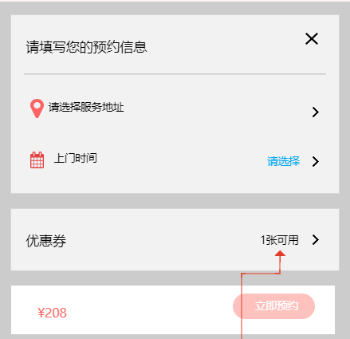

以上模块中服务管理是本项目特有的，服务人员或机构抢到订单后根据预约时间上门进行服务，服务管理模块是对家政服务的过程进行跟踪管理，服务人员抢单成功生成服务单，服务管理就是对服务单的管理。

## 2.确定目标

本章的目标对订单管理本身管理的业务进行总结和学习，除了订单导出、统计分析、历史订单我们需要从头学习，其它模块重点进行总结。

## 3.小结

能说出订单模块涉及到的业务有哪些？

# 二、基础设计 

如何对订单模块进行设计，通常从基础设计开始，本节从订单状态、订单数据库等几个方面入手进行设计。

## 1.订单状态流转

产品经理通常以订单的生命周期为线索进行管理，首先根据业务梳理订单的状态流转。

### 1.1.订单状态流转图

下图是产品经理设计的订单的状态流转图：

订单状态用黑色表示，订单相关的支付状态为紫色表示，订单相关的服务单状态用绿色表示。

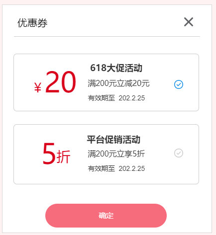

订单状态：0：待支付，100：派单中，200：待服务，300：服务中，500：订单完成，600：已取消，700：已关闭。

支付状态：2：未支付，4：支付成功

服务单状态：0：待分配，1：待服务，2：服务中，3：服务完成，4：取消

### 1.2订单状态

订单状态共有7种，如下图：

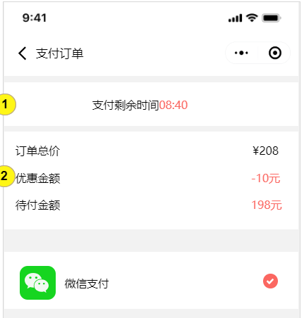

待支付：用户下单成功，该订单的初始状态为待支付。

派单中：用户支付成功后订单的状态由待支付变为派单中。

待服务：服务人员或机构抢单成功订单的状态由派单中变为待服务。

服务中：服务人员开始服务，订单状态变为服务中。

订单完成：服务人员完成服务，订单状态变为订单完成。

已取消：订单是待支付状态时用户取消订单，订单状态变为已取消。

已关闭：订单已支付状态下取消订单后订单状态变为已关闭。

### 1.3.服务单状态

服务人员抢单成功或系统派单成功将生成订单对应的服务单，服务单状态如下：

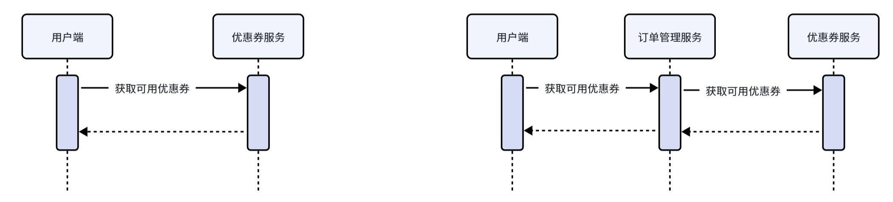

待分配：机构抢单成功后服务单的初始状态

待服务：服务人员抢单成功后服务单的初始状态

服务中：服务人员现场开始服务后服务单的状态

服务完成：服务人员服务完成后服务单的状态

已取消：用户取消订单或运营人员取消订单后的服务单状态

### 1.4.小结

订单的状态是怎么流转的？

## 2.数据库设计

### 2.1.表设计

在设计订单表时通常采用的结构是订单主表与订单明细表一对多关系结构，由于本项目中一个订单中只包括一种家政服务，所以无须记录订单明细的信息只设计订单表。

详细的订单表设计方法参考第四章相关内容。

1.订单表设计

```sql
create table `jzo2o-orders`.orders
(
    id               bigint                             not null comment '订单id'
        constraint `PRIMARY`
        primary key,
    user_id          bigint                             not null comment '订单所属人',
    serve_type_id    bigint                             null comment '服务类型id',
    serve_type_name  varchar(50)                        null comment '服务类型名称',
    serve_item_id    bigint                             not null comment '服务项id',
    serve_item_name  varchar(50)                        null comment '服务项名称',
    serve_item_img   varchar(255)                       null comment '服务项图片',
    unit             int                                null comment '服务单位',
    serve_id         bigint                             not null comment '服务id',
    orders_status    int                                not null comment '订单状态，0：待支付，100：派单中，200：待服务，300：服务中，400：待评价，500：订单完成，600：已取消，700：已关闭',
    pay_status       int                                null comment '支付状态，2：待支付，4：支付成功',
    refund_status    int                                null comment '退款状态 1退款中 2退款成功 3退款失败',
    price            decimal(10, 2)                     not null comment '单价',
    pur_num          int      default 1                 not null comment '购买数量',
    total_amount     decimal(10, 2)                     not null comment '订单总金额',
    real_pay_amount  decimal(10, 2)                     not null comment '实际支付金额',
    discount_amount  decimal(10, 2)                     not null comment '优惠金额',
    city_code        varchar(20)                        not null comment '城市编码',
    serve_address    varchar(255)                       not null comment '服务详细地址',
    contacts_phone   varchar(20)                        not null comment '联系人手机号',
    contacts_name    varchar(255)                       not null comment '联系人姓名',
    serve_start_time datetime                           not null comment '服务开始时间',
    lon              double(10, 5)                      null comment '经度',
    lat              double(10, 5)                      null comment '纬度',
    pay_time         datetime                           null comment '支付时间',
    evaluation_time  datetime                           null comment '评价时间',
    trading_order_no bigint                             null comment '支付服务交易单号',
    transaction_id   varchar(50)                        null comment '第三方支付的交易号',
    refund_no        bigint                             null comment '支付服务退款单号',
    refund_id        varchar(50)                        null comment '第三方支付的退款单号',
    trading_channel  varchar(50)                        null comment '支付渠道',
    display          int      default 1                 null comment '用户端是否展示，1：展示，0：隐藏',
    sort_by          bigint                             null comment '排序字段，serve_start_time秒级时间戳+订单id后六位',
    create_time      datetime default CURRENT_TIMESTAMP not null,
    update_time      datetime default CURRENT_TIMESTAMP not null on update CURRENT_TIMESTAMP
)
    comment '订单表' charset = utf8mb4;
```

2.服务单表设计

服务单表记录了服务人员进行家政服务的过程。

表结构如下：

```sql
-- 服务任务 
-- auto-generated definition
create table orders_serve_0
(
    id                      bigint                             not null comment '任务id'
        primary key,
    user_id                 bigint                             null comment '属于哪个用户',
    serve_provider_id       bigint                             not null comment '服务人员或服务机构id',
    serve_provider_type     int                                null comment '服务者类型，2：服务端服务，3：机构端服务',
    institution_staff_id    bigint                             null comment '机构服务人员id',
    orders_id               bigint                             null comment '订单id',
    orders_origin_type      int                                not null comment '订单来源类型，1：抢单，2：派单',
    city_code               varchar(50)                        not null comment '城市编码',
    serve_type_id           bigint                             not null comment '服务分类id',
    serve_start_time        datetime                           null comment '预约时间',
    serve_item_id           bigint                             not null comment '服务项id',
    serve_status            int                                not null comment '任务状态',
    settlement_status       int      default 0                 not null comment '结算状态，0：不可结算，1：待结算，2：结算完成',
    real_serve_start_time   datetime                           null comment '实际服务开始时间',
    real_serve_end_time     datetime                           null comment '实际服务完结时间',
    serve_before_imgs       json                               null comment '服务前照片',
    serve_after_imgs        json                               null comment '服务后照片',
    serve_before_illustrate varchar(255)                       null comment '服务前说明',
    serve_after_illustrate  varchar(255)                       null comment '服务后说明',
    cancel_time             datetime                           null comment '取消时间,可以是退单，可以是取消时间',
    orders_amount           decimal(10, 2)                     null comment '订单金额',
    pur_num                 int                                null comment '购买数量',
    create_time             datetime default CURRENT_TIMESTAMP null comment '创建时间',
    update_time             datetime default CURRENT_TIMESTAMP null on update CURRENT_TIMESTAMP comment '更新时间',
    sort_by                 bigint                             null comment '排序字段（serve_start_time（秒级时间戳）+订单id（后6位））',
    display                 int      default 1                 null comment '服务端/机构端是否展示，1：展示，0：隐藏',
    is_deleted              int      default 0                 null comment '是否是逻辑删除',
    update_by               bigint                             null comment '更新人'
)
    comment '服务任务' charset = utf8mb4;
```

### 2.2.分库分表

为了解决日益增长的订单数据对系统造成的瓶颈，在系统架构时设计分库分表的技术方案。

对订单表、服务单表进行分库分表。

订单表分库分表方案：

分库方案：

设计三个数据库，根据用户id哈希，分库表达式为：db\_用户id % 3

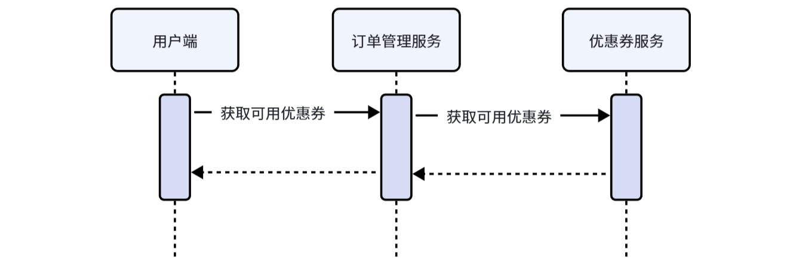

参考历史经验，前期设计三个数据库，每个数据库使用主从结构部署，可以支撑项目3年左右的运行，虽然哈希存在数据迁移问题，在很长一段时间也不用考虑这个问题。

分表方案：

根据订单范围分表，0\-\-\-1500万落到table\_0，1500万\-\-\-3000万落到table\_1，依次类推。根据范围分表不存在数据库迁移问题，方便系统扩容。

分表表达式：orders\_$\{\(int\)Math\.floor\(id % 10000000000 / 15000000\)\}

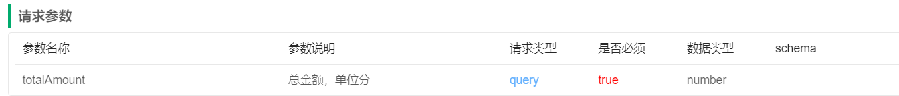

整体方案如下图：

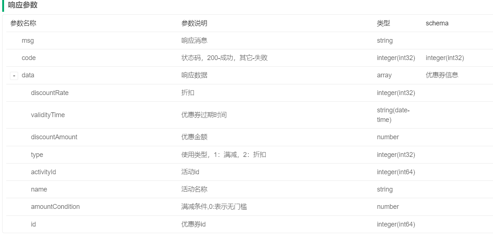

服务单表分库分表方案：

分库方案：

设计三个数据库, 根据服务人员id哈希，分库表达式：jzo2o\-orders\-$\{serve\_provider\_id % 3\}

分表方案：

根据订单范围分表，0\-\-\-1500万落到table\_0，1500万\-\-\-3000万落到table\_1，依次类推。

orders\_serve\_$\{\(int\)Math\.floor\(id % 10000000000 / 15000000\)\}

### 2.3.小结

订单模块数据库的分库分表方案是什么？

## 3.状态机设计

### 3.1.订单状态机

当订单的状态非常多且变化关系复杂时就非常有必要使用状态机来管理订单状态，这样可以避免代码中对状态变更的硬编码，提高系统的可扩展可维护性。

本项目基于状态机设计模式开发了状态机组件，状态机设计模式描述了一个对象在内部状态发生变化时如何改变其行为，将状态之间的变更定义为事件，将事件暴露出去，通过执行状态变更事件去更改状态，这是状态机设计模式的核心内容。

1.设计状态机表

在状态机表中记录订单的当前状态。

```sql
create table `jzo2o-orders`.state_persister
(
    id                 bigint auto_increment comment '主键'
        constraint `PRIMARY`
        primary key,
    state_machine_name varchar(255)                       null comment '状态机名称',
    biz_id             varchar(255)                       null comment '业务id',
    state              varchar(255)                       null comment '状态',
    create_time        datetime default CURRENT_TIMESTAMP null comment '创建时间',
    update_time        datetime default CURRENT_TIMESTAMP null on update CURRENT_TIMESTAMP comment '更新时间',
    constraint 唯一索引
        unique (state_machine_name, biz_id)
)
    comment '状态机持久化表' charset = utf8mb4;
```

在状态机表中记录订单的状态，状态机表也进行分库分表

分库方案：

设计三个数据库, 按db\_shard\_id哈希决定数据库，分库表达式：jzo2o\-orders\-$\{db\_shard\_id % 3\}，db\_shard\_id即用户的id

分表方案：

同订单的分表方案，按范围分表，分表表达式为：biz\_snapshot\_$\{\(int\)Math\.floor\(\(Long\.valueOf\(biz\_id\)\)  % 10000000000 / 15000000\)\}

2.首先定义订单状态枚举类

```java
package com.jzo2o.orders.base.enums;

import com.jzo2o.statemachine.core.StatusDefine;
import lombok.AllArgsConstructor;
import lombok.Getter;
 
@Getter
@AllArgsConstructor
public enum OrderStatusEnum implements StatusDefine {
    NO_PAY(0, "待支付", "NO_PAY"),
    DISPATCHING(100, "派单中", "DISPATCHING"),
    NO_SERVE(200, "待服务", "NO_SERVE"),
    SERVING(300, "服务中", "SERVING"),
    FINISHED(500, "已完成", "FINISHED"),
    CANCELED(600, "已取消", "CANCELED"),
    CLOSED(700, "已关闭", "CLOSED");

    private final Integer status;
    private final String desc;
    private final String code;

    /**
     * 根据状态值获得对应枚举
     *
     * @param status 状态
     * @return 状态对应枚举
     */
    public static OrderStatusEnum codeOf(Integer status) {
        for (OrderStatusEnum orderStatusEnum : values()) {
            if (orderStatusEnum.status.equals(status)) {
                return orderStatusEnum;
            }
        }
        return null;
    }
}
```

3.定义状态变更事件枚举类

```java
package com.jzo2o.orders.base.enums;

import com.jzo2o.statemachine.core.StatusChangeEvent;
import lombok.AllArgsConstructor;
import lombok.Getter;
 
@Getter
@AllArgsConstructor
public enum OrderStatusChangeEventEnum implements StatusChangeEvent {
    PAYED(OrderStatusEnum.NO_PAY, OrderStatusEnum.DISPATCHING, "支付成功", "payed"),
    DISPATCH(OrderStatusEnum.DISPATCHING, OrderStatusEnum.NO_SERVE, "接单/抢单成功", "dispatch"),
    START_SERVE(OrderStatusEnum.NO_SERVE, OrderStatusEnum.SERVING, "开始服务", "start_serve"),
    COMPLETE_SERVE(OrderStatusEnum.SERVING, OrderStatusEnum.NO_EVALUATION, "完成服务", "complete_serve"),
    CANCEL(OrderStatusEnum.NO_PAY, OrderStatusEnum.CANCELED, "取消订单", "cancel"),
    SERVE_PROVIDER_CANCEL(OrderStatusEnum.NO_SERVE, OrderStatusEnum.DISPATCHING, "服务人员/机构取消订单", "serve_provider_cancel"),
    CLOSE_DISPATCHING_ORDER(OrderStatusEnum.DISPATCHING, OrderStatusEnum.CLOSED, "派单中订单关闭", "close_dispatching_order"),
    CLOSE_NO_SERVE_ORDER(OrderStatusEnum.NO_SERVE, OrderStatusEnum.CLOSED, "待服务订单关闭", "close_no_serve_order"),
    CLOSE_SERVING_ORDER(OrderStatusEnum.SERVING, OrderStatusEnum.CLOSED, "服务中订单关闭", "close_serving_order"),
    CLOSE_FINISHED_ORDER(OrderStatusEnum.FINISHED, OrderStatusEnum.CLOSED, "已完成订单关闭", "close_finished_order");

    /**
     * 源状态
     */
    private final OrderStatusEnum sourceStatus;

    /**
     * 目标状态
     */
    private final OrderStatusEnum targetStatus;

    /**
     * 描述
     */
    private final String desc;

    /**
     * 代码
     */
    private final String code;
}
```

4.定义事件变更动作类

拿order\_payed事件对应的动作类说明，如下代码：

动作类的bean名称为"状态机名称\_事件名称"，例如下边的动作类bean的名称为order\_payed，表示order状态机的payed事件。

根据事件名称找到事件的定义，如下：

PAYED\(OrderStatusEnum\.NO\_PAY, OrderStatusEnum\.DISPATCHING, "支付成功", "payed"\)

通过事件的定义可知 原始状态为OrderStatusEnum\.NO\_PAY\(未支付\)，目标状态为OrderStatusEnum\.DISPATCHING（派单中），支付成功事件执行后将从原始状态改为目标状态。

```java
package com.jzo2o.orders.base.handler;

import cn.hutool.db.DbRuntimeException;
import com.jzo2o.orders.base.enums.OrderPayStatusEnum;
import com.jzo2o.orders.base.enums.OrderStatusEnum;
import com.jzo2o.orders.base.model.dto.OrderSnapshotDTO;
import com.jzo2o.orders.base.model.dto.OrderUpdateStatusDTO;
import com.jzo2o.orders.base.service.IOrdersCommonService;
import com.jzo2o.statemachine.core.StateMachineSnapshot;
import com.jzo2o.statemachine.core.StatusChangeEvent;
import com.jzo2o.statemachine.core.StatusChangeHandler;
import lombok.extern.slf4j.Slf4j;
import org.springframework.stereotype.Component;

import javax.annotation.Resource;
import java.time.LocalDateTime;

/**
 * 订单支付成功处理器
 **/
@Slf4j
@Component("order_payed")
public class OrderPayedHandler implements StatusChangeHandler<OrderSnapshotDTO> {
    @Resource
    private IOrdersCommonService ordersService;

    /**
     * 订单支付处理逻辑
     *
     * @param bizId   业务id
     * @param statusChangeEventEnum   状态变更事件
     * @param bizSnapshot 快照
     */
    @Override
    public void handler(String bizId, StatusChangeEvent statusChangeEventEnum, OrderSnapshotDTO bizSnapshot) {
        log.info("支付事件处理逻辑开始，订单号：{}", bizId);
        // 修改订单状态和支付状态
        OrderUpdateStatusDTO orderUpdateStatusDTO = OrderUpdateStatusDTO.builder().id(Long.valueOf(bizId))
                .originStatus(OrderStatusEnum.NO_PAY.getStatus())
                .targetStatus(OrderStatusEnum.DISPATCHING.getStatus())
                .payStatus(OrderPayStatusEnum.PAY_SUCCESS.getStatus())
                .payTime(LocalDateTime.now())
                .tradingOrderNo(bizSnapshot.getTradingOrderNo())
                .transactionId(bizSnapshot.getThirdOrderId())
                .tradingChannel(bizSnapshot.getTradingChannel())
                .build();
        int result = ordersService.updateStatus(orderUpdateStatusDTO);
        if (result <= 0) {
            throw new DbRuntimeException("支付事件处理失败");
        }
    }


}
```

其它动作类在jzo2o\-orders\-base工程下：

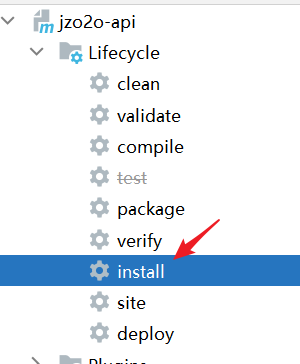

5.使用订单状态机

首先定义订单状态机类

AbstractStateMachine状态机抽象类是状态机的核心类，是具体的状态机要继承的抽象类，比如我们实现订单状态机就需要继承AbstractStateMachine抽象类。

```java
package com.jzo2o.orders.base.config;


/**
 * 订单状态机
 **/
@Component
public class OrderStateMachine extends AbstractStateMachine<OrderSnapshotDTO> {

 
    public OrderStateMachine(StateMachinePersister stateMachinePersister, BizSnapshotService bizSnapshotService, RedisTemplate redisTemplate) {
        super(stateMachinePersister, bizSnapshotService, redisTemplate);
    }

    /**
     * 设置状态机名称
     *
     * @return 状态机名称
     */
    @Override
    protected String getName() {
        return "order";
    }

    @Override
    protected void postProcessor(OrderSnapshotDTO orderSnapshotDTO) {

    }

    /**
     * 设置状态机初始状态
     *
     * @return 状态机初始状态
     */
    @Override
    protected OrderStatusEnum getInitState() {
        return OrderStatusEnum.NO_PAY;
    }

}
```

下边通过OrderStateMachine 去使用状态机：

启动状态机：调用OrderStateMachine的start\(\)方法启动一个订单的状态机，表示此订单的状态交由状态机管理并且设置初始状态

```java
//启动状态机，指定订单id
String start = orderStateMachine.start("101");
log.info("返回初始状态:{}", start);
```

变更状态：

调用OrderStateMachine的changeStatus\(\)方法通过状态变更事件去变更状态，自动执行状态变更事件的动作方法，最终更新订单的状态。

```java
//状态变更，指定状态变更事件
orderStateMachine.changeStatus("101",OrderStatusChangeEventEnum.PAYED);
```

执行此方法：

state\_persister表中101订单的状态变更为DISPATCHING。

biz\_snapshot表多了一条101号订单的快照信息。

### 3.2.订单快照

1.定义快照类

订单快照是订单变化瞬间的状态及相关信息。

通过订单快照可以查询订单当前状态下的信息，以及历史某个状态下的订单信息。

快照基础类型是StateMachineSnapshot，如果我们要实现订单快照则需要定义一个订单快照类OrderSnapshotDTO 去继承StateMachineSnapshot类型，代码如下：

```Java
package com.jzo2o.orders.base.model.dto;

import com.jzo2o.statemachine.core.StateMachineSnapshot;
import io.swagger.annotations.ApiModelProperty;
import lombok.AllArgsConstructor;
import lombok.Builder;
import lombok.Data;
import lombok.NoArgsConstructor;

import java.math.BigDecimal;
import java.time.LocalDateTime;

/**
 * 订单快照
 **/
@Data
@Builder
@NoArgsConstructor
@AllArgsConstructor
public class OrderSnapshotDTO extends StateMachineSnapshot {
....
```

2.保存订单快照

在启动状态机时指定快照：

```java
/**
 * 状态机初始化，并保存业务快照，快照分库分表
 *
 * @param dbShardId   分库键
 * @param bizId       业务id
 * @param bizSnapshot 业务快照
 * @return 初始化状态代码
 */
public String start(Long dbShardId, String bizId, T bizSnapshot) {
    return start(dbShardId, bizId, initState, bizSnapshot);
}
```

在变更状态时指定新的快照：

```java
/**
 * 变更状态并保存快照，快照分库分表
 *
 * @param dbShardId             分库键
 * @param bizId                 业务id
 * @param statusChangeEventEnum 状态变换事件
 * @param bizSnapshot           业务数据快照（json格式）
 */
public void changeStatus(Long dbShardId, String bizId, StatusChangeEvent statusChangeEventEnum, T bizSnapshot) {
...
}
```

3.使用订单快照

在查询订单详情时通过查询订单快照，并且对快照信息进行缓存提高查询性能。

下边的代码是状态机提供的查询快照的方法：

```java
/**
 * 获取当前状态的快照缓存
 *
 * @param bizId 业务id
 * @return 快照信息
 */
public String getCurrentSnapshotCache(String bizId) {
    //先查询缓存，如果缓存没有就查询数据库然后存缓存
    String key = "JZ_STATE_MACHINE:" + name + ":" + bizId;
    Object object = redisTemplate.opsForValue().get(key);
    if (ObjectUtil.isNotEmpty(object)) {
        return object.toString();
    }

    String bizSnapshot = getCurrentSnapshot(bizId);
    redisTemplate.opsForValue().set(key, bizSnapshot, 30, TimeUnit.MINUTES);
    return bizSnapshot;
}
```

在查询订单详情方法\(部分代码\)中调用状态机的查询快照方法：

```java
/**
 * 根据订单id查询
 *
 * @param id 订单id
 * @return 订单详情
 */
@Override
public OrderResDTO getDetail(Long id) {
    //从快照中查询订单数据
    String jsonResult = orderStateMachine.getCurrentSnapshotCache(String.valueOf(id));
    OrderSnapshotDTO orderSnapshotDTO = JSONUtil.toBean(jsonResult, OrderSnapshotDTO.class);
    ...
}
```

### 3.3.小结

状态机组件是怎么实现的？

# 三、具体业务

## 1.创建订单

完成创建订单的设计与开发需要从下边几个方面入手。

### 1.1.订单号生成规则

常见的订单号生成规则

1.自增数字序列

使用数据库的自增主键或者其他递增的数字序列作为订单号的一部分。例如，订单号可以是"202310280001"，其中"20231028"表示日期，"0001"是自增的订单序号。

2.时间戳\+随机数

将年月日时分秒和一定范围内的随机数组合起来。例如，订单号可以是"20181028124523" \+ "1234"，其中"20181028124523"表示日期和时间，"1234"是随机生成的数字。

3.订单类型\+日期\+序号

将订单类型（例如"01"表示普通订单，"02"表示VIP订单等）、日期和序号组合起来。例如，订单号可以是"0101028100001"，其中"01"表示订单类型，"20181028"表示日期，"00001"是序号。

4.分布式唯一ID生成器

使用分布式唯一ID生成器（例如Snowflake算法）生成全局唯一的ID作为订单号。这种方法保证了在分布式系统中生成的订单号的唯一性和有序性。

本项目订单号生成规则如下：

19位：2位年\+2位月\+2位日\+13位序号

例如：2311011000000000001

实现方案：

- 前6位通过当前时间获取。

- 后13位通过Redis的INCR 命令实现。


### 1.2.价格计算

分两种情况：

1.未使用优惠券：

实际支付金额=订单总金额

订单总金额=服务单价 \* 数量

2.使用优惠券：

实际支付金额=订单总金额\-优惠金额。

订单总金额=服务单价 \* 数量

优惠金额：调用优惠券服务接口进行计算，分两种情况：满减和折扣。

### 1.3.优惠券核销\(分布式事务\)

1.分布式事务解决方案

如果使用了优惠券需要请求优惠券服务的核销接口进行优惠券核销。

下单与优惠券核销组成分布式事务，进行分布式事务控制，根据需求分布式事务控制满足AP，即强调的是可用性,允许出现短暂不一致，最终达到数据一致性。

如何实现AP？

- 使用MQ或定时任务，一方先成功另一方最终成功

- 使用seata，一方成功另一个方失败，成功方进行回滚

根据需求，订单创建成功可能存在优惠券被使用的问题（虽然可能性极低），所以使用第二种方案，使用seata进行分布式事务控制。

2.Seata控制分布式事务

执行流程如下：

Seata事务管理中有三个重要的角色：

- TC \(Transaction Coordinator\) \- 事务协调者：维护全局和分支事务的状态，协调全局事务提交或回滚。

- TM \(Transaction Manager\) \- 事务管理器：定义全局事务的范围、开始全局事务、提交或回滚全局事务。

- RM \(Resource Manager\) \- 资源管理器：管理分支事务处理的资源，与TC交互注册分支事务和报告分支事务的状态，并驱动分支事务提交或回滚。

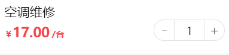

说明：

1）事务管理器（TM）开启全局事务

2）事务管理器（TM）请求RM执行分支事务

下单RM：先向事务协调器（TC）注册下单分支事务，并执行sql\(记录undo log\)，并向TC报告事务状态

undo log：用于回滚事务使用，下单sql是插入记录，根据undo log会生成反向sql删除记录，通过执行反向sql实现回滚事务。

优惠券RM：先向事务协调器（TC）注册优惠券核销分支事务，并执行sql\(记录undo log\)，并向TC报告事务状态

3）事务管理器（TM）请求TC提交全局事务

4）TC检查分支事务状态，如果发现都成功则请求每个RM提交事务（删除undo log），如果发现其中有失败记录则请求每个RM回滚事务，RM回滚事务的方法是通过undo log执行提交事务的反向sql。

3.Seata的使用方法

第一步安装TC事务协调器：参考前面章节 “优惠券核销事务控制实现”

启动命令：docker start seata\-server 

第二步为每个RM创建undo\_log表:

在订单数据库和优惠券数据库分别创建undo\_log表。

第三步在Service方法中使用@GlobalTransactional开启全局事务。

```java
@GlobalTransactional
public void addWithCoupon(Orders orders, Long couponId) {
...
}
```

### 1.4.防止订单重复提交

什么情况下会重复提交订单？

以下情况会导致重复提交相同的订单：

网络延迟或不稳定： 当用户点击提交按钮后，由于网络延迟或不稳定，前端可能在等待服务端响应时，用户误以为操作未成功，多次点击提交按钮。

重复点击按钮： 用户可能会因为页面加载缓慢或其他原因感到不耐烦，多次点击提交按钮，导致重复提交订单。

页面刷新后的再次提交： 用户在订单提交后，如果刷新页面，浏览器可能会重新发送上一次的表单提交请求，导致订单的重复提交。

如何防止重复提交相同的订单？

通常需要在前端和后端共同去完成：

1.前端防重复提交

禁用提交按钮： 在用户点击提交按钮后，立即将按钮禁用，防止用户多次点击。

显示加载中状态： 提交按钮点击后，显示加载中状态，防止用户再次点击。

2.后端防重复提交

使用分布式锁：以用户id\+服务id作为分布式锁锁定下单接口10秒，10秒内该用户不能再次下同一个服务的订单。

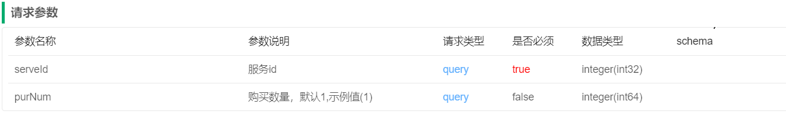

### 1.5.小结

1.下单接口是怎么实现的？

2.怎么防止订单重复提交？

## 2.订单支付

订单支付功能的设计与开发从以下几个方面入手

### 2.1.对接第三方支付接口

通常项目会开发独立的支付服务对接第三方支付接口，如：微信、支付宝、聚合支付平台等。对于小程序支付需要对接微信的小程序支付接口，对于APP支付和PC网站支付可以对接微信、支付宝或第三方聚合支付平台。

根据授课的需求项目对接的是扫码支付接口，但一定要注意如果项目使用小程序支付一定要对接微信的小程序支付接口。

当然，不管对接是扫码支付还是小程序支付 其方法都是大同小异。

下边总结对接第三方支付接口有哪些：

1.下单接口

业务系统请求第三方支付平台下单，第三方支付平台创建本次支付的交易订单。

2.支付通知

第三方支付平台将支付结果通知给业务系统。

3.支付结果查询

业务系统主动请求第三方支付平台查询支付结果，可以根据业务系统的订单也可以根据第三方支付平台的订单去查询。

4.关闭订单

业务系统请求第三方支付平台关闭订单后此订单将无法继续支付。

5.退款申请

业务系统请求第三方支付平台申请退款，申请退款需要请求第三方支付平台的订单号，可以部分退款，分多次退款，但退款金额不会大于支付金额。

6.申请交易账单 

业务系统请求第三方支付平台申请交易账单 的目的是为了进行对账，即业务系统自己记录的订单和金额与第三方支付平台记录的订单是否一致。

### 2.2.如何保证接口安全性

第三方支付平台除了使用https协议进行加密传输以外，还通过接口签名以及敏感参数加密的方式保证接口的安全性。

拿 微信支付接口为例，请求任何微信支付接口都需要对请求参数进行签名，微信会进行验签，如果通过才会进行业务处理。

详细参见：https://pay.weixin.qq.com/docs/merchant/development/interface-rules/signature-generation.html

1.什么是签名和验签

签名是对原始数据通过签名算法生成的一段数据（签名串），用于证明数据的真实性和完整性。签名通常使用密钥进行生成，这个密钥可以是对称密钥或非对称密钥。

验签是对签名串进行验证的过程，用于确认数据的真实性和完整性。验签的过程通常使用与签名过程中相对应的公钥进行解密。

签名和验签是为了防止内容被篡改。

签名和验签是为了防止内容被篡改。

参考微信支付的文档，签名方式如下：

第一步生成签名串：

签名串一共有五行，每一行为一个参数。结尾以`\n`（换行符，ASCII编码值为0x0A）结束，包括最后一行。如果参数本身以`\n`结束，也需要附加一个`\n`。

```Bash
HTTP请求方法\n
URL\n
请求时间戳\n
请求随机串\n
请求报文主体\n

示例：
GET\n 
2/v3/certificates\n 
31554208460\n 
4593BEC0C930BF1AFEB40B4A08C8FB242\n 
5\n
```

第二步计算签名值

使用商户私钥对待签名串进行SHA256 with RSA签名，并对签名结果进行Base64编码得到签名值。

第三步请求设置http头

通过HTTP Authorization头来传递签名信息，如下：

```JSON
Authorization: 认证类型 签名信息
```

示例：

```JSON
Authorization: WECHATPAY2-SHA256-RSA2048 mchid="1900009191",nonce_str="593BEC0C930BF1AFEB40B4A08C8FB242",signature="uOVRnA4qG/MNnYzdQxJanN+zU+lTgIcnU9BxGw5dKjK+VdEUz2FeIoC+D5sB/LN+nGzX3hfZg6r5wT1pl2ZobmIc6p0ldN7J6yDgUzbX8Uk3sD4a4eZVPTBvqNDoUqcYMlZ9uuDdCvNv4TM3c1WzsXUrExwVkI1XO5jCNbgDJ25nkT/c1gIFvqoogl7MdSFGc4W4xZsqCItnqbypR3RuGIlR9h9vlRsy7zJR9PBI83X8alLDIfR1ukt1P7tMnmogZ0cuDY8cZsd8ZlCgLadmvej58SLsIkVxFJ8XyUgx9FmutKSYTmYtWBZ0+tNvfGmbXU7cob8H/4nLBiCwIUFluw==",timestamp="1554208460",serial_no="1DDE55AD98ED71D6EDD4A4A16996DE7B47773A8C"
```

微信支付收到请求根据请求头Authorization的内容进行验签，过程如下：

接收签名和原始数据： 接收到发送方发送的签名和原始数据。

生成 SHA\-256 摘要： 对接收到的原始数据应用 SHA\-256 哈希函数，生成摘要。

使用发送方的公钥进行验签： 通常签名是通过发送方的私钥生成的，验证方使用发送方的公钥来验证签名。

比较摘要： 将接收到的摘要与使用公钥运算得到的摘要进行比较。如果一致，说明签名有效，数据未被篡改。

同样，如果微信支付通知支付结果给业务系统，业务系统也需要使用SHA256 with RSA进行验签。

参考：https://pay.weixin.qq.com/docs/merchant/development/interface-rules/signature-verification.html

2.加密与解密

加密是将原始的、可读的数据（称为明文）通过某种算法和密钥转换成不可读的数据（称为密文）。加密的目的是防止未经授权的访问者能够理解或识别被加密的信息。加密算法通常基于密钥，有对称加密和非对称加密两种主要类型。

- 对称加密： 使用相同的密钥进行加密和解密。常见的对称加密算法包括 AES、DES、3DES。

- 非对称加密： 使用一对密钥，包括公钥和私钥，公钥用于加密，私钥用于解密，或者私钥用于加密，公钥用于解密。常见的非对称加密算法包括 RSA、ECC。

解密是加密的逆过程，即将密文还原为明文。只有持有正确密钥的人或系统能够进行解密操作。解密的目的是还原加密前的原始信息，使其能够被理解和使用。

加密与解密是为了防止内容被泄露，保证内容的机密性。

为了保证安全性，微信支付在回调通知和平台证书下载接口中，对关键信息进行了AES\-256\-GCM加密，商户收到报文后，要解密出明文，APIv3密钥是解密时使用的对称密钥。参考：https://pay.weixin.qq.com/docs/merchant/development/interface-rules/certificate-callback-decryption.html

### 2.3.支付服务的设计

关于支付服务的设计详细参考第四章 支付服务章节，下边总结要点。

1.使用SDK与微信支付对接

SDK封装了签名、验签、加密及解密的过程，使用SDK开发更加高效。

项目使用的SDK是wechatpay\-apache\-httpclient，地址： https://github.com/wechatpay-apiv3/wechatpay-apache-httpclient 

2.表设计

支付服务核心的表有支付渠道表、交易单表、退款记录表。

下边是数据流：

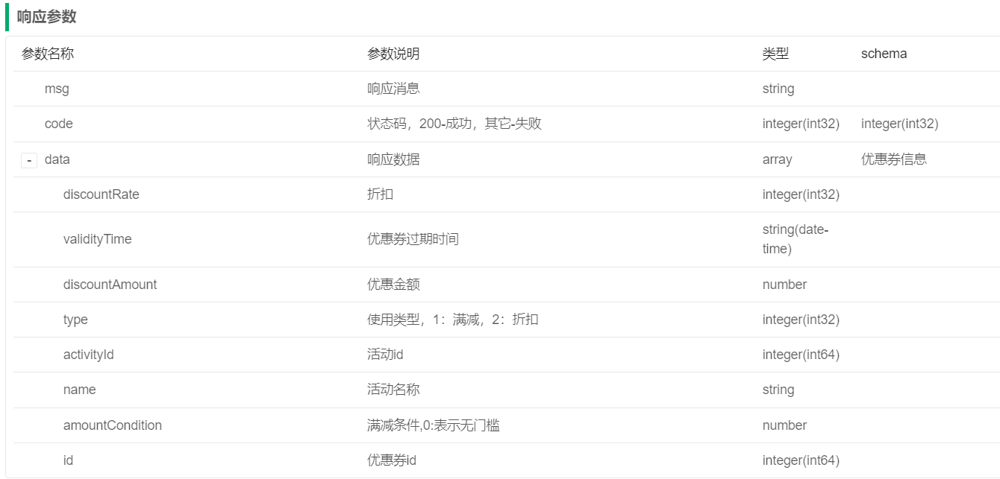

说明：

支付接口：收到支付请求后请求第三方支付的下单接口，并向交易单表新增记录。

查询交易结果接口：请求第三方支付的查询支付结果并更新交易单表的支付状态。

接收第三方通过支付结果：更新交易单表的支付状态。

退款接口：新增退款记录

更新退款状态：请求第三方退款结果查询接口查询退款状态，并更新退款状态。

具体的表结构参考：第四章 理解支付服务的设计。

3.接口设计

- 小程序下单接口

- 查询支付结果

- 退款申请接口

- 退款订单查询接口

4.支付服务防止重复支付设计

重复支付是一个订单客户支付多次，造成重复支付。

如果项目实现的是扫码支付，可能存在重复支付的问题，通过以下方式去避免重复支付：

- 同一个订单同一个支付渠道只生成一个支付二维码。

- 在请求第三方支付下单使用分布式锁控制不会重复请求第三方下单。

- 切换支付渠道时先关闭原渠道的交易单再生成新渠道的交易单。

- 使用定时任务每天扫描交易单表，如果存在多个支付成功的交易单则进行自动退款。


### 2.4.对接支付服务

使用支付服务的好处是支付服务与微信、支付宝等第三方平台一一对接，业务系统只需要对接支付服务即可，提高对接的效率。

首先支付服务配置支付渠道。

`jzo2o-trade.pay\_channel`是支付渠道表，默认提供微信、支付宝的支付参数。

其次请求支付服务的下单接口，如果是扫码支付则需要请求支付服务生成二维码。

最后通过MQ接收支付服务的支付结果通知，或业务系统主动请求支付服务查询支付结果。

### 2.5.小结

如何保证一个外部接口的安全性？

## 3.查询订单

### 3.1.单条订单查询优化方案

针对单条订单信息查询接口可以使用缓存进行优化。

对于单条订单信息查询接口通过快照查询接口查询订单的详情信息。

参考AbstractStateMachine类的String getCurrentSnapshotCache\(String bizId\)快照查询方法，将快照信息缓存到 redis提供查询效率。

根据订单Id查询缓存信息，先从缓存查询如果缓存没有则查询快照表的数据然后保存到缓存中。缓存设置了过期时间是30分钟。

当订单状态变更，此时订单最新状态的快照有变更，会删除快照缓存，当再次查询快照时从数据库查询最新的快照信息进行缓存。

### 3.2.用户端订单列表优化方案

使用滚动查询，一次查询指定数量的记录，不用进行count查询，省去count查询的消耗。

首先在订单表使用排序字段sort\_by作为滚动ID，滚动ID是一种递增的序列号，是按开始服务时间计算生成。

然后根据查询条件查询符合条件的订单ID，这里使用覆盖索引优化的方法。

最后对订单信息进行缓存，使用redis的hash结构存储订单信息。

保证缓存一致性：

当用户创建新订单删除该用户在redis的hash结构中的数据。

当用户的 订单状态发生变更则删除redis中hash结构中的订单数据库。

保证缓存一致性的代码在状态机中实现：

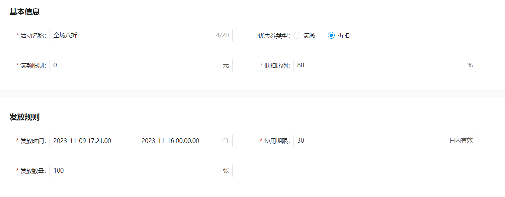

### 3.3.运营端订单列表优化方案

运营端订单列表由于访问量不大这里无需使用缓存，实现方案是首先通过覆盖索引查询符合条件的订单ID，再根据订单ID查询聚集索引拿到数据。

我们根据查询条件创建的联合字段索引是非聚集索引，先从非聚集索引中查询到符合条件的ID，再根据订单ID从聚集索引中查找数据。

### 4.小结

订单查询是如何优化的？

## 4.取消订单

### 4.1.取消订单技术方案

**需求分析**

在前面我们实现了取消订单功能，具体的需求如下：

待支付状态下取消订单: 

更改订单的状态为已取消。

订单已支付，状态为待派单时取消订单:  

更改订单的状态为已关闭。

请求支付服务自动退款。

完整的取消订单的需求如下图：

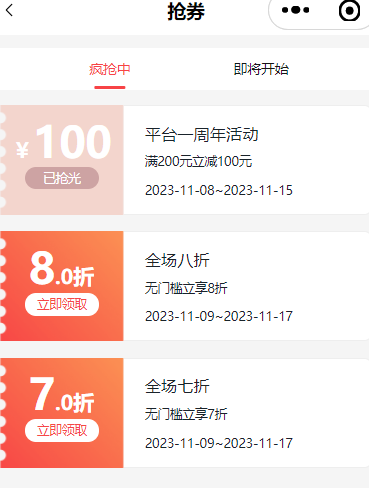

订单在不同状态下执行取消订单操作的需求：

1.待支付：

支付超时系统自动取消。

用户取消订单，订单状态改为已取消。

2.派单中：

用户和运营人员都可以取消订单，订单状态改为已关闭。

到达服务时间还没有派单成功系统自动取消。

取消订单后自动退款。

删除抢单池记录。

3.待服务：

用户和运营人员都可以取消订单，订单状态改为已关闭。

取消订单后自动退款。

4.服务中：

只有运营人员可以取消，订单状态改为已关闭。

取消订单后自动退款。

5.订单完成：

只有运营人员可以取消，订单状态改为已关闭。

取消订单后自动退款。

**技术分析**

根据上边的需求，下边分析订单取消功能。

订单的状态不同取消订单执行的逻辑可能不同

取消待支付的订单：

最终的结果是更改订单状态为已取消，因为没有支付所以不涉及退款。

消派单中的订单：

用户和运营人员都可以取消订单，订单状态改为已关闭。

到达服务时间还没有派单成功系统自动取消。

取消订单后自动退款。

删除抢单池记录。

操作用户不同其权限也不同

普通用户：可取消待支付、派单中、待服务的订单。

运营人员：可取消除待支付状态下的所有订单。

目前的代码如下：

```java
@Override
public void cancel(OrderCancelDTO orderCancelDTO) {
    //查询订单信息
    Orders orders = getById(orderCancelDTO.getId());
    if (ObjectUtil.isNull(orders)) {
        throw new DbRuntimeException("找不到要取消的订单,订单号：{}",orderCancelDTO.getId());
    }
    //将订单中的交易单号信息拷贝到orderCancelDTO
    orderCancelDTO.setTradingOrderNo(orders.getTradingOrderNo());
    orderCancelDTO.setRealPayAmount(orders.getRealPayAmount());
    //订单状态
    Integer ordersStatus = orders.getOrdersStatus();

    if(OrderStatusEnum.NO_PAY.getStatus()==ordersStatus){ //订单状态为待支付
        owner.cancelByNoPay(orderCancelDTO);
    }else if(OrderStatusEnum.DISPATCHING.getStatus()==ordersStatus){ //订单状态为派单中
        owner.cancelByDispatching(orderCancelDTO);
        //新启动一个线程请求退款
        ordersHandler.requestRefundNewThread(orders.getId());
    }else{
        throw new CommonException("当前订单状态不支持取消");
    }

}
```

根据完整的需求，如何完善上边的代码？

下边这样写是否合适？

```java
@Override
public void cancel(OrderCancelDTO orderCancelDTO) {
    //查询订单信息
    Orders orders = getById(orderCancelDTO.getId());
    if (ObjectUtil.isNull(orders)) {
        throw new DbRuntimeException("找不到要取消的订单,订单号：{}",orderCancelDTO.getId());
    }
    //将订单中的交易单号信息拷贝到orderCancelDTO
    orderCancelDTO.setTradingOrderNo(orders.getTradingOrderNo());
    orderCancelDTO.setRealPayAmount(orders.getRealPayAmount());
    //订单状态
    Integer ordersStatus = orders.getOrdersStatus();
    //获取当前用户
    CurrentUserInfo currentUserInfo = UserContext.currentUser();
    //用户类型
    Integer userType = currentUserInfo.getUserType();
    if(UserType.C_USER==userType){
        //普通用户取消订单
        if(OrderStatusEnum.NO_PAY.getStatus()==ordersStatus){ //订单状态为待支付
            owner.cancelByNoPay(orderCancelDTO);
        }else if(OrderStatusEnum.DISPATCHING.getStatus()==ordersStatus){ //订单状态为派单中
            owner.cancelByDispatching(orderCancelDTO);
            //新启动一个线程请求退款
            ordersHandler.requestRefundNewThread(orders.getId());
        }else if(OrderStatusEnum.NO_SERVE.getStatus()==ordersStatus){ //订单状态为待服务
            //...
        }else{
            throw new CommonException("当前订单状态不支持取消");
        }
    }else if(UserType.OPERATION==userType){
        if(OrderStatusEnum.DISPATCHING.getStatus()==ordersStatus) { //订单状态为派单中
            //...
        }else if(OrderStatusEnum.NO_SERVE.getStatus()==ordersStatus){//订单状态为待服务

        }
        //else if(){}
        //....
    }
}
```

虽然这样写代码也能实现需求但是扩展性很差，任意状态下取消订单的需求有变更都需要更改此方法，或者用户取消订单的权限有变更也需要更改此方法。

**策略模式**

针对上边这种因为不同的场景执行取消订单的逻辑不同可以使用策略模式实现。

策略模式作为一种软件设计模式，指对象有某个行为，但是在不同的场景中，该行为有不同的实现算法。

策略模式以下部分组成：

抽象策略角色： 策略类，通常由一个接口或者抽象类实现。

具体策略角色：包装了相关的算法和行为。

环境角色：持有一个策略类的引用，最终给客户端调用。

下边是一个例子：


策略接口

```Java
package com.jzo2o.orders.manager.strategy;
// 定义策略接口
public interface PaymentStrategy {
    void pay(BigDecimal amount);
}
```

具体策略类

```JSON
package com.jzo2o.orders.manager.strategy;

/**
 * 信用卡支付策略类
 */
public class CreditCardPayment implements PaymentStrategy {
 private String cardNumber;

 public CreditCardPayment(String cardNumber) {
  this.cardNumber = cardNumber;
 }

 @Override
 public void pay(BigDecimal amount) {
     System.out.println("信用卡:"+cardNumber+"支付金额:"+amount);
 }
}


/**
 *  微信支付策略类
 */
public class WeixinPayment implements PaymentStrategy {

 private String account;

 public WeixinPayment(String account) {
  this.account = account;
 }

 @Override
 public void pay(BigDecimal amount) {
  System.out.println("微信:"+account+"支付金额:"+amount);
 }
}
```

环境类

```java
// 环境类，负责维护策略接口
class ShoppingCart {
    private PaymentStrategy paymentStrategy;

    public void setPaymentStrategy(PaymentStrategy paymentStrategy) {
        this.paymentStrategy = paymentStrategy;
    }

    public void checkout(BigDecimal amount) {
        paymentStrategy.pay(amount);
    }
}
```

客户端代码

```java
package com.jzo2o.orders.manager.strategy;

/**
 * 使用策略模式的例子
 */
public class StrategyPatternExample {
    public static void main(String[] args) {
        // 创建环境类
        ShoppingCart shoppingCart = new ShoppingCart();

        // 选择支付策略--信用卡支付
        PaymentStrategy creditCardPayment = new CreditCardPayment("1234-5678-9876-5432");
        shoppingCart.setPaymentStrategy(creditCardPayment);

        // 进行支付
        shoppingCart.checkout(new BigDecimal(100));
        
        // 切换支付策略，使用微信支付
        PaymentStrategy weixinPayment = new WeixinPayment("example@example.com");
        shoppingCart.setPaymentStrategy(weixinPayment);
        
        // 进行支付
        shoppingCart.checkout(new BigDecimal(50));
    }
}
```

**取消订单使用策略模式**

学习了策略模式我们可以将取消订单定义为策略接口，针对不同场景下取消订单的逻辑定义为一个一个的策略类，如果哪个场景下的策略有变化只需要修改该策略类即可，如果增加场景也只需要增加策略类。

如下图：

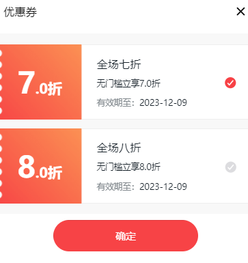

下边阅读代码：

1.取消订单策略接口

取消策略接口需要指定用户类型、订单状态及取消信息，根据用户类型和订单状态决定取消订单的逻辑。

```java
package com.jzo2o.orders.manager.strategy;

import com.jzo2o.orders.manager.model.dto.OrderCancelDTO;

/**
 * 订单取消策略类
 **/
public interface OrderCancelStrategy {
    /**
     * 订单取消
     *
     * @param orderCancelDTO 订单取消模型
     */
    void cancel(OrderCancelDTO orderCancelDTO);
}
```

OrderCancelDTO 类：

```java
package com.jzo2o.orders.manager.model.dto;

import lombok.AllArgsConstructor;
import lombok.Builder;
import lombok.Data;
import lombok.NoArgsConstructor;

import java.math.BigDecimal;
import java.time.LocalDateTime;

/**
 * 订单取消模型
 **/
@Data
@Builder
@NoArgsConstructor
@AllArgsConstructor
public class OrderCancelDTO {
    /**
     * 订单id
     */
    private Long id;

    /**
     * 用户id
     */
    private Long userId;

    /**
     * 当前用户id
     */
    private Long currentUserId;

    /**
     * 当前用户名称
     */
    private String currentUserName;

    /**
     * 当前用户类型
     */
    private Integer currentUserType;

    /**
     * 取消原因
     */
    private String cancelReason;

    /**
     * 预约服务开始时间
     */
    private LocalDateTime serveStartTime;

    /**
     * 实际支付金额
     */
    private BigDecimal realPayAmount;

    /**
     * 城市编码
     */
    private String cityCode;

    /**
     * 支付服务交易单号
     */
    private Long tradingOrderNo;
}
```

2.定义策略类

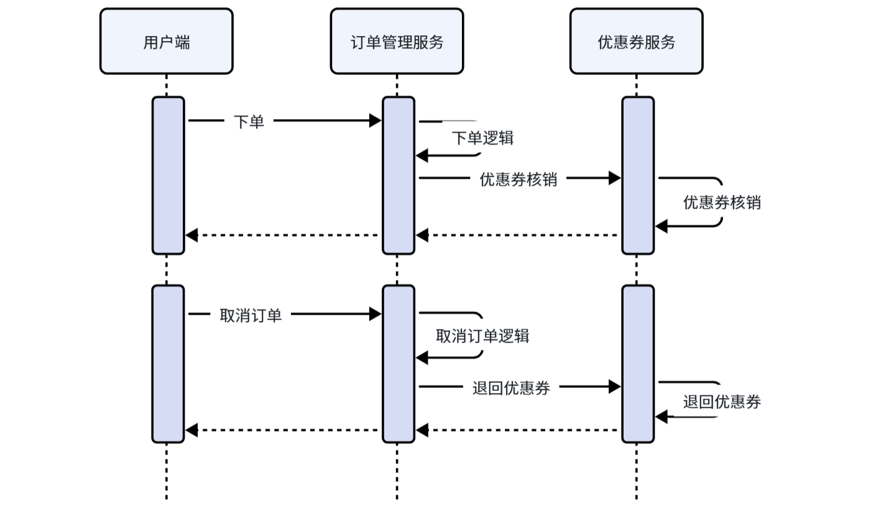

每个策略类定义的bean名称为“用户类型：订单状态”。

举例：

下边的策略类是普通用户针对待支付的订单进行取消。

@Component\("1:NO\_PAY"\)：定义bean的名称为1:NO\_PAY，1表示普通用户，NO\_PAY表示待支付订单。

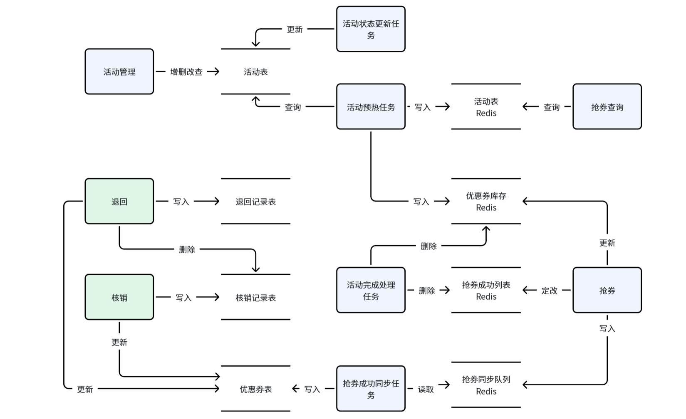

其它策略类也使用此方法定义bean的名称。

下边方法是该策略类针对策略接口的具体实现方法：

取消待支付的订单执行的动作有：更改订单的状态为已取消，添加取消订单记录。

```java
@Override
public void cancel(OrderCancelDTO orderCancelDTO) {
    //1.校验是否为本人操作
    if (ObjectUtil.notEqual(orderCancelDTO.getUserId(), orderCancelDTO.getCurrentUserId())) {
        throw new ForbiddenOperationException("非本人操作");
    }

    //2.构建订单快照更新模型
    OrderSnapshotDTO orderSnapshotDTO = OrderSnapshotDTO.builder()
            .cancellerId(orderCancelDTO.getCurrentUserId())
            .cancelerName(orderCancelDTO.getCurrentUserName())
            .cancellerType(orderCancelDTO.getCurrentUserType())
            .cancelReason(orderCancelDTO.getCancelReason())
            .cancelTime(LocalDateTime.now())
            .build();

    //3.保存订单取消记录
    OrdersCanceled ordersCanceled = BeanUtil.toBean(orderSnapshotDTO, OrdersCanceled.class);
    ordersCanceled.setId(orderCancelDTO.getId());
    ordersCanceledService.save(ordersCanceled);

    //4.订单状态变更
    orderStateMachine.changeStatus(orderCancelDTO.getUserId(), orderCancelDTO.getId().toString(), OrderStatusChangeEventEnum.CANCEL, orderSnapshotDTO);
}
```

3.策略的环境类

在环境类中管理了策略接口

```java
package com.jzo2o.orders.manager.strategy;

import cn.hutool.core.util.ObjectUtil;
import cn.hutool.extra.spring.SpringUtil;
import com.jzo2o.common.expcetions.ForbiddenOperationException;
import com.jzo2o.orders.base.enums.OrderStatusEnum;
import com.jzo2o.orders.base.model.domain.Orders;
import com.jzo2o.orders.manager.service.IOrdersManagerService;
import com.jzo2o.orders.manager.model.dto.OrderCancelDTO;
import com.jzo2o.orders.manager.strategy.OrderCancelStrategy;
import lombok.extern.slf4j.Slf4j;
import org.springframework.stereotype.Component;

import javax.annotation.PostConstruct;
import javax.annotation.Resource;
import java.util.HashMap;
import java.util.Map;

 
@Slf4j
@Component
public class OrderCancelStrategyManager {
    @Resource
    private IOrdersManagerService ordersManagerService;

    //key格式：userType+":"+orderStatusEnum，例：1：NO_PAY
    private final Map<String, OrderCancelStrategy> strategyMap = new HashMap<>();

    @PostConstruct
    public void init() {
        Map<String, OrderCancelStrategy> strategies = SpringUtil.getBeansOfType(OrderCancelStrategy.class);
        strategyMap.putAll(strategies);
        log.debug("订单取消策略类初始化到map完成！");
    }

    /**
     * 获取策略实现
     *
     * @param userType    用户类型
     * @param orderStatus 订单状态
     * @return 策略实现类
     */
    public OrderCancelStrategy getStrategy(Integer userType, Integer orderStatus) {
        String key = userType + ":" + OrderStatusEnum.codeOf(orderStatus).toString();
        return strategyMap.get(key);
    }

    /**
     * 订单取消
     *
     * @param orderCancelDTO 订单取消模型
     */
    public void cancel(OrderCancelDTO orderCancelDTO) {
        Orders orders = ordersManagerService.queryById(orderCancelDTO.getId());
        OrderCancelStrategy strategy = getStrategy(orderCancelDTO.getCurrentUserType(), orders.getOrdersStatus());
        if (ObjectUtil.isEmpty(strategy)) {
            throw new ForbiddenOperationException("不被许可的操作");
        }

        orderCancelDTO.setUserId(orders.getUserId());
        orderCancelDTO.setServeStartTime(orders.getServeStartTime());
        orderCancelDTO.setCityCode(orders.getCityCode());
        orderCancelDTO.setRealPayAmount(orders.getRealPayAmount());
        orderCancelDTO.setTradingOrderNo(orders.getTradingOrderNo());
        strategy.cancel(orderCancelDTO);
    }

}
```

@PostConstruct 是java自带的注解，此注解标记的方法用于在对象创建后依赖注入完成后执行一些初始化操作。

和@PostConstruct对应的还有一个@PreDestroy，是在bean销毁时调用，通常需要做一些释放资源的操作。

在init\(\)方法中取出所有的策略接口实现对象放入strategyMap 中，key为：userType\+":"\+orderStatusEnum，即bean的名称，value为对象本身。

查阅 cancel\(OrderCancelDTO orderCancelDTO\) 取消订单方法：

1.根据用户类型和订单状态取出策略类的对象

2.执行策略对象的cancel\(OrderCancelDTO orderCancelDTO\) 方法即执行取消订单操作。

**小结**

项目中用到设计模式了吗，具体说说？

### 4.2.取消订单优化

**使用策略模式实现取消订单**

修改取消订单的service方法：

由于取消优惠券核销需要使用分布式事务控制，分布式事务控制影响性能，这里将本地事务提交与分布式事务提交分开编写代码。

```java
@Slf4j
@Service
public class OrdersManagerServiceImpl extends ServiceImpl<OrdersMapper, Orders> implements IOrdersManagerService {
...
/**
 * 取消订单
 *
 * @param orderCancelDTO 取消订单模型
 */
@Override
public void cancel(OrderCancelDTO orderCancelDTO) {
    // 1.有优惠金额的回滚优惠券（当前优惠金额均来自优惠券）
    Orders orders = getById(orderCancelDTO.getId());
    if (ObjectUtils.isNull(orders.getDiscountAmount()) || orders.getDiscountAmount().compareTo(BigDecimal.ZERO) > 0) {
        CouponUseBackReqDTO couponUseBackReqDTO = new CouponUseBackReqDTO();
        couponUseBackReqDTO.setOrdersId(orderCancelDTO.getId());
        couponUseBackReqDTO.setUserId(orders.getUserId());
        //需要取消优惠券核销要使用分布式事务控制
        owner.cancelWithCoupon(orderCancelDTO, couponUseBackReqDTO);
    } else {
        //使用本地事务控制即可
        owner.cancelWithoutCoupon(orderCancelDTO);
    }

}

@Override
@GlobalTransactional
public void cancelWithCoupon(OrderCancelDTO orderCancelDTO, CouponUseBackReqDTO couponUseBackReqDTO) {
    couponApi.useBack(couponUseBackReqDTO);
    orderCancelStrategyManager.cancel(orderCancelDTO);
}

@Override
@Transactional
public void cancelWithoutCoupon(OrderCancelDTO orderCancelDTO) {
    orderCancelStrategyManager.cancel(orderCancelDTO);
}
...
```

**测试**

启动网关

启动jzo2o\-orders\-manager

启动jzo2o\-foundations

启动jzo2o\-customer

启动小程序

测试流程：

下单

取消订单

断点跟踪：

在策略环境对象中包括了所有策略实现对象。

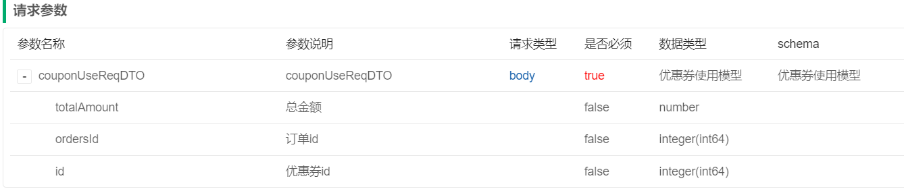

继续执行，根据订单状态和用户类型找到符合的策略对象：

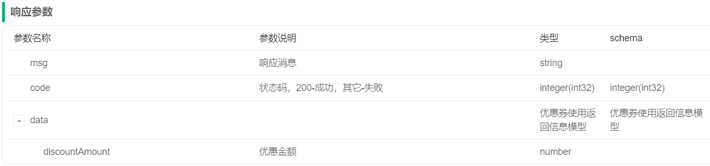

## 5.删除订单

### 5.1.需求分析

删除订单和取消订单不同，取消订单的目的是终止订单，删除订单是不希望订单信息出现订单列表中。

此需求通常是针对普通用户提供。

用户删除订单后订单信息将不在订单列表显示。

也有平台提供订单回收站查询功能，即查询已经删除的订单。

### 5.2.技术方案分析

根据需求，我们在订单表添加逻辑删除标记，删除订单相当于隐藏订单。

在订单表添加字段：display （1：展示，0：隐藏）

删除订单将此字段设置为0。

在订单列表中只查询display 为1的订单信息。

### 5.3.阅读代码

1.接口定义

```java
@RestController("consumerOrdersController")
@Api(tags = "用户端-订单相关接口")
@RequestMapping("/consumer/orders")
public class ConsumerOrdersController {
    ...    
    @PutMapping("/hide/{id}")
    @ApiOperation("订单删除（隐藏）")
    @ApiImplicitParams({
            @ApiImplicitParam(name = "id", value = "订单id", required = true, dataTypeClass = Long.class)
    })
    public void hide(@PathVariable("id") Long id) {
        CurrentUserInfo currentUserInfo = UserContext.currentUser();
        ordersManagerService.hide(id, currentUserInfo.getUserType(), currentUserInfo.getId());
    }
    ...
```

2.service方法实现 

```java
/**
 * 用户端-订单删除（隐藏）
 *
 * @param id       订单id
 * @param userType 用户类型
 * @param userId   用户id
 */
@Override
@Transactional
public void hide(Long id, Integer userType, Long userId) {
    //1.校验用户类型是否为普通用户
    if (ObjectUtil.notEqual(userType, UserType.C_USER)) {
        throw new ForbiddenOperationException("非普通用户不可操作");
    }

    //2.校验该操作是否为本人
    Orders orders = queryById(id);
    if (ObjectUtil.notEqual(userId, orders.getUserId())) {
        throw new ForbiddenOperationException("非本人不可操作");
    }

    //3.校验订单状态，只能取消状态、关闭状态才能删除
    if (ObjectUtil.notEqual(OrderStatusEnum.CANCELED.getStatus(), orders.getOrdersStatus()) && ObjectUtil.notEqual(OrderStatusEnum.CLOSED.getStatus(), orders.getOrdersStatus())) {
        throw new ForbiddenOperationException("订单非取消、关闭状态不可操作");
    }

    //4.更新订单显示状态为隐藏
    displaySetting(id, EnableStatusEnum.DISABLE.getStatus());
}

@Override
public void displaySetting(Long id, Integer displayStatus) {
    LambdaUpdateWrapper<Orders> updateWrapper = Wrappers.<Orders>lambdaUpdate()
            .eq(Orders::getId, id)
            .set(Orders::getDisplay, displayStatus);
    super.update(updateWrapper);
}
```

### 5.4.小结

删除订单怎么实现？

## 6.服务单管理

### 6.1.需求分析

1.界面原型

服务人员进入我的订单，查询服务单列表：

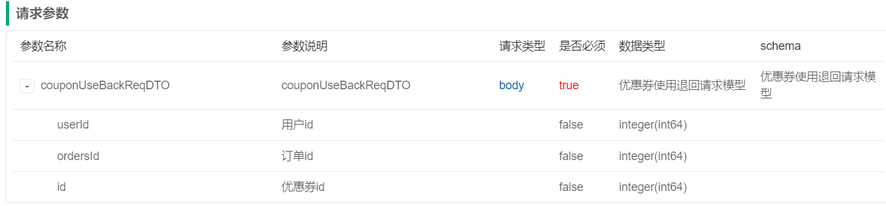

点击开始服务，上传服务前的现场照片。

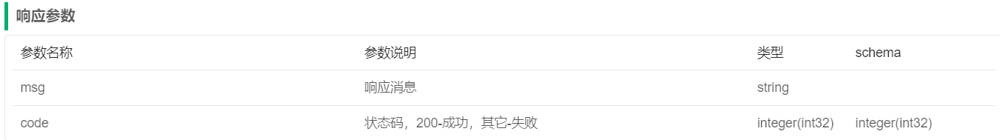

服务人员现场完成服务后进入我的订单，查询待完工的订单。


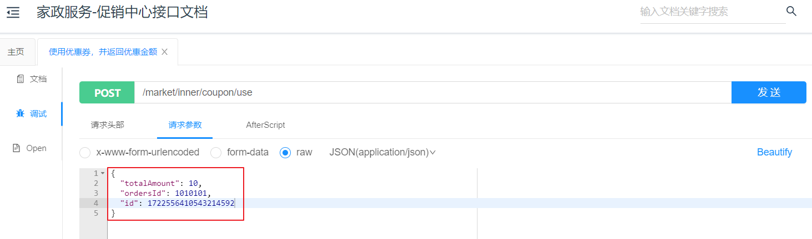

点击完成服务，上传服务后的现场照片。

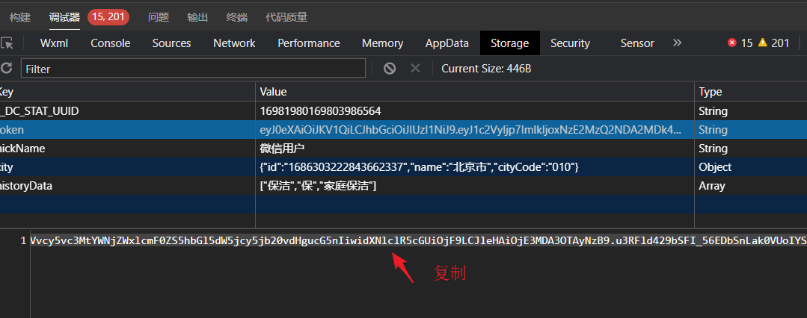

完成服务的订单在已完成订单中查看

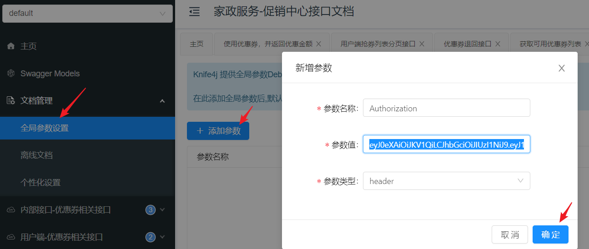

查看订单详情

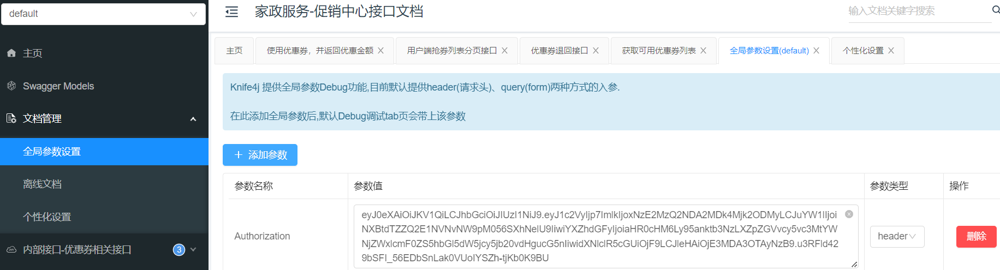

2.服务单状态

服务人员抢单成功或系统派单成功将生成订单对应的服务单，服务单状态如下：

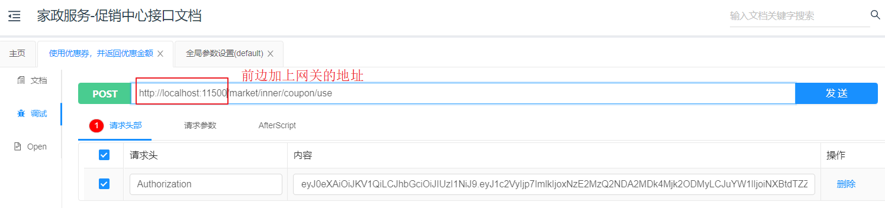

待服务：服务人员抢单成功生成服务单，服务单的初始状态为待服务。

待分配：机构抢单成功生成服务单，服务单的初始状态为待分配，机构分配服务人员此时状态改为待服务。

服务中：服务人员去现场服务，开始服务后服务单的状态由待服务变为服务中。

服务完成：服务人员完成家政服务，服务单的状态由服务中变为服务完成。

服务取消：用户取消订单或运营人员取消订单后服务单状态改为已取消。

用户取消订单：

待分配\-\-\-》已取消

待服务\-\-\-》已取消

运营人员取消订单：

服务中\-\-\-》已取消

服务完成\-\-\-》已取消

### 6.2.测试

启动jzo2o\-orders\-manager

启动jzo2o\-foundations

启动网关

启动jzo2o\-customer

启动jzo2o\-publics

启动服务端\(前端\)

测试流程：

服务人员登录服务端

进入我的订单

开始服务

完成服务

预期结果：

服务人员查看订单详情查看服务单的状态为：已完成

进入数据库查看对应订单的状态为：待评价

### 6.3.阅读代码

进入接口文档：http://localhost:11504/orders-manager/doc.html#/home

通过接口查看源码，重点查看以下接口的源码

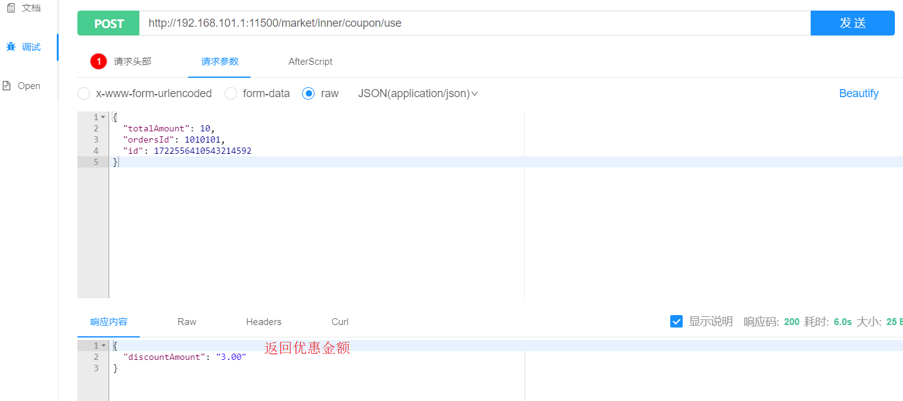

### 6.4.小结

服务人员现场服务的过程是如何管理的？

## 7.历史订单

### 7.1.冷热分离方案

目标：理解冷热分离的方案。

**冷热分离需求**

随着时间的推移，订单数据会逐渐增加，虽然对订单数据库进行分库分表，但是考虑用户对已完成的历史订单的操作热度远远低于未完成订单。

为了提高系统的性能我们对订单数据进行冷热分离。

冷数据是指那些很少被访问或者对访问时延迟要求较低的数据，而热数据则是经常被访问、对访问时延迟要求高的数据。

订单的冷热分离是指根据订单的特性和需求，将订单数据划分为冷数据和热数据，以便更有效地管理和优化数据存储、检索和处理的方式。这种分离有助于提高系统的性能和降低存储成本

根据需求，订单完成15日后将不允许对订单进行取消，我们可以将订单完成超过15日的订单归档到历史订单库，其它订单数据在订单数据库。订单数据库存储的是热数据，历史订单数据库存储冷数据。

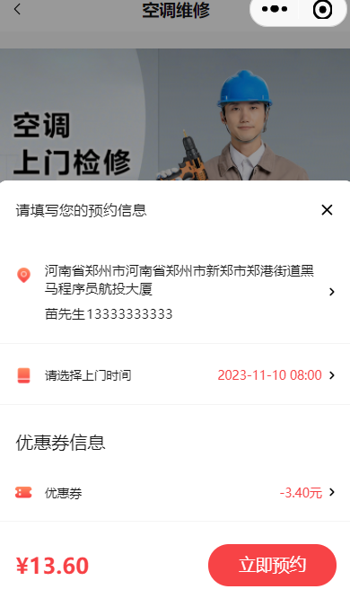

**分布式数据库**

历史订单（冷数据）存储到哪里呢？

通常通过以下方式存储冷数据

将冷数据从主要的数据库中归档到较为廉价的存储介质，例如使用固态硬盘（SSD）存储热数据，而将冷数据存储在传统磁盘或云存储中，也可以使用低成本的云存储服务。

使用数据库分区或分片技术，将冷数据和热数据存储在不同的物理或逻辑分区。

使用云服务进行存储，比如：阿里云的对象存储OSS，腾讯云对象存储COS，这些都是比较廉价的。

根据本项目的需求，需要给用户和运营人员提供历史订单的查询接口，并且还需要对历史订单进行一些统计分析处理。

OSS不符合需求，因为OSS只能存储文件、图片、视频等，不能提供类似数据库的查询接口。

所以我们需要选择数据库存储，存储海量数据用关系数据库不合适，关系数据库可伸缩性相对有限，为了解决这个问题我们使用分布式数据库。

分布式数据库是指将数据库系统中的数据存储和处理分布在多个计算机节点上，这些节点可以位于不同的物理位置或在同一物理位置上。分布式数据库旨在通过分布数据和查询负载，提高系统的可伸缩性、性能和容错性。

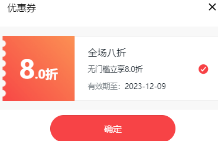

常见的分布式数据库：

Apache Cassandra： 高度可伸缩、分布式、面向列的NoSQL数据库。

MongoDB： 面向文档的NoSQL数据库，支持分布式架构。

HBase： 是一个开源的、分布式的、面向列的NoSQL数据库系统，建立在Hadoop分布式文件系统（HDFS）之上。

还有一些国内常用的分布式数据库：

阿里云 PolarDB：

阿里云的PolarDB是一种支持MySQL和PostgreSQL的分布式关系型数据库服务。它具有高性能、可伸缩性和自动容灾的特性。

腾讯云 TDSQL\-C（TiDB）：

TDSQL\-C是腾讯云推出的一种云原生分布式数据库服务，基于TiDB开源项目，支持水平扩展、强一致性和分布式事务。


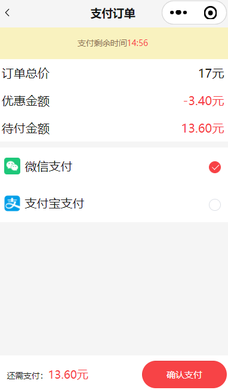

如果去选择分布式数据库，通常从OLTP、OLAP、HTAP、NOSQL这几个方面去选择：

OLTP（Online Transaction Processing）： OLTP是指在线事务处理系统。

OLAP（Online Analytical Processing）： OLAP是指在线分析处理系统。

HTAP（Hybrid Transactional/Analytical Processing）：HTAP是OLTP和OLAP的结合，旨在使一个数据库系统能够同时支持事务处理和分析处理。

本项目选择HTAP分布式数据库，TiDB（分布式数据库系统）属于HTAP范畴。TiDB设计为一个支持事务处理（OLTP）和复杂分析查询（OLAP）的分布式数据库系统。TiDB采用分布式架构，支持水平扩展，具有高可用性和强一致性的特性。TiDB支持MySQL协议，使用 MySQL 驱动（MySQL Client）来连接和与 TiDB 进行交。TiDB 开源，开源数据库不仅不影响学习和使用还可以节省成本。

下边列出了TiDB的优势 ：

1.分布式架构：

TiDB采用分布式架构，可以水平扩展以处理大规模的数据和请求。它将数据分散存储在多个节点上，支持高并发和高吞吐量。

2.兼容 MySQL 协议：

TiDB 兼容 MySQL 协议，可以直接使用 MySQL 客户端工具和驱动，使得迁移现有的 MySQL 应用程序到 TiDB 变得相对容易。

3.水平可伸缩性：

TiDB 支持水平扩展，可以轻松地增加节点以提高存储和查询能力，而不需要修改应用程序代码。

4.分布式事务支持：

TiDB 提供强一致性的分布式事务支持，确保在分布式环境中的数据一致性和可靠性。

5.自动负载均衡：

TiDB 具有自动负载均衡的功能，能够动态调整数据在集群中的分布，以保持各节点的负载均衡。

6.分布式查询优化：

TiDB 提供分布式查询优化，可以在多个节点上并行执行查询，提高查询性能。同时，TiDB 优化器支持将查询计划分发到各节点执行。

7.实时分析：

TiDB 支持实时分析查询，适用于OLAP（在线分析处理）场景，允许在不影响在线事务的情况下执行复杂的分析操作。

8.在线扩容和缩容：

TiDB 支持在线扩容和缩容，可以根据需要动态调整集群的规模，而不需要停机。

9.弹性扩展：

TiDB 提供了弹性扩展的能力，可以根据实际需求调整存储引擎，支持多种存储引擎，包括 TiKV、RocksDB 等。

10.开源社区支持：

TiDB 是一个开源项目，拥有活跃的社区支持，用户可以获取到丰富的文档、社区资源和技术支持。

11.云原生：

利用云计算环境的弹性、可伸缩性和分布式特性在云环境中构建、部署、管理和扩展应用程序。

TiDB 支持云原生架构，可以轻松部署在云服务提供商（如阿里云、腾讯云、华为云）上，并集成到云服务的生态系统中。

**冷热分离方案**

如何进行冷热分离？

本项目除了将订单完成15日的订单迁移到历史订单数据库，还需要对订单数据进行分析，所以通过Canal\+MQ将完成的订单（完成、取消、关闭）迁移到历史订单数据库，在历史订单服务对订单数据进行统计分析，并通过定时任务迁移冷数据。

方案如下：

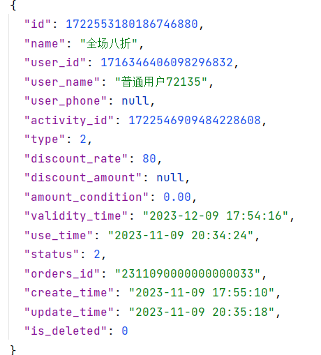

流程如下：

当订单完成，取消、关闭时将订单信息写入同步表。

通过Canal\+MQ将同步表的订单数据同步到历史订单数据库的待迁移表中，具体过程如下：

Canal读取binlog将写入同步表的数据写入MQ。

历史订单服务监听MQ，获得同步表的订单数据。

历史订单服务将订单数据写入待迁移表。

历史订单服务启动定时任务，每天凌晨将昨天0点到昨天24点之间完成15日后的订单信息迁移到历史订单表。

每次迁移完成将迁移完成的历史订单从待迁移表删除。

数据流：

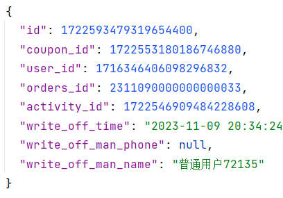

**小结**

1.订单的冷热分离是怎么做的？

2.TiDB数据库与MySQL有什么不同？

### 7.2.订单同步

根据冷热分离方案，首先将完成、取消、关闭的订单同步到历史订单库。

本节目标：将完成、取消、关闭的订单同步到历史订单数据库。

**创建历史订单数据库**

根据冷热分离方案我们需要安装TiDB 分布式数据库，TiDB 分布式数据库安装过程复杂，在企业中通常由运维或数据库管理人员维护，TiDB数据库 支持MySQL协议，在开发中可以使用 MySQL 的 JDBC 驱动进行连接，为了节省学习成本我们在MySQL数据库创建历史订单数据库进行使用。

创建jzo2o\-orders\-history数据库，导入jzo2o\-orders\-history\.sql脚本：

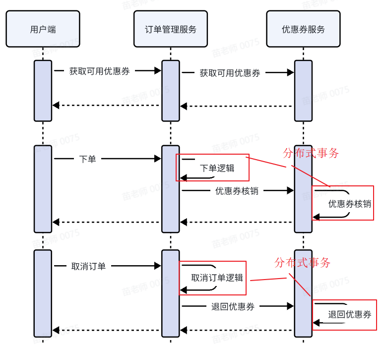

history\_orders：用于存储历史订单数据。

history\_orders\_serve: 用于存储历史服务单数据。

history\_orders\_serve\_sync：用于存储待迁移的已完成的服务单数据。

history\_orders\_sync： 用于存储待迁移的订单数据（包括已完成，取消、关闭的订单）。

stat\_day：存储按天统计数据

stat\_hour：存储按小时统计数据。

数据库创建完成注意修改nacos上数据库的连接地址：shared\-tidb\.yaml

**订单同步**

根据冷热分离方案，当订单完成，取消、关闭时将订单信息写入同步表，再通过Canal\+MQ同步到历史订单数据库的待迁移表，Canal\+MQ同步的代码我们之前做过，这里我们阅读代码理解订单同步的过程。

在订单数据库创建订单同步表和服务单的同步表：

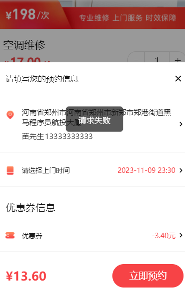

1.当订单完成、取消、关闭时向同步表写入记录。

此部分的代码在订单状态机OrderStateMachine 类中实现，阅读下边的代码：

```java
package com.jzo2o.orders.base.statemachine;

import com.jzo2o.orders.base.enums.OrderStatusEnum;
import com.jzo2o.orders.base.model.dto.OrderSnapshotDTO;
import com.jzo2o.orders.base.service.IHistoryOrdersSyncCommonService;
import com.jzo2o.statemachine.AbstractStateMachine;
import com.jzo2o.statemachine.core.StatusDefine;
import com.jzo2o.statemachine.persist.StateMachinePersister;
import com.jzo2o.statemachine.snapshot.BizSnapshotService;
import org.springframework.beans.factory.annotation.Autowired;
import org.springframework.data.redis.core.RedisTemplate;
import org.springframework.stereotype.Component;

/**
 * 订单状态机类
 */
@Component
public class OrderStateMachine extends AbstractStateMachine<OrderSnapshotDTO> {


    protected OrderStateMachine(StateMachinePersister stateMachinePersister, BizSnapshotService bizSnapshotService, RedisTemplate redisTemplate) {
        super(stateMachinePersister, bizSnapshotService, redisTemplate);
    }

    /**
     * 状态机名称
     * @return
     */
    @Override
    protected String getName() {
        return "order";
    }

    @Autowired
    private IHistoryOrdersSyncCommonService historyOrdersSyncCommonService;


    @Override
    protected void postProcessor(OrderSnapshotDTO orderSnapshotDTO) {
        /**********完成、关闭、取消订单写历史订单同步表***********/
        //取出订单的新状态
        Integer ordersStatus = orderSnapshotDTO.getOrdersStatus();
        if(OrderStatusEnum.FINISHED.getStatus().equals(ordersStatus) ||
                OrderStatusEnum.CLOSED.getStatus().equals(ordersStatus) ||
                OrderStatusEnum.CANCELED.getStatus().equals(ordersStatus) ){
            historyOrdersSyncCommonService.writeHistorySync(orderSnapshotDTO.getId());
        }
    }

    @Override
    protected StatusDefine getInitState() {
        return OrderStatusEnum.NO_PAY;
    }
}
```

通过historyOrdersSyncService\.writeHistorySync\(orderSnapshotDTO\.getId\(\)\);方法将订单数据同步上边两张同步表当中。

2.Canal\+MQ将同步表数据同步到历史订单数据库的待迁移表

首先进入RabbitMQ，配置exchange\.canal\-jzo2o交换机绑定下边红框的队列。

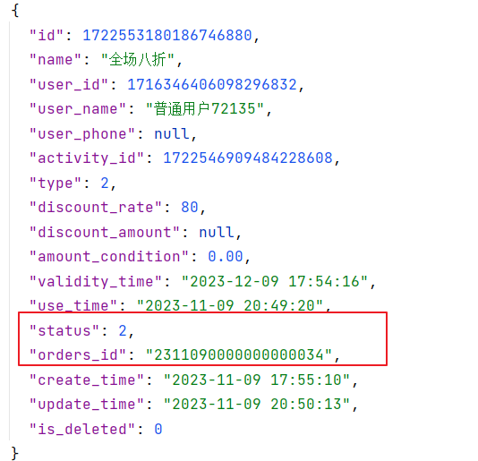

找到历史订单服务中的数据同步类：

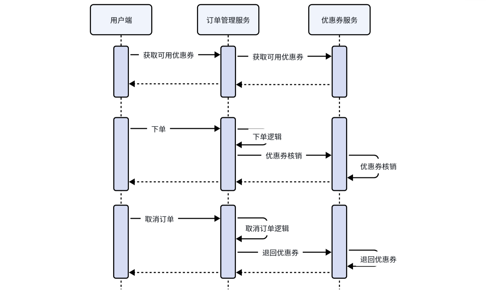

代码如下：

```java
package com.jzo2o.orders.history.handler;

import com.jzo2o.canal.listeners.AbstractCanalRabbitMqMsgListener;
import com.jzo2o.orders.history.model.domain.HistoryOrdersSync;
import com.jzo2o.orders.history.service.IHistoryOrdersSyncService;
import org.springframework.amqp.core.ExchangeTypes;
import org.springframework.amqp.core.Message;
import org.springframework.amqp.rabbit.annotation.Exchange;
import org.springframework.amqp.rabbit.annotation.Queue;
import org.springframework.amqp.rabbit.annotation.QueueBinding;
import org.springframework.amqp.rabbit.annotation.RabbitListener;
import org.springframework.stereotype.Component;

import javax.annotation.Resource;
import java.util.List;

@Component
public class HistoryOrdersSyncHandler extends AbstractCanalRabbitMqMsgListener<HistoryOrdersSync> {

    @Resource
    private IHistoryOrdersSyncService historyOrdersSyncService;

    @RabbitListener(bindings = @QueueBinding(
            value = @Queue(name = "canal-mq-jzo2o-orders-history", durable = "true"),
            exchange = @Exchange(name = "exchange.canal-jzo2o", type = ExchangeTypes.TOPIC),
            key = "canal-mq-jzo2o-orders-history"),
            concurrency = "1"
    )
    public void onMessage(Message message) throws Exception {
        parseMsg(message);
    }

    @Override
    public void batchSave(List<HistoryOrdersSync> historyOrdersSyncs) {
        historyOrdersSyncService.saveOrUpdateBatch(historyOrdersSyncs);
    }

    @Override
    public void batchDelete(List<Long> ids) {

    }
}
```

通过historyOrdersSyncService\.saveOrUpdateBatch\(historyOrdersSyncs\);将订单数据写入历史订单数据库的待迁移表history\_orders\_sync中。

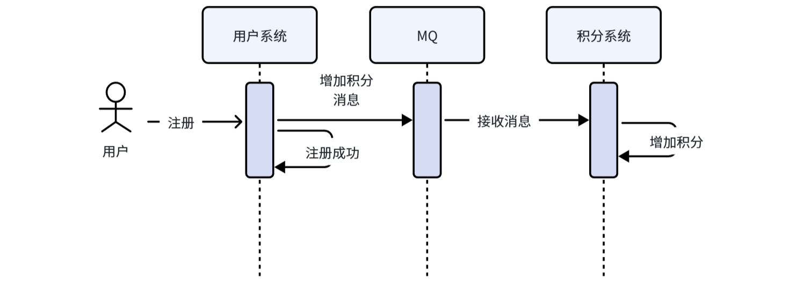

服务单同步类HistoryOrdersServeSyncHandler请自行查询源码。

**测试订单同步**

启动网关

启动jzo2o\-customer

启动jzo2o\-fundations

启动jzo2o\-publics

启动jzo2o\-orders\-manager

启动jzo2o\-orders\-history

启动服务端（前端工程）

服务人员登录服务端，进入我的订单

开始服务

完成服务

预期结果：

完成服务后向同步表添加成功：

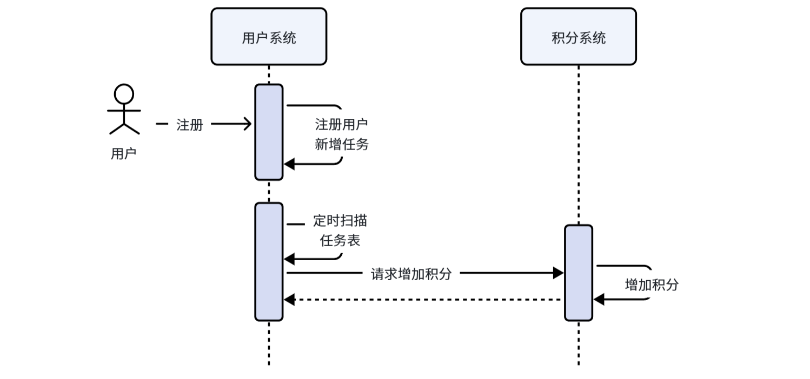

通过canal将完成订单同步到历史库

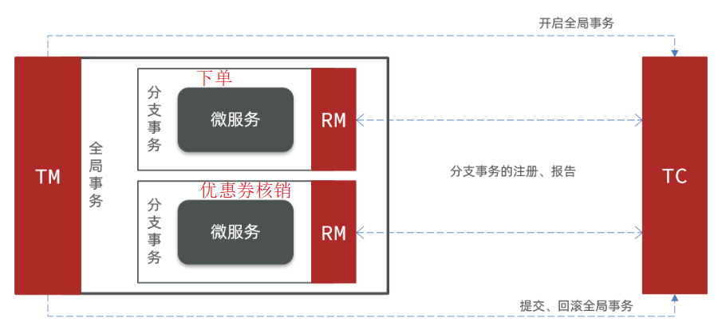

测试时注意：保证Canal工作正常，数据不同的问题参考：“配置搜索及数据同步环境v1\.0” 进行处理。

**小结**

本节将完成、取消、关闭的订单使用Canal\+MQ同步到历史订单数据库，流程如下：

1. 订单完成、取消、关闭后在写入订单同步表。

2. Canal读取同步表的binlog，解析数据发送至MQ

3. 历史订单服务监听MQ，获取到订单信息后写入待迁移表（history\_orders\_sync和history\_orders\_serve\_sync表）。

### 7.3.订单冷热分离

根据需求，订单完成15日后迁移到历史订单表和历史服务单表。

下边完成订单迁移：

**定义mapper**

1.首先编写SQL：

```sql
insert into history_orders (id, user_id, serve_type_id, serve_provider_id, serve_provider_type, serve_item_id, serve_id,
                            city_code, serve_type_name, serve_item_name, serve_item_img, unit, orders_status,
                            pay_status, refund_status, trade_finish_time, trading_channel, third_order_id,
                            dispatch_time, price, pur_num, total_amount, real_pay_amount, third_refund_order_id,
                            canceler_name, discount_amount, serve_address, contacts_phone, contacts_name,
                            serve_provider_staff_name, serve_provider_staff_phone, institution_name, place_order_time,
                            serve_start_time, serve_end_time, real_serve_start_time, real_serve_end_time,
                            serve_before_imgs, serve_before_illustrate, serve_after_imgs, serve_after_illustrate,
                            payment_timeout, lon, lat, pay_time, cancel_time, cancel_reason, year, month, day, hour,
                            sort_time)
    select hos.id,
            hos.user_id,
            hos.serve_type_id,
            hos.serve_provider_id,
            hos.serve_provider_type,
            hos.serve_item_id,
            hos.serve_id,
            hos.city_code,
            hos.serve_type_name,
            hos.serve_item_name,
            hos.serve_item_img,
            hos.unit,
            hos.orders_status,
            hos.pay_status,
            hos.refund_status,
            hos.trade_finish_time,
            hos.trading_channel,
            hos.third_order_id,
            hos.dispatch_time,
            hos.price,
            hos.pur_num,
            hos.total_amount,
            hos.real_pay_amount,
            hos.third_refund_order_id,
            hos.canceler_name,
            hos.discount_amount,
            hos.serve_address,
            hos.contacts_phone,
            hos.contacts_name,
            hos.serve_provider_staff_name,
            hos.serve_provider_staff_phone,
            hos.institution_name,
            hos.place_order_time,
            hos.serve_start_time,
            hos.serve_end_time,
            hos.real_serve_start_time,
            hos.real_serve_end_time,
            hos.serve_before_imgs,
            hos.serve_before_illustrate,
            hos.serve_after_imgs,
            hos.serve_after_illustrate,
            hos.payment_timeout,
            hos.lon,
            hos.lat,
            hos.pay_time,
            hos.cancel_time,
            hos.cancel_reason,
            hos.year,
            hos.month,
            hos.day,
            hos.hour,
            hos.sort_time
     from history_orders_sync hos
              LEFT JOIN history_orders ho on hos.id = ho.id
     where hos.sort_time >= '2023-12-05 0:0:0'
       and hos.sort_time <= '2023-12-05 23:59:59'
       and ho.id is null
     limit 0,1000
```

2.定义mapper

编写mapper映射文件：

```xml
<?xml version="1.0" encoding="UTF-8"?>
<!DOCTYPE mapper PUBLIC "-//mybatis.org//DTD Mapper 3.0//EN" "http://mybatis.org/dtd/mybatis-3-mapper.dtd">
<mapper namespace="com.jzo2o.orders.history.mapper.HistoryOrdersMapper">

    <insert id="migrate" parameterType="java.util.Map">
        insert into history_orders (id, user_id, serve_type_id, serve_provider_id, serve_provider_type, serve_item_id, serve_id, city_code, serve_type_name, serve_item_name, serve_item_img, unit, orders_status, pay_status, refund_status, trade_finish_time, trading_channel, third_order_id, dispatch_time, price, pur_num, total_amount, real_pay_amount, third_refund_order_id, canceler_name, discount_amount, serve_address, contacts_phone, contacts_name, serve_provider_staff_name, serve_provider_staff_phone, institution_name, place_order_time, serve_start_time, serve_end_time, real_serve_start_time, real_serve_end_time, serve_before_imgs, serve_before_illustrate, serve_after_imgs, serve_after_illustrate, payment_timeout, lon, lat, pay_time, cancel_time, cancel_reason, year, month, day, hour, sort_time)
        (
        select hos.id,hos.user_id,hos.serve_type_id,hos.serve_provider_id,hos.serve_provider_type,hos.serve_item_id,hos.serve_id,hos.city_code,hos.serve_type_name,hos.serve_item_name,hos.serve_item_img,hos.unit,hos.orders_status,hos.pay_status,hos.refund_status,hos.trade_finish_time,hos.trading_channel,hos.third_order_id,hos.dispatch_time,hos.price,hos.pur_num,hos.total_amount,hos.real_pay_amount,hos.third_refund_order_id,hos.canceler_name,hos.discount_amount,hos.serve_address,hos.contacts_phone,hos.contacts_name,hos.serve_provider_staff_name,hos.serve_provider_staff_phone,hos.institution_name,hos.place_order_time,hos.serve_start_time,hos.serve_end_time,hos.real_serve_start_time,hos.real_serve_end_time,hos.serve_before_imgs,hos.serve_before_illustrate,hos.serve_after_imgs,hos.serve_after_illustrate,hos.payment_timeout,hos.lon,hos.lat,hos.pay_time,hos.cancel_time,hos.cancel_reason,hos.year,hos.month,hos.day,hos.hour,hos.sort_time
        from history_orders_sync hos
        LEFT JOIN history_orders ho on hos.id=ho.id
        where <![CDATA[ hos.sort_time >= #{yesterDayStartTime}]]> and <![CDATA[ hos.sort_time <= #{yesterDayEndTime} ]]>
        and ho.id is null
        limit #{offset},#{perNum}
        )
    </insert>
</mapper>
```

定义mapper接口：

```java
package com.jzo2o.orders.history.mapper;

import com.jzo2o.orders.history.model.domain.HistoryOrders;
import com.baomidou.mybatisplus.core.mapper.BaseMapper;
import org.apache.ibatis.annotations.Param;

import java.time.LocalDateTime;

/**
 * <p>
 * 订单表 Mapper 接口
 * </p>
 */
public interface HistoryOrdersMapper extends BaseMapper<HistoryOrders> {

    Integer migrate(@Param("yesterDayStartTime") LocalDateTime yesterDayStartTime,
                    @Param("yesterDayEndTime") LocalDateTime yesterDayEndTime,
                    @Param("offset") Integer offset,
                    @Param("perNum") Integer perNum);
}
```

**定义service**

```java
package com.jzo2o.orders.history.service;

import com.jzo2o.common.model.PageResult;
import com.jzo2o.orders.history.model.domain.HistoryOrders;
import com.baomidou.mybatisplus.extension.service.IService;
import com.jzo2o.orders.history.model.dto.request.HistoryOrdersListQueryReqDTO;
import com.jzo2o.orders.history.model.dto.request.HistoryOrdersPageQueryReqDTO;
import com.jzo2o.orders.history.model.dto.response.HistoryOrdersDetailResDTO;
import com.jzo2o.orders.history.model.dto.response.HistoryOrdersListResDTO;
import com.jzo2o.orders.history.model.dto.response.HistoryOrdersPageResDTO;

import java.util.List;

/**
 * <p>
 * 订单表 服务类
 * </p>
 */
public interface IHistoryOrdersService extends IService<HistoryOrders> {
/**
 * 迁移历史订单
 */
void migrate();
```

实现类：

```java
@Override
public void migrate() {
    log.debug("历史订单迁移开始...");
    // 查询时间开始坐标
    int offset = 0;
    int perNum = 1000;
    // 昨天开始时间
    LocalDateTime yesterDayStartTime = DateUtils.getDayStartTime(DateUtils.now().minusDays(1));
    // 昨天结束时间
    LocalDateTime yesterDayEndTime = DateUtils.getDayEndTime(DateUtils.now().minusDays(1));

    // 统计迁移数据数量
    Integer total = historyOrdersSyncService.countBySortTime(yesterDayStartTime, yesterDayEndTime);
    if(total <= 0){
        return;
    }

    // 分批次迁移
    while (offset < total) {
        baseMapper.migrate(yesterDayStartTime, yesterDayEndTime, offset, perNum);
        offset += perNum;
    }
    log.debug("历史订单迁移结束。");

}
```

**定时任务**

阅读下边的代码：

```java
package com.jzo2o.orders.history.handler;

import com.jzo2o.orders.history.service.IHistoryOrdersServeService;
import com.jzo2o.orders.history.service.IHistoryOrdersService;
import com.jzo2o.orders.history.service.IStatDayService;
import com.jzo2o.orders.history.service.IStatHourService;
import com.xxl.job.core.handler.annotation.XxlJob;
import org.springframework.stereotype.Component;

import javax.annotation.Resource;

@Component
public class XxlJobHandler {

  /**
     * 迁移HistoryOrdersSync同步表的数据到HistoryOrders历史订单表
     * 迁移HistoryOrdersServeSync同步表的数据到HistoryOrdersServe历史订单表
     * 规则：
     * 每天凌晨执行，迁移截止到昨日已完成15天的订单到历史订单
     *
     */
    @XxlJob("migrateHistoryOrders")
    public void migrateHistoryOrders(){
        //迁移HistoryOrdersSync同步表的数据到HistoryOrders历史订单表
        historyOrdersService.migrate();
        //删除迁移完成的数据
        historyOrdersService.deleteMigrated();
    
        //迁移HistoryOrdersServeSync同步表的数据到HistoryOrdersServe历史订单表
        historyOrdersServeService.migrate();
        //删除迁移完成的数据
        historyOrdersServeService.deleteMigrated();
    }
    ...
```

自定义阅读以下代码：

```java
//删除迁移完成的数据
historyOrdersService.deleteMigrated();

//迁移HistoryOrdersServeSync同步表的数据到HistoryOrdersServe历史订单表
historyOrdersServeService.migrate();
//删除迁移完成的数据
historyOrdersServeService.deleteMigrated();
```

**测试订单冷热分离**

添加执行器：

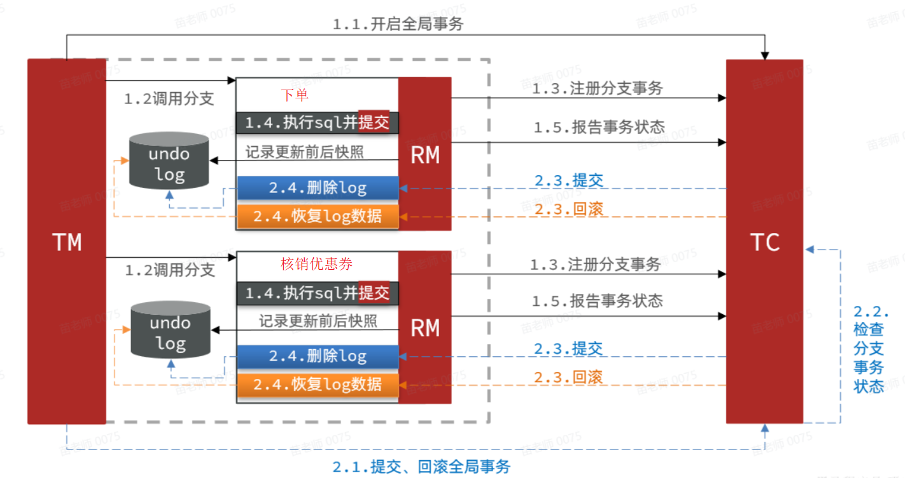

添加任务并启动任务：

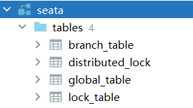

订单完成15个工作日后迁移到历史订单。

在测试时修改history\_orders\_sync和history\_orders\_serve\_sync中sort\_time字段值小于等于昨天日期。

预期结果：

数据由 history\_orders\_sync和history\_orders\_serve\_sync迁移到history\_orders和history\_orders\_serve表。

运营人员登录运营端，查询历史订单：

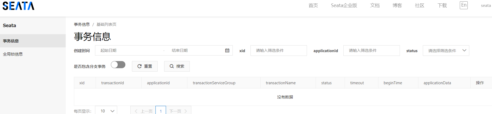

## 8.订单统计

### 8.1.订单统计方案

**经营看板**

本项目在运营端工作台页面展示系统经营看板，内容包括订单分析、用户分析等，如下图：

经营看板是一种用于实时监控关键业务指标的工具，它不仅帮助团队保持敏捷、透明和高效，还促进了团队的协作和创新。

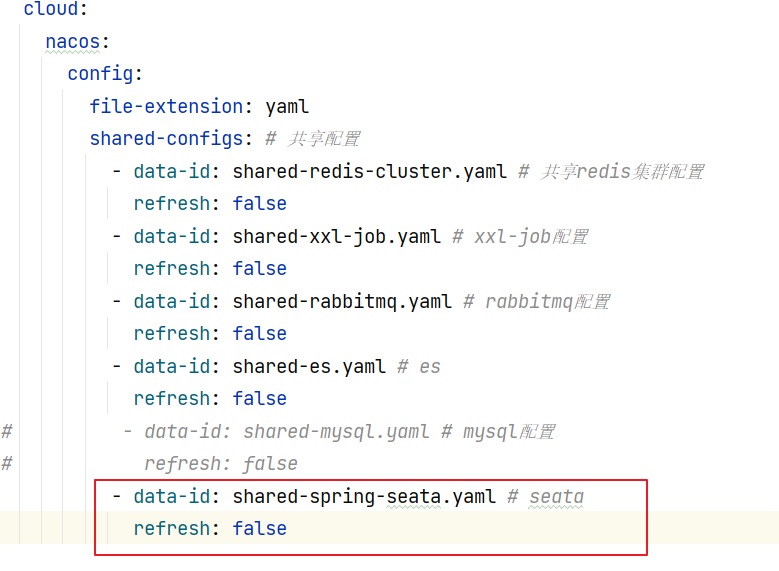


软件中经营看板的应用场景非常多，下图显示了公司销售分析周报：

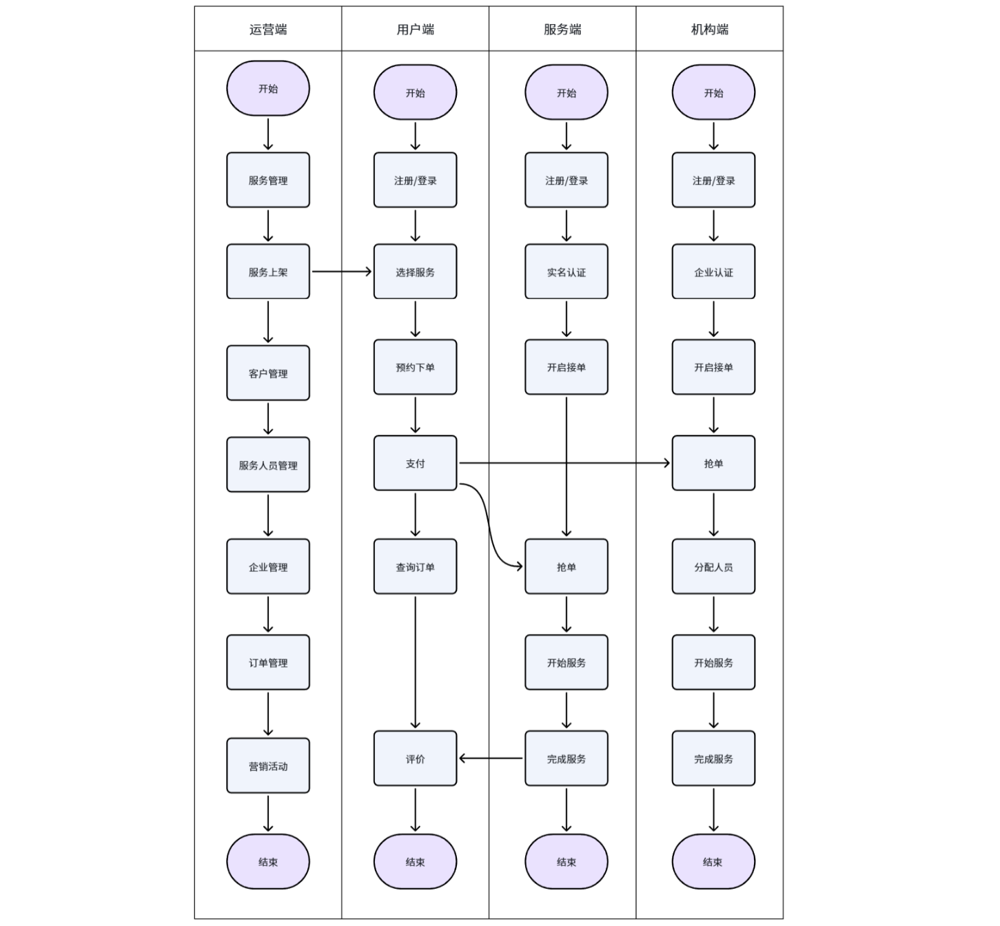

双11销售统计：

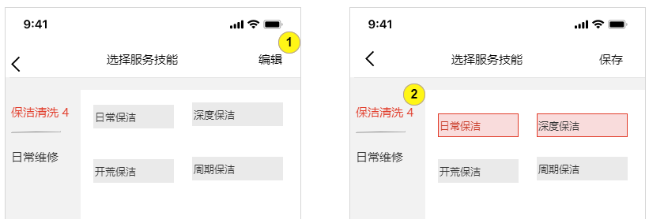

通过学习本节的内容掌握看板功能 的开发方法。

**需求分析**

下边梳理本项目运营端经营看板的功能。

首先选择一个时间区间（不能大于365天），统计在此时间区间内的订单数据，只统计已取消、已关闭、已完成的订单数据。

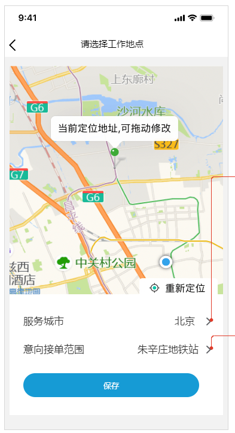

订单分析内容如下：

- 有效订单数：在统计时间内，订单状态为已完成的订单数。（订单被取消、退款、关闭状态均不属于有效订单）

- 取消订单数：在统计时间内，提交订单后被取消订总量

- 关闭订单数：在统计时间内，提交订单后被关闭订总量

- 有效订单总额：在统计时间内，有效订单的总订单交易总额

- 实付单均价：在统计时间内，平均每单实际支付额（不包含失效订单）

实付单均价=有效订单总额/有效订单数

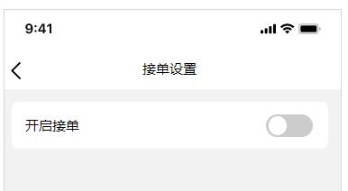

订单趋势：

订单趋势的显示分两种情况：

- 如果统计时间区间 大于1天，订单趋势显示时间区间内每天的下单总数。

- 如果统计时间区间小于等于1天，订单趋势显示当天每小时的下单总数。

**技术方案**

根据需求，我们要统计一个时间区间的订单总数、订单均价等指标。统计出结果后通过接口将数据返回给前端，前端在界面展示即可。

基于什么平台进行统计分析？

通常统计分析要借助大数据平台进行，流程如下：

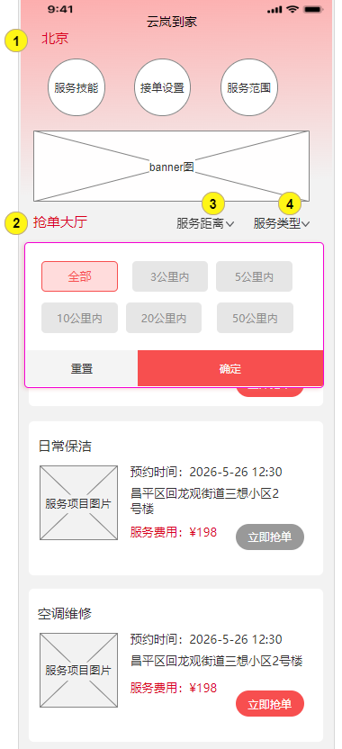

说明：

大数据统计系统对数据进行统计，并统计结果存入MySQL。

Java程序根据看板的需求提供查询接口，从统计结果表查询数据。这里使用缓存，将看板需要的数据存入Redis，提高查询性能。

如果数据量不大在千万级别可以基于数据库进行统计。

本项目通过分布式数据库存储历史订单数据，可以满足统计分析的需求。

本项目对订单的统计基于数据库进行统计。

如何基于数据库进行统计呢？

当用户进入看板页面面向全部数据 进行实时统计其统计速度较慢。

为了提高统计效率可以分层次聚合，再基于分层聚合的统计结果进行二次统计。

举例：

我们要统计2023年10月1日 到2023年11月30日的订单总数等指标，我们可以提前按天把每天的订单总数等指标统计出来，当用户去统计2023年10月1日 到2023年11月30日的订单总数时基于按天统计的结果进行二次统计。

按天统计结果：

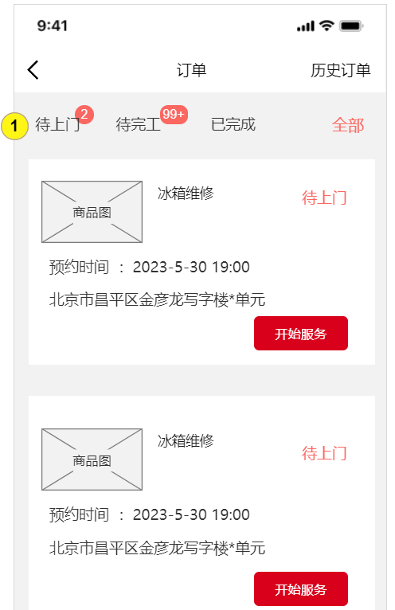

统计数据的分层次聚合需要根据需求确定统计的维度，例如除了按照时间，还可能按地区、产品类别等进行聚合。

根据需求在订单趋势图上除了显示每天的订单总数以外还会按小时进行显示，所以还需要按小时进行统计。

本项目采用滚动式统计，每次统计近15天的数据（如果数据量大可减少统计时段长度），采用滚动式统计的好处是防止统计任务执行失败漏掉统计数据，如下图：

15日统计1到15日的订单。

16日统计2到16日的订单。

依此类推。

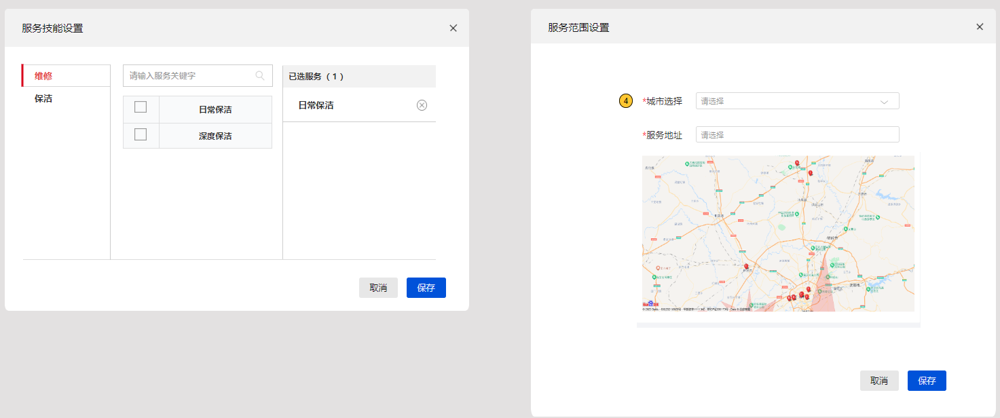

分层聚合的粒度有两种：

按天统计，将统计结果存储至按天统计表。

按小时，将统计结果存储至按小时统计表。

有了分层聚合的统计结果，根据用户需求基于分层聚合的统计结果进行二次统计，其统计效率会大大提高，并且有此需求无需进行二次统计直接查询分层聚合结果表即可。

数据流如下：

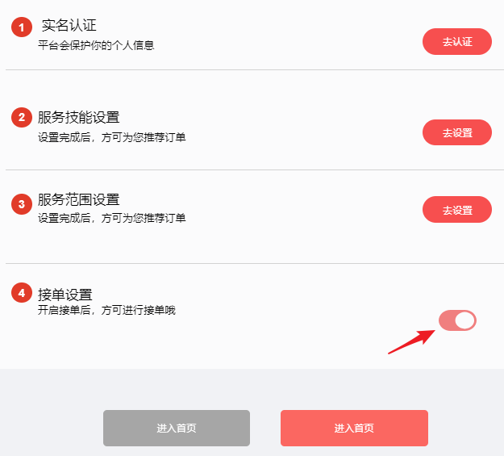

**小结**

订单统计分析是怎么实现的？

### 8.2.订单统计

下边实现按天统计订单。

**定义mapper**

首先编写SQL：

```SQL
select day as id,
       day as statTime,
       sum(if(orders_status=500,1,0)) effective_order_num, -- 有效订单数
       sum(if(orders_status=600,1,0)) cancel_order_num, -- 取消订单数
       sum(if(orders_status=700,1,0)) close_order_num, -- 关闭订单数
       sum(if(orders_status=500,total_amount,0)) effective_order_total_amount -- 有效订单总额
from history_orders_sync where day >= 20241120
GROUP BY day
```

在HistoryOrdersSyncMapper\.xml\.xml添加mapper映射,如下内容：

```xml
<?xml version="1.0" encoding="UTF-8"?>
<!DOCTYPE mapper PUBLIC "-//mybatis.org//DTD Mapper 3.0//EN" "http://mybatis.org/dtd/mybatis-3-mapper.dtd">
<mapper namespace="com.jzo2o.orders.history.mapper.HistoryOrdersSyncMapper">

    <select id="statForDay" parameterType="java.util.Map" resultType="com.jzo2o.orders.history.model.domain.StatDay">
        select day as id,
        day as statTime,
        sum(if(orders_status=500,1,0)) effective_order_num,
        sum(if(orders_status=600,1,0)) cancel_order_num,
        sum(if(orders_status=700,1,0)) close_order_num,
        sum(if(orders_status=500,total_amount,0)) effective_order_total_amount
        from history_orders_sync where day >= #{queryDay}
        GROUP BY day
    </select>
    ...
```

定义mapper接口

```java
package com.jzo2o.orders.history.mapper;

import com.jzo2o.orders.history.model.domain.HistoryOrdersSync;
import com.baomidou.mybatisplus.core.mapper.BaseMapper;
import com.jzo2o.orders.history.model.domain.StatDay;
import com.jzo2o.orders.history.model.domain.StatHour;
import org.apache.ibatis.annotations.Param;

import java.util.List;

/**
 * <p>
 * 订单统计
 * </p>
 */
public interface HistoryOrdersSyncMapper extends BaseMapper<HistoryOrdersSync> {

List<StatDay> statForDay(@Param("queryDay") Integer queryDay);
...
```

**定义service**

```java
package com.jzo2o.orders.history.service;

public interface IHistoryOrdersSyncService extends IService<HistoryOrdersSync> {

    List<StatDay> statForDay(Integer statDay);
    ...
```

实现类如下：

```java
package com.jzo2o.orders.history.service.impl;

@Service
@Slf4j
public class HistoryOrdersSyncServiceImpl extends ServiceImpl<HistoryOrdersSyncMapper, HistoryOrdersSync> implements IHistoryOrdersSyncService {

@Override
public List<StatDay> statForDay(Integer statDay) {
    //统计15天以内的订单
    List<StatDay> statForDay = baseMapper.statForDay(statDay);
    if(CollUtils.isEmpty(statForDay)) {
        return Collections.emptyList();
    }
    // 按天统计订单，计算订单总数、均价等信息
    List<StatDay> collect = statForDay.stream().peek(sd -> {
        // 订单总数
        sd.setTotalOrderNum(NumberUtils.add(sd.getEffectiveOrderNum(), sd.getCloseOrderNum(), sd.getCancelOrderNum()).intValue());
        // 实付订单均价
        if (sd.getEffectiveOrderNum().compareTo(0) == 0) {
            sd.setRealPayAveragePrice(BigDecimal.ZERO);
        } else {
           //RoundingMode.HALF_DOWN 表示四舍五入 向下舍弃，如2.345，保留两位小数为2.34
            BigDecimal realPayAveragePrice = sd.getEffectiveOrderTotalAmount().divide(new BigDecimal(sd.getEffectiveOrderNum()), 2, RoundingMode.HALF_DOWN);
            sd.setRealPayAveragePrice(realPayAveragePrice);
        }
    }).collect(Collectors.toList());

    return collect;
}
...
```

**定时任务**

定义service：

```java
package com.jzo2o.orders.history.service.impl;

import com.baomidou.mybatisplus.core.conditions.query.LambdaQueryWrapper;
import com.baomidou.mybatisplus.core.toolkit.Wrappers;
import com.jzo2o.common.utils.DateUtils;
import com.jzo2o.orders.history.model.domain.StatDay;
import com.jzo2o.orders.history.mapper.StatDayMapper;
import com.jzo2o.orders.history.service.IHistoryOrdersService;
import com.jzo2o.orders.history.service.IHistoryOrdersSyncService;
import com.jzo2o.orders.history.service.IStatDayService;
import com.baomidou.mybatisplus.extension.service.impl.ServiceImpl;
import com.jzo2o.orders.history.mapper.StatDayMapper;
import com.jzo2o.orders.history.model.domain.StatDay;
import com.jzo2o.orders.history.model.domain.StatHour;
import com.jzo2o.orders.history.service.IStatDayService;
import org.springframework.stereotype.Service;
import org.springframework.transaction.annotation.Transactional;

import javax.annotation.Resource;
import java.time.LocalDateTime;
import java.util.List;

/**
 * <p>
 * 日统计表 服务实现类
 * </p>
 */
@Service
public class StatDayServiceImpl extends ServiceImpl<StatDayMapper, StatDay> implements IStatDayService {
@Override
public void statAndSaveData() {
    // 1.数据统计
    // 15天前时间
    LocalDateTime statDayLocalDateTime = DateUtils.now().minusDays(15);
    long statDayTime = DateUtils.getFormatDate(statDayLocalDateTime, "yyyMMdd");
    // 统计数据
    List<StatDay> statDays = historyOrdersSyncService.statForDay((int) statDayTime);
    if(ObjectUtils.isEmpty(statDays)){
        return ;
    }    
    // 2.数据保存至按天统计表
    saveOrUpdateBatch(statDays);
}
```

定义xxl\-job定时任务，在历史订单服务通过定时任务完成数据统计。

```java
package com.jzo2o.orders.history.handler;

import com.jzo2o.orders.history.service.IHistoryOrdersServeService;
import com.jzo2o.orders.history.service.IHistoryOrdersService;
import com.jzo2o.orders.history.service.IStatDayService;
import com.jzo2o.orders.history.service.IStatHourService;
import com.xxl.job.core.handler.annotation.XxlJob;
import org.springframework.stereotype.Component;

import javax.annotation.Resource;

@Component
public class XxlJobHandler {

    /**
     * 按天统计保存15天内的订单数据
     * 按小时统计保存15天内的订单数据
     */
    @XxlJob("statAndSaveData")
    public void statAndSaveDataForDay() {
        //按天统计保存15天内的订单数据
        statDayService.statAndSaveData();
        //按小时统计保存15天内的订单数据
        statHourService.statAndSaveData();
    }
    
    ...
```

**测试**

添加订单统计任务


保证history\_orders\_sync和history\_orders\_serve\_sync有要统计的数据，按订单完成时间统计15天以内的订单

统计完成写入stat\_day和stat\_hour两张表，stat\_day存储按天统计数据，stat\_hour存储按小时统计数据。

**按小时统计**

自行阅读按小时统计代码。

**小结**

订单统计分析是怎么实现的？

### 8.3.经营看板

**需求分析**

目前我们完成对订单数据按天、按小时分层聚合，下边根据经营看板的需求进行二次统计，提供查询接口给前端，前端获取数据后在看板界面展示。

需求1：根据时间区间统计

根据时间区间统计以下内容：


- 有效订单数：在统计时间内，订单状态为已完成的订单数。（订单被取消、退款、关闭状态均不属于有效订单）

- 取消订单数：在统计时间内，提交订单后被取消订总量

- 关闭订单数：在统计时间内，提交订单后被关闭订总量

- 有效订单总额：在统计时间内，有效订单的总订单交易总额

- 实付单均价：在统计时间内，平均每单实际支付额（不包含失效订单）

实付单均价=有效订单总额/有效订单数

需求2: 订单趋势图

如果统计时间区间 大于1天，订单趋势显示时间区间内每天的下单总数，查询按天统计表的数据即可。

如果统计时间区间小于等于1天，订单趋势显示当天每小时的下单总数，查询按小时统计表的数据即可。


需求3: 缓存

看板数据需要进行二次统计，为了提高查询性能通常对二次统计的数据结果进行缓存，设置缓存过期时间，通常30分钟以内，根据监控数据变化的实时性去设置，本项目缓存数据为30分钟，当缓存过期重新统计最新的数据在看板展示。

**阅读代码**

1.接口

```java
package com.jzo2o.orders.history.controller.operation;

import com.jzo2o.orders.history.model.dto.response.OperationHomePageResDTO;
import com.jzo2o.orders.history.service.OrdersStatisticsService;
import io.swagger.annotations.Api;
import io.swagger.annotations.ApiImplicitParam;
import io.swagger.annotations.ApiImplicitParams;
import io.swagger.annotations.ApiOperation;
import org.springframework.format.annotation.DateTimeFormat;
import org.springframework.web.bind.annotation.GetMapping;
import org.springframework.web.bind.annotation.RequestMapping;
import org.springframework.web.bind.annotation.RequestParam;
import org.springframework.web.bind.annotation.RestController;

import javax.annotation.Resource;
import java.io.IOException;
import java.time.LocalDateTime;

/**
 * 订单统计
 **/
@Api(tags = "运营端 - 订单统计相关接口")
@RestController("operationOrdersStatisticsController")
@RequestMapping("/operation/orders-statistics")
public class OrdersStatisticsController {
    @Resource
    private OrdersStatisticsService ordersStatisticsService;

    @GetMapping("/homePage")
    @ApiOperation("运营端首页数据")
    @ApiImplicitParams({
            @ApiImplicitParam(name = "minTime", value = "开始时间", required = true, dataTypeClass = LocalDateTime.class),
            @ApiImplicitParam(name = "maxTime", value = "结束时间", required = true, dataTypeClass = LocalDateTime.class)
    })
    public OperationHomePageResDTO homePage(@RequestParam("minTime") @DateTimeFormat(pattern = "yyyy-MM-dd HH:mm:ss") LocalDateTime minTime,
                                            @RequestParam("maxTime") @DateTimeFormat(pattern = "yyyy-MM-dd HH:mm:ss") LocalDateTime maxTime) {
        return ordersStatisticsService.homePage(minTime, maxTime);
    }
```

2.service方法

service方法上使用spring cache注解对看板上展示的数据进行缓存。

```java
package com.jzo2o.orders.history.service.impl;

import cn.hutool.core.bean.BeanUtil;
import cn.hutool.core.date.DatePattern;
import cn.hutool.core.date.LocalDateTimeUtil;
import cn.hutool.core.io.FileUtil;
import cn.hutool.core.util.NumberUtil;
import cn.hutool.core.util.ObjectUtil;
import com.alibaba.excel.EasyExcel;
import com.alibaba.excel.ExcelWriter;
import com.alibaba.excel.util.MapUtils;
import com.alibaba.excel.write.metadata.WriteSheet;
import com.alibaba.fastjson.JSON;
import com.jzo2o.common.expcetions.ForbiddenOperationException;
import com.jzo2o.common.utils.BeanUtils;
import com.jzo2o.common.utils.ObjectUtils;
import com.jzo2o.mvc.utils.ResponseUtils;
import com.jzo2o.orders.history.model.domain.StatDay;
import com.jzo2o.orders.history.model.domain.StatHour;
import com.jzo2o.orders.history.model.dto.excel.AggregationStatisticsData;
import com.jzo2o.orders.history.model.dto.excel.ExcelMonthData;
import com.jzo2o.orders.history.model.dto.excel.MonthElement;
import com.jzo2o.orders.history.model.dto.excel.StatisticsData;
import com.jzo2o.orders.history.model.dto.response.OperationHomePageResDTO;
import com.jzo2o.orders.history.service.IStatDayService;
import com.jzo2o.orders.history.service.IStatHourService;
import com.jzo2o.orders.history.service.OrdersStatisticsService;
import com.jzo2o.orders.history.utils.EasyExcelUtil;
import org.apache.poi.ss.formula.functions.T;
import org.springframework.cache.annotation.Cacheable;
import org.springframework.stereotype.Service;

import javax.annotation.Resource;
import javax.servlet.http.HttpServletResponse;
import java.io.IOException;
import java.math.BigDecimal;
import java.net.URLEncoder;
import java.nio.charset.StandardCharsets;
import java.time.LocalDateTime;
import java.time.temporal.ChronoUnit;
import java.util.ArrayList;
import java.util.List;
import java.util.Map;
import java.util.stream.Collectors;

import static com.jzo2o.mvc.constants.HeaderConstants.BODY_PROCESSED;

/**
 * 订单统计服务层
 **/
@Service
public class OrdersStatisticsServiceImpl implements OrdersStatisticsService {


/**
 * 运营端首页数据
 *
 * @param minTime 开始时间
 * @param maxTime 结束时间
 * @return 首页数据
 */
@Override
@Cacheable(value = "JZ_CACHE", cacheManager = "cacheManager30Minutes")
public OperationHomePageResDTO homePage(LocalDateTime minTime, LocalDateTime maxTime) {
    //校验查询时间
    if (LocalDateTimeUtil.between(minTime, maxTime, ChronoUnit.DAYS) > 365) {
        throw new ForbiddenOperationException("查询时间区间不能超过一年");
    }

    //如果查询日期是同一天，则按小时查询折线图数据
    if (LocalDateTimeUtil.beginOfDay(maxTime).equals(minTime)) {
        return getHourOrdersStatistics(minTime);
    } else {
        //如果查询日期不是同一天，则按日查询折线图数据
        return getDayOrdersStatistics(minTime, maxTime);
    }
}

/**
 * 按日统计数据
 *
 * @param minTime 最小时间
 * @param maxTime 最大时间
 * @return 统计数据
 */
private OperationHomePageResDTO getDayOrdersStatistics(LocalDateTime minTime, LocalDateTime maxTime) {
    //定义要返回的对象
    OperationHomePageResDTO operationHomePageResDTO = OperationHomePageResDTO.defaultInstance();

    //日期格式化，格式：yyyyMMdd
    String minTimeDayStr = LocalDateTimeUtil.format(minTime, DatePattern.PURE_DATE_PATTERN);
    String maxTimeDayStr = LocalDateTimeUtil.format(maxTime, DatePattern.PURE_DATE_PATTERN);

    //根据日期区间聚合统计数据
    StatDay statDay = statDayService.aggregationByIdRange(Long.valueOf(minTimeDayStr), Long.valueOf(maxTimeDayStr));

    //将statDay拷贝到operationHomePageResDTO
    operationHomePageResDTO = BeanUtils.copyIgnoreNull(BeanUtil.toBean(statDay, OperationHomePageResDTO.class), operationHomePageResDTO, OperationHomePageResDTO.class);

    //根据日期区间查询按日统计数据
    List<StatDay> statDayList = statDayService.queryListByIdRange(Long.valueOf(minTimeDayStr), Long.valueOf(maxTimeDayStr));
    //将statDayList转为map<趋势图横坐标，订单总数>
    Map<String, Integer> ordersCountMap = statDayList.stream().collect(Collectors.toMap(s -> dateFormatter(s.getId()), StatDay::getTotalOrderNum));
    //趋势图上全部点
    List<OperationHomePageResDTO.OrdersCount> ordersCountsDef = OperationHomePageResDTO.defaultDayOrdersTrend(minTime, maxTime);
    //遍历ordersCountsDef，将统计出来的ordersCountMap覆盖ordersCountsDef中的数据
    ordersCountsDef.stream().forEach(v->{
        if (ObjectUtil.isNotEmpty(ordersCountMap.get(v.getDateTime()))) {
            v.setCount(ordersCountMap.get(v.getDateTime()));
        }
    });
    //将ordersCountsDef放入operationHomePageResDTO
    operationHomePageResDTO.setOrdersTrend(ordersCountsDef);

    return operationHomePageResDTO;
}

/**
 * 按小时统计数据
 *
 * @param minTime 开始时间
 * @return 统计数据
 */
private OperationHomePageResDTO getHourOrdersStatistics(LocalDateTime minTime) {
    //定义要返回的对象
    OperationHomePageResDTO operationHomePageResDTO = OperationHomePageResDTO.defaultInstance();

    //获取当前日期，格式：yyyyMMdd
    String minTimeDayStr = LocalDateTimeUtil.format(minTime, DatePattern.PURE_DATE_PATTERN);

    //查询该日期的统计数据
    StatDay statDay = statDayService.getById(Long.valueOf(minTimeDayStr));

    //趋势图上全部点
    List<OperationHomePageResDTO.OrdersCount> ordersCountsDef = OperationHomePageResDTO.defaultHourOrdersTrend();
    if (null == statDay) {
        operationHomePageResDTO.setOrdersTrend(ordersCountsDef);
        return operationHomePageResDTO;
    }

    //如果统计数据不为空，拷贝数据
    operationHomePageResDTO = BeanUtil.toBean(statDay, OperationHomePageResDTO.class);

    //根据时间区间查询小时统计数据，并转换为map结构，key为小时，value为订单数量
    List<StatHour> statHourList = statHourService.queryListByIdRange(Long.valueOf(minTimeDayStr + MIN_HOUR), Long.valueOf(minTimeDayStr + MAX_HOUR));
    //将statHourList转map
    Map<String, Integer> ordersCountMap = statHourList.stream().collect(Collectors.toMap(s -> String.format("%02d",s.getId() % 100), StatHour::getTotalOrderNum));
    //遍历ordersCountsDef，将统计出来的ordersCountMap覆盖ordersCountsDef中的数据
    ordersCountsDef.stream().forEach(v->{
        if (ObjectUtil.isNotEmpty(ordersCountMap.get(v.getDateTime()))) {
            v.setCount(ordersCountMap.get(v.getDateTime()));
        }
    });

    //组装订单数趋势，返回结果
    operationHomePageResDTO.setOrdersTrend(ordersCountsDef);
    return operationHomePageResDTO;
}

...
```

**测试**

首先完成订单按天、按小时统计测试。

然后进入运营端

通过工作台查看统计数据


**小结**

经营看板功能怎么实现？

## 9.统计结果导出

### 9.1.EasyExcel入门

**需求分析**

在经营看板界面可将订单趋势图的数据导出Excel

点击“导出明细”，导出Excel。


示例：

2023\-10\-20\~2023\-11\-20 全国经营分析统计\.xlsx


示例2：


**EasyExcel入门**

根据需求，目标是将订单趋势图的中的数据导出Excel，数据来源于按天统计表和按小时统计表，现在关键问题是使用java语言生成Excel文档。

Java解析、生成Excel比较有名的框架有Apache poi、jxl。但他们都存在一个严重的问题就是非常的耗内存，poi有一套SAX模式的API可以一定程度的解决一些内存溢出的问题，但POI还是有一些缺陷，比如07版Excel解压缩以及解压后存储都是在内存中完成的，内存消耗依然很大。

Easyexcel重写了poi对07版Excel的解析，一个3M的excel用POI sax解析依然需要100M左右内存，改用easyexcel可以降低到几M，并且再大的excel也不会出现内存溢出；03版依赖POI的sax模式，在上层做了模型转换的封装，让使用者更加简单方便。

EasyExcel是一个基于Java的、快速、简洁、解决大文件内存溢出的Excel处理工具。他能让你在不用考虑性能、内存的等因素的情况下，快速完成Excel的读、写等功能。

- 官方网站：[https://easyexcel\.opensource\.alibaba\.com/](https://easyexcel.opensource.alibaba.com/)

- github地址：[https://github\.com/alibaba/easyexcel](https://github.com/alibaba/easyexcel)

- gitee地址：[https://gitee\.com/easyexcel/easyexcel](https://gitee.com/easyexcel/easyexcel)

参考官方的例子

1.读Excel

DEMO代码地址：https://gitee.com/easyexcel/easyexcel/blob/master/easyexcel-test/src/test/java/com/alibaba/easyexcel/test/demo/read/ReadTest.java

测试的XLS文件：https://gitee.com/easyexcel/easyexcel/blob/master/easyexcel-test/src/test/resources/demo/demo.xlsx

```Java
    
package com.jzo2o.orders.history.easyexcel.read;

import java.io.File;
import java.io.InputStream;
import java.util.List;
import java.util.Map;

import com.alibaba.excel.EasyExcel;
import com.alibaba.excel.ExcelReader;
import com.alibaba.excel.annotation.ExcelProperty;
import com.alibaba.excel.annotation.format.DateTimeFormat;
import com.alibaba.excel.annotation.format.NumberFormat;
import com.alibaba.excel.context.AnalysisContext;
import com.alibaba.excel.converters.DefaultConverterLoader;
import com.alibaba.excel.enums.CellExtraTypeEnum;
import com.alibaba.excel.read.listener.PageReadListener;
import com.alibaba.excel.read.listener.ReadListener;
import com.alibaba.excel.read.metadata.ReadSheet;
import com.alibaba.excel.util.ListUtils;

import com.alibaba.fastjson.JSON;
import com.jzo2o.orders.history.easyexcel.util.TestFileUtil;
import lombok.extern.slf4j.Slf4j;
import org.junit.jupiter.api.Test;

/**
 * 读的常见写法
 */
@Slf4j
public class ReadTest {

    /**
     * 最简单的读
     * <p>1. 创建excel对应的实体对象 参照{@link DemoData}
     * <p>2. 由于默认一行行的读取excel，所以需要创建excel一行一行的回调监听器，参照{@link DemoDataListener}
     * <p>3. 直接读即可
     */
    @Test
    public void simpleRead() {
        String fileName = TestFileUtil.getPath() + "demo" + File.separator + "demo.xlsx";
        // 这里 需要指定读用哪个class去读，然后读取第一个sheet 文件流会自动关闭
        EasyExcel.read(fileName, DemoData.class, new DemoDataListener()).sheet().doRead();
    }
    ...
```

运行上边的测试方法，跟踪DemoDataListener类invoke方法，观察控制台输出了从Excel中读取到的数据。

2.写Excel

DEMO代码地址：https://gitee.com/easyexcel/easyexcel/blob/master/easyexcel-test/src/test/java/com/alibaba/easyexcel/test/demo/write/WriteTest.java

```Java
package com.jzo2o.orders.history.easyexcel.write;

import java.io.File;
import java.io.InputStream;
import java.net.URL;
import java.util.ArrayList;
import java.util.Arrays;
import java.util.Date;
import java.util.HashSet;
import java.util.List;
import java.util.Set;

import com.alibaba.excel.EasyExcel;
import com.alibaba.excel.ExcelWriter;
import com.alibaba.excel.annotation.ExcelProperty;
import com.alibaba.excel.annotation.format.DateTimeFormat;
import com.alibaba.excel.annotation.format.NumberFormat;
import com.alibaba.excel.annotation.write.style.ColumnWidth;
import com.alibaba.excel.annotation.write.style.ContentRowHeight;
import com.alibaba.excel.annotation.write.style.HeadRowHeight;
import com.alibaba.excel.enums.CellDataTypeEnum;
import com.alibaba.excel.metadata.data.CommentData;
import com.alibaba.excel.metadata.data.FormulaData;
import com.alibaba.excel.metadata.data.HyperlinkData;
import com.alibaba.excel.metadata.data.HyperlinkData.HyperlinkType;
import com.alibaba.excel.metadata.data.ImageData;
import com.alibaba.excel.metadata.data.ImageData.ImageType;
import com.alibaba.excel.metadata.data.RichTextStringData;
import com.alibaba.excel.metadata.data.WriteCellData;
import com.alibaba.excel.util.BooleanUtils;
import com.alibaba.excel.util.FileUtils;
import com.alibaba.excel.util.ListUtils;
import com.alibaba.excel.write.handler.CellWriteHandler;
import com.alibaba.excel.write.handler.context.CellWriteHandlerContext;
import com.alibaba.excel.write.merge.LoopMergeStrategy;
import com.alibaba.excel.write.metadata.WriteSheet;
import com.alibaba.excel.write.metadata.WriteTable;
import com.alibaba.excel.write.metadata.style.WriteCellStyle;
import com.alibaba.excel.write.metadata.style.WriteFont;
import com.alibaba.excel.write.style.HorizontalCellStyleStrategy;
import com.alibaba.excel.write.style.column.LongestMatchColumnWidthStyleStrategy;

import com.jzo2o.orders.history.easyexcel.util.TestFileUtil;
import org.apache.poi.ss.usermodel.Cell;
import org.apache.poi.ss.usermodel.CellStyle;
import org.apache.poi.ss.usermodel.FillPatternType;
import org.apache.poi.ss.usermodel.IndexedColors;
import org.apache.poi.ss.usermodel.Workbook;
import org.apache.poi.xssf.streaming.SXSSFSheet;
import org.junit.jupiter.api.Test;

/**
 * 写的常见写法
 */

public class WriteTest {
    /**
     * 最简单的写
     * <p>1. 创建excel对应的实体对象 参照{@link com.alibaba.easyexcel.test.demo.write.DemoData}
     * <p>2. 直接写即可
     */
    @Test
    public void simpleWrite() {
        String fileName = TestFileUtil.getPath() + "write" + System.currentTimeMillis() + ".xlsx";
        // 这里 需要指定写用哪个class去读，然后写到第一个sheet，名字为模板 然后文件流会自动关闭
        // 如果这里想使用03 则 传入excelType参数即可
        EasyExcel.write(fileName, DemoData.class).sheet("模板").doWrite(data());
    }
    ...
```

运行上边的测试方法，跟踪写到磁盘的excel文件（fileName ），查看文件内容是否是data\(\)方法返回的数据。

3.web上传、下载

DEMO代码地址：https://gitee.com/easyexcel/easyexcel/blob/master/easyexcel-test/src/test/java/com/alibaba/easyexcel/test/demo/web/WebTest.java

```Java
package com.jzo2o.orders.history.controller.test;

import com.alibaba.excel.EasyExcel;
import com.alibaba.excel.util.ListUtils;
import com.jzo2o.orders.history.model.dto.request.HistoryOrdersListQueryReqDTO;
import com.jzo2o.orders.history.model.dto.response.HistoryOrdersDetailResDTO;
import com.jzo2o.orders.history.model.dto.response.HistoryOrdersListResDTO;
import com.jzo2o.orders.history.service.IHistoryOrdersService;
import io.swagger.annotations.Api;
import io.swagger.annotations.ApiImplicitParam;
import io.swagger.annotations.ApiOperation;
import org.springframework.stereotype.Controller;
import org.springframework.web.bind.annotation.GetMapping;
import org.springframework.web.bind.annotation.PathVariable;
import org.springframework.web.bind.annotation.RequestMapping;
import org.springframework.web.bind.annotation.RestController;

import javax.annotation.Resource;
import javax.servlet.http.HttpServletResponse;
import java.io.IOException;
import java.net.URLEncoder;
import java.util.Date;
import java.util.List;


@Controller
@RequestMapping("/excel/test")
public class ExcelController {

  /**
     * 文件下载（失败了会返回一个有部分数据的Excel）
     * <p>
     * 1. 创建excel对应的实体对象 参照{@link DownloadData}
     * <p>
     * 2. 设置返回的 参数
     * <p>
     * 3. 直接写，这里注意，finish的时候会自动关闭OutputStream
     */
    @GetMapping("download")
    public void download(HttpServletResponse response) throws IOException {
        // 这里注意 有同学反应使用swagger 会导致各种问题，请直接用浏览器或者用postman
        response.setContentType("application/vnd.openxmlformats-officedocument.spreadsheetml.sheet");
        response.setCharacterEncoding("utf-8");
        // 这里URLEncoder.encode可以防止中文乱码 当然和easyexcel没有关系
        String fileName = URLEncoder.encode("测试", "UTF-8").replaceAll("\\+", "%20");
        response.setHeader("Content-disposition", "attachment;filename*=utf-8''" + fileName + ".xlsx");
        EasyExcel.write(response.getOutputStream(), DemoData.class).sheet("模板").doWrite(data());
       //设置返回body无需包装标识
       response.setHeader(BODY_PROCESSED, "1");                
    }

    /**
     * 文件上传
     * <p>1. 创建excel对应的实体对象 参照{@link UploadData}
     * <p>2. 由于默认一行行的读取excel，所以需要创建excel一行一行的回调监听器，参照{@link UploadDataListener}
     * <p>3. 直接读即可
     */
    @PostMapping("upload")
    @ResponseBody
    public String upload(MultipartFile file) throws IOException {
        EasyExcel.read(file.getInputStream(), DemoData.class, new DemoDataListener()).sheet().doRead();
        return "success";
    }
```

测试上边的download方法。

**小结**

基于java的excel导入导出工具很多，这里推荐使用EashExcel，它性能更好。

使用方法：

读excel:

针对excel中的数据设计模型类。

编写监听类，实现ReadListener\<T\>，在invoke方法中读取excel每一行的数据。

通过EasyExcel\.read 方法读取excel*。*

写excel:

准备好要写入的数据。

针对要写入的数据编写模型类。

通过EasyExcel\.write方法向excel写入数据。

### 9.2.统计结果导出

有了EasyExcel基础，下边阅读并测试订单导出的代码

**阅读代码**

1.接口

```java
package com.jzo2o.orders.history.controller.operation;

import com.jzo2o.orders.history.model.dto.response.OperationHomePageResDTO;
import com.jzo2o.orders.history.service.OrdersStatisticsService;
import io.swagger.annotations.Api;
import io.swagger.annotations.ApiImplicitParam;
import io.swagger.annotations.ApiImplicitParams;
import io.swagger.annotations.ApiOperation;
import org.springframework.format.annotation.DateTimeFormat;
import org.springframework.web.bind.annotation.GetMapping;
import org.springframework.web.bind.annotation.RequestMapping;
import org.springframework.web.bind.annotation.RequestParam;
import org.springframework.web.bind.annotation.RestController;

import javax.annotation.Resource;
import java.io.IOException;
import java.time.LocalDateTime;

/**
 * 订单统计
 **/
@Api(tags = "运营端 - 订单统计相关接口")
@RestController("operationOrdersStatisticsController")
@RequestMapping("/operation/orders-statistics")
public class OrdersStatisticsController {
    @Resource
    private OrdersStatisticsService ordersStatisticsService;


    /**
     * 文件下载并且失败的时候返回json（默认失败了会返回一个有部分数据的Excel）
     *
     * @since 2.1.1
     */
    @GetMapping("downloadStatistics")
    @ApiOperation("导出统计数据")
    @ApiImplicitParams({
            @ApiImplicitParam(name = "minTime", value = "开始时间", required = true, dataTypeClass = LocalDateTime.class),
            @ApiImplicitParam(name = "maxTime", value = "结束时间", required = true, dataTypeClass = LocalDateTime.class)
    })
    public void downloadStatistics(@RequestParam("minTime") @DateTimeFormat(pattern = "yyyy-MM-dd HH:mm:ss") LocalDateTime minTime,
                                   @RequestParam("maxTime") @DateTimeFormat(pattern = "yyyy-MM-dd HH:mm:ss") LocalDateTime maxTime) throws IOException {
        ordersStatisticsService.downloadStatistics(minTime, maxTime);
    }
}
```

2.service方法 

```java
/**
 * 导出统计数据
 *
 * @param minTime 开始时间
 * @param maxTime 结束时间
 */
@Override
public void downloadStatistics(LocalDateTime minTime, LocalDateTime maxTime) throws IOException {
    //校验查询时间
    if (LocalDateTimeUtil.between(minTime, maxTime, ChronoUnit.DAYS) > 365) {
        throw new ForbiddenOperationException("查询时间区间不能超过一年");
    }

    HttpServletResponse response = ResponseUtils.getResponse();
    response.setContentType("application/vnd.openxmlformats-officedocument.spreadsheetml.sheet");
    response.setCharacterEncoding("utf-8");
    //设置返回body无需包装标识
    response.setHeader(BODY_PROCESSED, "1");
    try {
        //如果查询日期是同一天，则按小时导出数据
        if (LocalDateTimeUtil.beginOfDay(maxTime).equals(minTime)) {
            downloadHourStatisticsData(response, minTime);
        } else {
            //如果查询日期不是同一天，则按日导出数据
            downloadDayStatisticsData(response, minTime, maxTime);
        }

    } catch (Exception e) {
        // 重置response,默认失败了会返回一个有部分数据的Excel
        response.reset();
        response.setContentType("application/json");
        Map<String, String> map = MapUtils.newHashMap();
        map.put("status", "failure");
        map.put("message", "下载文件失败" + e.getMessage());
        response.getWriter().println(JSON.toJSONString(map));
    }
}

private void downloadDayStatisticsData(HttpServletResponse response, LocalDateTime minTime, LocalDateTime maxTime) throws IOException {
        //模板文件路径
        String templateFileName = "static/day_statistics_template.xlsx";

        //转换时间格式，拼接下载文件名称
        String fileNameMinTimeStr = LocalDateTimeUtil.format(minTime, DatePattern.NORM_DATE_PATTERN);
        String fileNameMaxTimeStr = LocalDateTimeUtil.format(maxTime, DatePattern.NORM_DATE_PATTERN);
        String fileName = fileNameMinTimeStr + "~" + fileNameMaxTimeStr + " 全国经营分析统计.xlsx";
        // 这里URLEncoder.encode可以防止中文乱码
        fileName = URLEncoder.encode(fileName, StandardCharsets.UTF_8).replaceAll("\\+", "%20");
        response.setHeader("Content-disposition", "attachment;filename*=utf-8''" + fileName);
        String currentTime = LocalDateTimeUtil.format(LocalDateTime.now(), "yyyy/MM/dd HH:mm:ss");

        //根据id区间查询按天统计数据，并转为map，key为日期，value为日期对应统计数据
        String minTimeDayStr = LocalDateTimeUtil.format(minTime, DatePattern.PURE_DATE_PATTERN);
        String maxTimeDayStr = LocalDateTimeUtil.format(maxTime, DatePattern.PURE_DATE_PATTERN);
        //查询按天统计表
        List<StatDay> statDayList = statDayService.queryListByIdRange(Long.valueOf(minTimeDayStr), Long.valueOf(maxTimeDayStr));
        //转成List<StatisticsData>
        List<StatisticsData> statisticsDataList = BeanUtils.copyToList(statDayList, StatisticsData.class);

        //按月份切分统计数据， 有几个月list中就有几条记录
        List<ExcelMonthData> excelMonthDataList = cutDataListByMonth(statisticsDataList);

        // 生成CellWriteHandler对象，在向单元格写数据时会调用它的afterCellDispose方法
        //  getSpecialHandleDataInfo()方法找到需要格式化处理的行索引，返回CellWriteHandler对象
        EasyExcelUtil easyExcelUtil = getSpecialHandleDataInfo(excelMonthDataList);

        try (ExcelWriter excelWriter = EasyExcel
                //注意，服务器上以jar包运行，只能使用下面第2种方式，第1种方式只能在本地运行成功
//                .write(fileName, StatisticsData.class)
                .write(response.getOutputStream(), StatisticsData.class)
                //注意，服务器上以jar包运行，只能使用下面第3种方式，前2种方式只能在本地运行成功
//                .withTemplate(templateFileName)
//                .withTemplate(FileUtil.getInputStream(templateFileName))
                .withTemplate(FileUtil.class.getClassLoader().getResourceAsStream(templateFileName))
                .autoCloseStream(Boolean.FALSE)
                .registerWriteHandler(easyExcelUtil).build()) {
            // 按天统计，选择第1个sheet，把sheet设置为不需要头
            WriteSheet writeSheet = EasyExcel.writerSheet(0).needHead(Boolean.FALSE).build();

            //构建填充数据,map的key对应模板文件中的{}中的名称
            Map<String, Object> map = MapUtils.newHashMap();
            map.put("startTime", fileNameMinTimeStr);
            map.put("endTime", fileNameMaxTimeStr);
            map.put("currentTime", currentTime);


            //写入填充数据
            excelWriter.fill(map, writeSheet);
            //向单元格式依次写入数据
            for (ExcelMonthData excelMonthData : excelMonthDataList) {
                MonthElement monthElement = new MonthElement(excelMonthData.getMonth());
                excelWriter.write(List.of(monthElement), writeSheet);//月份
                excelWriter.write(excelMonthData.getStatisticsDataList(), writeSheet);//每天的数据
                excelWriter.write(List.of(excelMonthData.getMonthAggregation()), writeSheet);//该天的汇总数据
            }

            excelWriter.finish();
        }
    }
```

通过阅读代码，这里通过EasyExcelUtil更改excel的样式。

**测试**

首先完成订单按天、按小时统计测试。

然后进入运营端

通过工作台查看统计数据,点击“导出明细”


**小结**

1.数据导出功能如何实现？

2.数据导入功能如何实现？
