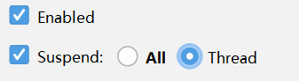
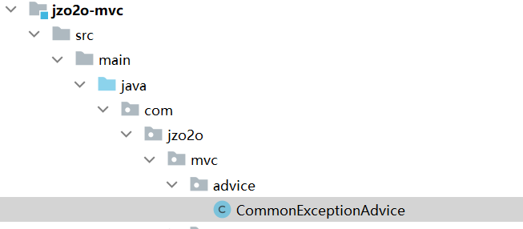
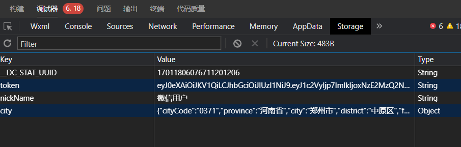
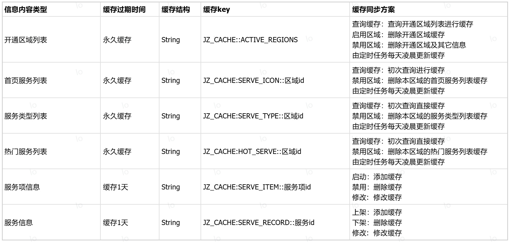
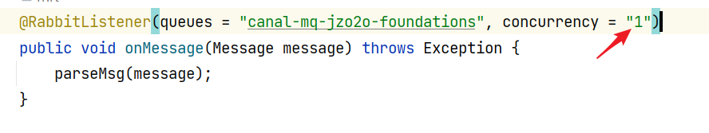

# 一、运营基础管理

## 1.你的项目是做什么业务的？

家政服务，我的项目是一个家政o2o平台。

## 2.项目涉及哪些角色？

本项目涉及如下角色：

家政需求方：通过用户端小程序完成在线预约下单、支付、评价、投诉、退款等操作。

家政服务人员：通过服务端APP完成在线接单、结算等操作。

家政服务公司：通过机构端完成在线接单、派单、投诉处理、结算等操作。

平台方：通过管理端完成服务人员管理、机构管理、订单管理、财务管理等操作，一笔完成的订单，结算时按照分成比例平台进行抽成。

## 3.说下你的项目的业务流程？

平台包括四个端：用户端\(小程序\)、服务端（app）、机构端\(PC\)、运营管理端\(PC\)。

1.用户通过平台在线下单、支付

2.家政服务人员和家政公司通过平台抢单

3.抢单成功服务人员去现场服务，平台跟进整个服务过程（服务前、服务中、服务后）。

4.服务完成后用户进行评价以及售后、退款等。

5.运营人员通过管理端完成服务人员管理、机构管理、订单管理等业务。

## 4.你的项目包括哪些模块？

服务管理：对家政服务项目进行管理，最后在指定区域上架服务后用户可在当前区域购买。

下单支付：用户通过小程序完成下单支付，进入小程序首页查询服务，用户选择服务，下单并支付

抢单：服务人员和机构进行抢单。首先服务人员和机构设置接单范围、服务技能、开启抢单开关，然后进入抢单界面进行抢单。

派单调度：平台根据撮合匹配算法通过任务调度将订单和服务人员进行撮合匹配，促进成交。

订单管理：对订单的生命周期进行管理，包括创建订单、取消订单、删除订单、历史订单等。

服务人员管理：对服务人员的信息、认证等进行管理。

企业管理：对机构的信息、认证进行管理。

客户管理：对c端用户的信息、用户的状态等信息进行管理。

营销管理：对优惠券活动进行管理。

## 5.你的项目用的什么架构？

项目是基于Spring Cloud Alibaba框架构建的微服务项目，采用前后端分离模式进行开发。

平台共包括四个端：运营端\(PC\)、服务端（APP）、机构端（PC）、用户端（小程序）。

网关我们用的SpringCloudGateWay网关，最前边是Nginx进行负载均衡。

服务层我们划分了运营基础服务、客户管理服务、公共服务、订单管理服务、抢单服务、派单服务、支付服务等微服务。

服务层用到了Nacos、XXL\-JOB、RabbitMQ、Elasticsearch、Canal、Sentinel等中间件。

数据层用的是MySQL数据库，使用ShardingShphere进行分库分表，使用TiDB分布式数据库存储历史订单数据，还用到了消息队列RabbitMQ、Redis缓存及Elasticsearch等中间件。

## 6.说说你的项目吧？

从以下几个方面进行项目介绍：

1.项目的背景，包括：是自研还是外包、什么业务、服务的客户群是谁、谁去运营等问题。

2.项目的核心业务流程或业务模块

3.项目的架构是什么

4.个人的工作职责，详细说明自己负责的模块，包括模块的设计，所用到的技术方案，以及所遇到的问题和解决方案。

## 7.如何对现有代码进行断点调试?

1.Debug启动项目

打开你的 Java 项目，并确保已经使用调试模式编译项目。你可以在 IDE 中选择 "Debug" 模式或者在代码中添加断点。

2.设置断点：

    找到接口实现的具体类，在具体类的方法中设置断点，点击编辑器左侧的行号区域，断点将显示为红色圆圈。
    
    如果要测试多线程需要勾选Thread



3.执行代码：

    触发调用接口方法的操作，例如运行应用程序或调用接口方法的测试用例。

4.调试过程中查看变量和调用栈：

    当程序执行到断点时，IDE 会暂停执行，你可以查看当前变量的值、调用栈信息等。在 IntelliJ IDEA 中，你可以在左侧的 "Variables" 和 "Debugger" 窗口中查看变量值和调用栈。

5.继续执行：

    在调试窗口中，你可以选择继续执行（Resume Program）或者单步执行（Step Over、Step Into、Step Out）。

6.停止调试：

    当调试完成后，你可以选择停止调试（Stop）。

## 8.运营基础工程用到哪些技术？

持久层：MySQL数据库，mybatis\-plus框架，com\.github\.pagehelper分页组件

中间件：Redis、Elasticsearch、xxl\-job

服务层：通过Spring进行事务控制，redisson分布式锁、Spring Cache缓存框架

web层:  SpringMVC框架（基于SpringBoot开发）

web容器：undertow。

## 9.设计一个接口需要设计哪些内容？

共7个方面：

1.HTTP请求方法

2.接口路径

3.请求参数类型

4.请求参数内容

5.响应结果类型

6.响应结果状态码

7.响应结果内容

## 10.如何去定义一个接口？

我们使用的是SpringBoot定义Controller方法，接口设计包括7个方面，定义controller方法根据接口设计的内容进行定义：

1.根据HTTP请求方法使用不同的注解

使用  @GetMapping注解表示GET方法。

HTTP方法与注解对应如下：

@PutMapping：put方法

@DeleteMapping：delete方法

@PostMapping：post方法

@RequestMapping 可用于任何方法

2.在类及方法上设置接口路径

在类上使用@RequestMapping\(根路径\)指定根路径。

在方法上指定具体的接口路径。

3.根据请求参数类型决定使用什么注解

当请求参数格式为json需要在方法参数前加@RequestBody注解，这里请求参数类型为from表单格式不用添加此注解。

4.定义接口请求参数内容的DTO类型

定义与请求参数相同属性的DTO类型作为参数类型。

5.统一响应结果类型为json

使用RestController注解，它集成了ResponseBody注解，ResponseBody注解的作用将响应结果转为json格式。

6.响应结果状态码

没有特殊要求无需专门指定。

7.定义响应结果的DTO类型

将响应结果对象转成Json输出。

## 11.Mybatis\-Plus有几种主键生成策略？

1.AUTO：基于数据库的自增主键

2.NONE: 不设置id生成策略

3.INPUT:用户手工输入id

4.ASSIGN\_ID:雪花算法生成id\(可兼容数值型与字符串型\)

5.ASSIGN\_UUID:以UUID生成算法作为id生成策略

## 12.如何开发一个接口的持久层？

对于一个新模块首先使用代码生成工具生成模型类、mapper等基础代码。

如果MyBatisPlus提供的单表的CRUD的mapper满足需求则不需要单独定义mapper接口，否则 需要单独定义mapper接口。

首先定义mapper接口再定义mapper映射。

最后通过单元测试测试mapper接口是否正确。

## 13.@Resource 和 @Autowired有什么区别? 

1.来源不同

@Resource 是 Java EE（Java Platform, Enterprise Edition）规范定义的注解，位于 javax\.annotation 包中，不仅可以用于 Spring 环境，还可以用于其他 Java EE 容器。

@Autowired 是 Spring 框架定义的注解，位于 org\.springframework\.beans\.factory\.annotation 包中，主要用于 Spring 环境中。

2.注入方式不同

@Resource默认按名称注入，如果在spring容器找不到对应名称的 Bean，则按照 byType 进行注入。

@Autowired默认按照 byType 的方式进行注入。如果有多个类型相同的 Bean，可以结合 @Qualifier 使用指定具体的 Bean 名称。

示例如下：

```java
// 使用 @Resource
@Resource(name = "myBean")
private MyBean myBean;

// 使用 @Autowired
@Autowired
@Qualifier("myBean")
private MyBean myBean;

```

## 14.如何开发controller方法？

首先根据接口设计或接口文档定义controller方法。

在controller类中注入service，在controller方法中调用service方法进行业务处理。

得到service方法的返回值封装与客户端要的数据格式进行返回。

遇到问题需要通过断点调试的方式在controller、service中打断点进行调试。

## 15.项目的分页查询是怎么实现的？

项目共用了两个分页实现方法：

第一种：mybatis\-plus自带的分页方法，通过调用selectPage方法实现分页，适用于通过QueryWrapper拼装SQL。

第二种：pagehelper分页组件适用于自定义sql的分页查询。

pagehelper分页组件的原理如下：

调用PageHelper\.startPage方法设置分页参数，通过一层一层进入源码，最终将分页参数设置到ThreadLocal\<Page\>*LOCAL\_PAGE*=newThreadLocal\(\); 中。

通过PageInterceptor拦截器拦截 MyBatis的Executor 的 query\(\) 方法得到原始的sql语句，首先得到count总数，然后从ThreadLocal中取出分页参数，在原始sql语句中添加分页参数查询分页数据。

每次分页查询之后分页组件清空了ThreadLocal中的分页参数，以免影响后边的SQL语句的执行。

即：仅对调用了PageHelper\.startPage方法后的第一条SQL分页查询，如果后续SQL也需要分页查询则需要先调用PageHelper\.startPage方法设置分页参数。

本项目对pagehelper分页查询进行封装也是为了方便使用该组件进行分页查询。

## 16.前后端联调都调些什么，怎么进行前后端联调？

在后端独立开发时通过单元测试对开发的接口进行测试，前后端联调是一种类似生产环境的测试，通过前端请求后端接口测试业务功能，根据接口的定义传递不同的数据进行测试，观察结果是否符合预期。

前后端测试需要借助工具跟踪前后端交互的数据，通常使用浏览器的网络记录去跟踪请求参数及响应结果。

如果前端报错则需要先定位是前端问题还是后端的问题。

如果后端有报错日志则需要先跟踪报错日志去排查问题。

如果后端没有报错日志则需要跟踪前后端交互的数据内容，判断是否符合接口定义要求，排查方向包括接口设计的7个方面。

## 17.如何开发一个接口？

首先设计接口，再根据接口设计去定义接口并生成接口文档，前后端依据接口文档进行开发。

具体编码的过程通常先编写mapper接口，再实现service方法，最后编写controller方法。

每层的编码都会进行单元测试。

和前端约定后待双方都完成本模块的编码后进行前后端联调。

## 18.如何开发一个接口的service方法？

service方法负责业务处理，是一个接口的核心，开发一个service方法需要注意以下几点：

接口职责要单一，一个接口不能过多的承担责任。

注意事务控制，对于更改数据库的操作要加@Transactional注解。

接口参数定义要简单明了，能用简单类型不要使用自定义类型。

对于增、删、改接口一定要做入参校验，其它接口根据情况而定。

接口的参数与返回值避免与其它框架耦合，比如：分页查询我们使用的是com\.github\.pagehelper分页插件，使用插件查询得到Page对象，Page类型是插件提供，避免service方法返回Page类型而是用我们自定义的类型PageResult对Page对象的数据进行封装返回，这样就避免Controller与pagehelper分页插件的耦合。

## 19.接口的异常处理怎么实现的？

mapper异常及service异常都抛给controller，controller方法的异常由异常处理器统一对异常进行处理。

我们抛出的异常是自定义异常类型，自定义的异常类型都继承了CommonException类型，在异常处理器中对此类型的异常进行处理。

通过@RestControllerAdvice注解加@ExceptionHandler注解实现，具体的原理是当controller抛出异常由DispatcherServlet统一拦截处理，再根据异常类型找到@ExceptionHandler标识方法去执行该方法进行异常处理。

异常处理器的源码在framework中，如下图：




# 二、客户管理

## 1.本项目的认证方式有哪些？

小程序认证

手机验证码认证

账号名密码方式认证。

## 2.小程序认证流程是什么？

前端请求微信获取登录凭证code。

前端携带登录凭证code请求微服务认证接口\.

微服务请求微信获取openid，初次认证将openid记录在数据库common\_user表中。

前端请求获取手机号拿到token令牌。

前端携带手机号token令牌请求微服务查询用户手机号。

微服务请求微信查询用户手机号并更新到数据库中。

## 3.当前认证通过的用户信息保存到哪里了？

用户信息保存在两个地方：

前端的storage中:



后端的ThreadLocal中。

用户认证通过后端生成token返回给前端由前端保存，前端每次请求微服务会携带token访问。

网关收到前端的请求进行token校验，token不合法直接返回失败信息，token合法解析出用户信息放在http的head中继续请求微服务，在微服务中解析http头信息中的用户信息，写入ThreadLocal方便应用程序使用。

## 4.手机验证码认证流程是什么？

输入手机号。

点击发送验证码。

输入验证码，点击登录。

认证过程会先校验验证码是否正确，如果验证码正确再根据手机号查询serve\_provider表是否存在相应记录且用户未被冻结，全部成功则认证通过。

## 5.如何开发小程序定位功能？

小程序通过微信提供的API方法获取手机当前位置（经纬度）。

小程序请求后端获取经纬度对应的城市等详细位置信息，后端调用地图服务（高德地图）根据经纬度查询地理编码信息。

后端根据地理编码中的city\_code对应到平台的区域。

定位成功在小程序首页显示定位的城市。

## 6.手机验证码服务的实现方案？

由于项目中使用手机验证码的业务非常多所以抽取一个公共的服务里边包括了验证码功能。

1.提供发送验证码接口

传入业务类型及手机号，向手机号发送验证码并将验证码存储在redis。

业务类型：将使用验证码的业务场景定义为业务类型，如：1：机构注册，2：机构忘记密码, 3:服务人员登录

存储到redis使用string类型。

验证码key: PHONE:CODE:VERIFY\_CODE\_手机号\_业务类型
验证码 value: 6位随机数
验证码有过期时间：默认300秒

2.提供校验验证码接口

传入业务类型、手机号及用户输入的验证码。
根据key从redis取出正确的验证码和用户输入的进行对比，一致说明验证码输入正确，否则输入错误，校验通过删除验证码。

3.对发送验证码接口进行限流，避免频繁发送验证码。

首先在前端操作频率控制，60秒内只允许发一次。

在后端通过对发送验证码接口进行限流。

## 7.你负责模块的怎么设计的

从业务流程、数据库表设计、接口设计、具体的技术方案这几个方面说。

## 8.在客户管理模块开发中你遇到了什么问题

设计方面、开发调试方面都可以说。

# 三、应用门户

## 1.实现一个门户用到的技术方案有哪些? 

对于web门户主要是使用cms系统对网页进行静态化：

1.使用内容发布系统将门户生成静态网页发布到CDN服务器。

纯静态网页通过Nginx加载要比Jsp等动态脚本通过Tomcat加载强很多。

将网页加入CDN服务提高网络访问效率。

2.html文件上的静态资源比如：图片、视频、CSS、Js等也全部放到CDN服务。

3.html上的动态数据通过异步请求后端缓存服务器加载，不要直接查询数据库。

4.使用负载均衡加分布式架构，通过部署多个Nginx服务器共同提供服务。

5.在前端也做一部分缓存。

对于app类的门户：

静态资源要走CDN服务器，对所有请求进行负载均衡、缓存门户上显示的动态数据、可在前端缓存或在服务端进行缓存。

## 2.Spring Cache 用在项目哪里了？怎么用的？

在门户界面使用Spring Cache对门户上的数据进行缓存。

使用Spring Cache的方法很简单，首先引入Spring Cache的依赖，根据缓存策略配置缓存管理器，在业务方法中添加Spring Cache的注解，指定缓存key和缓存管理器即可。

## 3.Spring Cache @Cacheable 注解的工作原理？

基于AOP原理，对添加注解@Cacheable的类生成代理对象，在方法执行前查看是否有缓存对应的数据，如果有直接返回数据，如果没有调用源方法获取数据返回，并缓存起来。

## 4.Spring Cache有哪些常用的注解，都有什么用

@EnableCaching：开启缓存注解功能

@Cacheable：查询数据时缓存，将方法的返回值进行缓存。
@CacheEvict：用于删除缓存，将一条或多条数据从缓存中删除。
@CachePut：用于更新缓存，将方法的返回值放到缓存中
@Caching：组合多个缓存注解；
@CacheConfig：统一配置@Cacheable中的value值

## 5.什么是缓存穿透？如何解决缓存穿透？

缓存穿透是指请求一个不存在的数据，缓存层和数据库层都没有这个数据，这种请求会穿透缓存直接到数据库进行查询。它通常发生在一些恶意用户可能故意发起不存在的请求，试图让系统陷入这种情况，以耗尽数据库连接资源或者造成性能问题。

解决缓存穿透的方法有很多，常用的有：

1.对请求增加校验机制

2.缓存空值或特殊值

3.使用布隆过滤器

项目中对没有查询到数据的请求我们缓存了空值避免缓存穿透，具体实现是使用的Spring Cache，使用Cacheable注解标记在service方法，并通过unless指定条件，根据返回值去控制缓存过期时间，正常的数据我们设置了永不过期，我们会有一个定时任务去更新这部分的缓存，对空列表数据为防止缓存穿透我们缓存了空值，缓存过期时间是30分钟。

## 6.什么是布隆过滤器？如何使用布隆过滤器？

布隆过滤器（Bloom Filter）是一种数据结构，用于快速判断一个元素是否属于一个集合中。它基于哈希函数实现，可以高效地判断一个元素是否在集合中，但不能精确地确定一个元素在集合中的位置。

布隆过滤器是适合处理大规模数据集，比如：海量数据去重、垃圾邮件过滤、避免缓存穿透等。

使用布隆过滤器需要提前将数据通过多个hash函数映射布隆过滤器中，从布隆过滤器查询的方法也是通过多hash函数进行映射找到具体的位置，如果找到一个位置的值为0则说明数据一定不存在，如果找到位置的值都是1则说明可能存在。

我知道的在redit中提供bitmap位图结构可以实现布隆过滤器，使用redisson也可以实现，使用google的Guava库可以实现。

## 7.什么是缓存击穿？如何解决缓存击穿？

缓存击穿发生在访问热点数据，大量请求访问同一个热点数据，当热点数据失效后同时去请求数据库，瞬间耗尽数据库资源，导致数据库无法使用。

解决方案：

1.使用同步锁或分布式锁控制。

2.热点数据永不过期。

3.缓存预热，分为提前预热、定时预热

4.降级处理

## 8.什么是缓存雪崩？如何解决缓存雪崩？

缓存雪崩是缓存中大量key失效后当高并发到来时导致大量请求到数据库，瞬间耗尽数据库资源，导致数据库无法使用。

解决方案：

1.使用锁进行控制

2.对同一类型信息的key设置不同的过期时间

3.缓存预热

## 9.如何保证缓存一致性？

保证缓存一致性需要根据具体的需求来定：

1.对数据实时性有一定要求

对数据实时性有一定要求即数据库数据更新需要近实时查询到最新的数据，针对这种情况可采用延迟双删、Canal\+MQ异步同步的方式。

2.对数据实时性要求不高

使用定时任务的方式定时更新缓存。

3.对数据实时性要求非常高

此类场景不适合用缓存，直接使用数据库即可。

注意：在使用缓存时不论采用哪种方式如果没有特殊要求一定要对key加过期时间，即使一段时间缓存不一致当缓存过期后最终数据是一致的。

## 10.项目哪里进行了缓存，缓存方案是什么？

以下几块信息需要缓存

1.首页服务列表，包括两个服务分类及每个分类下的四个服务项。

2.热门服务列表

3.服务类型列表

4.开通城市列表

5.服务项信息

6.服务信息。

缓存方案如下：



## 11.项目中如何保证缓存的一致性？

保证缓存一致性的方案有很多：

保证缓存一致性需要根据具体的需求来定：

1.对数据实时性有一定要求

对数据实时性有一定要求即数据库数据更新需要近实时查询到最新的数据，针对这种情况可采用Canal\+MQ异步同步的方式。

2.对数据实时性要求不高

使用定时任务、延迟双删的方式定时更新缓存。

3.对数据实时性要求非常高

此类场景不适合用缓存，直接使用数据库即可。

我在实现门户的开通区域服务列表接口时对数据进行缓存，我是这么做的：

首先制定缓存的方案：缓存的过期时间、缓存的数据结构及缓存的同步方案。

过期时间为永不过期，缓存的数据结构使用String，同步方案如下：

查询缓存：查询已开通区域列表，如果缓存没有则查询数据库并缓存，如果缓存有则直接返回

启用区域：删除开通区域信息缓存（再次查询将缓存新的开通区域列表）。

禁用区域：删除开通区域信息缓存，删除该区域下的其它缓存信息，包括：首页服务列表，服务类型列表，热门服务列表。

定时任务：每天凌晨缓存已开通区域列表。

具体实现的我用的Spring Cache去实现。

## 12.项目为什么要用xxl\-job？

xxl\-job是一个分布式任务调度系统，本项目是采用微服务架构开发的分布式系统，在分布式系统中进行任务调度所以选用xxl\-job作为项目的任务调度系统， xxl\-job可以控制任务在分布式环境下进行调度，常用的调度策略有：

第一个：即每次执行任务都由第一个执行器去执行。

轮询：即执行器轮番执行。

分片：每次执行任务广播给每个执行器让他们同时执行任务。

## 13.xxl\-job的执行器和调度中心有什么区别？

调度中心：负责按调度策略调度任务执行。调度中心通常单独部署，使用xxl\-job提供的程序进行安装部署。

执行器：负责执行任务，执行器通常在微服务中运行，需要在微服务引入xxl\-job依赖。

## 14.项目中哪里用了xxl\-job？怎么用的？

项目中使用xxl\-job对门户的缓存进行定时更新。

具体的使用方法：

首先安装xxl\-job调度中心，在微服务添加xxl\-job依赖保证执行器在调度中心注册成功。

然后根据需求编写任务执行方法。

在调度中心配置任务策略，缓存更新任务是每天凌晨执行，由于微服务可能部署多个实例只有一个实例去更新缓存即可所以任务调度策略我们选择第一个。

通过调度中心任务管理去管理定时任务，并且可以查看调度的日志。

## 15.项目为什么要用Elasticsearch？数据很多吗？

项目使用Elasticsearch是实现了门户上对服务的搜索。

平台上的服务数据是并不是很多，全国所有区域下的服务信息加一起几千条，之所以使用Elasticsearch是因为：

1.公司架构师在系统架构时考虑几年后的数据及对全文检索使用的需求使用了Elasticsearch\.

2.对服务信息进行搜索使用的是全文检索方式，虽然MySQL也支持全文检索但是我们这个接口是面向 C端用户且对接口性能有要求，所以使用了ES。

3.虽然现在数据量不大考虑几年后的数据量增长问题，我们使用了Elasticsearch。

4.在项目中除了通过关键字搜索服务信息，还有根据地理坐标进行搜索，使用Elasticsearch也考虑了这一点。

## 16.项目中如何进行索引同步的？

项目使用了Canal\+MQ的方式进行索引同步。

Canal会定时读取数据库的binlog日志，解析出增加、修改及删除的数据内容并将其写入MQ。

同步程序监听MQ，收到消息后根据消息内容请求ES同步索引数据。

这里最关键的问题是MQ的消息可靠性，我们是这样保证MQ的消息可靠性的。（见下）

## 17.如何保证MQ消息的可靠性？

保证MQ消息的可靠性分两个方面：保证生产消息的可靠性、保证消费消息的可靠性。

1.保证生产消息的可靠性

RabbitMQ提供生产者确认机制保证生产消息的可靠性。

首先发送消息的方法如果执行失败会进行重试，这里我们在发送消息的工具类中使用spring提供的@Retryable注解，实现发送失败重试机制，通过注解的backoff属性指定重试等待策略，通过Recover注解指定失败回调方法，失败重试后仍然失败的会走失败回调方法，在回调方法中将失败消息写入一个失效消息表由定时任务进行补偿（重新发送），如果系统无法补偿成功则由人工进行处理，单独开发人工处理失败消息的功能模块。

另外MQ提供生产者确认机制，我们在发送消息时给每个消息指定一个唯一ID，设置回调方法，如果发送成功MQ返回ack，如果失败会返回nack，我们在回调方法中解析是ack还是nack，如果发送失败可以记录到失败表由定时任务去异步重新发送。

还有一种情况是如果消息发送到MQ的Broker成功了但是并没有到达队列，此时会调用ReturnCallback回调方法，在回调方法中我们可以收到失败的消息进行补偿处理。

2.保证消费消息的可靠性

RabbitMQ是通过消费者回执来确认消费者是否成功处理消息的：消费者获取消息后，应该向RabbitMQ发送ACK回执，表明自己已经处理完成消息，RabbitMQ收到ACK后删除消息。

RabbitMQ提供三个确认模式：手动ack，自动ack、关闭ack

本项目使用自动ack模式，当消费消息失败会重试，重试3次如果还失败会将消息投递到失败消息队列，由定时任务程序定时读取队列的消息。

## 18.可以百分百保证MQ的消息可靠性吗？

保证消息可靠性分两个方面：保证生产消息可靠性和保证消费消息可靠性。

保证生产消息可靠性：

生产消息可靠性是通过判断MQ是否发送ack回执，如果发nack表示发送消息失败，此时会进行重发或记录到失败消息表，通过定时任务进行补偿发送。如果Java程序并没有收到回执（如jvm进程异常结束了，或断电等因素），此时将无法保证生产消息的可靠性。

保证消费消息可靠性：

保证消费消息可靠性方案首先保证发送消息设置为持久化，其次通过MQ的消费确认机制保证消费者消费成功消息后再将消息删除。

虽然设置了消息持久化，消息进入MQ首先是在缓存存在，MQ会根据一定的规则进行刷盘，比如：每隔几毫秒进行刷盘，如果在消息还没有保存到磁盘时MQ进程终止，此时将会丢失消息。虽然可以使用镜像队列（用于在 RabbitMQ 集群中复制队列的消息，这样做的目的是提高队列的可用性和容错性，以防止在单个节点故障时导致消息的丢失。）但也不能百分百保证消息不丢失。

虽然我们加了很多保证可靠性的机制，这样也只是去提高消息的可靠性，不能百分百做的可靠，所以使用MQ的场景要考虑这种问题的存在，做好补偿处理任务。

## 19.如何保证MQ幂等性？或 如何防止重复消费？

保证MQ幂等性通常是指保证消费者消费消息的幂等性。

1.使用数据库的唯一约束去控制。

比如：添加唯一索引保证添加数据的幂等性

2.使用token机制

发送消息时给消息指定一个唯一的ID

发送消息时将消息ID写入Redis

消费时根据消息ID查询Redis判断是否已经消费，如果已经消费则不再消费。

## 20.Canal是怎么伪装成 MySQL slave？

1.Canal模拟 MySQL slave 的交互协议，伪装自己为 MySQL slave ，向 MySQL master 发送dump 协议

2.MySQL master 收到 dump 请求，开始推送 binary log 给 slave \(即 canal \)

。一旦连接建立成功，Canal会一直等待并监听来自MySQL主服务器的binlog事件流，当有新的数据库变更发生时MySQL master主服务器发送binlog事件流给Canal。

3.Canal会及时接收并解析这些变更事件并解析 binary log 

## 21.Canal数据同步异常了怎么处理？

检查MySQL主从状态： 检查MySQL主从服务器的状态，确保主从服务器之间的连接正常，MySQL主库的binlog开启，Canal连接是否正常等。如果有网络故障、MySQL主从服务器之间的通信问题，或者Canal连接问题，都可能导致数据同步异常。

查看Canal日志： Canal会生成日志文件，其中包含了关于数据同步的详细信息。

通过日志可以了解出现同步是成功的还是出了错误，如果同步错误在日志会显示读取哪个binlog文件出现了错误，然后通过show binary logs 查询是否存在该 binlog日志。

如果由于binlog日志被删除导致canal同步失败，可以将canal中的meta\.dat清理，并且将master复位，重启canal。

此时为了防止数据不同步需要对表中的数据全部update，触发canal读取update产生的binlog，最终保证当前数据是全部同步的。

确认Canal配置： 检查Canal的配置文件，确保配置正确。特别是Canal的过滤规则等是否正确，即`canal.instance.filter.regex`的配置。

## 22.如何保证Canal\+MQ同步消息的顺序性？

Canal解析binlog日志信息按顺序发到MQ的队列中。

现在是要保证消费端如何按顺序消费队列中的消息。

解决方法：

多个jvm进程监听同一个队列保证只有消费者活跃，即只有一个消费者接收消息。

队列需要增加x\-single\-active\-consumer参数，值为true，表示否启用单一活动消费者模式。

消费队列中的数据使用单线程。

在监听队列的java代码中指定消费线程为1，如下图：



# 四、预约下单

## 1.订单的状态有哪些？

待支付：订单的初始状态。

派单中：用户支付成功后订单的状态由待支付变为派单中。

待服务：服务人员或机构抢单成功订单的状态由派单中变为待服务。

服务中：服务人员开始服务，订单状态变为服务中。

待评价：服务人员完成服务，订单状态变为待评价。

订单完成：用户完成评价，订单状态变为订单完成。

已取消：订单是待支付状态时用户取消订单，订单状态变为已取消。

已关闭：订单已支付状态下取消订单后订单状态变为已关闭。

## 2.订单表是怎么设计的？

订单表通常采用的结构是订单主表与订单明细表一对多关系结构，比如：在电商系统中，一个订单购买的多件不同的商品，设计订单表和订单明细表：

订单表：记录订单号、订单金额、下单人信息、订单状态等信息。

订单明细表：记录该订单购买商品的信息，包括：商品名称、商品价格、交易价格、购买商品数量等。

如果系统需求是一个订单只包括一种商品，此时无须记录订单明细，将购买商品的详细信息记录在订单表即可，设计字段包括：订单号、订单金额、下单人、订单状态、商品名称、购买商品数量等。

本项目订单表包括以下内容：

订单基础信息：订单号、订单状态、排序字段、是否显示标记等。

价格信息：单价、购买数量、优惠金额、订单总金额等。

下单人信息：下单人ID、联系方式、位置信息（相当于收货地址）等。

服务信息（如果有订单明细表要放在订单明细表）：服务类型名称、服务项名称、服务单价、价格单位、购买数量等。

## 3.常见的订单号生成规则有哪些？

1.自增数字序列

使用数据库的自增主键、redis的INCR 命令生成序列化。

2.时间戳\+随机数

将年月日时分秒和一定范围内的随机数组合起来。有重复的风险。

3.订单类型\+日期\+序号

将订单类型（例如"01"表示普通订单，"02"表示VIP订单等）、日期和序号组合起来。加上订单类型的好处是方便客户服务，根据订单号就可以知道订单的类型。

4.分布式唯一ID生成器

使用分布式唯一ID生成器（例如Snowflake算法）生成全局唯一的ID作为订单号。Snowflake 算法根据机器ID、时间戳、序号等因素生成，保证全局唯一性，它的优势在于生成的 ID 具有趋势递增、唯一性、高效性等特点\.

## 4.Feign和OpenFeign的区别？

Feign 是 Netflix 公司开发的一个独立的项目，在使用 Spring Cloud 时，需要单独引入 Feign 的依赖。

OpenFeign 是 Spring Cloud 对 Feign 进行了集成，并提供了对 Spring Cloud 注解的支持。

Feign 使用了一套自己的注解，例如 `@FeignClient` 用于声明一个 Feign 客户端，`@RequestMapping` 用于声明请求的映射等。

OpenFeign 则直接使用了 Spring MVC 注解，例如 `@GetMapping`、`@PostMapping` 等，这使得 OpenFeign 更加和 Spring 生态集成。

从spring boot 2\.0之后基本上都是使用OpenFeign 了。

## 5.微服务保护怎么做？

微服务之间相互调用，因为调用链中的一个服务故障，引起整个链路都无法访问会导致微服务雪崩。

常用的预防微服务雪崩的的方法：

超时处理：设定超时时间，请求超过一定时间没有响应就返回错误信息，不会无休止等待。

熔断降级：当服务的异常数或异常比例超过了预设的阈值时，熔断器会进入开启状态，暂时中断对该服务的请求，此时走降级方法，能够快速响应，确保系统的基本功能能够继续运行。

限流：限制对服务的请求速率，避免短时间内大量的请求导致系统崩溃。

线程池隔离：给要请求的资源分配一个线程池，通过线程池去控制请求数量

信号量隔离：使用计数器模式，记录请求资源的并发线程数量，达到信号量上限时，禁止新的请求。

信号量隔离适合同步请求，控制并发数，比如：对文件的下载并发数进行控制。

大多数场景都适合使用线程池隔离，对于需要同步操作控制并发数的场景可以使用信号量隔离。

## 6.你的项目怎么实现微服务保护的？怎么实现熔断降级的？

我们项目使用sentinel实现微服务保护，我们在Feign远程调用时进行熔断降级控制。

当远程调用发生异常首先走降级方法，当异常比较或异常数达到阈值将触发熔断，在熔断时间内不再走原来的方法而是走降级方法，可以快速进行响应。

当服务恢复后，熔断时间结束此时会再次尝试请求服务，如果成功请求将关闭熔断，恢复原来的链路。

具体方法：

1.在客户端使用使用FeignClient注解定义远程调用接口

2.定义专门远程调用的客户端类实现远程调用、熔断、降级逻辑

使用@SentinelResource注解定义sentinel监控的资源，@SentinelResource注解的属性具体包括。

value: 用于定义资源的名称，即 Sentinel 会对该资源进行流量控制和熔断降级。

fallback ：非限流、熔断等导致的异常执行的降级方法

blockHandler :触发限流、熔断时执行的降级方法

## 7.微服务之间远程调用怎么实现的？

项目使用的Spring Cloud Alibaba框架，微服务之间远程调用使用OpenFeign，具体实现步骤如下：

在api工程定义Feign接口，使用@FeignClient注解进行定义。

服务提供方法定义Feign接口的实现类，实现具体的逻辑。

服务调用方（客户端）依赖api工程，使用@EnableFeignClients注解扫描Feign接口，生成代理对象并放在Spring容器中。

服务调用方（客户端）定义专门远程调用的客户端类，在客户端类中实现远程调用、熔断、降级逻辑，具体参考"你的项目怎么实战微服务保护的？怎么实现熔断降级的？"问题。

## 8.Service方法事务失效的原因是什么？

可能有以下原因：

1.在方法中捕获了异常没有抛出去，没有把异常抛给代理对象，代理对象捕捉不到异常没有进行事务回滚

2.非事务方法内部调用事务方法，不是通过代理对象去调用

3.@Transactional标记的方法不是public

4.抛出的异常与rollbackFor指定的异常不匹配，默认rollbackFor指定的异常为RuntimeException

5.数据库表不支持事务，比如MySQL的MyISAM

6.Spring的传播行为导致事务失效，比如：PROPAGATION\_NEVER、PROPAGATION\_NOT\_SUPPORTED

PROPAGATION\_NOT\_SUPPORTED \-\- 以非事务方式执行操作，如果当前存在事务，就把当前事务挂起。
PROPAGATION\_NEVER \-\- 以非事务方式执行，如果当前存在事务，则抛出异常。

## 9.Spring 如何解决循环依赖？

Spring通过三级缓存对Bean延迟初始化解决循环依赖。

具体如下：

1.singletonObjects缓存：这是 Spring 容器用来缓存完全初始化好的单例 bean 实例的缓存。

2.earlySingletonObjects缓存：这个缓存是用来保存被实例化但还未完全初始化的 bean （半成品）的引用。

3.singletonFactories缓存：这个缓存保存的是用于创建 bean 实例的 ObjectFactory，用于支持循环依赖的延迟初始化。

Spring 通过这三级缓存的组合，来确保在循环依赖情况下，能够正常初始化 bean。当一个 bean  在初始化过程中需要依赖另一个还未初始化的 bean 时，Spring 会调用相应的 对象工厂来获取对应的 bean  半成品实例，这样就实现了循环依赖的延迟初始化。一旦 bean 初始化完成，它就会被移动到正式的单例缓存中。

对于通过构造方法注入导致循环依赖的在其中一个类的构造方法中使用@Lazy注解注入一个代理对象即可解决。

## 10.你们对接的哪个支付接口？怎么对接的？

用户端是微信小程序，我们对接的小程序支付接口。

我们使用的SDK是微信支付的httpclient程序（[wechatpay\-apache\-httpclient](https://github.com/wechatpay-apiv3/wechatpay-apache-httpclient) ）。

首先用户发起支付会调用小程序的下单接口，微信返回一个下单标识。

小程序前端程序使用该下单标识调用小程序的方法唤起支付窗口，用户进行支付。

支付成功，微信通过通知接口调用服务端接口。

服务端程序也会调用微信的支付结果查询接口查询支付结果，根据支付结果更新订单的支付状态。

用户退款接口我们对接小程序的退款接口，用户发起退款申请，通过退款结果查询接口查询退款状态。

## 11.项目的支付服务有哪些接口？

项目的支付服务对接了微信、支付宝的Native、jsapi等常用支付方法。

支付服务提供以下接口：

支付接口，此接口请求第三方支付平台的下单接口，下单成功生成支付二维码返回给业务系统，如果已生成支付二维码会将二维码返回给业务系统。

支付结果查询接口，根据支付服务的交易单查询支付结果，支付服务会请求第三方的支付结果查询接口查询支付结果。

退款接口，此接口请求第三方支付平台的退款接口，如果已退款此接口会返回退款记录给业务系统。

支付通知接口，支付服务获取支付结果通过MQ通知业务系统。

## 12.支付服务设计了几张表？

核心的表有支付渠道表、交易单表、退款记录表。

支付接口：收到支付请求后请求第三方支付的下单接口，并向交易单表新增记录。

查询交易结果接口：请求第三方支付的查询支付结果并更新交易单表的支付状态。

接收第三方通过支付结果：更新交易单表的支付状态。

退款接口：新增退款记录

更新退款状态：请求第三方退款结果查询接口查询退款状态，并更新退款状态。

## 13.如何防止重复支付？

重复支付是一个订单客户支付多次，造成重复支付。

我们项目实现的是扫码支付，可能存在重复支付的问题，通过以下方式去避免重复支付：

1.同一个订单同一个支付渠道只生成一个支付二维码。

2.在请求第三方支付下单使用分布式锁控制不会重复请求第三方下单。

3.切换支付渠道时先关闭原渠道的交易单再生成新渠道的交易单。

4.使用定时任务每天扫描交易单表，如果存在多个支付成功的交易单则进行自动退款。

## 14.支付接口是怎么开发的？

项目有统一的支付服务与第三方支付平台对接，业务系统对接支付服务完成支付流程。

首先请求通过支付服务请求第三方支付平台的支付下单接口，如果是小程序支付下单成功会返回一个会话标识，前端通过该会话标识调起支付窗口，如果是扫码支付下单成功会返回二维码URL，生成二维码返回给前端。

用户支付成功，获取支付结果更新订单表的订单状态字段。

获取支付结果有两种方法：

调用 支付服务的查询支付结果接口查询支付结果。

通过监听MQ，支付服务将支付结果通知给业务系统。

## 15.项目中有用到MQ吗？怎么用的？

项目有很多地方都用到了MQ，我们用的是RabbitMQ。

1.数据同步用到了MQ

项目在数据同步中用到了MQ，我们用的是Canal加MQ将MySQL的数据同步到其它服务，比如：ES、Redis等。

具体的流程是：

Canal会定时读取数据库的binlog日志，解析出增加、修改及删除的数据内容并将其写入MQ。

同步程序监听MQ，收到增加、修改及删除的数据的消息后请求ES同步索引。

2.支付通知用到了MQ 

项目在支付通知中用到了MQ，支付服务将支付结果发给MQ，订单服务监听MQ收到支付结果更新订单的支付状态。

具体的流程是：

支付服务将支付结果发送给专门传输支付通知的交换机，交换机使用的是topic类型，该交换机绑定了多个队列，因为考虑会有多个微服务对接支付通知，每个微服务监听一个队列。

当支付服务向交换机发送一条支付通知消息，所有绑定此交换机的队列会收到支付通知，业务系统收到支付结果后解析出业务系统应用标识，判断是否属于自己的支付结果通知，如果是再进行处理。

## 项目的退款功能怎么实现的？

取消订单执行退款操作。

1.首先使用一个事务保存以下数据

更新订单状态。

保存取消订单记录，记录取消的原因等信息。

保存退款记录。

2.事务提交后先启动一个线程请求支付服务的退款接口

3.定时任务扫描退款记录表，对未退款的记录请求支付服务进行退款，退款成功更新订单的退款状态，并删除退款记录。

说明：

第2步的作用为了第一时间申请退款，因为定时任务会有一定的延迟。

第3步的作用是由定时任务去更新退款的状态，因为调用了退款接口只是申请退款了，退款结果可能还没有拿到，通过定时任务再次请求支付服务的退款接口，拿到退款结果，更新订单的退款状态，并删除退款记录。

# 五、优惠卷管理

## 1.优惠券包括几个模块？

优惠券模块包括：活动管理、抢券、核销三个模块。

活动管理：

对优惠券活动进行管理，运营人员新增优惠券活动、修改优惠券活动、撤销优惠券活动及优惠券统计等。

抢券：

到了优惠券发放时间用户进行抢券，抢券过程对优惠券库存、对用户领取优惠券数量等进行校验，抢券成功记录用户领取优惠券的记录。

核销：

用户在下单时使用优惠券得到优惠金额，实付金额等于订单金额减去优惠金额，下单成功优惠券核销成功。

优惠券核销是指：顾客在购买商品使用优惠券，当此次消费符合优惠券的条件时提交订单后将优惠券的折扣应用到顾客的订单中，最后将优惠券标记为已使用或作废。

优惠券核销后还可以取消核销，如果用户取消订单会将优惠券取消核销即退回优惠券，退回优惠券后可以继续使用。

## 2.优惠券模块的核心表的哪些，是怎么设计的？

优惠券活动表：

优惠券活动记录优惠券活动信息。

关键字段：活动id、活动名称、优惠券类型、折扣、发放时间等。

优惠券表：

优惠券表记录用户领取的优惠券记录。

关键字段：用户id、活动id、折扣、优惠券类型、有效期等。

优惠券核销表: 

优惠券核销表记录用户使用优惠券的记录，记录是哪个用户的哪个订单使用了哪个优惠券。

关键字段 ：用户id、优惠券id、订单id，核销时间。

优惠券退回表：

优惠券退回表记录记录用户退回优惠券的信息。

关键字段：用户id、优惠券id、退回时间。

## 3.在活动管理模块开发中你遇到了什么问题？

设计方面、开发调试方面都可以说。

# 六、系统优化

## 1.什么是状态机，它解决了什么问题？

状态机就是对状态进行统一管理的数学模型，应用在软件领域是状态机设计模式，有了状态机就可以避免在业务代码中对状态进行硬编码，增加系统的可扩展性。状态机设计模式包括四个要素：现态、事件、动作、次态。

1.现态：是指当前所处的状态。

2.事件：当一个条件被满足，状态会由现态变为新的状态，事件发生可能会触发一个动作，或者执行一次状态的迁移。

3.动作：发生事件执行的动作，动作执行完毕后，可以迁移到新的状态，也可以仍旧保持原状态。动作不是必需的。

4.次态：条件满足后要迁往的新状态。

通过状态机更改状态只需要指定事件名称即可，避免了状态字段在代码中硬编码。

## 2.如何实现一个订单状态机？

我们封装了一个状态机组件，包括：状态机抽象类、状态接口、事件接口、动作接口、快照基础类。

实现一个订单状态机的步骤（其它状态实现类似）：

1.定义订单状态枚举类，实现状态接口，定义订单的各个状态

2.定义订单状态变更事件类，实现事件接口，实现状态之间变更的事件

3.定义订单快照类，继承快照基础类

4.定义事件变更动作类实现动作接口，并在订单状态变更事件类中指定动作类

5.定义订单状态机类继承状态机抽象类，指定状态机的名称、指定订单初始状态。

## 3.本项目使用状态机实现什么功能？为什么这样做？

本项目使用状态机对订单的状态的进行管理。

订单的状态很多，并且状态之间的变更复杂多样，如果在业务代码中对状态进行硬编码不利于系统的扩展和维护，使用状态机就可以对订单的状态进行统一管理，避免在业务代码中对订单状态进行硬编码，提高系统的可扩展性。

使用状态机对订单状态的变更：

在状态机中针对订单状态之间的变更定义了事件，每个事件对应一个动作类，对订单状态的变更是在动作类统一维护，这样就实现了对状态的统一管理，避免在业务代码中对订单状态进行硬编码，提高系统的可扩展性。

## 4.项目为什么进行分库分表？

架构师考虑订单数据量达到一定程度会影响系统的性能，在系统架构时我们项目对订单数据库进行分库分表。

项目使用ShardingSphere实战订单数据库的分库分表。

## 5.分库分表有哪些形式？

分库分表包括四种形式：垂直分表、垂直分库、水平分库、水平分表。

垂直分表是将一个表按照字段分成多表，每个表存储其中一部分字段，比如商品表按冷热字段进行拆分，商品基本信息表和商品详细信息表。

垂直分库是指按照业务将表进行分类，分布到不同的数据库上面，微服务架构下通常会对数据库进行垂直分为，不同业务数据放在单独的数据库中，比如：客户信息数据库、订单数据库等。

水平分库是把同一个表的数据按一定规则拆到不同的数据库中，每个库可以放在不同的服务器上，比如：单数订单在db\_orders\_0数据库，偶数订单在db\_orders\_1数据库。

水平分表是在同一个数据库内，把同一个表的数据按一定规则拆到多个表中，比如：0到500万的订单在orders\_0数据、500万到1000万的订单在orders\_1数据表。

## 6.项目的分库分表是怎么做的？

对订单数据库进行分库：

分为三个数据库

分库键：用户id

分库策略：用户id除以3求余

参考历史经验，前期设计三个数据库，每个数据库使用主从结构部署，足以支撑项目几年运行，虽然哈希存在数据迁移问题，在很长一段时间也不用考虑这个问题。

分表方案：

分表键：订单号

分表策略：根据订单范围分表，以1500万为单位进行分表，0\-\-\-1500万落到table\_0，1500万\-\-\-3000万落到table\_1，依次类推。

根据范围分库不存在数据库迁移问题，方便系统扩容。

## 7.订单查询是如何优化的？

对于根据订单id查询订单详情优化：

查询数据库改为查询订单快照缓存，状态机组件提供快照缓存的查询方法，将快照信息缓存到 redis提供查询效率。

对于C端订单列表的查询优化：

分页查询改为滚动查询，避免count查询。

首先使用覆盖索引查出符合条件的订单ID（主键），再根据订单ID查询订单信息。

将订单信息缓存到Redis的Hash结构中。

缓存同步：当订单状态变更则删除Hash结构中的对应的订单信息。

对于运营端订单列表的查询优化：

使用覆盖索引查出符合条件的订单ID（主键），再根据订单ID查询订单信息。

## 8.订单快照是怎么实现的？

在订单状态变更时会记录订单的快照信息，在订单状态机的方法中实现了保存订单快照，订单快照保存到数据库的订单的快照。

提供快照查询接口，根据订单id查询订单详情是查询订单快照的信息。

快照查询接口实现Redis缓存，根据订单Id查询缓存信息，先从缓存查询如果缓存没有则查询快照表的数据然后保存到缓存中。缓存设置了过期时间是30分钟。

当订单状态变更，此时订单最新状态的快照有变更，会删除快照缓存，当再次查询快照时从数据库查询最新的快照信息进行缓存。

## 9.什么是聚集索引和非聚集索引？

聚集索引就是主键的索引，聚集索引的叶子结点存储了一行的数据。

非聚集索引是普通字段的索引，可以是联合索引，非聚集索引的叶子结点存储的是主键值。

## 10.什么是回表查询？

当从非聚集索引无法查询所需要的数据时会根据非聚集索引查询到主键再查询聚集索引拿到一行数据。

## 11.什么是覆盖索引？

覆盖索引（covering index）是一种优化手段，指一个查询语句的执行只需要从非聚集索引中就可以得到查询记录，而不需要回表去查询聚集索引，可以称之为实现了索引覆盖。

## 12.如何知道一个SQL有没有使用索引？

通过获取该SQL的执行计划判断是否使用索引。

使用explain关键字，后边跟上SQL语句即可查询该SQL的执行计划。

在执行计划中，通过key、key\_len可以知道是否使用索引及使用的哪个索引。

通过Extra可以判断是否实现覆盖索引。

当Extra的值是Using index时表示使用了覆盖索引。

# 七、秒杀抢购

## 1.秒杀抢购常用的技术方案有哪些？

1.缓存方案

使用缓存技术（如Redis）来存储热点数据，例如商品信息和库存数量。这样可以减轻数据库的压力，提高读取数据的速度。

2.异步处理方案

当用户成功秒杀后，将抢购信息发送到队列，然后由消费者多线程异步处理订单，减轻系统的实时压力，使用Redis、RabbitMQ等技术都可以实现队列。

3.防止超卖方案

超卖是最终下单购买数量大于库存数量，比如：库存１00个用户最终购买了101个，多出这一个就是超卖了，在秒杀抢购业务中这也是需要解决的问题，可以使用分布式锁、Redis等技术都可以防止超卖。

4.限流与防刷方案

使用限流算法（如令牌桶、漏桶算法）来控制请求的并发数，防止服务器被过多请求压垮。同时，可以在服务端实现防刷机制，例如限制同一IP的请求频率，以及使用验证码等技术。

5.数据库优化方案

对数据库进行优化，包括索引的设计、SQL语句的优化、数据库连接池的使用等，以提高数据库的查询和更新速度。

6.数据库分库分表方案

在数据库层面进行分库分表，将数据分散存储在不同的数据库实例或表中，提高数据库的读写性能。

7.负载均衡

使用负载均衡技术，例如Nginx、负载均衡器等，将请求分发到多个服务器上，增加系统的处理能力。

8.CDN加速

使用内容分发网络（CDN）来加速静态资源的访问，例如商品图片、CSS和JavaScript文件等，提高网页加载速度。

9.安全性处理

确保系统的安全性，防止SQL注入、XSS攻击（跨站脚本攻击）等，同时在后端实现防刷、验证码等安全措施，保护系统免受恶意攻击。

## 2.抢券查询的缓存是怎么做的？

我们使用Redis缓存活动信息。

活动信息缓存方案如下：

redis结构：String类型（存储的json串）

value: 符合条件的优惠券活动列表JSON数据，我们将一个月以内即将开始的活动和进行中的活动进行缓存。

过期时间：永不过期

缓存一致性方案：通过定时预热程序保证缓存一致性

## 3.动定时预热程序是怎么做的？

1.首先说明缓存方案 （参考问题：抢券查询的缓存是怎么做的？）

2.使用xxl\-job定时执行活动预热程序，从数据库查询出符合条件的活动信息存储到redis中。

## 4.解决超卖问题有哪些方案？

使用数据库行锁实现悲观锁和乐观锁解决超卖问题，适用并发量不大的场景。

使用Redis分布式锁解决超卖问题，控制多个Jvm进程去争抢同一个锁，将并发操作库存改为同步执行。

使用Redis原子操作解决超卖问题，Redis命令具有原子性，将库存放在Redis中，使用decr命令去扣减库存。

## 5.什么是悲观锁和乐观锁？

悲观锁是一种悲观思想，总认为会有其它线程修改数据，为了保证线程安全所以在操作前总是先加锁，操作完成后释放锁，其它线程只有当锁释放后才可以获取锁继续操作数据。synchronized和ReentrantLock都可以实现悲观锁。

乐观锁则是一种乐观思想，认为不会有太多线程去并发修改数据所以谁都可以去执行代码。

Java提供的CAS机制可以实现乐观锁。CAS（Compare And Swap ）即比较并交换，在修改数据前先比较版本号，如果数据的版本号没有变化说明数据没有修改，此时再去更改数据。

## 6.数据库的怎么实现悲观锁和乐观锁？

数据库的行级锁可以实现悲观锁也可以实现乐观锁。

执行select … for update 实现悲观锁，select … for update 会锁住符合条件的行的数据

数据库的行级锁也可以实现乐观锁，通用的做法是在表中添加一个version版本字段，在更新时对比版本号，更新成功将版本号加1，SQL示例如下：

```Java
update 表名 set 字段=值,version=version+1 where  id =? and version =? 
```

针对扣减库存业务扣减库存示例SQL：

```Java
update 库存表 set 库存=库存-1 where 库存>0 and id =? 
```

## 7.项目中保证Redis原子操作用什么方案？

Redis命令都具有原子性。

通过  MULTI 事务命令可以实现多个Redis命令具有原子性。

Redis\+Lua也可以实现多个Redis命令具有原子性，此方式可以使用Lua语言添加执行逻辑，相对MULTI 命令较灵活，本项目使用Redis\+Lua。

## 8.抢券是怎么做的？或方案是什么？

1.由预热程序将待生效库存同步到redis\(活动开始将不允许更改库存\)

2.活动开始后，抢券程序请求Redis扣减库存，扣减库存成功向抢券成功队列和抢券同步队列写入记录

Redis中两个队列的作用如下：

抢券成功队列：为了校验用户是否抢过该优惠券。

抢券同步队列：将抢券结果同步到数据库

3.通过定时任务程序根据Redis中同步队列记录的用户抢券结果信息将数据同步到MySQL，具体操作如下：

向优惠券表插入用户抢券记录。

更新优惠券活动表的库存。

写入数据库完成后删除Redis中同步队列的相应记录，删除后表示同步完成，如果同步过程失败将保留Redis同步队列的相应记录。

## 9.抢券业务的Redis数据结构用的什么？具体说说

1.活动信息

缓存结构：String类型:

key: "ACTIVITY:LIST"

value: 符合条件的优惠券活动列表JSON数据。

过期时间：永不过期

缓存一致性方案：通过预热程序保证缓存一致性

2.优惠券活动库存

缓存结构：Hash

RedisKey：COUPON:RESOURCE:STOCK:\{活动id%10\}

HashKey：活动id

HashValue: 库存

过期时间：永不过期

缓存一致性方案：通过预热程序保证缓存一致性

3.抢券成功队列

缓存结构：Hash

RedisKey：COUPON:SEIZE:LIST:活动id\_\{活动id%10\}

HashKey：用户id

HashValue:1

过期时间：永不过期

缓存一致性方案：

抢券成功写入此队列。

活动结束删除队列。

4.抢券同步队列

缓存结构：Hash

RedisKey：QUEUE:COUPON:SEIZE:SYNC:\{活动id%10\}

HashKey：用户id

HashValue:活动id

过期时间：永不过期

缓存一致性方案：

抢券成功写入此队列。

每同步成功一条记录删除同步队列的相应数据。

## 10.项目中如何定义的线程池？

项目中使用线程池从Redis的多个同步队列获取数据向MySQL同步。

我们通过创建ThreadPoolExecutor对象定义线程池，这里我们关注以下参数：

核心线程数：初始为1

最大线程数：为同步队列的个数，同步队列个数控制在10到20

线程空闲时间：120秒，因为我们定时任务每隔1分钟调用线程池去处理任务，如果线程在120秒没有使用则销毁辅助线程，只留核心线程。

阻塞队列：根据需求我们不需要任务存放在队列，如果线程没有空闲将拒绝任务，所以阻塞队列使用的SynchronousQueue，此队列不存储任务。

拒绝策略：使用的是DiscardPolicy，丢弃任务不抛出异常策略，

## 11.项目分布式锁怎么实现的？

项目使用Redisson实现分布式锁。

我们在使用多线程从同步队列查询并处理数据时，同一个队列只允许一个线程去处理，这里我们用到了分布式锁，锁的粒度是每个同步队列。

由于从同步队列同步数据的时间不确定，所以我们使用了redisson的看门狗机制，当同步任务完成将分布式锁释放。

## 12.如何将Redis中的数据异步同步到MySQL？

我们项目开发了一个同步组件，用于将Redis Hash结构中的数据同步到MySQL，具体是这样做的：

1.使用线程池从多个同步队列中查询数据，每个线程处理一个同步队列。

同步队列的个数通常配置10到20即可。

在同步时为了保证一个线程只处理一个队列，这里使用的分布式锁进行控制。

2.使用redisTemplate\.opsForHash\(\)\.scan\(H key, ScanOptions options\)方法从hash表获取数据。

3.读取到数据后将数据库写入MySQL，最后将写入成功的的数据表示已经同步成功，将从Redis的Hash表中删除。

## 13.秒杀异步处理怎么实现的？

在秒杀抢购场景中，为了流量削峰可以在Redis存储秒杀结果，再通过定时任务将秒杀结果同步到数据库中。

本项目使用了一个数据同步组件，将Redis中的数据异步同步到MySQL，具体的做法是：

将Redis中的数据异步同步到MySQL参考“如何将Redis中的数据异步同步到MySQL？”

## 14.下单时如何拿到可用的优惠券列表？

下单时订单管理服务会请求优惠券服务获取可用优惠券列表。

根据用户id、订单金额去匹配优惠券的规则，符合条件的优惠券为可用优惠券，规则如下：

- 属于当前用户的优惠券

- 符合下边条件的优惠券：

订单金额大于等于满减金额

优惠金额小于订单金额

优惠券还没有过期

优惠券还没有使用

## 15.优惠券核销的交互流程是什么？

1.优惠券核销

用户端请求订单管理服务创建订单信息，订单管理服务远程调用优惠券服务核销优惠券，下单成功且优惠券核销成功。

优惠券核销执行以下操作：

- 根据优惠券id标记优惠券表中该优惠券已使用。

- 向优惠券核销表添加记录。

2.优惠券退回

用户端取消订单，订单管理服务执行取消订单逻辑，如果该订单使用了优惠券则请求优惠券服务退回优惠券。

优惠券退回执行以下操作：

- 添加优惠券退回记录。

- 如果优惠券已过期则标记该优惠券已作废，否则标记该优惠券未使用。

- 删除核销记录。

在优惠券核销和退回操作时由于是远程请求优惠券服务，这里使用seata控制分布式事务。

## 16.什么是分布式事务？

什么是本地事务？

基于本应用自己的关系型数据库的事务称为本地事务，在service方法通过添加@Transactional注解进行本地事务控制。

什么是分布式事务？

在分布式系统环境下由多个服务通过网络通信协作去完成一次事务，这称之为分布式事务。

分布式事务的场景有哪些？

多个微服务之间通过远程调用完成一次分布式事务。

单服务请求多数据库完成一次事务。

多服务请求单数据库完成一次事务。

## 17.什么是CAP原理？

CAP分别表示一致性、可用性、分区容忍性\.

CAP理论要强调在分布式系统中C、A、P这三点不能全部满足，要么满足AP、要么满足CP。

## 18.能够说出本项目抢单的实现方案？

1.用户下单且支付成功，订单信息进入抢单池

2.通过Canal\+MQ将抢单池的信息同步到Elasticsearch、同步到Redis中。

3.服务人员或机构进入抢单界面，请求Elasticsearch查询订单信息，这里可以根据地理坐标搜索附近的订单

4.服务人员或机构点击抢单、请求Redis执行Lua脚本完成抢单。

5.通过定时任务将Redis中抢单成功的结果同步到数据库。

## 19.抢单池是怎么设计的？

1.在数据库中创建抢单池表，存储待抢单的订单信息。

2.用户下单并支付成功将订单信息写入订单表和抢单池表。

3.通过Canal\+MQ将抢单池的信息同步到Elasticsearch和Redis中。

同步到Elasticsearch是为了通过ES的地理坐标搜索功能查询订单信息。

同步到Redis是为了将抢单池库存信息同步到Redis，服务人员抢单时请求Redis完成。

4.服务人员抢单完成扣减Redis中抢单池的库存，并记录抢单结果。

5.最后通过异步任务将抢单结果同步到数据库。

## 20.订单分流的业务流程是什么

1.用户下单且支付成功

2.根据服务预约时间与当前时间的间隔判断，如果间隔小于2小时（默认）将订单信息写入派单池表和抢单池表。

3.如果服务预约时间与当前时间的间隔大于2小时将订单信息只写入抢单池表。

## 21.搜索附近怎么实现？

对于地理坐标不变的场景，比如：搜索附近的酒店、搜索附近银行等，可以提前将搜索目标信息同步到Elasticsearch中，再通过Elasticsearch的geo去根据地理坐标去搜索附近几公里内的酒店、银行等。

使用geo时在索引中设置geo\_point类型的字段，查询时需要传入经纬度坐标及距离（公里），将查询以此经纬度坐标为中心方圆几公里的信息。

对于地理坐标变的场景，比如：搜索附近的骑手、搜索附近的出租车，这里就需要在手机定时上报坐标到系统中，系统收到上传的坐标更新至Elasticsearch中，再通过geo去搜索附近的骑手、搜索附近的出租车等。

## 22.抢单是如何防止超卖的？

1.首先提前将抢单池库存信息同步到Redis

2.抢单时请求Redis执行Lua脚本扣减库存，如果库存不足将会抢单失败

3.通过Lua脚本执行抢单逻辑保证了原子性。

# 八、订单管理

## 1.能说出订单模块涉及到的业务有哪些？

订单模块所包含的业务功能:

1.订单创建：允许用户创建新订单，选择商品、商品数量、支付方式等。

2.订单查询：提供用户查询订单的功能，可以按订单状态、时间范围等条件进行筛选。

3.订单详情：显示订单的详细信息，包括商品清单、价格、运费、收货地址等。

4.订单支付：提供多种支付方式，支持用户完成订单支付操作。

5.订单状态管理：管理订单的不同状态，如待支付、已支付、已发货、已完成、已取消等。

6.价格计算：根据用户选择的商品、优惠券、运费等信息计算订单总金额。

7.订单导出：提供导出订单数据的功能，以便进一步的分析和报表生成。

8.订单统计分析：对订单数据进行统计和分析，为业务决策提供参考。

9.历史订单：通过冷热分离对已经完成的历史订单进行单独管理，提高热数据的处理效率。

相关的外部系统/模块：

1.库存管理：在订单创建时，要检查商品库存是否充足，成功支付后要扣减库存。

2.优惠券管理：允许用户使用优惠券，系统需要验证优惠券的有效性，并计算折扣金额。

3.订单支付：提供多种支付方式，支持用户完成订单支付操作。

4.物流管理：记录订单的物流信息，包括快递公司、快递单号等，方便用户追踪物流信息。

5.售后服务：提供用户申请退款、退货、换货等售后服务，需要有相应的审核和处理流程。

6.评价和评论：允许用户对已完成的订单进行评价和评论，提供用户反馈。

## 2.订单的状态是怎么流转的？

订单状态共有7种：

待支付：用户下单成功，该订单的初始状态为待支付。

派单中：用户支付成功后订单的状态由待支付变为派单中。

待服务：服务人员或机构抢单成功订单的状态由派单中变为待服务。

服务中：服务人员开始服务，订单状态变为服务中。

订单完成：服务人员完成服务，订单状态变为订单完成。

已取消：订单是待支付状态时用户取消订单，订单状态变为已取消。

已关闭：订单已支付状态下取消订单后订单状态变为已关闭。

## 3.订单模块的数据库是怎么设计的？

订单数据库进行分库分表设计：

分库方案：

设计三个数据库。

订单表：根据用户id哈希决定数据库\(分库表达式为：db\_用户id % 3\)

服务单表：根据服务人员id哈希决定数据库，分库表达式：jzo2o\-orders\-$\{serve\_provider\_id % 3\}

快照表：根据db\_shard\_id哈希决定数据库，分库表达式：jzo2o\-orders\-$\{db\_shard\_id % 3\}，db\_shard\_id即用户的id

每个数据库使用主从结构部署，可以支撑项目3年左右的运行，虽然哈希存在数据迁移问题，在很长一段时间也不用考虑这个问题。

分表方案：

订单表：根据订单范围分表，0\-\-\-1500万落到table\_0，1500万\-\-\-3000万落到table\_1，依次类推。根据范围分表不存在数据库迁移问题，方便系统扩容。

服务单表：同订单表，分表表达式为：orders\_serve\_$\{\(int\)Math\.floor\(id % 10000000000 / 15000000\)\}。

快照表：同订单表，分表表达式为：biz\_snapshot\_$\{\(int\)Math\.floor\(\(Long\.valueOf\(biz\_id\)\)  % 10000000000 / 15000000\)\}

## 4.状态机组件是怎么实现的？

为了对订单状态进行统一管理我们开发了状态机组件，状态机组件适合对状态较多且状态之间变化复杂进行状态信息进行统一管理。

根据状态机设计模式开发状态机组件，状态机设计模式简单理解就是通过状态变更事件去更改状态，状态变更事件包括变更前的状态和变更后的状态，通过变更事件可以将原状态更改为新状态。

1.首先定义状态接口，接口中包括获取状态代码和状态名称等方法。

订单状态会单独定义在枚举类中，并实现此状态接口。

2.定义状态变更事件接口，接口中包括获取变更前的状态和获取变更后的状态等方法。

订单状态变更事件定义在枚举类中，并实现状态变更事件接口。

3.定义快照抽象类

订单快照类会继承此抽象类

4.定义状态机抽象类

订单状态机继承状态机抽象类，实现抽象方法，指定状态机的名称，以及初始状态。

在变更订单状态时使用订单状态机的方法去变更。

在状态机中针对订单状态之间的变更定义了事件，每个事件对应一个动作类，对订单状态的变更是在动作类统一维护，这样就实现了对状态的统一管理，避免在业务代码中对订单状态进行硬编码，提高系统的可扩展性。

## 5.下单接口是怎么实现的？

从以下几个方面回答：

订单表如何设计

订单号生成规则

下单接口如何防止重复提交

如何计算价格

存在分布式事务如何解决

## 6.怎么防止订单重复提交？

重复提交通常是因为网络不稳定，用户提交后没有响应用户重复点提交按钮导致。

通过前端和后端共同完成。

前端：

在用户点击提交按钮后，立即将按钮禁用，防止用户多次点击。

后端：

使用分布式锁，以用户id\+服务id作为分布式锁，锁定下单接口10秒，10秒内只会提交一次。

## 7.如何保证一个外部接口的安全性？

对于登录、支付包含敏感信息的接口一定要使用https进行加密传输。

通过签名、验签防止内容篡改，我们对接第三方支付接口都会进行签名验签的过程，使用非对称加密算法 更安全，比如：SHA256 with RSA算法。

通过加密、解密防止内容暴露，通过非对称加密算法 更安全。

## 8.项目中用到设计模式了吗，具体说说？

单例模式：controller、service、mapper三层的bean都是单例。

工厂模式：spring容器就是一个工厂，在Spring中，BeanFactory 接口就是一个典型的工厂方法模式的例子。

策略模式：我们在开发取消订单业务时使用了策略模式，因为不同的场景执行取消订单的逻辑不同，我们使用使用策略模式实现提高了系统的扩展性。

首先定义策略接口

再定义不同的策略类即不同场景下取消订单的逻辑，每个策略类定义的bean名称为“用户类型：订单状态”。

在取消订单时通过拿到用户的类型及当前订单的状态，根据用户类型和订单状态得到具体的策略对象，执行该策略对象的取消订单方法。

## 9.删除订单怎么实现？

删除订单和取消订单不同，取消订单的目的是终止订单，删除订单是不希望订单信息出现订单列表中。

用户删除订单后订单信息将不在订单列表显示。

也有平台提供订单回收站查询功能，即查询已经删除的订单。

根据需求，我们在订单表添加逻辑删除标记，删除订单相当于隐藏订单。

在订单表添加字段：display （*1：展示，0：隐藏*）

删除订单将此字段设置为0。

在订单列表中只查询display 为1的订单信息。

## 10.服务人员现场服务的过程是如何管理的？

服务人员抢单成功将生成服务单，服务单有5个状态：

待服务：服务人员抢单成功生成服务单，服务单的初始状态为待服务。

待分配：机构抢单成功生成服务单，服务单的初始状态为待分配，机构分配服务人员此时状态改为待服务。

服务中：服务人员去现场服务，开始服务后服务单的状态由待服务变为服务中。

服务完成：服务人员完成家政服务，服务单的状态由服务中变为服务完成。

服务取消：用户取消订单或运营人员取消订单后服务单状态改为已取消。

服务人员开始服务需要上传服务前的照片进行存档，服务完成后也需要上传服务后的照片进行存档。

## 11.订单的冷热分离是怎么做的？

本项目的订单在15日后将不再变更状态，通过订单冷热分离技术将历史订单迁移到历史订单数据库，因为我们要对历史订单进行统计分析并且提供查询接口，所以历史订单数据库使用TiDB分布式数据库存储。

具体迁移的过程：

当订单完成，取消、关闭时将订单信息写入同步表。

通过Canal\+MQ将同步表的订单数据同步到历史订单数据库的待迁移表中，具体过程如下：

Canal读取binlog将写入同步表的数据写入MQ。

历史订单服务监听MQ，获得同步表的订单数据。

历史订单服务将订单数据写入待迁移表。

历史订单服务启动定时任务，每天凌晨将昨天0点到昨天24点之间符合条件（订单完成15日后）的订单信息迁移到历史订单表。

每次迁移完成将迁移完成的历史订单从待迁移表删除。

## 12.TiDB数据库与MySQL有什么不同？

TiDB支持 MySQL驱动，开发中通过MySQL驱动访问TiDB，与访问MySQL基本没有区别，SQL中避免使用MySQL的一些复杂函数，TiDB可能不支持。

下边是它们的区别：

架构：

TiDB： TiDB 是一个分布式数据库系统，采用了分布式架构。它将数据水平分片，并在多个节点上存储分片数据。

MySQL： MySQL 是一个传统的单节点数据库管理系统，尽管有主从架构和分区功能，但主要是为单节点或主从复制场景设计的。

事务处理：

TiDB： TiDB 是分布式数据库支持分布式事务。

MySQL：MySQL不是分布式事务，是本地数据库的事务控制支持ACID特性。

存储引擎：

TiDB： TiDB 使用了自己的分布式存储引擎 TiKV（TiDB Key\-Value），该存储引擎支持分布式架构，并且是 TiDB 的核心组件之一。

MySQL： MySQL 支持多种存储引擎，如 InnoDB、MyISAM 等。不同的存储引擎有不同的特性和适用场景。

水平扩展：

TiDB： TiDB 支持水平扩展，可以通过添加新的 TiDB 节点来增加集群的容量和性能。

MySQL： MySQL 在垂直方向上可以通过增加服务器的资源来进行扩展，但水平扩展需要借助第三方框架或中间件来完成。

## 13.订单统计分析是怎么实现的？

为了提高统计效率进行分层次聚合，再基于分层聚合的统计结果进行二次统计。

本项目对订单数据进行统计采用滚动统计的方式，每次统计近15天的数据（如果数据量大可减少统计时段长度），采用滚动式统计的好处是防止统计任务执行失败漏掉统计数据。

分层聚合的粒度有两种：

按天统计，将统计结果存储至按天统计表。

按小时，将统计结果存储至按小时统计表。

有了分层聚合的统计结果，根据用户需求基于分层聚合的统计结果进行二次统计，其统计效率会大大提高，并且有此需求无需进行二次统计直接查询分层聚合结果表即可。

## 14.经营看板功能怎么实现？

包括两个步骤：

1.首先根据经营看板的需求先进行统计分析，并将统计分析的结果存到数据库表中。

2.为前端提供获取看板数据的接口，并将数据进行缓存。

先说统计分析：

一种是使用大数据平台进行统计分析，大数据平台进行统计分析后将结果存储数据库表，java程序读取统计结果返回给前端。

第二种是基于数据库进行统计分析，为了提高统计效率进行分层次聚合，再基于分层聚合的统计结果进行二次统计。

本项目分层聚合的粒度有两种：

按天统计，将统计结果存储至按天统计表。

按小时，将统计结果存储至按小时统计表。

再根据需求编写获取看板数据的接口，并将数据进行缓存。

设置缓存过期时间，通常30分钟以内，根据监控数据变化的实时性去设置，本项目缓存数据为30分钟，当缓存过期重新统计最新的数据在看板展示。

## 15.数据导出功能如何实现？

首先制定excel模板。

再编写获取数据的service方法。

再通过EasyExcel的API向excel输出流中写数据，通过输出流最终将excel文件导出到客户端。

## 16.数据导入功能如何实现？

根据要导入的数据定义模型类。

编写解析数据的方法，对脏数据进行过滤，对数据进行去重。

将要导入的文件上传到服务器。

通过EasyExcel的API解析excel文件，解析一条数据处理一条数据，最终将数据进行存储。

# 九、派单调度

## 1.派单调度的整体交互是什么？

1.使用Canal\+MQ将服务提供者（服务人员和机构）信息（经纬度坐标、接单状态、当前接单数等）同步Elasticsearch中。

2.将派单池同步到Redis，派单池中是待派单的订单信息。

3.通过定时任务定时派单，从Redis派单池查询多个订单，使用线程池对多个订单进行派单，每个线程负责一个订单。

4.派单过程首先根据订单信息（服务地址、服务项目）从Elasticsearch中的服务提供池中找到符合地理位置及服务项目等基础条件的服务提供者。

5.如果找到多个服务提供者，根据派单策略通过责任链模式对服务提供者进行规则匹配，最终找到一个服务提供者。

6.系统调用抢单接口进行机器抢单，最终将服务提供者与订单撮合匹配成功。

## 2.责任链模式用在哪里？怎么使用？在开发中注意什么？

责任链模式适用于那些处理逻辑可以被划分成多个独立处理器，并且这些处理器之间存在某种顺序关系组合成一个链，依次执行链中的处理器，最终拿到处理结果。

通常应用在如下场景：

事件处理系统： 在事件处理系统中，一个事件可能经过多个处理者处理，每个处理者负责一部分的事件处理逻辑。责任链模式可以用于处理事件的分发和处理。

请求传递与处理解耦： 当一个请求可能被多个处理者中的一个处理，而请求的发送者不需要知道是哪个处理者来处理时，责任链模式可以实现请求的发送者和接收者的解耦。

多级审批流程： 典型的场景是多级审批流程，例如请假审批、报销审批等。不同级别的审批人员可以构成一个责任链，每个审批人员处理请求后，可以将请求传递给下一级审批人员，直到得到最终审批结果。

日志记录与处理： 日志记录可以通过责任链模式来实现。不同级别的日志处理者可以负责记录不同级别的日志信息，形成一个级别递增的责任链。

使用责任链模式步骤：

1.定义责任接口或抽象类。

2.定义处理器类

3.将多个处理器组成一个链。

4.客户端通过链中的第一个处理器开始执行。

开发中注意以下几点：

1.确保每个处理者的处理逻辑清晰： 每个具体处理者应该专注于自己的处理逻辑，确保责任链的每个环节都清晰可理解。

2.避免形成无限循环： 在设计责任链时，要避免形成闭环，确保请求不会在责任链中无限循环。

3.动态修改责任链： 责任链模式允许在运行时动态修改处理者链，这样可以灵活地调整请求的处理顺序。

4.适时终止责任链： 某个处理者在处理请求时，如果确定无需继续传递请求，可以适时终止责任链的传递，提高效率。

## 3.派单策略是怎么定义的？

派单程序支持以下策略：

距离优先策略：谁距离近谁优先，距离相同看接单数，谁接单数少谁优先

评分优先策略：谁评分高谁优先，评分相同看接单数，谁接单数少谁优先

最少接单优先策略：谁接单数少谁优先，如果接单数一样看评分，谁的分高谁优先

每个策略会根据不同中的规则去匹配，比如：距离优先策略首先按距离排序，获取最近的服务人员，我们是通过Elasticsearch计算服务人员位置与用户下单位置之间的距离，距离值是小数的转为整数，如果最近的服务人员距离相同的继续根据接单数去判断，谁的接单数少谁优先，如果接单数也一样则随机选一个。

我们使用的责任链模式去进行规则匹配，创建了距离优先规则、评分优先规则、最少接单数优先规则。

不同的派单策略就是对三个规则的不同组装，所以我们通过策略模式定义了距离优先策略、评分优先策略、最少接单优先策略。

拿距离优先策略举例：

距离优先策略组装责任链模式的顺序是：

距离优先规则\-\-\-》最少接单数优先规则
