# 一、基本说明

1.配置要求

个人电脑内存至少16G以上（为了更好的学习最好升级到32G）。

2.开发工具列表：

| 开发工具           | 版本号         | 安装位置 |
| ------------------ | -------------- | -------- |
| IntelliJ-IDEA      | 2023.x以上版本 | 个人电脑 |
| JDK                | 11.x           | 个人电脑 |
| Maven              | 3.6.x以上版本  | 个人电脑 |
| Git                | 2.37.x         | 个人电脑 |
| VMware-workstation | 16.x或17.x     | 个人电脑 |
| CentOS             | 7.x            | 虚拟机   |
| Docker             | 18.09.0        | 虚拟机   |
| MySQL              | 8.0.x          | docker   |
| Elasticsearch      | 7.17.7         | docker   |
| Kibana             | 7.17.7         | docker   |
| nacos              | 1.4.1          | docker   |
| rabbitmq           | 3.9.17         | docker   |
| redis              | 6.2.7          | docker   |
| xxl-job-admin      | 2.3.1          | docker   |
| nginx              | 1.12.2         | docker   |
| sentinel           | 1.8.5          | docker   |
| seata              | 1.5.2          | docker   |
| Canal              | 1.15           | docker   |

# 二、配置虚拟机

## 1.导入虚拟机

项目中用到的一些服务端软件如：Nacos配置中心、Redis、RabbitMQ消息队列等通常会安装在企业局域网的服务器中，开发人员去远程连接它们。我们在自己的电脑上安装虚拟机，虚拟机代表了企业局域网中的服务器。

服务器操作系统使用Centos7，导入下发的虚拟机文件，也可以自行安装Centos7虚拟机。

1.安装虚拟机：

首先安装VMware\-workstation 16\.x 或 VMware\-workstation 17\.x 虚拟机软件，可从资料“软件工具”目录获取安装程序（VMwareworkstation16\.rar）。

2.设置网络

点击 “编辑\-\-》虚拟网络编辑器”配置网络地址，地址须与下图一致。

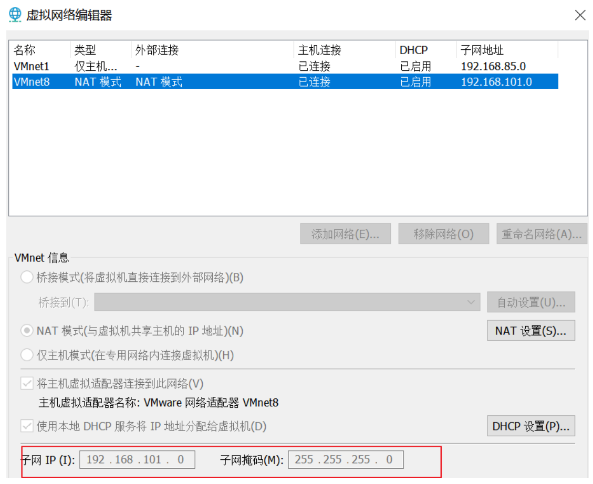

设置子网IP：192\.168\.101\.0，子网掩码：255\.255\.255\.0。

3.导入虚拟机

解压资料提供虚拟机文件，进入解压后的文件夹，双击"CentOS 7 64 位\.vmx" 文件，选择复制虚拟机。

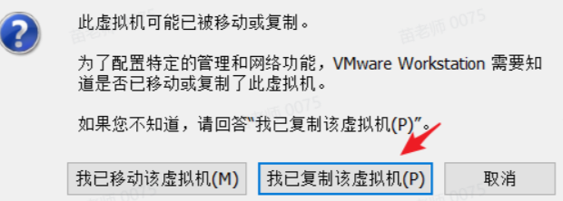

对此虚拟机的设置建议至少8G内存、8核CPU，硬盘存储至少40G。

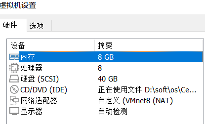

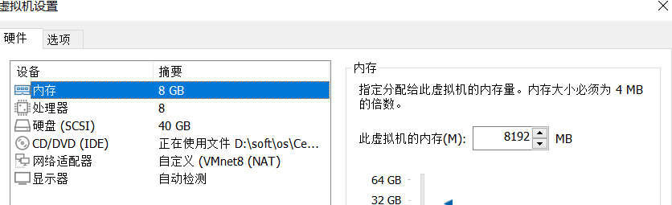

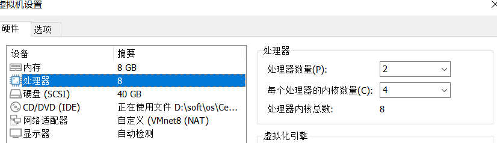

设置完成，启动虚拟机。

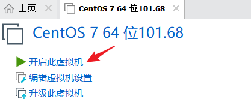

> 注意：虚拟机的IP地址为192\.168\.101\.68，不用修改IP地址。
>

虚拟机启动成功如下界面：

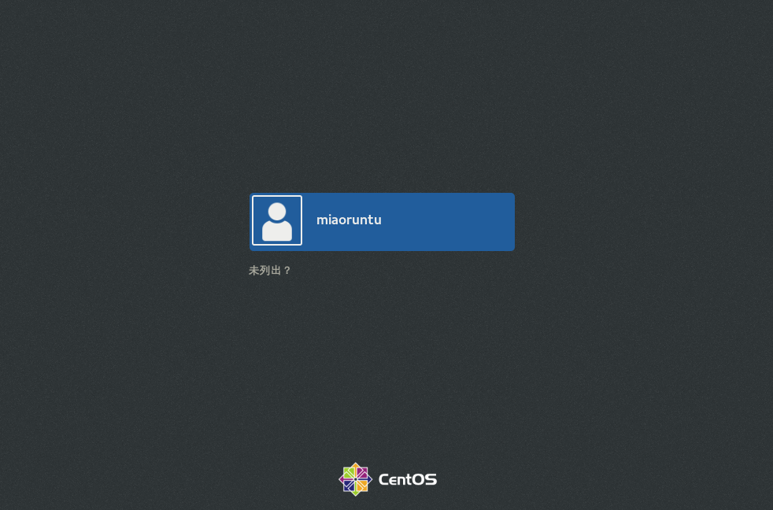

> 注意：不用点击进行登录。

4.远程连接虚拟机

虚拟机启动成功，下边使用ssh客户端工具（FinalShell或MobaXterm）远程 连接 虚拟机。

打开FinalShell软件，没有安装的可以从资料“软件工具”目录获取安装程序（finalshell\_install\.exe）。

通过下图所示建立新连接：

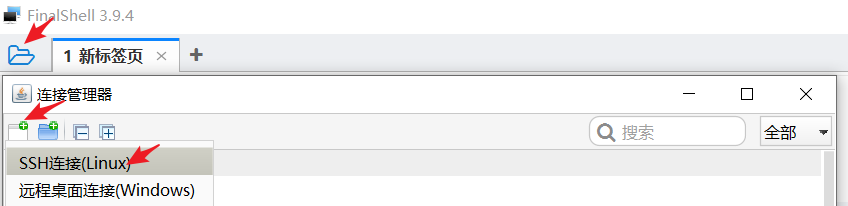

填写连接信息：

IP地址：192\.168\.101\.68

账号与密码为：root/centos

如下图：

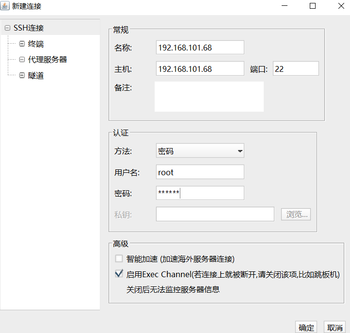

点击“确定”，创建连接成功，如下图：

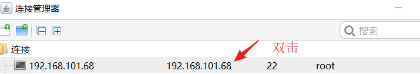

> 如果win11打开\.vmx文件报错：“未能启动虚拟机”
>
> 尝试解决方法：
>
> 1. 打开虚拟机的存放路径
>
> 2. 找到\.vmx的配置文件
>
> 3. 修改 virtualHW\.version改为virtualHW\.version = "18"
>

## 2.配置数据库环境

### 2.1.启动mysql容器

首先确保Docker容器中的MySQL8已经启动。

运行docker ps命令进行查看：

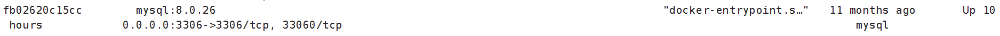

### 2.2.客户端连接数据库

下边使用DataGrip 客户端连接数据库。可以直接使用idea连接

客户端工具不作限制，这里使用的是DataGrip ，安装程序从资料获取（datagrip\-2022\.2\.2\.win\.zip）。

首先创建数据源

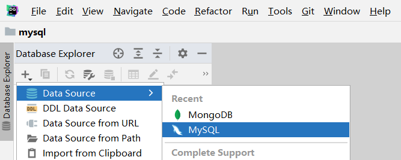

填写数据源信息

账号：root   密码：mysql

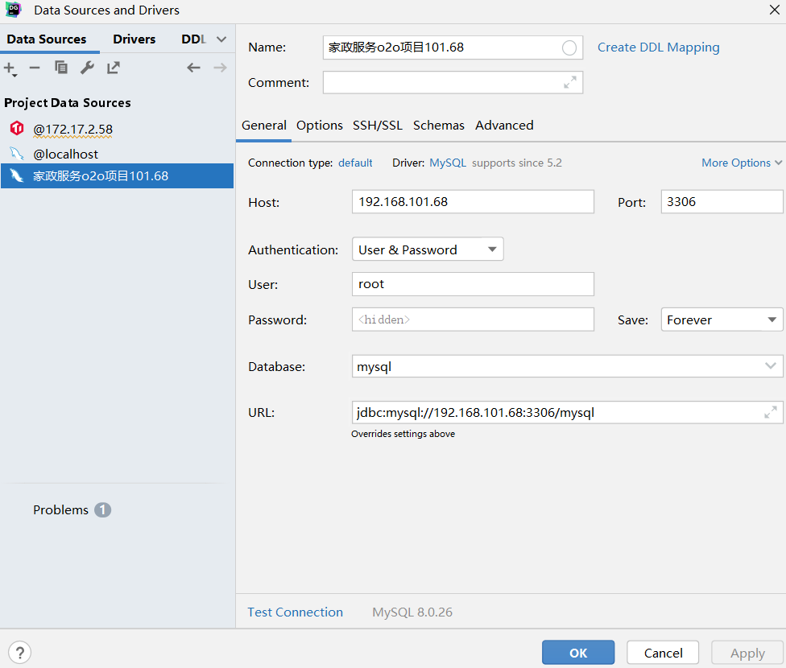

点击"Test Connection" 测试成功

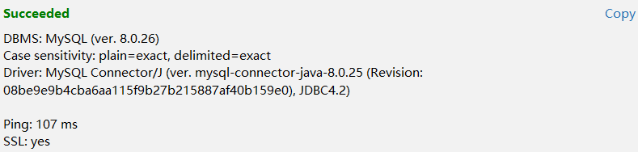

在下发的虚拟机中MySQL数据库已经包括了项目使用的数据库。

下边通过客户端工具查询 jzo2o\-foundations数据库的信息。

显示jzo2o\-foundations数据库，如下图：

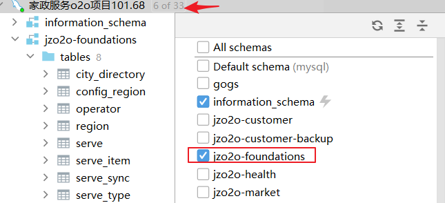

通过上图可知jzo2o\-foundations数据库总共8张表。

### 2.3.创建数据库

如果没有使用下发的虚拟机则需要自行创建 jzo2o\-foundations数据库。

首先创建 jzo2o\-foundations数据库：

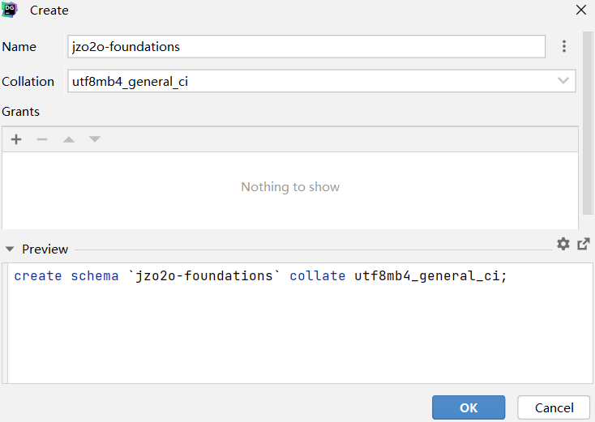

接下来导入数据：

从资料下的“sql脚本”目录拿到 jzo2o\-foundations\-init\.sql，下边导入数据：


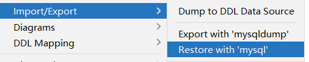

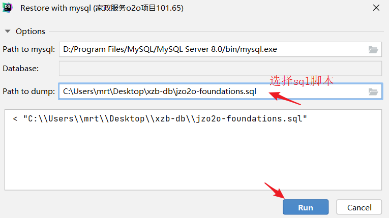

执行完成， 通过客户端工具查看jzo2o\-foundations数据库信息，如下图：

jzo2o\-foundations数据库共8张表。

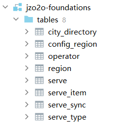

## 3.配置Redis环境

### 3.1.启动redis容器

首先确保Docker容器中的redis已经启动，没有启动运行docker start redis启动redis。

运行docker ps命令进行查看：


### 3.2.客户端连接Redis

使用redis客户端程序 resp\-2022\.4\.2\.0\.0\.exe 连接redis。

客户端工具不作限制，这里使用的是resp\-2022\.4\.2\.0\.0\.exe，可从资料获取安装程序（resp\-2022\.4\.2\.0\.0\.exe）。

安装成功，新建一个连接:

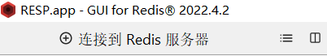

配置连接参数：

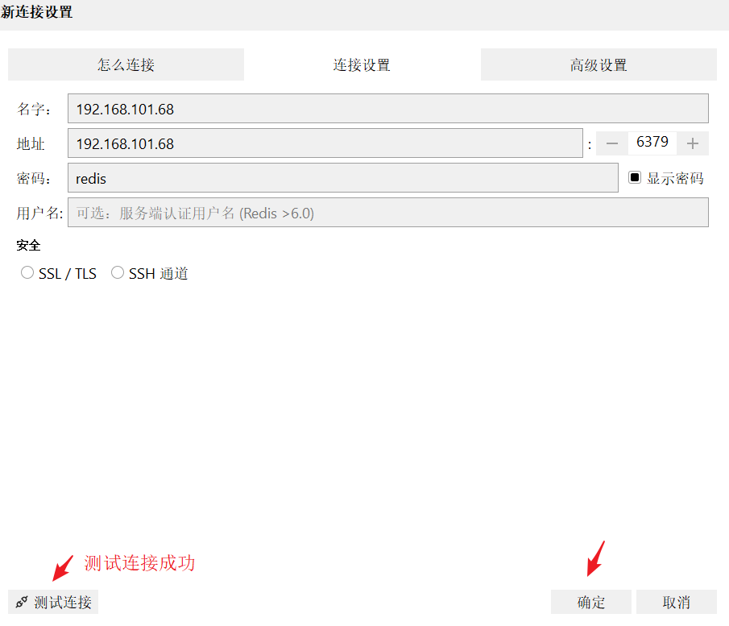

测试连接成功如下图：

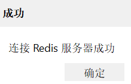

点击“确定”创建连接成功。

## 4.配置Nacos

### 4.1.检查配置

导入下发的虚拟机且成功启动nacos容器，如下图：


访问Nacos: http://192.168.101.68:8848/nacos/#/login

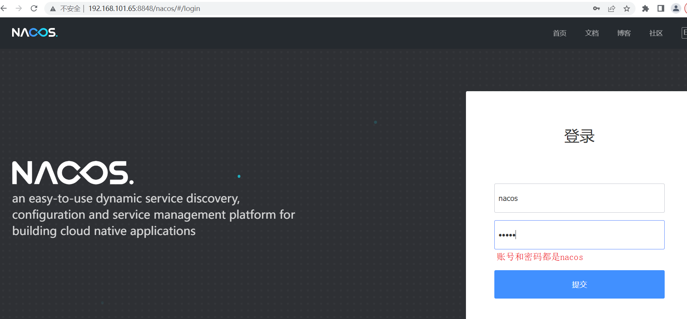

输入账号和密码点击登录

账号：nacos

密码：nacos

登录成功，在配置列表中找到"家政o2o"的命名空间可以正常查询到数据说明安装成功。

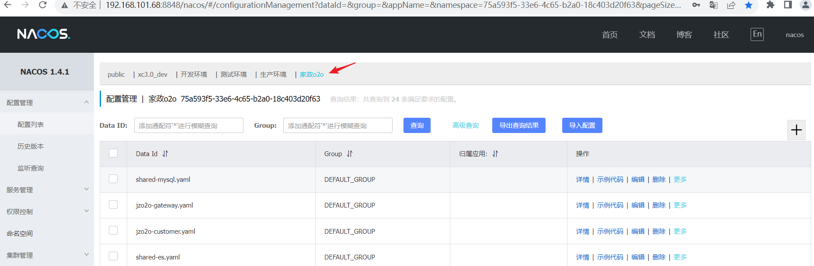

到此说明nacos服务可以正常使用。

如果不能正常显示可重启nacos，运行下边的命令：

docker restart nacos

### 4.2.自行安装

如果无法正常导入下发的虚拟机下边说明安装并配置nacos的步骤。

参考“第三方软件安装说明”文档进行安装。

安装nacos后需要创建命名空间并导入nacos的配置文件。

创建命名空间：

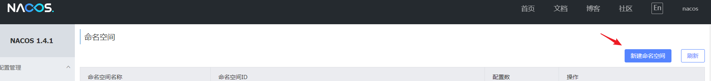

命名空间id统一使用 75a593f5\-33e6\-4c65\-b2a0\-18c403d20f63

如下图：

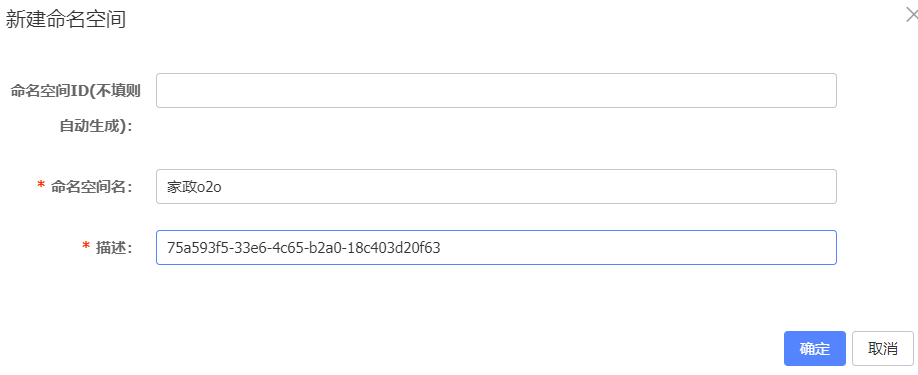

导入配置文件：

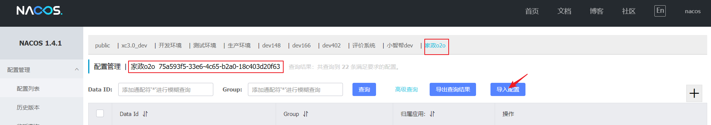

选择资料中“nacos配置文件”目录下的nacos\_config\_export\.zip 进行导入。

导入配置文件后注意修改数据库的IP地址、Redis的IP地址、RabbitMQ的IP地址等配置信息。

以下是部分配置文件：

- 数据库配置文件：shared\-mysql\.yaml

- Redis配置文件：shared\-redis\-cluster\.yaml

- XXL\-Job配置文件：shared\-xxl\-job\.yaml

- MQ配置文件：shared\-rabbitmq\.yaml

- ES配置文件：shared\-es\.yaml

当前阶段需要修改shared\-mysql\.yaml、shared\-redis\-cluster\.yaml中的IP地址为虚拟机的IP地址。

# 三、软件安装说明

> 以下软件在提供的虚拟机中已安装，如果不使用资料提供的需自行安装。

## 1.MySQL

1.拉取镜像：

```bash
docker pull mysql:8.0.26
```

2.创建以下目录：

```bash
sudo mkdir -p /usr/mysql/conf /usr/mysql/data /var/log/mysql
sudo chmod -R 777 /usr/mysql/ /var/log/mysql
```

3.创建配置文件

```bash
vim /usr/mysql/conf/my.cnf
```

添加以下内容到上述创建的配置文件中

```Java

[client]
#socket = /usr/mysql/mysqld.sock
default-character-set = utf8mb4
 
[mysqld]
#pid-file  = /var/run/mysqld/mysqld.pid
#socket = /var/run/mysqld/mysqld.sock
#datadir = /var/lib/mysql
#socket = /usr/mysql/mysqld.sock
#pid-file = /usr/mysql/mysqld.pid
 
datadir  = /usr/mysql/data
 
general_log = 1
general_log_file = /var/log/mysql/access.log
log-error = /var/log/mysql/error.log
 
character_set_server = utf8mb4
collation_server = utf8mb4_bin
secure-file-priv= NULL

Disabling symbolic-links is recommended to prevent assorted security risks
symbolic-links=0

Custom config should go here
!includedir /etc/mysql/conf.d/
```

4.创建启动容器

```Java
docker run -itd --name=mysql -v /usr/mysql/conf/my.cnf:/etc/mysql/my.cnf -v /usr/mysql/data:/usr/mysql/data -v /var/log/mysql:/var/log/mysql -p 3306:3306 -e MYSQL_ROOT_PASSWORD=mysql mysql:8.0.26
```

> 说明： \-v : 挂载宿主机目录和 docker容器中的目录，前面是宿主机目录，后面是容器内部目录 \-d : 后台运行容器 \-p 映射容器端口号和宿主机端口号 \-e 环境参数，MYSQL\_ROOT\_PASSWORD设置root用户的密码
>

5.修改mysql的访问权限为所有客户端可以访问：

进入容器内部

```bash
sudo docker exec -it mysql /bin/bash
```

连接mysql

```bash
mysql -uroot -pmysql
```

使用mysql库

```bash
use mysql;
```

修改访问主机以及密码等，设置为所有主机可访问

```shell
ALTER USER 'root'@'%' IDENTIFIED WITH mysql_native_password BY 'mysql';
flush privileges;
```

## 2.Nacos

1.首先创建nacos的数据库：nacos\-1\.4\.1

2.再导入资料下sql脚本目录中的nacos\-1\.4\.1\.sql

导入成功如下图：

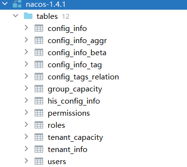

3.拉取镜像：

```shell
docker pull nacos/nacos-server:1.4.1
```

4.配置文件：

```shell
mkdir -p /data/soft/nacos/logs/ /data/soft/nacos/init.d/
vi /data/soft/nacos/conf/application.properties
```

注意配置nacos连接的数据库地址：

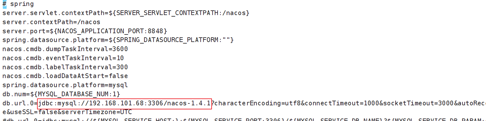

内容如下：

```properties
# spring
server.servlet.contextPath=${SERVER_SERVLET_CONTEXTPATH:/nacos}
server.contextPath=/nacos
server.port=${NACOS_APPLICATION_PORT:8848}
spring.datasource.platform=${SPRING_DATASOURCE_PLATFORM:""}
nacos.cmdb.dumpTaskInterval=3600
nacos.cmdb.eventTaskInterval=10
nacos.cmdb.labelTaskInterval=300
nacos.cmdb.loadDataAtStart=false
spring.datasource.platform=mysql
db.num=${MYSQL_DATABASE_NUM:1}
db.url.0=jdbc:mysql://192.168.101.68:3306/nacos-1.4.1?characterEncoding=utf8&connectTimeout=1000&socketTimeout=3000&autoReconnect=true&useUnicode=true&useSSL=false&serverTimezone=UTC
#db.url.0=jdbc:mysql://${MYSQL_SERVICE_HOST:}:${MYSQL_SERVICE_PORT:3306}/${MYSQL_SERVICE_DB_NAME}?${MYSQL_SERVICE_DB_PARAM:characterEncoding=utf8&connectTimeout=1000&socketTimeout=3000&autoReconnect=true}
#db.url.1=jdbc:mysql://${MYSQL_SERVICE_HOST}:${MYSQL_SERVICE_PORT:3306}/${MYSQL_SERVICE_DB_NAME}?${MYSQL_SERVICE_DB_PARAM:characterEncoding=utf8&connectTimeout=1000&socketTimeout=3000&autoReconnect=true}
db.user=${MYSQL_SERVICE_USER:root}
db.password=${MYSQL_SERVICE_PASSWORD:mysql}
### The auth system to use, currently only 'nacos' is supported:
nacos.core.auth.system.type=${NACOS_AUTH_SYSTEM_TYPE:nacos}
 
 
### The token expiration in seconds:
nacos.core.auth.default.token.expire.seconds=${NACOS_AUTH_TOKEN_EXPIRE_SECONDS:18000}
 
### The default token:
nacos.core.auth.default.token.secret.key=${NACOS_AUTH_TOKEN:SecretKey012345678901234567890123456789012345678901234567890123456789}
 
### Turn on/off caching of auth information. By turning on this switch, the update of auth information would have a 15 seconds delay.
nacos.core.auth.caching.enabled=${NACOS_AUTH_CACHE_ENABLE:false}
nacos.core.auth.enable.userAgentAuthWhite=${NACOS_AUTH_USER_AGENT_AUTH_WHITE_ENABLE:false}
nacos.core.auth.server.identity.key=${NACOS_AUTH_IDENTITY_KEY:serverIdentity}
nacos.core.auth.server.identity.value=${NACOS_AUTH_IDENTITY_VALUE:security}
server.tomcat.accesslog.enabled=${TOMCAT_ACCESSLOG_ENABLED:false}
server.tomcat.accesslog.pattern=%h %l %u %t "%r" %s %b %D
# default current work dir
server.tomcat.basedir=
## spring security config
### turn off security
nacos.security.ignore.urls=${NACOS_SECURITY_IGNORE_URLS:/,/error,//*.css,//*.js,//*.html,//*.map,//*.svg,//*.png,//*.ico,/console-fe/public/,/v1/auth/,/v1/console/health/,/actuator/,/v1/console/server/}
# metrics for elastic search
management.metrics.export.elastic.enabled=false
management.metrics.export.influx.enabled=false
 
nacos.naming.distro.taskDispatchThreadCount=10
nacos.naming.distro.taskDispatchPeriod=200
nacos.naming.distro.batchSyncKeyCount=1000
nacos.naming.distro.initDataRatio=0.9
nacos.naming.distro.syncRetryDelay=5000
nacos.naming.data.warmup=true
```

5.启动容器：

```shell
docker  run --name nacos -d -p 8848:8848 --privileged=true --restart=always -e JVM_XMS=256m -e JVM_XMX=256m -e MODE=standalone -e PREFER_HOST_MODE=hostname -v /data/soft/nacos/logs:/home/nacos/logs -v /data/soft/nacos/conf/application.properties:/home/nacos/conf/application.properties nacos/nacos-server:1.4.1 -m standalone
```

## 3.xxl\-job

1.拉取镜像：

```shell
docker pull xuxueli/xxl-job-admin:2.3.1
```

2.创建目录：

```shell
/data/soft/xxl-job
/data/soft/xxl-job/applogs
```

3.创建配置文件：/data/soft/xxl\-job/application\.properties,内容如下：

```properties
### web
server.port=8080
server.servlet.context-path=/xxl-job-admin

### actuator
management.server.servlet.context-path=/actuator
management.health.mail.enabled=false

### resources
spring.mvc.servlet.load-on-startup=0
spring.mvc.static-path-pattern=/static/
spring.resources.static-locations=classpath:/static/

### freemarker
spring.freemarker.templateLoaderPath=classpath:/templates/
spring.freemarker.suffix=.ftl
spring.freemarker.charset=UTF-8
spring.freemarker.request-context-attribute=request
spring.freemarker.settings.number_format=0.##########

### mybatis
mybatis.mapper-locations=classpath:/mybatis-mapper/*Mapper.xml
#mybatis.type-aliases-package=com.xxl.job.admin.core.model

### xxl-job, datasource
spring.datasource.url=jdbc:mysql://192.168.101.68:3306/xxl_job_2.3.1?useUnicode=true&characterEncoding=UTF-8&autoReconnect=true&serverTimezone=Asia/Shanghai
spring.datasource.username=root
spring.datasource.password=mysql
spring.datasource.driver-class-name=com.mysql.cj.jdbc.Driver

### datasource-pool
spring.datasource.type=com.zaxxer.hikari.HikariDataSource
spring.datasource.hikari.minimum-idle=10
spring.datasource.hikari.maximum-pool-size=30
spring.datasource.hikari.auto-commit=true
spring.datasource.hikari.idle-timeout=30000
spring.datasource.hikari.pool-name=HikariCP
spring.datasource.hikari.max-lifetime=900000
spring.datasource.hikari.connection-timeout=10000
spring.datasource.hikari.connection-test-query=SELECT 1
spring.datasource.hikari.validation-timeout=1000

### xxl-job, email
spring.mail.host=smtp.qq.com
spring.mail.port=25
spring.mail.username=xxx@qq.com
spring.mail.from=xxx@qq.com
spring.mail.password=xxx
spring.mail.properties.mail.smtp.auth=true
spring.mail.properties.mail.smtp.starttls.enable=true
spring.mail.properties.mail.smtp.starttls.required=true
spring.mail.properties.mail.smtp.socketFactory.class=javax.net.ssl.SSLSocketFactory

### xxl-job, access token
xxl.job.accessToken=default_token

### xxl-job, i18n (default is zh_CN, and you can choose "zh_CN", "zh_TC" and "en")
xxl.job.i18n=zh_CN

## xxl-job, triggerpool max size
xxl.job.triggerpool.fast.max=200
xxl.job.triggerpool.slow.max=100

### xxl-job, log retention days
xxl.job.logretentiondays=30

```

4.创建数据库：xxl\_job\_2\.3\.1

导入xxl\_job\_2\.3\.1\.sql,如下：

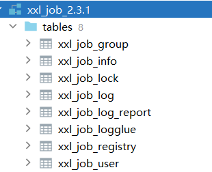


5.创建容器：

```shell
docker run -d -e \
  --restart=always \
  -v /data/soft/xxl-job/applogs:/data/applogs \
  -v /data/soft/xxl-job/application.properties:/application.properties \
  -p 8088:8080 \
  --name xxl-job-admin \
  xuxueli/xxl-job-admin:2.3.1
```

启动成功进入管理界面：

http://192.168.101.68:8088/xxl-job-admin

账号/密码：admin/123456

## 4.Elasticsearch7\.17\.7

1.拉取镜像

```shell
docker pull elasticsearch:7.17.7
```

2.创建文件夹：

```shell
mkdir -p /data/soft/es7.17.7/xzb
```

3.在/data/soft/es7\.17\.7/xzb下创建data目录并且修改权限为777

```Java
mkdir data
chmod 777 data
```

4.将资料下的"ES安装"目录中的 es\.zip上传到/data/soft/es7\.17\.7/xzb下，并进行解压

```Java
unzip es.zip
```

解压成功如下图：

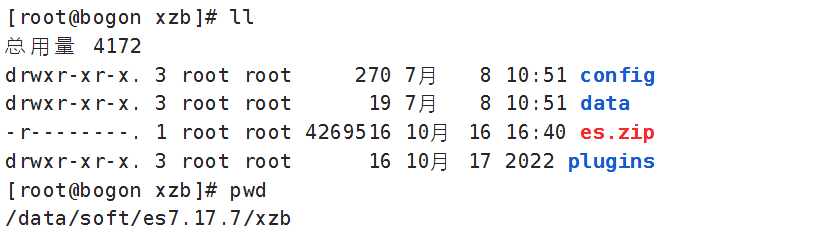

5.创建容器

```shell
docker run -d \
--name elasticsearch7.17.7 \
--restart always \
-p 9200:9200 \
-p 9300:9300 \
-e "discovery.type=single-node" \
-e "ES_JAVA_OPTS=-Xms512m -Xmx512m" \
-v /data/soft/es7.17.7/xzb/data:/usr/share/elasticsearch/data \
-v /data/soft/es7.17.7/xzb/plugins:/usr/share/elasticsearch/plugins \
-v /data/soft/es7.17.7/xzb/config:/usr/share/elasticsearch/config \
elasticsearch:7.17.7
```

访问 http://192.168.101.68:9200/ ，如下图说明启动成功：

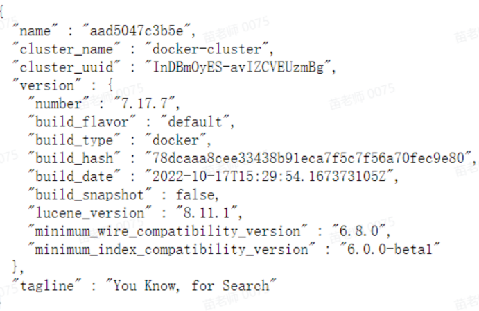

## 5.kibana7\.17\.7

### 5.1.安装镜像

1.拉取镜像

```shell
docker pull kibana:7.17.7
```

2.创建容器：

注意修改es的地址

```shell
docker run --name kibana7.17.7 \
-e ELASTICSEARCH_HOSTS=http://192.168.101.68:9200 \
-p 5601:5601 \
-d kibana:7.17.7
```

下边启动容器，先保证Elasticsearch启动成功。

启动kibana容器成功，在浏览器输入地址访问：`http://192.168.101.68:5601`，进入DevTools，如下图：

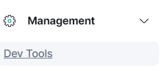

执行:GET /\_cat/indices?v  查询索引信息

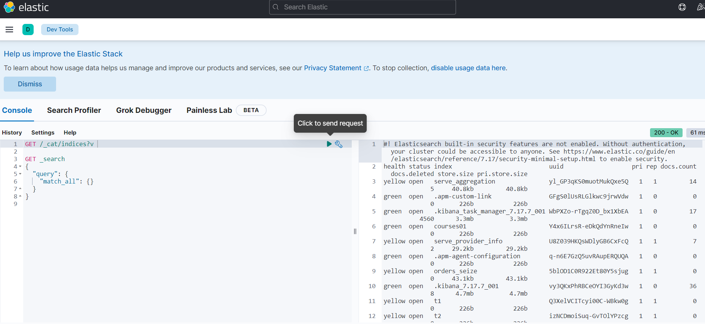


### 5.2.创建索引

1.启动ES和kibana:

```shell
docker start elasticsearch7.17.7 
docker start kibana7.17.7
```

2.本项目共需创建下边三个索引结构：

首先通过下边的命令查询索引

```JSON
GET /_cat/indices?v 
```


创建orders\_seize和serve\_provider\_info（已经存在无法重复创建）

```json
PUT /serve_provider_info
{
    "mappings" : {
      "properties" : {
        "acceptance_num" : {
          "type" : "integer"
        },
        "city_code" : {
          "type" : "keyword"
        },
        "evaluation_score" : {
          "type" : "double"
        },
        "id" : {
          "type" : "long"
        },
        "location" : {
          "type" : "geo_point"
        },
        "pick_up" : {
          "type" : "integer"
        },
        "serve_item_ids" : {
          "type" : "long"
        },
        "serve_provider_type" : {
          "type" : "integer"
        },
        "serve_times" : {
          "type" : "integer"
        },
        "setting_status" : {
          "type" : "long"
        },
        "settting_status" : {
          "type" : "integer"
        },
        "skills" : {
          "type" : "long"
        }
      }
    }
}
```

如果需要修改索引结构需要删除重新创建：

```JSON
DELETE 索引名
```

查询索引结构

```JSON
GET /索引名/_mapping
```

下边继续创建其它索引：

创建：orders\_seize  （已经存在无法重复创建）

```json
PUT /orders_seize
{
"mappings" : {
      "properties" : {
        "city_code" : {
          "type" : "keyword"
        },
        "id" : {
          "type" : "long"
        },
        "key_words" : {
          "type" : "text",
          "analyzer" : "ik_max_word",
          "search_analyzer" : "ik_smart"
        },
        "location" : {
          "type" : "geo_point"
        },
        "orders_amount" : {
          "type" : "float"
        },
        "pur_num" : {
          "type" : "integer"
        },
        "serve_address" : {
          "type" : "text",
          "index" : false
        },
        "serve_item_id" : {
          "type" : "long"
        },
        "serve_item_img" : {
          "type" : "text",
          "fields" : {
            "keyword" : {
              "type" : "keyword",
              "ignore_above" : 256
            }
          }
        },
        "serve_item_name" : {
          "type" : "text",
          "index" : false
        },
        "serve_start_time" : {
          "type" : "text",
          "index" : false
        },
        "serve_time" : {
          "type" : "integer"
        },
        "serve_type_id" : {
          "type" : "long"
        },
        "serve_type_name" : {
          "type" : "text",
          "index" : false
        },
        "total_amount" : {
          "type" : "double"
        }
      }
    }
}
```

创建serve\_aggregation索引  （已经存在无法重复创建）

```json
PUT /serve_aggregation
{
   "mappings" : {
      "properties" : {
        "city_code" : {
          "type" : "keyword"
        },
        "detail_img" : {
          "type" : "text",
          "index" : false
        },
        "hot_time_stamp" : {
          "type" : "long"
        },
        "id" : {
          "type" : "keyword"
        },
        "is_hot" : {
          "type" : "short"
        },
        "price" : {
          "type" : "double"
        },
        "serve_item_icon" : {
          "type" : "text",
          "index" : false
        },
        "serve_item_id" : {
          "type" : "keyword"
        },
        "serve_item_img" : {
          "type" : "text",
          "index" : false
        },
        "serve_item_name" : {
          "type" : "text",
          "analyzer": "ik_max_word",
          "search_analyzer":"ik_smart"
          
        },
        "serve_item_sort_num" : {
          "type" : "short"
        },
        "serve_type_icon" : {
          "type" : "text",
          "index" : false
        },
        "serve_type_id" : {
          "type" : "keyword"
        },
        "serve_type_img" : {
          "type" : "text",
          "index" : false
        },
        "serve_type_name" : {
          "type" : "text",
          "analyzer": "ik_max_word",
          "search_analyzer":"ik_smart"
        },
        "serve_type_sort_num" : {
          "type" : "short"
        }
      }
    }
}
```

## 6.sentinel

### 6.1.安装镜像

从资料\-\-》开发环境配置目录找到“sentinel”目录获取sentinel\.zip，并上传至/data/soft目录下

解压sentinel\.zip:

```shell
unzip sentinel.zip
```

> 注意：
>
> 如果unzip命令不可用则需要安装unzip：
>
> ```shell
> sudo yum install -y unzip
> ```
>

进入/data/soft/sentinel目录，如下所示：

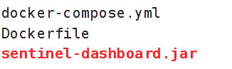

注意修改docker\-compose\.yml中的nacos的地址及nacos的账号和密码：

```yaml
version: "3.8"
services:
  sentinel:
    container_name: sentinel-dashboard
    image: sentinel-dashboard:latest
    ports:
        - "8080:8080"
    environment:
        - "TZ=Asia/Shanghai" 
        # nacos访问地址+端口号
        - SENTINEL_NACOS_SERVER_ADDR=192.168.101.68:8848
        # nacos访问账号
        - SENTINEL_NACOS_USERNAME=nacos
        # nacos访问密码
        - SENTINEL_NACOS_PASSWORD=nacos
        # nacos访问命名空间
        - SENTINEL_NACOS_NAMESPACE=75a593f5-33e6-4c65-b2a0-18c403d20f63
        # sentinel dashboard平台登录账号
        - SENTINEL_USERNAME=sentinel
        # sentinel dashboard平台登录密码
        - SENTINEL_PASSWORD=sentinel
        # sentinel dashboard 访问端口号
        - SENTINEL_PORT=8080
```

执行下边的命令创建镜像，如下：

```Shell
docker build -t sentinel-dashboard .
```

下边启动容器：

```Shell
docker-compose up -d
```

启动容器成功，通过docker ps命令查看容器：

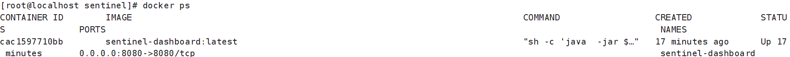

接下来访问sentinel ，地址：http://192.168.101.68:8080/#/login

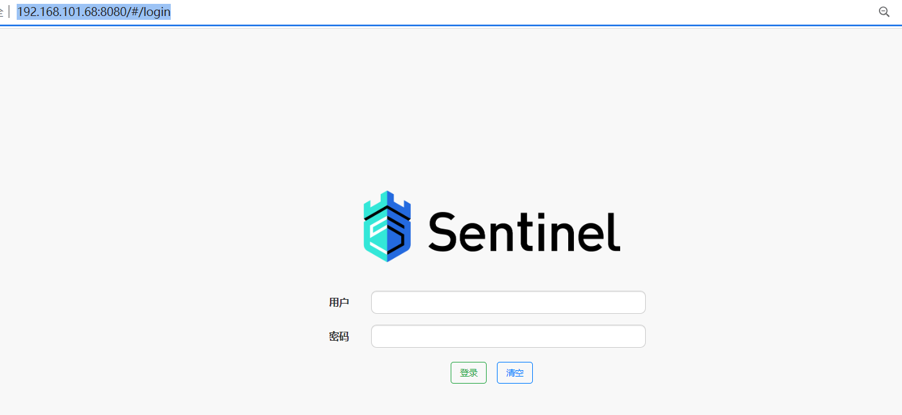

需要输入账号和密码，默认都是：sentinel

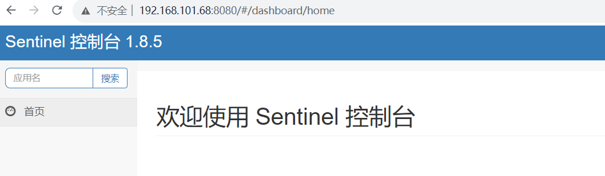

### 6.2.项目集成sentinel

1.添加nacos配置文件shared\-sentinel\.yaml，如下：

```YAML
spring:
  cloud:
    sentinel:
      transport:
        # 供sentinel dashboard平台访问端口
        port: 8719
        # sentinel控制台
        dashboard: 192.168.101.68:8080
        #服务启动直接建立心跳连接
      eager: true
```

> 注意：
>
> 1.spring\.cloud\.sentinel\.transport\.port 端口可以无需修改，如果多个微服务运行在同一个物理机时，同时都要占用8719端口，记得修改端口号，保证 sentinel\.transport\.port 端口不冲突，如果使用docker部署一定要将该端口开放
>
> 2.spring\.cloud\.sentinel\.transport\.dashboard 需要配置成自己 sentinel\-dashboard 的访问地址

2.在项目中引入shared\-sentinel\.yaml配置文件

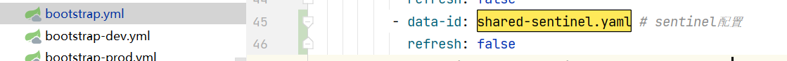

只需要在远程调用的调用方（客户端）配置sentinel即可，订单管理服务调用 客户管理服务，只需要在订单管理服务配置sentienl。

3.项目代码中添加依赖

```XML
<dependency>
    <groupId>com.jzo2o</groupId>
    <artifactId>jzo2o-sentinel</artifactId>
</dependency>
```

> 注意：
>
> 1.hibernate\-validator版本不要高于6，sentinel 1\.8\.5版本对于hibernate\-validator 6以上版本存在不兼容问题。
>
> 2.sentinel\-dashboard注册中心和配置中心一定要和微服务保持一致，不然读不到熔断配置。

# 四、第三方服务配置

## 1.阿里云OSS配置

### 1.1.注册阿里云账号

https://www.aliyun.com/


注册成功登录阿里云。

### 1.2.配置bucket

进入控制台：


搜索OSS

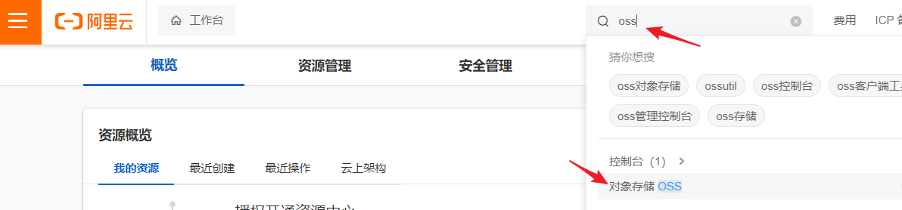

点击上图中控制台“对象存储OSS”，立即创建Bucket:

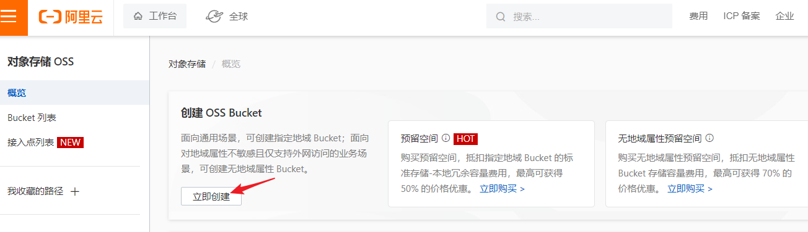

点击“立即创建”，填写bucket的信息，如下图：

注意：Bucket名称不能重复，除了Bucket外其它项目按下图填写

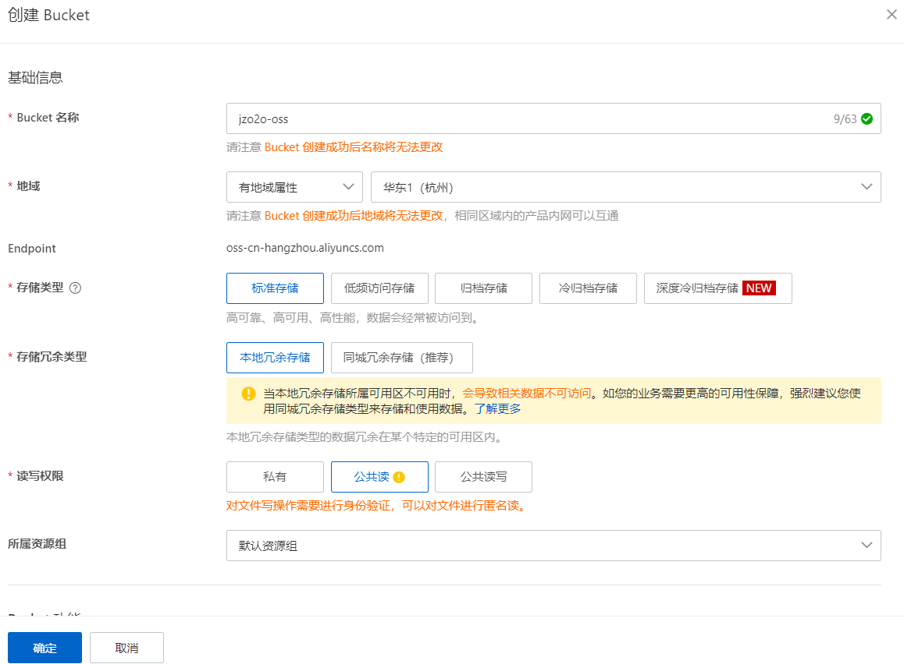

点击“确定”:


点击“进入Bucket”，到此Bucket创建成功

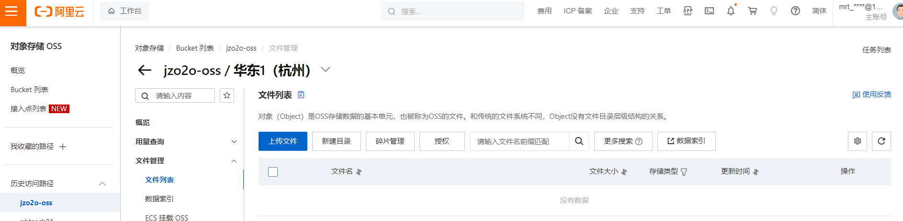

### 1.3.获取访问凭证

鼠标移动到右上角头像处，如下图：

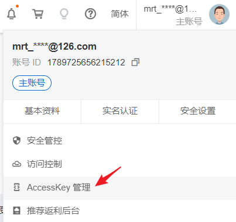

点击“AccessKey管理”，如下图：


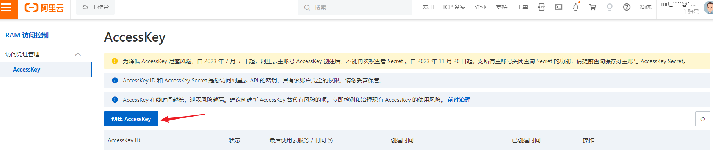

点击“创建AccessKey”,进行安装验证，如下图，选择手机号验证。

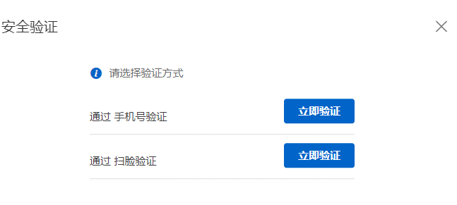

验证成功，创建AccessKey成功，如下图：


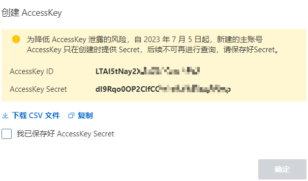

点击“复制”，将AccessKey ID和密钥保存好，稍后使用。

到此拿到了两个参数：accessKeyId和accessKeySecret。

重新进入OSS控制台，进入Bucket列表，如下图：

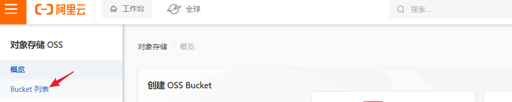

点击创建的Bucket

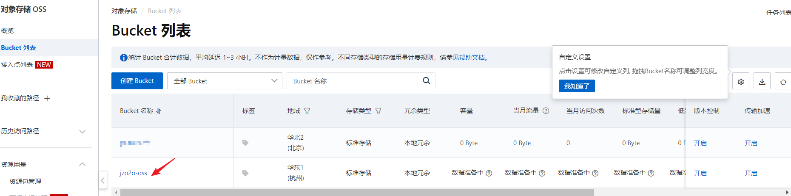

进入概览

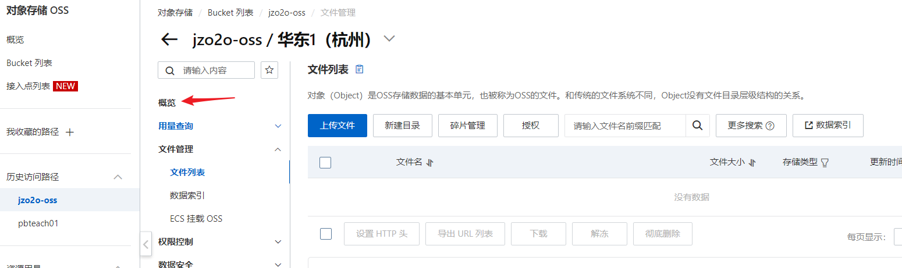

复制Bucket名称此时拿到了bucket参数，如下图：


在本页面下方复制外网访问域名，此时拿到了endpoint参数。


到此我们共拿到了四个参数：

- endpoint: 外网访问域名

- accessKeyId: 访问key

- accessKeySecret: 密钥

- bucketName: 桶的名称


### 1.4.在nacos配置

进入nacos在jzo2o\-publics\.ymal中配置上边拿到四个参数：


## 2.高德地图服务配置

官方参考地址：https://lbs.amap.com/api/webservice/guide/create-project/get-key

### 2.1.登录控制台

登录 [高德开放平台控制台](https://console.amap.com/)，如果没有开发者账号，请[注册开发者](https://console.amap.com/dev/id)。


### 2.2.创建新应用

进入应用管理，创建新应用


### 2.3.创建 key

点开新应用，新应用中添加 key，服务平台选择 Web 服务。


### 2.4.获取 key 

创建成功后，可获取 key。


到此我们获取高德地图接口key。

### 2.5.在nacos配置key

进入nacos配置jzo2o\-publics\.yml中高德地图key。


# 五、创建后端工程

## 1.熟悉 jzo2o\-framework 并安装

### 1.1.导入jzo2o\-framework工程

jzo2o\-framework工程是项目的基础工程，封装了项目所需要的一些基础组件，如：通用的工具类库、持久层MyBatis\-Plus的通用功能抽取等。

从资料的源码目录解压jzo2o\-framework\.zip 到jzo2o\-framework目录，使用IDEA打开jzo2o\-framework目录。

确保项目的JDK版本提前配置了11，可再次核对下


IDEA如果没自动识别IDEA项目的话（IDEA2023\+会自动识别），需要在jzo2o\-parent工程的pom\.xml点击右键，选择：Add as Maven Project 将工程变为maven工程，操作后如下图：


### 1.2.打包上传到maven仓库

在开发中一些公共组件会打包jar上传到公司的maven私服上，其它团队从私服下载jar包。

jzo2o\-framework工程中包括了项目中用到一些封装组件，最后会发布为jar供其它项目使用，如果要发布到私服则执行mvn deploy命令，如果仅是在本地开发执行mvn install命令发布到本地仓库即可。

下边将jzo2o\-framework打包后发布到本地仓库。

打开maven面板如下图，选择跳过测试，执行install命令。


安装成功观察日志如下：


## 2.启动 jzo2o\-gateway

### 2.1.导入网关工程

jzo2o\-gateway工程是项目的网关工程，使用Spring Cloud gateway实现，负责请求拦截、请求路由与负载均衡。

操作步骤同jzo2o\-framework工程。

从资料的“源码目录”解压jzo2o\-gateway\.zip到jzo2o\-gateway目录，用IDEA打开。

jzo2o\-gateway创建完成需要注意nacos的ip地址：


### 2.2.运行网关工程

下边使用IDEA启动网关工程。


也可以进入nacos目录，双击运行：jzo2o\-gateway\-startup\.bat启动网关，启动成功如下图：


## 3.GIT项目jzo2o\-api

api工程jzo2o\-api提供了微服务内部接口的维护，用于微服务之间的远程调用。

> 注意：前边创建的jzo2o\-framework工程和jzo2o\-gateway工程代码我们不用开发，所以不需要使用Git去管理代码。
>

下边我们通过Git去管理jzo2o\-api：

1. 从资料下的源码目录解压jzo2o\-api\-01\-0\.zip到jzo2o\-api目录

2. 使用IDEA打开项目代码

3. 推送项目代码到第8\.2\.2步创建的GIT仓库中

4. 创建day01分支并推送

5. 安装api工程JAR包到本地仓库


操作成功：


## 4.GIT项目jzo2o\-foundations

运营基础服务工程jzo2o\-foundations提供了运营端的接口支持，由于运营基础服务工程需要开发维护，使用Git管理代码。

> 注意：前边创建的jzo2o\-framework工程和jzo2o\-gateway工程代码我们不用开发，所以不需要使用Git去管理代码。
>

下边我们通过Git去管理jzo2o\-foundations：

1. 从资料下的源码目录解压jzo2o\-foundations\-01\-0\.zip到jzo2o\-foundations目录

2. 使用IDEA打开项目代码

3. 推送项目代码到之前创建的GIT仓库中

4. 创建day01分支并推送

5. 运行项目

目前使用了mysql/redis/es/rabbitmq，确保虚拟机中这些服务都启动成功，然后点击启动项目

## 5.启动 jzo2o\-publics

### 5.1.导入jzo2o\-publics

公共服务工程jzo2o\-publics提供了地图定位、上传图片、验证码等公用服务，本工程的代码需要找到

jzo2o\-publics\.zip并解压到jzo2o\-publics目录。

用IDEA打开jzo2o\-publics目录


### 5.2.配置OSS

jzo2o\-publics提供通用的上传图片接口，图片服务器使用阿里的OSS存储。

前面已经开通阿里云OSS服务，并在nacos中配置OSS参数。

### 5.3.配置高德地图

jzo2o\-publics提供通用的地图定位接口，地图定位服务使用高德地图。

前面已经开通获取调用地理定位接口的key，并在nacos中配置高德地图key。

### 5.4.启动jzo2o\-publics

启动前配置nacos地址：


通过IDEA启动


或通过双击启动脚本


## 6.启动jzo2o\-customer

下边创建jzo2o\-customer工程，创建过程参考jzo2o\-foundations工程。需要远程git管理

jzo2o\-customer工程的初始代码 在：jzo2o\-customer\-01\-0\.zip

## 7.注意事项

1.maven本地仓库地址一定要配置正确

2.运行安装文件时要以管理员模式运行。

3.关闭自己电脑的防火墙。

4.如果没有使用下发的虚拟机需要修改数据库的地址、nacos的地址。

修改nacos地址：修改bootstrap\-dev\.yml文件，如下图：


修改数据库地址，进入nacos找到shared\-mysql\.yaml文件，修改数据库的ip、账号、密码，如下图所示。


5.如下警告可以忽略

环境部署好后在进行接口测试时发现控制台报下边的警告：

```Java
WARNING: An illegal reflective access operation has occurred
WARNING: Illegal reflective access by com.baomidou.mybatisplus.core.toolkit.SetAccessibleAction (file:/D:/develop/repository/com/baomidou/mybatis-plus-core/3.4.3/mybatis-plus-core-3.4.3.jar) to field java.lang.invoke.SerializedLambda.capturingClass
WARNING: Please consider reporting this to the maintainers of com.baomidou.mybatisplus.core.toolkit.SetAccessibleAction
WARNING: Use --illegal-access=warn to enable warnings of further illegal reflective access operations
WARNING: All illegal access operations will be denied in a future release
```

以上警告表示在运行时发生了非法反射操作，这是因为Java9以上版本限制了反射操作的范围，无法通过过反射访问或修改类的私有成员，而Mybatis\-plus存在违反该规则的代码。

此警告不影响正常使用mybatis\-plus，如果不想看到该警告信息可在启动程序时加入\-\-illegal\-access=warn

如下图：


# 六、配置前端环境

从资料下的源码目录找到project\-xzb\-pc\-admin\-vue3\-java\.zip，并解压到project\-xzb\-pc\-admin\-vue3\-java目录,

直接使用trae打开,然后npm run dev 运行即可

## 1.编译前端工程

### 1.1.安装nodejs

> 已安装过的不需要安装

1.首先从软件工具目录找到node\-v14\.19\.1\-x64\.msi安装nodejs 

> 注意安装到C盘默认的位置下，不要选择其他位置
>

2.安装完成，查看版本号


3.接下来安装cnpm：

CNPM 是中国 npm 镜像的客户端。

分别在在cmd命令窗口运行下边的命令

```Java
-- 升级npm版本
npm install npm@9.8.1 -g --registry=https://registry.npmmirror.com

-- 安装指定版本的cnpm
npm install cnpm@9.2.0 -g --registry=https://registry.npmmirror.com
```

安装成功执行下边的命令查看npm是否升级成功及cnpm是否安装成功

```Java
npm -v
cnpm -v
```

cnpm安装成功会输出cnpm的版本号，如下所示：


### 1.2.编译前端工程

> 这个压缩包是编译过的,不需要编译了,直接运行

从资料下的源码目录找到project\-xzb\-pc\-admin\-vue3\-java\.zip，并解压到project\-xzb\-pc\-admin\-vue3\-java目录

通过cmd进入project\-xzb\-pc\-admin\-vue3\-java目录运行下边的命令下载依赖包：

```shell
npm install || yarn 
##或
cnpm install || yarn 
```

运行效果如下图：


## 2.运行前端工程

### 2.1.运行前端工程

编译完成现在运行前端工程，运行前端工程之前需要启动以下后端服务：

- jzo2o\-gateway

- jzo2o\-foundations

- jzo2o\-publics

接来来配置前端工程连接的网关地址：

解压管理端（PC网页）\-project\-xzb\-pc\-admin\-vue3\-java\.zip，通过cmd进入project\-xzb\-pc\-admin\-vue3\-java目录，找到vite\.config\.ts文件，打开文件配置网关地址（默认连接本地网关，不需要修改）：

如下图：


运行命令：npm run dev  启动前端工程

启动成功如下图：


运行成功自动进入http://localhost:3000


- 账号：xiaoyan

- 密码：888itcast\.CN764%\.\.\.

点击“登录”，进入运营管理端


### 2.2.服务类型查询功能验证

通过下边的功能验证判断开发环境是否搭建成功。

进入服务类型管理，可以正常查询到数据说明配置成功。


如果不能正常查询到数据需要打开浏览器进入调试窗口，右键点击“检查”（这里使用的是chrome浏览器）


进入“网络”，找到请求查询服务类型接口的记录，如下图：


请求服务类型接口可以正常返回数据说明请求后端接口正常，如下图：


如果不能正常返回数据需要排查jzo2o\-foundations工程是否正常启动成功，需要仔细阅读本文档配置jzo2o\-foundations工程。

### 2.3.上传图功能验证

通过下边的功能验证判断jzo2o\-publics服务及OSS配置是否正确。

进入服务类型管理界面，点击“新建”测试上传图片，如下图：


选择一个图片进行上传，上传成功示例如下：


