# 一、查阅微信产品文档 

如何使用小程序进行支付？

下边通过调研小程序支付接口梳理交互流程。

打开微信小程序支付的产品文档：https://pay.weixin.qq.com/doc/v3/merchant/4012791894

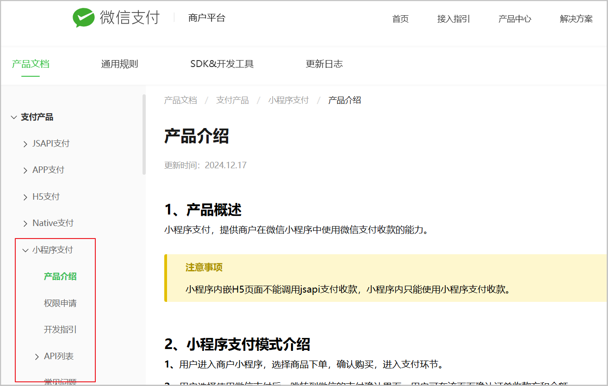

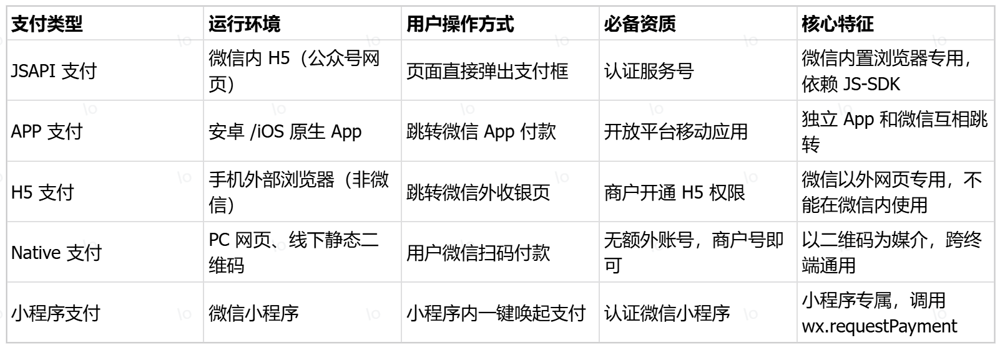

# 二、前期准备

## 2\.1 注册商户

首先参照接入前的准备进行申请：

进行小程序运营的企业需要申请成为微信的普通商户，为企业提供支付服务的需要注册成为普通服务商。

本项目作为公司的自研项目并进行运营需要申请成为普通商户（而非第三方服务商或合作伙伴），地址：https://pay.weixin.qq.com/index.php/core/home/login?return_url=%2F 

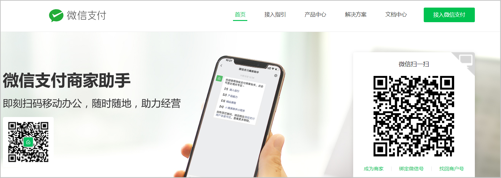

步骤：

1.申请成为商户

点击“成为商户”填写法人、公司等信息等待审核。

2.申请AppID

对于普通商户，该社交载体可以是 [公众号](https://mp.weixin.qq.com/mp/opshowpage?action=newoplaw)，[小程序](https://mp.weixin.qq.com/cgi-bin/wx?token=&lang=zh_CN) 或 App。

本项目需要申请一个小程序账号，拿到 AppID。具体步骤可参见：

[微信支付商户入驻详细流程介绍 - 腾讯客服](https://kf.qq.com/faq/180910eUfeyu180910BFZNJN.html)

[申请JSAPI支付权限指引(小程序支付场景)_小程序支付|微信支付商户文档中心](https://pay.weixin.qq.com/doc/v3/merchant/4012791895)

3.申请mchid（微信支付商户号）

进入商户平台申请：[微信支付 - 中国领先的第三方支付平台 ｜ 微信支付提供安全快捷的支付方式](https://pay.weixin.qq.com/index.php/core/home/login?return_url=https%3A%2F%2Fpay.weixin.qq.com%2Findex.php%2Fcore%2Finfo)

4.绑定AppID及mchid

AppID和mchid全部申请完毕后，需要建立两者之间的绑定关系。

## 2\.2 开通微信支付

申请小程序开发者账号，进行微信认证，获取AppID登录[《微信公众平台》 \(opens new window\)](https://mp.weixin.qq.com/)，注册一个小程序的开发者账号。[小程序账号申请指引\(opens new window\)](https://developers.weixin.qq.com/miniprogram/introduction/)

小程序开通微信支付，即申请或复用微信支付商户号，申请完小程序后，登录 [小程序后台 \(opens new window\)](https://mp.weixin.qq.com/)。点击左侧导航栏的微信支付，在页面中进行开通。

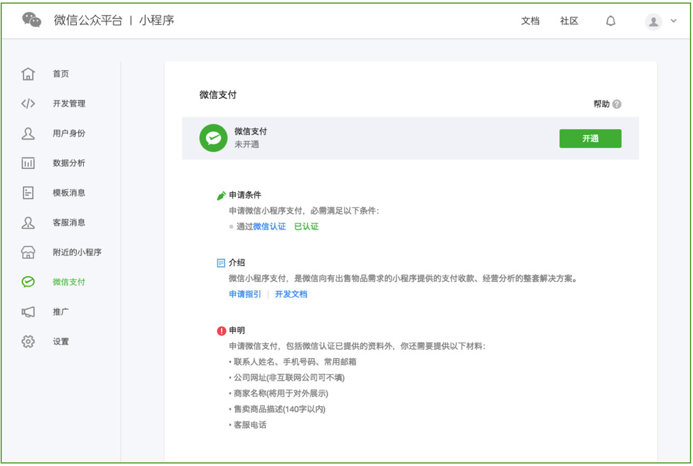

点击开通按钮后，有2种方式可以获取微信支付能力，新申请微信支付商户号或绑定一个已有的微信支付商户号，请根据你的业务需要和具体情况选择，只能二选一。

# 三、小程序支付接口

## 1.总体流程

前期准备工作完毕下边调研小程序支付接口。

接口地址：https://pay.weixin.qq.com/doc/v3/merchant/4012791897

API列表

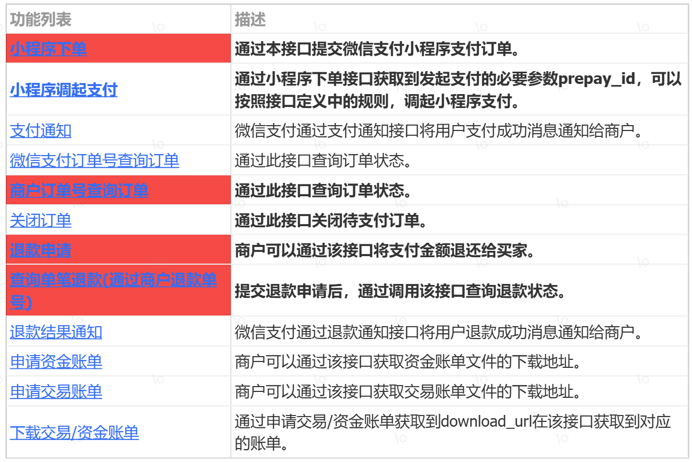

> 上边表格加粗的表示必须对接的接口。
>

下边的流程是业务系统（凡是和微信支付对接的系统统称为业务系统）与微信支付接口的交互流程，列出了支付、支付结果查询、退款三个接口的交互流程。 

业务系统请求微信支付下单要将业务系统自己的订单号和订单金额告诉微信支付，只要这样在支付完成后才可以根据业务系统的订单号去查询支付结果。

比如：用户在家政平台下单，然后进行支付，家政平台服务端程序需要调用 微信支付的下单接口，将家政平台的订单号与订单金额传给微信下单接口。

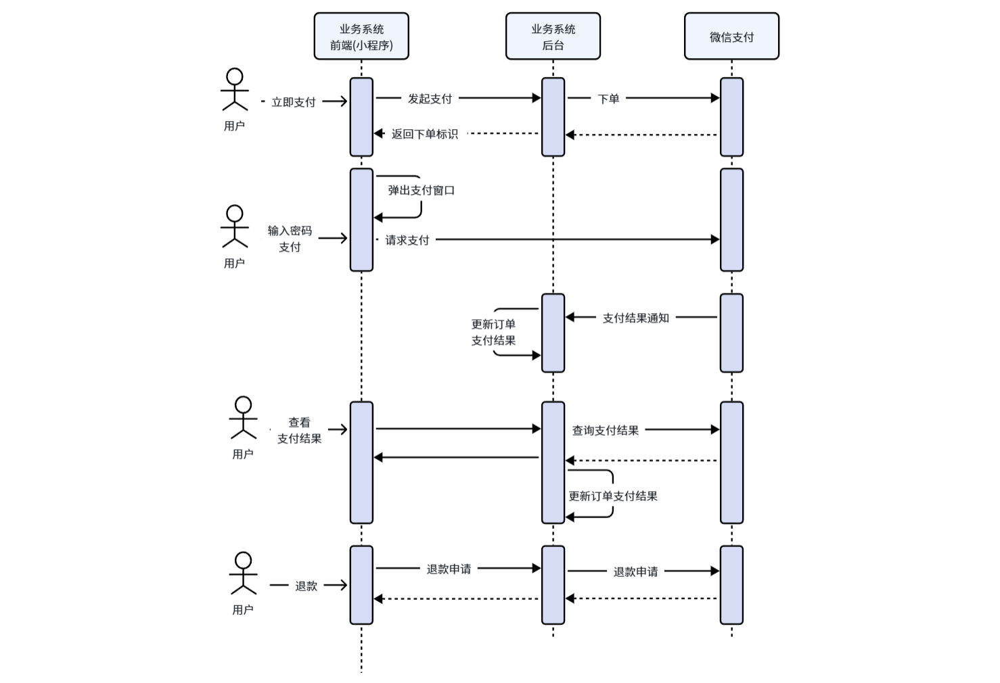

## 2.小程序下单

当点击支付时，业务系统向微信发起下单请求。

接口文档：https://pay.weixin.qq.com/doc/v3/merchant/4012791897

请求方式：【POST】/v3/pay/transactions/jsapi

请求域名：【主域名】https://api.mch.weixin.qq.com

请求方向：业务系统\-\-\-\>微信

### 2.1.请求参数

除了appid、mchid商户id等必要参数以外，与业务相关的最重要的就是out\_trade\_no和amount，它是业务系统中的订单号及订单金额。

业务系统请求微信支付下单要将业务系统自己的订单号和订单金额告诉微信支付，只要这样在支付完成后才可以根据业务系统的订单号去查询支付结果。

比如：用户在家政平台下单，然后进行支付，家政平台服务端程序需要调用 微信支付的下单接口，将家政平台的订单号与订单金额传给微信下单接口。

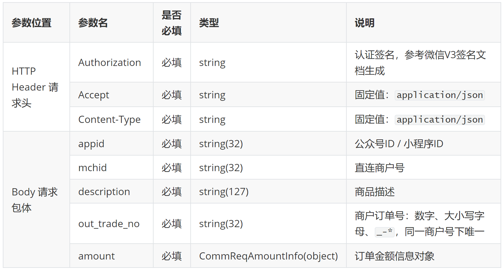

### 2.2.应答参数

200 OK

prepay\_id必填string\(64\)

> 【预支付交易会话标识】 预支付交易会话标识。用于后续接口调用中使用，该值有效期为2小时
>

### 2.3.接口安全 \- 签名验签

[总述-APIv3如何签名和验签_通用规则|微信支付商户文档中心](https://pay.weixin.qq.com/doc/v3/merchant/4012365342#请求接口后端签名)

在微信提供的SDK程序中此部分由SDK处理了无需程序员手动编码。

地址：https://pay.wechatpay.cn/wiki/doc/apiv3/wechatpay/wechatpay6_0.shtml

### 2.4.接口安全 \- 加密与解密

微信支付APIv3的下载平台证书接口以及处理回调通知中，为防止报文被他人其他人恶意篡改，服务器会对数据进行加密。商户收到报文后，要解密出明文，解密过程中用的key就是APIv3密钥。（注意：APIv3密钥属于敏感信息，请妥善保管不要泄露，如果怀疑信息泄露，请重设密钥。）

加密是将原始的、可读的数据（称为明文）通过某种算法和密钥转换成不可读的数据（称为密文）。加密的目的是防止未经授权的访问者能够理解或识别被加密的信息。加密算法通常基于密钥，有对称加密和非对称加密两种主要类型。

- 对称加密： 使用相同的密钥进行加密和解密。常见的对称加密算法包括 AES、DES、3DES。

- 非对称加密： 使用一对密钥，包括公钥和私钥，公钥用于加密，私钥用于解密，或者私钥用于加密，公钥用于解密。常见的非对称加密算法包括 RSA、ECC。

解密是加密的逆过程，即将密文还原为明文。只有持有正确密钥的人或系统能够进行解密操作。解密的目的是还原加密前的原始信息，使其能够被理解和使用。

加密与解密是为了防止内容被泄露，保证内容的机密性。

为了保证安全性，微信支付在回调通知和平台证书下载接口中，对关键信息进行了AES\-256\-GCM加密，商户收到报文后，要解密出明文，APIv3密钥是解密时使用的对称密钥。参考：https://pay.weixin.qq.com/doc/v3/merchant/4012071382l

## 3.小程序调起支付

小程序下单成功后微信返回一个prepay\_id即预支付会话标识，小程序使用微信支付提供的小程序方法调起小程序支付。

调用wx\.requestPayment\(OBJECT\)发起微信支付

接口名称： wx\.requestPayment，详见 [小程序API文档\(opens new window\)](https://developers.weixin.qq.com/miniprogram/dev/api/payment/wx.requestPayment.html)

Object请求参数说明：

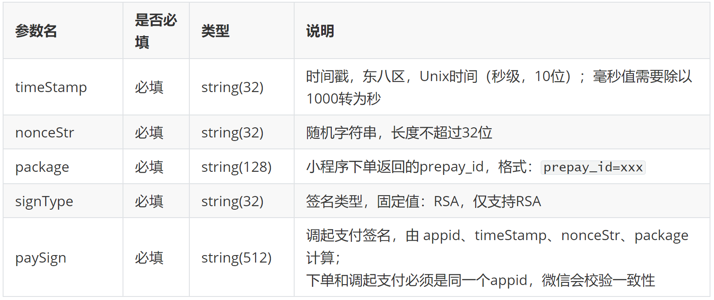

## 4.支付通知

微信支付通过支付通知接口将用户支付成功消息通知给商户的业务系统。

这里要注意的是最终业务系统要根据支付结果更新订单的支付状态，所以带着这个需求去查阅接口。

请求方式： 【POST】

请求方向：微信\-\-\-\-》业务系统

回调URL： 即业务系统接收支付结果的URL，在请求微信支付下单时传给微信的，通过下单接口中的请求参数“notify\_url”来设置的。

支付结果通知是以POST 方法访问商户设置的通知URL，通知的数据以JSON 格式通过请求主体（BODY）传输。

通过内容如下：

1.回调外层 Body（收到的原始回调包）

| 参数名        | 是否必填 | 类型       | 说明                                                         |
| ------------- | -------- | ---------- | ------------------------------------------------------------ |
| id            | 必填     | string(36) | 通知的唯一 ID                                                |
| create_time   | 必填     | string(32) | 通知创建时间，RFC3339 格式示例：`2015-05-20T13:29:35+08:00`（北京时间） |
| event_type    | 必填     | string(32) | 通知类型，支付成功固定：`TRANSACTION.SUCCESS`                |
| resource_type | 必填     | string(32) | 资源类型，支付通知固定：`encrypt-resource`                   |
| resource      | 必填     | object     | 加密的业务资源数据，需要解密，订单信息都在这里面             |
| summary       | 必填     | string(64) | 回调摘要                                                     |

2.resource 解密之后得到的业务字段（核心，用来更新订单）

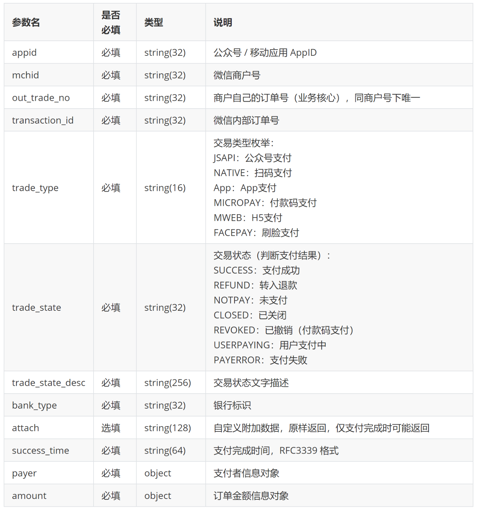

## 5.商户通过订单号查询订单

商户可以通过查询订单接口主动查询订单状态

这里要注意的是最终业务系统要根据支付结果更新订单的支付状态，所以带着这个需求去查阅接口。

接口文档：https://pay.weixin.qq.com/doc/v3/merchant/4012791899

支持商户：【普通商户】

请求方式：【GET】/v3/pay/transactions/out\-trade\-no/\{out\_trade\_no\}

请求域名：【主域名】https://api.mch.weixin.qq.com

请求方向：业务系统\-\-\-\>微信

### 5.1.请求参数

> 请求 URL 模板
>
> ```http
> GET https://api.mch.weixin.qq.com/v3/pay/transactions/out-trade-no/{out_trade_no}?mchid={mchid}
> ```

1.HTTP Header 请求头

| 参数名        | 是否必填 | 类型   | 说明                               |
| ------------- | -------- | ------ | ---------------------------------- |
| Authorization | 必填     | string | 认证签名，参考微信 V3 签名文档生成 |
| Accept        | 必填     | string | 固定值：`application/json`         |

2.Path 路径参数（放在 URL 路径里）

| 参数名       | 是否必填 | 类型       | 说明                                                        |
| ------------ | -------- | ---------- | ----------------------------------------------------------- |
| out_trade_no | 必填     | string(32) | 商户订单号规则：数字、大小写字母、`_-*`，同一个商户号下唯一 |

3.Query 查询参数（URL 后面？拼接）

| 参数名 | 是否必填 | 类型       | 说明                     |
| ------ | -------- | ---------- | ------------------------ |
| mchid  | 必填     | string(32) | 直连商户号，微信支付下发 |

### 5.2.应答参数

在应答参数中有一个out\_trade\_no，正是业务系统的订单号，trade\_state是支付结果，我们可以根据这两个参数去更新订单的支付结果。

响应参数（200 OK）

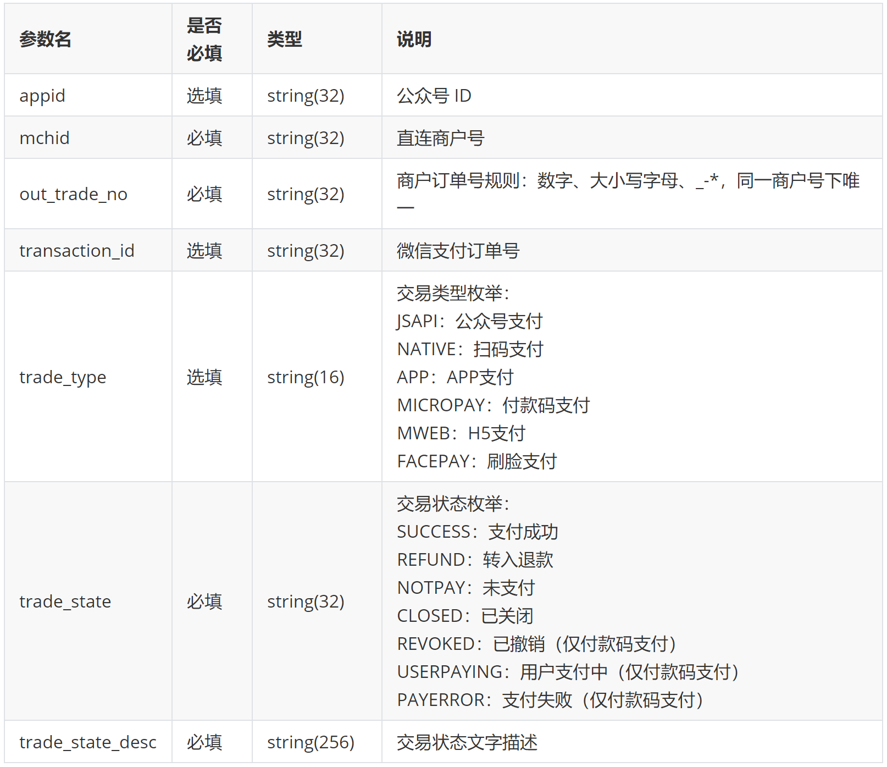

# 四、Native支付接口

打开Native下单接口： 

https://pay.weixin.qq.com/doc/v3/merchant/4012791877

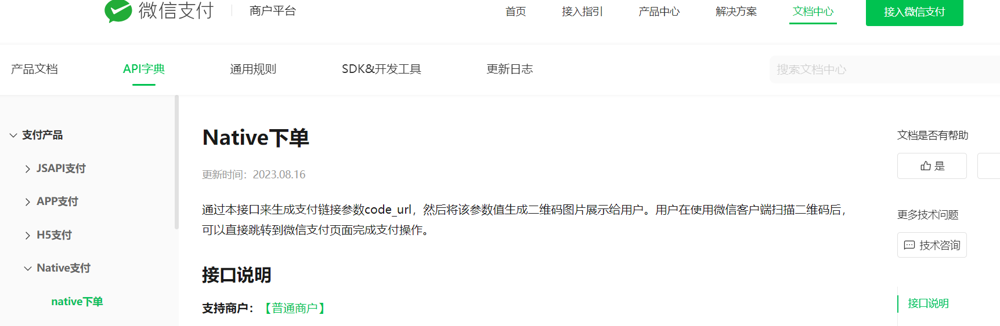

## 1.总体流程

扫码支付的流程与小程序支付基本类似，只是小程序支付改为了用户扫码支付，流程如下：

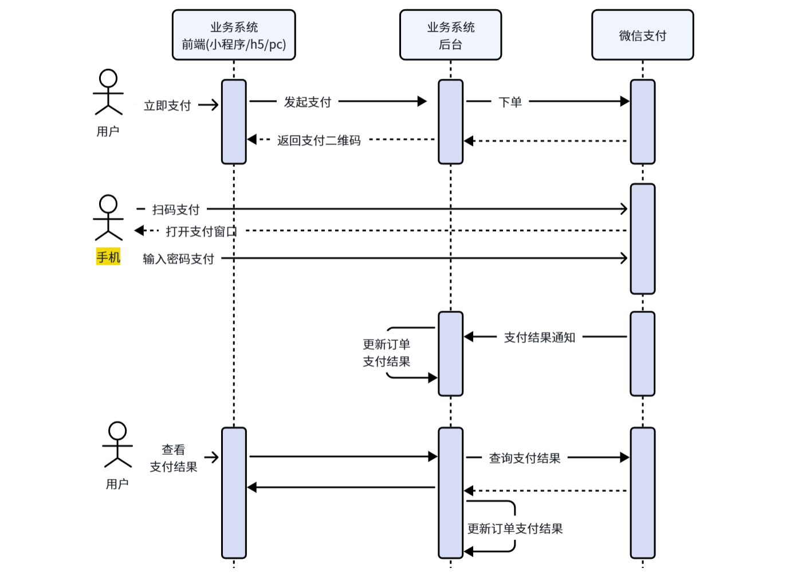

## 2.下单

支持商户：【普通商户】

接口文档：https://pay.weixin.qq.com/doc/v3/merchant/4012791877

请求方式：【POST】/v3/pay/transactions/native

请求域名：【主域名】https://api.mch.weixin.qq.com 

请求方向：业务系统\-\-\-\>微信

### 2.1.请求参数

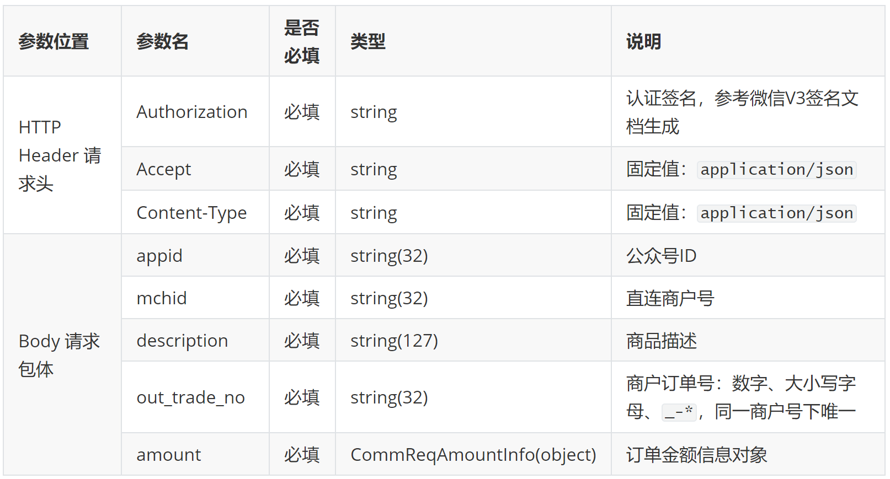

### 2.2.应答参数

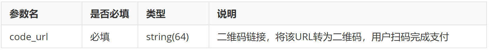


## 3.支付通知

同小程序支付通知。

## 4.商户订单号查询订单

除了接口地址不同其它与小程序支付相同。

支持商户：【普通商户】

接口文档：https://pay.weixin.qq.com/doc/v3/merchant/4012791880

请求方式：【GET】/v3/pay/transactions/out\-trade\-no/\{out\_trade\_no\}

请求域名：【主域名】https://api.mch.weixin.qq.com

请求方向：业务系统\-\-\-\>微信

### 4.1.请求参数

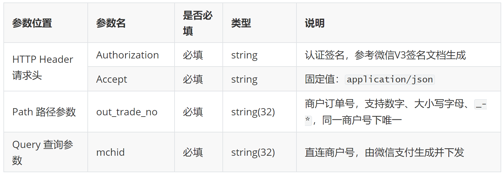

### 4.2.应答参数

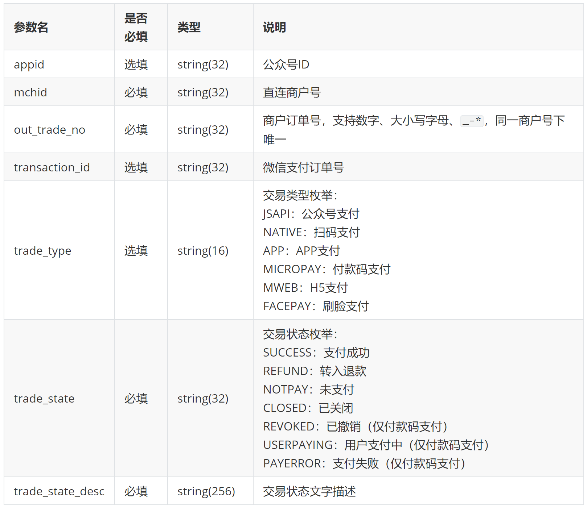

# 五、SDK调研

## 1.介绍

为了方便进行支付接口对接，可通过SDK程序快速进行开发。

SDK介绍地址：https://pay.wechatpay.cn/wiki/doc/apiv3/wechatpay/wechatpay6_0.shtml

开发者可以根据自己的需要，选择对应的库。

- [wechatpay\-java](https://github.com/wechatpay-apiv3/wechatpay-java)（推荐）[wechatpay\-apache\-httpclient](https://github.com/wechatpay-apiv3/wechatpay-apache-httpclient)，适用于Java开发者。

- [wechatpay\-php](https://github.com/wechatpay-apiv3/wechatpay-php)（推荐）、[wechatpay\-guzzle\-middleware](https://github.com/wechatpay-apiv3/wechatpay-guzzle-middleware)，适用于PHP开发者。

- [wechatpay\-go](https://github.com/wechatpay-apiv3/wechatpay-go)，适用于Go开发者

本项目使用 [wechatpay\-apache\-httpclient](https://github.com/wechatpay-apiv3/wechatpay-apache-httpclient)

- https://gitee.com/190642964/wechatpay-apache-httpclient

- https://github.com/wechatpay-apiv3/wechatpay-apache-httpclient

## 2.使用示例

### 2.1.加入以下依赖

```xml
<dependency>
    <groupId>com.github.wechatpay-apiv3</groupId>
    <artifactId>wechatpay-apache-httpclient</artifactId>
    <version>0.4.9</version>
</dependency>
```

### 2.2.名词解释

https://pay.weixin.qq.com/doc/v3/merchant/4012069411

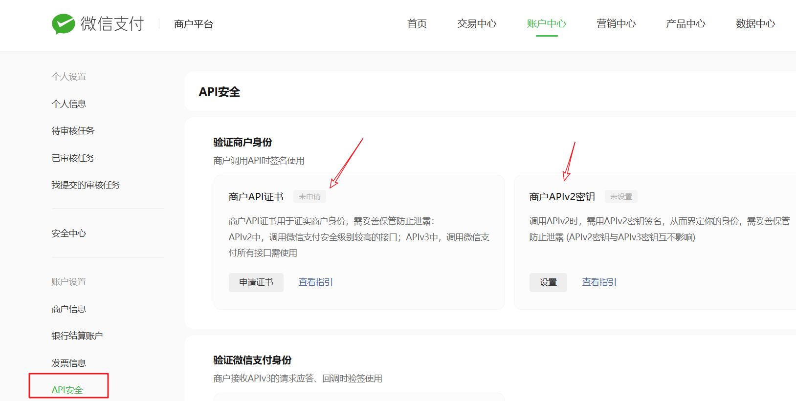

商户API证书，是用来证实商户身份的。证书中包含商户号、证书序列号、证书有效期等信息，由证书授权机构\(Certificate Authority ，简称CA\)签发，以防证书被伪造或篡改。如何获取请见[商户API证书](https://wechatpay-api.gitbook.io/wechatpay-api-v3/ren-zheng/zheng-shu#shang-hu-api-zheng-shu)。

商户API私钥。商户申请商户API证书时，会生成商户私钥，并保存在本地证书文件夹的文件apiclient\_key\.pem中。注：不要把私钥文件暴露在公共场合，如上传到Github，写在客户端代码等。

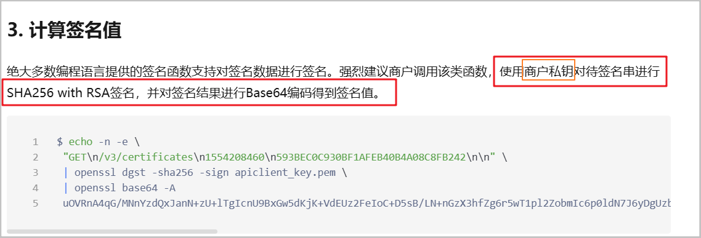

微信支付平台证书。平台证书是指由微信支付负责申请的，包含微信支付平台标识、公钥信息的证书。商户可以使用平台证书中的公钥进行应答签名的验证。获取平台证书需通过 https://pay.weixin.qq.com/doc/v3/merchant/4013053053 接口下载。

由于证书存在有效期的限制，微信支付会不定期地更换平台证书以确保交易安全。

证书序列号。每个证书都有一个由CA颁发的唯一编号，即证书序列号。如何查看证书序列号请看 https://pay.weixin.qq.com/doc/v3/merchant/4013053053。

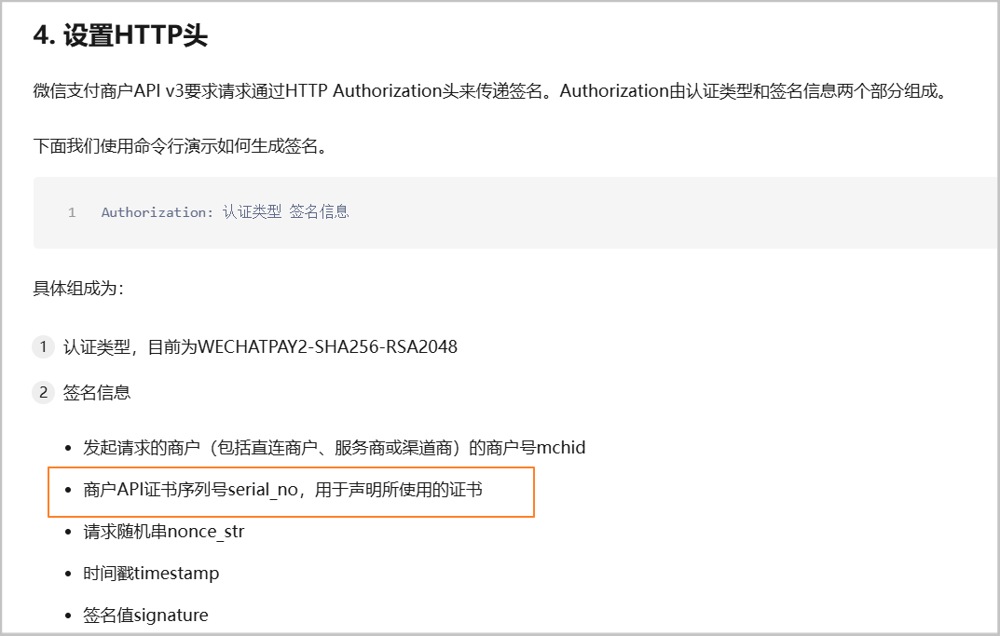

API v3密钥。为了保证安全性，微信支付在回调通知和平台证书下载接口中，对关键信息进行了AES\-256\-GCM加密。API v3密钥是加密时使用的对称密钥。商户可以在【商户平台】\-\>【API安全】的页面设置该密钥。

### 2.3.开始

如果你使用的是`HttpClientBuilder`或者`HttpClients#custom()`来构造`HttpClient`，你可以直接替换为`WechatPayHttpClientBuilder`。

```Java
import com.wechat.pay.contrib.apache.httpclient.WechatPayHttpClientBuilder;

//...
WechatPayHttpClientBuilder builder = WechatPayHttpClientBuilder.create()
        .withMerchant(merchantId, merchantSerialNumber, merchantPrivateKey)
        .withWechatPay(wechatPayCertificates);
// ... 接下来，你仍然可以通过builder设置各种参数，来配置你的HttpClient

// 通过WechatPayHttpClientBuilder构造的HttpClient，会自动的处理签名和验签
CloseableHttpClient httpClient = builder.build();

// 后面跟使用Apache HttpClient一样
CloseableHttpResponse response = httpClient.execute(...);
```

参数说明（前三个必须）：

- `merchantId`商户号。 

- `merchantSerialNumber`商户API证书的证书序列号。 

- `merchantPrivateKey`商户API私钥，如何加载商户API私钥请看[常见问题](https://github.com/wechatpay-apiv3/wechatpay-apache-httpclient#%E5%A6%82%E4%BD%95%E5%8A%A0%E8%BD%BD%E5%95%86%E6%88%B7%E7%A7%81%E9%92%A5)。

- `wechatPayCertificates`微信支付平台证书列表。你也可以使用后面章节提到的“[定时更新平台证书功能](https://github.com/wechatpay-apiv3/wechatpay-apache-httpclient#%E5%AE%9A%E6%97%B6%E6%9B%B4%E6%96%B0%E5%B9%B3%E5%8F%B0%E8%AF%81%E4%B9%A6%E5%8A%9F%E8%83%BD)”，而不需要关心平台证书的来龙去脉。

### 2.4.示例：获取平台证书

你可以使用`WechatPayHttpClientBuilder`构造的`HttpClient`发送请求和应答了。

```Java
URIBuilder uriBuilder = new URIBuilder("https://api.mch.weixin.qq.com/v3/certificates");
HttpGet httpGet = new HttpGet(uriBuilder.build());
httpGet.addHeader("Accept", "application/json");

CloseableHttpResponse response = httpClient.execute(httpGet);

String bodyAsString = EntityUtils.toString(response.getEntity());
System.out.println(bodyAsString);
```

### 2.5.示例：JSAPI下单

https://github.com/wechatpay-apiv3/wechatpay-apache-httpclient#%E7%A4%BA%E4%BE%8Bjsapi%E4%B8%8B%E5%8D%95

注：

- 我们使用了 jackson\-databind 演示拼装 Json，你也可以使用自己熟悉的 Json 库

- 请使用你自己的测试商户号、appid 以及对应的 openid

```Java
HttpPost httpPost = new HttpPost("https://api.mch.weixin.qq.com/v3/pay/transactions/jsapi");
httpPost.addHeader("Accept", "application/json");
httpPost.addHeader("Content-type","application/json; charset=utf-8");

ByteArrayOutputStream bos = new ByteArrayOutputStream();
ObjectMapper objectMapper = new ObjectMapper();

ObjectNode rootNode = objectMapper.createObjectNode();
rootNode.put("mchid","1900009191")
        .put("appid", "wxd678efh567hg6787")
        .put("description", "Image形象店-深圳腾大-QQ公仔")
        .put("notify_url", "https://www.weixin.qq.com/wxpay/pay.php")
        .put("out_trade_no", "1217752501201407033233368018");
rootNode.putObject("amount")
        .put("total", 1);
rootNode.putObject("payer")
        .put("openid", "oUpF8uMuAJO_M2pxb1Q9zNjWeS6o");

objectMapper.writeValue(bos, rootNode);

httpPost.setEntity(new StringEntity(bos.toString("UTF-8"), "UTF-8"));
CloseableHttpResponse response = httpClient.execute(httpPost);

String bodyAsString = EntityUtils.toString(response.getEntity());
System.out.println(bodyAsString);
```

### 2.6.示例：查单

https://github.com/wechatpay-apiv3/wechatpay-apache-httpclient#%E7%A4%BA%E4%BE%8B%E6%9F%A5%E5%8D%95

```Java
URIBuilder uriBuilder = new URIBuilder("https://api.mch.weixin.qq.com/v3/pay/transactions/id/4200000889202103303311396384?mchid=1230000109");
HttpGet httpGet = new HttpGet(uriBuilder.build());
httpGet.addHeader("Accept", "application/json");

CloseableHttpResponse response = httpClient.execute(httpGet);

String bodyAsString = EntityUtils.toString(response.getEntity());
System.out.println(bodyAsString);
```

### 2.7.示例：关单

https://github.com/wechatpay-apiv3/wechatpay-apache-httpclient#%E7%A4%BA%E4%BE%8B%E5%85%B3%E5%8D%95

```Java
HttpPost httpPost = new HttpPost("https://api.mch.weixin.qq.com/v3/pay/transactions/out-trade-no/1217752501201407033233368018/close");
httpPost.addHeader("Accept", "application/json");
httpPost.addHeader("Content-type","application/json; charset=utf-8");

ByteArrayOutputStream bos = new ByteArrayOutputStream();
ObjectMapper objectMapper = new ObjectMapper();

ObjectNode rootNode = objectMapper.createObjectNode();
rootNode.put("mchid","1900009191");

objectMapper.writeValue(bos, rootNode);

httpPost.setEntity(new StringEntity(bos.toString("UTF-8"), "UTF-8"));
CloseableHttpResponse response = httpClient.execute(httpPost);

String bodyAsString = EntityUtils.toString(response.getEntity());
System.out.println(bodyAsString);
```
