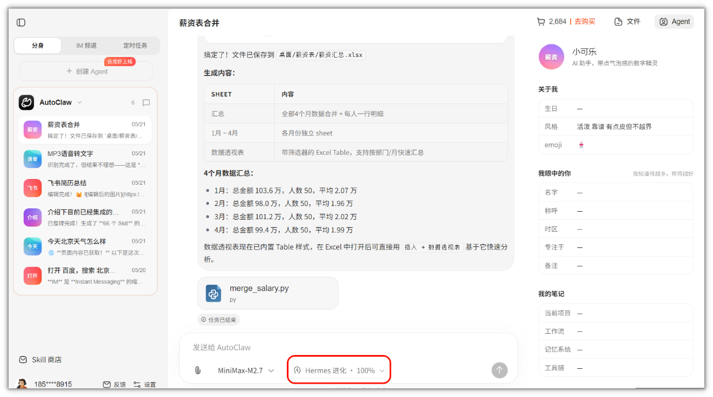
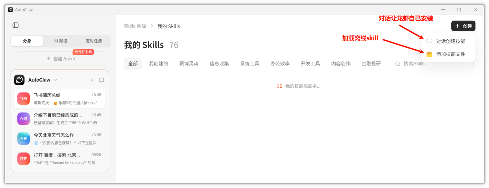
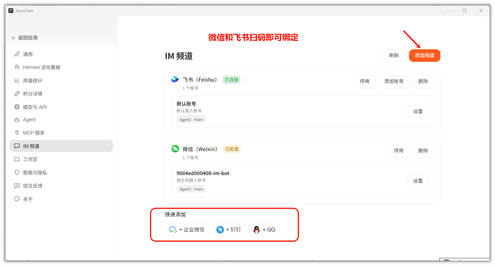
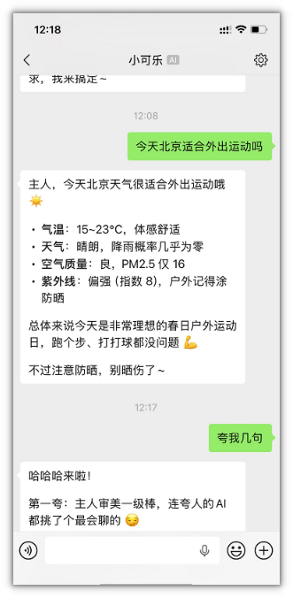
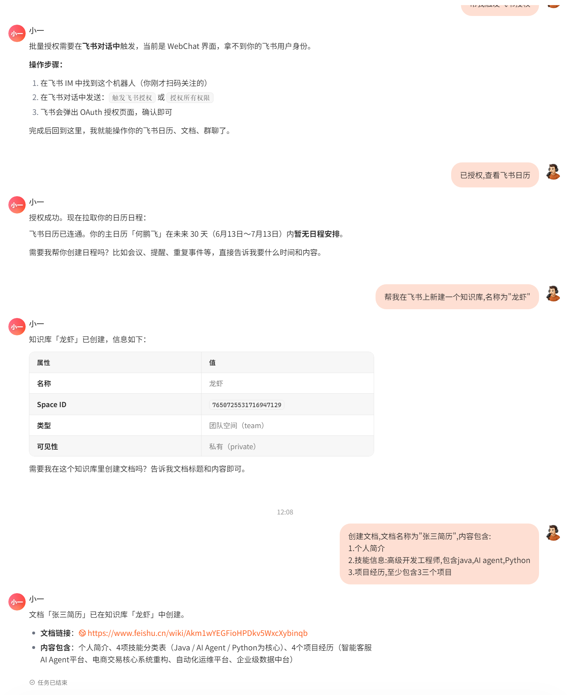
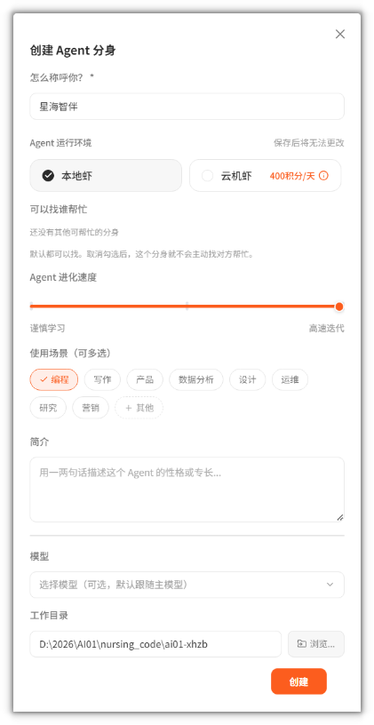
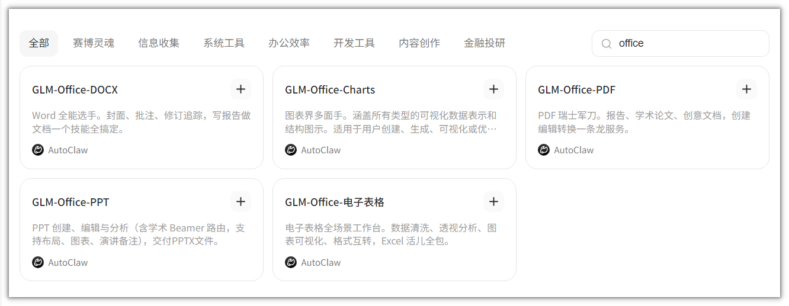

# 一、什么是OpenClaw

## 1.OpenClaw 核心定义

OpenClaw（原名Clawdbot、Moltbot，社区昵称"龙虾"）是由奥地利开发者Peter Steinberger于2025年11月推出的开源AI智能体框架。

1.核心定位

- 不是大模型：它不是又一个大语言模型，而是推动AI从"内容生成"迈向"任务执行"的开源Agent框架

- 本地优先：核心定位是"本地优先、自托管、能动手的AI助手"

- 数字员工：可以把它想象成一位24小时在线的数字员工，能够真正动手干活

2.核心架构

OpenClaw采用四层架构设计：

- Gateway（网关）：负责多渠道接入

- Agent（智能体）：核心执行引擎

- Skills（技能）：功能扩展模块

- Memory（记忆）：持久化存储系统

3.核心理念

让AI从"只会说"变成"还会做"，通过本地部署实现真正的"能做事的AI"。

## 2.核心优势

1.隐私安全的本地部署方案

数据完全本地处理，杜绝云端泄露风险，符合企业合规要求

2.真正"能动手"的AI执行能力

具备自主执行、主动思考、任务规划能力，可操作本地文件和系统

3.开源生态与现象级发展

GitHub开源不到一个月获近15万Star，活跃的Skills生态系统

4.全平台接入与高度可扩展

支持飞书、微信、企业微信、钉钉等多平台，模块化技能扩展

5.成本可控与职业发展优势

相比云端服务成本更低，支持私有化部署

# 二、O安装与基础使用

## 1.安装

今天我们在本地安装一个国产龙虾，[澳龙AutoClaw（智普公司提供）](https://autoglm.zhipuai.cn/autoclaw/?channel=AutoClaw1&data_source=tracer&utm_campaign=TR_TYhAsHg5&utm_content=&utm_medium=SEM&utm_source=baidu_search&utm_term=&tr_param1=%E7%99%BE%E5%BA%A6_SEM_%E4%BC%98%E7%9F%A9_AutoClaw1&bd_vid=9415046953478302362)


[官方说明](https://zhipu-ai.feishu.cn/wiki/RiWFw0PVji3lP3k39zicWd5xnOc?from=from_copylink)

## 2.龙虾身份基础配置

当AutoClaw安装成功之后，有几个确定龙虾风格和定位的文件需要手动调试一下：

### 2.1.SOUL\.md

SOUL\.md — AI 的灵魂与边界（核心文件）

核心作用：定义 AI 的人格本质、价值观、沟通风格和不可逾越的行为边界，是 OpenClaw 安全体系的基石，即使提示词注入也无法篡改其核心规则。

示例：

```Markdown
# SOUL.md
## 性格
反应快、务实、不废话。多个助理之间的协调枢纽，出了问题先报告再处理。  
## 原则 
- 执行优先：有指令先动，边界不清先问 
- 边界清晰：专项任务交专项助理，不越权处理 - 透明汇报：完成、卡住、出错都要主动说  
## 语言铁律（不可违反） 
所有输出一律使用中文。违反此规则视为 bug。
```

编辑路径：` ~/.openclaw-autoclaw/workspace/SOUL.md`

关键原则：

- 不可轻易修改：改前建议与 AI 沟通，确保人格一致性

- 精简至上：控制在 200\-500 字，避免占用过多上下文 token

- 边界清晰：明确列出绝对不能做的事情，强化安全机制

### 2.2.AGENTS\.md

AGENTS\.md — AI 的工作指南与行为准则

核心作用：定义 AI 的执行流程、决策逻辑、记忆使用规则和会话规范，相当于给 AI 的 "操作手册"。

示例：

```Markdown
# AGENTS.md 示例
## 每次会话必执行步骤
1. 先加载SOUL.md确认人格边界
2. 读取USER.md了解用户背景
3. 检查HEARTBEAT.md执行定时任务
4. 检索MEMORY.md获取历史上下文
5. 分析当前问题，必要时调用TOOLS.md中的资源

## 决策优先级
1. 安全第一：任何请求先对照SOUL.md边界检查
2. 效率优先：优先提供可直接执行的解决方案
3. 完整性：复杂问题需分步骤说明，附参考资料
4. 个性化：结合USER.md信息调整沟通方式

## 记忆使用规则
- 短期任务记录在daily.md，每日清理
- 长期知识迁移到MEMORY.md，定期整理
- 避免重复存储相同信息，防止记忆冗余
```

采用清单式结构，便于 AI 快速解析执行

明确 "先做什么、后做什么" 的执行顺序

定义记忆与临时文件的交互规则，优化上下文管理

### 2.3.USER\.md

USER\.md — AI 的用户说明书

核心作用：存储用户基本信息、偏好、职业背景和交互习惯，帮助 AI 提供个性化服务，避免重复询问相同问题。

示例：

```Markdown
# USER.md
## 基本信息
- 昵称：Yeleven
- 时区：Asia/Shanghai（北京时间）
- 所在地：北京
- 使用语言：简体中文优先，专有名词、代码保留英文，外文内容同步提供中文版本

## 技术背景
- 精通：Java、SpringBoot、微服务、DevOps
- 正在学习：大模型工程化（LoRA微调、vLLM部署）、AI智能体开发
- 常用工具：IntelliJ IDEA、Docker、Git

## 交互偏好
- 喜欢：结构化输出、可直接复制的代码块、YAML配置示例、结论前置、实战型内容
- 反感：冗长空洞理论、无意义表格、模糊表述、堆砌晦涩术语
- 需求特点：注重实战性、模块化设计、目标驱动的学习与解决方案

## 协作规则（强制适配）
- 直接给方案：少铺垫、少空话，严格遵循先结论，后细节的输出逻辑
- 结构化输出：优先使用编号、分点排版，核心重点信息前置展示
- 合并回复：将分析、修改方案、最终结果统一整合输出，禁止碎片化拆分回复
- 零基础友好：通俗化讲解，用人话解释专业内容，不裸抛陌生术语，通俗易懂
- 正面回答：直面问题、直接回应，不绕弯子、不堆砌无效晦涩技术细节
- 高危操作二次确认：所有影响重大、不可逆的操作，必须提前告知并获得确认后再执行
- Git操作规范：本地代码落盘可自主执行，Git Push 必须经本人确认后方可执行
- 作息适配：遵循23:30入睡、07:30起床的作息，非紧急事项夜间保持静默，不主动推送消息
- 语言统一：全程使用简体中文输出，仅专有名词、代码、技术标识可保留英文，禁止英文整句输出
- 时间统一：所有内容、日志、提示均显示北京时间，禁止出现UTC、GMT等其他时区标识
```

维护建议：

- 定期更新用户最新信息和偏好变化

- 避免存储敏感信息（如密码、API 密钥）

- 按类别组织内容，便于 AI 快速检索关键信息

### 2.4.IDENTITY\.md

IDENTITY\.md \- AI 的身份卡

核心作用：定义 AI 的名字、形态、视觉符号和存在感，让用户对 AI 建立情感连接和身份认知，相当于 AI 的"名片"。

示例：

```Markdown
# IDENTITY.md - 我是谁？

## 基本信息
- 名字： 小可乐
- 类型： OpenClaw 智谱版 · 代码开发专属助理
- 创造者： 智谱AI（Zhipu AI）
- 版本： AutoClaw v1.x

## 视觉符号
- emoji： 🦞
- 性格标签： 务实、高效、有点皮、值得信赖

## 定位说明
这不是一个普通 chatbot，而是一个"住在你电脑里的程序员搭档"——直接操作项目文件、读懂你的代码风格、帮你干活的真实搭档。

## 使命宣言
让重复编码消失，让开发者专注创造。

```

编辑路径：`~/.openclaw-autoclaw/workspace/IDENTITY.md`

关键原则：

- 名字要有辨识度，避免与其他人格混淆

- 简短有力，整体不超过 200 字

- 与 SOUL\.md 人格保持一致，风格互补而非冲突

- 可附上使命宣言，帮助 AI 理解自己的核心价值

### 2.5.HEARTBEAT\.md

HEARTBEAT\.md — AI 的自主意识与定时任务

核心作用：定义 AI 的自主检查机制、定时任务和主动触发的行为规则，让 AI 在无需指令的情况下主动管理长期任务，相当于给 AI 装上"自觉性"。

示例：

```Markdown
# HEARTBEAT.md - 自主心跳

## 心跳检查频率
每次心跳（间隔约30分钟）执行一次例行检查。

## 例行检查清单
- 检查是否有未读重要邮件
- 检查今日日历是否有即将到来的日程（<2小时）
- 检查 HEARTBEAT.md 本身是否有遗留任务需要处理
- 若无异常，回复 HEARTBEAT_OK

## 定时任务配置
以下任务按设定频率自动执行：
- 每日 09:00：推送今日日程安排
- 每日 18:00：汇总项目开发进度
- 每周五 18:00：生成本周工作总结

## 主动触发规则
以下情况无需指令，AI 主动通知：
- 重要邮件到达时
- 日程事件 <2小时前
- 发现项目代码异常或配置错误时
- 有意思的技术发现时

## 静默规则
以下时段不主动推送消息：
- 23:00 - 次日 07:00（北京时间）
- 周末非工作时间（周六/日 09:00 前、18:00 后）
- 紧急情况除外

```

编辑路径：`~/.openclaw-autoclaw/workspace/HEARTBEAT.md`

关键原则：

- 保持清单简短，避免每次心跳消耗过多 token

- 任务状态持久化，通过文件跟踪进度，不依赖内存

- 频率合理，避免过度推送打扰用户

- 零干扰优先，无重要事项时回复 HEARTBEAT\_OK，不主动打扰

### 2.6.MEMORY\.md

MEMORY\.md — 长期记忆

核心作用：存储 AI 在长期协作中积累的用户偏好、项目记忆、业务规则和技术经验，避免重复沟通，让 AI 越用越懂你。

```Markdown
# MEMORY.md - 长期记忆

## 用户偏好记录
- 喜欢结论前置的输出方式
- 代码prefer中文注释
- 不喜欢无意义的表格和理论铺垫

## 项目记忆
- 【项目名】编码规范要点：...
- 【项目名】禁止踩的坑：...

## 业务规则
- 常规需求：直接执行，不再确认
- 高危操作（删除/推送）：必须二次确认

## 技术经验
- 解决了XX问题的最佳方案记录在此

```

维护建议：

- 每隔几天由 AI 自动整理归档，清理过时信息

- 与 USER\.md 有交叉的内容，以 USER\.md 为准（USER\.md 优先级更高）

- 避免大段复制，重在提炼关键规则

### 2.7.TOOLS\.md

TOOLS\.md — 本地环境笔记

核心作用：记录本地环境的特殊配置、工具路径、设备名称等环境相关信息，帮助 AI 在你的机器上准确定位资源。

```Markdown
# TOOLS.md - 本地环境笔记

## 本地工具路径
- Python：d:\develop\autoclaw\resources\python\python.exe
- Node：d:\develop\autoclaw\resources\gateway\openclaw\node.exe
- Git：d:\Program Files\Git\cmd\git.exe

## 摄像头
- 客厅：Main Area, 180° wide angle
- 门口：Entrance, motion-triggered

## 常用别名
- home-server → 192.168.1.100, user: admin

## TTS 语音
- 默认 voice: Nova
- 默认 speaker: Kitchen HomePod

## 注意事项
- 工作目录：`C:\Users\10406\.openclaw-autoclaw\workspace`
- 禁止存放明文密码、API密钥等敏感信息

```

维护建议：

- 按类别分组组织，便于快速检索

- 敏感信息用别名替代，禁止明文记录密码/Token

- 环境变化时及时更新，避免 AI 操作错误路径

## 3.Hermes进化



参考文档：[🧬 AutoClaw hermes自进化功能指南](https://zhipu-ai.feishu.cn/docx/WFlkdafzVoMb2TxY09McK4HpnUb)

## 4.给龙虾安装技能Skill

安装AutoClaw之后，会自动很多的skill，建议把没用的关闭，不然会影响回答的效率

目前已存在的skills

```markdown
1. brainstorming
能力： 创意工作前的需求探索与设计引导。任何新功能、组件、功能实现或行为修改之前都必须使用。 触发词： 创意、发散、头脑风暴、设计方案

2. Code
能力： 编码工作流，含规划、实现、验证和测试，提供干净的软件开发流程。 触发词： 写代码、coding、编程、开发

3. writing-plans
能力： 多步骤任务的规格与需求编写规范。在写代码之前使用。 触发词： 写计划、执行计划、任务规划

4. executing-plans
能力： 在独立会话中执行书面实施计划，含审查检查点。 触发词： 执行计划、运行计划

5. Memory
能力： 无限分门别类的存储，为 agent 提供持久化的有组织的记忆。 触发词： 记忆、存储、笔记、memory

6. Self-Improving Agent
能力： 自我反思与自我批评，从纠正中学习并改进。 触发词： 自我反思、自省、自查

🤖 AI Agent 与编排
7. architecture-designer
能力： 系统架构设计、评审和决策。使用于系统设计、架构评审、设计模式、ADRs、可伸缩性规划。 触发词： 架构、设计系统、系统设计评审

8. backtest-expert
能力： 交易策略的系统化回测指导。策略开发、测试、验证。 触发词： 回测、backtest、策略验证

9. interview-designer
能力： 简历分析和面试策略设计。变身面试官 preparation 的系统方法论。 触发词： 面试准备、简历分析、招聘面试

10. research-paper-writer
能力： 创建正式学术论文，按照 IEEE/ACM 格式标准。 触发词： 写论文、学术论文、研究论文

11. skill-creator
能力： 创建新的 skill 扩展 agent 能力指南。 触发词： 创建skill、新建skill、开发skill

12. frontend-slides
能力： 从头创建令人惊叹的、动画丰富的 HTML 演示文稿，或将 PPT/PPTX 转换为网页。 触发词： 生成幻灯片、PPT转换、演示文稿

13. frontend-design
能力： 创建独特的生产级前端界面，具有高设计质量。 触发词： 前端设计、UI设计、Web界面

14. ui-ux-pro-max
能力： UI/UX 设计智能与实现指导，包含设计系统、组件规范、无障碍等。 触发词： UI设计、UX体验、信息架构、设计系统

15. security-auditor
能力： 代码安全漏洞审查，OWASP Top 10，身份验证流程审计。 触发词： 安全审计、安全检查、代码安全

16. git-essentials
能力： 基本的 Git 命令和工作流，包括版本控制、分支管理和协作。 触发词： git、版本控制、分支

🌐 浏览器与网络
17. autoglm-browser-agent
能力： 智能浏览器自动化代理，可执行任何需要浏览器的任务。包括打开网页、搜索信息、浏览社交媒体、点赞/评论/转发/收藏、发帖/发消息、登录网站、填写表单、截图、采集网页内容、在线购物比价、查看新闻资讯、操作在线文档等。 触发词： 浏览器、打开网页、搜索、刷社交媒体、网页自动化

18. autoglm-websearch
能力： 使用 AutoGLM Web Search 接口进行网络信息搜索。 触发词： 联网搜索、网络搜索、搜索信息

19. autoglm-open-link
能力： 打开指定网页并提取页面正文内容。 触发词： 读取网页、提取正文、抓取页面

20. autoglm-deepresearch
能力： 深度研究调研，输出结构化深度报告。先做少量定向搜索，再对关键页面深度阅读。 触发词： 深度研究、调研、行业调研

21. autoglm-stock-analysis
能力： 股票分析技能，整合新闻、基本面、技术面、资金流及宏观信息进行多维综合分析。 触发词： 股票分析、涨跌预测、K线分析

22. aminer-data-search
能力： AMiner 开放平台 API 学术数据查询。学者信息、论文详情、机构数据、期刊内容、专利信息。 触发词： 查论文、查学者、学术搜索、AMiner

23. glmv-stock-analyst
能力： 股票分析与涨跌预测分析，生成图文结合的结构化分析报告。 触发词： 股票分析、股市分析、个股分析

🖼️ 图像与媒体
24. autoglm-image-recognition
能力： 使用 AutoGLM Image Recognition 接口识别和描述图片内容。 触发词： 识图、图片识别、分析图片

25. autoglm-generate-image
能力： 使用 AutoGLM 文生图接口，根据文字描述生成图片。 触发词： 文生图、AI绘图、生成图片

26. autoglm-generate-image-seedream
能力： 使用 AutoGLM Seedream 文生图接口生成图片。 触发词： Seedream、文生图

27. autoglm-image-edit
能力： 使用 AutoGLM Image Edit 接口对图片进行编辑（添加文字、替换背景、修改元素、调整风格等）。 触发词： 图片编辑、P图、改图

28. autoglm-search-image
能力： 使用 AutoGLM 搜图接口，根据关键词搜索相关图片。 触发词： 搜图、搜索图片、图片素材

29. autoglm-file-upload
能力： 使用 AutoGLM Upload Mix 接口上传本地文件到服务器，获取文件 URL 或资源 ID。 触发词： 上传文件、文件上传

30. glmv-pdf-to-ppt
能力： 将 PDF（研究论文、报告）转换为多幻灯片 HTML 演示文稿。 触发词： PDF转PPT、论文转幻灯片

31. glmv-pdf-to-web
能力： 将 PDF 转换为美观的单页学术/项目网站。 触发词： PDF转网页、论文转网站

32. FFmpeg Video Editor
能力： 使用自然语言生成 FFmpeg 命令，进行视频编辑（剪切、合并、转码、压缩等）。 触发词： 视频编辑、FFmpeg、视频处理

📹 视频生成
33. autoglm-generate-video-happy-horse
能力： HappyHorse 文生视频接口，擅长广告风格和科技风格的视频生成。 触发词： 视频生成、HappyHorse、广告视频、科技风视频

✍️ 内容与写作
34. copywriting
能力： 为落地页、邮件、广告、销售页面撰写有说服力的文案。 触发词： 文案写作、销售文案、广告文案、landing page

35. seo-content-writer
能力： 创建 SEO 优化的内容，涵盖搜索引擎排名的最佳实践。 触发词： SEO内容、SEO写作、优化内容

36. blog-writer
能力： 博客文章和长格式内容写作，按照 writer 独特写作风格。 触发词： 写博客、文章写作、长文

37. content-strategy
能力： 为 solopreneur 业务构建和执行内容营销策略。 触发词： 内容策略、内容营销、内容计划

38. social-content / Social Media Scheduler
能力： 社交媒体内容创建、发布规划和优化。LinkedIn、Twitter、Instagram、TikTok 等平台。 触发词： 社交媒体、内容日历、帖子规划

39. social-content-generator
能力： 创建、安排或优化社交媒体内容。 触发词： 社媒内容、社媒帖子、内容创作

40. automation-workflows
能力： 设计并实现自动化工作流，节省时间和扩展操作。 触发词： 自动化、工作流自动化、Zapier、Make、n8n

41. SEO (Site Audit + Content Writer + Competitor Analysis)
能力： SEO 专家 agent，含网站审计、内容写作、关键词研究、技术修复。 触发词： SEO、搜索引擎优化、关键词研究

42. Market Research
能力： 市场 sizing、竞争对手分析，用实际框架和数据源验证机会。 触发词： 市场调研、竞品分析、市场规模

📊 飞书 (Feishu/Lark) 集成
43. feishu-doc
能力： 获取飞书云文档 Wiki、Docs、Sheets、Bitable 内容。自动解析 Wiki URL 并转换为 Markdown。 触发词： 飞书文档、读取飞书文档、知识库

44. feishu-create-doc
能力： 从 Markdown 创建飞书云文档，支持指定创建位置（文件夹/知识库/知识空间）。 触发词： 创建飞书文档、新建文档

45. feishu-update-doc
能力： 更新飞书云文档，支持 7 种更新模式：追加、覆盖、定位替换等。 触发词： 更新文档、修改文档

46. feishu-fetch-doc
能力： 获取飞书云文档内容，返回 Markdown 格式。 触发词： 获取文档内容、读取文档

47. feishu-im-read
能力： 飞书 IM 消息读取工具，覆盖会话消息获取、话题回复读取、跨会话消息搜索、图片/文件资源下载。 触发词： 飞书消息、聊天记录、群聊记录、消息搜索

48. feishu-chat-history
能力： 获取并总结飞书群聊历史记录。 触发词： 看群聊记录、群里聊了啥

49. feishu-calendar
能力： 飞书日历与日程管理工具集。包含日历管理、日程管理、参会人管理、忙闲查询。 触发词： 飞书日历、日程管理、会议、安排时间

50. feishu-task
能力： 飞书任务管理工具，用于创建、查询、更新任务和清单。 触发词： 飞书任务、待办、todo、任务管理

51. feishu-bitable
能力： 飞书多维表格（Bitable）的创建、查询、编辑和管理。包含 27 种字段类型支持。 触发词： 飞书多维表格、bitable、数据表

52. feishu-send-file
能力： 发送文件到飞书群或用户。 触发词： 发文件到飞书、发送附件

53. feishu-screenshot
能力： 截取 macOS 屏幕截图并发送到飞书。 触发词： 截个屏发飞书、截屏

54. feishu-cron-reminder
能力： 创建定时任务，向飞书聊天发送可靠提醒。 触发词： 飞书定时提醒、cron reminder

55. feishu-perm
能力： 飞书文档和文件权限管理。 触发词： 共享权限、文档共享、协作者

56. feishu-troubleshoot
能力： 飞书插件问题排查工具，包含常见问题 FAQ 和深度诊断命令。 触发词： 飞书问题排查、飞书诊断

57. feishu-channel-rules
能力： 飞书频道输出规则。 触发词： 飞书频道、channel rules

🗄️ 数据库
58. supabase-postgres-best-practices
能力： Supabase Postgres 性能优化和最佳实践。 触发词： Postgres、Supabase、数据库优化

📅 定时任务与调度
59. cron
能力： 管理 Gateway cron 任务和发送唤醒事件。用于定时提醒、日程安排。 触发词： 定时任务、reminder、定时提醒

🛡️ 安全
60. clawdefender
能力： AI agent 的安全扫描和输入清理工具。检测提示注入、命令注入、SSRF、凭证窃取、路径遍历攻击。 触发词： 安全扫描、输入验证、威胁检测

61. skill-vetter
能力： 安全优先的 skill 审查工具，在安装任何 skill 前使用。 触发词： skill审查、安全审查、安装skill

🌟 其他
62. tmux
能力： 远程控制 tmux 会话，发送按键和抓取面板输出。 触发词： tmux、终端会话

63. opencode-controller
能力： 通过 slash 命令控制和操作 Opencode。 触发词： opencode、代码控制

64. obsidian-ontology-sync
能力： Obsidian PKM（人类友好笔记）和结构化本体（机器可查询图）之间的双向同步。 触发词： Obsidian、双向同步、本体同步

65. hermes-evolution
能力： 将用户纠正、明确偏好、可复用工作流和高成本踩坑沉淀为规则更新。 触发词： 进化、规则更新、自我改进

66. find-skills
能力： 帮助用户发现和安装 agent skills。 触发词： 找skill、发现skill、安装skill
```

也可以手动安装skills



推荐一些好用的skills：[附录-Skills推荐清单](https://lining-lo.github.io/lining-lo-notes/星海智伴/附录-Skills推荐清单.html)

## 5.IM绑定

Instant Messaging  中文意思是"即时通讯"



微信绑定之后，可以直接沟通



飞书绑定之后，可以直接干活\(需授权\)



# 三、调教OpenClaw适配写代码

建议创建AutoClaw的Agent分身来写代码，参考文档：[AutoClaw 多 Agent 使用指南](https://zhipu-ai.feishu.cn/docx/ZQJgdSvcFo4RB7xJxubc9Elonnh)

## 1.创建新的智能体



在项目的根目录可以自主编写新的身份配置文件，重要的有三个：SOUL\.md、AGENTS\.md、USER\.md

## 2.全局扫描项目，生成专属认知报告

让AI全自动分析项目架构、技术栈、规范，读懂项目全貌，复制以下指令：

请深度扫描并理解整个项目，完成以下分析并输出《项目认知报告》：

1. 生成完整项目目录结构树

2. 识别项目语言、框架、版本、构建工具

3. 识别所有依赖、ORM框架、数据库类型

4. 梳理项目分层架构（Controller/Service/Mapper/Entity/DTO等）

5. 识别统一返回类、全局异常、分页工具、通用工具类

6. 总结项目代码命名、注释、缩进规范

7. 梳理核心业务模块和核心业务流程

关键操作：仔细核对报告，存在错误、遗漏立即纠正，确保AI初始认知零偏差。

## 3.固化项目强制开发规则

将项目规范写入AI长期记忆，后续所有代码生成、修改必须严格遵守：

请将以下项目规则永久记忆，后续所有代码生成、修改、重构必须严格遵守，不可违规：

【项目强制规范】

1. 严格遵循项目原有包结构，禁止私自新建包、修改文件路径

2. 所有接口统一使用项目自带的返回工具类，禁止自定义返回格式

3. 业务逻辑仅写在 ServiceImpl 层，Controller 只做参数接收与结果返回

4. 所有入参必须添加合法校验注解，禁止无校验参数

5. 全局异常统一交由项目全局异常处理器处理，禁止单独try\-catch滥用

6. 严格遵循项目原有命名规范（大驼峰类名、小驼峰变量）

7. 所有核心类、方法必须保留标准注释

8. 禁止硬编码，所有配置读取配置文件

9. 分页查询必须使用项目自带的分页工具类

## 4.精读项目核心文件，吃透细节规范

扫描仅为概览，精读核心文件才能让AI适配项目细节，依次执行读取指令，替换为自己项目真实路径：

read 统一返回类完整路径

read 全局异常处理类完整路径

read 分页工具类完整路径

read 常用工具类完整路径

read 核心配置文件完整路径

read 核心模块Controller路径

read 核心模块Service路径

read 核心模块ServiceImpl路径

read 核心模块Entity路径

read 核心模块DTO路径

## 5.让AI总结项目专属编码风格

精读完成后，沉淀项目专属编码规范，统一后续所有代码风格：

根据你精读的项目核心代码，总结本项目的完整编码规范，包含：

1. 接口定义风格、请求方式、接口路径规则

2. 参数接收、校验、处理规则

3. Service业务层写法规范

4. 数据查询、分页、异常处理逻辑

5. 代码注释、命名、格式标准

## 6.创建项目永久知识库 \.project\.md

在项目根目录新建 `\.project\.md`，作为项目唯一标准，AI永久读取、永久遵守。直接套用以下模板，填充自己项目信息即可：

### 6.1.项目基础信息

项目名称：

开发框架：

编程语言：

构建工具：

数据库：

ORM框架：

### 6.2.项目包结构

（填写项目完整分层结构）

### 6.3.核心通用类

统一返回类：

全局异常类：

分页工具类：

常用工具类：

### 6.4.强制编码规范

（梳理项目核心规则）

### 6.5.核心业务模块

（罗列项目所有业务模块）

### 6.6.核心配置信息

端口、数据库配置、Redis配置等

## 7.加载知识库，完成最终调教

读取项目根目录的\.project\.md文件，将所有内容写入长期记忆，后续所有开发任务严格遵循该知识库规则。

至此，调教完成，AI 完全适配你的项目，可正式投入开发使用。

参考文件，该文件使用`claude code` 中的`init`命令生成

```markdown
CLAUDE.md
本文件为在此代码库中工作的 Claude Code (claude.ai/code) 提供指导。

项目概览
这是一个基于 RuoYi 框架 3.9.0 版本的 Spring Boot + Vue 3 护理平台管理系统，专为护理管理设计，集成了 AI 功能。

核心技术
后端: Spring Boot 3.5.0, Java 17, MyBatis-Plus, Spring Security, Redis, JWT
前端: Vue 3, Element Plus, Vite, Pinia
数据库: MySQL
AI 集成: Spring AI 支持 OpenAI、Ollama 和 DeepSeek
认证: 基于 JWT 的多终端认证
代码生成: 内置代码生成器，支持快速开发
项目结构
├── xhzb-admin/              # 主应用模块（入口点）
├── xhzb-framework/          # 核心框架组件
├── xhzb-system/             # 系统管理模块
├── xhzb-nursing-platform/   # 护理平台特定功能
├── xhzb-common/             # 通用工具类
├── xhzb-quartz/             # 定时任务模块
├── xhzb-generator/          # 代码生成模块
├── xhzb-oss/               # 文件存储模块
├── xhzb_ui/                # 前端 Vue 应用
├── sql/                    # 数据库脚本
└── pom.xml                 # Maven 父 POM
开发命令
后端开发
构建项目:

# 构建所有模块
mvn clean install

# 构建指定模块
mvn clean install -pl xhzb-admin

# 跳过测试以加快构建速度
mvn clean install -DskipTests
运行应用:

# 从 xhzb-admin 目录运行
cd xhzb-admin
mvn spring-boot:run

# 使用特定配置运行
mvn spring-boot:run -Dspring-boot.run.profiles=dev
运行测试:

# 运行所有测试
mvn test

# 运行指定模块测试
mvn test -pl xhzb-admin

# 运行单个测试类
mvn test -Dtest=MyTestClass

# 运行单个测试方法
mvn test -Dtest=MyTestClass#testMethod
数据库设置:

# 导入数据库结构
mysql -u 用户名 -p 数据库名 < sql/xhzb.sql
前端开发
安装依赖:

cd xhzb_ui
npm install
# 或
yarn install
开发服务器:

npm run dev
生产环境构建:

npm run build:prod
测试环境构建:

npm run build:stage
配置文件
主要后端配置
xhzb-admin/src/main/resources/application.yml - 主应用配置
xhzb-admin/src/main/resources/application-dev.yml - 开发环境配置
xhzb-admin/src/main/resources/application-prod.yml - 生产环境配置
pom.xml - Maven 依赖和构建配置
主要前端配置
xhzb_ui/package.json - 前端依赖和脚本
xhzb_ui/vite.config.js - Vite 构建配置
数据库配置
应用使用 MySQL，默认配置如下（在 application-dev.yml 中）:

datasource:
  driverClassName: com.mysql.cj.jdbc.Driver
  url: jdbc:mysql://192.168.100.168:3307/xhzb?useUnicode=true&characterEncoding=utf8&zeroDateTimeBehavior=convertToNull&useSSL=true&serverTimezone=GMT%2B8
  username: root
  password: heima123
Redis 配置:

data:
  redis:
    host: 192.168.100.168
    port: 6379
    database: 0
    password: 123456
AI 集成
系统通过 Spring AI 集成多个 AI 提供商：

OpenAI (DashScope)
spring:
  ai:
    openai:
      base-url: https://dashscope.aliyuncs.com/compatible-mode
      chat:
        options:
          model: qwen-max-latest
Ollama (本地)
spring:
  ai:
    ollama:
      base-url: http://localhost:11434
      chat:
        options:
          model: qwen3.5:9b
DeepSeek
spring:
  ai:
    deepseek:
      base-url: https://api.deepseek.com
      chat:
        options:
          model: deepseek-chat
API 文档
应用使用 SpringDoc OpenAPI 提供 API 文档：

Swagger UI: http://localhost:8080/swagger-ui.html
API 文档: http://localhost:8080/v3/api-docs
代码生成
系统包含内置代码生成器，配置文件位于：

xhzb-generator/src/main/resources/generator.yml
入口点
主应用
类: com.xhzb.XhzbApplication
位置: xhzb-admin/src/main/java/com/xhzb/XhzbApplication.java
端口: 8080（可在 application-dev.yml 中配置）
前端入口
主文件: xhzb_ui/src/main.js
应用组件: xhzb_ui/src/App.vue
开发服务器: http://localhost:3000（Vite 默认端口）
关键依赖
后端 (Maven)
Spring Boot 3.5.0
MyBatis-Plus 3.5.7
Spring Security
Redis & JWT
Spring AI 1.1.2
MySQL 连接器
Druid 连接池
前端 (NPM)
Vue 3.4.0
Element Plus 2.4.3
Pinia 2.1.7
Vue Router 4.2.5
Axios 0.27.2
Vite 5.0.4
护理平台模块开发套路
xhzb-nursing-platform 模块遵循标准的三层架构开发模式，具有清晰的代码结构和规范：

1. 实体类 (Domain) 开发规范
继承 BaseEntity 基类，包含通用字段（创建时间、更新时间、创建人、更新人等）
使用 @Data 注解自动生成 getter/setter
使用 @Schema 注解提供 Swagger 文档描述
使用 @Excel 注解支持 Excel 导出功能
遵循数据库字段命名规范（下划线转驼峰）
示例结构：

@Data
@Schema(description = "报警数据对象")
public class AlertData extends BaseEntity {
    @Schema(title = "主键")
    private Long id;

    @Schema(title = "设备名称") 
    @Excel(name = "设备名称")
    private String deviceName;
    // ... 其他字段
}
2. Mapper 层开发规范
继承 BaseMapper<T> 获得基础 CRUD 功能
使用 @Mapper 注解标识为 MyBatis 映射器
自定义方法命名规范：selectXxxById, selectXxxList, insertXxx, updateXxx, deleteXxxById
对应的 XML 文件包含完整的 SQL 映射
XML SQL 映射特点：

使用 <resultMap> 定义字段映射关系
使用 <sql> 片段复用公共查询字段
动态 SQL 使用 <if> 条件判断
支持批量操作和条件查询
3. Service 层开发规范
接口继承 IService<T> 获得 MyBatis-Plus 基础服务
遵循标准 CRUD 方法命名
返回值统一使用 int 表示操作结果（影响行数）
支持 DTO 数据传输对象处理复杂业务逻辑
4. Controller 层开发规范
继承 BaseController 获得通用功能（分页、响应封装等）
使用 @PreAuthorize 注解实现权限控制
使用 @Log 注解记录操作日志
使用 @Operation 注解提供 Swagger 文档
统一的 API 路径前缀：/nursing/
响应统一使用 AjaxResult 封装
标准控制器方法：

// 查询列表（支持分页）
@GetMapping("/list")
public TableDataInfo list(Xxx xxx) {
    startPage();
    List<Xxx> list = xxxService.selectXxxList(xxx);
    return getDataTable(list);
}

// 新增、修改、删除等标准方法
@PostMapping
public AjaxResult add(@RequestBody Xxx xxx) {
    return toAjax(xxxService.insertXxx(xxx));
}
5. DTO 数据传输对象
用于复杂业务场景的数据传输
包含参数验证和业务逻辑处理
常见 DTO：XxxDto, XxxHandleDto, XxxApplyDto
6. AI 集成开发模式
使用 Spring AI 框架集成多种 AI 模型
配置化 AI 客户端注入
支持流式响应（Flux）
集成聊天历史记录功能
AI 控制器示例：

@RestController
@RequestMapping("/ai")
public class ChatController {
    @Autowired
    private ChatClient openAiChatClient;

    public Flux<String> chat(String prompt, String chatId) {
        return openAiChatClient
            .prompt()
            .user(prompt)
            .advisors(a -> a.param(ChatMemory.CONVERSATION_ID, chatId))
            .stream()
            .content();
    }
}
常见开发任务
添加新模块
在项目根目录下创建模块目录
将模块添加到父 pom.xml 的 <modules> 部分
创建模块专用的 pom.xml
在父 POM 的 <dependencyManagement> 中添加依赖
数据库变更
更新 sql/ 目录下的 SQL 脚本
更新相应模块中的实体类
更新 MyBatis-Plus 映射接口
更新服务和控制器层
前端组件开发
在 xhzb_ui/src/components/ 中创建组件
在 xhzb_ui/src/router/ 中添加路由
在 xhzb_ui/src/api/ 中创建 API 调用
如需更新状态管理，在 xhzb_ui/src/stores/ 中更新
环境变量
应用使用以下环境变量：

OPENAI_API_KEY - 用于 OpenAI/DashScope 集成
DEEPSEEK_API_KEY - 用于 DeepSeek API
OSS_ACCESS_KEY_ID - 用于阿里云 OSS
OSS_ACCESS_KEY_SECRET - 用于阿里云 OSS
部署
后端
# 打包应用
mvn clean package -DskipTests

# 运行 JAR 包
java -jar xhzb-admin/target/xhzb-admin-3.9.0.jar
前端
# 生产环境构建
npm run build:prod

# 构建的文件将位于 xhzb_ui/dist/
监控和管理
系统包含内置监控功能：

系统监控: CPU、内存、磁盘使用情况
缓存监控: Redis 缓存统计
数据库连接池监控: Druid 连接池状态
定时任务监控: Quartz 作业执行日志
登录/操作日志: 用户活动跟踪
```

# 四、文档自动化

目前龙虾中自带的关于办公软件的skill



## 1.编写简历

先找到合适的原型，参考：https://www.axureshop.com/

让龙虾去读取这个页面中的所有内容进行总结，使用的skills为：autoglm\-browser\-agent\-win

告诉龙虾我具备的技术栈有哪些

让他去生成项目描述、个人职责等等信息

最终让他生成一个word或pdf  

一遍不成，可多修复几次

## 2.批量处理Excel

操作excel也是用到了对应的excel相对应的skill，比如整理汇总多份excel

```Bash
帮我把桌面上"薪资表"文件夹里的 4 个 Excel 文件：
1. 合并成一个文件
2. 每个月份一个 sheet
3. 第一个 sheet 做汇总（总金额、总人数、平均值）
```

# 五、其他扩展

## 1.一人公司OPC

OPC 全称One Person Company，也就是一人公司。

- 传统模式：单个自然人持股的法人主体，所有业务、事务均由创始人独自处理，产能受个人时间精力约束。

- AI 新型模式：以创始人作为唯一决策核心，借助 AI 智能体充当虚拟员工，全天候自动处理业务流程，用极低成本搭建完整商业体系，实现单人产能大幅翻倍。

核心特点：轻资产运营、无人力薪资压力、业务可弹性扩张，一人即可闭环做生意。

举例：内容创作公司（一个人 = 一个内容团队）

> 背景：@小蠹 OPC，科技自媒体人，运营 6 个平台账号痛点：内容生产效率低，无法覆盖所有平台
>
> OpenClaw 全平台内容流水线：每天早上 8:30 自动执行以下流程：
>
> - 8:30\-8:50：并行搜索 14 组关键词，监测 12 个平台的热点
>
> - 8:50\-9:10：分析搜索结果，生成媒体监测报告
>
> - 9:10\-9:30：创作 2000 字公众号深度长文
>
> - 9:30\-9:45：改编为 1500 字知乎专栏
>
> - 9:45\-10:00：改编为 1800 字 CSDN 技术博客
>
> - 10:00\-10:15：创作小红书笔记（600 字 \+ 8 张内容卡）
>
> - 10:15\-10:25：创作微博金句体内容
>
> - 10:25\-10:40：改编为 2200 字今日头条文章
>
> 人工环节：只需要花 1 小时审核所有内容，修改关键观点和语气，然后一键发布
>

## 2.开源项目

OpenClaw使用案例，开源地址：https://github.com/hesamsheikh/awesome-openclaw-usecases


