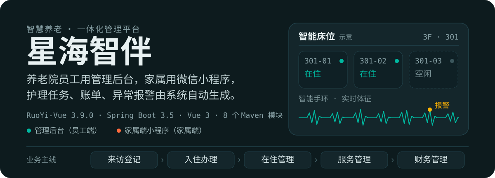
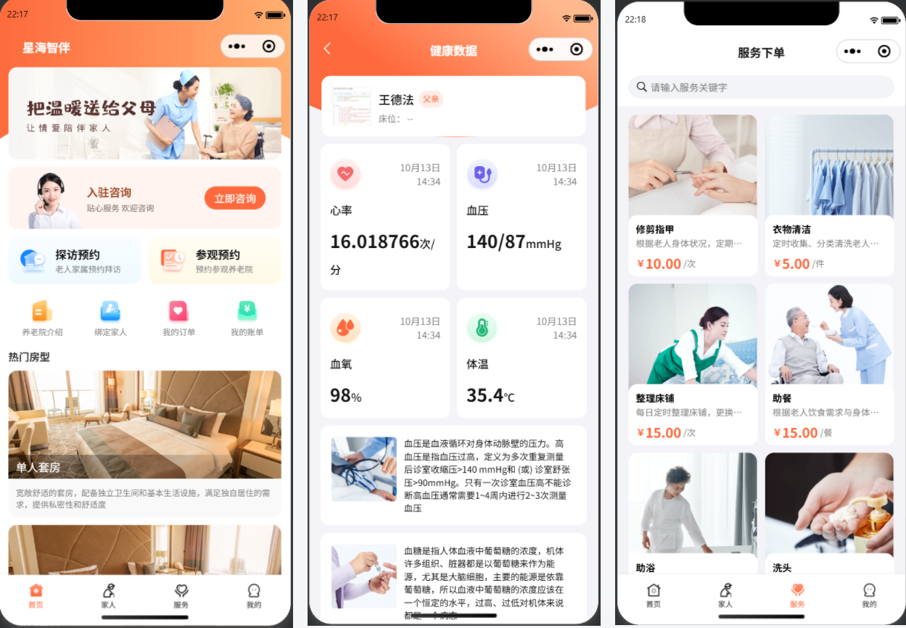
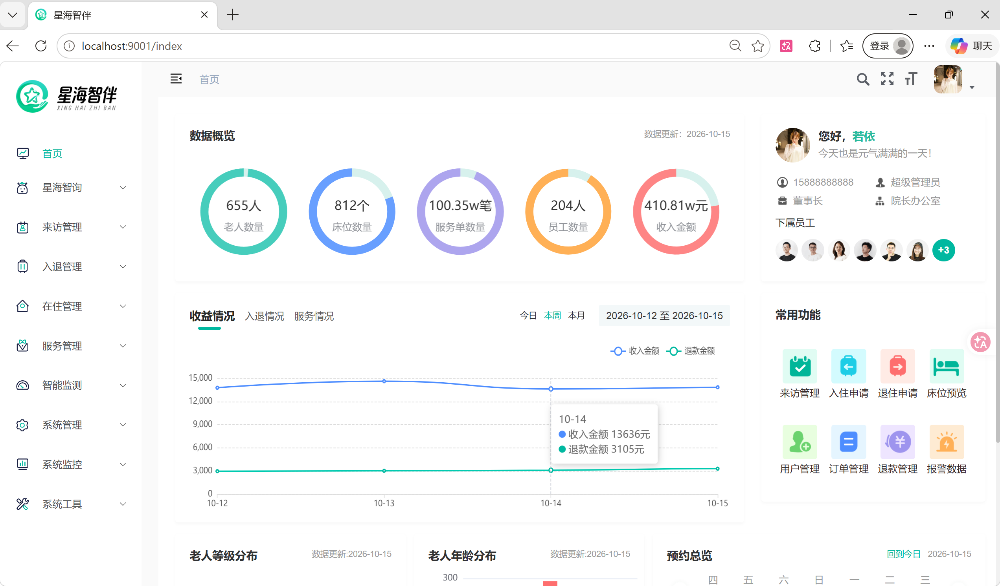
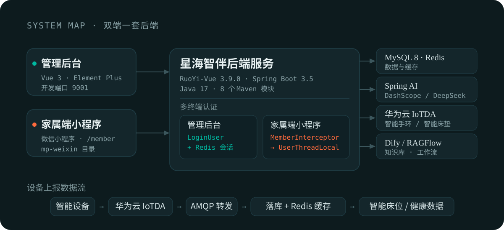

# 星海智伴 · 智慧养老护理平台

> 面向养老院的一体化管理平台：**管理后台（Vue 3）+ 家属端微信小程序**，两端共用一套 Spring Boot 3 后端，集成 Spring AI 大模型、华为云 IoT 设备接入、知识库 RAG 与 Dify 智能体。

<p align="center">
  
</p>

## 运行界面预览

小程序端



后台管理



## 系统架构

<p align="center">
  
</p>
两端共用一套后端服务：

| 端 | 使用方 | 主要职责 |
| --- | --- | --- |
| 管理后台（`xhzb_ui`） | 养老院员工 | 来访 / 入住 / 在住 / 服务 / 任务排班 / 智能监测 / 财务报表 |
| 家属端小程序（`mp-weixin`） | 老人家属 | 登录绑定家人、健康数据、服务下单、订单 / 账单 / 合同、参观探访预约 |

后端多终端认证：管理后台走若依的 `LoginUser + Redis` 会话；小程序端走 `MemberInterceptor`（解析 JWT 中的 `userId` 放入 `UserThreadLocal`），两套互不干扰。

## 快速开始

| 组件 | 版本 / 说明 |
| --- | --- |
| JDK | 17+ |
| Maven | 3.6+ |
| Node.js | 18+（配合 Vite 5） |
| MySQL | 8.x |
| Redis | 6.x+（知识库需要 Redis Stack 以支持向量检索） |
| Docker | 可选，用于部署 MySQL / Redis / Redis Stack / Nginx |

**1）准备基础服务**

```bash
# MySQL
docker run -d --name mysql -p 3306:3306 --restart=always -e MYSQL_ROOT_PASSWORD=your_password mysql:8

# Redis
docker run -d --name redis -p 6379:6379 --restart=always redis --requirepass your_password

# Redis Stack（知识库向量存储，与 Redis 二选一）
docker run -d --name redis-stack -p 6379:6379 -p 8001:8001 redis/redis-stack:latest
```

**2）导入数据库**（库名 `xhzb`，按顺序执行）

```bash
mysql -u root -p xhzb < sql/xhzb.sql
```

**3）启动后端**

```bash
mvn clean install -DskipTests
cd xhzb-admin
mvn spring-boot:run -Dspring-boot.run.profiles=dev
```

启动后服务地址 `http://localhost:8080`，接口文档 `http://localhost:8080/swagger-ui.html`。

**4）启动管理后台**

```bash
cd xhzb_ui
npm install
npm run dev
```

开发服务器 `http://localhost:9001`，`/dev-api` 代理到后端 `8080`。

**5）运行小程序**：用微信开发者工具打开 `mp-weixin` 目录，把 `mp-weixin/utils/env.js` 中的 `baseUrl` 改成后端地址（默认 `http://localhost:8080/member`），登录后可体验家属端全部功能。

**默认账号**

| 账号 | 密码 | 说明 |
| --- | --- | --- |
| `admin` | `admin123` | 管理后台超级管理员 |
| `nurse01` / `nurse02` / `nurse03` | `admin123` | 演示护理员账号，角色为「护理员」，可在「负责老人」中指派给老人 |

## 技术栈

**后端**

| 类别 | 技术 |
| --- | --- |
| 基础框架 | Spring Boot 3.5.0、Java 17、RuoYi-Vue 3.9.0 |
| 持久层 | MyBatis、MyBatis-Plus 3.5.7、Druid 连接池 |
| 安全 | Spring Security、JWT 多终端认证、RBAC 权限模型 |
| 缓存 / 存储 | Redis、MySQL 8 |
| AI | Spring AI（OpenAI 兼容协议 / Ollama / DeepSeek） |
| 接口文档 | SpringDoc OpenAPI / Swagger / Knife4j |
| 消息 | AMQP（消费 IoT 平台转发的设备数据） |
| 定时任务 | Quartz |
| 文件存储 | 阿里云 OSS |

**前端**

| 类别 | 技术 |
| --- | --- |
| 框架 | Vue 3.4.0、Vite 5.0.4 |
| UI | Element Plus 2.4.3 |
| 状态 / 路由 | Pinia 2.1.7、Vue Router 4 |
| 请求 | Axios |
| 小程序 | 微信小程序（对接同一套 `/member` 接口） |

**外部平台**：华为云 IoTDA、阿里云百炼（DashScope）、DeepSeek、Ollama、Coze、Dify、RAGFlow、Redis Stack（向量库）。

## 项目结构

```
xhzb_elder_care
├── xhzb-admin/              # 启动模块：配置、登录、系统接口
├── xhzb-framework/          # 框架核心：安全、拦截器、AOP、数据源
├── xhzb-system/             # 系统管理：用户 / 角色 / 菜单 / 字典
├── xhzb-common/             # 公共模块：工具类、注解、统一响应
├── xhzb-quartz/             # 定时任务模块
├── xhzb-generator/          # 代码生成模块
├── xhzb-oss/                # 文件存储模块
├── xhzb-nursing-platform/   # 养老业务模块（核心）
├── xhzb_ui/                 # 管理后台前端（Vue 3）— 开发端口 9001
├── mp-weixin/               # 家属端微信小程序
├── notes/                   # 开发笔记
├── sql/                     # 数据库脚本
└── pom.xml                  # Maven 父 POM
```

养老业务模块 `xhzb-nursing-platform` 内部结构：

```
com.xhzb.nursing
├── config/          # 业务配置（Spring AI、Redis 向量库等）
├── constants/       # 业务常量（预约名额、护理员角色标识等）
├── controller/      # 管理端接口
│   └── member/      # 小程序端接口（/member/**）
├── domain/          # 实体、DTO、VO
├── job/             # 定时任务（护理任务生成、账单生成、报警校验、合同状态）+ AMQP 客户端
├── mapper/          # MyBatis-Plus Mapper
├── service/         # 业务逻辑
├── tools/ util/     # 工具类
└── resources/mapper/nursing/*.xml
```

**规模参考**（按工作区实测）：

| 指标 | 数量 |
| --- | --- |
| 业务模块 Java 文件 | 212 |
| 业务模块 Mapper XML | 27 |
| 业务模块 Controller | 29（其中小程序端 `/member/**` 7 个） |
| 若依系统模块 Controller | 25 |
| 管理后台 `.vue` 文件 | 169 |
| 数据库表 | 47 张（`sql/` 覆盖 34 张） |
| 业务定时任务 | 4 个 |

关键入口：

- 后端启动类：`xhzb-admin/src/main/java/com/xhzb/XhzbApplication.java`
- 后端配置：`xhzb-admin/src/main/resources/application-{dev,prod,test}.yml`
- 前端入口：`xhzb_ui/src/main.js`，开发端口 9001，`/dev-api` 代理到 `http://localhost:8080`
- 小程序请求前缀：`mp-weixin/utils/env.js` → `http://localhost:8080/member`

## AI 能力

**多模型接入（Spring AI）**：通过 OpenAI 兼容协议接入 DashScope，也可切换本地 Ollama 或 DeepSeek。

**对话能力**：普通对话与流式对话（`Flux<String>`）、System 角色设定、Advisors（日志与会话记忆）、基于 `ChatMemory` + `CONVERSATION_ID` 的多轮会话隔离、会话历史持久化、Tool Calling（如天气查询）。

**知识库（RAG）**：Reader 读取文本 / PDF → Chunk 切分 → 调用向量模型写入 Redis Stack → 用户提问时检索相似片段拼接上下文交大模型生成回答；配套文档上传、拆分向量化、删除及向量数据清理。

**智能评估**：先按评估规则匹配，再交给大模型分析生成能力 / 健康评估结论，落库后支持查看、修改、取消与删除。

**智能体（Dify / RAGFlow）**：用 Dify 构建企业智能体并接入内部知识库与工作流，通过 RAGFlow 解决文档图片解析并作为外部知识库挂载；工作流 HTTP 节点调用业务接口读取预约、老人与健康数据。

> 这一组能力需要 `DASHSCOPE_API_KEY`，配置方式见 [配置说明](#配置说明)。

## IoT 设备接入与报警

**设备管理**：接入华为云 IoTDA，同步产品列表、注册 / 修改 / 删除设备、查询设备详情与物模型数据（运行状态、服务调用）、查看设备影子。

**数据流转**：智能设备 → 华为云 IoTDA → AMQP 数据转发 → 后端消费落库，同时把每台设备的最新上报值缓存进 Redis → 智能床位 / 健康数据展示。完整链路见 [系统架构](#系统架构) 底部的「设备上报数据流」。

后端通过 `ApplicationRunner` 启动 AMQP 客户端持续消费设备上报数据；智能床位模块据此获取楼层 / 房间中的设备与实时数据，健康数据接口也优先读取该缓存。

**报警管理**：按产品 / 设备 / 物模型功能定义监控字段、运算符、阈值、持续周期与生效时间、沉默周期；定时任务周期校验，命中即生成报警数据；老人异常通知护理员、设备异常通知后勤维修，支持站内信与短信。

## 配置说明

**数据源与缓存**（`xhzb-admin/src/main/resources/application-dev.yml`）

```yaml
spring:
  datasource:
    url: jdbc:mysql://localhost:3306/xhzb?useUnicode=true&characterEncoding=utf8&serverTimezone=GMT%2B8
    username: root
    password: your_password
  data:
    redis:
      host: localhost
      port: 6379
```

**支付开关**（`application.yml`）

```yaml
pay:
  # true=模拟支付：下单/账单支付后直接置为已支付（演示用，无需商户号）；false=等待支付平台回调
  mock: true
```

**环境变量**

| 变量 | 用途 |
| --- | --- |
| `DASHSCOPE_API_KEY` | 阿里云百炼（通义千问，OpenAI 兼容模式）密钥 |
| `OSS_ACCESS_KEY_ID` / `OSS_ACCESS_KEY_SECRET` | 阿里云 OSS 访问凭据 |
| `APPID_TEST` / `APPSECRET_TEST` | 小程序 AppId 与密钥（code2session、获取手机号） |

> 请勿把真实密钥提交到仓库；华为云 IoTDA 的 AK/SK、项目 ID 等在 `application-dev.yml` 中按自己账号替换。

## 开发笔记

项目按课程章节推进，每一步的实现说明与截图都整理在 `notes/` 目录，可与代码对照阅读：

| 笔记 | 内容 | 对应实现 |
| --- | --- | --- |
| `01_快速搭建项目(若依).md` | 若依框架搭建、前后端分离结构 | 8 个 Maven 模块 + `xhzb_ui` |
| `02_前后端快速开发.md` | 代码生成器、CRUD 快速开发 | 护理项目 / 等级 / 计划等 CRUD |
| `03_大模型应用基础(SpringAI).md` | Spring AI 接入、对话与流式响应 | `/ai/chat`、会话历史 |
| `04_配置知识库(RAG).md` | 文档切分、向量化、检索问答 | 知识库模块、Redis Stack |
| `05_AI智能评估.md` | 提示词工程 + 评估规则 | 健康评估与评估报告 |
| `06_入住办理功能开发.md` | 入住申请、床位选择、入住详情 | `/nursing/checkIn/**`、入住配置 |
| `07_项目自动化部署.md` | Jenkins、Docker、Nginx、ELK | 见「部署方案」 |
| `08_小程序登录.md` | 微信登录、code2session、手机号、JWT | `/member/user/login`、家人绑定 |
| `09_IOT产品设备管理.md` | 华为云 IoTDA 产品与设备管理 | `/nursing/device/**` |
| `10_数据处理和展示.md` | 设备上报数据落库、缓存与展示 | `/nursing/data/list`、智能床位、健康数据 |
| `11_报警管理和通知.md` | 报警规则、数据过滤、通知 | `/nursing/alertRule/**`、`alertRuleJob` |
| `12_智能体Coze和Dify.md` | 智能体概念与平台能力 | Dify 智能体对接 |
| `13_智能体Dify应用.md` | Dify 应用落地（知识问答 / 数据查询） | 工作流调用业务接口 |
| `14_OpenClaw养虾指南.md` | 工具与技能生态补充 | — |
| `附录-接口文档.md` | 各模块接口文档汇总 | 与「接口清单」一致 |
| `附录-定时任务.md` | Quartz 定时任务原理与实践 | 4 个业务定时任务 |
| `附录-老年人评估表.md` | 评估表范本 | 健康评估 |
| `附录-线程和构造者模式.md` | ThreadLocal / 构造者模式 | `UserThreadLocal`、实体构建 |
| `附录-Jenkins.md` / `附录-RAGFlow安装及对接Dify.md` / `附录-Skills推荐清单.md` | 部署与工具链补充 | — |
