# 一、目标

从今天开始，我们开始一个新的模块开发，叫做智能监测，我们可以先来看一张图

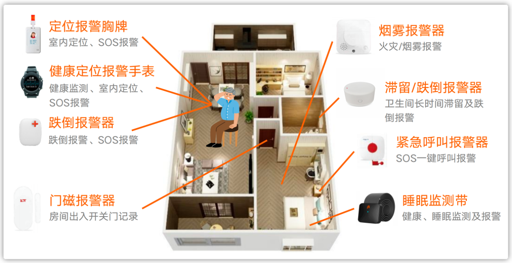

老人入住养老院之后，可以通过选择的配置来配备智能硬件设备，它有两类场景：安全场景和健康场景

- 安全场景：防跌倒意外、防走失、睡眠中意外、区域滞留、环境安全

- 健康场景：健康监测、健康小屋；

通过硬件设备来监控老人以及老人活动场所的情况。后台时刻做监控，一旦有意外发生就可以迅速处理解决。

其中关于智能设备的数据传输和上报，采用的华为云提供的设备接入服务（IoTDA），我们也会重点讲解设备如何上报数据到IOT以及如何从IOT平台拉取数据

今日的目标：

- 能够熟悉华为云IoTDA平台的特点

- 能够掌握华为云IoTDA平台的一些概念，如：产品、设备、物模型等

- 能够掌握使用华为云IoTDA平台提供的接口创建设备，并绑定业务数据（老人、位置）

- 能够熟悉智能设备对接华为云IoTDA平台上报数据的方式

# 二、华为云IOT平台

在开发智能监测之前，我们必须要先熟悉和掌握华为云IoTDA平台的使用及对接，才能开发我们的项目

## 1.什么是物联网

把所有物品通过信息传感设备与互联网连接起来，进行信息交换，即物物相息，以实现智能化识别和管理。

物联网（英文：Internet of Things，缩写：IoT）起源于传媒领域，是信息科技产业的第三次革命。物联网是指通过信息传感设备，按约定的协议，将任何物体与网络相连接，物体通过信息传播媒介进行信息交换和通信，以实现智能化识别、定位、跟踪、监管等功能。

常见的应用场景：

1.共享充电宝

充电宝设备接入物联网平台后，可上报充电宝电量和借用状态等信息到物联网平台云端。充电宝用户扫码后，云端低延时向充电宝下发指令，使其弹出。同时，企业运营者能够实时获知充电宝的运行状况。

2.智能音箱 

播报音箱接入物联网平台后，用户扫码完成支付后，将支付金额实时通过音箱，向用户和商家进行语音播报。

3.智能家居

智能家居技术已经成为当今家庭装潢的一大特色。比如，通过智能灯泡，可以实现远程控制灯光和电视等设备，调节温度和湿度，实现智能化生活。

4.智能农耕

智能农耕可以通过物联网技术来监测、传输、分析、管理农业生产过程中的信息。比如作物的生长情况、土壤的状况等，以提高农业生产的效率，改善利润率，减少污染，节约农业资源。

5.智能医疗

在智慧医疗中，可以捕捉人的生理状态信息，例如心跳频率、体力消耗、血压高低等。然后对采集数据进行备份、加工和分析，以便个人或医生快速查询。在物联网平台接入传感器设备，采集人体及周边环境参数的信息，通过数据服务处理数据后，反馈给用户。

## 2.华为云IoTDA简介

产品文档：https://support.huaweicloud.com/iothub/index.html

设备接入服务（IoTDA）是华为云的物联网平台，提供海量设备连接上云、设备和云端双向消息通信、批量设备管理、远程控制和监控、OTA升级、设备联动规则等能力，并可将设备数据灵活流转到华为云其他服务。

我们作为一个开发者，基本的设备与后台调度思路，如下：


> 更多的介绍可以阅读官方产品文档
> 

## 3.开通IoTDA

### 3.1.注册华为云账号

前往[华为云官网](https://www.huaweicloud.com/)注册账号。如果已有注册账号，请跳过此步骤。

进入华为云首页后，如果没有华为云的账户需要先进行注册，才可以进行登录。由于注册较为简单，这里不在进行体现。

> 注意：
>
> 注册成功后，需要实名认证才能正常开通服务 \(微信扫码即可\)
>

### 3.2.开通物联网平台

登录账号以后，我们可以在产品中搜索设备接入IoTDA

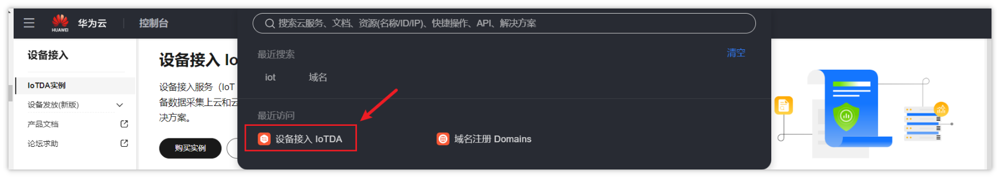

打开之后，点击开通免费单元

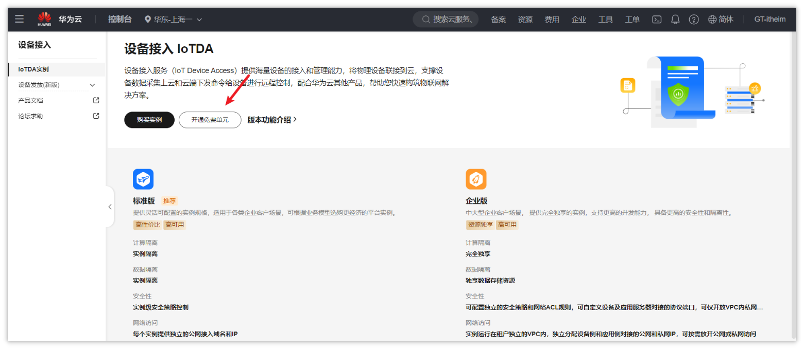

然后直接创建就可以了

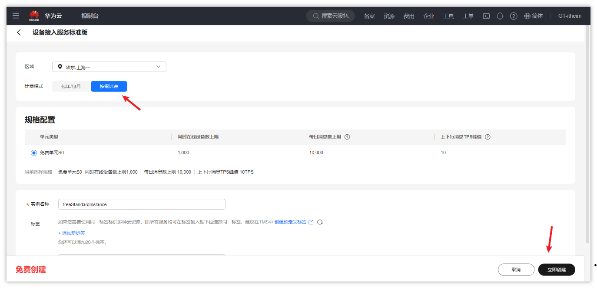

创建成功之后的效果：

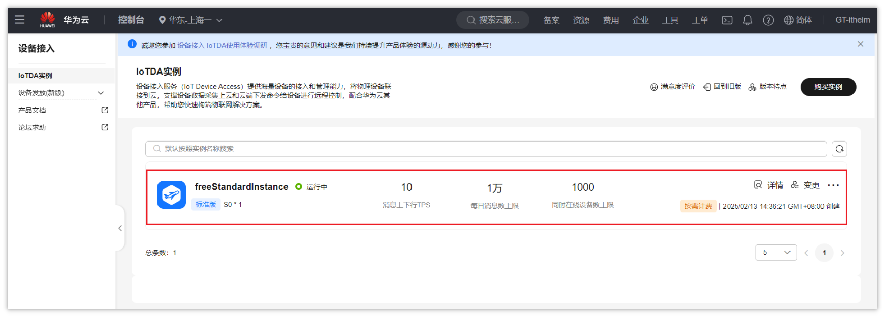

服务的基本信息，可以点击服务查看

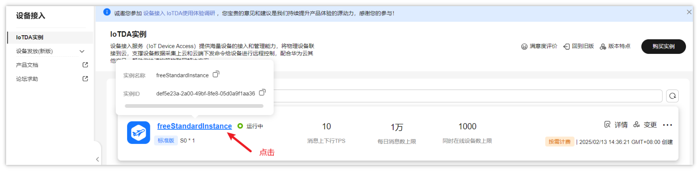

服务内部

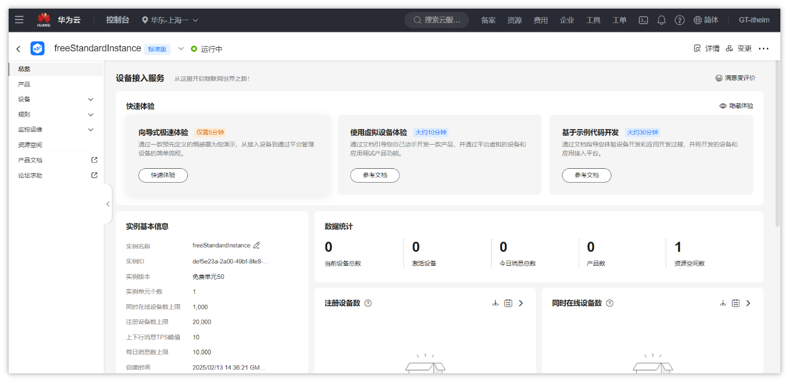

到此，IoTDA服务就正式开通了。

## 4.产品

### 4.1.创建产品

产品：某一类具有相同能力或特征的设备的集合称为一款产品。帮助开发者快速进行产品模型和插件的开发，同时提供端侧集成、在线调试、自定义Topic等多种能力。比如，手表、大门通道门禁、紧急呼叫报警器、滞留报警器、跌倒报警器

现在我们可以创建产品，找到产品\-\-\>创建产品

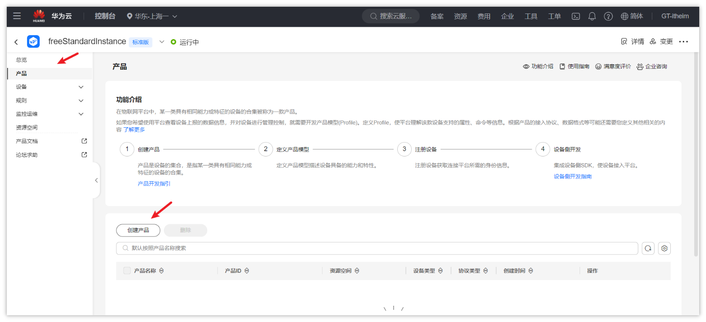

如下图，我们先创建智能定位报警手表的产品，输入信息如下：

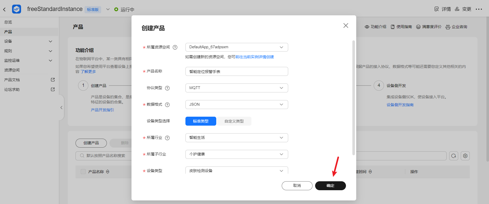

创建成功之后，在产品列表中也可以查看，刚刚创建的产品

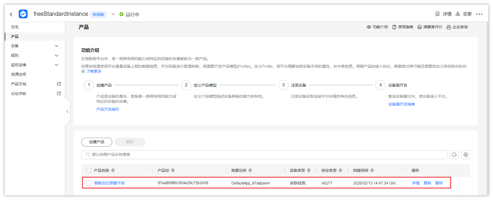

### 4.2.产品模型

产品模型（Product Model），也称物模型，用于描述设备具备的能力和特性。开发者通过定义产品模型，在物联网平台构建一款设备的抽象模型，使平台理解该款设备支持的服务、属性、命令等信息。

- 手表本身：耗电量，使用时间

- 指标数据：身体血压、血氧、体温数据

像这些耗电量、血压、血氧数据都属于产品的功能，也叫做物模型

在IOT平台的物模型中，分为了三类

创建手表产品的物模型

进入产品的详情，我们选择自定义模型

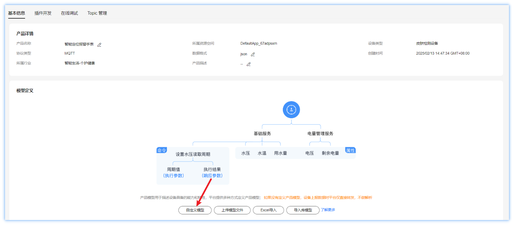

创建服务信息

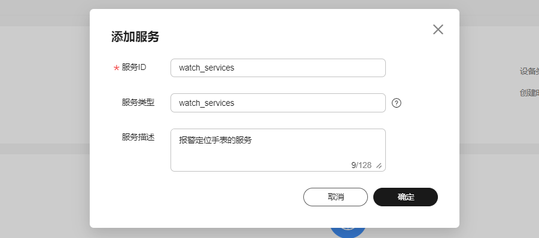

然后可以给这个服务添加具体的物模型

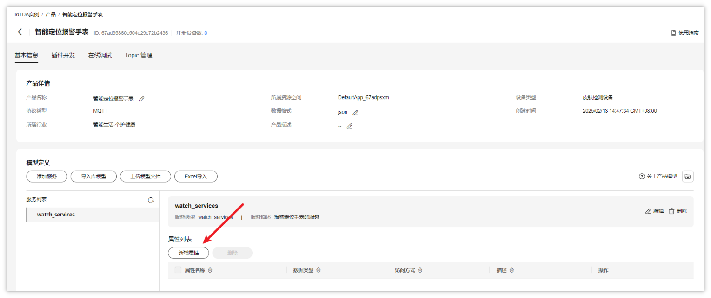

我们目前创建的智能手表产品的物模型，目前可以定义四个，如下：

|属性名称|属性描述|数据类型|访问权限|取值范围|
|---|---|---|---|---|
|BodyTemp|体温|decimal\(小数\)|读写|0\~50|
|xueyang|血氧|decimal\(小数\)|读写|0\~150|
|HeartRate|心率|int|读写|0\~200|
|BatteryPercentage|用电量|int|读写|0\~100|

下面是创建了一个体温的物模型，其他物模型创建类似

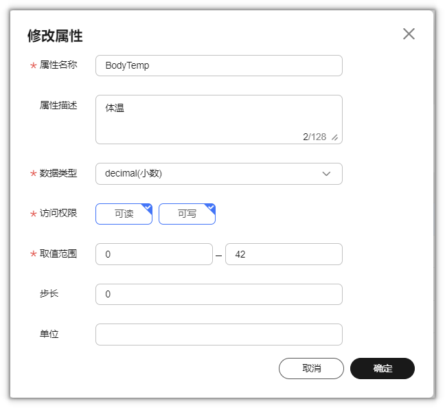

创建成功之后的效果：

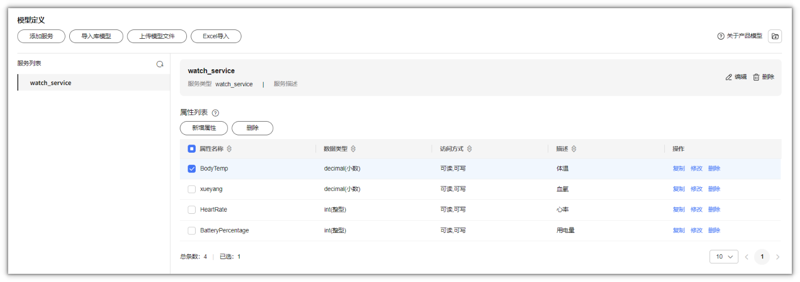

## 5.设备

归属于某个产品下的设备实体，每个设备具有一个唯一的标识码。设备可以是直连物联网平台的设备，也可以是代理子设备连接物联网平台的网关。

前提条件：设备是绑定在产品上的，所以必须先创建产品才行

操作步骤：

1. 在左侧导航栏，选择设备\-\-\>所有设备

2. 在设备页面，单击注册设备。

3. 在添加设备对话框中，输入设备信息，单击确认。

如下图：

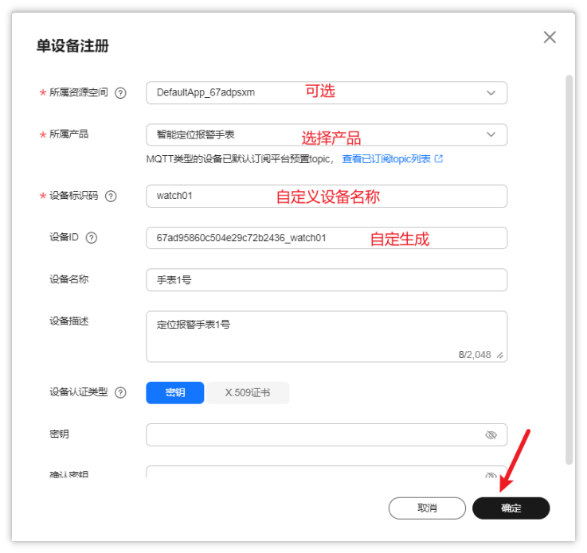

创建成功之后，会分配一个设备的信息，非常重要，需要保存下来，方便后面调试使用

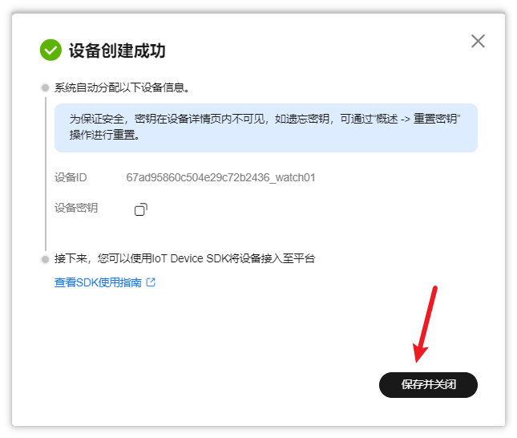

设备中可以查看，创建好的设备

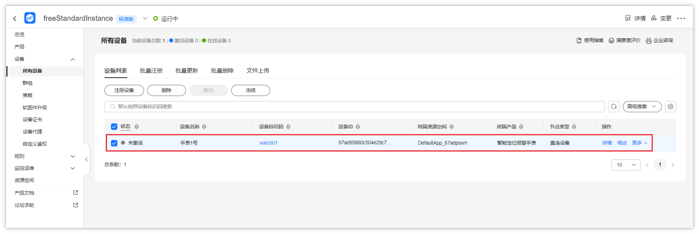

设备详情

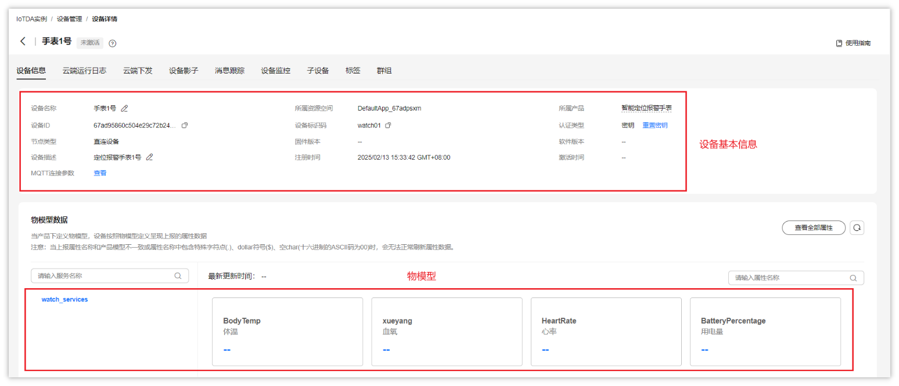

## 6.设备接入\-数据上报

### 6.1.概述

属性上报是一种需要平台解析、缓存，通过数据流转功能将数据转发到应用侧或华为云其他云服务的一种方式。需要在平台建立产品模型。对于属性上报的数据，平台会记录属性的最新一次上报值，对符合产品模型定义的属性数据进行存储。

官方案例\-设备接入：[基于NB\-IoT小熊派的智慧烟感](https://support.huaweicloud.com/bestpractice-iothub/iot_bp_0024.html)

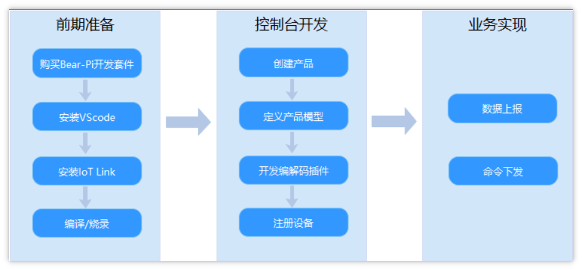

我们在开发阶段可以使用联网的电脑，来模拟设备的数据上报，官方[sdk](https://github.com/huaweicloud/huaweicloud-sdk-java-v3/releases)下载

### 6.2.Java SDK使用示例

1.前提，需要提前创建好产品和对应的物模型，以及该产品的设备

2.SDK代码获取：[SDK下载](https://github.com/huaweicloud/huaweicloud-iot-device-sdk-java)（由于github访问的效果不好，可以直接使用当天资料中提供好的）

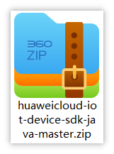

解压之后，使用idea打开，找到`iot-device-demo`模块中的`PropertySample`类，如下图

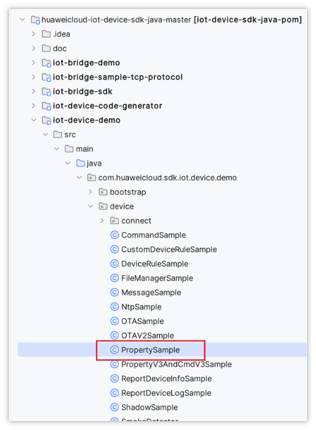

3.完整代码，如下：

```Java
package com.huaweicloud.sdk.iot.device.demo.device;

import com.huaweicloud.sdk.iot.device.IoTDevice;
import com.huaweicloud.sdk.iot.device.client.requests.ServiceProperty;
import com.huaweicloud.sdk.iot.device.transport.ActionListener;

import org.apache.logging.log4j.LogManager;
import org.apache.logging.log4j.Logger;

import java.io.File;
import java.io.IOException;
import java.io.InputStream;
import java.nio.file.Files;
import java.security.SecureRandom;
import java.util.Arrays;
import java.util.HashMap;
import java.util.List;
import java.util.Map;
import java.util.Random;

import static java.nio.file.StandardCopyOption.REPLACE_EXISTING;

/**
 * 演示如何直接使用DeviceClient进行设备属性的上报和读写
 */
public class PropertySample {

    private static final String IOT_ROOT_CA_RES_PATH = "ca.jks";

    private static final String IOT_ROOT_CA_TMP_PATH = "huaweicloud-iotda-tmp-" + IOT_ROOT_CA_RES_PATH;

    private static final Logger log = LogManager.getLogger(PropertySample.class);

    public static void main(String[] args) throws InterruptedException, IOException {

        // 加载iot平台的ca证书，进行服务端校验
        File tmpCAFile = new File(IOT_ROOT_CA_TMP_PATH);
        try (InputStream resource = CommandSample.class.getClassLoader().getResourceAsStream(IOT_ROOT_CA_RES_PATH)) {
            Files.copy(resource, tmpCAFile.toPath(), REPLACE_EXISTING);
        }

        // 创建设备并初始化. 用户请替换为自己的接入地址。-->watch01
        IoTDevice device = new IoTDevice(
            //接入地址获取方式：登录华为云IoTDA控制台左侧导航栏“总览”页签，在选择的实例基本信息中，单击“接入信息”-->设备接入-->MQTT。选择8883端
            "ssl://230590aa95.st1.iotda-device.cn-east-3.myhuaweicloud.com:8883",
            //设备id
            "67ab39f1bab900244b1e64a6_watch01", 
            //设备秘钥  设备创建成功后会自动生成
            "5f71b853642b8ccab767890a5b148f02", tmpCAFile);
        if (device.init() != 0) {
            return;
        }
        
        /*// 接收平台下发的属性读写     注释掉或删除，用不到
        device.getClient().setPropertyListener(new PropertyListener() {
            // 处理写属性
            @Override
            public void onPropertiesSet(String requestId, List<ServiceProperty> services) {
                // 遍历service
                for (ServiceProperty serviceProperty : services) {
                    log.info("OnPropertiesSet, serviceId is {}", serviceProperty.getServiceId());
                    // 遍历属性
                    for (String name : serviceProperty.getProperties().keySet()) {
                        log.info("property name is {}", name);
                        log.info("set property value is {}", serviceProperty.getProperties().get(name));
                    }
                }
                // 修改本地的属性值
                device.getClient().respondPropsSet(requestId, IotResult.SUCCESS);
            }
        
            *//**
             * 处理读属性。多数场景下，用户可以直接从平台读设备影子，此接口不用实现。
             * 但如果需要支持从设备实时读属性，则需要实现此接口。
             *//*
            @Override
            public void onPropertiesGet(String requestId, String serviceId) {
                log.info("OnPropertiesGet, the serviceId is {}", serviceId);
                Map<String, Object> json = new HashMap<>();
                Random rand = new SecureRandom();
                json.put("alarm", 1);
                json.put("temperature", rand.nextFloat() * 100.0f);
                json.put("humidity", rand.nextFloat() * 100.0f);
                json.put("smokeConcentration", rand.nextFloat() * 100.0f);
        
                ServiceProperty serviceProperty = new ServiceProperty();
                serviceProperty.setProperties(json);
                serviceProperty.setServiceId("smokeDetector");
        
                device.getClient().respondPropsGet(requestId, Arrays.asList(serviceProperty));
            }
        });*/

        // 定时上报属性
        while (true) {

            Map<String, Object> json = new HashMap<>();
            Random rand = new SecureRandom();

            // 按照物模型设置属性，根据实际情况设置，下面是智能报警手表的物模型
            json.put("BodyTemp", 36);
            json.put("xueyang", rand.nextFloat()*100.0f);
            json.put("HeartRate", rand.nextFloat()*100.0f);
            json.put("BatteryPercentage", rand.nextFloat() * 100.0f);

            ServiceProperty serviceProperty = new ServiceProperty();
            serviceProperty.setProperties(json);
            serviceProperty.setServiceId("watch_service"); // serviceId要和物模型一致

            device.getClient().reportProperties(Arrays.asList(serviceProperty), new ActionListener() {
                @Override
                public void onSuccess(Object context) {
                    log.info("pubMessage success");
                }

                @Override
                public void onFailure(Object context, Throwable var2) {
                    log.error("reportProperties failed" + var2.toString());
                }
            });

            Thread.sleep(10000);
        }
    }
}
```

链接地址

找到IoTDA实例，点击详情

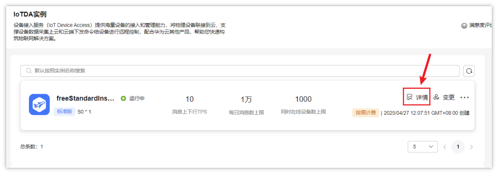

详细的链接地址列表如下：

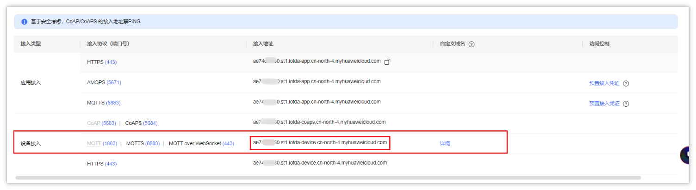

设备秘钥的获取，在创建设备的时候已保存下载

右键启动之后的效果：

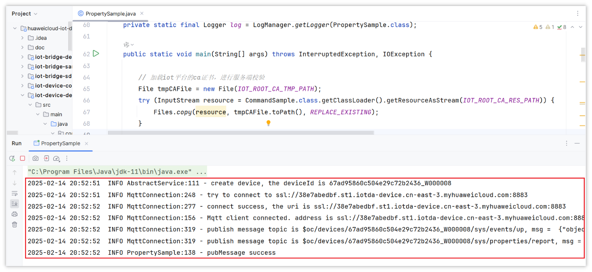

消息发送成功后，可以在华为云IoTDA平台中查看该设备上报的数据

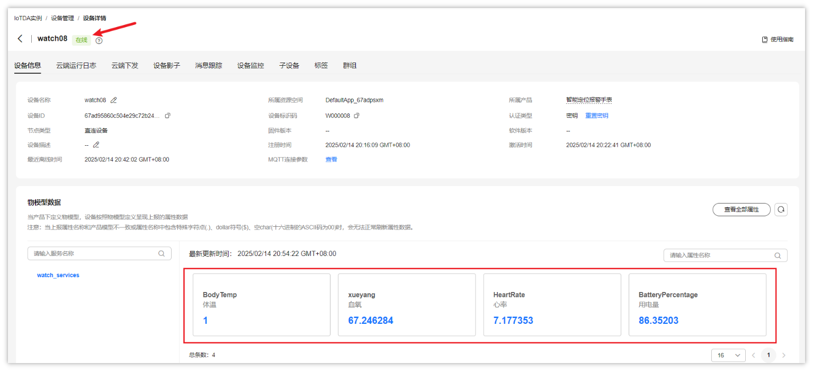

## 7.产品设备数据准备

下面两款产品在后面还会使用到，大家需要自行创建

1.产品名称：烟雾报警器    smoke\_detector

| **属性名称**      | **属性描述** | **数据类型** | **访问权限** | **取值范围**                 |
| ----------------- | ------------ | ------------ | ------------ | ---------------------------- |
| CurrentHumidity   | 湿度         | int          | 读写         | 0~100                        |
| IndoorTemperature | 温度         | int          | 读写         | -40~80                       |
| SmokeSensorState  | 烟雾监测状态 | bool(布尔)   | 读写         | 布尔值：0：正常1：检测到烟雾 |

2.产品名称：睡眠监测带  sleep_monitor_band

|属性名称|属性描述|数据类型|访问权限|取值范围|
|---|---|---|---|---|
|BedTime|离床时间|dateTime\(日期时间\)|读写|300|
|BedExitCount|离床次数|int|读写|0\~10|
|SleepPhaseState|睡眠状态|int|读写|0\~2|
|HeartRate|心率|int|读写|1\~200|
|RespiratoryRate|呼吸率|int|读写|1\~150|

# 三、设备管理

我们熟悉了IOT平台的基本概念以及基本操作后，可以现在来分析后台系统的功能需求，在后台管理系统中，是需要自己维护设备，不需要创建产品，因为产品直接物联网平台创建添加即可

需要单独维护设备的原因是，设备需要跟养老院的老人或者位置进行绑定，才能做到精准的监控

比如：

- 烟雾报警器需要绑定到某个房间

- 智能手表需要绑定某个老人

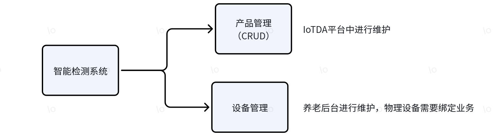

## 1.需求分析

### 1.1.设备管理列表页

找到智能监测\-\>设备管理

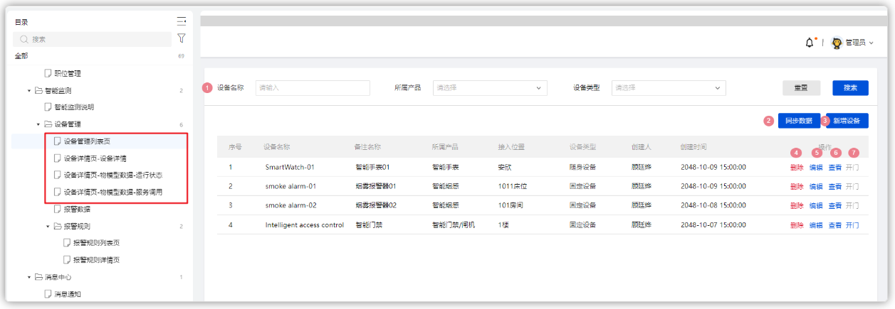

搜索：可以根据设备名称模块插叙，根据产品和设备类型精确查询

- 所属产品=【Iot平台\-产品管理\-产品名称】

- 设备类型=随身设备、固定设备；

同步数据：点击【同步数据】后，获取华为云产品数据

新增设备：

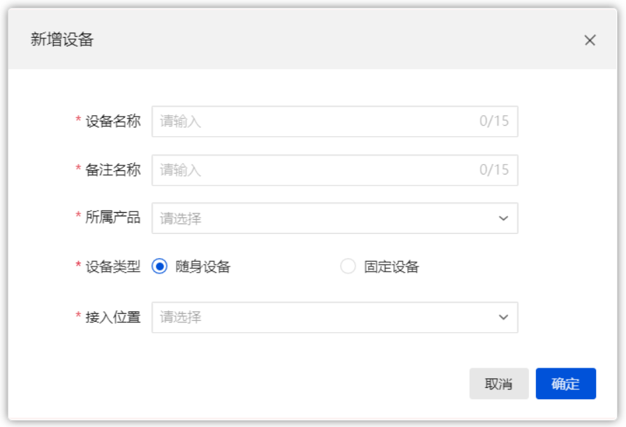

随身设备：表示绑定在老人身上的设备，如手表；

固定设备：表示绑定在固定位置的设备，如睡眠监测带、门磁、摄像头；

接入位置为随身设备=入退管理->入住管理->入住办理->老人姓名->当前已入住的老人；

接入位置为固定设备=楼层、房间、床位 = 在住管理->床位管理->床位房型；

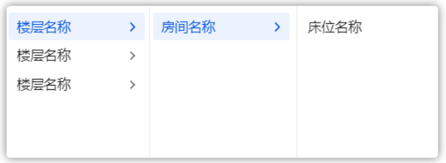

删除：该条设备从列表中移除。老人与设备自动解绑

编辑：先查看该条设备，然后再修改设备数据

查看：跳转到设备详情页

### 1.2.设备详情

当在列表点击查看按钮之后，可以查看设备详情页，如下效果

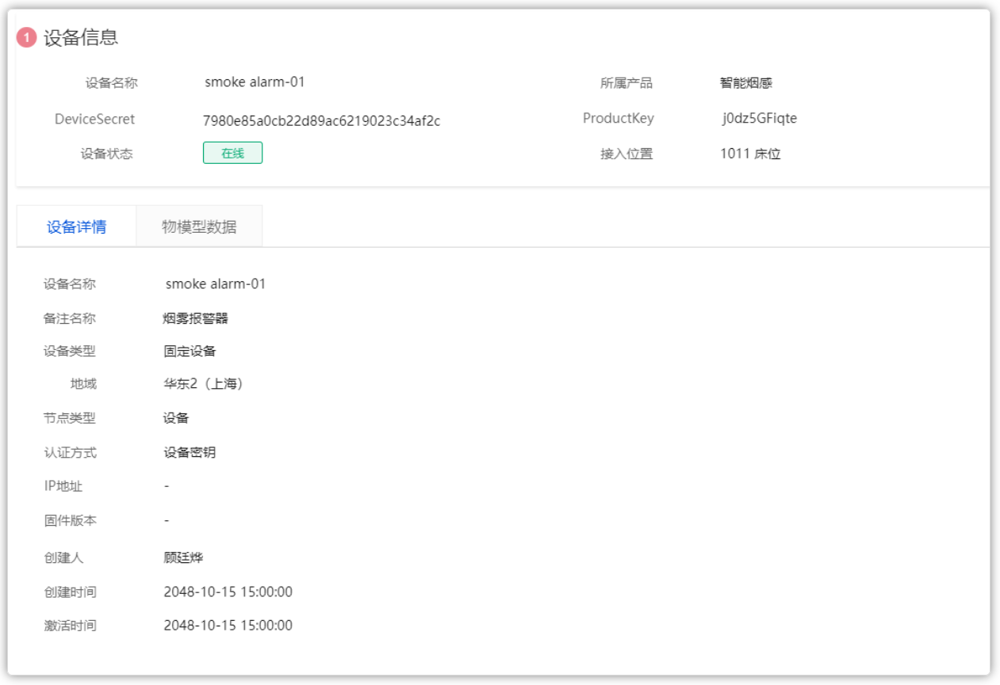

### 1.3.物模型数据\-运行状态

点击【物模型数据】，查询物模型运行状态，列表中的数据为上行指令数据；

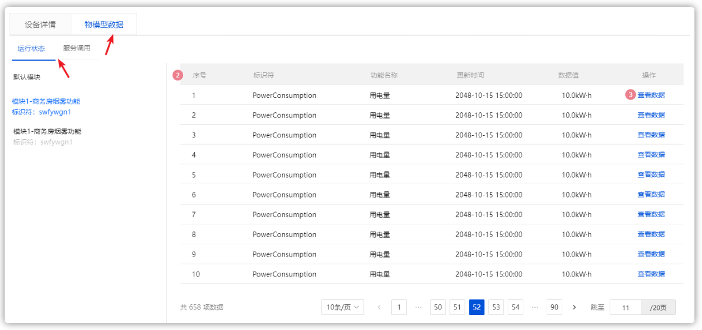

当点击了【查看数据】，出【查看数据】弹窗；

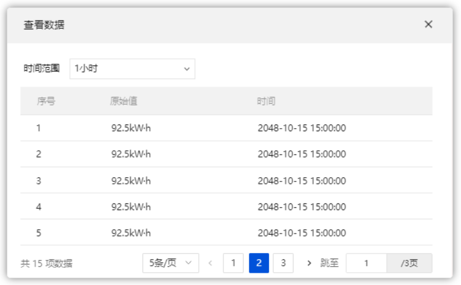

### 1.4.物模型数据\-服务调用

点击【物模型数据】，查询物模型服务调用

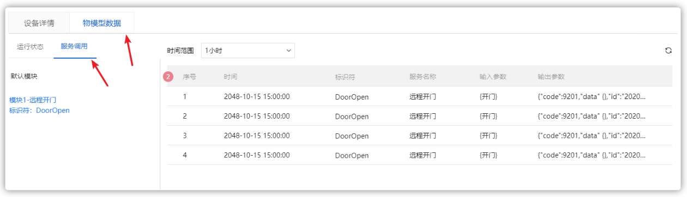

列表中的数据为下行指令数据；

时间范围=1小时、24小时、7天

## 2.表结构说明

因为在本地需要维护设备数据，所以需要在本地创建设备表，数据也要存储，也需要创建设备数据表，如下：

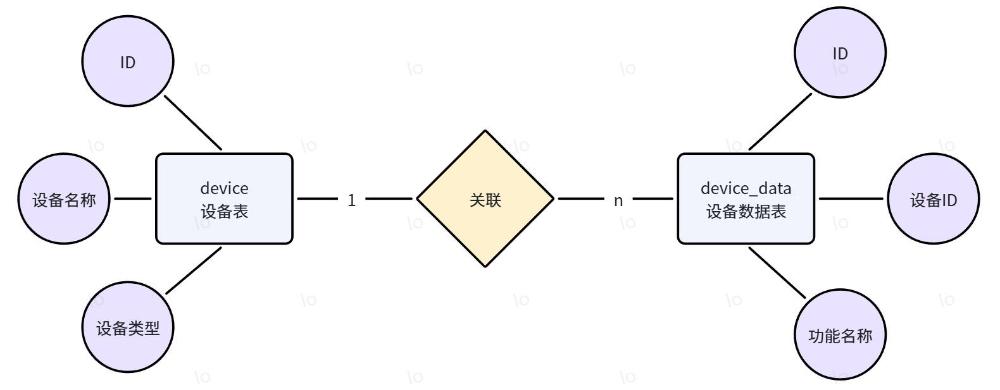

详细表字段说明：

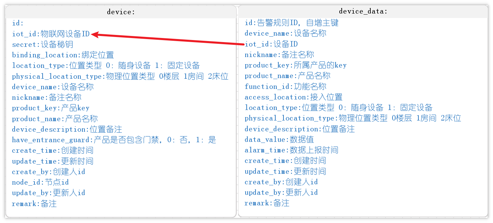

sql脚本（里面包含了智能检测模块的所有需要的表）：

```sql
####################
##  device
####################
DROP TABLE IF EXISTS `device`;

####################
##  table device ddl
####################
CREATE TABLE `device` (
  `id` bigint NOT NULL AUTO_INCREMENT,
  `iot_id` varchar(50) CHARACTER SET utf8mb4 COLLATE utf8mb4_unicode_ci DEFAULT NULL COMMENT '物联网设备ID',
  `secret` varchar(64) COLLATE utf8mb4_unicode_ci DEFAULT NULL COMMENT '设备秘钥',
  `binding_location` varchar(50) CHARACTER SET utf8mb4 COLLATE utf8mb4_unicode_ci DEFAULT NULL COMMENT '绑定位置',
  `location_type` int DEFAULT NULL COMMENT '位置类型 0：随身设备 1：固定设备',
  `physical_location_type` int DEFAULT NULL COMMENT '物理位置类型 0楼层 1房间 2床位',
  `device_name` varchar(100) CHARACTER SET utf8mb4 COLLATE utf8mb4_unicode_ci DEFAULT NULL COMMENT '设备名称',
  `product_key` varchar(100) CHARACTER SET utf8mb4 COLLATE utf8mb4_unicode_ci DEFAULT NULL COMMENT '产品key',
  `product_name` varchar(100) CHARACTER SET utf8mb4 COLLATE utf8mb4_unicode_ci DEFAULT NULL COMMENT '产品名称',
  `device_description` varchar(255) CHARACTER SET utf8mb4 COLLATE utf8mb4_unicode_ci DEFAULT NULL COMMENT '位置备注',
  `have_entrance_guard` int NOT NULL DEFAULT '0' COMMENT '产品是否包含门禁，0：否，1：是',
  `create_time` datetime DEFAULT NULL COMMENT '创建时间',
  `update_time` datetime DEFAULT NULL COMMENT '更新时间',
  `create_by` bigint DEFAULT NULL COMMENT '创建人id',
  `node_id` varchar(50) COLLATE utf8mb4_unicode_ci DEFAULT NULL COMMENT '节点id',
  `update_by` bigint DEFAULT NULL COMMENT '更新人id',
  `remark` varchar(255) CHARACTER SET utf8mb4 COLLATE utf8mb4_0900_ai_ci DEFAULT NULL COMMENT '备注',
  PRIMARY KEY (`id`) USING BTREE,
  UNIQUE KEY `binding_location_location_type_physical_location_type_product_id` (`binding_location`,`location_type`,`physical_location_type`,`product_key`) USING BTREE,
  KEY `device_id` (`iot_id`) USING BTREE
) ENGINE=InnoDB AUTO_INCREMENT=30 DEFAULT CHARSET=utf8mb4 COLLATE=utf8mb4_unicode_ci ROW_FORMAT=DYNAMIC;

####################
##  device_data
####################
DROP TABLE IF EXISTS `device_data`;

####################
##  table device_data ddl
####################
CREATE TABLE `device_data` (
  `id` bigint NOT NULL AUTO_INCREMENT COMMENT '告警规则ID，自增主键',
  `device_name` varchar(255) CHARACTER SET utf8mb4 COLLATE utf8mb4_unicode_ci DEFAULT NULL COMMENT '设备名称',
  `iot_id` varchar(255) CHARACTER SET utf8mb4 COLLATE utf8mb4_unicode_ci DEFAULT NULL COMMENT '设备ID',
  `product_key` varchar(500) CHARACTER SET utf8mb4 COLLATE utf8mb4_unicode_ci DEFAULT NULL COMMENT '所属产品的key',
  `product_name` varchar(500) CHARACTER SET utf8mb4 COLLATE utf8mb4_unicode_ci DEFAULT NULL COMMENT '产品名称',
  `function_id` varchar(255) CHARACTER SET utf8mb4 COLLATE utf8mb4_unicode_ci DEFAULT NULL COMMENT '功能名称',
  `access_location` varchar(255) CHARACTER SET utf8mb4 COLLATE utf8mb4_unicode_ci DEFAULT NULL COMMENT '接入位置',
  `location_type` int DEFAULT NULL COMMENT '位置类型 0：随身设备 1：固定设备',
  `physical_location_type` int DEFAULT NULL COMMENT '物理位置类型 0楼层 1房间 2床位',
  `device_description` varchar(255) CHARACTER SET utf8mb4 COLLATE utf8mb4_unicode_ci DEFAULT NULL COMMENT '位置备注',
  `data_value` varchar(50) CHARACTER SET utf8mb4 COLLATE utf8mb4_unicode_ci DEFAULT NULL COMMENT '数据值',
  `alarm_time` datetime DEFAULT NULL COMMENT '数据上报时间',
  `create_time` datetime NOT NULL COMMENT '创建时间',
  `update_time` datetime DEFAULT NULL COMMENT '更新时间',
  `create_by` bigint DEFAULT NULL COMMENT '创建人id',
  `update_by` bigint DEFAULT NULL COMMENT '更新人id',
  `remark` varchar(255) CHARACTER SET utf8mb4 COLLATE utf8mb4_0900_ai_ci DEFAULT NULL COMMENT '备注',
  PRIMARY KEY (`id`) USING BTREE,
  KEY `idx_iot_id_product_key` (`iot_id`,`product_key`)
) ENGINE=InnoDB AUTO_INCREMENT=22950 DEFAULT CHARSET=utf8mb4 COLLATE=utf8mb4_unicode_ci ROW_FORMAT=DYNAMIC;

####################
##  alert_rule
####################
DROP TABLE IF EXISTS `alert_rule`;

####################
##  table alert_rule ddl
####################
CREATE TABLE `alert_rule` (
  `id` bigint NOT NULL AUTO_INCREMENT,
  `product_key` varchar(50) CHARACTER SET utf8mb4 COLLATE utf8mb4_unicode_ci DEFAULT NULL COMMENT '所属产品的key',
  `product_name` varchar(500) CHARACTER SET utf8mb4 COLLATE utf8mb4_unicode_ci DEFAULT NULL COMMENT '产品名称',
  `module_id` varchar(50) CHARACTER SET utf8mb4 COLLATE utf8mb4_unicode_ci DEFAULT NULL COMMENT '模块的key',
  `module_name` varchar(500) CHARACTER SET utf8mb4 COLLATE utf8mb4_unicode_ci DEFAULT NULL COMMENT '模块名称',
  `function_name` varchar(255) CHARACTER SET utf8mb4 COLLATE utf8mb4_unicode_ci DEFAULT NULL COMMENT '功能名称',
  `function_id` varchar(255) CHARACTER SET utf8mb4 COLLATE utf8mb4_unicode_ci DEFAULT NULL COMMENT '功能标识',
  `iot_id` varchar(255) CHARACTER SET utf8mb4 COLLATE utf8mb4_unicode_ci DEFAULT NULL COMMENT '物联网设备id',
  `device_name` varchar(255) CHARACTER SET utf8mb4 COLLATE utf8mb4_unicode_ci DEFAULT NULL COMMENT '设备名称',
  `alert_data_type` int DEFAULT NULL COMMENT '报警数据类型，0：老人异常数据，1：设备异常数据',
  `alert_rule_name` varchar(255) CHARACTER SET utf8mb4 COLLATE utf8mb4_unicode_ci DEFAULT NULL COMMENT '告警规则名称',
  `operator` varchar(255) CHARACTER SET utf8mb4 COLLATE utf8mb4_unicode_ci DEFAULT NULL COMMENT '运算符',
  `value` float DEFAULT NULL COMMENT '阈值',
  `duration` int DEFAULT NULL COMMENT '持续周期',
  `alert_effective_period` varchar(255) CHARACTER SET utf8mb4 COLLATE utf8mb4_unicode_ci DEFAULT NULL COMMENT '报警生效时段',
  `alert_silent_period` int DEFAULT NULL COMMENT '报警沉默周期',
  `status` int DEFAULT NULL COMMENT '0 禁用 1启用',
  `create_time` datetime NOT NULL COMMENT '创建时间',
  `update_time` datetime DEFAULT NULL COMMENT '更新时间',
  `create_by` bigint DEFAULT NULL COMMENT '创建人id',
  `update_by` bigint DEFAULT NULL COMMENT '更新人id',
  `remark` varchar(255) CHARACTER SET utf8mb4 COLLATE utf8mb4_0900_ai_ci DEFAULT NULL COMMENT '备注',
  PRIMARY KEY (`id`) USING BTREE
) ENGINE=InnoDB AUTO_INCREMENT=60 DEFAULT CHARSET=utf8mb4 COLLATE=utf8mb4_unicode_ci ROW_FORMAT=DYNAMIC;

####################
##  alert_data
####################
DROP TABLE IF EXISTS `alert_data`;

####################
##  table alert_data ddl
####################
CREATE TABLE `alert_data` (
  `id` bigint NOT NULL AUTO_INCREMENT COMMENT '主键',
  `iot_id` varchar(50) CHARACTER SET utf8mb4 COLLATE utf8mb4_general_ci NOT NULL COMMENT '物联网设备id',
  `device_name` varchar(50) CHARACTER SET utf8mb4 COLLATE utf8mb4_general_ci DEFAULT NULL COMMENT '设备名称',
  `product_key` varchar(50) CHARACTER SET utf8mb4 COLLATE utf8mb4_general_ci NOT NULL COMMENT '所属产品key',
  `product_name` varchar(50) CHARACTER SET utf8mb4 COLLATE utf8mb4_general_ci DEFAULT NULL COMMENT '产品名称',
  `function_id` varchar(50) CHARACTER SET utf8mb4 COLLATE utf8mb4_general_ci NOT NULL COMMENT '功能标识符',
  `access_location` varchar(100) CHARACTER SET utf8mb4 COLLATE utf8mb4_general_ci DEFAULT NULL COMMENT '接入位置',
  `location_type` int DEFAULT NULL COMMENT '位置类型 0：随身设备 1：固定设备',
  `physical_location_type` int DEFAULT NULL COMMENT '物理位置类型 0楼层 1房间 2床位',
  `device_description` varchar(50) CHARACTER SET utf8mb4 COLLATE utf8mb4_general_ci DEFAULT NULL COMMENT '位置备注',
  `data_value` varchar(100) CHARACTER SET utf8mb4 COLLATE utf8mb4_general_ci NOT NULL COMMENT '数据值',
  `alert_rule_id` bigint NOT NULL COMMENT '报警规则id',
  `alert_reason` varchar(500) CHARACTER SET utf8mb4 COLLATE utf8mb4_general_ci NOT NULL COMMENT '报警原因，格式：功能名称+运算符+阈值+持续周期+聚合周期',
  `processing_result` varchar(500) CHARACTER SET utf8mb4 COLLATE utf8mb4_general_ci DEFAULT NULL COMMENT '处理结果',
  `processor_id` bigint DEFAULT NULL COMMENT '处理人id',
  `processor_name` varchar(50) CHARACTER SET utf8mb4 COLLATE utf8mb4_general_ci DEFAULT NULL COMMENT '处理人名称',
  `processing_time` datetime DEFAULT NULL COMMENT '处理时间',
  `type` int NOT NULL COMMENT '报警数据类型，0：老人异常数据，1：设备异常数据',
  `status` int NOT NULL COMMENT '状态，0：待处理，1：已处理',
  `user_id` bigint DEFAULT '0' COMMENT '接收人id',
  `create_time` datetime NOT NULL DEFAULT CURRENT_TIMESTAMP COMMENT '创建时间',
  `update_time` datetime NOT NULL DEFAULT CURRENT_TIMESTAMP ON UPDATE CURRENT_TIMESTAMP COMMENT '更新时间',
  `create_by` bigint DEFAULT NULL COMMENT '创建人id',
  `update_by` bigint DEFAULT NULL COMMENT '更新人id',
  `remark` varchar(200) CHARACTER SET utf8mb4 COLLATE utf8mb4_general_ci DEFAULT NULL COMMENT '备注',
  PRIMARY KEY (`id`) USING BTREE
) ENGINE=InnoDB AUTO_INCREMENT=3 DEFAULT CHARSET=utf8mb4 COLLATE=utf8mb4_general_ci ROW_FORMAT=DYNAMIC COMMENT='报警数据';
```

## 3.接口分析

### 3.1.接口列表

依据我们刚才的需求分析，在养老系统中需要维护设备数据，我们需要开发以下接口

- 从物联网平台同步产品列表  \(关联iot接口\)

- 查询所有产品列表

- 注册设备    \(关联iot接口\)

- 分页查询设备列表   

- 查询设备详细数据     \(关联iot接口\)

- 查看设备上报的数据    \(关联iot接口\)

- 修改设备备注名称   \(关联iot接口\)

- 删除设备   \(关联iot接口\)

- 分页查询设备服务调用数据（暂不开发，后期接收到数据之后再完成）

### 3.2.接口文档

接口文档参考：[附录-接口文档](https://lining-lo.github.io/lining-lo-notes/星海智伴/附录-接口文档.html#四iot智能检测)

接口文档中的设备管理部分

## 4.IOT接口对接

我们刚才分析了功能中涉及到的接口，其中关于设备的维护（新增、删除、修改、查询），我们都需要在IOT平台中去操作，同时也需要在本地去保存一份，那为什么要保存两份呢？

IOT平台中只是维护了基础的设备信息，并没有跟业务数据进行绑定，比如，设备属于哪个位置，绑定了哪个老人。

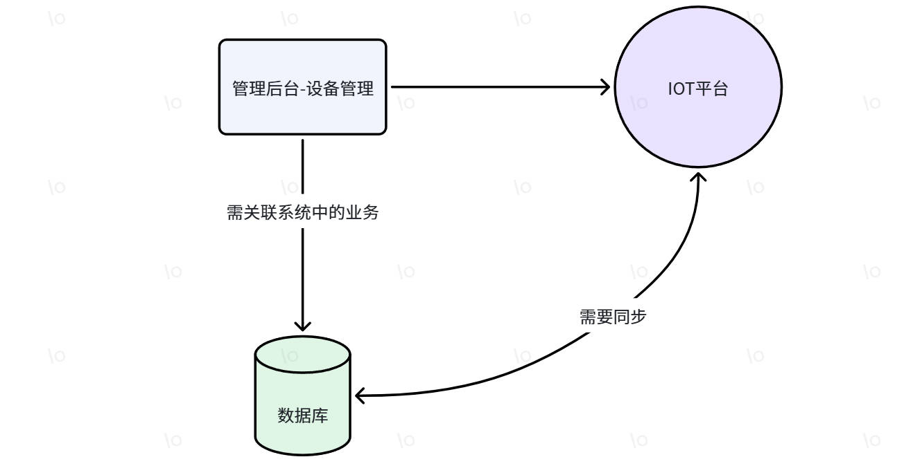

只有设备绑定了业务数据，后期采集数据之后，我们才能针对性的进行排查问题。

所以，在接口的开发中，我们需要调用远程的接口维护设备，同时也需要在本地进行数据操作。关于远程接口，IOT平台给提供了丰富的API，利于我们去操作。

### 4.1.API列表

先查阅IOT官方提供API列表：[API列表](https://support.huaweicloud.com/api-iothub/iot_06_v5_0200.html)

目前业务中所需要的接口文档如下：

1.产品管理的API

- [查询产品列表](https://support.huaweicloud.com/api-iothub/iot_06_v5_0080.html)

2.设备管理的API

- [创建设备](https://support.huaweicloud.com/api-iothub/iot_06_v5_0046.html)

- [查询设备详情](https://support.huaweicloud.com/api-iothub/iot_06_v5_0055.html)

- [删除设备](https://support.huaweicloud.com/api-iothub/iot_06_v5_0041.html)

- [修改设备](https://support.huaweicloud.com/api-iothub/iot_06_v5_1079.html)

3.设备属性

- [查询设备属性](https://support.huaweicloud.com/api-iothub/iot_06_v5_0035.html)

### 4.2.环境集成

IOT平台目前已经给提供了完整的SDK，我们可以快速集成到项目进行接口的调用，集成方式：[官方说明](https://support.huaweicloud.com/sdkreference-iothub/iot_10_10002.html)

在xhzb\-framework模块导入坐标\(代码\)

```XML
<dependency>
    <groupId>com.huaweicloud.sdk</groupId>
    <artifactId>huaweicloud-sdk-core</artifactId>
    <version>3.1.76</version>
</dependency>
<dependency>
    <groupId>com.huaweicloud.sdk</groupId>
    <artifactId>huaweicloud-sdk-iotda</artifactId>
    <version>3.1.76</version>
</dependency>
```

在xhzb\-admin模块中的application\-dev\.yml文件中添加关于IOT的配置如下：

```YAML
huaweicloud:
  ak: HPUAYUALM5RM9DZUY4HJ
  sk: TxmD5WAsGK2wC2RXnJG4xBVgFppLMjL3EcjZBdu6
  #如果是上海一，请填写"cn-east-3"；如果是北京四，请填写"cn-north-4";
  regionId: cn-north-4
  endpoint: 040b2c6816.st1.iotda-app.cn-north-4.myhuaweicloud.com
  projectId: e0e00d8fd98e4754b77104f5e878a27e
  #amqp相关配置 接收设备数据使用
  host: 040b2c6816.st1.iotda-app.cn-north-4.myhuaweicloud.com
  accessKey: 6z950jhi
  accessCode: tvLoiWd8DzddMxDkpACs7f6gr3ZwfGvm
  queueName: DefaultQueue   #默认无需改动
```

ak和sk是华为云身份凭证，需要新增一个访问密钥，操作如下：

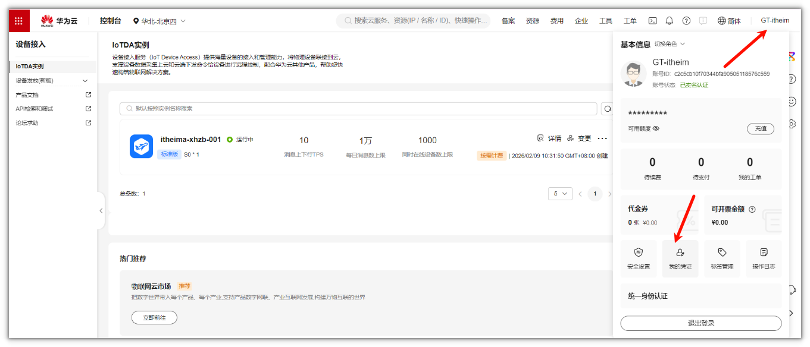

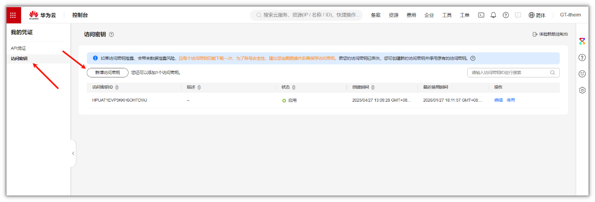

> 需要手机验证码
> 

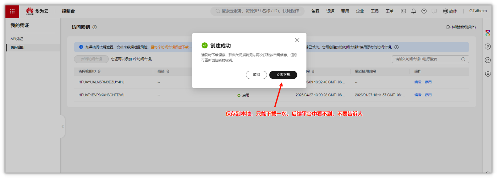

endpoint  请在控制台的"总览"界面的"平台接入地址"中查看“应用侧”的https接入地址。

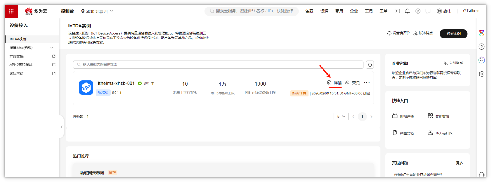

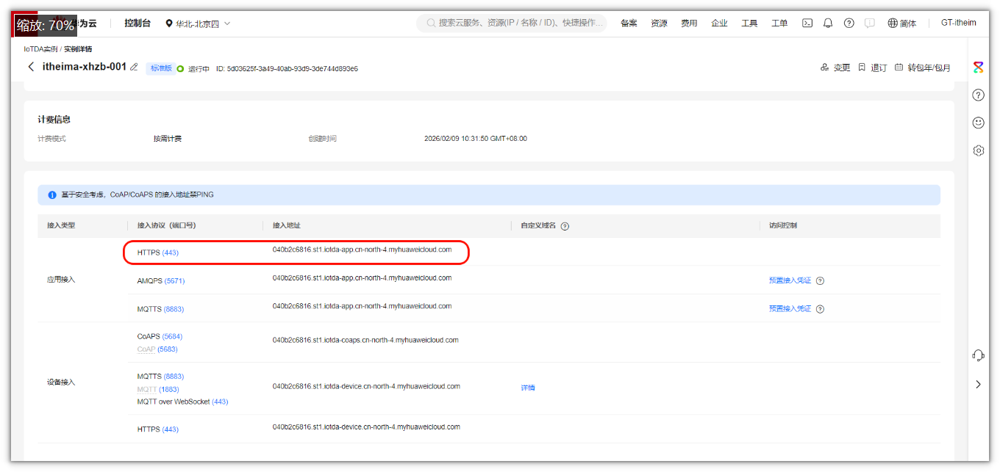

projectId项目ID，[获取项目ID](https://support.huaweicloud.com/api-iothub/iot_06_v5_1001.html)

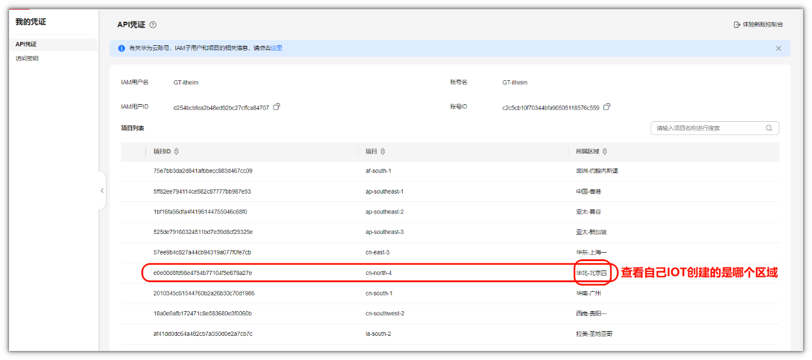

host是AMQP访问的地址，获取方式如下：

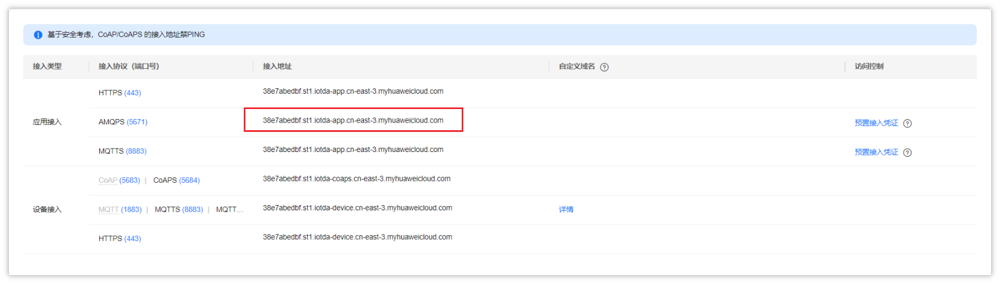

accessKey和accessCode从预置接入凭证获取

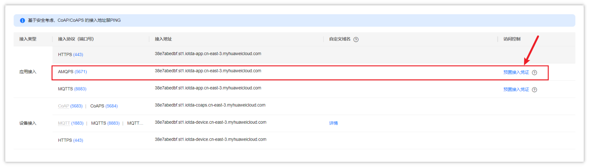

在xhzb\-framework中新增HuaWeiIotConfigProperties 来读取配置文件

```Java
package com.xhzb.framework.config.properties;

import lombok.Data;
import lombok.NoArgsConstructor;
import org.springframework.boot.context.properties.ConfigurationProperties;
import org.springframework.context.annotation.Configuration;

import java.util.Map;

/**
 * @author ruoyi
 */

@Data
@NoArgsConstructor
@Configuration
@ConfigurationProperties(prefix = "huaweicloud")
public class HuaWeiIotConfigProperties {

    /**
     * 访问Key
     */
    private String ak;

    /**
     * 访问秘钥
     */
    private String sk;

    /**
     * 区域id
     */
    private String regionId;

    /**
     * 应用侧https接入地址
     */
    private String endpoint;

    /**
     * 项目id
     */
    private String projectId;

    /**
     * 应用侧amqp接入地址
     */
    private String host;

    /**
     * amqp连接端口
     */
    private int port = 5671;

    /**
     * amqp接入凭证键值
     */
    private String accessKey;

    /**
     * amqp接入凭证密钥
     */
    private String accessCode;

    // 指定单个进程启动的连接数
    // 单个连接消费速率有限，请参考使用限制，最大64个连接
    // 连接数和消费速率及rebalance相关，建议每500QPS增加一个连接
    //可根据实际情况自由调节，目前测试和正式环境资源有限，限制更改为4
    private int connectionCount = 4;

    /**
     * 队列名称
     */
    private String queueName;

    /**
     * 开门命令所属服务id
     */
    private String smartDoorServiceId;

    /**
     * 开门记录属性
     */
    private String doorOpenPropertyName;

    /**
     * 开门命令
     */
    private String doorOpenCommandName;

    /**
     * 设置临时密码命令
     */
    private String passwordSetCommandName;

    /**
     * 仅支持true
     */
    private boolean useSsl = true;

    /**
     * IoTDA仅支持default
     */
    private String vhost = "default";

    /**
     * IoTDA仅支持PLAIN
     */
    private String saslMechanisms = "PLAIN";

    /**
     * true: SDK自动ACK（默认）
     * false:收到消息后，需要手动调用message.acknowledge()
     */
    private boolean isAutoAcknowledge = true;

    /**
     * 重连时延（ms）
     */
    private long reconnectDelay = 3000L;

    /**
     * 最大重连时延（ms）,随着重连次数增加重连时延逐渐增加
     */
    private long maxReconnectDelay = 30 * 1000L;

    /**
     * 最大重连次数,默认值-1，代表没有限制
     */
    private long maxReconnectAttempts = -1;

    /**
     * 空闲超时，对端在这个时间段内没有发送AMQP帧则会导致连接断开。默认值为30000。单位：毫秒。
     */
    private long idleTimeout = 30 * 1000L;

    /**
     * The values below control how many messages the remote peer can send to the client and be held in a pre-fetch buffer for each consumer instance.
     */
    private int queuePrefetch = 1000;

    /**
     * 扩展参数
     */
    private Map<String, String> extendedOptions;
}
```

在xhzb\-framework中添加如下配置：

```Java
package com.xhzb.framework.config;

import com.huaweicloud.sdk.core.auth.BasicCredentials;
import com.huaweicloud.sdk.core.auth.ICredential;
import com.huaweicloud.sdk.core.region.Region;
import com.huaweicloud.sdk.iotda.v5.IoTDAClient;
import com.xhzb.framework.config.properties.HuaWeiIotConfigProperties;
import org.springframework.beans.factory.annotation.Autowired;
import org.springframework.context.annotation.Bean;
import org.springframework.context.annotation.Configuration;

@Configuration
public class IotClientConfig {

    @Autowired
    private HuaWeiIotConfigProperties huaWeiIotConfigProperties;

    @Bean
    public IoTDAClient huaWeiIotInstance() {
        ICredential auth = new BasicCredentials()
                .withAk(huaWeiIotConfigProperties.getAk())
                .withSk(huaWeiIotConfigProperties.getSk())
                // 标准版/企业版需要使用衍生算法，基础版请删除配置"withDerivedPredicate"
                .withDerivedPredicate(BasicCredentials.DEFAULT_DERIVED_PREDICATE)
                .withProjectId(huaWeiIotConfigProperties.getProjectId());

        return IoTDAClient.newBuilder()
                .withCredential(auth)
                // 标准版/企业版：需自行创建Region对象，基础版：请使用IoTDARegion的region对象，如"withRegion(IoTDARegion.CN_NORTH_4)"
                .withRegion(new Region(huaWeiIotConfigProperties.getRegionId(), huaWeiIotConfigProperties.getEndpoint()))
                // .withRegion(IoTDARegion.CN_NORTH_4)
                .build();
    }
}
```

测试，在xhzb\-admin模块下创建单元测试，查询产品列表，[接口说明](https://support.huaweicloud.com/api-iothub/iot_06_v5_0080.html)

详细代码如下：

```Java
package com.xhzb.test;

import com.huaweicloud.sdk.iotda.v5.IoTDAClient;
import com.huaweicloud.sdk.iotda.v5.model.ListProductsRequest;
import com.huaweicloud.sdk.iotda.v5.model.ListProductsResponse;
import com.huaweicloud.sdk.iotda.v5.model.ProductSummary;
import org.junit.jupiter.api.Test;
import org.springframework.beans.factory.annotation.Autowired;
import org.springframework.boot.test.context.SpringBootTest;

import java.util.List;

@SpringBootTest
public class IoTDeviceTest {


    @Autowired
    private IoTDAClient client;
    
    /**
     * 查询公共实例下的所有产品
     * @throws Exception
     */
    @Test
    public void selectProduceList() throws Exception {

        ListProductsRequest listProductsRequest = new ListProductsRequest();
        listProductsRequest.setLimit(50);
        ListProductsResponse response = client.listProducts(listProductsRequest);
        List<ProductSummary> products = response.getProducts();
        System.out.println(products);
    }
    
}
```

测试结果如下

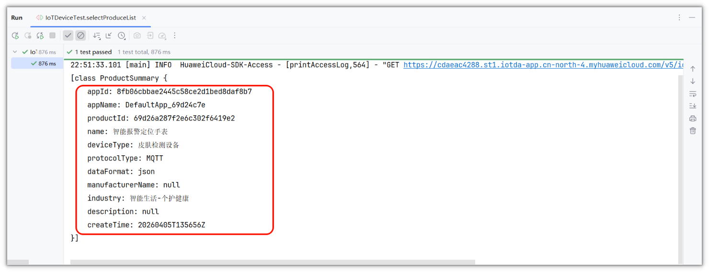

## 5.功能实现

### 5.1.基础代码准备

按照之前的套路，我们使用代码生成的功能，来生成device设备管理的代码

- 包名:`com.xhzb.nursing`

- 模块名：`nursing`

- 除了主键之外的Long类型，改为Integer

只拷贝后端代码到idea中

同时删除DeviceController中除了list方法之外的其他方法，如下代码

```Java
package com.xhzb.nursing.controller;

import com.xhzb.common.core.controller.BaseController;
import com.xhzb.common.core.page.TableDataInfo;
import com.xhzb.nursing.domain.Device;
import com.xhzb.nursing.service.IDeviceService;
import io.swagger.v3.oas.annotations.Operation;
import io.swagger.v3.oas.annotations.tags.Tag;
import org.springframework.beans.factory.annotation.Autowired;
import org.springframework.security.access.prepost.PreAuthorize;
import org.springframework.web.bind.annotation.GetMapping;
import org.springframework.web.bind.annotation.RequestMapping;
import org.springframework.web.bind.annotation.RestController;

import java.util.List;

/**
 * 设备Controller
 * 
 * @author ruoyi
 * @date 2026-04-05
 */
@RestController
@RequestMapping("/nursing/device")
@Tag(name = "设备相关接口")
public class DeviceController extends BaseController
{
    @Autowired
    private IDeviceService deviceService;

    /**
     * 查询设备列表
     */
    @GetMapping("/list")
    @Operation(summary = "查询设备列表")
    public TableDataInfo list(Device device)
    {
        startPage();
        List<Device> list = deviceService.selectDeviceList(device);
        return getDataTable(list);
    }
}
```

### 5.2.从物联网平台同步产品列表

**思路分析**

我们先来完成前四个接口，分别是：从物联网平台同步产品列表、查询所有产品列表、注册设备、分页查询设备列表，这四个接口都与产品有关系

- 物联网中的产品是由在物理网平台进行维护，设备是养老项目后台管理并同步到物联网平台

- 其中注册设备、分页查询设备列表都需要用到产品数据

由于以上两条原因，我们需要先让物联网平台的产品数据同步到后台，然后再被注册设备、分页查询设备列表这两个接口所引用

以下就是物联网产品与养老后台同步的思路

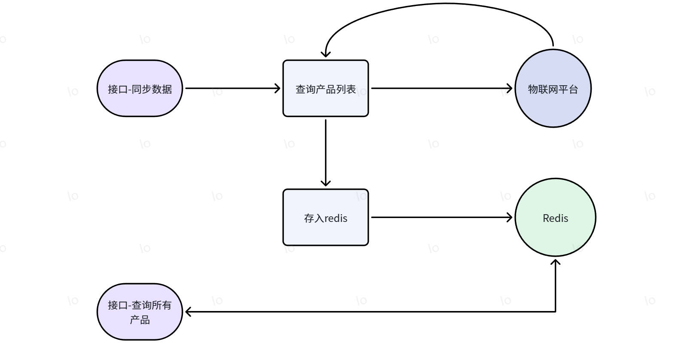

**接口定义**

在DeviceController定义同步的方法，详细如下：

```java
@PostMapping("/syncProductList")
@Operation(summary = "从物联网平台同步产品列表")
public AjaxResult syncProductList() {
    deviceService.syncProductList();
    return success();
}
```

**业务层**

在IDeviceService类中定义同步的方法，如下：

```Java
/**
 * 从物联网平台同步产品列表
 */
void syncProductList();
```

实现类的方法：

```Java
@Autowired
private RedisTemplate<String,String> redisTemplate;

@Autowired
private IoTDAClient client;

/**
 * 同步产品列表
 */
@Override
public void syncProductList() {
    //请求参数
    ListProductsRequest listProductsRequest = new ListProductsRequest();
    
    //发起请求
    ListProductsResponse response = client.listProducts(listProductsRequest);
    if(response.getHttpStatusCode() != 200){
        throw new BaseException("物联网接口 - 查询产品，同步失败");
    }
    //存储到redis
    redisTemplate.opsForValue().set(CacheConstants.IOT_ALL_PRODUCT_LIST, JSONUtil.toJsonStr(response.getProducts()));

}
```

> 其中的缓存常量，可以自己定义
> 
> public static final String IOT\_ALL\_PRODUCT\_LIST= "iot:all\_product\_list";
> 

**测试**

点击了【同步数据】按钮之后，可以查看redis客户端，是否保存数据成功

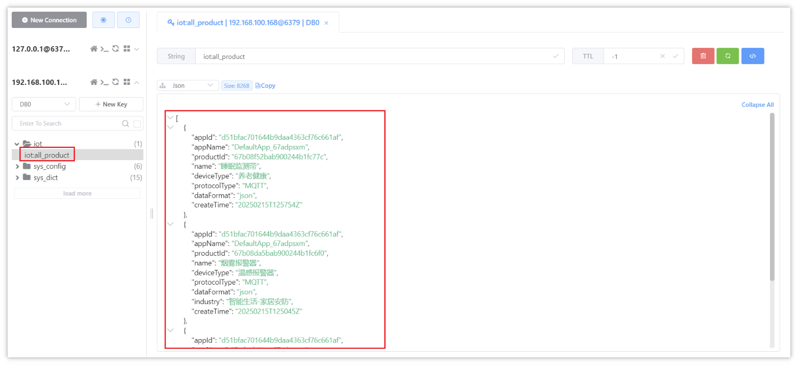

### 5.3.查询所有产品列表

**思路分析**

依据上一个接口，一旦redis中被同步了产品数据，我们只需要从redis中获取数据返回即可

**接口定义**

在DeviceController中新增方法，如下：

```Java
@GetMapping("/allProduct")
@Operation(summary = "查询所有产品列表")
public AjaxResult allProduct() {
    return success(deviceService.allProduct());
}
```

**业务层**

在DeviceService中新增方法如下：

```Java
/**
 * 查询所有产品列表
 *
 * @return 产品列表
 */
List<ProductVo> allProduct();
```

ProductVo 

```Java
package com.xhzb.nursing.domain.vo;

import io.swagger.v3.oas.annotations.media.Schema;
import lombok.Data;

/**
 * 产品信息响应模型
 *
 * @author ruoyi
 **/
@Data
@Schema(description = "产品信息响应模型")
public class ProductVo {
    /**
     * 产品的ProductKey,物联网平台产品唯一标识
     */
    @Schema(title = "产品的ProductKey,物联网平台产品唯一标识")
    private String productId;

    /**
     * 产品名称
     */
    @Schema(title = "产品名称")
    private String name;
}
```

实现方法：

```Java
/**
 * 查询所有产品列表
 *
 * @return
 */
@Override
public List<ProductVo> allProduct() {
    //从redis中查询数据
    String jsonStr = redisTemplate.opsForValue().get(CacheConstants.IOT_ALL_PRODUCT_LIST);
    //如果数据为空，则返回一个空集合
    if(StringUtils.isEmpty(jsonStr)){
        return Collections.emptyList();
    }
    //解析数据，并返回
    return JSONUtil.toList(jsonStr, ProductVo.class);
}
```

**测试**

在前端页面中的所属产品中可以正常查看同步之后的产品列表数据

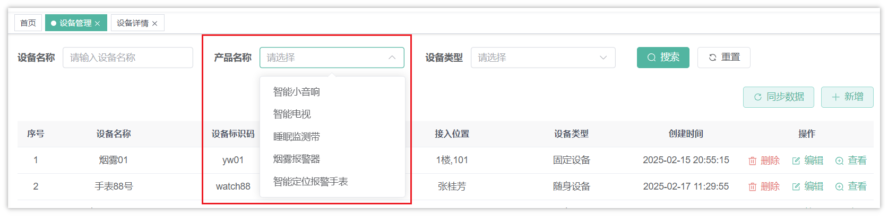

### 5.4.查询已经入住的老人列表

**需求说明**

当新增设备的时候，如果选择的的随身设备，则会弹窗选择已经入住的老人，如下图

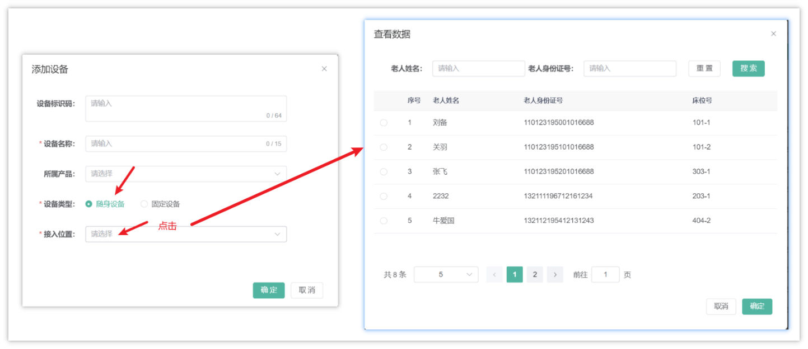

该接口已经在之前的代码生成中完成

### 5.5.注册设备

**思路分析**

整体思路如下：


**接口定义**

在DeviceController中新增方法，如下：

```Java
@PostMapping("/register")
@Operation(summary = "注册设备")
public AjaxResult registerDevice(@RequestBody DeviceDto deviceDto) {
    deviceService.registerDevice(deviceDto);
    return success();
}
```

基于接口文档，定义DeviceDto 如下代码，其中的RegisterDeviceRequest为物联网SDK提供

```Java
package com.xhzb.nursing.domain.dto;


import io.swagger.v3.oas.annotations.media.Schema;
import lombok.Data;

@Data
@Schema(description =  "设备注册参数")
public class DeviceDto {

    private Long id;

    /** 备注 */
    private String remark;

    /**
     * 设备标识码，通常使用IMEI、MAC地址或Serial No作为node_id
     */
    @Schema(title = "设备标识码")
    private String nodeId;

    @Schema(title = "设备id")
    public String iotId;

    @Schema(title = "产品的id")
    public String productKey;

    @Schema(title = "产品名称")
    private String productName;

    @Schema(title = "位置名称回显字段")
    private String deviceDescription;

    @Schema(title = "位置类型 0 老人 1位置")
    Integer locationType;

    @Schema(title = "绑定位置")
    Long bindingLocation;

    @Schema(title = "设备名称")
    String deviceName;

    @Schema(title = "物理位置类型 0楼层 1房间 2床位")
    Integer physicalLocationType;
}
```

**业务层**

在IDeviceService接口中新增方法，如下：

```Java
/**
 * 注册设备
 * @param deviceDto
 */
void registerDevice(DeviceDto deviceDto);
```

实现方法

```Java
/**
 * 注册设备
 * @param dto
 */
@Override
public void registerDevice(DeviceDto dto) {
    //判断设备名称是否存在
    Long count = this.lambdaQuery().eq(Device::getDeviceName, dto.getDeviceName()).count();
    if(count > 0){
        throw new BaseException("设备名称已存在，请重新输入");
    }

    //判断设备标识是否存在
    count = this.lambdaQuery().eq(Device::getNodeId, dto.getNodeId()).count();
    if(count > 0){
        throw new BaseException("设备标识码已存在，请重新输入");
    }

    //判断同一位置是否绑定了相同的产品
    count = this.lambdaQuery()
        .eq(Device::getBindingLocation, dto.getBindingLocation())
        .eq(Device::getLocationType, dto.getLocationType())
        .eq(Device::getProductKey, dto.getProductKey())
        .eq(Objects.nonNull(dto.getPhysicalLocationType()), Device::getPhysicalLocationType, dto.getPhysicalLocationType())
        .count();
    if(count > 0){
        throw new BaseException("该老人/位置已绑定该产品，请重新选择");
    }

    //注册设备--->IoT平台
    AddDeviceRequest request = new AddDeviceRequest();
    AddDevice body = new AddDevice();
    body.withProductId(dto.getProductKey());
    body.withDeviceName(dto.getDeviceName());
    body.withNodeId(dto.getNodeId());

    //秘钥设置
    AuthInfo authInfo = new AuthInfo();
    String secret = UUID.randomUUID().toString().replaceAll("-", "");
    authInfo.withSecret(secret);
    body.setAuthInfo(authInfo);
    request.setBody(body);

    AddDeviceResponse response;
    try {
        response = client.addDevice(request);
    } catch (Exception e) {
        e.printStackTrace();
        throw new BaseException("物联网接口 - 注册设备，调用失败");
    }
    //本地保存设备
    //属性拷贝
    Device device = BeanUtil.toBean(dto, Device.class);
    //秘钥
    device.setSecret(secret);
    //设备id、设备绑定状态
    device.setIotId(response.getDeviceId());
    save(device);
}
```

**测试**

在前端页面中查看是否可以保存设备成功，同时查看IoTDA平台中是否添加成功了


### 5.6.分页查询设备列表

该接口在生成的代码中已经实现

其中的搜索条件，需要在后台添加数据字典（已完成）


最终的效果：


### 5.7.查询设备详细数据

当点击了列表中的【查看】按钮，可以查看设备的详细数据

**思路分析**

这里的查询是有两部分数据的，第一个是数据库中存储的设备数据，第二个是物联网中的设备数据，查询流程如下


**接口定义**

在DeviceController中定义方法，如下：

```Java
/**
 * 获取设备详细信息
 */
@GetMapping("/{iotId}")
@Operation(summary = "获取设备详细信息")
public AjaxResult getInfo(@PathVariable("iotId") String iotId) {
    return success(deviceService.queryDeviceDetail(iotId));
}
```

**业务层**

在DeviceService中新增方法，如下：

```Java
/**
 * 查询设备详情
 * @param iotId
 * @return
 */
DeviceDetailVo queryDeviceDetail(String iotId);
```

DeviceVo

```Java
package com.xhzb.nursing.domain.vo;

import com.fasterxml.jackson.annotation.JsonFormat;
import io.swagger.v3.oas.annotations.media.Schema;
import lombok.Data;

import java.time.LocalDateTime;

/**
 * @author ruoyi
 */
@Data
@Schema(description = "设备详情响应模型")
public class DeviceDetailVo {

    /**
     * 设备id
     */
    @Schema(title = "设备id")
    private Long id;

    /**
     * 物联网设备id
     */
    @Schema(title = "物联网设备id")
    private String iotId;

    /**
     * 设备名称
     */
    @Schema(title = "设备名称")
    private String deviceName;

    /**
     * 设备标识码
     */
    @Schema(title = "设备标识码")
    private String nodeId;

    /**
     * 设备秘钥
     */
    @Schema(title = "设备秘钥")
    private String secret;

    /**
     * 产品id
     */
    @Schema(title = "产品id")
    public String productKey;

    /**
     * 产品名称
     */
    @Schema(title = "产品名称")
    public String productName;

    /**
     * 位置类型 0 随身设备 1固定设备
     */
    @Schema(title = "位置类型 0 随身设备 1固定设备")
    private Integer locationType;

    /**
     * 绑定位置,如果是随身设备为老人id，如果是固定设备为位置的最后一级id
     */
    @Schema(title = "绑定位置,如果是随身设备为老人id，如果是固定设备为位置的最后一级id")
    private Long bindingLocation;


    /**
     * 接入位置
     */
    @Schema(title = "接入位置")
    private String remark;

    /**
     * 设备状态，ONLINE：设备在线，OFFLINE：设备离线，ABNORMAL：设备异常，INACTIVE：设备未激活，FROZEN：设备冻结
     */
    @Schema(title = "设备状态，ONLINE：设备在线，OFFLINE：设备离线，ABNORMAL：设备异常，INACTIVE：设备未激活，FROZEN：设备冻结")
    private String deviceStatus;

    /**
     * 激活时间
     */
    @Schema(title = "激活时间,格式：yyyy-MM-dd HH:mm:ss")
    @JsonFormat(pattern = "yyyy-MM-dd HH:mm:ss", timezone = "GMT+8")
    private LocalDateTime activeTime;

    /**
     * 创建时间
     */
    @Schema(title = "创建时间,格式：yyyy-MM-dd HH:mm:ss")
    @JsonFormat(pattern = "yyyy-MM-dd HH:mm:ss", timezone = "GMT+8")
    private LocalDateTime createTime;

    /**
     * 创建人id
     */
    @Schema(title = "创建人id")
    private Long createBy;

    /**
     * 创建人名称
     */
    @Schema(title = "创建人名称")
    private String creator;

    /** 位置备注 */
    @Schema(title = "位置备注")
    private String deviceDescription;
}
```

实现方法：

```Java
@Override
public DeviceDetailVo queryDeviceDetail(String iotId) {
    //查询本地设备数据
    Device device = this.lambdaQuery().eq(Device::getIotId, deviceId).one();
    if(ObjectUtil.isEmpty(device)){
        return null;
    }
    //调用华为云接口查询设备详情
    ShowDeviceRequest request = new ShowDeviceRequest();
    request.setDeviceId(iotId);
    ShowDeviceResponse response;
    try {
        response = client.showDevice(request);
    } catch (Exception e) {
        throw new BaseException("物联网接口 - 查询设备详情，调用失败");
    }
    //属性拷贝
    DeviceDetailVo deviceVo = BeanUtil.toBean(device, DeviceDetailVo.class);
    deviceVo.setDeviceStatus(response.getStatus());
    String activeTimeStr = response.getActiveTime();
    //日期转换
    if(StringUtils.isNotEmpty(activeTimeStr)){
        //把字符串转换为LocalDateTime
        LocalDateTime activeTime = LocalDateTimeUtil.parse(activeTimeStr, DatePattern.UTC_MS_PATTERN);
        //日期时区转换
        deviceVo.setActiveTime(DateTimeZoneConverter.utcToShanghai(activeTime));
    }

    return deviceVo;
}
```

从当天资料可以找到日期转换工具类DateTimeZoneConverter

**测试**

测试效果如下：


### 5.8.查看设备上报的数据

**接口定义**

华为云接口文档：https://support.huaweicloud.com/api-iothub/iot_06_v5_0079.html

在DeviceController中新增方法，如下：

```Java
/**
 * 查询设备上报数据
 */
@GetMapping("/queryServiceProperties/{iotId}")
@Operation(summary = "查询设备上报数据")
public AjaxResult queryServiceProperties(@PathVariable("iotId") String iotId) {
    AjaxResult ajaxResult = deviceService.queryServiceProperties(iotId);
    return ajaxResult;
}
```

**业务层**

在IDeviceService中定义新的方法

```Java
/**
 * 查询设备上报数据
 * @param iotId
 * @return
 */
AjaxResult queryServiceProperties(String iotId);
```

实现方法：

```Java
@Override
public AjaxResult queryServiceProperties(String iotId) {

    ShowDeviceShadowRequest request = new ShowDeviceShadowRequest();
    request.setDeviceId(iotId);
    ShowDeviceShadowResponse response = client.showDeviceShadow(request);
    if(response.getHttpStatusCode() != 200){
        throw new BaseException("物联网接口 - 查询设备影子，调用失败");
    }
    List<DeviceShadowData> shadow = response.getShadow();
    if(CollUtil.isEmpty(shadow)){
        return AjaxResult.success(List.of());
    }
    //获取上报数据的reported （参考返回的json数据）
    DeviceShadowProperties reported = shadow.get(0).getReported();
    //把数据转换为JSONObject(map)，方便处理
    JSONObject jsonObject = JSONUtil.parseObj(reported.getProperties());
    //遍历数据，封装到list中
    List<Map<String,Object>>  list = new ArrayList<>();
    //事件上报时间
    String eventTimeStr = reported.getEventTime();
    //把字符串转换为LocalDateTime
    LocalDateTime eventTimeLocalDateTime = LocalDateTimeUtil.parse(eventTimeStr, "yyyyMMdd'T'HHmmss'Z'");
    //时区转换
    LocalDateTime eventTime = DateTimeZoneConverter.utcToShanghai(eventTimeLocalDateTime);

    // k:属性标识，v:属性值
    jsonObject.forEach((k,v)->{
        Map<String,Object> map = new HashMap<>();
        map.put("functionId",k);
        map.put("value",v);
        map.put("eventTime",eventTime);
        list.add(map);
    });

    //数据返回
    return AjaxResult.success(list);
}
```

**测试**

在本地的后台系统中新增一个设备，并绑定老人或位置，开启设备数据上报


### 5.9.修改设备

**思路分析**

再修改本地

先修改平台

问：修改之后，不能在同一个位置绑定同一个产品

参考接口文档自行实现\(也要参考华为云官方接口文档\)

### 5.10.删除设备

先修改平台

再修改本地
