# 一、目标

前一天我们已经完成了设备的管理，今天，我们就来处理设备联网之后上报数据的处理。

我们再来回顾一下IOT基本的工作原理

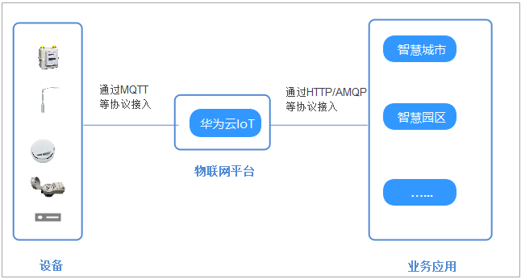

从图中，我们可以看到，当设备上报数据到IOT平台之后，业务系统可以从IOT平台中拉取数据到自己的数据库，方便在业务应用中去展示。

今天的目标：

- 能够熟悉AMQP协议的特点

- 能够完成使用AMQP消费IOT中设备上报的数据

- 能够完成智能床位的功能开发

- 能够掌握MySQL创建索引的方式

- 能够掌握MySQL索引的底层原理

- 能够掌握MySQL索引失效的检查方式

# 二、异步处理基础概念

在接收设备数据之前，我们需要先来熟悉一些基本的概念，来方便大家理解接收设备数据的基本思路

## 1.同步和异步

同步和异步的概念，在我们之前讲解js课程的时候已经学习过，基本的思路是一样的

同步（Background Synchronous）是指任务在后台进行处理，但需要等待任务完成后才能继续执行其他操作

异步（Asynchronous）是指任务的提交和执行是相互独立的，任务的执行不会阻塞程序的继续执行

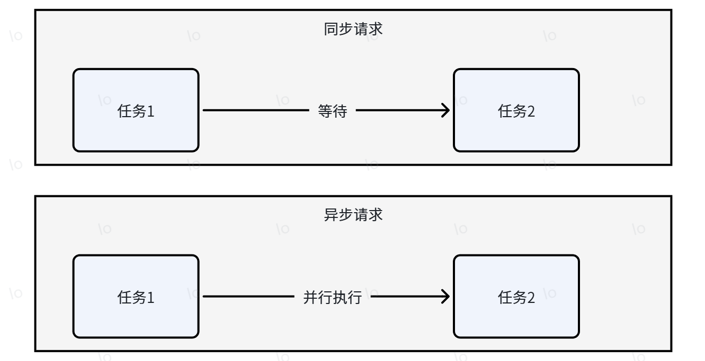

同步模式下，任务1完成后才能执行任务2，任务2需要等待任务1的完成。这种顺序执行的方式称为同步。

异步模式下，任务1和任务2可以并行执行，彼此之间相互独立，不需要等待对方的完成。这种并行执行的方式称为异步。

优缺点：

好处：

- 提高系统的并发性

- 改善系统的响应性

缺点：

- 复杂性增加

- 资源消耗增加

## 2.消息队列的基本概念

我们知道了同步和异步的区别之后，我们来理解一下消息队列的概念，消息队列都是以异步的方式进行请求

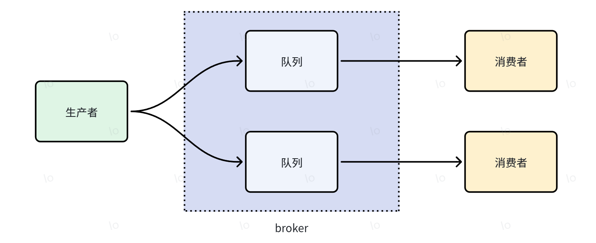

- 生产者：负责将消息发送到消息队列中
- 消费者：负责从消息队列中获取消息并进行处理
- 队列：存储消息
- broker：负责接收、存储和分发消息的中间件组件，实现了发送者和接收者之间的解耦和异步通信
- topic：消息的分类

在IOT中数据流转是这样的，如下图

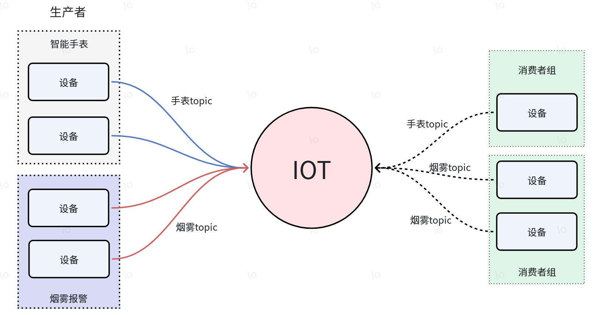

- 生产者：设备负责将消息发送到IOT中（队列）
- 每个产品可以绑定不同的topic来进行消息分类，比如有手表topic、烟雾topic
- IOT本身相当于是一个队列
- 消费者可以从指定的topic中获取数据

如果有多个消费者都要接收同一类消息，可以设置多个消费者，称为消费者组

## 3.什么是AMQP

我们现在已经清楚了消息队列的基础概念，在IOT中数据接收用到的是AMQP来处理消息。

AMQP全称Advanced Message Queuing Protocol，是一种网络协议，用于在应用程序之间传递消息。它是一种开放标准的消息传递协议，可以在不同的系统之间实现可靠、安全、高效的消息传递。

AMQP协议的实现包括多种消息队列软件，例如RabbitMQ、Apache ActiveMQ、Apache Qpid等。这些软件提供了可靠、高效的消息传递服务，广泛应用于分布式系统、云计算、物联网等领域。

> 我们这次并不会详细讲解这些软件的使用，其中关于RabbitMQ我们后期的课程中会详细的，重点的去讲解。
> 

今天我们会快速使用Apache Qpid软件来接收IOT中的数据，如下图

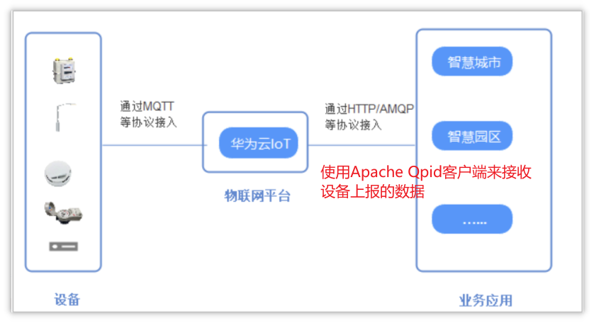

# 三、设备数据转发

在IOT官方文档中，已经提供了对应的数据转发的解决方案，如下链接：[AMQP转发](https://support.huaweicloud.com/usermanual-iothub/iot_01_00100.html)

## 1.官网Java SDK接入

### 1.1.创建数据转发规则

设备接入物联网平台后，可以通过自定义Topic或产品模型将数据上报给平台。在控制台上设置订阅后，平台会将包括设备生命周期变更、属性上报、消息上报及状态变更等信息，通过订阅推送的方式转发到您指定的服务器。

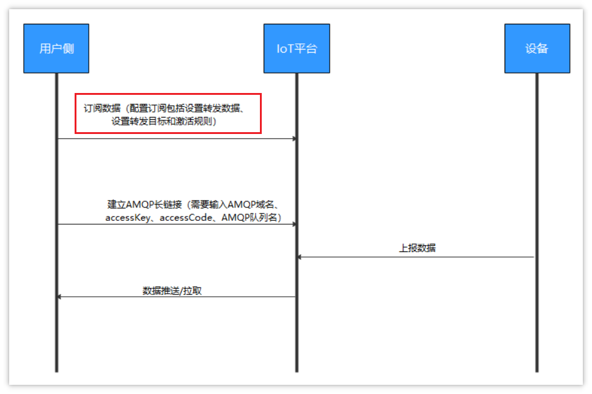

订阅（AMQP）： 用户可以通过控制台或调用API创建订阅，以获取设备的变更信息，如设备状态、数据上报等。订阅时需要指定具体的AMQP消息通道。

推送： 一旦订阅成功，物联网平台会根据用户选择的数据类型，自动将相关变更推送到指定的AMQP消息队列中。用户使用AMQP客户端（Apache Qpid）连接到IoT平台即可接收这些更新信息。

按照上述流程，我们需要在IOT平台中创建转发规则，才能让AMQP客户端接收到数据

配置规则参考官方说明：https://support.huaweicloud.com/usermanual-iothub/iot_01_00101.html

1.找到规则\-\>数据转发\-\>创建规则

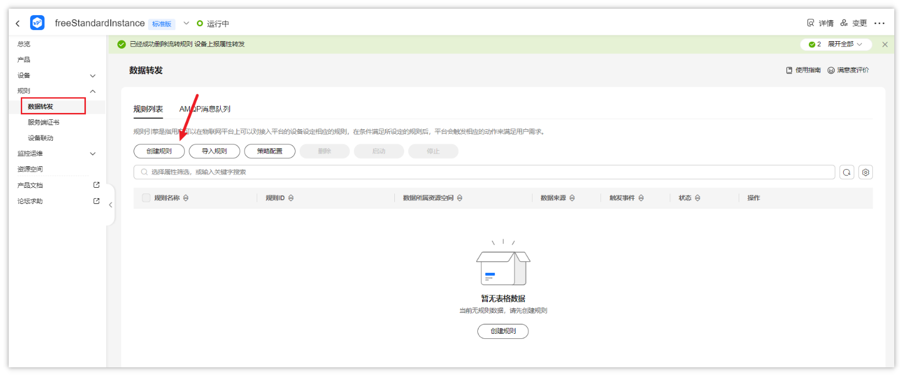

2.创建规则，其中数据来源为：设备属性

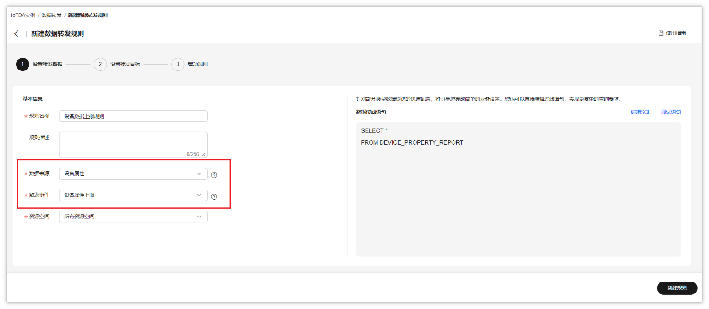

配置完成后，点击右下角的 \[创建规则\]

3.添加转发目标，转发目标选择：AMQP推送消息队列

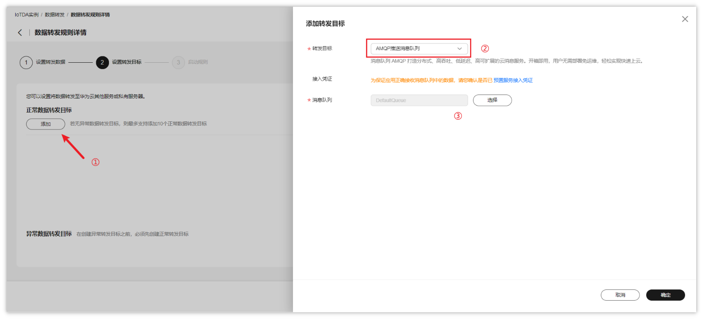

4.上述操作完成后，可以启动规则

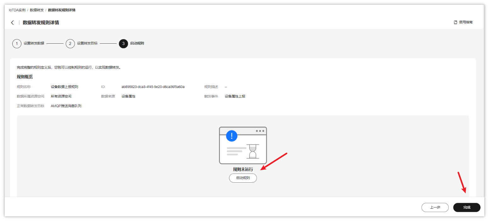

### 1.2.Java SDK接入示例

1.下载sdk代码

下载地址：https://developer.obs.myhuaweicloud.com/manage/amqp/amqp-demo.zip


官网说明参考：https://support.huaweicloud.com/usermanual-iothub/iot_01_00100_3.html

2.使用idea打开刚刚下载的amqp\-demo中的amqp\-client\-examples代码目录，如下图

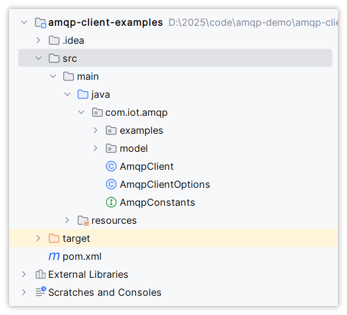

3.修改连接参数

可以直接到AmqpConstants类中进行修改，以下参数的获取都可以通过对应链接说明找到

```Java
package com.iot.amqp;

public interface AmqpConstants {
    /**
     * AMQP接入域名
     * 参考：https://support.huaweicloud.com/usermanual-iothub/iot_01_00100_2.html#section2
     */
    String HOST = "38e7abedbf.st1.iotda-app.cn-east-3.myhuaweicloud.com";   // eg: "****.iot-amqps.cn-north-4.myhuaweicloud.com";

    /**
     * AMQP接入端口
     * 参考：https://support.huaweicloud.com/usermanual-iothub/iot_01_00100_2.html#section2
     */
    int PORT = 5671;

    /**
     * 接入凭证键值
     * 参考：https://support.huaweicloud.com/usermanual-iothub/iot_01_00100_2.html#section3
     */
    String ACCESS_KEY = "S2DSSeTC5";

    /**
     * 接入凭证密钥
     * 参考：https://support.huaweicloud.com/usermanual-iothub/iot_01_00100_2.html#section3
     */
    String ACCESS_CODE = "61xLTVTzppmBi62h5my2TT2LIXpU";

    /**
     * 默认队列，无需改动
     */
    String DEFAULT_QUEUE = "DefaultQueue";
}
```

4.放开AbstractAmqpExample中的打印消息的代码，如下图：

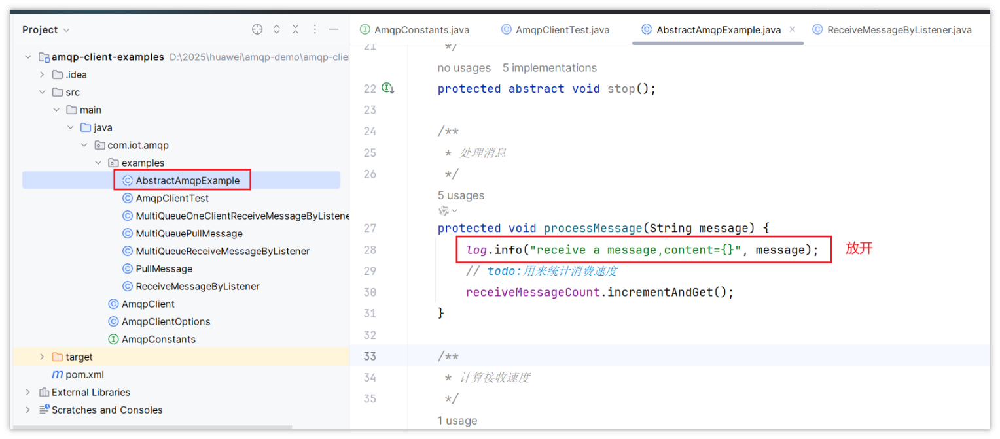

5.启动测试，可以正常在控制台看到设备上报的数据

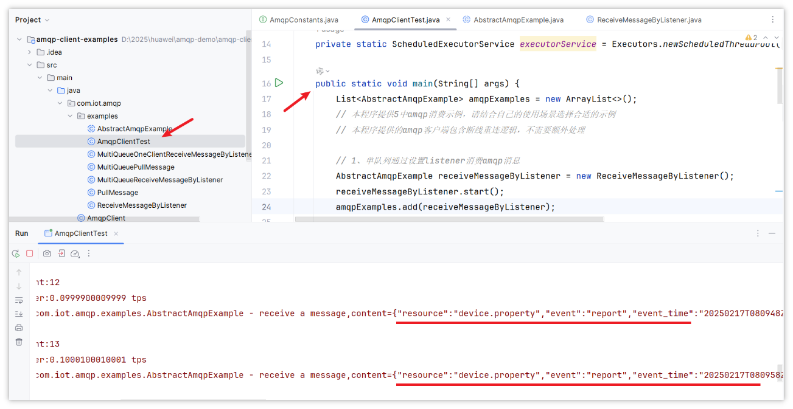

## 2.SDK改造

### 2.1.改造思路

SDK提供好的这个工具类，只是官网给提供的参考，我们需要进行改造，改造思路如下：

- 导入对应的依赖

- 所有的可变参数，如HOST、ACCESS\_KEY、ACCESS\_CODE、DEFAULT\_QUEUE这些统一在配置文件中维护

- 在项目中根据项目需求配置线程池

- 让spring进行管理和监听，一旦有数据变化之后，就可以马上消费，可以让这个类实现ApplicationRunner接口，重新run方法

### 2.2.导入pom依赖

在`xhzb-nursing-platform`模块中导入依赖，参考官网提供的pom依赖，如下：

```XML
<!-- amqp 1.0 qpid client -->
<dependency>
    <groupId>org.apache.qpid</groupId>
    <artifactId>qpid-jms-client</artifactId>
    <version>0.61.0</version>
</dependency>
```

### 2.3.添加iot配置

application\.yml文件添加iot配置（前一天已经创建过了，可以直接使用）

### 2.4.实现ApplicationRunner接口

让AmqpClient 实现ApplicationRunner接口，重写run方法，然后调用处理数据方法（由main方法改造而来）

```Java
package com.xhzb.nursing.job;

import cn.hutool.core.text.CharSequenceUtil;
import com.xhzb.framework.config.properties.HuaWeiIotConfigProperties;
import lombok.extern.slf4j.Slf4j;
import org.apache.qpid.jms.*;
import org.apache.qpid.jms.message.JmsInboundMessageDispatch;
import org.apache.qpid.jms.transports.TransportOptions;
import org.apache.qpid.jms.transports.TransportSupport;
import org.springframework.beans.factory.annotation.Autowired;
import org.springframework.boot.ApplicationArguments;
import org.springframework.boot.ApplicationRunner;
import org.springframework.scheduling.concurrent.ThreadPoolTaskExecutor;
import org.springframework.stereotype.Component;

import javax.jms.*;
import java.net.InetAddress;
import java.net.URI;
import java.net.UnknownHostException;
import java.text.MessageFormat;
import java.util.HashMap;
import java.util.Map;
import java.util.UUID;
import java.util.stream.Collectors;

/**
 * @author ruoyi
 */
@Slf4j
@Component
public class AmqpClient implements ApplicationRunner {

    @Autowired
    private HuaWeiIotConfigProperties huaWeiIotConfigProperties;

    //业务处理异步线程池，线程池参数可以根据您的业务特点调整，或者您也可以用其他异步方式处理接收到的消息。
    @Autowired
    private ThreadPoolTaskExecutor threadPoolTaskExecutor;

    //控制台服务端订阅中消费组状态页客户端ID一栏将显示clientId参数。
    //建议使用机器UUID、MAC地址、IP等唯一标识等作为clientId。便于您区分识别不同的客户端。
    private static String clientId;

    static {
        try {
            clientId = InetAddress.getLocalHost().getHostAddress();
        } catch (UnknownHostException e) {
            e.printStackTrace();
        }
    }

    @Override
    public void run(ApplicationArguments args) throws Exception {
        start();
    }

    public void start() throws Exception {
        //参数说明，请参见AMQP客户端接入说明文档。
        for (int i = 0; i < huaWeiIotConfigProperties.getConnectionCount(); i++) {
            //创建amqp连接
            Connection connection = getConnection();

            //加入监听者
            ((JmsConnection) connection).addConnectionListener(myJmsConnectionListener);
            // 创建会话。
            // Session.CLIENT_ACKNOWLEDGE: 收到消息后，需要手动调用message.acknowledge()。
            // Session.AUTO_ACKNOWLEDGE: SDK自动ACK（推荐）。
            Session session = connection.createSession(false, Session.AUTO_ACKNOWLEDGE);
            connection.start();

            // 创建Receiver连接。
            MessageConsumer consumer = newConsumer(session, connection, huaWeiIotConfigProperties.getQueueName());
            consumer.setMessageListener(messageListener);
        }

        log.info("amqp  is started successfully, and will exit after server shutdown ");
    }

    /**
     * 创建amqp连接
     *
     * @return amqp连接
     */
    private Connection getConnection() throws Exception {
        String connectionUrl = generateConnectUrl();
        JmsConnectionFactory cf = new JmsConnectionFactory(connectionUrl);
        // 信任服务端
        TransportOptions to = new TransportOptions();
        to.setTrustAll(true);
        cf.setSslContext(TransportSupport.createJdkSslContext(to));
        String userName = "accessKey=" + huaWeiIotConfigProperties.getAccessKey();
        cf.setExtension(JmsConnectionExtensions.USERNAME_OVERRIDE.toString(), (connection, uri) -> {
            // IoTDA的userName组成格式如下：“accessKey=${accessKey}|timestamp=${timestamp}”
            String newUserName = userName;
            if (connection instanceof JmsConnection) {
                newUserName = ((JmsConnection) connection).getUsername();
            }
            return newUserName + "|timestamp=" + System.currentTimeMillis();
        });

        // 创建连接。
        return cf.createConnection(userName, huaWeiIotConfigProperties.getAccessCode());
    }

    /**
     * 生成amqp连接地址
     *
     * @return amqp连接地址
     */
    public String generateConnectUrl() {
        String uri = MessageFormat.format("{0}://{1}:{2}",
                (huaWeiIotConfigProperties.isUseSsl() ? "amqps" : "amqp"),
                huaWeiIotConfigProperties.getHost(),
                String.valueOf(huaWeiIotConfigProperties.getPort()));
        Map<String, String> uriOptions = new HashMap<>();
        uriOptions.put("amqp.vhost", huaWeiIotConfigProperties.getVhost());
        uriOptions.put("amqp.idleTimeout", String.valueOf(huaWeiIotConfigProperties.getIdleTimeout()));
        uriOptions.put("amqp.saslMechanisms", huaWeiIotConfigProperties.getSaslMechanisms());

        Map<String, String> jmsOptions = new HashMap<>();
        jmsOptions.put("jms.prefetchPolicy.queuePrefetch", String.valueOf(huaWeiIotConfigProperties.getQueuePrefetch()));
        if (CharSequenceUtil.isNotBlank(clientId)) {
            jmsOptions.put("jms.clientID", clientId);
        } else {
            jmsOptions.put("jms.clientID", UUID.randomUUID().toString());
        }
        jmsOptions.put("failover.reconnectDelay", String.valueOf(huaWeiIotConfigProperties.getReconnectDelay()));
        jmsOptions.put("failover.maxReconnectDelay", String.valueOf(huaWeiIotConfigProperties.getMaxReconnectDelay()));
        if (huaWeiIotConfigProperties.getMaxReconnectAttempts() > 0) {
            jmsOptions.put("failover.maxReconnectAttempts", String.valueOf(huaWeiIotConfigProperties.getMaxReconnectAttempts()));
        }
        if (huaWeiIotConfigProperties.getExtendedOptions() != null) {
            for (Map.Entry<String, String> option : huaWeiIotConfigProperties.getExtendedOptions().entrySet()) {
                if (option.getKey().startsWith("amqp.") || option.getKey().startsWith("transport.")) {
                    uriOptions.put(option.getKey(), option.getValue());
                } else {
                    jmsOptions.put(option.getKey(), option.getValue());
                }
            }
        }
        StringBuilder stringBuilder = new StringBuilder();
        stringBuilder.append(uriOptions.entrySet().stream()
                .map(option -> MessageFormat.format("{0}={1}", option.getKey(), option.getValue()))
                .collect(Collectors.joining("&", "failover:(" + uri + "?", ")")));
        stringBuilder.append(jmsOptions.entrySet().stream()
                .map(option -> MessageFormat.format("{0}={1}", option.getKey(), option.getValue()))
                .collect(Collectors.joining("&", "?", "")));
        return stringBuilder.toString();
    }

    /**
     * 创建消费者
     *
     * @param session    session
     * @param connection amqp连接
     * @param queueName  队列名称
     * @return 消费者
     */
    public MessageConsumer newConsumer(Session session, Connection connection, String queueName) throws Exception {
        if (connection == null || !(connection instanceof JmsConnection) || ((JmsConnection) connection).isClosed()) {
            throw new Exception("create consumer failed,the connection is disconnected.");
        }

        return session.createConsumer(new JmsQueue(queueName));
    }

    private final MessageListener messageListener = message -> {
        try {
            //异步处理收到的消息，确保onMessage函数里没有耗时逻辑
            threadPoolTaskExecutor.submit(() -> processMessage(message));
        } catch (Exception e) {
            log.error("submit task occurs exception ", e);
        }
    };

    /**
     * 在这里处理您收到消息后的具体业务逻辑。
     */
    private void processMessage(Message message) {
        String contentStr;
        try {
            contentStr = message.getBody(String.class);
            String topic = message.getStringProperty("topic");
            String messageId = message.getStringProperty("messageId");
            log.info("receive message,\n topic = {},\n messageId = {},\n content = {}", topic, messageId, contentStr);
        } catch (JMSException e) {
            throw new RuntimeException("服务器错误");
        }

    }

    private final JmsConnectionListener myJmsConnectionListener = new JmsConnectionListener() {
        /**
         * 连接成功建立。
         */
        @Override
        public void onConnectionEstablished(URI remoteURI) {
            log.info("onConnectionEstablished, remoteUri:{}", remoteURI);
        }

        /**
         * 尝试过最大重试次数之后，最终连接失败。
         */
        @Override
        public void onConnectionFailure(Throwable error) {
            log.error("onConnectionFailure, {}", error.getMessage());
        }

        /**
         * 连接中断。
         */
        @Override
        public void onConnectionInterrupted(URI remoteURI) {
            log.info("onConnectionInterrupted, remoteUri:{}", remoteURI);
        }

        /**
         * 连接中断后又自动重连上。
         */
        @Override
        public void onConnectionRestored(URI remoteURI) {
            log.info("onConnectionRestored, remoteUri:{}", remoteURI);
        }

        @Override
        public void onInboundMessage(JmsInboundMessageDispatch envelope) {
        }

        @Override
        public void onSessionClosed(Session session, Throwable cause) {
        }

        @Override
        public void onConsumerClosed(MessageConsumer consumer, Throwable cause) {
        }

        @Override
        public void onProducerClosed(MessageProducer producer, Throwable cause) {
        }
    };
}
```

特别说明：在目前若依的项目中已经提供了线程池的配置`ThreadPoolTaskExecutor `

类的位置：`com.xhzb.framework.config.ThreadPoolConfig`

### 2.5.测试

当所有都配置完成后，启动模拟设备上报，同时启动后端项目，查看日志中是否打印上报之后的数据

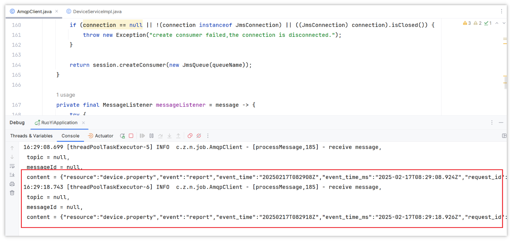

# 四、接收设备端数据

## 1.思路分析

整体的接收数据思路如下：

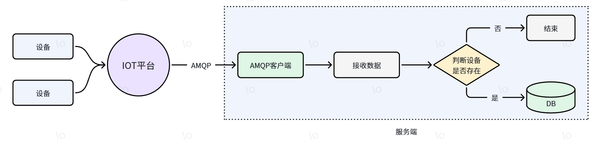

## 2.表结构


## 3.基础代码生成

们使用代码生成的功能，来生成代码

- 包名:`com.xhzb.nursing`

- 模块名：`nursing`

- 除了主键之外的Long类型，改为Integer

- 数据上报时间字段改为LocalDateTime类型

- 生成业务名称：data

- 生成功能名称：设备数据

只拷贝后端代码到idea中

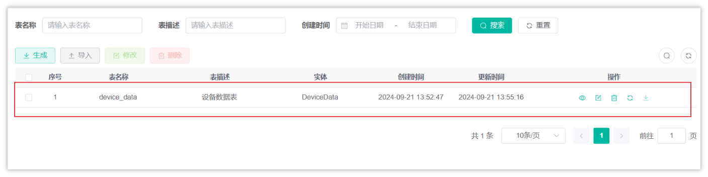

修改DeviceData表，添加三个注解，方便使用构建者设计模式来构建对象，如下图：

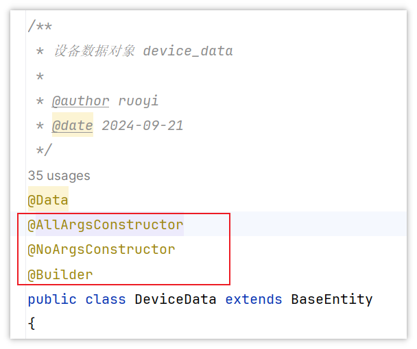

## 4.功能实现

1.思路分析

接收到的数据格式如下，是一个json字符串，我们可以定义一个类来转换接收数据

```JSON
{
  "resource": "device.property",
  "event": "report",
  "event_time": "20250217T083248Z",
  "event_time_ms": "2025-02-17T08:32:48.938Z",
  "request_id": "57f53c8e-9f20-4ce8-aceb-83953391c6c2",
  "notify_data": {
    "header": {
      "app_id": "d51bfac701644b9daa4363cf76c661af",
      "device_id": "67ad95860c504e29c72b2436_watch88",
      "node_id": "watch88",
      "product_id": "67ad95860c504e29c72b2436",
      "gateway_id": "67ad95860c504e29c72b2436_watch88"
    },
    "body": {
      "services": [
        {
          "service_id": "watch_services",
          "properties": {
            "BodyTemp": 1,
            "HeartRate": 87.6276,
            "xueyang": 93.12909,
            "BatteryPercentage": 6.9553375
          },
          "event_time": "20250217T083248Z"
        }
      ]
    }
  }
}
```

上述json的数据结构中，由于嵌套层级较多，需要定义多个类来进行接收，对应的类可以在资料中找到，如下图

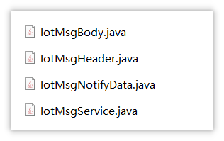

在设备数据表中，一次上报需要保存一个设备的多个物模型数据

> 比如，烟雾报警有三个物模型，那么当接收到一个数据上报的时候，就要保存三条数据到设备数据中
> 

流程

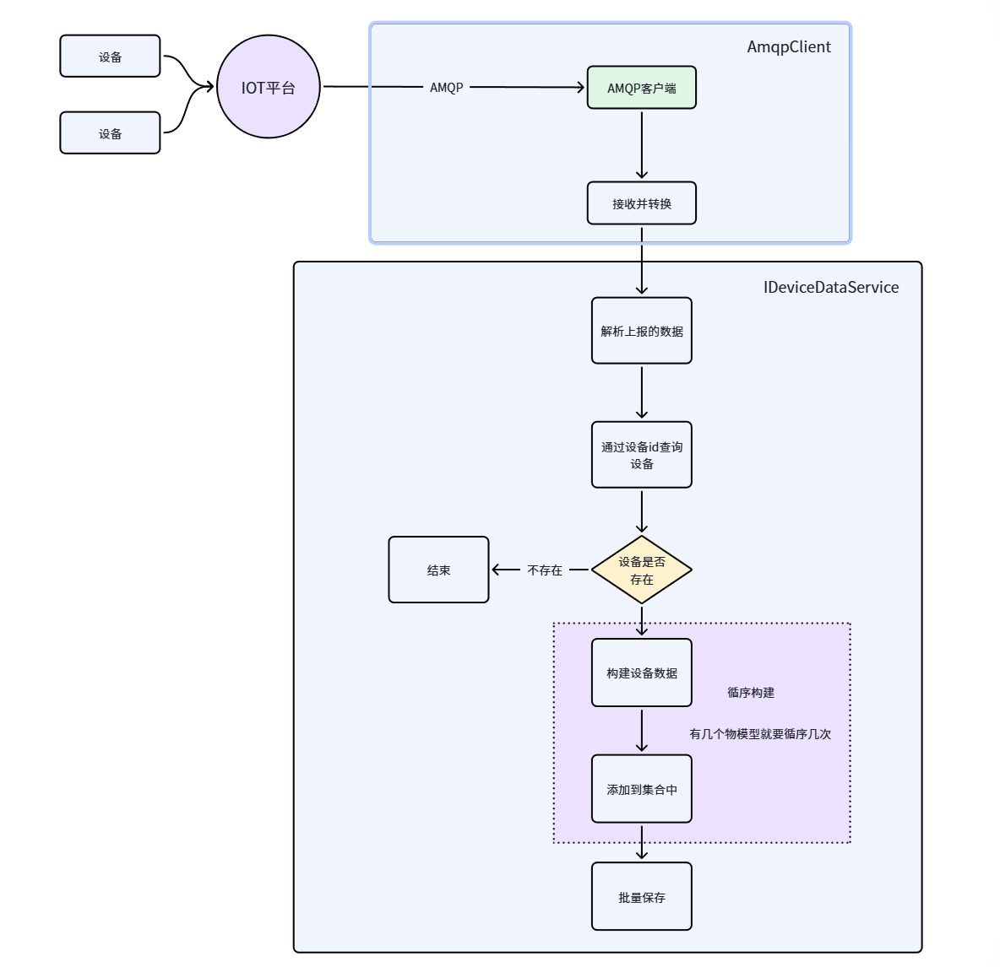

2.修改AmqpClient类，解析json数据并调用设备数据的业务层，批量添加数据

```Java
package com.xhzb.nursing.job;
/**
 * @author ruoyi
 */
@Slf4j
@Component
public class AmqpClient implements ApplicationRunner {

    // 其他代码省略....
    // 其他代码省略....
    // 其他代码省略....

    @Autowired
    private IDeviceDataService deviceDataService;

    /**
     * 在这里处理您收到消息后的具体业务逻辑。
     */
    private void processMessage(Message message) {
        String contentStr;
        try {
            contentStr = message.getBody(String.class);
            String topic = message.getStringProperty("topic");
            String messageId = message.getStringProperty("messageId");
            log.info("receive message,\n topic = {},\n messageId = {},\n content = {}", topic, messageId, contentStr);
        } catch (JMSException e) {
            throw new RuntimeException("服务器错误");
        }

        //将消息转换为json格式，数据为空，直接返回
        JSONObject jsonMsg = JSONUtil.parseObj(contentStr);

        //取出消息中的notify_data字段，数据为空，直接返回
        JSONObject jsonNotifyData = jsonMsg.getJSONObject("notify_data");
        if (ObjectUtil.isEmpty(jsonMsg)) {
            return;
        }

        //json格式转换为对象，如果属性上报为空，程序结束
        IotMsgNotifyData iotMsgNotifyData = JSONUtil.toBean(jsonNotifyData, IotMsgNotifyData.class);
        if (ObjectUtil.isEmpty(iotMsgNotifyData.getBody()) || ObjectUtil.isEmpty(iotMsgNotifyData.getBody().getServices())) {
            return;
        }

        deviceDataService.batchInsertDeviceData(iotMsgNotifyData);

    }

    // 其他代码省略....
}
```

3.在设备数据的业务层定义批量添加的方法

在IDeviceDataService中定义新的方法：

```Java
/**
 * 批量保存数据
 * @param iotMsgNotifyData
 */
void batchInsertDeviceData(IotMsgNotifyData iotMsgNotifyData);
```

实现方法：

```java
@Autowired
private IDeviceService deviceService;

/**
 * 批量保存设备数据
 * @param iotMsgNotifyData
 */
@Override
public void batchInsertDeviceData(IotMsgNotifyData iotMsgNotifyData) {
    String iotId = iotMsgNotifyData.getHeader().getDeviceId();
    //查询设备信息
    Device device = deviceService.lambdaQuery().eq(Device::getIotId, iotId).one();
    if(ObjectUtil.isEmpty(device)){
        log.error("设备不存在");
        return;
    }
    //批量保存设备数据
    iotMsgNotifyData.getBody().getServices().forEach(s->{
        //判断属性是否为空
        Map<String, Object> properties = s.getProperties();
        if(CollUtil.isEmpty(properties)){
            return;
        }

        //上报时间处理
        String eventTimeStr = s.getEventTime();
        LocalDateTime localDateTime = LocalDateTimeUtil.parse(eventTimeStr, "yyyyMMdd'T'HHmmss'Z'");
        LocalDateTime eventTime = DateTimeZoneConverter.utcToShanghai(localDateTime);

        List<DeviceData> list = new ArrayList<>();

        //key:属性id，value:属性值
        properties.forEach((k,v)->{
            DeviceData deviceData = BeanUtil.toBean(device, DeviceData.class);
            deviceData.setId(null);
            deviceData.setAlarmTime(eventTime);
            deviceData.setFunctionId(k);
            deviceData.setDataValue(v+"");
            deviceData.setAccessLocation(device.getBindingLocation());
            list.add(deviceData);
        });
        //批量保存设备数据
        saveBatch(list);
    });

}
```

## 5.测试

启动模拟设备进行上报

启动后端项目，查看数据库是否保存数据成功

## 6.bug修复\(如有\)

当设备增多之后，数据库连接池可能会很快耗尽，可以适当增加连接数数量和等待时间

可能的错误提示：

```Bash
wait millis 60003, active 20, maxActive 20, creating 0
```

数据库连接池耗尽，活跃连接数已达上限\(maxActive=20\)，无可用连接且等待超时\(60秒\)，导致新请求无法获取连接。

修改application\.yml文件关于数据库的配置，如下标颜色内容

```YAML
spring:
  datasource:
    type: com.alibaba.druid.pool.DruidDataSource
    driverClassName: com.mysql.cj.jdbc.Driver
    druid:
      # 主库数据源
      master:
        url: jdbc:mysql://192.168.100.168:3306/xhzb?useUnicode=true&characterEncoding=utf8&zeroDateTimeBehavior=convertToNull&useSSL=true&serverTimezone=GMT%2B8
        username: root
        password: heima123
      # 从库数据源
      slave:
        # 从数据源开关/默认关闭
        enabled: false
        url:
        username:
        password:
      # 初始连接数
      initialSize: 5
      # 最小连接池数量
      minIdle: 10
      # 最大连接池数量
      maxActive: 60   # 提升最大连接数
      # 配置获取连接等待超时的时间
      maxWait: 120000   # 延长等待时间至2分钟
      # 配置连接超时时间
      connectTimeout: 30000
      # 配置网络超时时间
      socketTimeout: 60000
      # 配置间隔多久才进行一次检测，检测需要关闭的空闲连接，单位是毫秒
      timeBetweenEvictionRunsMillis: 60000
      # 配置一个连接在池中最小生存的时间，单位是毫秒
      minEvictableIdleTimeMillis: 300000
      # 配置一个连接在池中最大生存的时间，单位是毫秒
      maxEvictableIdleTimeMillis: 900000
      # 配置检测连接是否有效
      validationQuery: SELECT 1 FROM DUAL
      testWhileIdle: true
      testOnBorrow: true  # 借出连接时校验有效性
      testOnReturn: false
      webStatFilter:
        enabled: true
      statViewServlet:
        enabled: true
        # 设置白名单，不填则允许所有访问
        allow:
        url-pattern: /druid/*
        # 控制台管理用户名和密码
        login-username: ruoyi
        login-password: 123456
      filter:
        stat:
          enabled: true
          # 慢SQL记录
          log-slow-sql: true
          slow-sql-millis: 1000
          merge-sql: true
        wall:
          config:
            multi-statement-allow: true
```

# 五、智能床位

## 1.需求说明

我们打开原型图

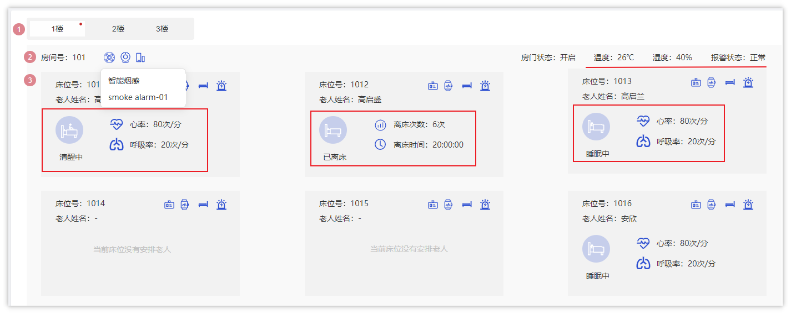

在床位管理里面有个智能床位，可以展示绑定智能设备的房间或床位以及设备对应的数据

## 2.接口说明

在智能床位这个模块中共分为了两个接口

- 获取所有的包含智能设备的楼层

- 查询房间设备或床位设备的数据

参考接口文档：[附录-接口文档](https://lining-lo.github.io/lining-lo-notes/星海智伴/附录-接口文档.html#四iot智能检测)

## 3.产品设备数据准备

在智能床位模块，我们需要提前创建两个产品来进行演示和测试，分别是智能烟雾报警器和睡眠监测带

要保证在物联网平台创建了这两个产品

所有设备的创建必须在本地创建，需要关联本地的位置

## 4.获取所有楼层（智能楼层）

### 4.1.思路分析

目的是为了展示哪个楼层中的房间或床位绑定了设备，需要展示的楼层编号

比如下图中，只有3楼、4楼、5楼、1楼绑定了设备，那就只展示这些楼层

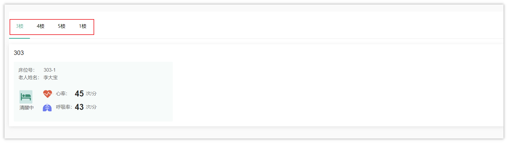

表关系

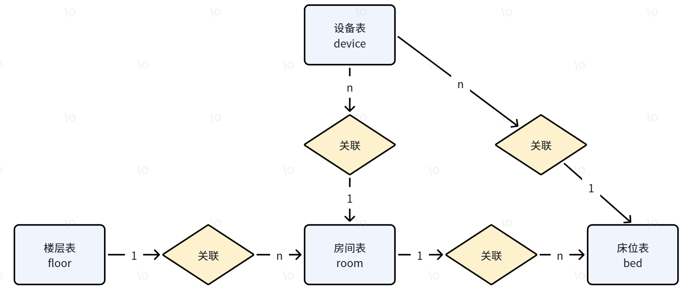

目前设备的绑定都是房间或者是床位

> 比如：智能烟雾报警绑定的位置是房间，睡眠监测带绑定的位置是床位
> 

在设备（device）表中同时有三个字段确定绑定的位置

- location\_type  位置类型   0：随身设备 1：固定设备

- physical\_location\_type  物理位置类型   0楼层 1房间 2床位

- binding\_location   具体位置对应的id值（如果是房间，则是房间id，如果是床位，则对应床位id）

5张表关联查询（floor、room、bed、device【房间\|床位】），对应的sql

```SQL
select f.*
from floor f
         left join room r on f.id = r.floor_id
         left join bed b on r.id = b.room_id
         left join device rd on rd.binding_location = r.id and rd.location_type = 1 and rd.physical_location_type = 1
         left join device bd on bd.binding_location = b.id and bd.location_type = 1 and bd.physical_location_type = 2
where (rd.id is not null  or bd.id is not null)
group by  f.id
order by f.code,f.create_time desc
```

> 上述sql中的group by f\.id 是为了去除重复数据
> 

### 4.2.控制层

在FloorController中新增查询智能楼层的方法，如下：

```Java
@GetMapping("/getAllFloorsWithDevice")
public AjaxResult getAllFloorWithDevice(){
    return success(floorService.getAllFloorsWithDevice();
}
```

### 4.3.业务层

在FloorService中新增查询智能楼层的方法，如下：

```Java
/**
 * 查询智能楼层
 * @return
 */
List<FloorVo> getAllFloorsWithDevice();
```

对应的实现方法：

```Java
/**
 * 查询智能楼层
 * @return
 */
@Override
public List<FloorVo> getAllFloorsWithDevice() {
    return floorMapper.getAllFloorsWithDevice();
}
```

### 4.4.持久层

在FloorMapper中新增方法，无参

```Java
List<FloorVo> getAllFloorsWithDevice();
```

对应的映射文件：

```Java
<select id="getAllFloorsWithDevice" resultType="com.xhzb.nursing.domain.vo.FloorVo">
    select f.*
    from floor f
             left join room r on f.id = r.floor_id
             left join bed b on r.id = b.room_id
             left join device rd on rd.binding_location = r.id and rd.location_type = 1 and rd.physical_location_type = 1
             left join device bd on bd.binding_location = b.id and bd.location_type = 1 and bd.physical_location_type = 2
    where (rd.id is not null  or bd.id is not null)
    group by  f.id
    order by f.code,f.create_time desc
</select>
```

### 4.5.测试

前提：必须在本地创建系统创建关于位置的IOT设备，比如烟雾报警器和睡眠检测带

测试：打开前端页面，找到智能床位查看效果

## 5.获取房间中的智能设备及数据

### 5.1.思路分析

根据楼层查询房间或者是床位的设备数据（最新的一条数据）

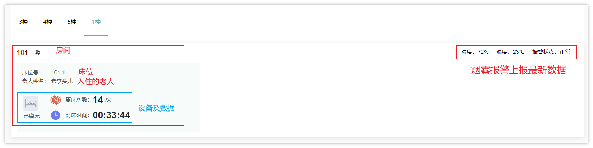

在这个接口中返回的数据较多，条件是选中的楼层ID

- 房间数据以及房间绑定的设备、设备上报的数据

- 床位数据以及床位入住的老人姓名、绑定的设备、设备上报的数据

实现方案有两种

方案一：通过楼层关联房间、床位、设备表2次、设备数据表2次共6张表查询对应的数据（设备数据表数据较多，效率不高），不推荐这种方案

方案二：使用缓存，因为只需要查询最近一次的设备数据，可以把最近一次采集的数据存储到redis中，然后让房间或者床位进行匹配

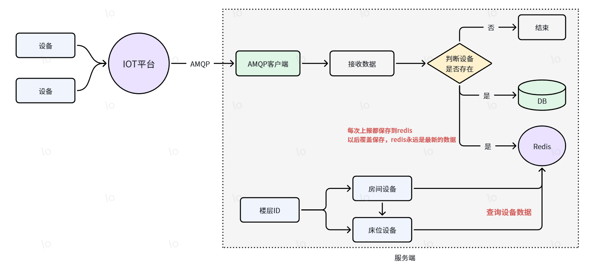

按照这种思路实现，结合接口需要的响应结果，其中需要准备基础数据返回，基础数据就包括了房间、床位、老人、设备（房间或床位），其中的设备数据从redis中获取

查询基础的sql：

```SQL
select r.*,  --房间数据
       b.id bid,--床位数据
       b.bed_number,
       b.bed_status,
       b.room_id,
       e.name ename,--老人数据
       e.id eid,
       d.id as r_did,--房间关联的设备
       d.iot_id,
       d.product_key    as product_key,
       d.device_name,
       d.product_name,
       dd.id as b_did,--床位关联的设备
       dd.iot_id b_iot_id,
       dd.product_key    as b_product_key,
       dd.device_name as b_device_name,
       dd.product_name as b_product_name
from room r
         left join bed b on r.id = b.room_id
         left join elder e on b.id = e.bed_id
         left join device rd on rd.binding_location = r.id and rd.location_type = 1 and rd.physical_location_type = 1
         left join device bd on bd.binding_location = b.id and bd.location_type = 1 and bd.physical_location_type = 2
where r.floor_id = 1 and  (rd.id is not null or bd.id is not null)
```

### 5.2.改造上报数据接收逻辑

找到DeviceDataServiceImpl类中的batchInsertDeviceData方法，把每次上报的数据存储到redis中，由于redis是可以覆盖旧数据，所以在redis中存储的永远都是最新的数据

详细代码，如下：

```java
@Autowired
private StringRedisTemplate redisTemplate;

/**
 * 批量保存
 *
 * @param data
 */
@Override
public void batchInsertDeviceData(IotMsgNotifyData data) {
    //根据iotId查询设备'
    Device device = deviceMapper.selectOne(Wrappers.<Device>lambdaQuery().eq(Device::getIotId, data.getHeader().getDeviceId()));
    if(ObjectUtil.isEmpty(device)){
        log.info("设备不存在，设备id：{}",data.getHeader().getDeviceId());
        return;
    }

    //构建设备数据，可能会有多条
    List<IotMsgService> services = data.getBody().getServices();
    if(CollUtil.isEmpty(services)){
        log.info("设备数据为空");
        return;
    }
    //循序services
    services.forEach(s->{

        //处理上报时间
        String eventTimeStr = s.getEventTime();
        LocalDateTime localDateTime = LocalDateTimeUtil.parse(eventTimeStr, "yyyyMMdd'T'HHmmss'Z'");
        LocalDateTime eventTime = DateTimeZoneConverter.utcToShanghai(localDateTime);

        List<DeviceData> list = new ArrayList<>();

        properties.forEach((k,v)->{
            DeviceData deviceData = BeanUtil.toBean(device, DeviceData.class);
            deviceData.setId(null);
            deviceData.setAlarmTime(eventTime);
            deviceData.setFunctionId(k);
            deviceData.setDataValue(v+"");
            deviceData.setAccessLocation(device.getBindingLocation());
            deviceData.setCreateTime(null);
            list.add(deviceData);
        });
        //批量保存
        saveBatch(list);
        redisTemplate.opsForHash().put(CacheConstants.IOT_DEVICE_LAST_DATA, iotId, JSONUtil.toJsonStr(list));
    });
}
```

> 需要在CacheConstants类中定义新的常量
> 
> `public static final String IOT_DEVICE_LAST_DATA = "iot:device_last_data";`

### 5.3.控制层

根据接口中的路径分析，这个接口需要定义在RoomController中，代码如下：

```Java
@GetMapping("/getRoomsWithDeviceByFloorId/{floorId}")
public R<List<RoomVo>> getRoomsWithDeviceByFloorId(@PathVariable(name = "floorId") Long floorId){
    return R.ok(roomService.getRoomsWithDeviceByFloorId(floorId));
}
```

### 5.4.持久层

这里需要使用MyBatis的多表查询，根据刚才的sql，其中房间、床位、老人、房间设备、床位设备数据都要返回

在RoomMapper中新增方法

```Java
List<RoomVo> getRoomsWithDeviceByFloorId(Long floorId);
```

对应的映射文件：

```XML
<resultMap id="roomVoDeviceByFloorIdResultMap" type="com.xhzb.nursing.domain.vo.RoomVo">
    <id column="id" property="id"></id>
    <result column="code" property="code"></result>
    <collection property="bedVoList" ofType="com.xhzb.nursing.domain.vo.BedVo">
        <id column="bid" property="id"/>
        <result column="bed_number" property="bedNumber"></result>
        <result column="bed_status" property="bedStatus"></result>
        <result column="eid" property="elderId"></result>
        <result column="ename" property="ename"></result>
        <collection property="deviceVos" ofType="com.xhzb.nursing.domain.vo.DeviceInfo">
            <id column="b_did" property="id"/>
            <result column="b_iot_id" property="iotId"></result>
            <result column="b_device_name" property="deviceName"></result>
            <result column="b_product_key" property="productKey"></result>
            <result column="b_product_name" property="productName"></result>
        </collection>
    </collection>
    <collection property="deviceVos" ofType="com.xhzb.nursing.domain.vo.DeviceInfo">
        <id column="did" property="id"/>
        <result column="iot_id" property="iotId"></result>
        <result column="device_name" property="deviceName"></result>
        <result column="product_key" property="productKey"></result>
        <result column="product_name" property="productName"></result>
    </collection>
</resultMap>
<select id="getRoomsWithDeviceByFloorId" resultMap="roomVoDeviceByFloorIdResultMap" >
    select r.id ,
           r.code,
           b.id bid,
           b.bed_number,
           b.bed_status,
           e.id eid,
           e.name ename,
           rd.id did ,
           rd.iot_id ,
           rd.device_name,
           rd.product_key,
           rd.product_name,
           bd.id b_did ,
           bd.iot_id  b_iot_id,
           bd.device_name b_device_name,
           bd.product_key b_product_key,
           bd.product_name b_product_name
    from room r left join bed b on r.id = b.room_id
                left join  elder e on b.id = e.bed_id
                left join device rd on rd.binding_location = r.id and rd.location_type = 1 and rd.physical_location_type = 1
                left join device bd on bd.binding_location = b.id and bd.location_type = 1 and bd.physical_location_type = 2
    where r.floor_id = #{floorId} and  (rd.id is not null or bd.id is not null)
</select>
```

注意：

在映射文件中使用到了多次\<collection\>标签，需要在对应的类中添加数据返回的类型才可以

新建`DeviceInfo`来存储设备数据

```Java
package com.xhzb.nursing.domain.vo;

import com.xhzb.nursing.domain.DeviceData;
import io.swagger.v3.oas.annotations.media.Schema;
import lombok.Data;

import java.util.List;

@Schema(description = "设备信息响应模型")
@Data
public class DeviceInfo {

    @Schema(title = "主键")
    private Long id;

    @Schema(title = "物联网设备ID")
    private String iotId;

    @Schema(title = "设备名称")
    private String deviceName;

    @Schema(title = "产品key")
    public String productKey;

    @Schema(title = "产品名称")
    public String productName;

    @Schema(title = "设备数据")
    private List<DeviceData> deviceDataVos;
}
```

> 其中的设备数据`deviceDataVos`字段，是不需要从数据库中查询数据的，后期会到redis中进行匹配数据
> 

在`RoomVo`和`BedVo`中两个类中分别添加一个`deviceVos`设备集合属性

```Java
/**
 * 关联的设备
 */
private List<DeviceInfo> deviceVos;
```

### 5.5.业务层

```Java
/**
 * 获取所有房间（负责老人）
 * @param floorId
 * @return
 */
List<RoomVo> getRoomsWithDeviceByFloorId(Long floorId);
```

对应的实现方法，需要到redis中根据iotId匹配最新上报的设备数据

```Java
@Autowired
private RedisTemplate<String,String> redisTemplate;

/**
 * 查询智能楼层的基础数据和设备上报的数据
 *
 * @param floorId
 * @return
 */
@Override
public List<RoomVo> getRoomsWithDeviceByFloorId(Long floorId) {
//        redisTemplate.opsForHash().get(CacheConstants.IOT_DEVICE_LAST_DATA,"");
    //SQL返回的数据是基础数据，找到的是房间、床位、设备（房间|床位）
    List<RoomVo> roomVos = roomMapper.getRoomsWithDeviceByFloorId(floorId);
    roomVos.forEach(roomVo->{
        //遍历的是房间数据
        List<DeviceInfo> deviceVos = roomVo.getDeviceVos();
        //房间设备所对应的设备上报的数据
        deviceVos.forEach(deviceInfo -> {
            String jsonStr = (String) redisTemplate.opsForHash().get(CacheConstants.IOT_DEVICE_LAST_DATA, deviceInfo.getIotId());
            if(StringUtils.isEmpty(jsonStr)){
                return;//跳出本次循环，并不是结束方法
            }
            deviceInfo.setDeviceDataVos(JSONUtil.toList(jsonStr, DeviceData.class));
        });
        //遍历的是床位数据
        roomVo.getBedVoList().forEach(bedVo -> {
            //获取床位对应的设备列表
            bedVo.getDeviceVos().forEach(deviceInfo -> {
                String jsonStr = (String) redisTemplate.opsForHash().get(CacheConstants.IOT_DEVICE_LAST_DATA, deviceInfo.getIotId());
                if(StringUtils.isEmpty(jsonStr)){
                    return;//跳出本次循环，并不是结束方法
                }
                deviceInfo.setDeviceDataVos(JSONUtil.toList(jsonStr, DeviceData.class));
            });
        });
    });
    return roomVos;
}
```

### 5.6.测试

测试准备：

创建一个智能烟雾报警器，绑定的是房间，启动设备进行数据上报

创建一个睡眠监测带设备，绑定的是床位，启动设备进行数据上报

上报数据代码：

找到数据上报的代码，在iot\_device\_demo的pom中添加hutool的依赖

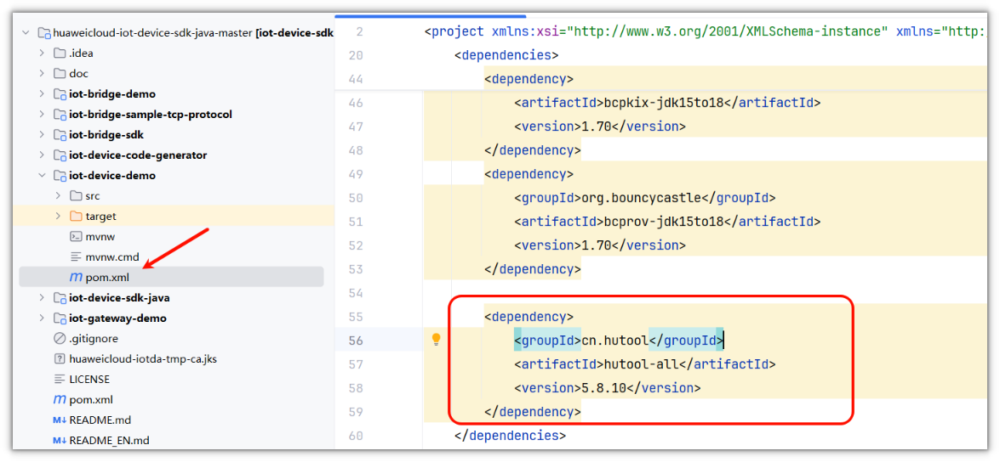

```xml
<dependency>
    <groupId>cn.hutool</groupId>
    <artifactId>hutool-all</artifactId>
    <version>5.8.10</version>
</dependency>
```

找到资料中上报数据的代码


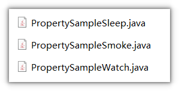

修改成自己的设备id和密钥

效果如下：

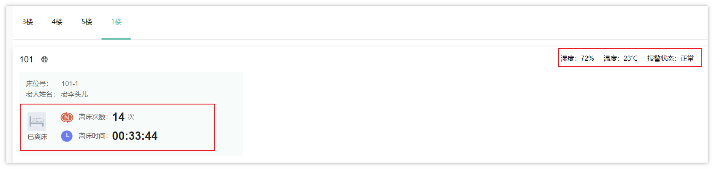

# 六、性能优化\-MySQL索引

## 1.为什么要使用索引？

使用索引是为了提高数据检索的效率。当数据量很大时，如果没有索引，数据库系统需要逐条扫描数据来找到符合条件的记录，这样会消耗大量的时间和资源。而使用索引可以通过创建特定的数据结构，将数据按照某种规则有序地组织起来，从而加快数据的查找速度。

索引可以在数据库表的一列或多列上创建，它们包含了对应列值的引用和指针，使得数据库系统可以快速定位到需要的数据。通过使用索引，数据库系统可以根据索引的排序和搜索算法，快速定位到符合查询条件的数据，提高查询的效率。

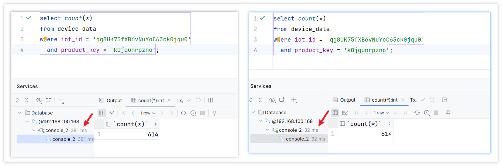

相同的SQL执行，左边没加索引，后边添加了索引，效率差了10倍有余（基础数据量为60万）

批量生成数据的存储过程：https://www.qianwen.com/share/chat/9e91e6bfad3f4c0d8d99632098d09210

优点：

- 提高数据查询的效率，降低数据库的IO成本。

- 通过索引列对数据进行排序，降低数据排序的成本，降低CPU消耗。

缺点：

- 索引会占用存储空间。

- 索引大大提高了查询效率，同时却也降低了insert、update、delete的效率。

## 2.MySQL索引\-结构

MySQL数据库支持的索引结构有很多，如：Hash索引、B\+Tree索引、Full\-Text索引等。

我们平常所说的索引，如果没有特别指明，都是指默认的 B\+Tree 结构组织的索引。

在没有了解B\+Tree结构前，我们先回顾下之前所学习的树结构：

二叉树

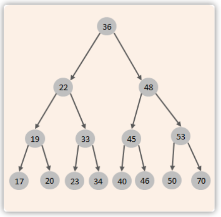

> 二叉查找树：左边的子节点比父节点小，右边的子节点比父节点大
> 

当我们向二叉查找树保存数据时，是按照从大到小\(或从小到大\)的顺序保存的，此时就会形成一个单向链表，搜索性能会打折扣。

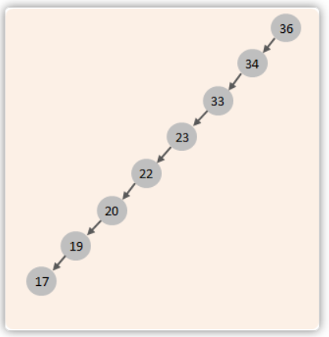

可以选择平衡二叉树或者是红黑树来解决上述问题。（红黑树也是一棵平衡的二叉树）

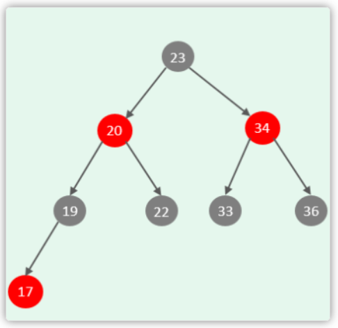

但是在Mysql数据库中并没有使用二叉搜索数或二叉平衡数或红黑树来作为索引的结构。

下面我们来看看B\+Tree\(多路平衡搜索树\)结构中如何避免这个问题：

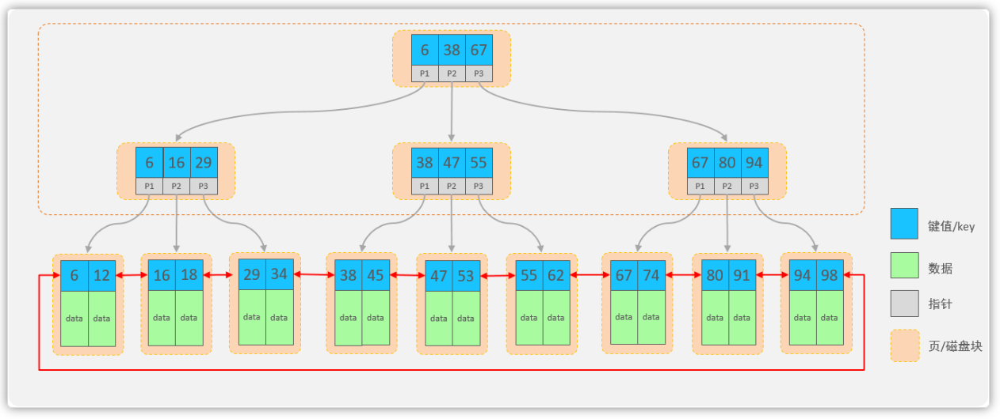

B\+Tree结构：

每一个节点，可以存储多个key（有n个key，就有n个指针）

节点分为：叶子节点、非叶子节点

- 叶子节点，就是最后一层子节点，所有的数据都存储在叶子节点上
- 非叶子节点，不是树结构最下面的节点，用于索引数据，存储的的是：key\+指针

为了提高范围查询效率，叶子节点形成了一个双向链表，便于数据的排序及区间范围查询

## 3.MySQL索引\-语法

什么字段适合添加索引？

作为查询条件的字段

### 3.1.创建索引

创建索引语法如下：

```SQL
create  [ unique ]  index 索引名 on  表名 (字段名,... ) ;
```

案例：为device\_data 表的iot\_id和product\_key字段建立一个索引

```SQL
create index idx_iot_id_product_key on device_data (iot_id, product_key);
```

在创建表时，如果添加了主键和唯一约束，就会默认创建：主键索引、唯一约束

> 创建索引的选择，一般情况下，使用那些字段查询的比较多，就使用那些字段来创建索引
> 

### 3.2.查看索引

查看索引的语法：

```SQL
show  index  from  表名;
```

### 3.3.删除索引

语法：

```SQL
drop  index  索引名  on  表名;
```

案例：删除 tb\_emp 表中name字段的索引

```SQL
drop index idx_iot_id_product_key on device_data ;
```

注意事项：

- 主键字段，在建表时，会自动创建主键索引

- 添加唯一约束时，数据库实际上会添加唯一索引

## 4.MySQL索引\-分类

在MySQL数据库，将索引的具体类型主要分为以下几类：主键索引、唯一索引、常规索引、全文索引。

| 分类     | 含义                                                 | 特点                     | 关键字   |
| -------- | ---------------------------------------------------- | ------------------------ | -------- |
| 主键索引 | 针对于表中主键创建的索引                             | 默认自动创建, 只能有一个 | PRIMARY  |
| 唯一索引 | 避免同一个表中某数据列中的值重复                     | 可以有多个               | UNIQUE   |
| 常规索引 | 快速定位特定数据                                     | 可以有多个               |          |
| 全文索引 | 全文索引查找的是文本中的关键词，而不是比较索引中的值 | 可以有多个               | FULLTEXT |

而在在InnoDB存储引擎中，根据索引的存储形式，又可以分为以下两种：

| 分类                      | 含义                                                       | 特点                |
| ------------------------- | ---------------------------------------------------------- | ------------------- |
| 聚集索引(Clustered Index) | 将数据存储与索引放到了一块，索引结构的叶子节点保存了行数据 | 必须有,而且只有一个 |
| 二级索引(Secondary Index) | 将数据与索引分开存储，索引结构的叶子节点关联的是对应的主键 | 可以存在多个        |

一级索引,聚集索引,聚簇索引

二级索引,非聚集索引,非聚簇索引

聚集索引选取规则:

- 如果存在主键，主键索引就是聚集索引。

- 如果不存在主键，将使用第一个唯一（UNIQUE）索引作为聚集索引。

- 如果表没有主键，或没有合适的唯一索引，则InnoDB会自动生成一个rowid作为隐藏的聚集索引。

索引设置时 尽量选取经常被作为查询条件的字段,同时重复率不高的字段;

聚集索引和二级索引的具体结构如下： 

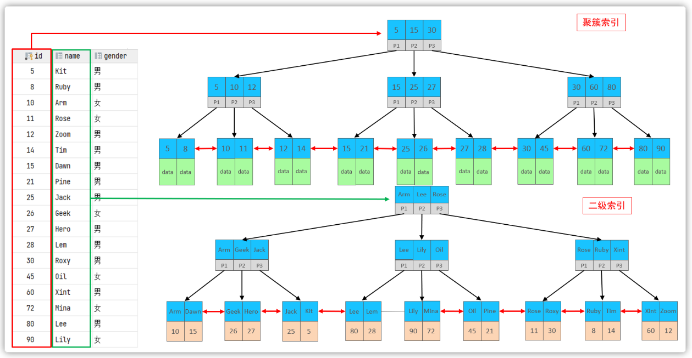

聚集索引的叶子节点下挂的是这一行的数据 。

二级索引的叶子节点下挂的是该字段值对应的主键值。

接下来，我们来分析一下，当我们执行如下的SQL语句时，具体的查找过程是什么样子的。

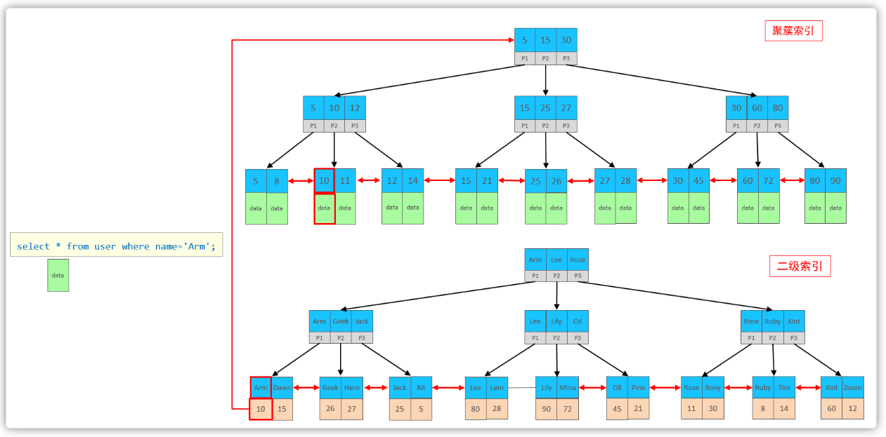

具体过程如下:

1.由于是根据name字段进行查询，所以先根据name='Arm'到name字段的二级索引中进行匹配查找。但是在二级索引中只能查找到 Arm 对应的主键值 10。

2.由于查询返回的数据是\*，所以此时，还需要根据主键值10，到聚集索引中查找10对应的记录，最终找到10对应的行row。 

3.最终拿到这一行的数据，直接返回即可。 

回表查询： 这种先到二级索引中查找数据，找到主键值，然后再到聚集索引中根据主键值，获取数据的方式，就称之为回表查询。

## 5.索引失效检查

可以采用EXPLAIN 或者 DESC命令获取 MySQL 如何执行 SELECT 语句的信息

语法：

```SQL
EXPLAIN   SELECT   字段列表   FROM   表名   WHERE  条件 ;
```

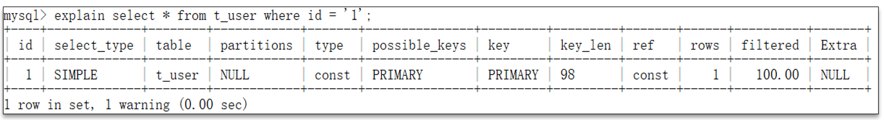

possible\_key  当前sql可能会使用到的索引

key 当前sql实际命中的索引

key\_len 索引占用的大小

Extra 额外的优化建议

| Extra                    | 含义                                                         |
| ------------------------ | ------------------------------------------------------------ |
| Using where; Using Index | 查找使用了索引，需要的数据都在索引列中能找到，不需要回表查询数据 |
| Using index condition    | 查找使用了索引，但是需要回表查询数据                         |

type 这条sql的连接的类型，性能由好到差为NULL、system、const、eq\_ref、ref、range、 index、all

- system：查询系统中的表

- const：根据主键查询

- eq\_ref：主键索引查询或唯一索引查询

- ref：索引查询

- range：范围查询

- index：索引树扫描

- all：全盘扫描

索引失效场景

- 不符合最左匹配法则

- 三个字段的索引（name,age,address）

# 七、作业

数据定时清理，在数据库中只保留最近半个月的设备上报数据
