# 一、目标

目前我们已经完成智能监测的大部分功能，其中有一项尤为关键，就是设备数据如果监测到有异常数据之后，我们该如何找出这些异常数据，以及找到的异常数据又该如何处理呢？今天的内容我们重点就围绕数据报警来讲解。

目标：

- 能够理解创建报警的规则

- 能够独立完成数据报警模块的功能开发

# 二、报警规则需求说明

想要获取报警数据，我们首先必须先制定报警规则，会根据不同的设备，不同的物模型来定义报警规则

## 1.需求分析

### 1.1.新增报警规则

我们先来分析需求，打开原型图

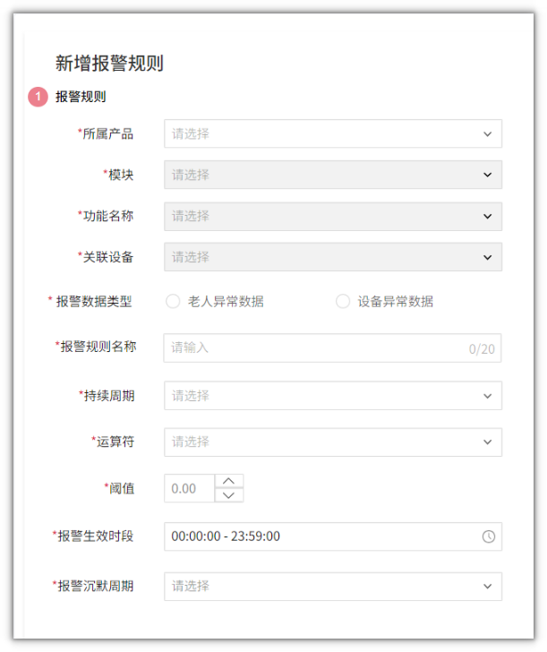

数据来源：

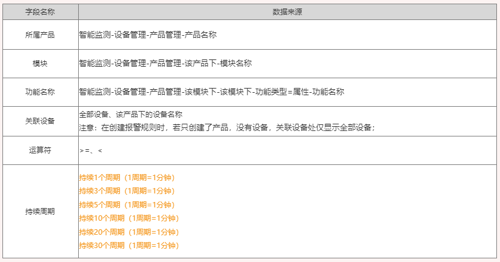

逻辑规则：

1.若多条报警规则是包含/互斥关系时，只要符合报警规则时，就会产生一条报警数据；

例如：规则1: 手表电量 \>=10 ，规则2:手表电量\< 50, 此时是包含关系，当手机电量=40时，符合两条报警规则，则产生两条报警数据；

2.报警数据见下方示例，1分钟（数据聚合周期）检查一次智能手表（所属产品）中的全部设备（关联设备）的血氧（功能名称），

监控值（统计字段）是否 \< 90（运算符\+阈值），当持续3个周期（持续周期）都满足这个规则时，触发报警；

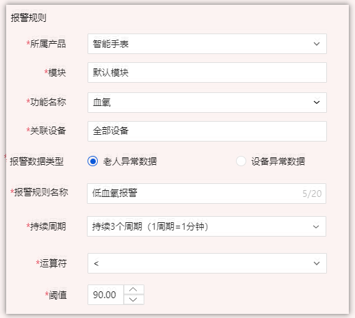

通知方式：

1.报警生效时间：报警规则的生效时间，报警规则只在生效时间内才会检查监控数据是否需要报警；

2.报警沉默周期：指报警发生后如果未恢复正常，重复发送报警通知的时间间隔；

报警方式：

当触发报警规则时，则发送消息通知

通知对象：设备数据类型=老人异常数据时，通知老人对应的护理员；设备数据类型=设备异常数据时，通知后勤部维修工；

渠道：站内信（见消息通知模块原型图）、短信；

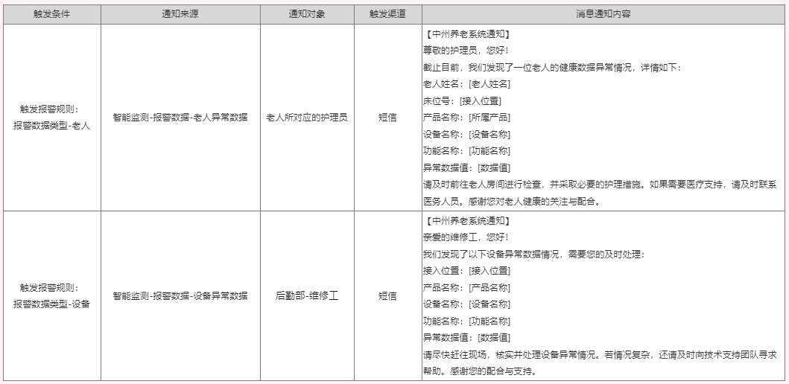

### 1.2.报警规则其他需求

下面这个就是刚刚创建的报警规则查询列表

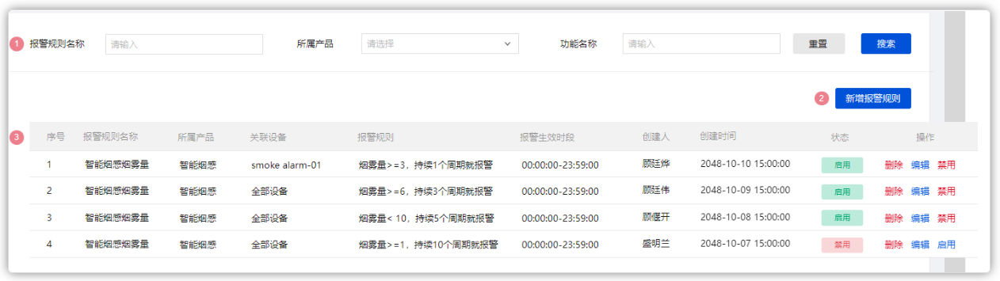

其中在操作中可以处理报警规则（删除，编辑，启用禁用）

### 1.3.表结构

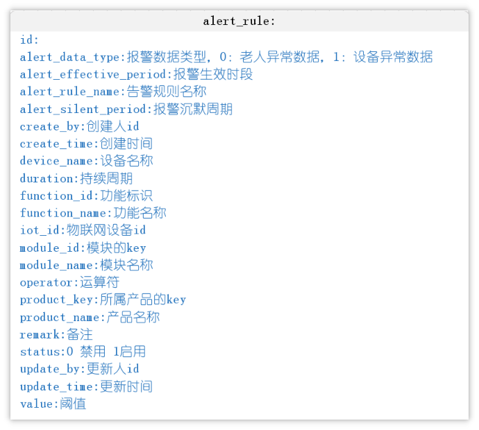

### 1.4.后端代码生成

代码生成

- 包名:`com.xhzb.nursing`

- 模块名：`nursing`

- 除了主键之外的Long类型，改为Integer

- 阈值字段的类型为：Double

- 生成业务名称：alertRule

- 生成功能名称：报警规则

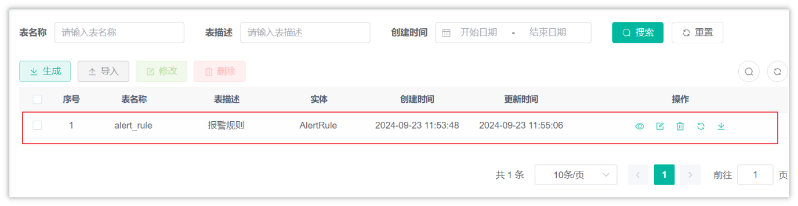

由于报警规则，就是单表的增删改查，所有功能都已实现，大家无需编写代码。但是要充分理解业务。

## 2.查询产品详情

### 2.1.需求说明

当我们新增报警规则的时候，是需要选择产品中具体的功能的，所以在选择产品之后需要查询到该产品下具体的服务及物模型的属性

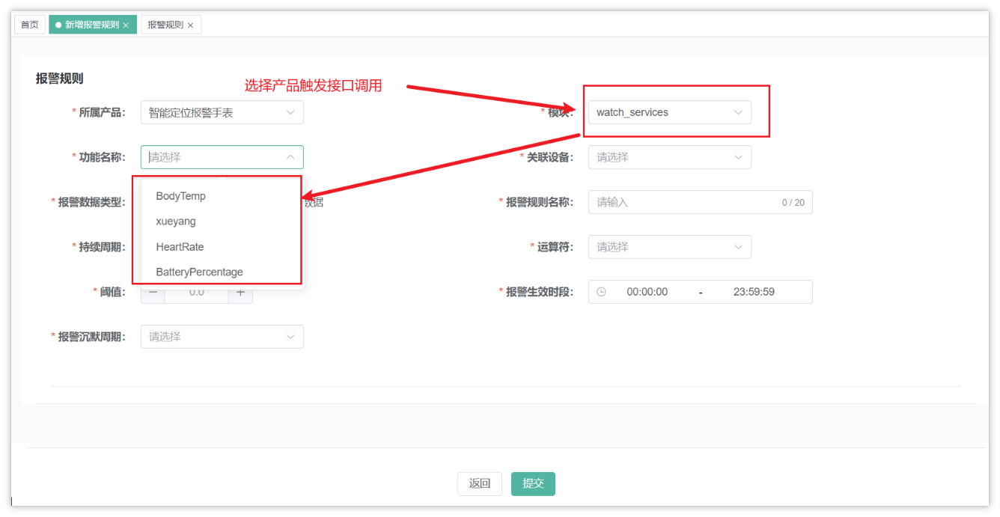

### 2.2.接口定义

接口文档参考：[附录-接口文档](https://lining-lo.github.io/lining-lo-notes/星海智伴/附录-接口文档.html#四iot智能检测)

华为云接口：https://support.huaweicloud.com/api-iothub/iot_06_v5_0052.html#section7

在DeviceController定义新的方法，如下：

```Java
@GetMapping("/queryProduct/{productKey}")
@Operation(summary = "查询产品详情")
public AjaxResult queryProduct(@PathVariable String productKey){
    return deviceService.queryProduct(productKey);
}
```

### 2.3.业务层

在IDeviceService中定义新的方法，如下：

```Java
/**
 * 查询产品详情
 * @param productKey
 * @return
 */
AjaxResult queryProduct(String productKey);
```

实现方法：

```Java
/**
 * 查询产品详情
 * @param productKey
 * @return
 */
@Override
public AjaxResult queryProduct(String productKey) {
    //参数校验
    if(StrUtil.isBlank(productKey)){
        throw new BaseException("请输入正确的参数");
    }
    //调用华为云物联网接口
    ShowProductRequest showProductRequest = new ShowProductRequest();
    showProductRequest.setProductId(productKey);
    ShowProductResponse response;

    try {
        response = client.showProduct(showProductRequest);
    } catch (Exception e) {
        throw new BaseException("查询产品详情失败");
    }
    //判断是否存在服务数据
    List<ServiceCapability> serviceCapabilities = response.getServiceCapabilities();
    if(CollUtil.isEmpty(serviceCapabilities)){
        return AjaxResult.success(Collections.emptyList());
    }

    return AjaxResult.success(serviceCapabilities);
}
```

## 3.需求加强说明

基于前面的报警规则，一旦有不符合预期的数据就会触发报警，产生报警数据，通知相关的负责人解决。

这里的概念大家要搞清楚，才能梳理清楚报警数据的过滤流程。下面举个例子来说明一下

### 3.1.案例一

详细报警规则，如下图：

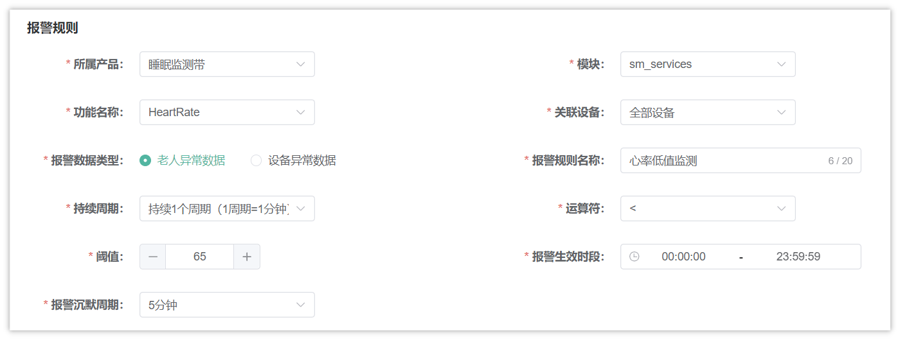

监测的产品为睡眠监测带，物模型为心率，过滤的是该产品下的所有设备

报警类型为老人异常数据（设备报警通知老人绑定的护理员和超级管理员）

持续周期：

- 持续1个周期（1周期=1分钟）：表示触发报警之后，马上会保存报警数据

- 持续3个周期（1周期=1分钟）：表示触发报警之后，连续三次都是异常数据才会保存报警数据

- 依此类推

阈值为65，运算符为\<：表示采集的心率数据如果小于65就触发报警

沉默周期为5分钟，已经保存报警数据之后，如果后面有连续报警，5分钟之后再触发报警规则

报警生效时段为00:00:00\~23:59:59：表示任意时段都会采集数据

### 3.2.案例二

报警规则如下图：

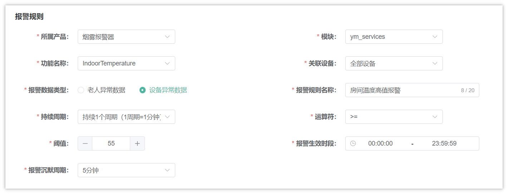

监测的产品为烟雾报警器，物模型为温度，过滤的是该产品下的全部设备

报警类型为设备异常数据（设备报警通知行政和超级管理员）

持续周期为持续1个周期（1后期=1分钟）：表示触发报警之后，马上会保存报警数据

阈值为55，运算符为\>=：表示采集的室内温度数据大于等于55就触发报警

沉默周期为5分钟，已经保存报警数据之后，如果后面有连续报警，5分钟之后再触发报警规则

报警生效时段为00:00:00\~23:59:59：表示任意时段都会采集数据

# 三、报警数据过滤及处理

## 1.执行流程

报警规则校验为定时任务拉取，每分钟拉取一次设备上报数据

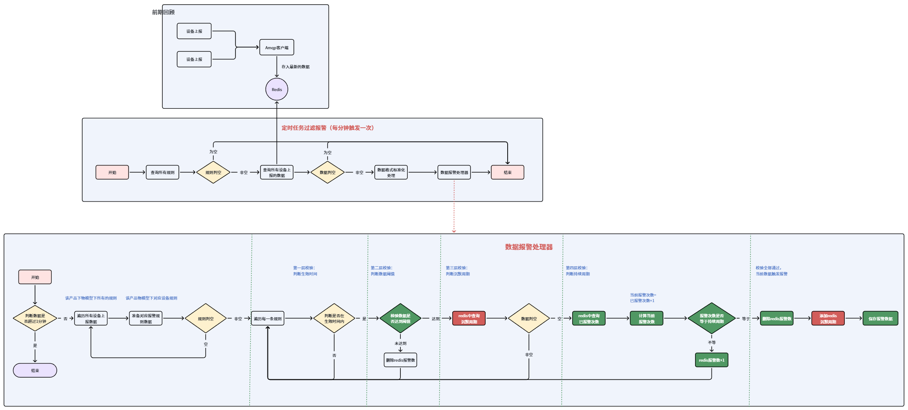

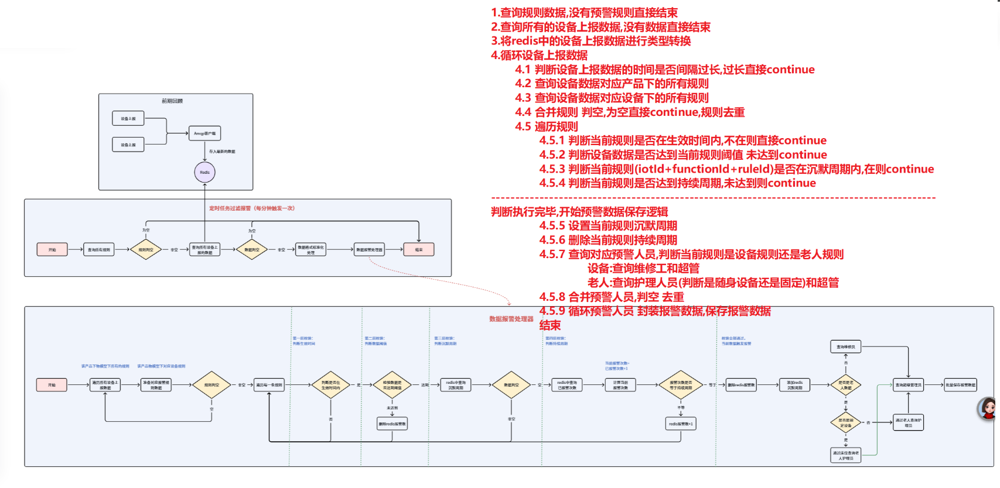

## 2.准备工作

1\.准备定时任务

2\.业务逻辑实现

3\.记录沉默周期

4\.记录持续周期

5\.查询护理人员

6\.查询维修人员

7\.查询超管

## 3.准备工作报警数据代码

一旦有了报警数据之后，需要通知的人可能不是一个，对于报警数据需要批量保存给多人

告警数据表结构：alert\_data（已提供）

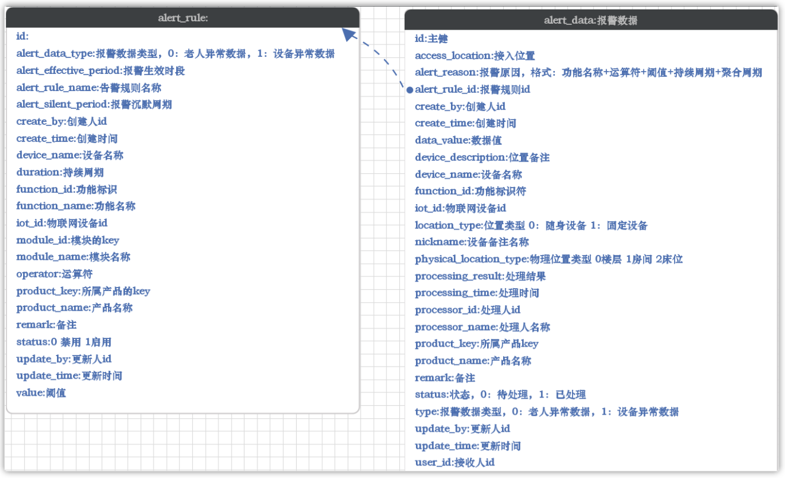

报警规则与报警数据为一对多的关系

报警数据基础代码准备

- 包名:`com.xhzb.nursing`

- 模块名：`nursing`

- 数据库类型init，对应的Java类型为Integer

- 生成业务名称：alertData

- 处理时间字段为：LocalDateTime

- 生成功能名称：报警数据

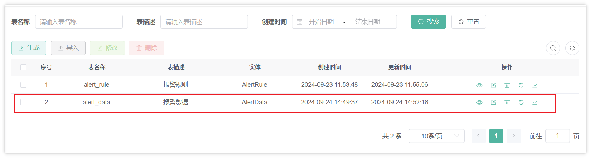

只需要拷贝后端代码

## 4.查询报警通知人

在流程结束之后，如果出现了报警数据，基于不同的报警设备的类型，通知的人的也是不同的

设备异常数据，通知行政人员（维修工）及超级管理员\(通知的用户ID在配置文件中维护\)

老人异常数据，通知负责老人的护理员及超级管理员，需要通过老人绑定的设备关联找到负责该老人的护理员id

表关系（设备、老人、护理员的关系如下）

- 如果是随身设备，可以通过设备找到老人，然后通过老人找到护理员的ID

- 如果是固定设备（只有床位），则需要通过设备找到床位\-\-\>老人\-\-\>护理员

- 如果固定设备不是床位，比如是房间或楼层，则不需要通知护理员，需要通知行政人员

导入资料中的表结构：`nursing_elder.sql`

修改表结构数据

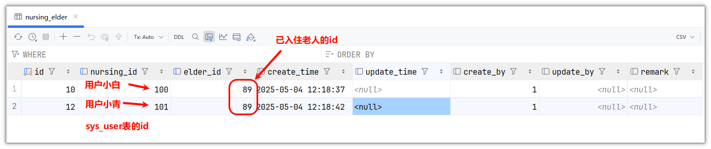

**查询老人异常数据通知的护理员**

表关系

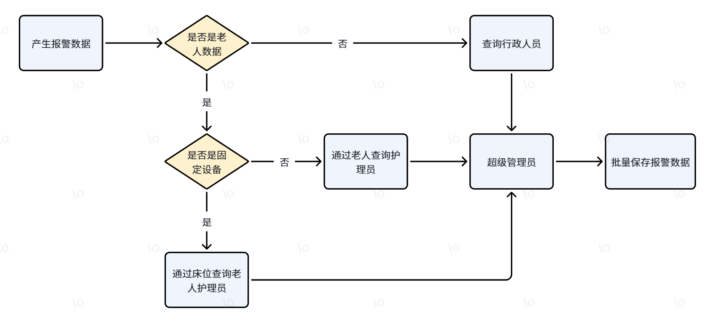

在AlertRuleMapper中新增两个方法，都是通过iotId查询对应的护理员

```Java
/**
 *根据老人ID，找到老人的护理人员ID
 * @param iotId
 * @return
 */
public List<Long> selectNursingIdsByElderId(Long elderId);


/**
 *根据床位ID，找到老人的护理人员ID
 * @param iotId
 * @return
 */
public List<Long> selectNursingIdsByBedId(Long bedId);
```

对应的xml映射文件

```XML
<select id="selectNursingIdsByElderId" resultType="java.lang.Long">
    select nursing_id from nursing_elder where elder_id = #{elderId}
</select>

<select id="selectNursingIdsByBedId" resultType="java.lang.Long">
    select
        ne.nursing_id
    from nursing_elder ne
    left join elder e on ne.elder_id = e.id
    left join bed b on e.bed_id = b.id
    where b.id = #{bedId}
</select>
```

**通过角色查询用户id**

表关系


需要在SysUserRoleMapper中新增方法，通过角色名称查询用户id

```Java
/**
 * 根据角色名称查询对应的用户ID
 * @param roleName
 * @return
 */
public List<Long> selectUserIdsByRoleName(@Param("roleName") String roleName);
```

对应的XML如下

```xml
<select id="selectUserIdsByRoleName" resultType="java.lang.Long">
    select sur.user_id
    from sys_user_role sur
           left join sys_role sr on sr.role_id=sur.role_id
    where sr.role_name=#{roleName}
</select>
```

沉默周期和持续周期使用redis，定义常量来表示redis的key，需要在CacheConstants新增常量，如下：

```Java
/**
 * 沉默周期 redis key 前缀 使用redis的setIfAbsent
 * setIfAbsent = Redis 原生命令 SETNX (SET if Not eXists)
 */
public static final String IOT_ALERT_SILENT_PREFIX = "iot:alert:silent:{}:{}:{}";


/**
 * 报警次数 redis key 前缀 使用redis的原子自增increment ()
 * 自动初始化：key 不存在时，自动创建并从 0 开始自增, 返回自增后的最新值 ,
 * 只能对整数类型的值操作，非数字会报错
 */
public static final String IOT_ALERT_COUNT_PREFIX = "iot:alert:count:{}:{}:{}";
```

对于超级管理员和维修工是通过配置的方式读取的名字，需要在application\-dev\.yml文件中添加数据

```YAML
# 报警规则相关角色名
alertRule:
  roleAdmin: 超级管理员
  roleRepair: 维修工
```

## 5.定时任务

在xhzb\-nursing\-platform中新增定时任务类，启动数据过滤

在编写代码的过程中，需要打开流程图，按图编写代码

```Java
package com.xhzb.nursing.job;

import com.xhzb.nursing.service.IAlertRuleService;
import lombok.extern.slf4j.Slf4j;
import org.springframework.beans.factory.annotation.Autowired;
import org.springframework.stereotype.Component;

/**
 * 设备数据报警规则校验定时任务
 *
 * @Author ruoyi
 * @Date 2026-5-29 11:28
 */
@Slf4j
@Component
public class AlertRuleJob {

    @Autowired
    private IAlertRuleService alertRuleService;

    /**
     * 定时进行设备数据对应的报警规则校验，将报警数据保存到对应表中
     */
    public void alertRuleFilter(){
        alertRuleService.alertRuleFilter();
        log.info("设备数据报警规则校验定时任务，执行完毕");
    }
}
```

需要在后台管理系统中创建定时任务，并指定开启

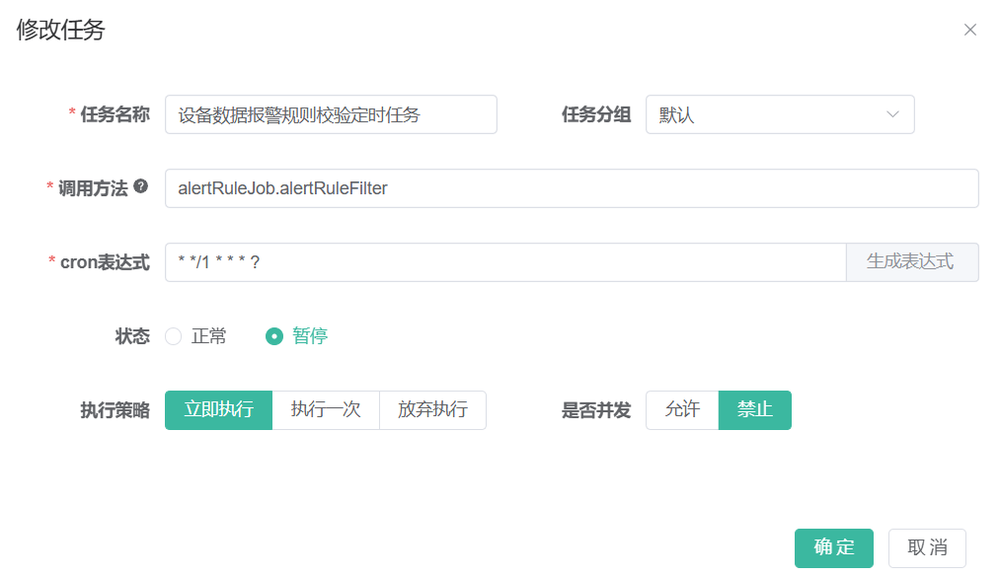

> `* */1 * * * ? ` 表示每分钟执行一次

## 6.核心过滤逻辑

在AlertRuleService中新增方法，过滤数据，如下：

```Java
/**
 * 过滤报警
 */
void alertRuleFilter();
```

实现方法：

```Java
package com.xhzb.nursing.service.impl;
import cn.hutool.core.collection.CollUtil;
import cn.hutool.core.date.LocalDateTimeUtil;
import cn.hutool.core.text.CharSequenceUtil;
import cn.hutool.core.util.NumberUtil;
import cn.hutool.json.JSONUtil;
import com.baomidou.mybatisplus.extension.service.impl.ServiceImpl;
import com.xhzb.common.constant.CacheConstants;
import com.xhzb.common.exception.base.BaseException;
import com.xhzb.common.utils.StringUtils;
import com.xhzb.nursing.domain.AlertData;
import com.xhzb.nursing.domain.AlertRule;
import com.xhzb.nursing.domain.DeviceData;
import com.xhzb.nursing.mapper.AlertRuleMapper;
import com.xhzb.nursing.mapper.DeviceMapper;
import com.xhzb.nursing.service.IAlertDataService;
import com.xhzb.nursing.service.IAlertRuleService;
import com.xhzb.system.mapper.SysUserRoleMapper;
import lombok.extern.slf4j.Slf4j;
import org.jetbrains.annotations.NotNull;
import org.jetbrains.annotations.Nullable;
import org.springframework.beans.BeanUtils;
import org.springframework.beans.factory.annotation.Autowired;
import org.springframework.beans.factory.annotation.Value;
import org.springframework.data.redis.core.StringRedisTemplate;
import org.springframework.stereotype.Service;
import org.springframework.transaction.annotation.Transactional;
import java.time.LocalDateTime;
import java.time.LocalTime;
import java.time.temporal.ChronoUnit;
import java.util.ArrayList;
import java.util.Arrays;
import java.util.List;
import java.util.concurrent.TimeUnit;
/**
 * 报警规则Service业务层处理
 * 
 * @author ruoyi
 * @date 2026-05-23
 */
@Slf4j
@Service
public class AlertRuleServiceImpl extends ServiceImpl<AlertRuleMapper, AlertRule> implements IAlertRuleService
{
    
    // 其他方法省略。。。。。
    @Autowired
    private StringRedisTemplate redisTemplate;

    @Autowired
    private SysUserRoleMapper sysUserRoleMapper;

    @Value("${alertRule.roleAdmin}")
    private String roleAdmin;

    @Value("${alertRule.roleRepair}")
    private String roleRepair;

    @Autowired
    private IAlertDataService alertDataService;

    /**
     * 设备数据对应的报警规则校验，将报警数据保存到对应表中
     */
    @Transactional(rollbackFor = Exception.class)
    @Override
    public void alertRuleFilter() {
        //1. 查询报警规则表中的所有报警规则
        Long ruleCount = this.lambdaQuery().eq(AlertRule::getStatus, 1).count();
        if (ruleCount <= 0) {
            log.error("[定时报警规则校验]没有任何报警规则，无需处理");
            return;
        }

        //2. 查询Redis中所有设备上报的数据
        List<Object> values = redisTemplate.opsForHash().values(CacheConstants.IOT_DEVICE_LAST_DATA);
        if (CollUtil.isEmpty(values)) {
            log.error("[定时报警规则校验]没有任何设备数据，无需处理");
            return;
        }

        List<DeviceData> deviceDataAllList = new ArrayList<>();
        //3. 将查询到的设备上报数据进行格式化处理
        values.forEach(v -> {
            List<DeviceData> deviceDataList = JSONUtil.toList((String) v, DeviceData.class);
            deviceDataAllList.addAll(deviceDataList);
        });

        //4. 获取到全部的设备数据，进行过滤处理
        for (DeviceData deviceData : deviceDataAllList) {

            //4.1 校验设备上报时间是否太久（由业务规则决定，可变）
            int limit = 600;//单位秒，超过十分钟的设备上报数据不再处理
            long between = LocalDateTimeUtil.between(deviceData.getAlarmTime(),
                    LocalDateTime.now(), ChronoUnit.SECONDS);
            if (between > limit) {
                log.error("[定时报警规则校验]过十分钟的设备上报数据不再处理");
                continue;
            }

            //4.2 查询上报数据对应的设备绑定的全部报警规则数据

            //4.2.1 查询当前上报数据对应的产品类型下同样的功能绑定的全部规则数据
            List<AlertRule> productAlertRuleList = this.lambdaQuery()
                    .eq(AlertRule::getProductKey, deviceData.getProductKey())
                    .eq(AlertRule::getFunctionId, deviceData.getFunctionId())
                    .eq(AlertRule::getIotId, -1)
                    .eq(AlertRule::getStatus,1)
                    .list();
            if(CollUtil.isEmpty(productAlertRuleList)) {
                productAlertRuleList =  new ArrayList<>();
            }

            //4.2.2 查询当前上报数据对应的设备下绑定的规则数据
            List<AlertRule> deviceAlertRuleList = this.lambdaQuery()
                    .eq(AlertRule::getProductKey, deviceData.getProductKey())
                    .eq(AlertRule::getFunctionId, deviceData.getFunctionId())
                    .eq(AlertRule::getIotId, deviceData.getIotId())
                    .eq(AlertRule::getStatus,1)
                    .list();
            if(CollUtil.isEmpty(deviceAlertRuleList)) {
                deviceAlertRuleList =  new ArrayList<>();
            }

            //4.2.3 合并所有报警规则
            productAlertRuleList.addAll(deviceAlertRuleList);

            //4.2.4 判断规则是否为空
            if(CollUtil.isEmpty(productAlertRuleList)) {
                log.error("[定时报警规则校验]当前上报数据对应的设备没匹配到任何报警规则，无需处理");
                continue;
            }

            //4.2.5 对规则去重，得到全部规则列表
            List<AlertRule> allAlertRuleList = CollUtil.distinct(productAlertRuleList);
            for (AlertRule alertRule : allAlertRuleList) {
                //第一层校验：判断生效时间是否合适
                String period = alertRule.getAlertEffectivePeriod();//生效时间段，值的格式：00:00:00~23:59:59

                //比较设备数据上报时间是否在生效时间段内
                String[] periodArr = period.split("~");

                LocalTime startTime = LocalTime.parse(periodArr[0]);//生效开始时间
                LocalTime endTime = LocalTime.parse(periodArr[1]); //生效结束时间
                LocalTime alarmTime = deviceData.getAlarmTime().toLocalTime();//数据上报时间
                if(alarmTime.isBefore(startTime) || alarmTime.isAfter(endTime)) {
                    log.error("[定时报警规则校验]数据上报时间不在规则的生效时间段内，无需处理");
                    continue;
                }

                //第二层校验：判断数据阈值
                Double dataValue = Double.valueOf(deviceData.getDataValue());//设备上报的数据
                Double value = alertRule.getValue();//阈值
                String operator = alertRule.getOperator();//比较运算符 >= 或 <

                //x大于y，结果就是1； x等于y，结果就是0； x小于y，结果就是-1
                int compare = NumberUtil.compare(dataValue, value);

                //达到阈值
                if((operator.equals(">=") && compare>=0) || (operator.equals("<") && compare<0)) {
                    //第三层校验：检查沉默周期是否存在，存在就直接结束
                    String silentKey = CharSequenceUtil.format(CacheConstants.IOT_ALERT_SILENT_PREFIX, deviceData.getIotId(), deviceData.getFunctionId(), alertRule.getId());
                    String silentVal = redisTemplate.opsForValue().get(silentKey);
                    if(StringUtils.isNotBlank(silentVal)) {
                        log.error("[定时报警规则校验]沉默周期还未结束，无需处理");
                        continue;
                    } else {

                        //第四层校验：判断持续周期对应的次数是否达到（没达到则直接结束）
                        String countKey = CharSequenceUtil.format(CacheConstants.IOT_ALERT_COUNT_PREFIX, deviceData.getIotId(), deviceData.getFunctionId(), alertRule.getId());
                        Long increment = redisTemplate.opsForValue().increment(countKey);
                        if(increment<alertRule.getDuration()) {
                            log.error("[定时报警规则校验]持续周期次数还未达到，无需处理");
                            continue;
                        }

                        //保存沉默周期的值到Redis，过期时间为沉默周期对应的秒数
                        redisTemplate.opsForValue().setIfAbsent(silentKey,"123",alertRule.getAlertSilentPeriod()*60, TimeUnit.SECONDS);

                        //删除Redis中持续抽周期缓存数据
                        redisTemplate.delete(countKey);

                        //查询老人的护理人员
                        List<Long> nursingIds = null;

                        //如果是老人异常数据，则查询对应护理人员
                        if(alertRule.getAlertDataType()==0) {
                            // 老人异常数据类型
                            if (deviceData.getLocationType() == 0) {
                                nursingIds = this.baseMapper.selectNuringIdsByElderId(Long.valueOf(deviceData.getAccessLocation()));
                            } else if (deviceData.getLocationType() == 1) {
                                nursingIds  = this.baseMapper.selectNuringIdsByBedId(Long.valueOf(deviceData.getAccessLocation()));
                            }
                        } else {
                            //如果是设备异常数据，则查询维修工
                            nursingIds = sysUserRoleMapper.selectUserIdsByRoleName(roleRepair);
                        }

                        //查询超级管理员
                        List<Long> adminUserIds = sysUserRoleMapper.selectUserIdsByRoleName(roleAdmin);

                        //合并用户ID
                        nursingIds.addAll(adminUserIds);

                        //去重用户ID （等待查看异常报警的所有用户ID）
                        List<Long> nursingIdList = CollUtil.distinct(nursingIds);

                        //封装报警基础数据对象
                        AlertData alertData = new AlertData();
                        BeanUtils.copyProperties(deviceData,alertData);
                        alertData.setId(null);
                        alertData.setType(alertRule.getAlertDataType());//设备数据类型 0-老人异常数据 1-设备异常数据
                        alertData.setAlertRuleId(alertRule.getId());//规则id
                        alertData.setStatus(0);//0-待处理  1-已处理
                        String reasonTemplate = "功能{}{}{}，持续了{}个周期才报警，沉默周期：{}";
                        String alertReason = CharSequenceUtil.format(reasonTemplate,
                                alertRule.getFunctionId(),
                                alertRule.getOperator(),
                                alertRule.getValue(),
                                alertRule.getDuration(),
                                alertRule.getAlertSilentPeriod()
                        ) ;
                        alertData.setAlertReason(alertReason);//报警原因
                        //所有用户报警数据的集合
                        List<AlertData> alertDataList = new ArrayList<>();
                        for (Long userId : nursingIdList) {
                            //封装用户报警数据，设置用户ID
                            AlertData userAlertData = new AlertData();
                            BeanUtils.copyProperties(alertData, userAlertData);
                            userAlertData.setUserId(userId);
                            alertDataList.add(userAlertData);
                        }

                        //批量保存所有用户报警数据
                        boolean result = alertDataService.saveBatch(alertDataList);
                        if(!result) {
                            throw new BaseException("保存用户保存数据失败");
                        }
                    }
                } else {
                    log.error("[定时报警规则校验]数据上报的值没有达到规则阈值，无需处理");
                    continue;
                }

            }
        }
    }
}
```

## 7.测试

1.前提

创建一条规则，如下：

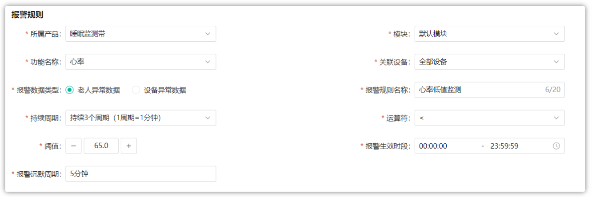

启动该设备的数据上报，手动改一下心率物模型的参数，需要保证上报的心率值低于65才行

2.启动后端项目

查看redis中key：alert\_count，查看统计数据的变化

查看redis中key：alert\_silent，沉默周期数据的变化

如果已经触发了报警规则三次后，是否能保存数据到数据库中，查看通知人的个人，保存的数据的条数是否相同

## 8.代码优化

```Java
package com.xhzb.nursing.service.impl;

import cn.hutool.core.collection.CollUtil;
import cn.hutool.core.date.LocalDateTimeUtil;
import cn.hutool.core.text.CharSequenceUtil;
import cn.hutool.core.util.NumberUtil;
import cn.hutool.json.JSONUtil;
import com.baomidou.mybatisplus.extension.service.impl.ServiceImpl;
import com.xhzb.common.constant.CacheConstants;
import com.xhzb.common.exception.base.BaseException;
import com.xhzb.common.utils.StringUtils;
import com.xhzb.nursing.domain.AlertData;
import com.xhzb.nursing.domain.AlertRule;
import com.xhzb.nursing.domain.DeviceData;
import com.xhzb.nursing.mapper.AlertRuleMapper;
import com.xhzb.nursing.mapper.DeviceMapper;
import com.xhzb.nursing.service.IAlertDataService;
import com.xhzb.nursing.service.IAlertRuleService;
import com.xhzb.system.mapper.SysUserRoleMapper;
import lombok.extern.slf4j.Slf4j;
import org.jetbrains.annotations.NotNull;
import org.jetbrains.annotations.Nullable;
import org.springframework.beans.BeanUtils;
import org.springframework.beans.factory.annotation.Autowired;
import org.springframework.beans.factory.annotation.Value;
import org.springframework.data.redis.core.StringRedisTemplate;
import org.springframework.stereotype.Service;
import org.springframework.transaction.annotation.Transactional;

import java.time.LocalDateTime;
import java.time.LocalTime;
import java.time.temporal.ChronoUnit;
import java.util.ArrayList;
import java.util.Arrays;
import java.util.List;
import java.util.concurrent.TimeUnit;

/**
 * 报警规则Service业务层处理
 *
 * @author ruoyi
 * @date 2026-05-29
 */
@Slf4j
@Service
public class AlertRuleServiceImpl extends ServiceImpl<AlertRuleMapper, AlertRule> implements IAlertRuleService {
   
    //其他方法省略....

    @Autowired
    private StringRedisTemplate redisTemplate;

    @Autowired
    private DeviceMapper deviceMapper;

    @Autowired
    private SysUserRoleMapper sysUserRoleMapper;

    @Value("${alertRule.roleAdmin}")
    private String roleAdmin;


    @Value("${alertRule.roleRepair}")
    private String roleRepair;

    @Autowired
    private IAlertDataService alertDataService;

    /**
     * 设备数据对应的报警规则校验，将报警数据保存到对应表中
     */
    @Transactional(rollbackFor = Exception.class)
    @Override
    public void alertRuleFilter() {
        //1. 查询报警规则表中的所有报警规则
        Long ruleCount = this.lambdaQuery().eq(AlertRule::getStatus, 1).count();
        if (ruleCount <= 0) {
            log.error("[定时报警规则校验]没有任何报警规则，无需处理");
            return;
        }

        //2. 查询Redis中所有设备上报的数据
        List<Object> values = redisTemplate.opsForHash().values(CacheConstants.IOT_DEVICE_LAST_DATA);
        if (CollUtil.isEmpty(values)) {
            log.error("[定时报警规则校验]没有任何设备数据，无需处理");
            return;
        }

        List<DeviceData> deviceDataAllList = new ArrayList<>();
        //3. 将查询到的设备上报数据进行格式化处理
        values.forEach(v -> {
            List<DeviceData> deviceDataList = JSONUtil.toList((String) v, DeviceData.class);
            deviceDataAllList.addAll(deviceDataList);
        });

        //4. 获取到全部的设备数据，进行过滤处理
        for (DeviceData deviceData : deviceDataAllList) {

            //校验上报数据时间和上报数据对应的规则
            List<AlertRule> allAlertRuleList = checkDevieDataRule(deviceData);
            if (allAlertRuleList == null) {
                continue;
            }
            for (AlertRule alertRule : allAlertRuleList) {
                //第一层校验：判断生效时间是否合适
                if (checkValidTime(deviceData, alertRule)) {
                    continue;
                }

                //第二层校验：判断数据阈值
                Double dataValue = Double.valueOf(deviceData.getDataValue());//设备上报的数据
                Double value = alertRule.getValue();//阈值
                String operator = alertRule.getOperator();//比较运算符 >= 或 <

                //x大于y，结果就是1； x等于y，结果就是0； x小于y，结果就是-1
                int compare = NumberUtil.compare(dataValue, value);

                //达到阈值
                if((operator.equals(">=") && compare>=0) || (operator.equals("<") && compare<0)) {
                    //第三层校验：检查沉默周期是否存在，存在就直接结束
                    String silentKey = CharSequenceUtil.format(CacheConstants.IOT_ALERT_SILENT_PREFIX, deviceData.getIotId(), deviceData.getFunctionId(), alertRule.getId());
                    String silentVal = redisTemplate.opsForValue().get(silentKey);
                    if(StringUtils.isNotBlank(silentVal)) {
                        log.error("[定时报警规则校验]沉默周期还未结束，无需处理");
                        continue;
                    } else {

                        //第四层校验：判断持续周期对应的次数是否达到（没达到则直接结束）
                        if (checkDurationCount(deviceData, alertRule, silentKey)) {
                            continue;
                        }

                        //获取报警数据对应的用户ID
                        List<Long> nursingIdList = getNursingIds(deviceData, alertRule);

                        //批量保存报警数据
                        saveBathAlertData(deviceData, alertRule, nursingIdList);
                    }
                } else {
                    log.error("[定时报警规则校验]数据上报的值没有达到规则阈值，无需处理");
                    continue;
                }

            }
        }
    }

    /**
     * 校验上报数据时间和上报数据对应的规则
     * @param deviceData
     * @return
     */
    @Nullable
    private List<AlertRule> getAlertRules(DeviceData deviceData) {
        //4.1 校验设备上报时间是否太久（由业务规则决定，可变）
        int limit = 6000;//单位秒，超过十分钟的设备上报数据不再处理
        long between = LocalDateTimeUtil.between(deviceData.getAlarmTime(),
                LocalDateTime.now(), ChronoUnit.SECONDS);
        if (between > limit) {
            log.error("[定时报警规则校验]过十分钟的设备上报数据不再处理");
            return null;
        }

        //4.2 查询上报数据对应的设备绑定的全部报警规则数据

        //4.2.1 查询当前上报数据对应的产品类型下同样的功能绑定的全部规则数据
        List<AlertRule> productAlertRuleList = this.lambdaQuery()
                .eq(AlertRule::getProductKey, deviceData.getProductKey())
                .eq(AlertRule::getFunctionId, deviceData.getFunctionId())
                .eq(AlertRule::getIotId, -1)
                .eq(AlertRule::getStatus,1)
                .list();
        if(CollUtil.isEmpty(productAlertRuleList)) {
            productAlertRuleList =  new ArrayList<>();
        }

        //4.2.2 查询当前上报数据对应的设备下绑定的规则数据
        List<AlertRule> deviceAlertRuleList = this.lambdaQuery()
                .eq(AlertRule::getProductKey, deviceData.getProductKey())
                .eq(AlertRule::getFunctionId, deviceData.getFunctionId())
                .eq(AlertRule::getIotId, deviceData.getIotId())
                .eq(AlertRule::getStatus,1)
                .list();
        if(CollUtil.isEmpty(deviceAlertRuleList)) {
            deviceAlertRuleList =  new ArrayList<>();
        }

        //4.2.3 合并所有报警规则
        productAlertRuleList.addAll(deviceAlertRuleList);

        //4.2.4 判断规则是否为空
        if(CollUtil.isEmpty(productAlertRuleList)) {
            log.error("[定时报警规则校验]当前上报数据对应的设备没匹配到任何报警规则，无需处理");
            return null;
        }

        //4.2.5 对规则去重，得到全部规则列表
        List<AlertRule> allAlertRuleList = CollUtil.distinct(productAlertRuleList);
        return allAlertRuleList;
    }

    /**
     * 第一层校验：判断生效时间是否合适
     * @param deviceData
     * @param alertRule
     * @return
     */
    private static boolean checkValidTime(DeviceData deviceData, AlertRule alertRule) {
        String period = alertRule.getAlertEffectivePeriod();//生效时间段，值的格式：00:00:00~23:59:59

        //比较设备数据上报时间是否在生效时间段内
        String[] periodArr = period.split("~");

        LocalTime startTime = LocalTime.parse(periodArr[0]);//生效开始时间
        LocalTime endTime = LocalTime.parse(periodArr[1]); //生效结束时间
        LocalTime alarmTime = deviceData.getAlarmTime().toLocalTime();//数据上报时间
        if(alarmTime.isBefore(startTime) || alarmTime.isAfter(endTime)) {
            log.error("[定时报警规则校验]数据上报时间不在规则的生效时间段内，无需处理");
            return true;
        }
        return false;
    }

    /**
     * 第四层校验：判断持续周期对应的次数是否达到（没达到则直接结束）
     * @param deviceData
     * @param alertRule
     * @param silentKey
     * @return
     */
    private boolean checkDurationCount(DeviceData deviceData, AlertRule alertRule, String silentKey) {
        String countKey = CharSequenceUtil.format(CacheConstants.IOT_ALERT_COUNT_PREFIX, deviceData.getIotId(), deviceData.getFunctionId(), alertRule.getId());
        Long increment = redisTemplate.opsForValue().increment(countKey);
        if(increment< alertRule.getDuration()) {
            log.error("[定时报警规则校验]持续周期次数还未达到，无需处理");
            return true;
        }

        //保存沉默周期的值到Redis，过期时间为沉默周期对应的秒数
        redisTemplate.opsForValue().setIfAbsent(silentKey,"123", alertRule.getAlertSilentPeriod()*60, TimeUnit.SECONDS);

        //删除Redis中持续抽周期缓存数据
        redisTemplate.delete(countKey);
        return false;
    }

    /**
     * 获取报警数据对应的用户ID
     * @param deviceData
     * @param alertRule
     * @return
     */
    @NotNull
    private List<Long> getNursingIds(DeviceData deviceData, AlertRule alertRule) {
        //查询老人的护理人员
        List<Long> nursingIds = null;

        //如果是老人异常数据，则查询对应护理人员
        if(alertRule.getAlertDataType()==0) {
            //如果设备是移动设备，则直接查到老人对应的护理人员
            if(deviceData.getLocationType()==0) {
                nursingIds = deviceMapper.selectNuringIdsByMoveIotId(deviceData.getIotId());

            } else {
                //如果设备是固定设备，则需要关联床位查询老人对应的护理人员
                nursingIds = deviceMapper.selectNuringIdsByStopIotId(deviceData.getIotId());
            }
        } else {
            //如果是设备异常数据，则查询维修工
            nursingIds = sysUserRoleMapper.selectUserIdsByRoleName(roleRepair);
        }

        //查询超级管理员
        List<Long> adminUserIds = sysUserRoleMapper.selectUserIdsByRoleName(roleAdmin);

        //合并用户ID
        nursingIds.addAll(adminUserIds);

        //去重用户ID （等待查看异常报警的所有用户ID）
        List<Long> nursingIdList = CollUtil.distinct(nursingIds);
        return nursingIdList;
    }

    /**
     * 批量保存报警数据
     * @param deviceData
     * @param alertRule
     * @param nursingIdList
     */
    private void saveBathAlertData(DeviceData deviceData, AlertRule alertRule, List<Long> nursingIdList) {
        //封装报警基础数据对象
        AlertData alertData = new AlertData();
        BeanUtils.copyProperties(deviceData,alertData);
        alertData.setId(null);
        alertData.setType(alertRule.getAlertDataType());//设备数据类型 0-老人异常数据 1-设备异常数据
        alertData.setAlertRuleId(alertRule.getId());//规则id
        alertData.setStatus(0);//0-待处理  1-已处理
        String reasonTemplate = "功能{}{}{}，持续了{}个周期才报警，沉默周期：{}";
        String alertReason = CharSequenceUtil.format(reasonTemplate,
                alertRule.getFunctionId(),
                alertRule.getOperator(),
                alertRule.getValue(),
                alertRule.getDuration(),
                alertRule.getAlertSilentPeriod()
        ) ;
        alertData.setAlertReason(alertReason);//报警原因
        //所有用户报警数据的集合
        List<AlertData> alertDataList = new ArrayList<>();
        for (Long userId : nursingIdList) {
            //封装用户报警数据，设置用户ID
            AlertData userAlertData = new AlertData();
            BeanUtils.copyProperties(alertData, userAlertData);
            userAlertData.setUserId(userId);
            alertDataList.add(userAlertData);
        }

        //批量保存所有用户报警数据
        boolean result = alertDataService.saveBatch(alertDataList);
        if(!result) {
            throw new BaseException("保存用户保存数据失败");
        }
    }
}
```

代码重构优化后，重新测试一遍

## 9.通知方式

### 9.1.短信提醒（紧急提醒）


技术实现：

- [阿里短信服务](https://dysms.console.aliyun.com/)

- [API文档](https://api.aliyun.com/document/Dysmsapi/2017-05-25/CreateSmsSign?spm=5176.25163407.overview-index-9c3d4_4cfbe_0.20.545a2ec8fZjYE3)

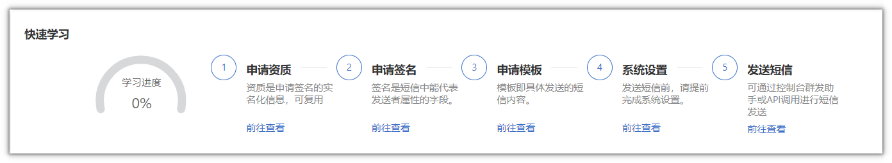

示例代码：

```Java
// 构造请求对象
SendSmsRequest sendSmsRequest = new SendSmsRequest()
            .setPhoneNumbers("1390000****")
            .setSignName("阿里云")
            .setTemplateCode("SMS_15305****")
            // TemplateParam 为序列化后的 JSON 字符串。其中\"表示转义后的双引号。
            .setTemplateParam("{\"name\":\"张三\",\"number\":\"1390000****\"}"); 

// 发送 API 请求
SendSmsResponse sendSmsResponse = client.sendSms(sendSmsRequest);
```

### 9.2.其他提醒方式

企业微信或钉钉提醒

App提醒

大屏提醒

硬件联动通知

# 四、作业

## 1.小程序端需求

### 1.1.需求说明

1.绑定家人

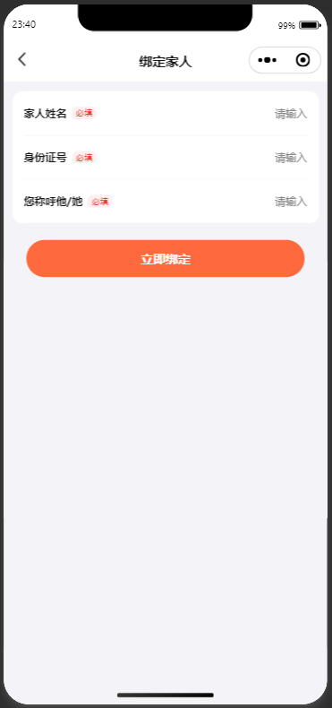

家人姓名和身份证号必须是养老院入住的老人

2.家人列表

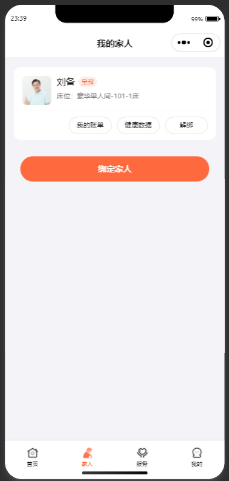

其中健康按钮展示的前提是，该老人必须绑定手表设备

点击解绑按钮，可以解绑老人

3.健康数据


4.按天统计查询指标数据

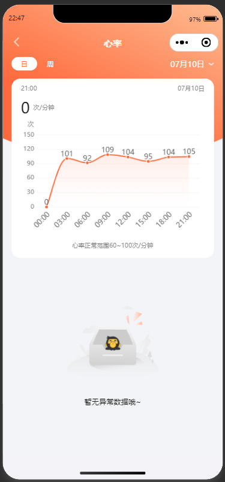


5.按周统计查询指标数据

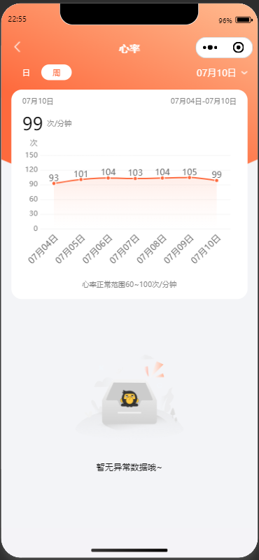

### 1.2.表结构

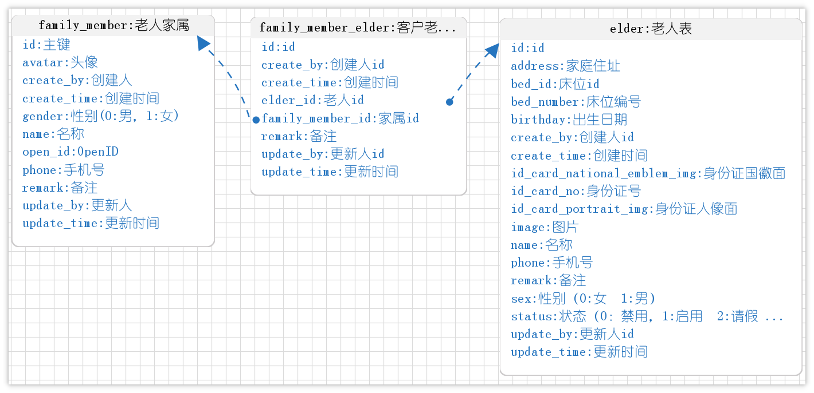

### 1.3.接口文档

[附录-接口文档](https://lining-lo.github.io/lining-lo-notes/星海智伴/附录-接口文档.html#3家人相关接口)

## 2.后台管理系统\-负责老人

### 2.1.需求说明

找到服务管理\-\>负责老人菜单，选择一个入住的老人，可以对老人进行护理员的绑定

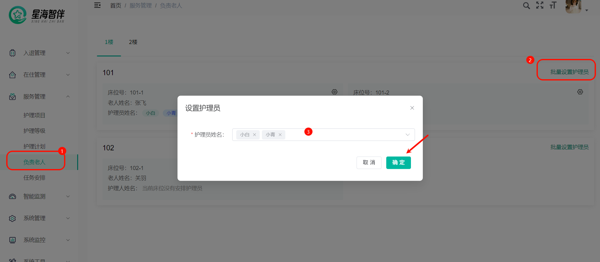

### 2.2.接口文档

[附录-接口文档](https://lining-lo.github.io/lining-lo-notes/星海智伴/附录-接口文档.html#4负责老人)

## 3.后台管理系统\-报警数据

### 3.1.需求说明

1.列表展示

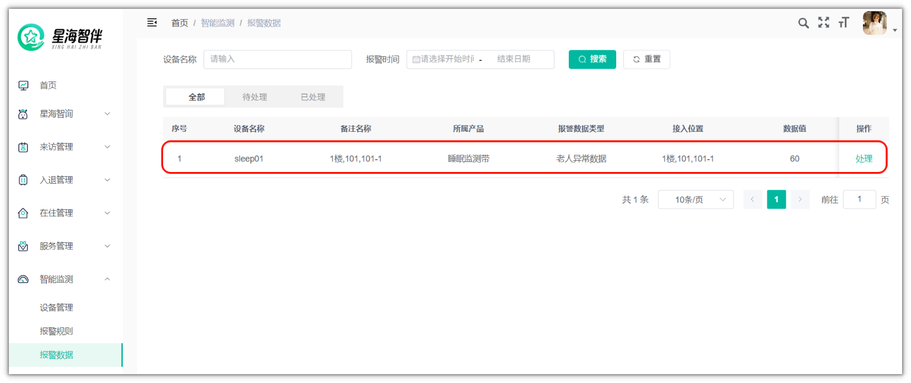

注意：只有负责该老人的护理员才能看到报警数据

2.处理数据

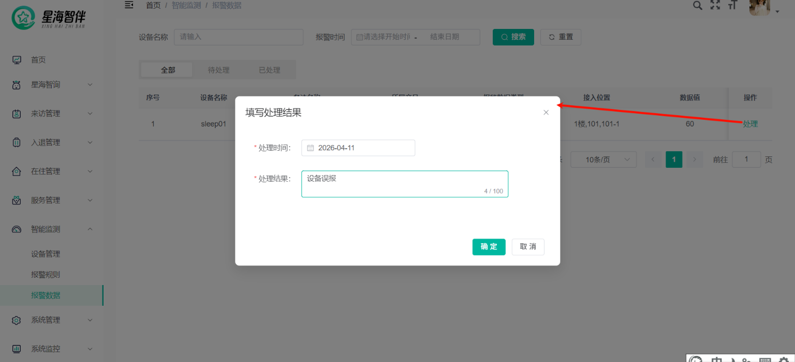

处理后的效果：

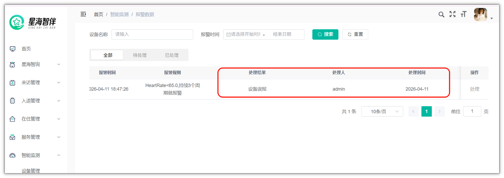

如果老人被多个护理员负责，那么多个护理员都可以看到这条数据

当其中一个护理员处理数据之后，其他负责的护理员也会展示已处理

### 3.2.接口文档

[附录-接口文档](https://lining-lo.github.io/lining-lo-notes/星海智伴/附录-接口文档.html#5报警数据)

## 4.后台管理系统\-任务安排

### 4.1.需求说明

护理任务的来源是服务计划内的任务，服务计划内的任务是根据老人所属服务等级的服务计划，每日自动生成的任务；护理人员可在任务安排页面查看指定日期，待执行/已执行的任务，若有特殊情况可取消任务，执行完任务后，可上传执行图片并填写执行记录；

1.护理任务查询

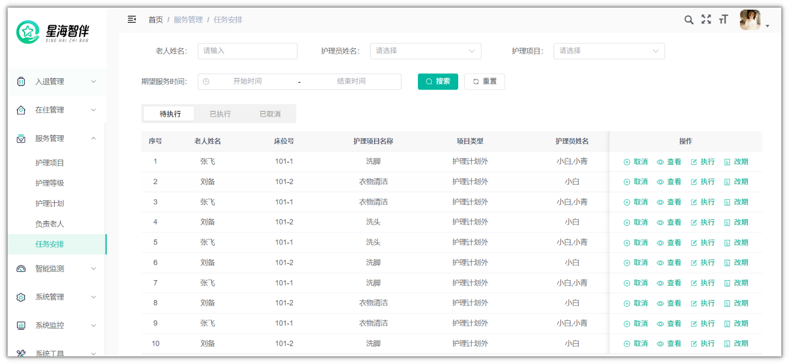

在这个页面中，条件众多，并且在列表的返回值中，需要重点分析所要展示的字段（结合接口文档）

对于任务，可以取消、查看、执行、改期

2.取消

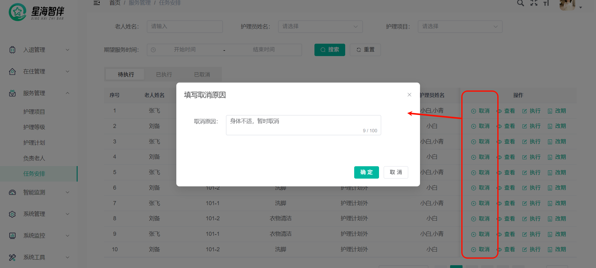

3.执行

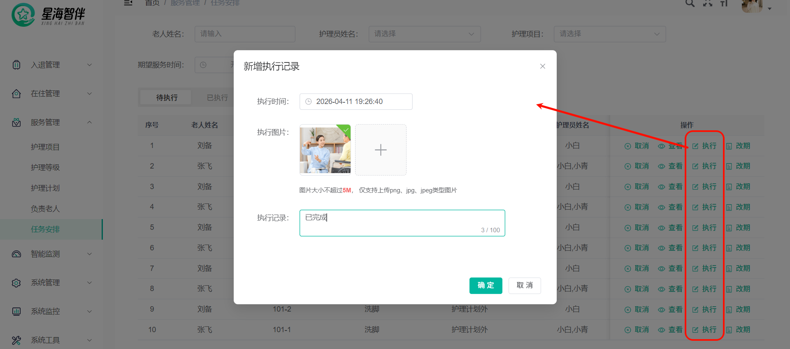

4.改期

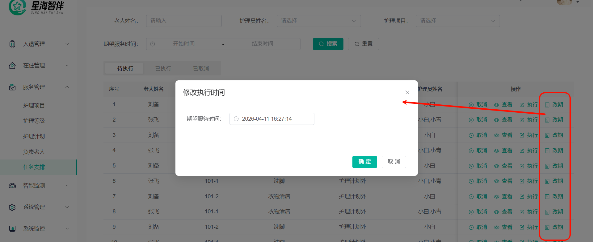

5.查看

查看分了几种情况，根据不同的状态展示的内容有差别

待执行的任务

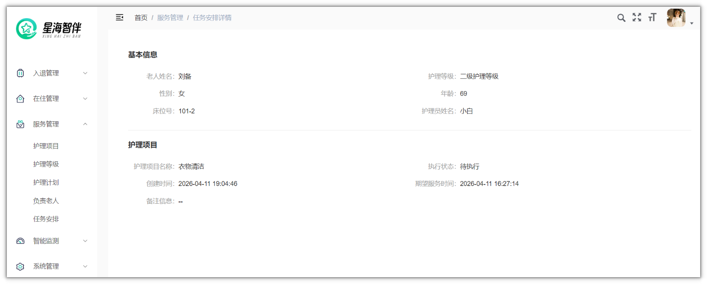

执行后的任务

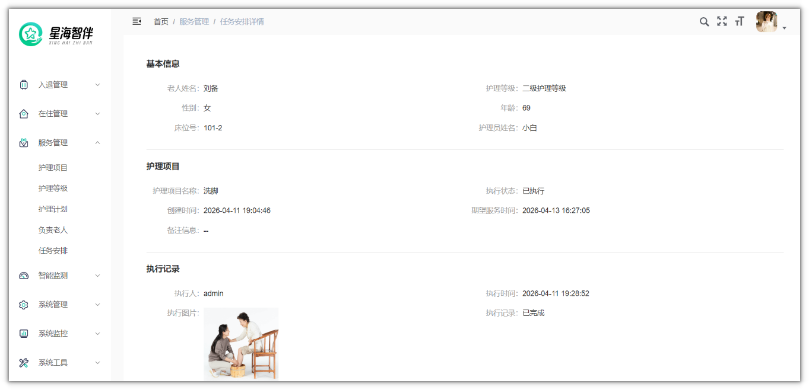

取消的任务

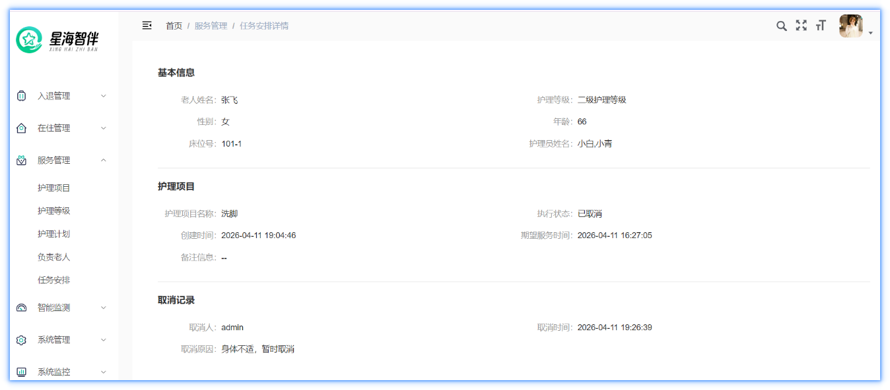

### 4.2.表结构

护理任务表结构

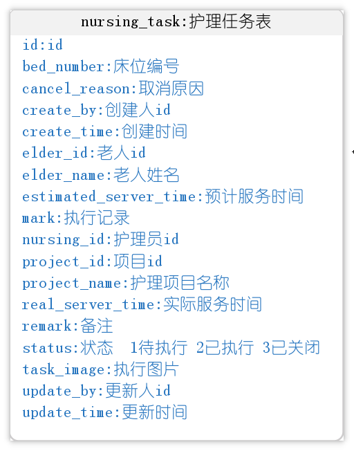

注意：其中字段nursing\_id类型为字符串，可以存多个护理员ID,比如：`103,104`

### 4.3.接口文档

[附录-接口文档](https://lining-lo.github.io/lining-lo-notes/星海智伴/附录-接口文档.html#5任务安排)

### 4.4.护理任务生成

在资料提供的代码中，已经包含了自动生成护理任务的逻辑和代码，大家可以执行系统中的定时任务

护理任务定时生成，就可以自动生成当前养老院中已入住老人的护理任务。如下图：

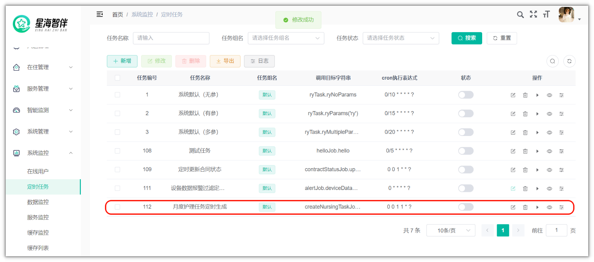

这个定时任务是每月的1号零点执行，现在的cron表达式都是为了测试使用，也可以点击立即执行按钮来生成任务。

注意：每次都点击执行，都会生成当前养老院已入住老人的护理任务，最好不要频繁点击，或者清空表之后再点击

## 5.表结构

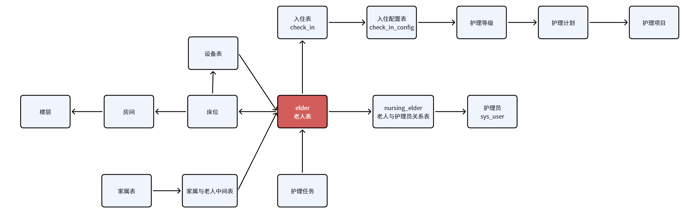

