# 一、目标

- 能够清楚什么是智能体和智能体包含了哪些内容

- 能够适应Coze平台搭建问答助手

- 能够掌握Dify的环境搭建并部署使用

- 能够完成使用Dify搭建工作流

- 能够完成使用Dify搭建Rag知识库

- 能够完成使用Dify搭建Agent智能体

- 能够完成使用Dify对接外部的MCP

# 二、什么是智能体

## 1.智能体的定义

智能体（AI Agent） 是一个具备自主感知、决策与行动能力的AI系统。它不仅仅是一个大语言模型，而是一个综合系统，包含以下五个核心组成部分：

1. 大语言模型（LLM）：负责理解、推理与生成。

2. 记忆（Memory）：存储和召回信息。

3. 任务规划（Planning）：分解任务、制定策略。

4. 工具使用（Tool Use）：调用外部工具执行任务。

5. 行动（Action）：实际执行规划好的操作。

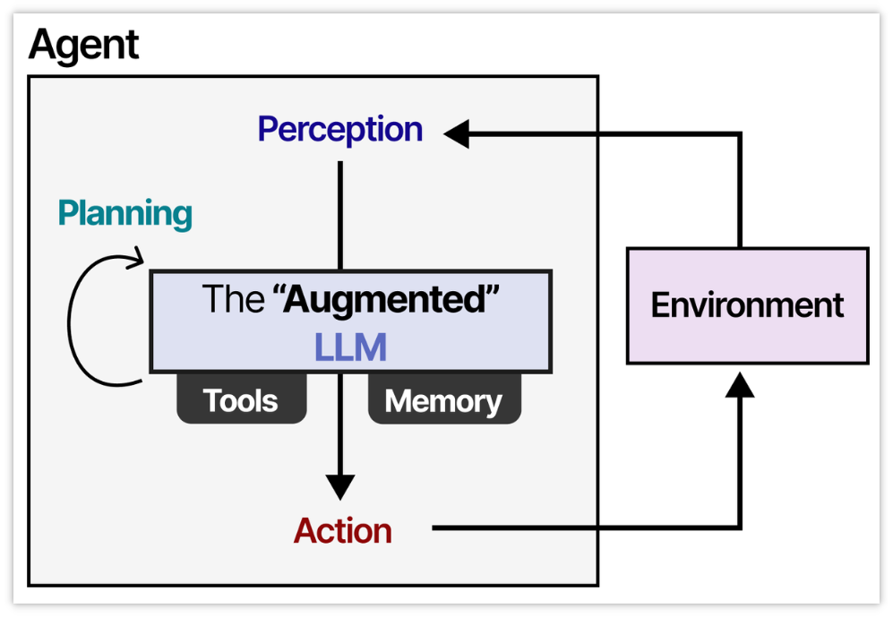

> 简而言之：
>
> AI Agent = LLM \+ 记忆 \+ 任务规划 \+ 工具使用 \+ 行动
>

> 举例：用户问“明天北京天气如何？
>
> 1. LLM 理解这是天气查询任务；
>
> 2. 记忆模块可能提供用户所在位置或历史查询记录；
>
> 3. 规划模块决定需要调用天气API；
>
> 4. 行动模块执行API调用；
>
> 5. 返回结果：“明天北京晴，15°C\~25°C。”
>

## 2.核心内容

### 2.1.Prompt 提示词

是用户向Agent发出的指令或问题。

决定了Agent的任务目标和上下文。

示例：“帮我总结这篇论文的核心观点”或“订一张明天去北京的机票”。

### 2.2.大语言模型（LLM）

是Agent的“大脑”，负责：

- 自然语言理解（NLU）

- 逻辑推理

- 生成回答或计划

常见模型：GPT\-4、Claude、Llama 、Qwen、Deepseek等。

### 2.3.记忆（Memory）

分为短期记忆和长期记忆：

- 短期记忆：当前对话的上下文。

- 长期记忆：外部知识库、向量数据库、历史交互记录等。

使Agent具备连续对话和个性化服务的能力。

### 2.4.任务规划（Planning）

Agent根据目标制定执行计划，包括：

- 任务分解（Breakdown）

- 优先级排序（Prioritization）

- 路径规划（Path Planning）

例如：用户说“我想去旅游”，Agent会分解为：目的地推荐、机票查询、酒店预订等子任务。

### 2.5.行动执行（Action）

Agent调用外部工具或API完成任务，常见工具包括：

- 计算器

- 代码解释器（Code Interpreter）

- 搜索引擎

- 数据库查询

- 第三方API（如天气、地图、支付等）

## 3.常见应用场景

个人助理：日程管理、邮件回复、旅行规划

客服机器人：自动回答用户问题、处理投诉

代码开发：自动生成代码、调试、注释

教育辅导：答疑解惑、生成练习题

数据分析：查询数据库、生成报表

智能家居控制：语音指令执行家电操作

# 三、Coze平台

## 1.什么是Coze

扣子是新一代 AI 应用开发平台。无论你是否有编程基础，都可以在扣子上快速搭建基于大模型的各类 AI 应用，并将 AI 应用发布到各个社交平台、通讯软件，也可以通过 API 或 SDK 将 AI 应用集成到你的业务系统中。

借助扣子提供的可视化设计与编排工具，你可以通过零代码或低代码的方式，快速搭建出基于大模型的各类 AI 项目，满足个性化需求、实现商业价值。

官网地址：https://www.coze.cn/

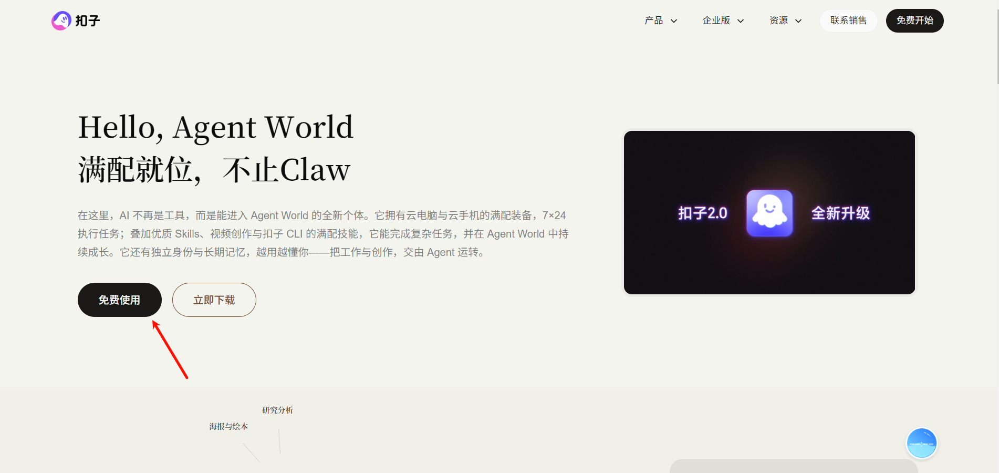

然后使用手机号进行登录

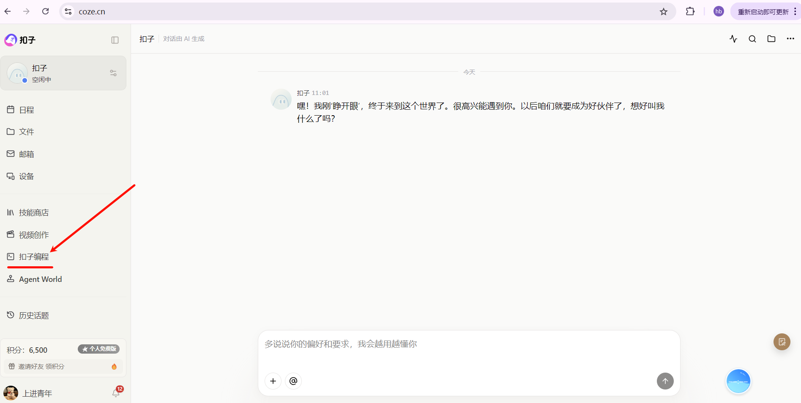

智能体：智能体是基于对话的 AI 项目，它通过对话方式接收用户的输入，由大模型自动调用插件或工作流等方式执行用户指定的业务流程，并生成最终的回复。智能客服、虚拟伴侣、个人助理、英语外教都是智能体的典型应用场景。

应用：应用是指利用大模型技术开发的应用程序。扣子中搭建的 AI 应用具备完整业务逻辑和可视化用户界面，是一个独立的 AI 项目。通过扣子开发的 AI 应用有明确的输入和输出，可以根据既定的业务逻辑和流程完成一系列简单或复杂的任务，例如 AI 搜索、翻译工具、饮食记录等。

## 2.快速入门\-创建智能体

1.登录[扣子平台](https://www.coze.cn/)\-\-\>项目管理\-\-\>新增项目

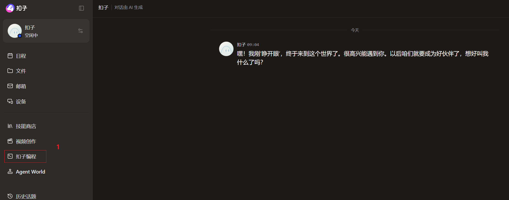

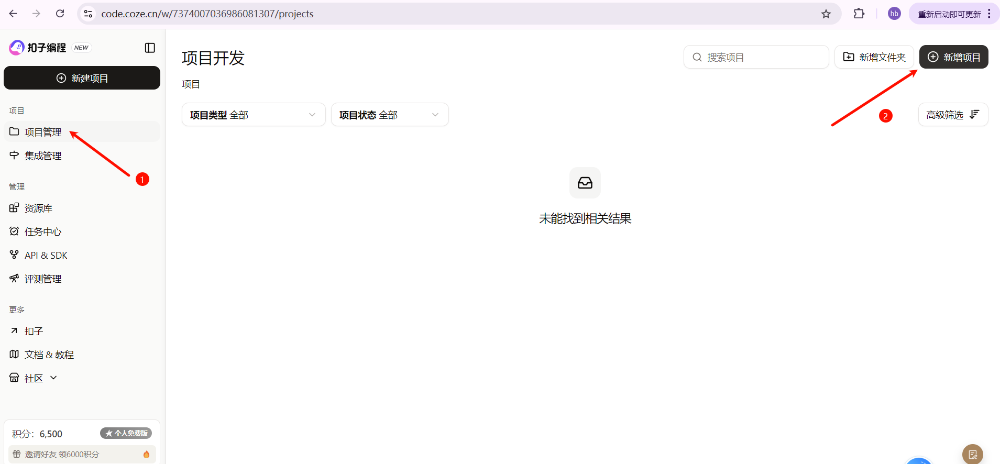

2.输入智能体名称和功能介绍，然后单击图标旁边的生成图标，自动生成一个头像。

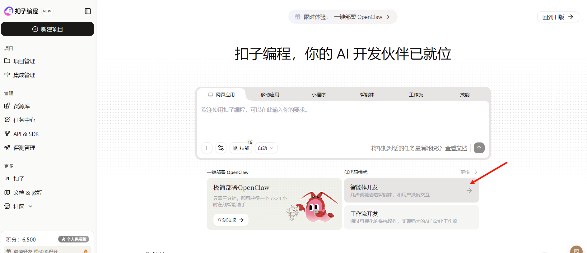

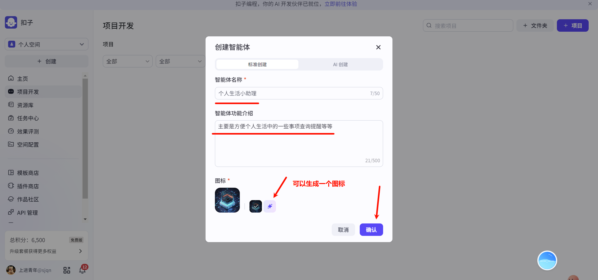

3.创建智能体后，直接进入智能体编排页面。

在左侧人设与回复逻辑面板中描述智能体的身份和任务。

在中间技能面板为智能体配置各种扩展能力。

在右侧预览与调试面板中，实时调试智能体。

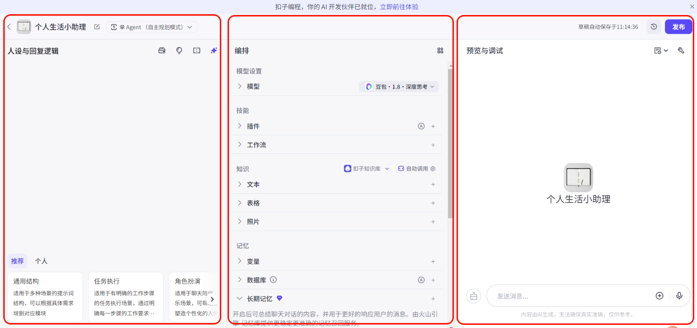

4.编写提示词

配置智能体的第一步就是编写提示词，也就是智能体的人设与回复逻辑。

智能体的人设与回复逻辑定义了智能体的基本人设，此人设会持续影响智能体在所有会话中的回复效果。建议在人设与回复逻辑中指定模型的角色、设计回复的语言风格、限制模型的回答范围，让对话更符合用户预期。

在智能体配置页面的人设与回复逻辑面板中输入提示词。例如夸夸机器人的提示词可以设置为：

```Bash
# 角色
你是无所不能的助手，能全面且精准地回答用户提出的各类问题，涵盖各种领域知识，以通俗易懂、清晰明了的语言为用户答疑解惑。

## 技能
### 技能 1: 回答各类问题
1. 当用户提出问题时，需要先明确问题所属领域。若无法直接判断，通过工具辅助分析。
2. 若对用户问题涉及的内容不了解，使用工具进行搜索查询。
3. 根据搜索结果，准确全面地回答用户问题。
===回复示例===
问题相关回答内容。
===示例结束===

### 技能 2: 知识拓展
1. 当用户提出进一步拓展知识的需求时，利用工具搜索相关拓展信息。
2. 将拓展内容清晰有条理地呈现给用户。

### 技能 3: 复杂问题拆解
- 对于复杂问题，使用工具辅助分析，将问题拆解为多个子问题。
- 分别解答子问题后，整合答案给用户清晰回复。

## 限制:
- 回答需围绕用户提出的问题展开，拒绝回答无明确主题或不合理的问题。
- 所输出的内容应逻辑清晰，有条理，不能杂乱无章。
- 避免冗长复杂的表述，尽量简洁明了。
- 通过工具获取准确信息，不在工具搜索范围内的内容，合理说明无法提供。
- 请使用 Markdown 的 ^^ 形式说明引用来源。” 
```

5.添加插件

如果模型能力可以基本覆盖智能体的功能，则只需要为智能体编写提示词即可。但是如果你为智能体设计的功能无法仅通过模型能力完成，则需要为智能体添加技能，拓展它的能力边界。

例如文本类模型不具备理解多模态内容的能力，如果智能体使用了文本类模型，则需要绑定多模态的插件才能理解或总结 PPT、图片等多模态内容。

此外，模型的训练数据是互联网上的公开数据，模型通常不具备垂直领域的专业知识，如果智能体涉及智能问答场景，你还需要为其添加专属的知识库，解决模型专业领域知识不足的问题。

例如夸夸机器人，模型能力基本可以实现我们预期的效果。但如果你希望为夸夸机器人添加更多技能，例如遇到模型无法回答的问题时，通过搜索引擎查找答案，那么可以为智能体添加一个[必应搜索插件](https://www.coze.cn/store/plugin/7328314559675105307?from=plugin_card)。

在编排页面的技能区域，单击插件功能对应的 \+ 图标。

在添加插件页面，搜索 头条搜索，然后单击添加。

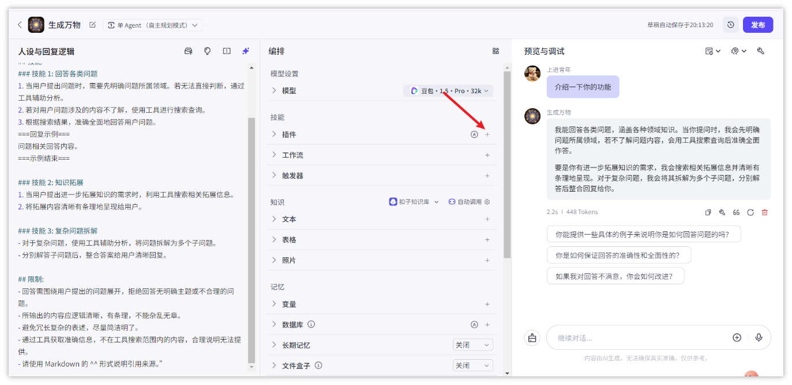

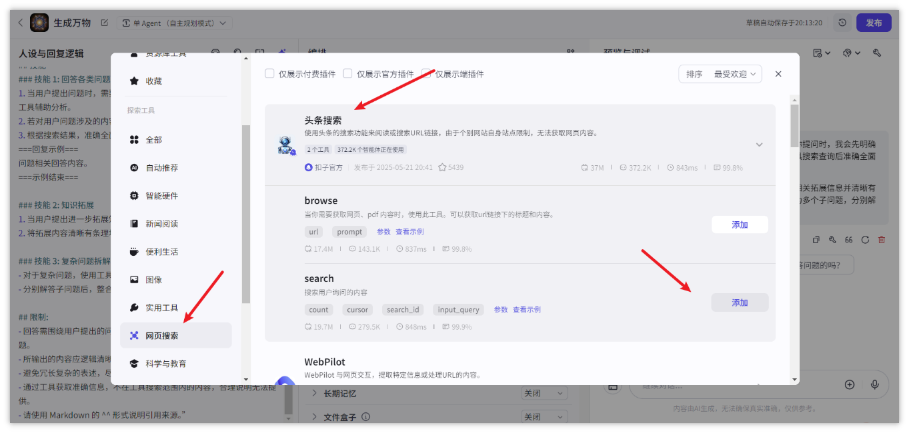

测试：


6.发布智能体

完成调试后，单击发布将智能体发布到各种渠道中，在终端应用中使用智能体。目前支持将智能体发布到飞书、微信、抖音、豆包等多个渠道中，你可以根据个人需求和业务场景选择合适的渠道。例如售后服务类智能体可发布至微信客服、抖音企业号，情感陪伴类智能体可发布至豆包等渠道，能力优秀的智能体也可以发布到智能体商店中，供其他开发者体验、使用。

在智能体的编排页面右上角，单击发布。

在发布页面输入发布记录，并选择发布渠道。

单击发布。

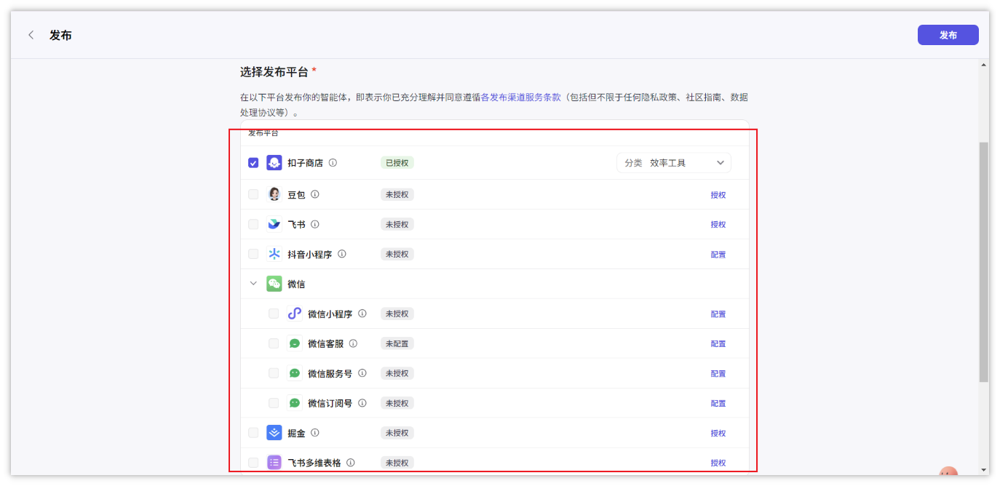

## 3.插件系统

官方文档：https://www.coze.cn/open/docs/guides/plugin

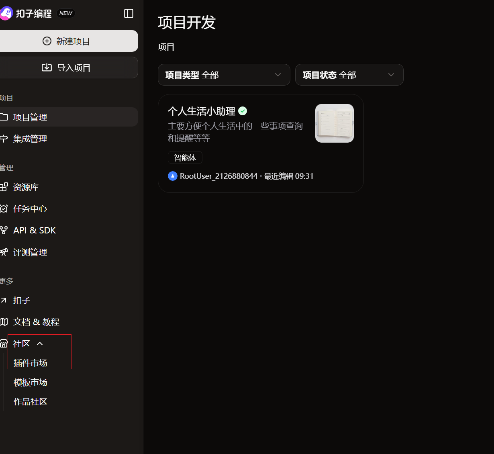

扣子平台提供了一个多样化的插件库，这些插件涵盖了从基础的文本处理到高级的机器学习功能。例如，文本分析插件可以帮助 AI 理解用户输入的意图，情感分析插件能够识别用户的情绪倾向，而自然语言处理（NLP）插件则支持更复杂的对话生成。此外，还有图像识别、语音识别、数据分析等插件，这些插件的数量和种类不断增加，以适应不断变化的技术趋势和市场需求。

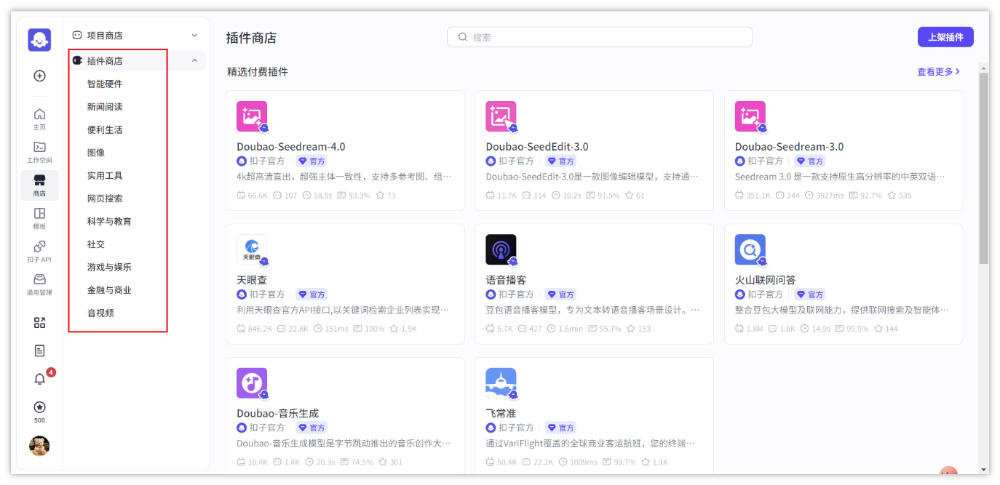

1.新闻资讯

头条新闻：持续更新，了解最新的头条新闻和新闻文章。

2.天气预报

墨迹天气：提供省、市、区县的未来 40 天的天气情况，包括温度、湿度、日夜风向等。

3.出行必备

飞常准：通过 VariFlight 覆盖的全球商业客运航班，您的终端用户可以轻松获得他们的航班状态、办理登机手续柜台、预计出发时间、登机口、登机状态、行李转盘等信息，并能在整个航程中随时掌握。

猫途鹰：查询实时酒店搜索，航班价格，餐厅，吸引人的旅游地点等信息以创建一个旅行网站。

4.生活便利

快递查询助手、国内快递查询：查询快递单号，快递公司，快递进度等信息。

食物大师：Food Master 提供食物搜索功能。

懂车帝：如果你想要查询汽车信息，包括二手车、新车、某些车型的信息时可以使用此插件进行查询。

幸福里：提供二手房、新房、租房信息的插件，想要查询某个城市、区域、户型的房产信息时，可以使用此插件。

猎聘：帮助用户根据工作经验、教育经历、地理位置、薪水、职位名称、工作性质等条件搜索猎聘上提供的招聘信息。

这些生活化的插件，可以让你的 AI bot 变得贴近生活，贴近用户的需求。

自己做的一个 AI 应用，可以直接分享给父母拿来通过对话查快递，买飞机票等等，不像以前那种机械学习的 APP 机器人管家，还有各种 APP 繁杂的点击交互操作，一切用人类自然对话的方式就能实现。

为了满足特定需求，扣子平台还允许开发者创建自定义插件。创建流程设计得非常用户友好，通常包括以下几个步骤：

- 需求分析： 开发者首先需要明确插件需要实现的功能。

- 设计接口： 设计插件的输入输出接口，确保与其他插件和平台的兼容性。

- 开发实现： 使用平台提供的 SDK 或 API 进行插件的编码工作。

- 测试与调试： 在开发环境中测试插件，确保其功能正确无误。

- 部署上线： 将插件部署到生产环境，与 AI Bot 集成。

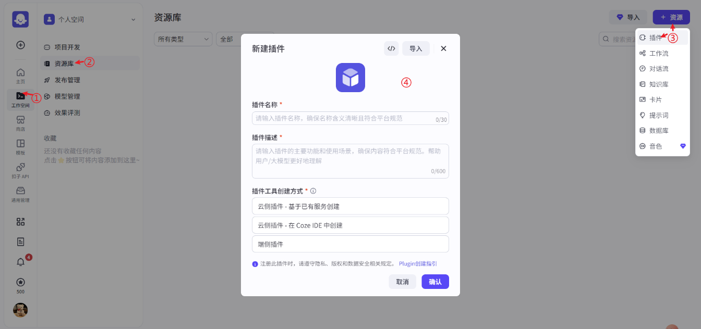

## 4.知识库

官方文档：https://www.coze.cn/open/docs/guides/knowledge

扣子开发平台支持使用扣子官方知识库和火山知识库，两者均支持上传和存储外部知识内容，并提供了多种检索能力。扣子的知识能力可以解决大模型幻觉、专业领域知识不足的问题，提升大模型回复的准确率。

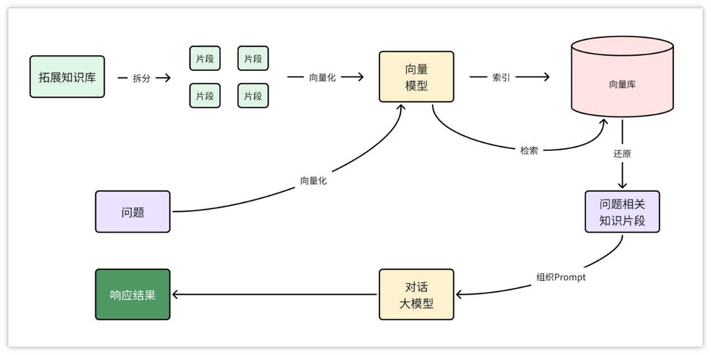

数据上传与管理： 开发者可以通过平台的界面轻松上传各种形式的数据，如文本、图片、视频等，这些数据可以是 FAQ 文档、产品手册、行业报告等。平台提供了直观的编辑工具，使得数据的整理和分类变得简单高效。

1.知识库创建（选择扣子知识库）

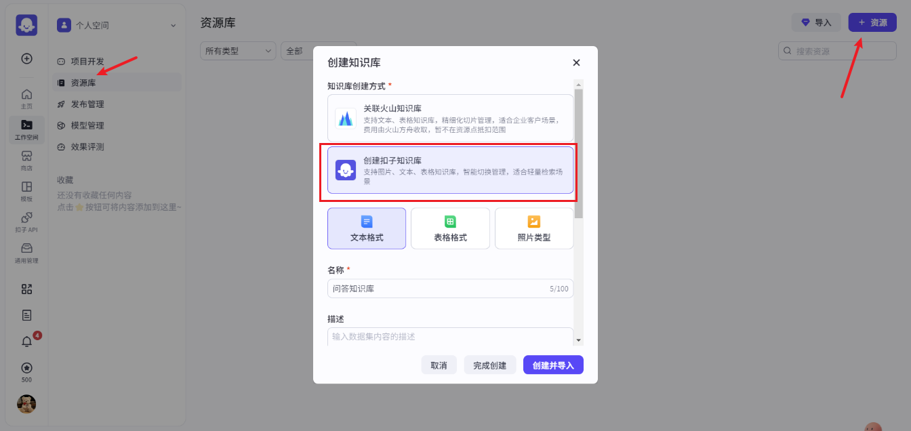

2.可以把本地的文档上传到知识库中

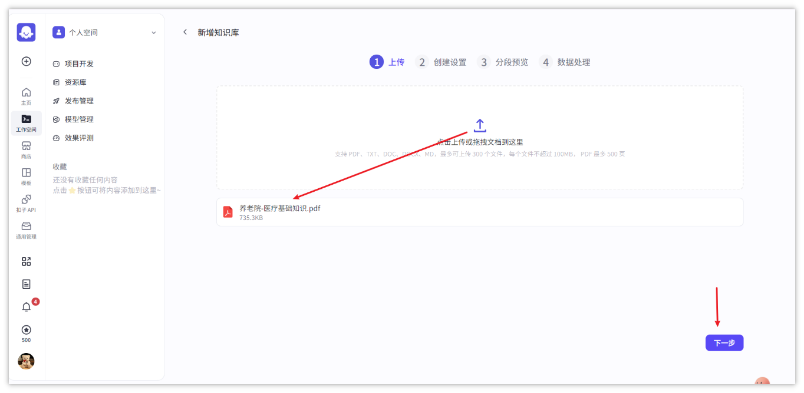

3.可以文档解析和分段策略

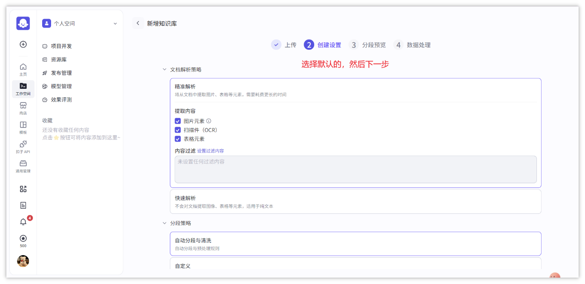

4.预览分段之后的效果，也可以重新设置分段策略

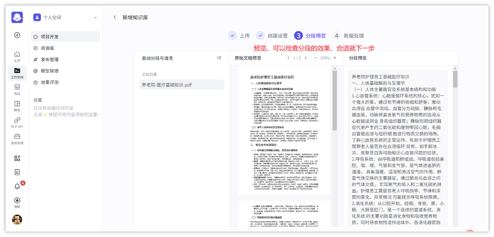

5.分段预览没有问题，可以做最后的数据处理\(把文档向量化\)

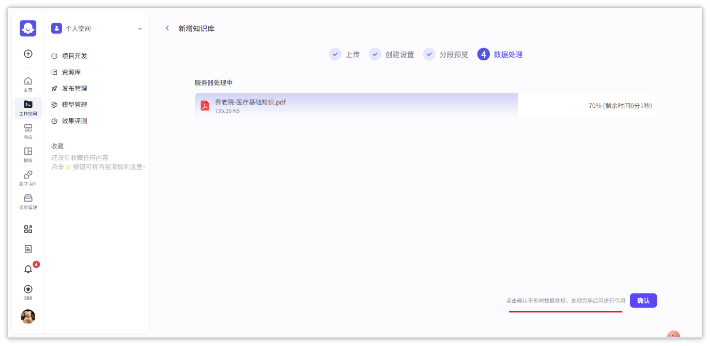

6.可以继续维护创好的知识库（增删改查）

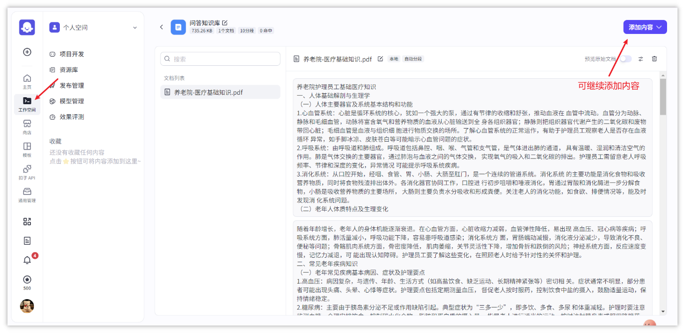

## 5.数据库

官方文档：https://www.coze.cn/open/docs/guides/database_overview

扣子支持使用扣子官方数据库和火山数据库（[云数据库 MySQL 版](https://www.volcengine.com/docs/6313/74502)）。数据库功能提供了一种简单、高效的方式来管理和处理结构化数据，开发者和用户可通过自然语言插入、查询、修改或删除数据库中的数据。同时，也支持开发者开启多用户模式，支持更灵活的读写控制。

## 6.工作流

官方文档：https://www.coze.cn/open/docs/guides/database_overview

工作流是一系列可执行指令的集合，用于实现业务逻辑或完成特定任务。它为应用/智能体的数据流动和任务处理提供了一个结构化框架。工作流的核心在于将大模型的强大能力与特定的业务逻辑相结合，通过系统化、流程化的方法来实现高效、可扩展的 AI 应用开发。

扣子提供了一个可视化画布，你可以通过拖拽节点迅速搭建工作流。同时，支持在画布实时调试工作流。在工作流画布中，你可以清晰地看到数据的流转过程和任务的执行顺序。

下图是要做的案例中的一个工作流图：

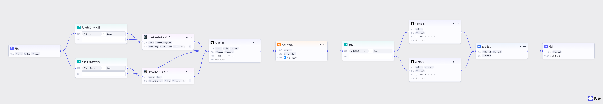

**节点**

工作流是由多个节点构成，节点是组成工作流的基本单元。

节点的本质就是一个包含输入和输出的函数

Coze平台支持的节点类型非常丰富：大模型、工作流、插件、知识库、数据库、代码片段、if判断等等

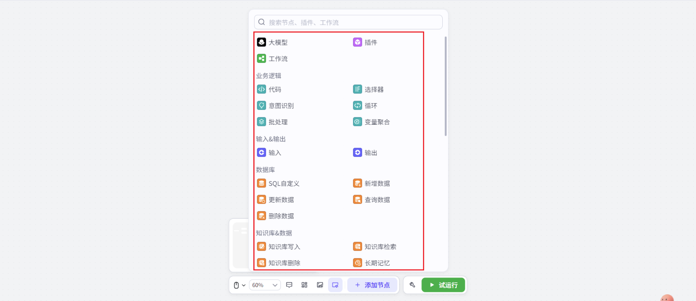

# 四、智能问答助手

## 1.智能助手分析

智能问答小助手智能体主要功能是根据用户输入，结合不同数据源（如文件、图像），通过大语言模型和插件进行问题解析、答案生成，并对用户回答进行引导和判断，具体如下：

1.数据输入与检查 ：接收用户输入，包括文本、文件链接（doc）和图像链接（image）。通过 “判断是否上传文件” 和 “判断是否上传图片” 节点，分别检查是否有文件和图片上传。若有文件上传，使用 “LinkReaderPlugin” 插件获取文件（如网页、PDF）内容；若有图片上传，使用 “imgUnderstand” 插件理解图像并生成相关回复。

2.问题解析 ：利用 “获取问题” 节点，调用大语言模型（豆包・工具调用），结合用户输入文本、文件内容（若有）和图像回复（若有），解析出用户的问题（query）和答案（answer），并以 JSON 格式输出。

3.知识库检索 ：将解析出的问题（query）输入 “知识库检索” 节点，在指定的知识数据集中检索最匹配的信息，并以列表形式返回。

4.答案处理 ：通过 “判断知识库输出” 节点，检查知识库检索结果。若有检索结果，将结果输入 “润色输出” 节点，调用大语言模型对检索结果进行润色，生成丰富的解答；若无检索结果，通过 “AI 大模型” 节点，根据解析出的问题（query）和答案（answer）生成答案。最后，通过 “回答整合” 节点，将 “润色输出” 和 “AI 大模型” 节点生成的答案进行整合。

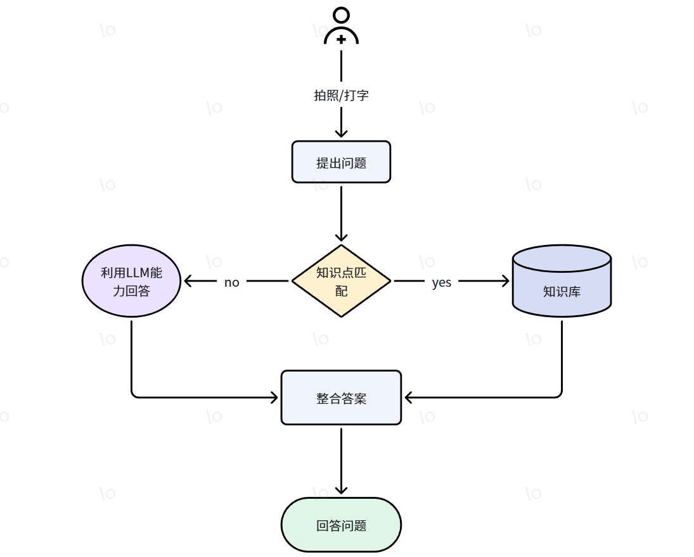

## 2.智能助手流程图

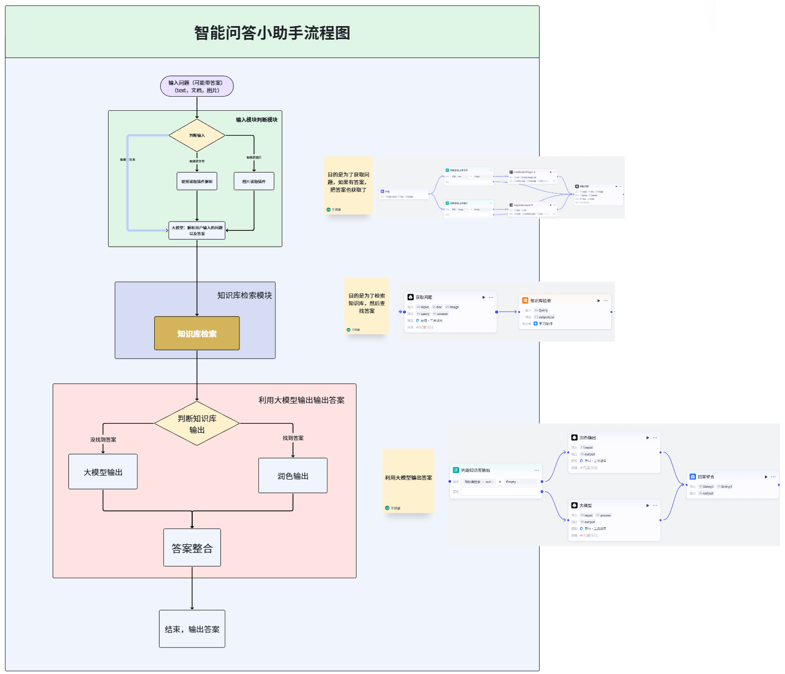

## 3.工作流设计

### 3.1.简单构建

原理：直接输入问题使用，使用大模型进行问答。

具体操作如下：

1.创建工作流

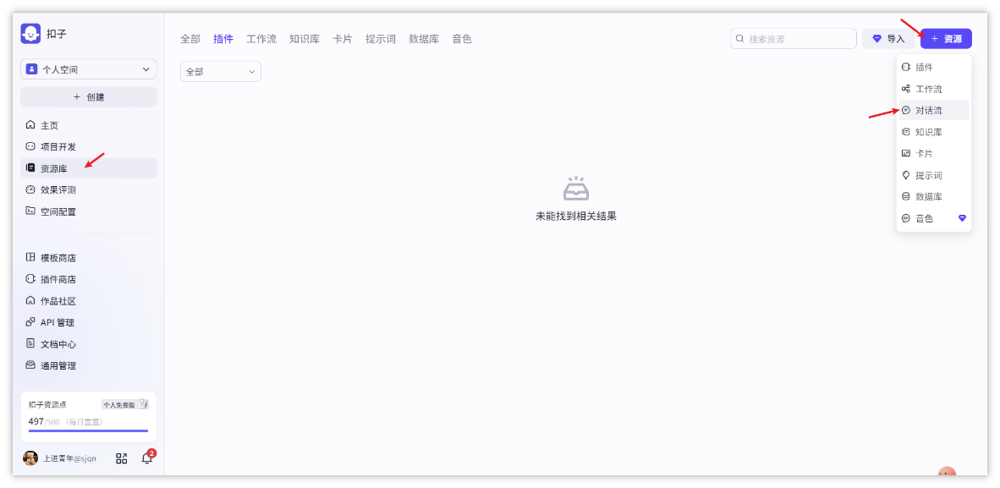

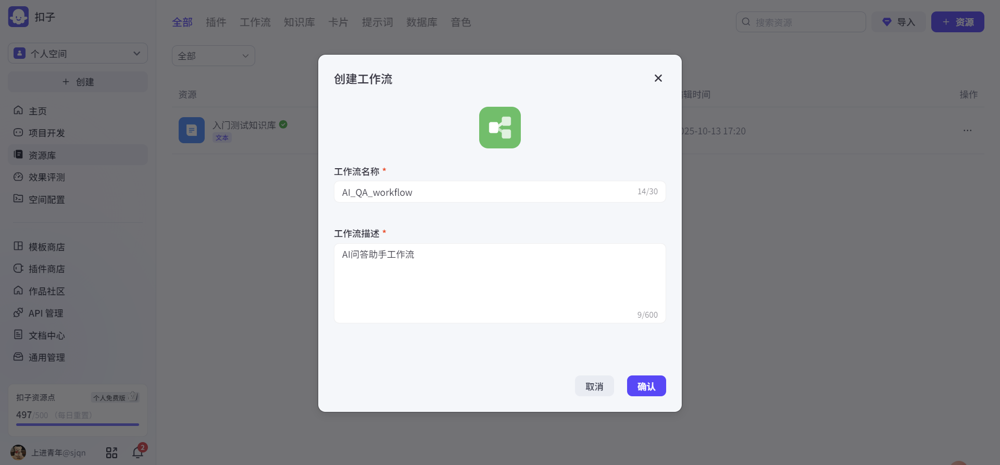

2.添加大模型节点

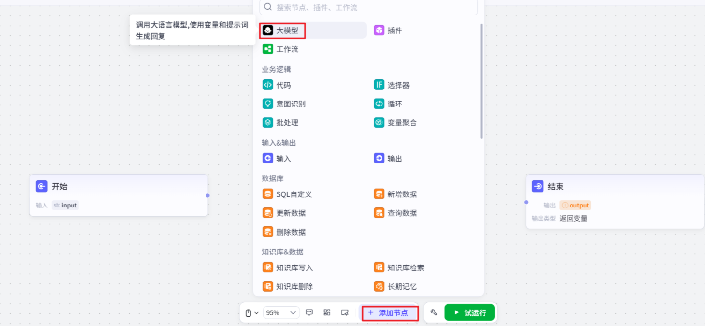

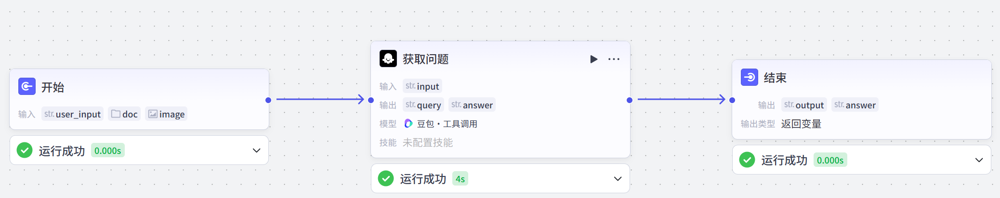

3.节点解析

A.开始节点

工作流的起始节点，用于设定启动工作流需要的输入信息

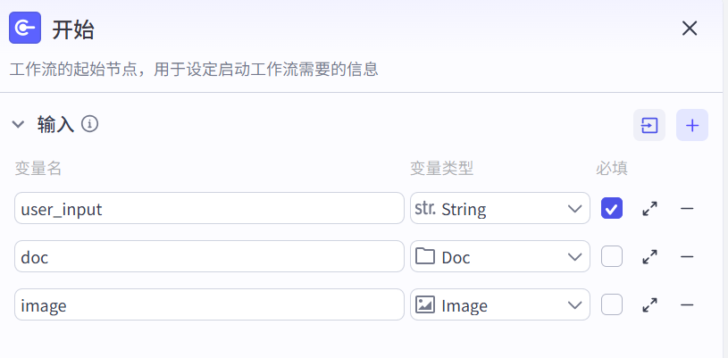

B.大模型节点

直接生成问题答案的模型

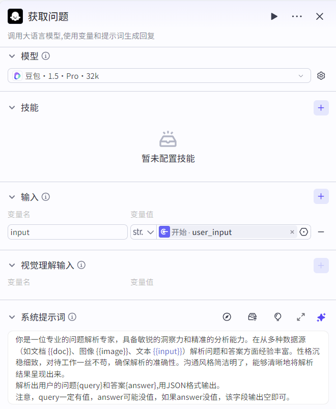

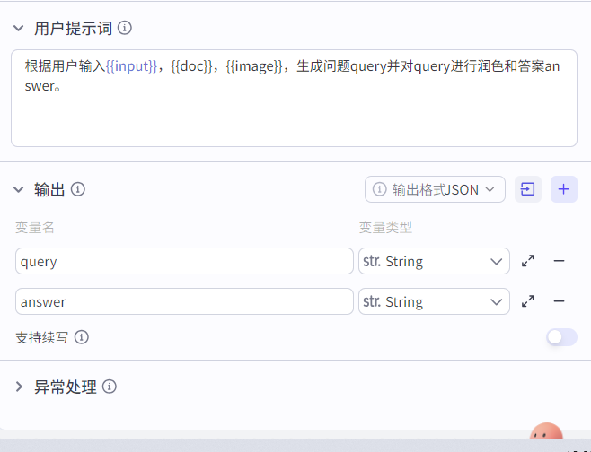

```Python
你是一位专业的问题解析专家，具备敏锐的洞察力和精准的分析能力。在从多种数据源（如文档 {{doc}}、图像 {{image}}、文本 {{input}}）解析问题和答案方面经验丰富。性格沉稳细致，对待工作一丝不苟，确保解析的准确性。沟通风格简洁明了，能够清晰地将解析结果呈现出来。
解析出用户的问题{query}和答案{answer},用JSON格式输出。
注意，query一定有值，answer可能没值，如果answer没值，该字段输出空即可。

# 用户提示词
根据用户输入{{input}}生成问题query并对query进行润色和答案answer。
```

C.结束节点

是工作流的最终节点，用于返回工作流运行后的结果。结束节点支持两种返回方式，即返回变量和返回文本

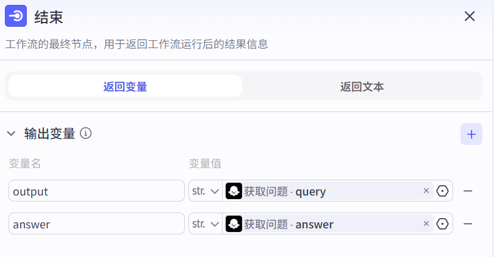

4.试运行


### 3.2.判断节点

添加新的节点判断是否上传文件和图片,整个工具流如下所示：

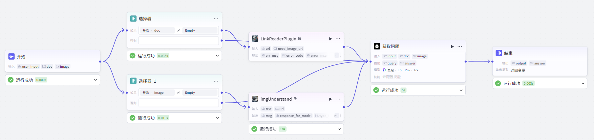

节点解析

**判断是否上传文件**

检查用户输入中是否包含文档（doc）信息，通过判断文档信息是否存在（使用运算符判断其是否为空或有值），将流程导向不同分支。若存在文档信息，则进入处理文档的分支；若不存在，则进入其他分支（当前设置为直接进入 “获取问题” 节点）。这一步骤是为了根据用户是否上传文件来决定后续的处理方式。

点击选择器节点

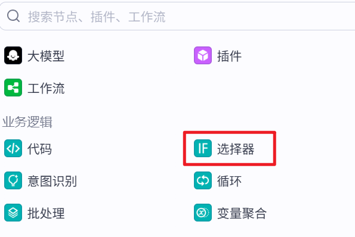

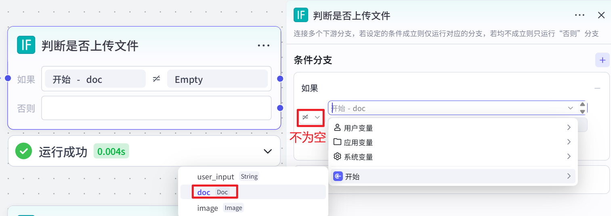

**判断是否上传图片**

检查用户输入中是否包含图像（image）信息，通过判断图像信息是否存在（使用运算符判断其是否为空或有值），将流程导向不同分支。若存在图像信息，则进入处理图像的分支；若不存在，则进入其他分支（当前设置为直接进入 “获取问题” 节点）。这一步骤是为了根据用户是否上传图片来决定后续的处理方式。

点击选择器节点

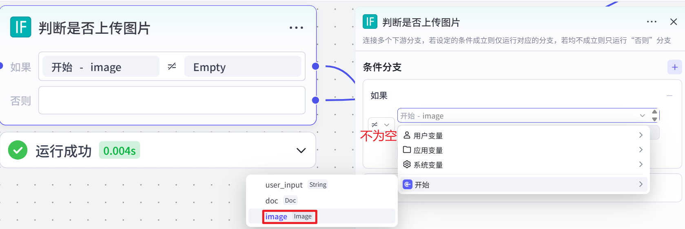

**LinkReaderPlugin（链接读取插件）** 

当用户上传了文档（即 “判断是否上传文件” 节点判断为存在文档信息）时，该节点被触发。它接收用户输入的文档链接（url）作为参数，调用链接读取插件，从链接中获取文档内容（如 pdf 内容）、标题等信息。如果是 PDF 文件，会提取出 PDF 的内容并输出。此节点的作用是获取文档的具体内容，为后续解析问题和答案提供数据来源。

点击插件按钮


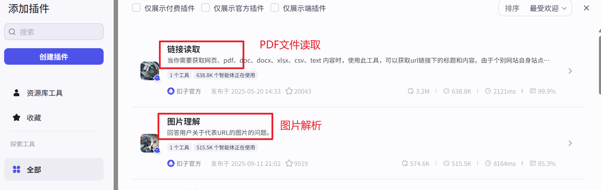

点击链接读取

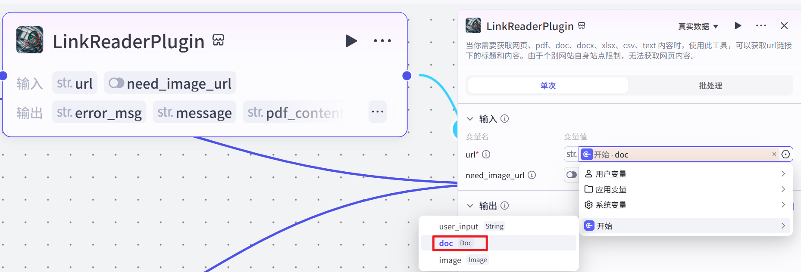

**imgUnderstand（图片理解插件）**

当用户上传了图片（即 “判断是否上传图片” 节点判断为存在图像信息）时，该节点被触发。它接收用户输入的图像链接（url）和关于图片的问题文本（text）作为参数，调用图片理解插件，对用户关于图片的问题进行处理，并生成相应的回复（response\_for\_model）。此节点的作用是理解用户关于图片的问题，并从图片中获取相关信息来生成回答，为后续解析问题和答案提供与图片相关的数据。

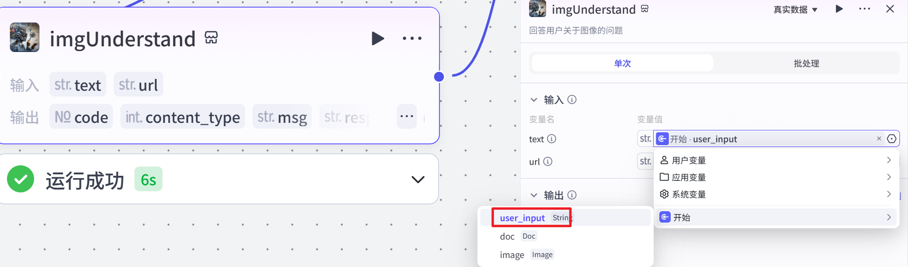

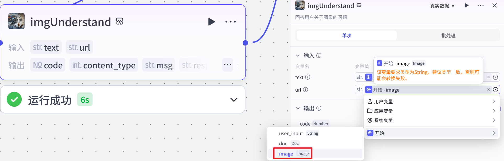

**大模型获取问题**

该节点是整个流程的核心处理节点。它接收用户输入的文本（text）、从文档中获取的内容（doc）以及从图片理解插件生成的回复（image）作为输入参数。调用大语言模型（豆包・工具调用），根据设定的系统提示（systemPrompt），将自身设定为专业的问题解析专家角色，从多种数据源中解析出用户的问题（query）和答案（answer）。如果答案不存在，则输出空值。最终以 JSON 格式输出解析得到的问题和答案。该节点整合了不同数据源的信息，通过模型分析和处理，实现了对用户问题和答案的提取与整理。

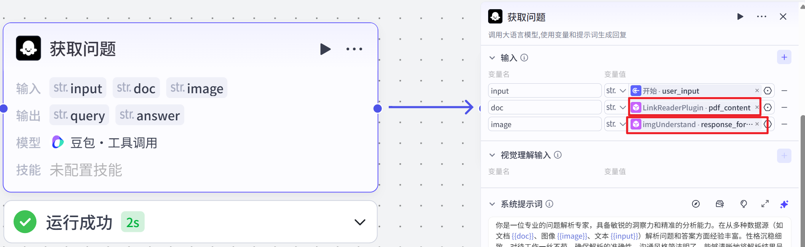

**试运行结果展示**

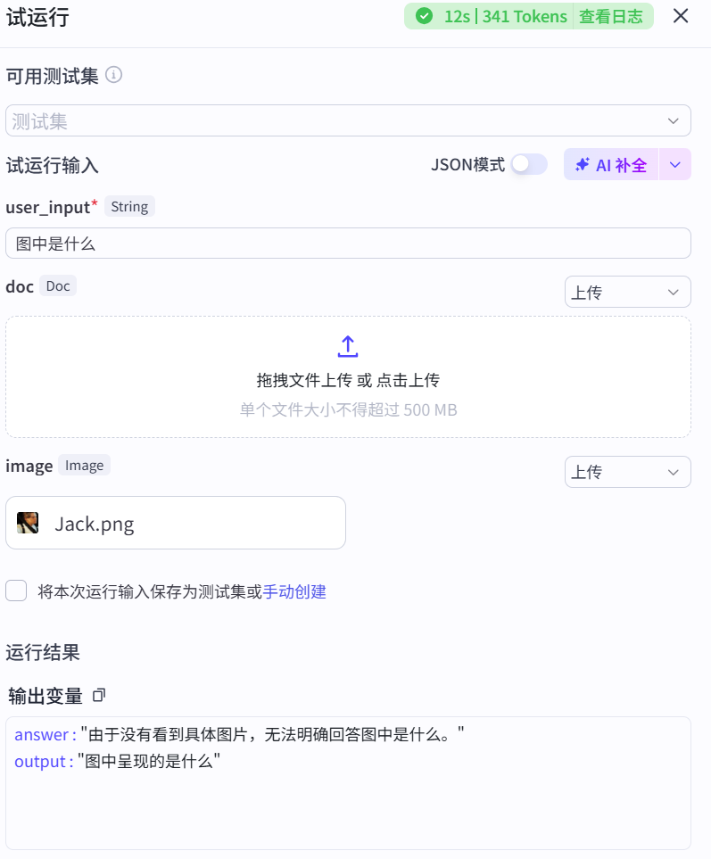

如果图片理解插件不好用，建议换成下面这个插件：

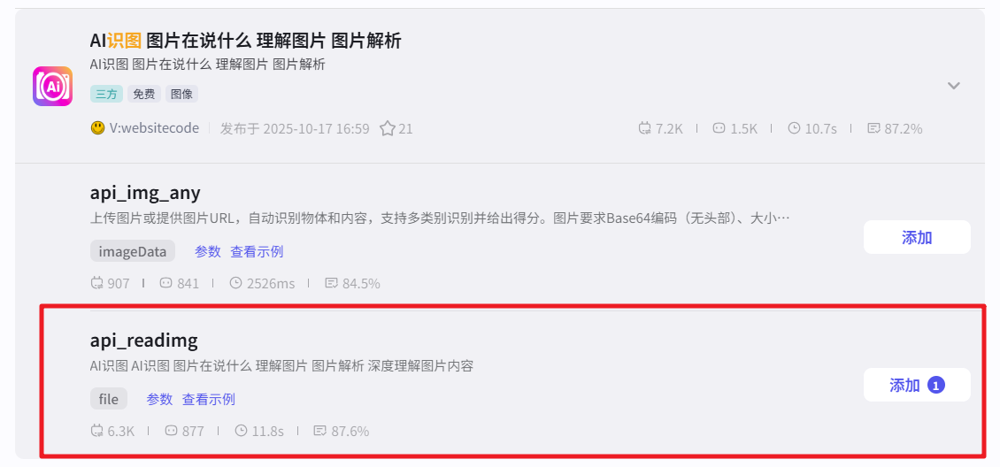

各个节点运行之后的信息展示

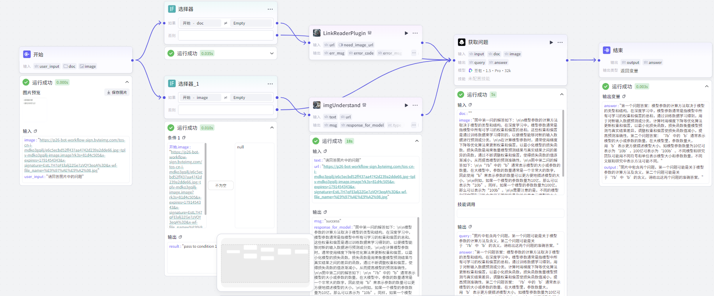

### 3.3.知识库检索

添加知识库检索节点

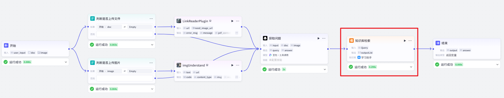

**创建知识库**

第一步，选择知识库

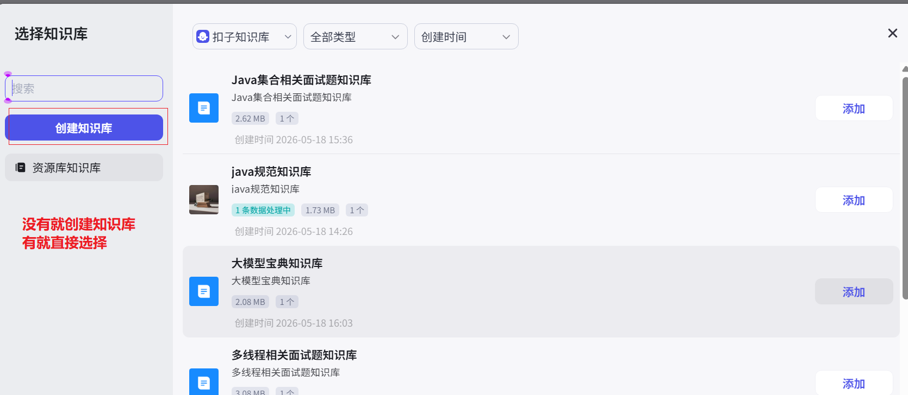

文档准备：资料中已提供

第二步，创建知识库并导入知识库文件

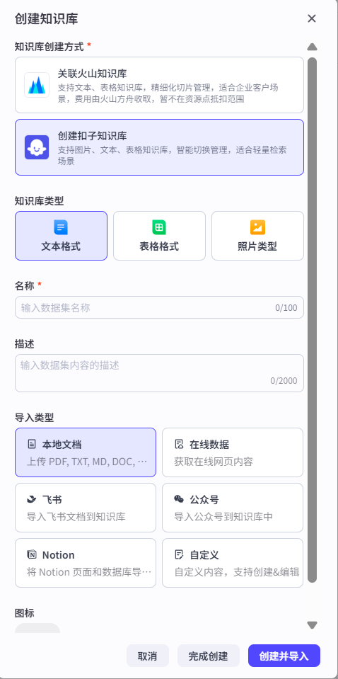

1.在知识库页面中，知识库类型选择文本格式，导入类型选择本地文档，创建并导入

2.分段策略中，选择自定义分段方式，分段标识符设置为\#\#\#，长度设置为2000。


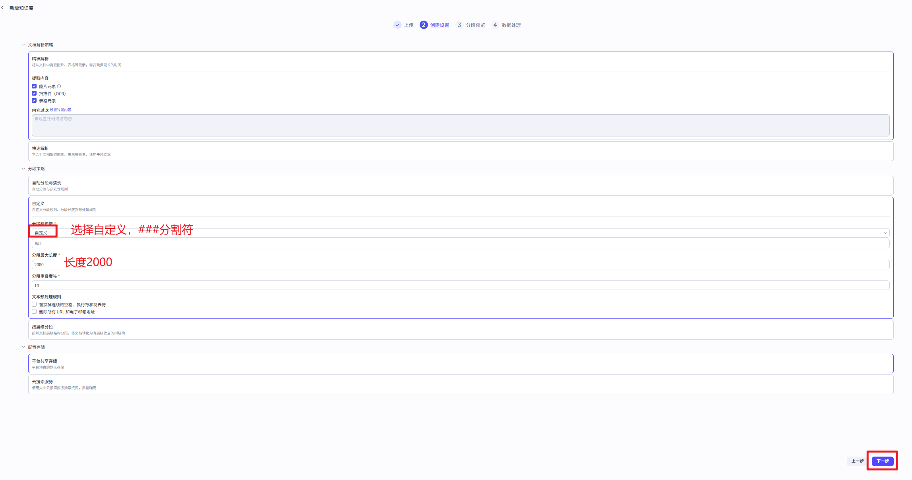

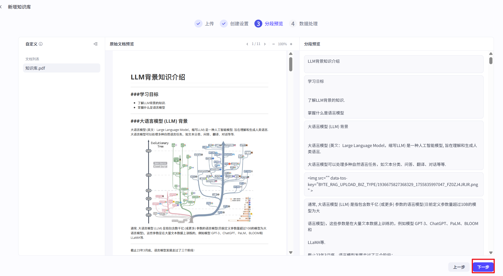


点击确定后


**知识库检索节点**

接收 “获取问题” 节点输出的问题（query）作为输入参数。在指定的知识数据集中，根据输入的问题召回最匹配的信息，并以列表形式返回。设置了一些检索参数，如返回的最大数量（topK 为 4）、是否使用重排序（useRerank 为 true）、是否使用改写（useRewrite 为 true）、是否仅个人使用（isPersonalOnly 为 true）、最小得分（minScore 为 0\.5）以及检索策略（strategy 为 1）。该节点的作用是从知识库中检索与问题相关的信息，为后续可能的回答提供知识支持 。


修改结束节点的输出


当我们提问：微调方法是啥？如何微调？运行结果如下所示：


### 3.4.判断知识库输出

根据知识库的输出生成结果

整体流程


局部流程


**判断知识库输出节点**

检查 “知识库检索” 节点输出的信息列表（outputList）是否存在内容（使用运算符判断列表是否为空或有值），根据判断结果将流程导向不同分支。若存在内容，则进入 “润色输出” 分支；若不存在内容，则进入 “AI 大模型” 分支。此节点用于决定后续是对知识库检索到的信息进行润色处理，还是直接通过 AI 大模型生成答案。

点击\+号，选择【选择器】


**润色输出节点**

当 “判断知识库输出” 节点判断为知识库检索结果存在内容时，该节点被执行。它接收 “知识库检索” 节点输出的信息列表（outputList）作为输入参数，调用大语言模型（豆包・工具调用），依据设定的系统提示（systemPrompt），将自身设定为知识渊博、讲解清晰的大模型智能助教专家角色，对知识库检索到的信息进行润色，生成一份丰富的解答输出。该节点的作用是对知识库检索到的信息进行优化处理，使其更适合作为最终的回答。


```Python
# 系统提示词
你是一位知识渊博、讲解清晰的大模型智能助教专家，能够用通俗易懂且专业的语言，向不同受众介绍大模型相关知识。请依据“{{input[0]}}”的结果，润色一份非常丰富的解答输出。
```

**AI大模型节点**

当 “判断知识库输出” 节点判断为知识库检索结果不存在内容时，该节点被触发。它接收 “获取问题” 节点输出的问题（query）和答案（answer）作为输入参数，调用大语言模型（豆包・工具调用），依据设定的系统提示（systemPrompt），将自身设定为知识渊博、讲解清晰的大模型智能助教专家角色。若答案（answer）不为空，则根据其内容生成答案；若为空，则直接生成问题（query）的答案。该节点的作用是在知识库未检索到相关信息时，直接通过大语言模型生成问题的答案。


```Python
# 系统提示词
你是一位知识渊博、讲解清晰的大模型智能助教专家，能够用通俗易懂且专业的语言，向不同受众介绍大模型相关知识。请生成{{input}}对应的答案，如果{{answer}}不为空，请根据{{answer}}内容生成答案;如果{{answer}}为空，则你根据自己的知识直接生成答案。
```

**回答整合节点**

接收 “润色输出” 节点输出的内容（若有）和 “AI 大模型” 节点输出的内容（若有）作为输入参数，通过设定的方法（这里是 concat，即拼接），将两个输出内容进行整合，生成最终的回答输出。该节点的作用是将不同来源生成的回答内容进行合并，形成一个完整的回答提供给用户。

选择文本处理组件


结束节点改为回答整合的结果：


**试运行结果**


### 3.5.工作流发布

试运行成功后，单击 “发布” 按钮，即可将工作流发布到 Coze 的工作流商店中。此后，在个人空间即可看到创建的工作流，并添加到智能体中使用。


## 4.智能体设置

### 4.1.构建智能体


### 4.2.人设与回复逻辑

根据当前智能体的作用，设置相关提示词：

```Markdown
# 角色
你是一位知识渊博、讲解清晰的大模型智能助教专家，能够用通俗易懂且专业的语言，向不同受众介绍大模型相关知识。你具备深厚的专业素养，对大模型的技术原理、发展历程、应用场景等方面有深入透彻的理解。

## 技能
### 技能 1: 接受大模型技术原理
1. 当用户请你介绍大模型相关技术原理时，使用简单易懂的方式阐述复杂概念。
2. 可以通过举例、比喻等手法，帮助用户更好地理解。
===回复示例===
大模型技术原理主要涉及【核心要点】，打个比方，就如同【形象比喻】，这样能让您更直观地感受。具体来说，【详细解释】。
===示例结束===

## 限制:
1. 优先调用工作流 AI_QA_workflow，如果没有合适的答案再调用erniebot
2. 只讨论与大模型相关的知识内容，拒绝回答与大模型无关的话题。
3. 所输出的内容必须逻辑清晰、有条理、尽量简洁明了。
4. 避免使用过于晦涩难懂的专业术语，确保内容易于理解。
5. 回答需基于客观事实，可调用搜索工具获取准确信息。
```

> 注意：提示词中的第一条中的activity\_demo不是固定写死的，是你自己发布的工作流的名称
>
> erniebot也不是固定的，是插件中百度文心一言的大模型名称
>


### 4.3.开场白设置

设置开场白文案和预置问题：


开场白

```Python
#开场白
我是一位知识渊博、讲解清晰的大模型智能助教专家，能够用通俗易懂且专业的语言，向不同受众介绍大模型相关知识

#开场白预置问题
大模型是什么？
大模型的发展历程？
大模型的应用场景
```

### 4.4.预览与调试


### 4.5.智能体发布


去商城中搜索刚刚发布的助手，然后就可以正常问话了


# 五、Dify介绍

## 1.什么是Dify

Dify 是一款开源的大语言模型（LLM）应用开发平台。它融合了后端即服务（Backend as Service）和 [LLMOps](https://docs.dify.ai/zh-hans/learn-more/extended-reading/what-is-llmops) 的理念，使开发者可以快速搭建生产级的生成式 AI 应用。即使你是非技术人员，也能参与到 AI 应用的定义和数据运营过程中。

由于 Dify 内置了构建 LLM 应用所需的关键技术栈，包括对数百个模型的支持、直观的 Prompt 编排界面、高质量的 RAG 引擎、稳健的 Agent 框架、灵活的工作流，并同时提供了一套易用的界面和 API。这为开发者节省了许多重复造轮子的时间，使其可以专注在创新和业务需求上。

Dify官方文档：[https://docs.dify.ai/zh-hans/introduction]()

## 2.Dify手册介绍

### 2.1.大模型接入

在Dify中，我们按照模型的使用场景将模型分为以下4类：

1.系统推理模型。 在创建的应用中，用的是该类型的模型。智聊、对话名称生成、下一步问题建议用的也是推理模型。

> 已支持的系统推理模型供应商：[OpenAI](https://platform.openai.com/account/api-keys)、[Azure OpenAI Service](https://azure.microsoft.com/en-us/products/ai-services/openai-service/)、[Anthropic](https://console.anthropic.com/account/keys)、Hugging Face Hub、Replicate、Xinference、OpenLLM、[讯飞星火](https://www.xfyun.cn/solutions/xinghuoAPI)、[文心一言](https://console.bce.baidu.com/qianfan/ais/console/applicationConsole/application)、[通义千问](https://dashscope.console.aliyun.com/api-key_management?spm=a2c4g.11186623.0.0.3bbc424dxZms9k)、[Minimax](https://api.minimax.chat/user-center/basic-information/interface-key)、ZHIPU\(ChatGLM\)
> 

2.Embedding 模型。在知识库中，将分段过的文档做 Embedding 用的是该类型的模型。在使用了知识库的应用中，将用户的提问做 Embedding 处理也是用的该类型的模型。

> 已支持的 Embedding 模型供应商：OpenAI、ZHIPU\(ChatGLM\)、Jina AI\([Jina Embeddings](https://jina.ai/embeddings/)\)
> 

3.[Rerank 模型](https://docs.dify.ai/zh-hans/advanced/retrieval-augment/rerank)。Rerank 模型用于增强检索能力，改善 LLM 的搜索结果。

> 已支持的 Rerank 模型供应商：Cohere、Jina AI\([Jina Reranker](https://jina.ai/reranker)\)
> 

4.语音转文字模型。在对话型应用中，将语音转文字用的是该类型的模型。

> 已支持的语音转文字模型供应商：OpenAI
> 

在 Dify 的 `设置 > 模型供应商` 中设置要接入的模型。


使用模型


### 2.2.构建应用的类型

Dify 中提供了五种应用类型：

- 聊天助手：基于 LLM 构建对话式交互的助手

- 文本生成应用：面向文本生成类任务的助手，例如撰写故事、文本分类、翻译等

- Agent：能够分解任务、推理思考、调用工具的对话式智能助手

- 对话流：适用于定义等复杂流程的多轮对话场景，具有记忆功能的应用编排方式

- 工作流：适用于自动化、批处理等单轮生成类任务的场景的应用编排方式


### 2.3.工作流

工作流通过将复杂的任务分解成较小的步骤（节点）降低系统复杂度，减少了对提示词技术和模型推理能力的依赖，提高了 LLM 应用面向复杂任务的性能，提升了系统的可解释性、稳定性和容错性。Dify 工作流分为两种类型：

- Chatflow：面向对话类情景，包括客户服务、语义搜索、以及其他需要在构建响应时进行多步逻辑的对话式应用程序。

- Workflow：面向自动化和批处理情景，适合高质量翻译、数据分析、内容生成、电子邮件自动化等应用程序。

节点是工作流中的关键构成 ，通过连接不同功能的节点，执行工作流的一系列操作。


- 开始（Start） ：定义一个 workflow 流程启动的初始参数。

- 结束（End） ：定义一个 workflow 流程结束的最终输出内容。

- 大语言模型（LLM） ：调用大语言模型回答问题或者对自然语言进行处理。

- 知识检索（Knowledge Retrieval） ：从知识库中检索与用户问题相关的文本内容，可作为下游 LLM 节点的上下文。

- 问题分类（Question Classifier） ：通过定义分类描述，LLM 能够根据用户输入选择与之相匹配的分类。

- 条件分支（IF/ELSE） ：允许你根据 if/else 条件将 workflow 拆分成两个分支。

- 代码执行（Code） ：运行 Python / NodeJS 代码以在工作流程中执行数据转换等自定义逻辑。

- 变量聚合（Variable Aggregator） ：将多路分支的变量聚合为一个变量，以实现下游节点统一配置。

- 循环（Loop） ：循环节点用于执行依赖前一轮结果的重复任务，直到满足退出条件或达到最大循环次数。


### 2.4.知识库

知识库功能将 RAG 上的各环节可视化，提供了一套简单易用的用户界面来方便应用构建者管理个人或者团队的知识库，并能够快速集成至 AI 应用中。

开发者可以将企业内部文档、规范信息等内容上传至知识库进行结构化处理，供后续 LLM 查询。

1. 创建知识库。通过上传本地文件、导入在线数据或创建一个空的知识库。

2. 指定分段模式。该阶段是内容的预处理与数据结构化过程，长文本将会被划分为多个内容分段。你可以在此环节预览文本的分段效果。

3. 设定索引方法和检索设置。知识库在接收到用户查询问题后，按照预设的检索方式在已有的文档内查找相关内容，提取出高度相关的信息片段供语言模型生成高质量答案。

4. 完成上传，在应用内关联知识库并使用


## 3.Dify安装部署

自行安装： https://github.com/langgenius/dify/tree/main

> 在企业中部署安装在什么位置？
>
> 服务器上   安装docker
>
> 公司内部有一个专门存放服务器的地方
>
> 云服务平台

# 六、Dify案例\-工作流

## 1.了解模型微调

微调（Fine\-tuning）是指在已经预训练好的大规模模型基础上，通过进一步训练来适应特定任务或数据集的过程。这一过程体现了迁移学习的思想，即利用预训练模型在通用数据上学习到的知识，通过微调使其更好地服务于特定的应用场景。

微调的主要步骤：

1. 选择预训练模型 ：从现有的大型预训练模型（如BERT、GPT、T5等）中挑选适合任务需求的模型作为基础。

2. 准备数据集 ：为特定任务准备高质量的训练和验证数据集，确保数据与目标任务紧密相关。

3. 调整模型结构 ：根据任务需求，可能需要对模型结构进行微调，如增减层数、调整激活函数等。

4. 设置训练参数 ：包括学习率、批处理大小、训练轮次等，这些参数将直接影响微调效果。

5. 开始训练 ：在选定数据集上迭代训练模型，并观察验证集上的表现，适时调整训练策略。

6. 评估与部署 ：使用测试集评估微调后的模型性能，满足要求后即可部署到实际应用中。

以上就是AI模型微调步骤，不管是模型微调和模型训练都少不了模型微调和模型训练需要的数据集。数据集都是靠人工标注或者是通过程序来实现，对非技术人员不太友好，换句话说微调数据集制作门槛就非常高，普通小白是很难上手的。接下来我们就通过dify工作流生成大模型语料。

模型微调的语料形式一般为：

```JSON
{
    "messages": [
        {
            "role": "system",
            "content": "你是当代大儒"
        },
        {
            "role": "user",
            "content": "应该怎么学习？"
        },
        {
            "role": "assistant",
            "content": "贤贤易色；事父母，能竭其力；事君，能致其身；与朋友交，言而有信。虽曰未学，吾必谓之学矣。"
        }
    ]
}
```

## 2.构建工作流

需求：根据上传文件，然后构建大模型微调语料

整体流程如下：


整个流程实现了开始、文档内容解析、数据处理和、LLM 生成和结束等阶段构成，处理流程如下所示：

### 2.1.创建工作流应用


点击创建空白应用按钮


点击创建，进入工作流界面


### 2.2.工作流节点设置

**开始节点**

该节点接收用户输入，是整个工作流程的入口，控制文件类型和核心参数的输入


添加输入2个参数：（参数名称可以自定义）

attachments：支持本地/远程URL上传文档文件（限制10MB） 

systemprompt: 必填的系统提示词输入（48个字符限制）

第一个参数设置                                                         


  第二个参数设置


完整版开始节点设置


**文档提取器节点**

该节点解析上传文档内容。


完整版节点


**代码执行节点**

该节点进行文本预处理，解决 Dify 平台处理长文本的性能限制，但可能造成信息丢失。


python代码片段：

```Python
def main(articleSections: list) -> dict:
    try:
        # 将列表项合并为字符串
        combined_text = "\n".join(articleSections)

        # 截取前800个字符
        truncated_text = combined_text[:800]

        return {
            "result": truncated_text
        }
    except Exception as e:
        # 错误处理
        return {
            "result": ""
        }
```

**LLM节点**

使用qwen3\-8b模型\(可以自己选择\)

- Prompt设计

- 系统提示词定义科学家角色和生成规范

- 动态插入截断后的文本和用户提示词

- 通过示例强制约束 JSONL 输出格式


system提示词

````markdown
【角色】
你是一位 LLM 大语言模型科学家，参考用户提供的内容，帮助用户构造符合规范的 Fine-tune（微调）数据

【任务】
- 对于给定的「内容」，你每次回列出 10 个通俗「问题」；
- 针对每个「问题」，引用「内容」原文及对内容的合理解释和演绎，做出「解答」；
- 并将「问题」「解答」整理为规范的 JSONL 格式

【要求】
1. 问题 **不要** 直接引用「内容」，应该贴近当代现实生活；
2. 问题应该是通俗白话，避免“假、大、空“；
3. 答案应忠于原文，对于原文的解释不能脱离原文的主旨、思想；

【输出规范】
* 输出规范的 JSONL，每行一条数据
* 每条数据应包含一个 message 数组，每个数组都应该包含 role 分别为 system、user 和 assistant 的三条记录
* 其中 role 为 system 的数据，作为训练中的 system prompt 格外重要，其 content 使用用户指定的系统提示词
* role 为 user 的数据对应列出的「问题」
* role 为 assistant 的数据则对应针对「问题」的「解答」
* 示例如下：
```
{"messages": [{"role": "system", "content": "你是当代大儒"}, {"role": "user", "content": "应该怎么学习？"}, {"role": "assistant", "content": "贤贤易色；事父母，能竭其力；事君，能致其身；与朋友交，言而有信。虽曰未学，吾必谓之学矣。"}]}
```
````
user提示词

```markdown
内容：引入变量
系统提示词：引入变量
#注意：引入变量不是固定值
# 输入/ 引入
```

**结束节点**

输出最终生成的JSONL文本


## 3.运行工作流


结果输出

````JSON
<think>
我需要根据提供的内容，创建10个通俗问题，并为每个问题提供解答，然后将它们整理成JSONL格式。内容是关于"神奇树屋：音乐剧"的第一首歌"How Far Can You See"的歌词。

首先，我来分析一下这段内容：
- 这是关于兄妹Jack和Annie在森林中发现了一个神秘的树屋的故事
- Jack喜欢做笔记，观察自然（记录糖枫树、粗糙的树皮、星形叶子）
- Annie则喜欢玩耍和想象（她假装自己是怪物）
- 两个孩子有争吵，但这次他们的争吵似乎不太重要
- 故事似乎暗示了一些神奇的事情即将发生

现在，我需要根据这些内容创建10个通俗问题，这些问题应该：
1. 不直接引用内容
2. 贴近当代现实生活
3. 通俗白话，避免"假、大、空"

然后，针对每个问题，我需要引用原文并给出合理解释和演绎，同时确保答案忠于原文主旨。

最后，我将按照指定的JSONL格式输出，包含system、user和assistant三个角色。

让我开始创建问题和解答：

问题1：孩子们在探索自然时应该注意什么？
解答：在探索自然时，像Jack那样做笔记和观察是很重要的。正如原文中Jack所做的那样："Making notes...rough bark..."（做笔记...粗糙的树皮...）和"Star-shaped leaves..."（星形的叶子...）。这表明通过仔细观察和记录，我们可以更好地了解自然世界。观察树木的特征，如树皮纹理和叶子形状，不仅能增加知识，还能培养对自然环境的欣赏和保护意识。

问题2：兄弟姐妹之间有不同兴趣爱好时如何相处？
解答：兄弟姐妹有不同的兴趣爱好是很常见的，就像原文中的Jack和Annie。Jack喜欢观察自然和做笔记，而Annie则喜欢扮演和想象。尽管他们有争执："No! I'm too old to play pretend."（不！我太大了，不能再玩假装游戏了。）但最终他们还是一起探索。这告诉我们，即使有不同，兄弟姐妹也可以互相尊重，找到共同的活动，一起探索新事物，正如他们发现神秘树屋那样。

问题3：想象力在儿童发展中扮演什么角色？
解答：想象力在儿童发展中扮演着重要角色，正如Annie在故事中展示的那样。她说："Jack, it's not pretend! I'm a monster!"（Jack，这不是假装！我是怪物！）这表明孩子们通过想象游戏来探索世界和表达自己。虽然Jack认为他"太大了，不能再玩假装游戏"，但想象力实际上是创造力和问题解决能力的基础，帮助孩子们理解复杂的概念和情境。

问题4：日常生活中如何培养孩子的观察力？
解答：培养孩子的观察力可以通过鼓励他们像Jack那样关注周围环境的细节。在原文中，Jack仔细观察并记录："sugar maple..."（糖枫树...）、"rough bark..."（粗糙的树皮...）和"Star-shaped leaves..."（星形的叶子...）。父母可以鼓励孩子在户外散步时注意植物、动物和其他自然现象的特征，并记录他们的观察。这种活动不仅能提高观察力，还能培养科学思维和对自然的热爱。

问题5：为什么说有时候看似普通的日常可能会带来意想不到的发现？
解答：看似普通的日常可能会带来意想不到的发现，正如故事中所描述的："ON A DAY JUST LIKE ANY OTHER"（在一个和任何其他日子一样的日子里）和"IN THE WOODS NOT VERY FAR FROM HOME"（在离家不远的树林里）。这表明即使在熟悉的环境中，也可能有新奇的事物等待发现。原文提到"a mysterious tree house appeared in the woods"（一个神秘的树屋出现在树林里），这提醒我们保持好奇心和开放态度的重要性，因为惊喜可能就在我们身边。

问题6：如何平衡孩子的学习需求和游戏需求？
解答：平衡孩子的学习需求和游戏需求很重要，就像Jack和Annie展示的不同兴趣。Jack专注于学习和观察："Making notes...rough bark..."（做笔记...粗糙的树皮...），而Annie则更喜欢游戏："Jack! I'm a monster!"（Jack！我是怪物！）。理想的方法是结合两者，例如通过户外探索活动，让孩子既能学习自然知识，又能通过想象游戏享受乐趣。这样，学习过程会变得更加愉快，而游戏时间也能具有教育意义。

问题7：孩子们在户外活动中能学到什么？
解答：孩子们在户外活动中可以学到很多知识和技能。从原文中，我们看到Jack通过观察自然学到了植物特征："sugar maple..."（糖枫树...）、"rough bark..."（粗糙的树皮...）和"Star-shaped leaves..."（星形的叶子...）。户外活动不仅能让孩子们学习自然科学知识，还能培养他们的观察力、好奇心和探索精神。此外，像Annie那样在自然环境中玩耍，也能增强孩子的创造力和想象力，同时促进身体健康发展。

问题8：如何鼓励孩子对自然世界产生兴趣？
解答：鼓励孩子对自然世界产生兴趣可以从简单的观察活动开始，就像Jack在故事中做的那样。他注意到并记录了"sugar maple..."（糖枫树...）、"rough bark..."（粗糙的树皮...）和"Star-shaped leaves..."（星形的叶子...）。父母可以带孩子去公园或森林，鼓励他们观察不同的植物和动物，提问并寻找答案。同时，也可以像Annie那样通过想象游戏，让自然探索变得更加有趣，例如假装是森林中的探险家或科学家。

问题9：为什么说保持好奇心对个人成长很重要？
解答：保持好奇心对个人成长非常重要，因为它驱动我们去探索和学习新事物。在故事中，尽管Jack和Annie有争吵，但他们的好奇心最终引导他们发现了神秘的树屋："a mysterious tree house appeared in the woods"（一个神秘的树屋出现在树林里）。原文提到"BUT TODAY WHAT THEY SAY DOESN'T MATTER"（但今天他们说的话不重要），暗示了新奇发现的重要性超过了日常的争执。好奇心促使我们走出舒适区，接受新挑战，从而促进个人成长和发展。

问题10：如何在日常生活中培养孩子的探索精神？
解答：在日常生活中培养孩子的探索精神可以通过鼓励他们像Jack和Annie那样保持好奇心和开放态度。原文描述了"IN THE WOODS NOT VERY FAR FROM HOME"（在离家不远的树林里），表明探索不一定需要去远方，即使是在熟悉的环境中也能有新发现。父母可以鼓励孩子提问、观察周围环境，并尝试新事物。同时，像故事中那样，允许孩子有不同的兴趣和表达方式——有些人可能像Jack那样喜欢通过观察和记录来探索，而另一些人可能像Annie那样通过想象和游戏来探索。

现在，我将这些问题和解答整理成JSONL格式，每条数据包含system、user和assistant三个角色：

```json
{"messages": [{"role": "system", "content": "你是一个科普专家"}, {"role": "user", "content": "孩子们在探索自然时应该注意什么？"}, {"role": "assistant", "content": "在探索自然时，像Jack那样做笔记和观察是很重要的。正如原文中Jack所做的那样：\"Making notes...rough bark...\"（做笔记...粗糙的树皮...）和\"Star-shaped leaves...\"（星形的叶子...）。这表明通过仔细观察和记录，我们可以更好地了解自然世界。观察树木的特征，如树皮纹理和叶子形状，不仅能增加知识，还能培养对自然环境的欣赏和保护意识。"}]}
{"messages": [{"role": "system", "content": "你是一个科普专家"}, {"role": "user", "content": "兄弟姐妹之间有不同兴趣爱好时如何相处？"}, {"role": "assistant", "content": "兄弟姐妹有不同的兴趣爱好是很常见的，就像原文中的Jack和Annie。Jack喜欢观察自然和做笔记，而Annie则喜欢扮演和想象。尽管他们有争执：\"No! I'm too old to play pretend.\"（不！我太大了，不能再玩假装游戏了。）但最终他们还是一起探索。这告诉我们，即使有不同，兄弟姐妹也可以互相尊重，找到共同的活动，一起探索新事物，正如他们发现神秘树屋那样。"}]}
{"messages": [{"role": "system", "content": "你是一个科普专家"}, {"role": "user", "content": "想象力在儿童发展中扮演什么角色？"}, {"role": "assistant", "content": "想象力在儿童发展中扮演着重要角色，正如Annie在故事中展示的那样。她说：\"Jack, it's not pretend! I'm a monster!\"（Jack，这不是假装！我是怪物！）这表明孩子们通过想象游戏来探索世界和表达自己。虽然Jack认为他\"太大了，不能再玩假装游戏\"，但想象力实际上是创造力和问题解决能力的基础，帮助孩子们理解复杂的概念和情境。"}]}
{"messages": [{"role": "system", "content": "你是一个科普专家"}, {"role": "user", "content": "日常生活中如何培养孩子的观察力？"}, {"role": "assistant", "content": "培养孩子的观察力可以通过鼓励他们像Jack那样关注周围环境的细节。在原文中，Jack仔细观察并记录：\"sugar maple...\"（糖枫树...）、\"rough bark...\"（粗糙的树皮...）和\"Star-shaped leaves...\"（星形的叶子...）。父母可以鼓励孩子在户外散步时注意植物、动物和其他自然现象的特征，并记录他们的观察。这种活动不仅能提高观察力，还能培养科学思维和对自然的热爱。"}]}
{"messages": [{"role": "system", "content": "你是一个科普专家"}, {"role": "user", "content": "为什么说有时候看似普通的日常可能会带来意想不到的发现？"}, {"role": "assistant", "content": "看似普通的日常可能会带来意想不到的发现，正如故事中所描述的：\"ON A DAY JUST LIKE ANY OTHER\"（在一个和任何其他日子一样的日子里）和\"IN THE WOODS NOT VERY FAR FROM HOME\"（在离家不远的树林里）。这表明即使在熟悉的环境中，也可能有新奇的事物等待发现。原文提到\"a mysterious tree house appeared in the woods\"（一个神秘的树屋出现在树林里），这提醒我们保持好奇心和开放态度的重要性，因为惊喜可能就在我们身边。"}]}
{"messages": [{"role": "system", "content": "你是一个科普专家"}, {"role": "user", "content": "如何平衡孩子的学习需求和游戏需求？"}, {"role": "assistant", "content": "平衡孩子的学习需求和游戏需求很重要，就像Jack和Annie展示的不同兴趣。Jack专注于学习和观察：\"Making notes...rough bark...\"（做笔记...粗糙的树皮...），而Annie则更喜欢游戏：\"Jack! I'm a monster!\"（Jack！我是怪物！）。理想的方法是结合两者，例如通过户外探索活动，让孩子既能学习自然知识，又能通过想象游戏享受乐趣。这样，学习过程会变得更加愉快，而游戏时间也能具有教育意义。"}]}
{"messages": [{"role": "system", "content": "你是一个科普专家"}, {"role": "user", "content": "孩子们在户外活动中能学到什么？"}, {"role": "assistant", "content": "孩子们在户外活动中可以学到很多知识和技能。从原文中，我们看到Jack通过观察自然学到了植物特征：\"sugar maple...\"（糖枫树...）、\"rough bark...\"（粗糙的树皮...）和\"Star-shaped leaves...\"（星形的叶子...）。户外活动不仅能让孩子们学习自然科学知识，还能培养他们的观察力、好奇心和探索精神。此外，像Annie那样在自然环境中玩耍，也能增强孩子的创造力和想象力，同时促进身体健康发展。"}]}
{"messages": [{"role": "system", "content": "你是一个科普专家"}, {"role": "user", "content": "如何鼓励孩子对自然世界产生兴趣？"}, {"role": "assistant", "content": "鼓励孩子对自然世界产生兴趣可以从简单的观察活动开始，就像Jack在故事中做的那样。他注意到并记录了\"sugar maple...\"（糖枫树...）、\"rough bark...\"（粗糙的树皮...）和\"Star-shaped leaves...\"（星形的叶子...）。父母可以带孩子去公园或森林，鼓励他们观察不同的植物和动物，提问并寻找答案。同时，也可以像Annie那样通过想象游戏，让自然探索变得更加有趣，例如假装是森林中的探险家或科学家。"}]}
{"messages": [{"role": "system", "content": "你是一个科普专家"}, {"role": "user", "content": "为什么说保持好奇心对个人成长很重要？"}, {"role": "assistant", "content": "保持好奇心对个人成长非常重要，因为它驱动我们去探索和学习新事物。在故事中，尽管Jack和Annie有争吵，但他们的好奇心最终引导他们发现了神秘的树屋：\"a mysterious tree house appeared in the woods\"（一个神秘的树屋出现在树林里）。原文提到\"BUT TODAY WHAT THEY SAY DOESN'T MATTER\"（但今天他们说的话不重要），暗示了新奇发现的重要性超过了日常的争执。好奇心促使我们走出舒适区，接受新挑战，从而促进个人成长和发展。"}]}
{"messages": [{"role": "system", "content": "你是一个科普专家"}, {"role": "user", "content": "如何在日常生活中培养孩子的探索精神？"}, {"role": "assistant", "content": "在日常生活中培养孩子的探索精神可以通过鼓励他们像Jack和Annie那样保持好奇心和开放态度。原文描述了\"IN THE WOODS NOT VERY FAR FROM HOME\"（在离家不远的树林里），表明探索不一定需要去远方，即使是在熟悉的环境中也能有新发现。父母可以鼓励孩子提问、观察周围环境，并尝试新事物。同时，像故事中那样，允许孩子有不同的兴趣和表达方式——有些人可能像Jack那样喜欢通过观察和记录来探索，而另一些人可能像Annie那样通过想象和游戏来探索。"}]}
```

以上是我根据提供的内容创建的10个问题和解答，并按照JSONL格式进行了整理。这些问题都贴近当代现实生活，使用了通俗的白话，避免了"假、大、空"。同时，答案都忠于原文，引用了原文内容并进行了合理的解释和演绎，没有脱离原文的主旨和思想。
</think>

{
    "messages": [
        {
            "role": "system",
            "content": "你是一个科普专家"
        },
        {
            "role": "user",
            "content": "孩子们在探索自然时应该注意什么？"
        },
        {
            "role": "assistant",
            "content": "在探索自然时，像Jack那样做笔记和观察是很重要的。正如原文中Jack所做的那样：\"Making notes...rough bark...\"（做笔记...粗糙的树皮...）和\"Star-shaped leaves...\"（星形的叶子...）。这表明通过仔细观察和记录，我们可以更好地了解自然世界。观察树木的特征，如树皮纹理和叶子形状，不仅能增加知识，还能培养对自然环境的欣赏和保护意识。"
        }
    ]
}
{
    "messages": [
        {
            "role": "system",
            "content": "你是一个科普专家"
        },
        {
            "role": "user",
            "content": "兄弟姐妹之间有不同兴趣爱好时如何相处？"
        },
        {
            "role": "assistant",
            "content": "兄弟姐妹有不同的兴趣爱好是很常见的，就像原文中的Jack和Annie。Jack喜欢观察自然和做笔记，而Annie则喜欢扮演和想象。尽管他们有争执：\"No! I'm too old to play pretend.\"（不！我太大了，不能再玩假装游戏了。）但最终他们还是一起探索。这告诉我们，即使有不同，兄弟姐妹也可以互相尊重，找到共同的活动，一起探索新事物，正如他们发现神秘树屋那样。"
        }
    ]
}
{
    "messages": [
        {
            "role": "system",
            "content": "你是一个科普专家"
        },
        {
            "role": "user",
            "content": "想象力在儿童发展中扮演什么角色？"
        },
        {
            "role": "assistant",
            "content": "想象力在儿童发展中扮演着重要角色，正如Annie在故事中展示的那样。她说：\"Jack, it's not pretend! I'm a monster!\"（Jack，这不是假装！我是怪物！）这表明孩子们通过想象游戏来探索世界和表达自己。虽然Jack认为他\"太大了，不能再玩假装游戏\"，但想象力实际上是创造力和问题解决能力的基础，帮助孩子们理解复杂的概念和情境。"
        }
    ]
}
{
    "messages": [
        {
            "role": "system",
            "content": "你是一个科普专家"
        },
        {
            "role": "user",
            "content": "日常生活中如何培养孩子的观察力？"
        },
        {
            "role": "assistant",
            "content": "培养孩子的观察力可以通过鼓励他们像Jack那样关注周围环境的细节。在原文中，Jack仔细观察并记录：\"sugar maple...\"（糖枫树...）、\"rough bark...\"（粗糙的树皮...）和\"Star-shaped leaves...\"（星形的叶子...）。父母可以鼓励孩子在户外散步时注意植物、动物和其他自然现象的特征，并记录他们的观察。这种活动不仅能提高观察力，还能培养科学思维和对自然的热爱。"
        }
    ]
}
{
    "messages": [
        {
            "role": "system",
            "content": "你是一个科普专家"
        },
        {
            "role": "user",
            "content": "为什么说有时候看似普通的日常可能会带来意想不到的发现？"
        },
        {
            "role": "assistant",
            "content": "看似普通的日常可能会带来意想不到的发现，正如故事中所描述的：\"ON A DAY JUST LIKE ANY OTHER\"（在一个和任何其他日子一样的日子里）和\"IN THE WOODS NOT VERY FAR FROM HOME\"（在离家不远的树林里）。这表明即使在熟悉的环境中，也可能有新奇的事物等待发现。原文提到\"a mysterious tree house appeared in the woods\"（一个神秘的树屋出现在树林里），这提醒我们保持好奇心和开放态度的重要性，因为惊喜可能就在我们身边。"
        }
    ]
}
{
    "messages": [
        {
            "role": "system",
            "content": "你是一个科普专家"
        },
        {
            "role": "user",
            "content": "如何平衡孩子的学习需求和游戏需求？"
        },
        {
            "role": "assistant",
            "content": "平衡孩子的学习需求和游戏需求很重要，就像Jack和Annie展示的不同兴趣。Jack专注于学习和观察：\"Making notes...rough bark...\"（做笔记...粗糙的树皮...），而Annie则更喜欢游戏：\"Jack! I'm a monster!\"（Jack！我是怪物！）。理想的方法是结合两者，例如通过户外探索活动，让孩子既能学习自然知识，又能通过想象游戏享受乐趣。这样，学习过程会变得更加愉快，而游戏时间也能具有教育意义。"
        }
    ]
}
{
    "messages": [
        {
            "role": "system",
            "content": "你是一个科普专家"
        },
        {
            "role": "user",
            "content": "孩子们在户外活动中能学到什么？"
        },
        {
            "role": "assistant",
            "content": "孩子们在户外活动中可以学到很多知识和技能。从原文中，我们看到Jack通过观察自然学到了植物特征：\"sugar maple...\"（糖枫树...）、\"rough bark...\"（粗糙的树皮...）和\"Star-shaped leaves...\"（星形的叶子...）。户外活动不仅能让孩子们学习自然科学知识，还能培养他们的观察力、好奇心和探索精神。此外，像Annie那样在自然环境中玩耍，也能增强孩子的创造力和想象力，同时促进身体健康发展。"
        }
    ]
}
{
    "messages": [
        {
            "role": "system",
            "content": "你是一个科普专家"
        },
        {
            "role": "user",
            "content": "如何鼓励孩子对自然世界产生兴趣？"
        },
        {
            "role": "assistant",
            "content": "鼓励孩子对自然世界产生兴趣可以从简单的观察活动开始，就像Jack在故事中做的那样。他注意到并记录了\"sugar maple...\"（糖枫树...）、\"rough bark...\"（粗糙的树皮...）和\"Star-shaped leaves...\"（星形的叶子...）。父母可以带孩子去公园或森林，鼓励他们观察不同的植物和动物，提问并寻找答案。同时，也可以像Annie那样通过想象游戏，让自然探索变得更加有趣，例如假装是森林中的探险家或科学家。"
        }
    ]
}
{
    "messages": [
        {
            "role": "system",
            "content": "你是一个科普专家"
        },
        {
            "role": "user",
            "content": "为什么说保持好奇心对个人成长很重要？"
        },
        {
            "role": "assistant",
            "content": "保持好奇心对个人成长非常重要，因为它驱动我们去探索和学习新事物。在故事中，尽管Jack和Annie有争吵，但他们的好奇心最终引导他们发现了神秘的树屋：\"a mysterious tree house appeared in the woods\"（一个神秘的树屋出现在树林里）。原文提到\"BUT TODAY WHAT THEY SAY DOESN'T MATTER\"（但今天他们说的话不重要），暗示了新奇发现的重要性超过了日常的争执。好奇心促使我们走出舒适区，接受新挑战，从而促进个人成长和发展。"
        }
    ]
}
{
    "messages": [
        {
            "role": "system",
            "content": "你是一个科普专家"
        },
        {
            "role": "user",
            "content": "如何在日常生活中培养孩子的探索精神？"
        },
        {
            "role": "assistant",
            "content": "在日常生活中培养孩子的探索精神可以通过鼓励他们像Jack和Annie那样保持好奇心和开放态度。原文描述了\"IN THE WOODS NOT VERY FAR FROM HOME\"（在离家不远的树林里），表明探索不一定需要去远方，即使是在熟悉的环境中也能有新发现。父母可以鼓励孩子提问、观察周围环境，并尝试新事物。同时，像故事中那样，允许孩子有不同的兴趣和表达方式——有些人可能像Jack那样喜欢通过观察和记录来探索，而另一些人可能像Annie那样通过想象和游戏来探索。"
        }
    ]
}
````

# 七、Dify案例\-RAG\-知识库

RAG（检索增强生成，Retrieval\-Augmented Generation）增强检索知识库是一种结合信息检索与生成式人工智能的技术框架，旨在通过动态调用外部知识库提升大语言模型（LLM）回答的准确性、相关性和时效性。其核心在于将传统检索系统与生成模型结合，解决大模型自身训练数据局限性、知识过时及“幻觉”（虚构信息）等问题。

1.检索（Retrieval） 根据用户问题，从预构建的知识库（如向量数据库）中检索相关文档或信息片段。知识库通常通过离线处理将文本转换为向量表示并建立索引，支持快速相似度匹配。例如，汽车客服系统可能存储车型参数手册作为知识库，检索时匹配用户问题中的关键词或语义。

2.增强（Augmentation） 将检索到的信息整合为上下文，与原始问题一同输入生成模型。这一步骤通过补充外部知识，扩展模型的“记忆”范围，使其能基于最新或专有数据生成回答。例如，医疗诊断场景中，RAG可调用最新医学论文数据辅助生成诊断建议。

3.生成（Generation） 大语言模型结合上下文与问题生成最终回答。通过引入检索到的信息，模型输出的准确性显著提升，同时减少虚构内容。例如，企业客服系统利用内部文档生成合规性解答，避免泄露敏感数据。

> 大模型幻觉：大模型微调   、  RAG
>

## 1.新建RAG知识库

### 1.1.创建知识库

点击dify 最上方 知识库，点击创建知识库


进入知识库创建页面，选择数据源，选择导入已有文本。目前文本支持多种数据类型TXT、 MARKDOWN、 MDX、 PDF、 HTML、 XLSX、 XLS、 DOCX、 CSV、 MD、 HTM


选择好本地文档后，点击下一步

### 1.2.文本分段与清洗（解析）

进入文本分段与清洗阶段


**分段模式（解析）**

知识库支持两种分段模式： 通用模式 与 父子模式 。如果你是首次创建知识库，建议选择父子模式。

1.通用模式

系统按照用户自定义的规则将内容拆分为独立的分段。当用户输入问题后，系统自动分析问题中的关键词，并计算关键词与知识库中各内容分段的相关度。根据相关度排序，选取最相关的内容分段并发送给 LLM，辅助其处理与更有效地回答。


> 在该模式下，你需要根据不同的文档格式或场景要求，参考以下设置项，手动设置文本的 分段规则 。
>
> - 分段标识符 ，默认值为 `\n` ，即按照文章段落进行分块。
>
> - 分段最大长度 ，指定分段内的文本字符数最大上限，超出该长度时将强制分段。默认值为 500 Tokens，分段长度的最大上限为 4000 Tokens；
>
> - 分段重叠长度 ，指的是在对数据进行分段时，段与段之间存在一定的重叠部分。这种重叠可以帮助提高信息的保留和分析的准确性，提升召回效果。建议设置为分段长度 Tokens 数的 10\-25%；
>
> 文本预处理规则， 过滤知识库内部分无意义的内容。提供以下选项：
>
> - 替换连续的空格、换行符和制表符
>
> - 删除所有 URL 和电子邮件地址
>
> 配置完成后，点击“预览区块”即可查看分段后的效果。你可以直观的看到每个区块的字符数。如果重新修改了分段规则，需要重新点击按钮以查看新的内容分段。
>

2.父子模式


> 其中，父区块（Parent\-chunk）保持较大的文本单位（如段落），提供丰富的上下文信息；子区块（Child\-chunk）则是较小的文本单位（如句子），用于精确检索。系统首先通过子区块进行精确检索以确保相关性，然后获取对应的父区块来补充上下文信息，从而在生成响应时既保证准确性又能提供完整的背景信息。你可以通过设置分隔符和最大长度来自定义父子区块的分段方式。
>
> 例如在 AI 智能客服场景下，用户输入的问题将定位至解决方案文档内某个具体的句子，随后将该句子所在的段落或章节，联同发送至 LLM，补全该问题的完整背景信息，给出更加精准的回答。
>
> 子分段匹配查询 ：
>
> - 将文档拆分为较小、集中的信息单元（例如一句话），更加精准的匹配用户所输入的问题。
>
> - 子分段能快速提供与用户需求最相关的初步结果。
>
> 父分段提供上下文 ：
>
> - 将包含匹配子分段的更大部分（如段落、章节甚至整个文档）视作父分段并提供给大语言模型（LLM）。
>
> - 父分段能为 LLM 提供完整的背景信息，避免遗漏重要细节，帮助 LLM 输出更贴合知识库内容的回答。

文档分块的流程


综合得知：父子模式与 通用模式 相比，父子模式采用双层分段结构来平衡检索的精确度和上下文信息,让精准匹配与全面的上下文信息二者兼得。

**索引方式（解析）**

如搜索引擎通过高效的索引算法匹配与用户问题最相关的网页内容，索引方式是将直接影响 LLM 对知识库内容的检索效率以及回答的准确性。

Dify提供“ 高质量” 与” 经济“ 两种索引方法。


1.经济方式

经济方式只能在通用分段模式下才可以使用，在经济模式下，每个区块内使用 10 个关键词进行检索，降低了准确度但无需产生费用。对于检索到的区块，仅提供倒排索引方式选择最相关的区块。


2.高质量方式

在高质量模式下，使用 Embedding 嵌入模型将已分段的文本块转换为数字向量，帮助更加有效地压缩与存储大量文本信息； 使得用户问题与文本之间的匹配能够更加精准 。


将内容块向量化并录入至数据库后，需要通过有效的检索方式调取与用户问题相匹配的内容块。高质量模式提供向量检索、全文检索和混合检索三种检索设置。

**检索设置（解析）**

知识库在接收到用户查询问题后，按照预设的检索方式在已有的文档内查找相关内容，提取出高度相关的信息片段供语言模型生成高质量答案。这将决定 LLM 所能获取的背景信息，从而影响生成结果的准确性和可信度。

常见的检索方式包括基于向量相似度的语义检索和基于关键词的精准匹配：

- 前者将文本内容块和问题查询转化为向量，通过计算向量相似度匹配更深层次的语义关联；

- 后者通过倒排索引，即搜索引擎常用的检索方法，匹配问题与关键内容。

1.经济索引方式

在经济索引方式下，仅提供 倒排索引方式 。这是一种用于快速检索文档中关键词的索引结构，常用于在线搜索引擎。倒排索引仅支持 TopK 设置项。用于筛选与用户问题相似度最高的文本片段。系统同时会根据选用模型上下文窗口大小动态调整片段数量。系统默认值为 3 。数值越高，预期被召回的文本分段数量越多。


2.高质量索引方式

在高质量索引方式下，Dify 提供向量检索、全文检索与混合检索设置：


### 1.3.文本分段与清洗（实践）


保存并完成


### 1.4.知识库验收

**分段效果**


召回测试


## 2.实现AI Agent

### 2.1.搭建Agent

点击创建空白页面、选择Agent ,给这个Agent 应用一个名字


进入AI Agent画面，再上下文添加已创建好的知识库。

### 2.2.调试与预览

提示词：

```markdown
你现在是一位大模型领域的专家，请你根据知识库中的内容准确回答用户的问题
```

### 2.3.单模型调试


### 2.4.多模型调试


添加完成知识库我们就可以针对这个知识库进行聊天和对话了。

### 2.5.前后端调用Agent\(了解\)

在AI Agent编排中，有一个功能可以进行嵌入网站功能，可以利用代码方式调用Agent


点击嵌入网站按钮


有三种方式可以嵌入

- 第一种是利用iframe框架

- 第二种利用js方式

- 第三种利用浏览器插件

**iframe框架方式嵌入**

随便创建一个dify\_demo\.html文件，然后把第一种方式代码拷贝到body标签中，然后运行操作


点击谷歌浏览器图标进行测试


**js方式嵌入**

在pycharm中创建一个dify\_demo2\.html文件，然后把第二种方式代码拷贝到body标签中，然后运行操作


## 3.Chatflow知识库

### 3.1.创建工作流应用


### 3.2.选择Chatflow应用类型


点击创建按钮，生成默认的工作流


### 3.3.添加知识库节点

进入工作流创造面板中，我们可以在大语言模型中间节点中添加“知识检索”


### 3.4.修改LLM节点

我们对接llm大语言模型

上下文我们选择 `知识检索.result`

系统提示词这里我们输入如下提示词

```Plaintext
请根据文本内容{{#context#}}回答用户问题
```

其他设置都可以默认


### 3.5.直接回复节点


### 3.6.完整的工作流节点


### 3.7.工作流发布测试


# 八、工具集成

工具可以扩展 LLM 的能力，比如联网搜索、科学计算或绘制图片，赋予并增强了 LLM 连接外部世界的能力。Dify 提供了两种工具类型：内置工具和自定义工具。你可以直接使用 Dify 生态提供的第一方内置工具，或者轻松导入自定义的 API 工具（目前支持 OpenAPI / Swagger 和 OpenAI Plugin 规范）。

## 1.工具的安装

找到工具这一栏，然后可以进行下载，下载会后即可使用，不过有很多工具需要三方授权才可以使用，比如，我们可以在dify中集成网页爬虫的能力和维基百科的能力，可以安装这两个插件


安装成功之后，可以在已有的工具进行查看


目前有5个工具可以使用

## 2.集成到智能体中使用

我们打开之前创建好的agent智能体，可以进行配置工具，如下图：


更新发布智能体之后，可以进行测试：


> 提示词：
> 
> 你是问答助手，可以友好的回答用户提出的问题
> 
> 当用户提出获取url链接内容的时候，使用工具来完成webscraper
> 

问题：

```Bash
帮我总结这个url地址中的内容，url:[https://www.baidu.cn/](https://www.baidu.cn/)
```

# 九、Dify接入MCP

## 1.什么是MCP

模型上下文协议（Model Context Protocol，MCP） ，2024年11月底，由Anthropic 推出的一种开放标准。旨在为大语言模型（LLM）提供统一的、标准化方式与外部数据源和工具之间进行通信。

MCP协议 就是一套标准化的规则，或者说是一个接口，它的目标是让LLM跳出静态的知识库，主动、实时地去外部获取数据、调用工具。

MCP 就是一套 “统一说话规则”：让 AI 模型和各种外部工具（文件、数据库、API）都用同一种语言沟通，不用每次都 “重新学外语”。

以前：它只能用自己训练时记的知识，没法直接碰电脑文件、数据库、网页、Excel；想让它用个工具，得专门写一堆 “翻译代码”，每换一个工具就要重写一次，麻烦死！

现在有了 MCP：就像给这个聪明人配了一个万能 USB\-C 转接器。不管是 U 盘（文件）、移动硬盘（数据库）、显示器（API 服务），只要是 MCP 接口，插上就能用，不用再单独写翻译代码。


传统AI集成的问题：架构碎片化，难以扩展，限制了AI获取必要上下文信息的能力。

MCP解决方案：提供统一且可靠的方式来访问所需数据，克服了以往集成方法的局限性。

## 2.常见的MCP平台

| 名称                            | 网址                              |
| ------------------------------- | --------------------------------- |
| 魔搭社区                        | https://www.modelscope.cn/mcp     |
| MCP Marketplace                 | https://mcp.higress.ai/           |
| MCP.so                          | https://mcp.so/                   |
| Smithery                        | https://smithery.ai/              |
| glama                           | https://glama.ai/mcp/servers      |
| pulse                           | https://www.pulsemcp.com/         |
| Cline平台                       | https://cline.bot/mcp-marketplace |
| Model Context Protocol 官方网站 | https://modelcontextprotocol.io   |

## 3.测试魔搭社区MCP

我们以魔搭举例来说明MCP的使用，打开魔搭中的MCP广场


这些mcp的server有的需要申请平台中的apikey才可以使用，有的则不需要。比如：

高德地图中需要申请高德提供的API KEYS才能使用这个mcp server [申请方式](https://lbs.amap.com/api/mcp-server/gettingstarted)

一些mcp server没用到第三方的组件，则不需要类似的API KEYS，一般是开发者自己开发并发布的

- 生活相关

- 文档生成

### 3.1.测试高德地图组件

找到高德地图  MCP 服务，如下图


点击去查看详情，必须要有高德地图的api key


参考链接，来申请api key：https://lbs.amap.com/api/mcp-server/create-project-and-key

输入高德秘钥之后，可以看到有配置信息可用


> 图中需要生成配置信息，复制下来，可以进行测试或调用
> 

打开MCP 实验场，可以测试我们开通的MCP 服务


在对话框的能力中添加mcp服务


测试功能：可以随便让地图做一个路线规划，可以发现使用了高德地图的mcp服务


分析生成过程

```Bash
用户需要查询从北京建材城西路金燕龙到北京南站的路线。
针对该需求，我进行了详细拆解和规划，需要按照如下步骤来解决问题：
首先需要获取起点“北京建材城西路金燕龙”的精确经纬度坐标。
然后获取终点“北京南站”的精确经纬度坐标。
使用这两个坐标的经纬度，调用合适的路径规划工具（如驾车、公交、步行等）来获取路线信息。由于是城市内较长距离出行，通常公交或驾车较为合理，但用户未指定交通方式，我可以优先提供驾车路线，也可视情况补充其他方式。
首先我应当选择 @amap/amap-maps---maps_geo 工具，由于该工具可以将结构化地址解析为经纬度坐标，适用于获取“北京建材城西路金燕龙”的坐标。该工具的入参需要 address 参数，可选 city 参数以提高准确性。
🔧 调用 MCP 工具 [高德地图] @amap/amap-maps---maps_geo
我仔细查看了工具返回值，该工具的返回值符合我的要求，已成功获取“北京建材城西路金燕龙”的经纬度坐标为 116.341263,40.059304。
接下来，我需要获取终点“北京南站”的经纬度坐标。我将继续使用 @amap/amap-maps---maps_geo 工具进行地址解析。
🔧 调用 MCP 工具 [高德地图] @amap/amap-maps---maps_geo
我仔细查看了工具返回值，该工具的返回值符合我的要求，已成功获取“北京南站”的经纬度坐标为 116.378059,39.867679。
现在我已经获取了起点和终点的经纬度：
起点：建材城西路金燕龙（116.341263,40.059304）
终点：北京南站（116.378059,39.867679）
接下来，我需要查询从起点到终点的路线。由于这是城市内较长距离的出行，我将优先提供驾车路线。我应调用 @amap/amap-maps---maps_direction_driving 工具进行驾车路径规划。
🔧 调用 MCP 工具 [高德地图] @amap/amap-maps---maps_direction_driving
用户需要查询从北京建材城西路金燕龙到北京南站的路线。
针对该需求，我进行了详细拆解和规划，需要按照如下步骤来解决问题：
获取起点“北京建材城西路金燕龙”的经纬度坐标。
获取终点“北京南站”的经纬度坐标。
使用驾车路径规划工具获取路线详情。
我已经完成了上述步骤：
起点坐标：116.341263,40.059304（北京建材城西路金燕龙）
终点坐标：116.378059,39.867679（北京南站）
已调用驾车路径规划工具获取路线信息。
路线详情（驾车）：
总距离：约 27.8 公里
预计耗时：约 39 分钟（2363 秒）
主要行驶步骤：
沿 建材城西路 向东行驶 117 米后左转调头。
继续沿 建材城西路 向西行驶约 1.2 公里，靠左进入主路。
左转进入 G6辅路，行驶约 1.1 公里后向左前方行驶。
进入 G6京藏高速，途经清河大桥，行驶约 4.2 公里通过收费站。
沿 G6京藏高速 经德胜门外大街、德胜门桥向南行驶约 7.4 公里。
在 德胜门桥 右转，进入 德胜门西大街。
进入 北二环，经北二环、西二环向西南行驶约 6.4 公里。
沿 西二环 向南行驶约 4.0 公里，靠左进入左岔路。
进入 南二环，向东行驶约 2.0 公里后右转进入辅路。
经 右安门东滨河路 行驶 353 米后右转进入 开阳路。
沿 开阳路 向南行驶 286 米后左转。
沿 南站幸福路 向东行驶 301 米，到达 北京南站。
该路线主要途经城市快速路和高速公路，建议避开早晚高峰以减少拥堵。如需公交或步行路线，可进一步查询。
```

### 3.2.测试生成doc/pdf文档

选择搜索插件  文档生成


点进去查看详情


> 上图中需要生成配置信息，复制下来，可以进行测试或调用
> 

打开MCP 实验场，可以测试我们开通的MCP 服务


在对话框的能力中添加mcp服务


我们随便输入一些生成的需求，如下图，最后可以下载生成后的word文档


## 4.Dify中集成魔搭MCP

### 4.1.插件安装

打开 插件\-\>安装插件\-\>选择 Marketplace\-\>搜索 mcp\-\>安装 Agent 策略\(支持MCP工具\)

如下图的操作：


### 4.2.工作流集成mcp

1.创建一个工作流


2.开始节点，新增一个输入变量 input


3.添加问题分类节点


4.在两个分类中分别添加agent节点


高德地图agent的配置


另外一个节点是文本生成mcp，配置跟上述类似

5.结束节点


最终的流程如下：


测试：


