# 一、项目介绍

## 1.项目背景

随着社会老龄化趋势加深，智慧养老已成为提升护理质量的重要方向。本项目通过引入 Dify 与 RAGFlow 的 AI 能力，对现有养老护理系统进行智能化升级，旨在帮助养老院员工更高效地处理日常事务，减轻工作负担。

系统主要实现以下目标：

- 整合知识，快速检索：将分散的护理规范、设备指南等资料构建为统一知识库，便于员工随时查找，提升信息获取效率。

- 智能问答，精准支持：AI 助手可即时解答护理相关的各类问题，如用药提醒、应急操作等，降低沟通成本。

- 流程自动化，减少人工：借助 Dify 工作流引擎，自动处理档案更新、服务审批等重复性工作，优化人力分配。

通过引入 AI 技术，我们希望帮助养老院员工更轻松、精准地完成照护任务，提升整体工作效率与服务品质。

今日的目标：

- 能够清楚的描述养老项目对接Dify的技术方案

- 能够了解RAGFlow集成Dify中解决图片识别的问题

- 能够在养老项目中对接Dify完成对话和知识库的能力

## 2.需求分析

### 2.1.需求1\-内部知识问答

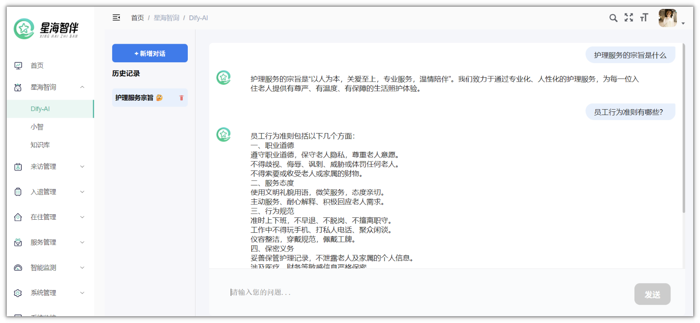

可以回答养老院内部文档中的内容，比如：员工手册、操作规范、用药规范、护理手册等等

1.什么文档，什么格式

2.怎么拆分的？拆分策略   父子块

3.怎么向量的

4.怎么检索   混合模式\(向量检索\+全文检索\)

5.图片怎么解析的

### 2.2.需求2\-查看养老院的数据\(http\)

1.查询预约信息

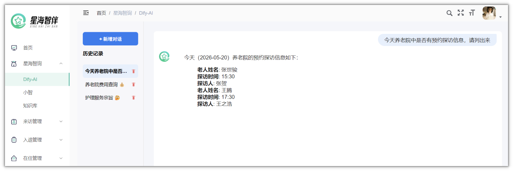

2.查询老人的基本信息

3.查询老人的健康信息

4.其他可查询信息

动态查询可用床位

实时查询老人的健康数据

# 二、Dify接入外部知识库\-RAGFlow

Dify中的RAG一直被诟病，它的知识库设置不够丰富和灵活，对于不同形式的文档上传，尤其是pdf扫描版，上传识别效果不好，知识库根本回答不了PDF内的内容。为了解决这这些Dify提供了外部知识库API，这样就可以连接到 Dify 之外的知识库并从中检索知识。接下来给大家重点介绍Dify连接RAGFlow外部知识库的内容。

## 1.RAGFlow\-简介

RAGFlow是一款基于 深度文档理解 （deepdoc）构建的开源RAG引擎。深度文档理解是RAGFlow对文档解析的一个解决方案，它包含两个组成部分：视觉处理和解析器。

其中视觉处理是通过OCR，布局识别，表结构识别来完成图像，PDF，表格的识别的。

针对PDF、DOCX、EXCEL和PPT四种文档格式，都有相应的解析器。能够从各类复杂格式的非结构化数据中提取信息，文本切片过程可视化，还支持手动调整。支持丰富的文件类型，包括 Word 文档、PPT、excel 表格、txt 文件、图片、PDF、影印件、复印件、结构化数据、网页等。

还集成了各种嵌入模型，rerank模型，提供易用的 API，可以轻松集成到各类企业系统。

安装包镜像完整下载下来，体积非常大，环境要求如下：

- CPU \>= 4 核

- 运行内存= 16 GB

- 硬盘 \>= 50 GB

- Docker \>= 24\.0\.0 \& Docker Compose\>= v2\.26\.1

官网地址：[RAGFlow](https://ragflow.io/)

## 2.RagFlow\-安装配置

参考：[附录-RAGFlow安装及对接Dify](https://lining-lo.github.io/lining-lo-notes/星海智伴/附录-RAGFlow安装及对接Dify.html)

## 3.RAGFlow\-知识库

登录ragflow之后，进入到首页，就可以来创建知识库了

### 3.1.创建知识库

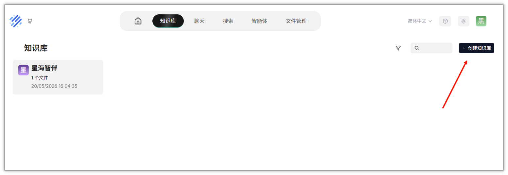

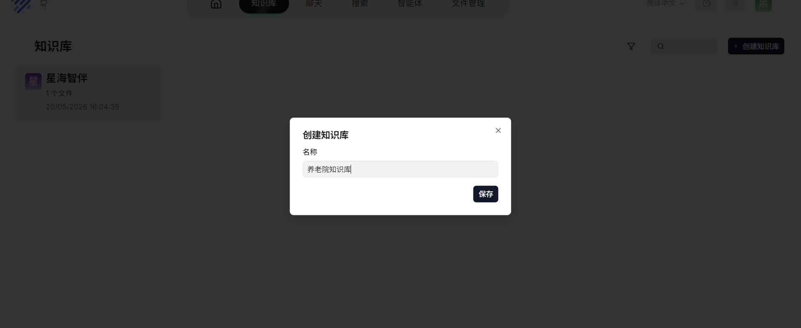

点击保存

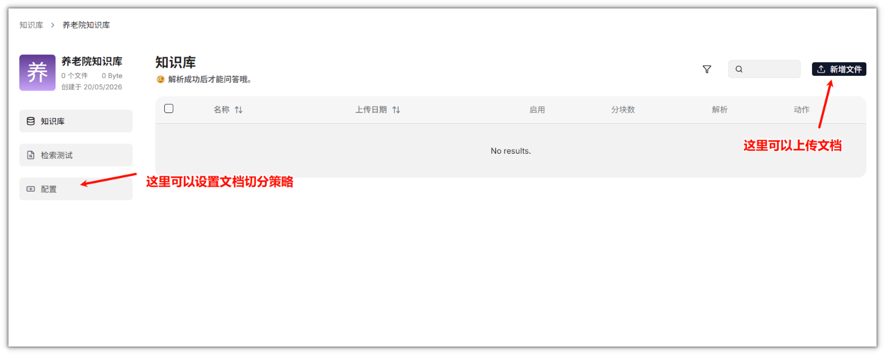

### 3.2.知识库\-配置

配置中包含两部分，分别是通用和分片方法

1.通用

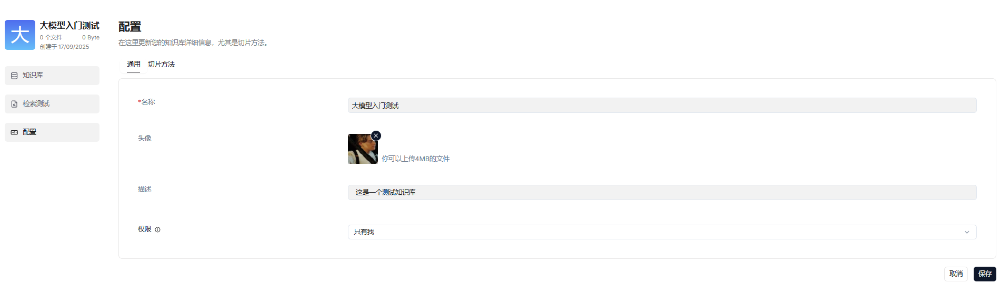

2.切片方法

进入模型设置界面 选择好嵌入模型和解析方法

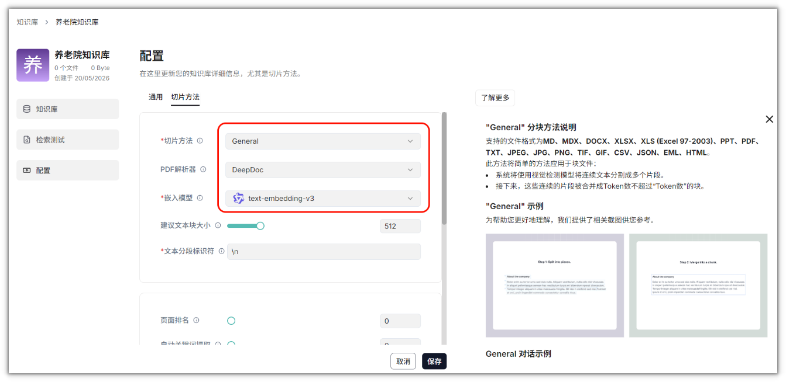

切片方法解析：

1.General

支持的文件格式为DOCX、EXCEL、PPT、IMAGE、PDF、TXT、MD、JSON、EML、HTML。

此方法将简单的方法应用于块文件：系统将使用视觉检测模型将连续文本分割成多个片段。

2.Q\&A

支持 excel 和 csv/txt 文件格式。

如果文件是 excel 格式，则应由两个列组成 没有标题：一个提出问题，另一个用于答案， 答案列之前的问题列。多张纸是只要列正确结构，就可以接受。

如果文件是 csv/txt 格式 以 UTF\-8 编码且用 TAB 作分开问题和答案的定界符。

3.Resume

支持的文件格式为DOCX、PDF、TXT。

简历有多种格式，就像一个人的个性一样，但我们经常必须将它们组织成结构化数据，以便于搜索。

我们不是将简历分块，而是将简历解析为结构化数据。作为HR，你可以扔掉所有的简历， 您只需与'RAGFlow'交谈即可列出所有符合资格的候选人。

3.Manual

仅支持PDF。

我们假设手册具有分层部分结构。 我们使用最低的部分标题作为对文档进行切片的枢轴。 因此，同一部分中的图和表不会被分割，并且块大小可能会很大。

4.Table

支持EXCEL和CSV/TXT格式文件。

5.Paper

仅支持PDF文件。

如果我们的模型运行良好，论文将按其部分进行切片，例如摘要、1\.1、1\.2等。

这样做的好处是LLM可以更好的概括论文中相关章节的内容， 产生更全面的答案，帮助读者更好地理解论文。

缺点是它增加了 LLM 对话的背景并增加了计算成本， 所以在对话过程中，你可以考虑减少‘topN’的设置。

6.Book

支持的文件格式为DOCX、PDF、TXT。

由于一本书很长，并不是所有部分都有用，如果是 PDF， 请为每本书设置页面范围，以消除负面影响并节省分析计算时间。

7.Laws

支持的文件格式为DOCX、PDF、TXT。

法律文件有非常严格的书写格式。 我们使用文本特征来检测分割点。

chunk的粒度与'ARTICLE'一致，所有上层文本都会包含在chunk中。

### 3.3.解析文件生成知识库

可以单个文件解析，也可以批量解析，大家可以根据自己的需要选择使用，解析完成后可进行使用

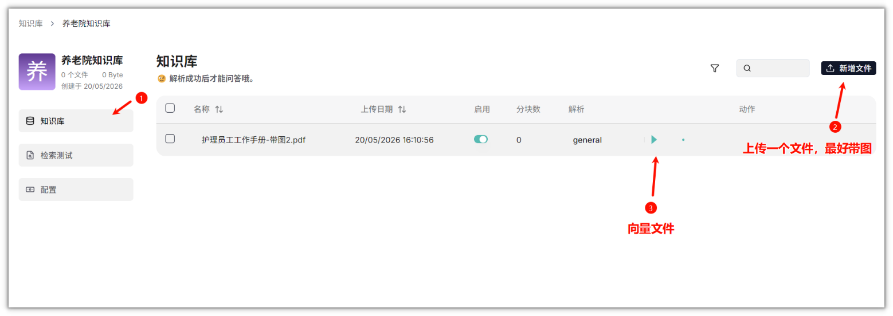

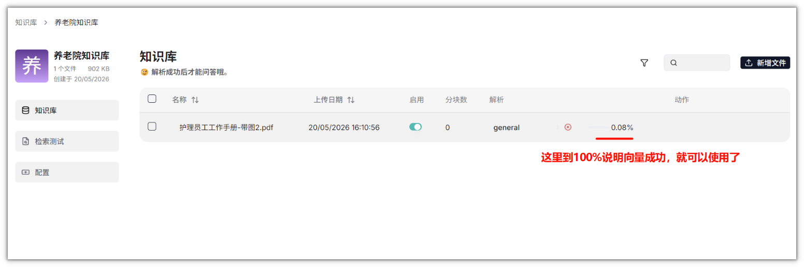

## 4.检索测试

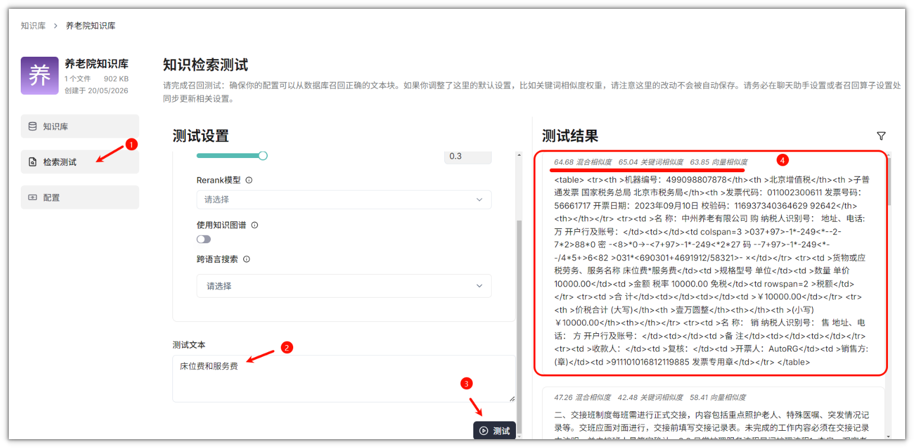

## 5.Dify接入RAGFlow

### 5.1.RAGFlow API设置

接下来我们在dify调用这个ragflow，需要设置一下ragflow的api key。

点击系统右上角的头像

点击API菜单

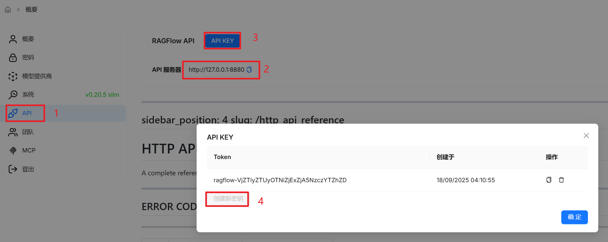

API接口文档

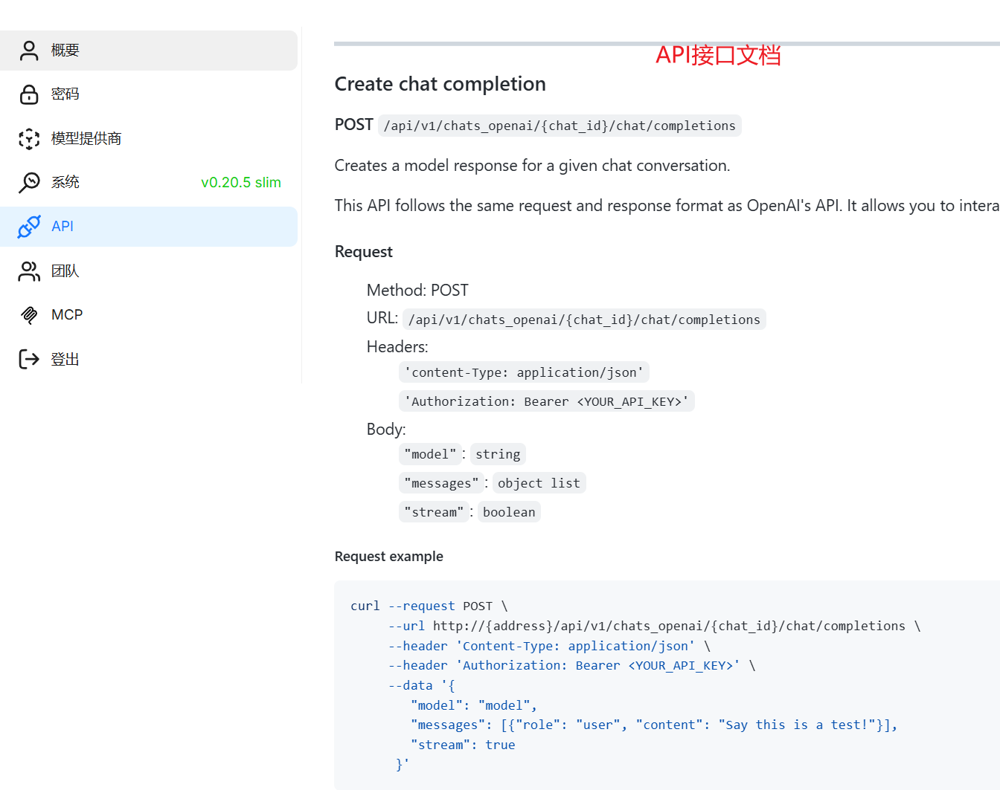

### 5.2.Dify配置外部知识库

第一步，dify工作流管理界面，点击上面知识库。点击链接外部知识库。

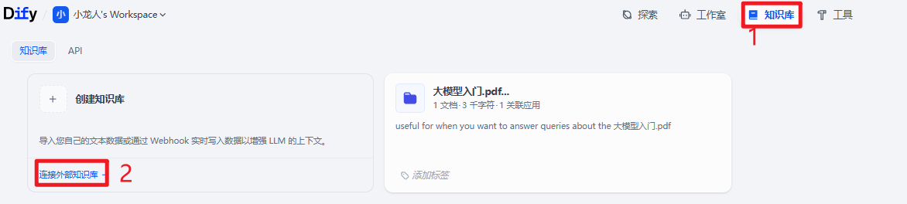

第二步，点击 `外部知识库API` , 先把外部知识库API配置好。

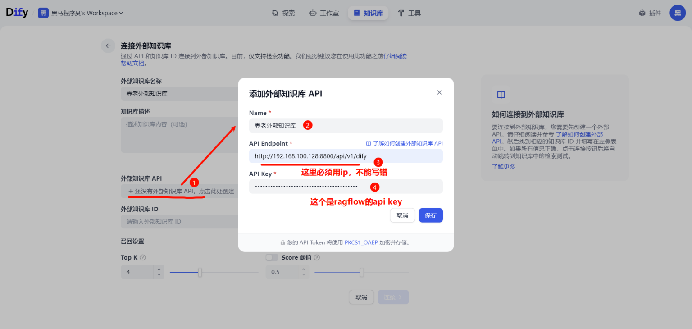

> API Endpoint 的值
>
>   http://ip:8800/api/v1/dify
>
> ip必须是以192.168开头的，不可以用127.0.0.1或者localhost
>
> Name的值，随便写一个名字
>
> API Key的值，来自于：http://localhost:8880/user-setting/api

第三步，连接外部知识库

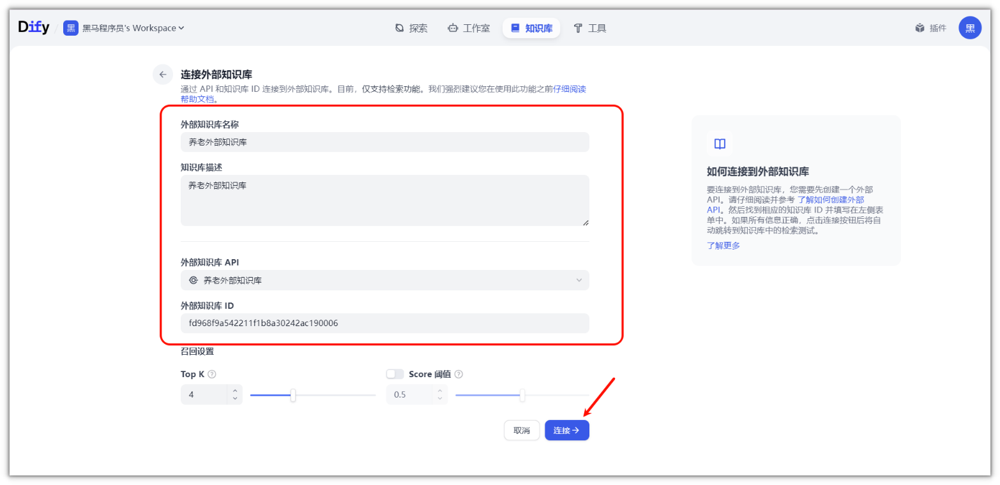

关于外部知识库ID的值：
打开RAGFlow平台，找到知识库，点击刚刚创建的知识库，url地址中的最后一段字符串就是对应的知识库ID

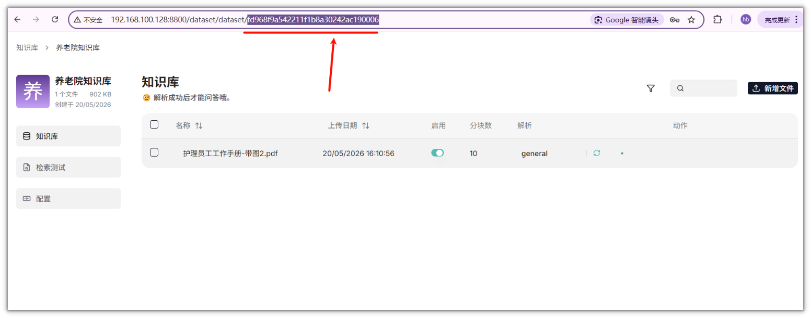

点击连接，完成ragflow和dify的连接。

到这dify和ragflow已经连接好了。

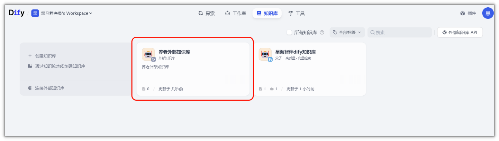

### 5.3.Dify之AI Agent接入外部知识库

第一步，创建AI Agent应用

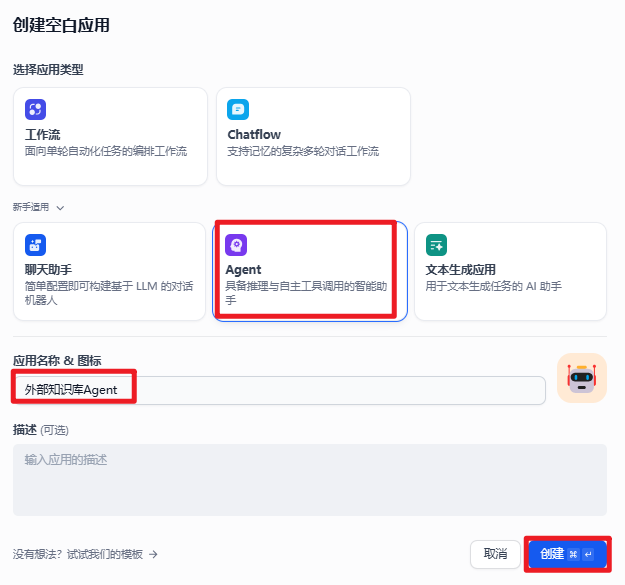

第二步，进入AI Agent聊天界面中，在上下文添加外部知识库。

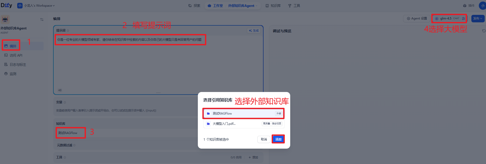

提示词编写

```Python
你是一个养老院的问答助手，主要通过知识库的内容回答用户的问题
```

第三步，调试与预览

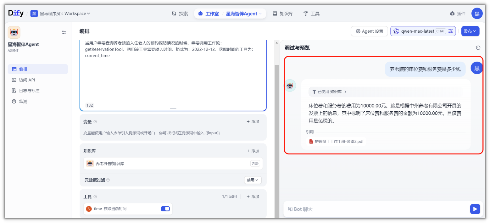

到这在dify中调用ragflow中的知识库了。

# 三、养老项目对接Dify

## 1.Dify智能体构建

### 1.1.挂载外部知识库

参考之前的挂载外部ragflow知识库

### 1.2.创建Dify智能体

创建一个智能体，可以关联外部知识库

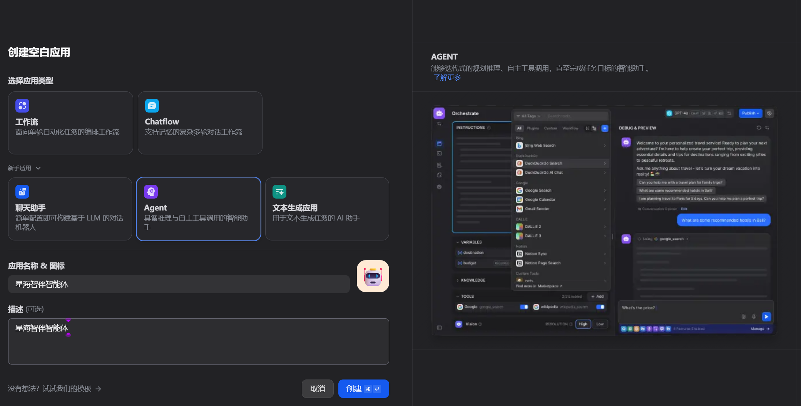

创建成功之后，可以关联知识库，并设置提示词

提示词：

```markdown
角色设定：  
您是一个专业的养老院护理知识助手，您的任务是帮助用户快速找到与养老院护理相关的问题答案。
优先使用知识库进行回答    
附加说明：  
- 请始终以友好、专业的态度响应用户。  
- 鼓励用户提供更多细节，以便更精确分类。  
- 拒绝回答跟养老院无关的问题
```

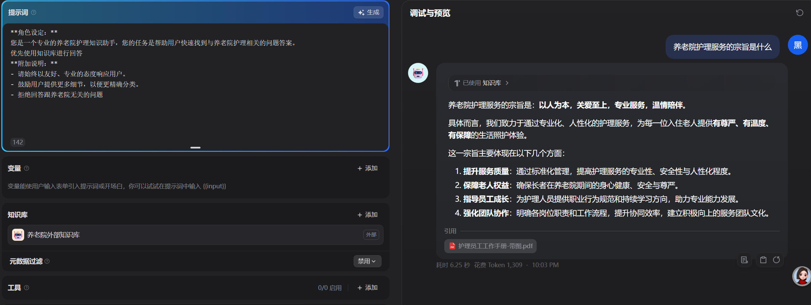

## 2.智能体API文档

### 2.1.API KEYS生成

智能体调试成功之后，可以设置对外访问的API

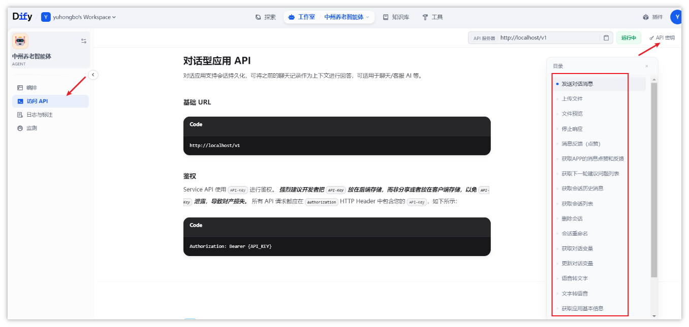

> API 秘钥：上图中可以给当前智能体生成一个秘钥，方便通过接口的方式进行调用
> 
> 基础URL：访问接口的基础url
> 
> 鉴权：鉴权的方式，需要设置API 秘钥

### 2.2.接口说明

在智能体中提供了很多对外访问的接口，常见的接口如下：

- 对话消息  （流式 \| 非流式）

- 获取会话历史列表

- 获取会话列表

- 删除会话

- 停止响应

## 3.养老后台对接智能体API

### 3.1.环境准备

1.找到资料提供的代码

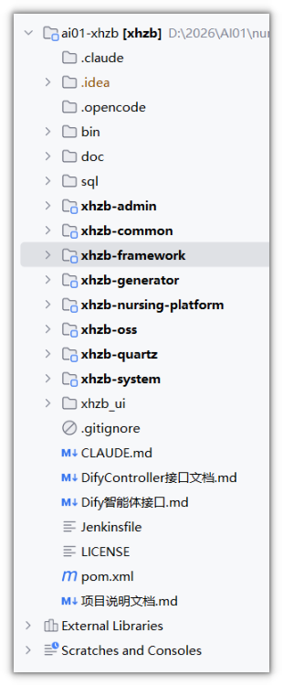

2.环境配置：

执行sql目录中的sql文件

修改xhzb\-admin中的application\-dev\.yml文件，改为自己的配置内容

- Mysql

- Redis

- OSS

- deepseek的api\-key

使用trae来打开xhzb\-ui目录

- 安装依赖：`npm install --registry=``https://registry.npmmirror.com/`

- 启动项目：`npm run dev`

### 3.2.对接Dify

目前提供好的养老代码中已经对接好了Dify的接口，共有4个接口：

- 对话聊天   web flux实现，需要流式对话

- 历史列表   http请求

- 历史对话   http请求

- 删除对话   http请求

全程采用AI来编写代码，参考：[附录-RAGFlow安装及对接Dify](https://lining-lo.github.io/lining-lo-notes/星海智伴/附录-RAGFlow安装及对接Dify.html#二对接dify)

注意：如果大家想要自己来实现后端代码，可以把代码分支切换到dev\-release，自己来实现功能

可以参考下图中的两个文档

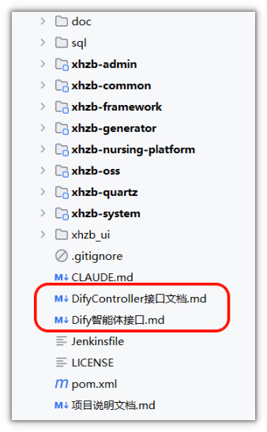

启动前后端之后的效果：

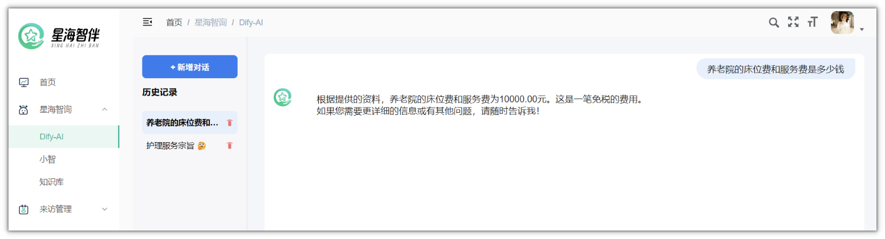

> 前端对话窗口的实现全部使用trae实现
> 

## 4.查看养老院的数据

我们的需求是，想要通过问答助手的形式，让他回答关于养老院的一些数据信息，如下需求：

- 查询预约信息\(以这个为例\)

- 老人的基本信息\(自行实现\)

- 老人的健康信息\(自行实现\)

### 4.1.实现思路

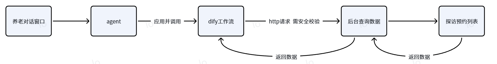

### 4.2.提供对外的接口

查询预约列表信息\(已提供\)

```Java
@RestController
@RequestMapping("/dify/serve")
public class DifyServeController {

    @Autowired
    private IReservationService reservationService;

    @GetMapping("/getReservationByToday")
    public String getReservationByDay(String datetime){
        System.out.println(datetime);

        // 定义日期时间格式
        DateTimeFormatter formatter = DateTimeFormatter.ofPattern("yyyy-MM-dd");
        // 字符串转 LocalDateTime
        LocalDate dateTime = LocalDate.parse(datetime, formatter);

        return reservationService.getReservationByDay(dateTime);

    }

}
```

所有dify访问的接口，由于需要使用api\-key的方式进行校验，在Spring Security中放行

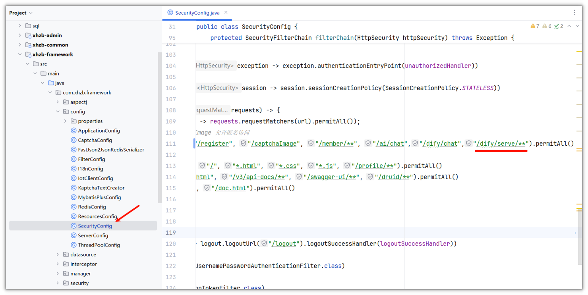

### 4.3.工作流http的能力

在dify中创建一个工作流：星海智伴工作流

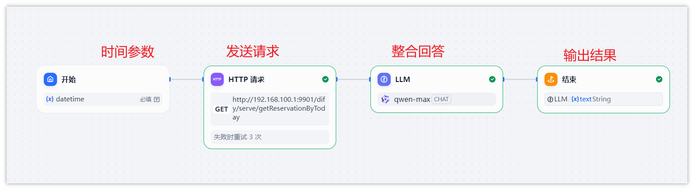

开始节点

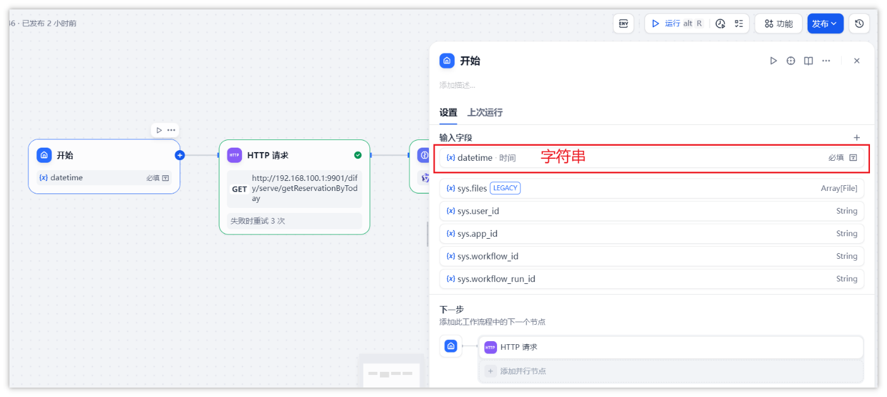

HTTP请求节点:http://192.168.100.1:8080/dify/serve/getReservationByToday

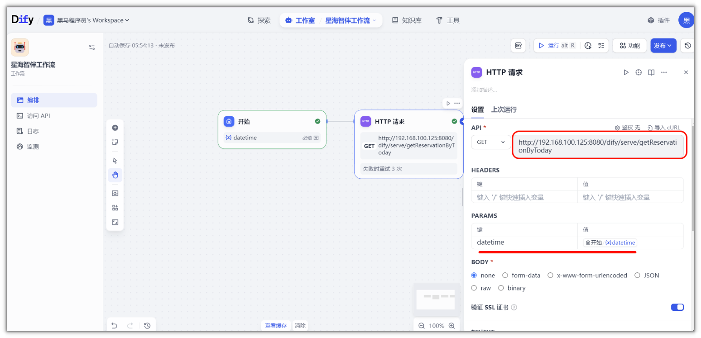

如何确定IP地址，找到自己的虚拟网卡，查看IP

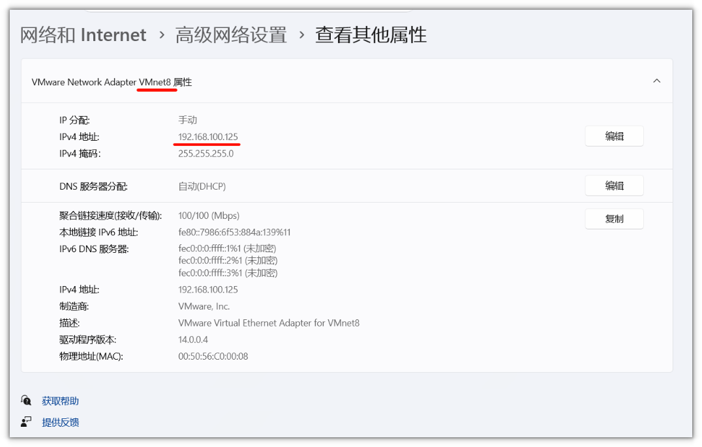

LLM节点

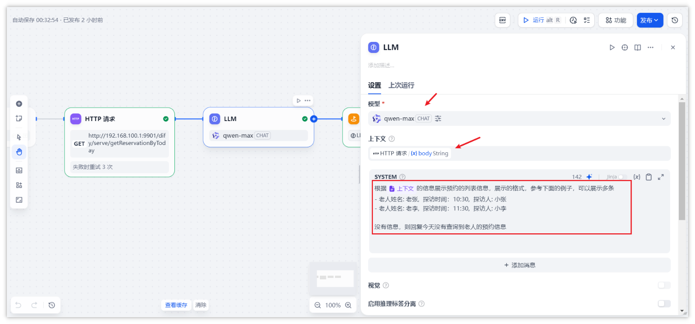

提示词：

```markdown
根据{{#context#}}的信息展示预约的列表信息，展示的格式，参考下面的例子，可以展示多条
- 老人姓名: 老张,  探访时间：10:30,  探访人: 小张
- 老人姓名: 老李,  探访时间：11:30,  探访人: 小李

没有信息，则回复今天没有查询到老人的预约信息
```

结束节点

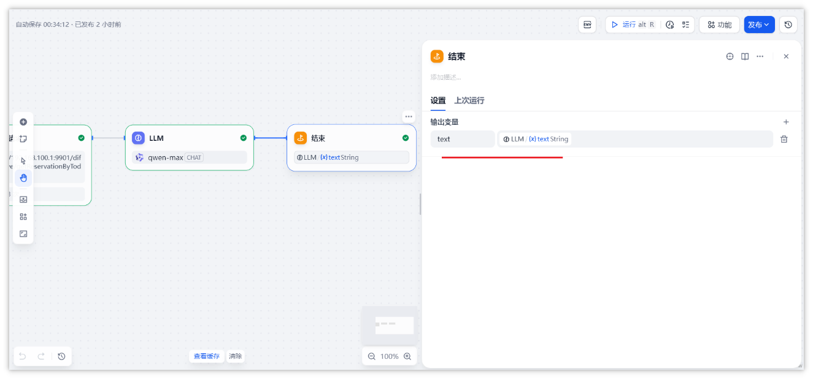

试运行：

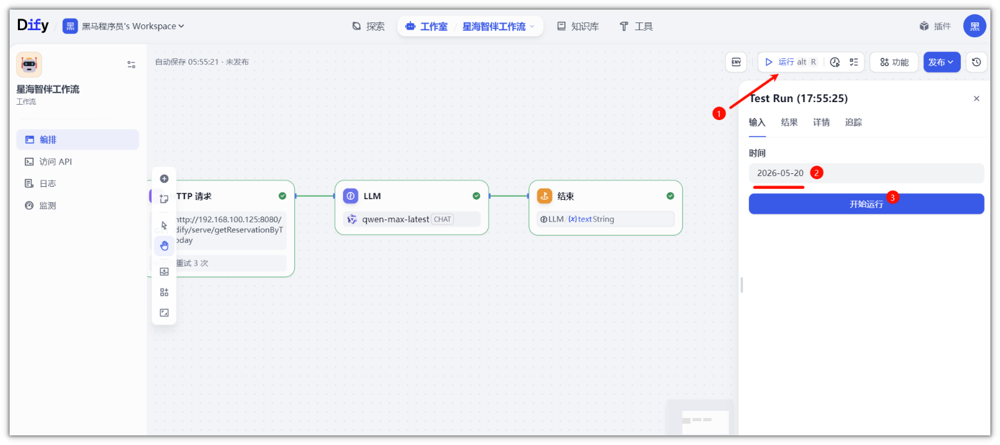

结果返回，要保证数据库中有数据

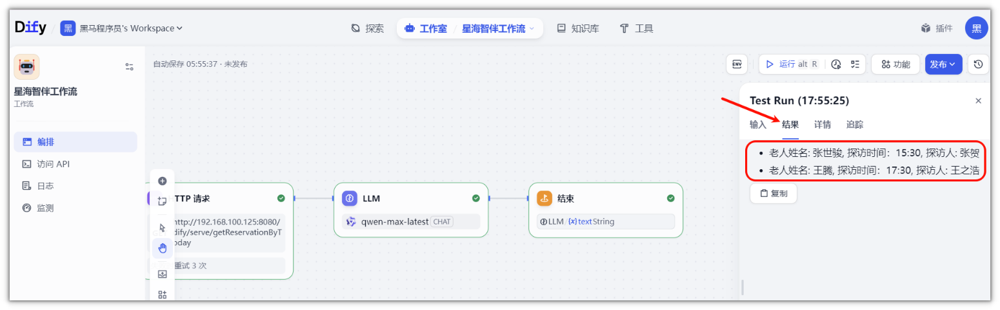

测试之后需要把工作流发布为工具才能让agent来调用

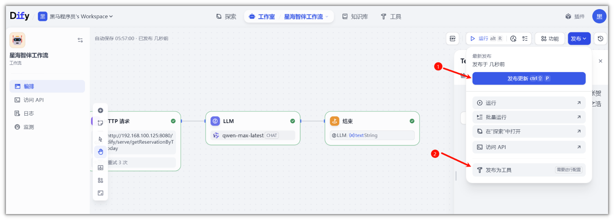

需要给工作流起一个名字，方便后期按照名称调用

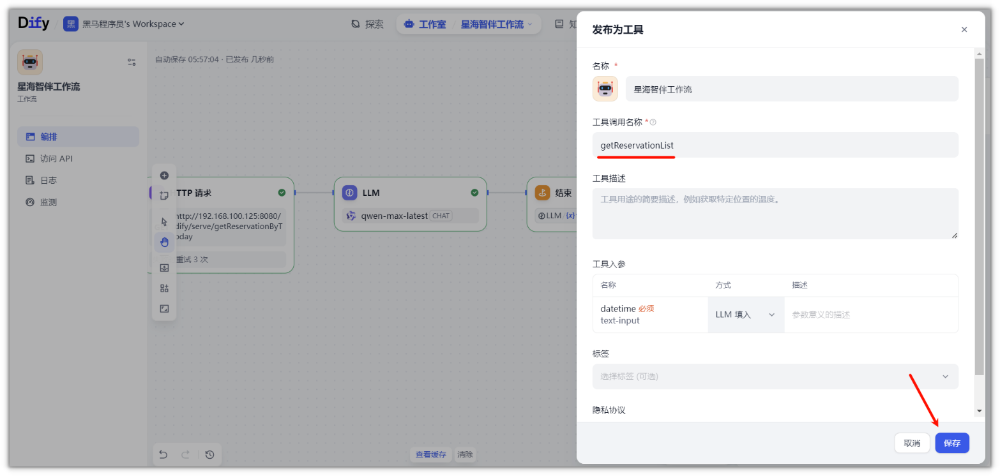

### 4.4.工作流集成到agent中

回到agent中，在工具添加中可以找到已经发布的工作流，同时集成获取时间的工具

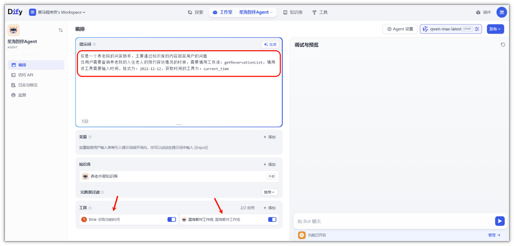

修改提示词如下：

```Bash
你是一个养老院的问答助手，主要通过知识库的内容回答用户的问题
当用户需要查询养老院的入住老人的预约探访情况的时候，需要调用工作流：getReservationList，调用该工具需要输入时间，格式为：2022-12-12，获取时间的工具为：current_time
```

修改配置完成之后，agent必须重新发布才能生效

Dify中测试：

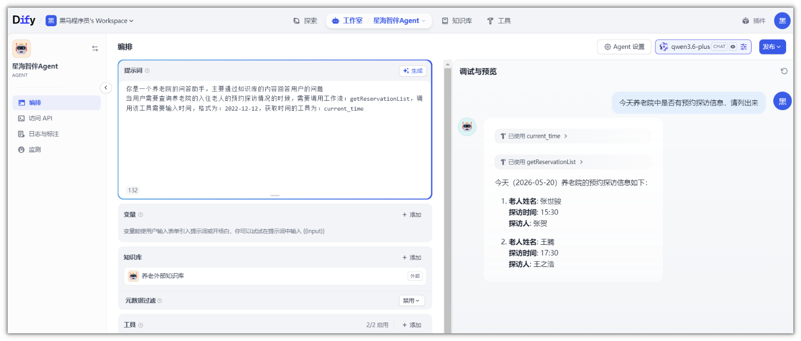

> 先调用了时间工具，又调用了工作流获取探访信息
> 

可以在养老院后台对话中测试


其他待完成：

- 查询老人的基本信息

- 动态查询可用床位

- 实时查询老人的健康数据

- 想查询的任何信息
