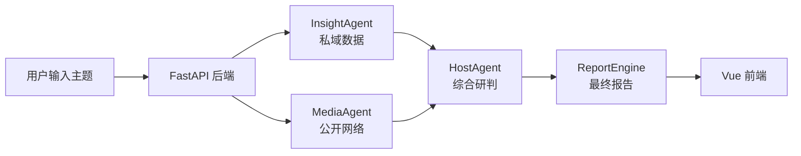
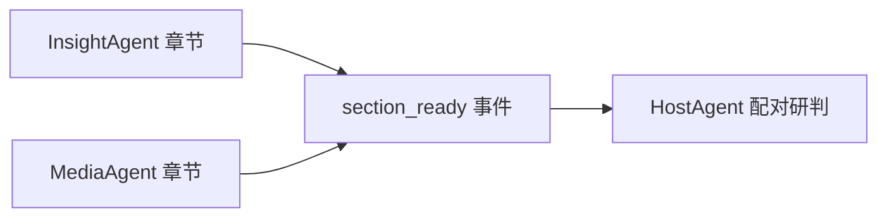

## 1. 项目定位

该项目是一个围绕舆情主题分析构建的后端智能分析平台，围绕一个输入主题，自动完成多来源舆情信息分析，并输出一份结构化的综合研判报告。

这个目标可以拆成几个更具体的能力：

- 接收舆情分析主题，并启动后台研究任务。
- 私域舆情数据检索Agent,从私域数据库中检索相关舆情内容。
- 公域网络检索Agent,从公开网络搜索中获取外部信息内容。
- 对两个分析角色的结果进行综合研判。
- 将分析结果聚合为最终报告。
- 通过接口和实时事件流向外部提供任务进度、分析结果和报告文件。

也就是说，系统并不是简单地“把问题发给大模型”，而是先分角色分析，再汇总裁判，最后生成报告。这种设计让系统具备更强的结构化分析能力，也方便后续扩展更多数据源、更多角色或更多报告类型。

本质上：是一个受控的多 Agent 舆情分析系统，多个专业 Agent 按固定工作流协作，模型在规定范围内完成规划、分析和裁决。它把数据库检索、公开网络搜索、大模型分析、观点研判和报告生成连接成一条完整的研究流程。

这里的“受控”表示主要执行步骤由 LangGraph 和程序代码提前编排，Agent 只在各自职责范围内使用模型完成任务。不是能够自由决定所有行动的自主多 Agent 系统，而是强调流程稳定、结果可追踪的多 Agent 系统。

## 2. 基本流程

```text
用户输入主题
    ↓
创建研究任务
    ↓
InsightAgent 与 MediaAgent 并行分析
    ↓
HostAgent 综合研判
    ↓
ReportEngine 生成最终报告
    ↓
前端预览或下载
```



> 两个研究角色分别查资料，Host 负责综合判断，ReportEngine 负责形成最终报告。

## 3. 四个核心角色

### 3.1 InsightAgent：私域数据研究员

InsightAgent 主要分析系统已有的舆情数据库。

它负责：

- 查找与主题相关的内容和评论
- 识别高热内容
- 分析用户情绪和观点
- 比较不同平台与群体

主要数据来源是 MySQL，配置开启后也可以使用 Milvus 做语义检索。

### 3.2 MediaAgent：公开网络研究员

MediaAgent 主要从公开网络搜索资料。

它负责：

- 查找公开报道
- 补充事件背景
- 寻找权威来源
- 分析外部传播情况

目前支持 Anspire 搜索服务。

### 3.3 HostAgent：主持人与裁判

HostAgent 将 InsightAgent 和 MediaAgent 的同维度章节放在一起比较。

它负责：

- 总结双方共识
- 识别关键分歧
- 评价证据是否充分

### 3.4 ReportEngine：报告整理者

ReportEngine 根据 HostAgent 的结构化裁决生成最终报告。

主要步骤是：

1. 按模板组装报告结构。
2. 使用大模型做轻度语言润色。
3. 生成 Markdown。
4. 将 Markdown 渲染为 HTML。
5. 保存报告供前端查看和下载。

## 4. 五维分析框架

三个 Agent 使用同一套五维框架：

| 维度 | 关注内容 |
|---|---|
| 事件背景与概览 | 事件起因、过程和基础事实 |
| 舆情热度与传播 | 热度变化、传播节点和扩散方式 |
| 公众情感与观点 | 主要情绪、支持与反对观点 |
| 平台与群体差异 | 不同平台和人群的表达差异 |
| 深层原因与影响 | 背后原因、潜在影响和风险 |

统一维度的作用是让两个研究角色能够对齐。

例如，InsightAgent 和 MediaAgent 都会生成“公众情感与观点”章节，HostAgent 才能比较双方结论。

## 5. 核心目录

```text
sentiment_analyse/
├── app/          # FastAPI 应用和接口
├── engines/      # 智能体和分析引擎
├── var/          # 报告和日志
├── main.py       # 后端启动入口
└── pyproject.toml
```

### 5.1 `app/`

`app/` 是后端应用层，负责：

- 接收前端请求
- 启动研究任务
- 查询研究结果
- 触发报告生成
- 提供实时进度

可以把它理解为系统的“服务窗口”。

### 5.2 `engines/`

`engines/` 是分析核心。

```text
engines/
├── contracts/        # 共享定义：数据格式、配置模型和五维规则
├── common/           # 共享实现：LLM、事件、重试和公共节点
├── orchestration/    # 研究任务编排
├── insight_agent/    # 私域研究
├── media_agent/      # 公开网络研究
├── host_agent/       # 主持研判
└── report_engine/    # 最终报告
```

`contracts` 和 `common` 的区别可以简单理解为：

- `contracts` 规定“数据应该长什么样、制定什么规则”。
- `common` 提供“这些 Agent 可以共同使用的现成功能”。

### 5.3 `var/`

默认报告目录：

```text
var/reports/{run_id}/
├── insight/
├── media/
├── host/
└── report/
```

每次研究都有独立目录，不同任务的报告不会混在一起。

## 6. Agent 之间的通信

多个 Agent 不是直接调用彼此的方法，而是通过事件和文件交换信息。

这两种方式承担不同职责：

- 事件负责传递实时过程和完成通知。
- 文件负责保存完整结果，并把产物交给后续阶段。

### 6.1 事件通信

InsightAgent 和 MediaAgent 每完成一个章节，都会发布一个 `section_ready` 事件。事件中包含：

- 当前研究任务的 `run_id`
- 章节所属角色
- 章节维度
- 章节标题和正文
- 证据数量与证据强度

HostAgent 监听这些事件。当同一研究任务、同一维度的 Insight 和 Media 章节都到达后，HostAgent 开始该维度的综合研判。



除了章节事件，系统还会发布研究Agent进度、研究Agent完成、研究Agent错误和 主持人 讨论消息。前端能够及时知道研究进行到了哪一步。

### 7.2 文件产物

事件适合传递通知，但不适合长期保存完整报告。因此各角色还会把结果写入文件：

- InsightAgent 保存私域分析报告。
- MediaAgent 保存公开网络分析报告。
- HostAgent 保存结构化裁决 JSON 和可读的 Markdown。
- ReportEngine 保存最终 Markdown 和 HTML。

这些文件用于结果展示、下载归档和后续报告生成。其中，最终报告主要读取 HostAgent 的结构化裁决。

因此，Agent 之间的通信可以概括为：

> 事件负责“及时通知”，文件负责“完整交接和长期保存”。

## 7. 前端与后端如何通信

### 7.1 REST API

REST API 用于：

- 创建研究任务
- 获取研究结果
- 查询报告是否可以生成
- 生成和下载报告
- 获取 Host 讨论记录
- 读取和修改配置

### 7.2 SSE

舆情研究需要一定时间，前端不能一直等待普通 HTTP 请求。

后端通过 SSE 推送 Agent 的进度、完成和错误通知。前端收到完成通知后，再通过 REST API 获取完整报告。

第一天只需要记住：

> REST 用于请求和获取完整数据，SSE 用于接收实时通知。

## 8. 主要技术栈

| 技术 | 作用 |
|---|---|
| FastAPI | 提供后端 API |
| Vue 3 | 构建前端页面 |
| LangGraph | 编排 Agent 的执行步骤 |
| LangChain | 调用大模型 |
| Pydantic | 校验配置和接口数据 |
| SQLAlchemy | 查询私域数据库 |
| Milvus | 语义检索 |
| Mistune | 将 Markdown 转换成 HTML |
| SSE | 实时推送进度 |
