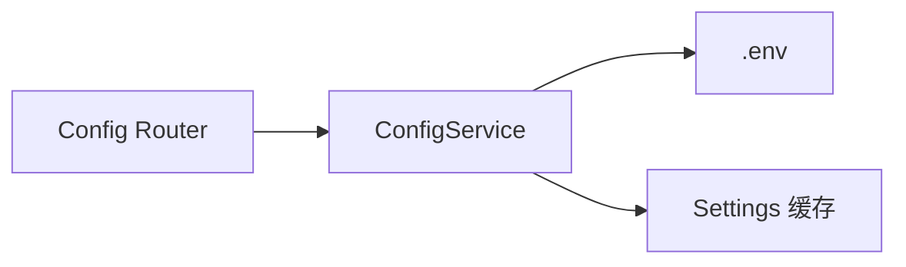
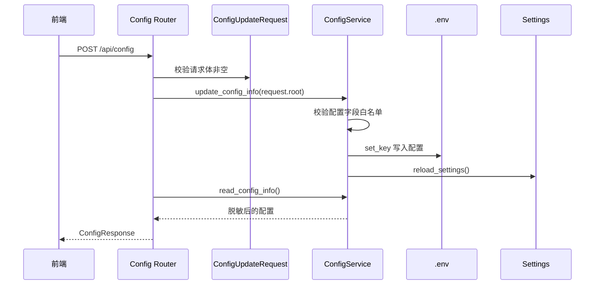
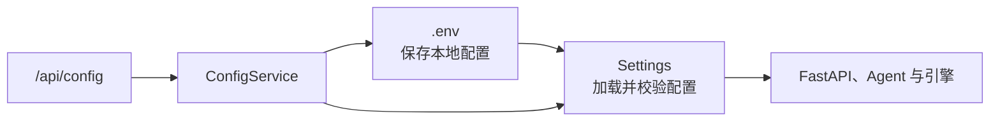
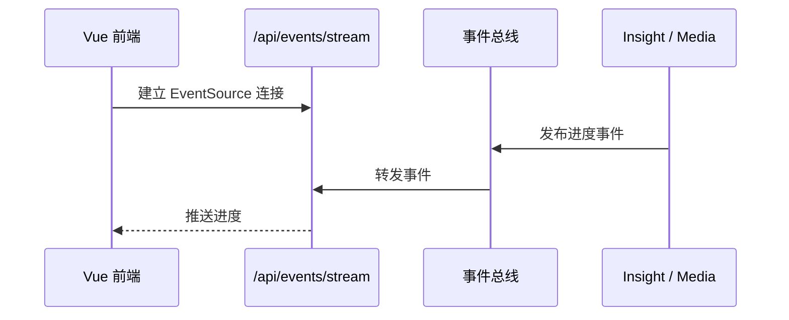
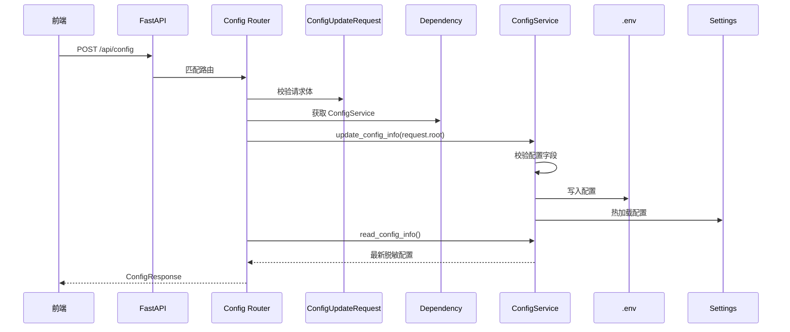

# 02_FastAPI 的 Web 应用层

> 本章在项目全景的基础上，进一步认识 FastAPI Web 应用层。  
> 学习重点是“一次请求如何进入系统”，暂不深入 Agent 内部算法。

## 1. 任务目标

完成本章后，应该能够回答：

1. FastAPI Web 层在项目中负责什么？
2. 后端服务从哪里启动？
3. Router、Schema、Dependency 和 Service 分别做什么？
4. 配置更新请求如何经过 Web 层写入 `.env`？
5. Pydantic 如何校验配置请求？
6. REST API 和 SSE 在 Web 层中有什么区别？

## 2. Web 应用层的位置

在整体系统中，Web 应用层位于浏览器和分析引擎之间。


Web 层主要解决：

> 外部请求如何安全、清晰地进入系统。

它负责：

- 定义接口地址和 HTTP 方法
- 接收并校验请求参数
- 找到对应的应用服务
- 调用服务完成业务动作
- 把结果转换成 HTTP 响应
- 将异常转换成合适的 HTTP 状态码
- 通过 SSE 向前端推送实时进度

它不直接负责：

- 数据库召回算法
- Web 搜索算法
- Agent Prompt
- Host 裁决逻辑
- 最终报告模板组装

这些复杂逻辑分别位于 `engines/` 的对应模块中。

## 3. Web 层目录结构

```text
app/
├── app.py                         # FastAPI 应用对象
├── dependencies.py                # 服务实例和依赖注入
├── exception_handlers.py          # 全局异常处理
├── routers/
│   ├── rest/
│   │   ├── research.py            # 研究接口
│   │   ├── report.py              # 报告接口
│   │   ├── host.py                # Host 讨论接口
│   │   └── config.py              # 配置接口
│   └── sse/
│       └── research_progress.py   # 实时进度流
├── schemas/
│   ├── research_schema.py
│   ├── report_schema.py
│   ├── host_schema.py
│   └── config_schema.py
└── services/
    ├── research/
    ├── report/
    ├── host/
    ├── realtime/
    └── system/
```

这些目录可以分成五类：

| 层次 | 作用 |
|---|---|
| `app.py` / `cli.py` | 创建并启动应用 |
| `routers/` | 定义 HTTP 接口 |
| `schemas/` | 定义请求和响应格式 |
| `dependencies.py` | 为路由提供服务对象 |
| `services/` | 承接业务动作并调用引擎 |

## 4. FastAPI 应用对象

`app/app.py` 是 Web 应用的装配入口。

核心代码可以概括为：

```python
from fastapi import FastAPI

from sentiment.app.exceptions.exception_handlers import register_exception_handlers
from sentiment.app.routers.rest import system_router

# 创建FastAPI应用
app = FastAPI(description="舆情分析")
# 将app传入异常处理器
register_exception_handlers(app)
# 添加路由
app.include_router(system_router.router)
```

它负责：

- 创建 FastAPI 实例
- 注册应用生命周期
- 注册全局异常处理器
- 挂载 REST 路由
- 挂载 SSE 路由

`app.py` 只做“组装”，不写具体业务逻辑。

## 5. Router：定义接口

Router 负责描述：

- 接口路径
- HTTP 方法
- 请求参数
- 响应模型
- 应调用哪个 Service

### 5.1 配置接口示例

system_router.py

```python
from fastapi import APIRouter

from sentiment.app.dependencies import SystemServiceDep
from sentiment.app.schemas.system_schema import ConfigResponse, ConfigUpdateRequest

# 创建路由对象
router = APIRouter(prefix="/api/config", tags=["系统配置信息路由"])

# 获取配置信息
@router.get(path="", response_model=ConfigResponse)
def get_config_endpoint(service: SystemServiceDep):
    # 调用服务层方法获取配置信息
    config = service.read_config_info()
    # 返回配置信息
    return ConfigResponse(config=config)


# 更新配置信息
@router.post(path="")
def update_config_endpoint(
        request: ConfigUpdateRequest,
        service: SystemServiceDep
):
    # 调用服务层方法更新配置信息
    service.update_config_info(request.root)
```

这组接口包含读取和更新两个动作：

1. `GET /api/config`：读取当前允许展示的配置。
2. `POST /api/config`：更新前端提交的配置。
3. `ConfigUpdateRequest`：校验更新请求体。
4. `ConfigServiceDep`：注入配置服务。
5. `ConfigResponse`：统一返回 `{ "config": {...} }`。

路由函数不直接读写 `.env`，而是把配置处理交给 `SystemService`。

### 5.2 当前接口概览

| 方法 | 路径 | 作用 |
|---|---|---|
| POST | `/api/research` | 创建研究任务 |
| GET | `/api/research/latest` | 获取研究结果 |
| GET | `/api/report/status` | 检查报告输入是否准备好 |
| POST | `/api/report/generate` | 启动最终报告生成 |
| GET | `/api/report/result/{task_id}` | 获取报告 HTML |
| GET | `/api/report/download/{task_id}/{file_type}` | 下载报告 |
| GET | `/api/host/discussion` | 获取 Host 讨论记录 |
| GET | `/api/config` | 读取配置 |
| POST | `/api/config` | 更新配置 |
| GET | `/api/events/stream` | 建立 SSE 连接 |

本章不需要记住所有地址，重点是理解它们按业务领域拆分在不同 Router 中。

## 6. Schema：定义接口数据格式

FastAPI 使用 Pydantic Schema 校验请求和响应。

### 6.1 请求模型

在system_schema.py中添加

```python
from typing import Any

from pydantic import RootModel, field_validator, BaseModel, Field

class ConfigUpdateRequest(RootModel[dict[str, Any]]):
    """
    配置更新请求数据模型
        root: 接收前端修改字典的key
    """
    @field_validator("root")
    @classmethod
    def not_empty(cls, value: dict[str, Any]) -> dict[str, Any]:
        if not value:
            raise ValueError("请求体不能为空")
        return value
```

#### 6.1.1 RootModel 

普通 `BaseModel` 通常用于描述字段固定的对象，例如：

```python
class UserRequest(BaseModel):
    name: str
    age: int
```

而配置更新请求的字段并不固定。前端可能只修改模型名称，也可能同时修改搜索工具和数据库地址，因此请求体本身就是一个动态字典。

```python
RootModel[dict[str, Any]]
```

表示：

- 整个请求体就是模型的数据。
- 请求体必须是一个字典。
- 字典的键必须是字符串。
- 字典的值暂时允许为任意类型。

因此前端可以直接提交：

```json
{
  "SEARCH_SWITCH": "TavilyAPI",
  "DB_PORT": 3306
}
```

路由通过 `request.root` 取得这个字典：

```python
service.update_config_info(request.root)
```

这里的 `root` 是 Pydantic 为 `RootModel` 提供的根数据属性，并不要求前端额外提交一个名为 `root` 的字段。

#### 6.1.2 field_validator 

`@field_validator()` 用于在数据进入路由业务逻辑前执行字段校验。

```python
@field_validator("root")
@classmethod
def not_empty(cls, value: dict[str, Any]) -> dict[str, Any]:
    if not value:
        raise ValueError("请求体不能为空")
    return value
```

其中：

- `"root"` 表示校验 `RootModel` 保存的整个请求体。
- `value` 是 Pydantic 解析后的配置字典。
- 校验成功时必须返回 `value`。
- 抛出 `ValueError` 表示校验失败。

如果前端提交：

```json
{}
```

`not_empty()` 会发现字典为空并抛出异常。FastAPI 会在进入路由函数之前拒绝该请求，并返回 HTTP 422 校验错误。

正常的更新请求可以只提交需要修改的字段：

```json
{
  "SEARCH_SWITCH": "TavilyAPI",
  "MEDIA_ENGINE_MODEL_NAME": "gemini-2.5-pro"
}
```


### 6.2 响应模型

在system_schema.py中添加

```python
class ConfigResponse(BaseModel):
    """
    配置响应数据模型
    """
    config: dict[str, Any] = Field(default_factory=dict)
```

配置查询和更新接口都返回相同结构：

```json
{
  "config": {
    "DB_HOST": "localhost",
    "SEARCH_SWITCH": "TavilyAPI"
  }
}
```

## 7. Dependency：提供服务对象

路由需要调用 Service，但不应该在每个请求函数中手动创建 Service。

项目在 `app/dependencies.py` 中集中创建服务对象：

```python
from typing import Annotated

from fastapi.params import Depends

from sentiment.app.services.system_service import SystemService
# 声明变量
_system_service = SystemService()
# 定义一个函数
def get_system_service() -> SystemService:
    return _system_service

# 创建对象
SystemServiceDep = Annotated[SystemService, Depends(get_system_service)]
```

路由只需要声明：

```python
service: SystemServiceDep
```

FastAPI 就会自动把同一个 `SystemServiceDep` 实例传给配置路由。

依赖注入带来的好处：

- 路由不关心服务如何创建
- 服务实例集中管理
- 多个接口可以共享同一个服务
- 后续更容易替换实现

当前 Config、Research、Report、Host、Broadcaster 和 Lifecycle 服务都由 `dependencies.py` 集中管理。

## 8. Service：定义业务服务

Router 只处理 HTTP，真正的业务协调放在 Service 中。

配置读取由 `SystemService.read_config_info()` 完成：

```python
import os
from typing import Any

from dotenv import set_key

from sentiment.engines.contract.settings import get_settings, ENV_FILE, reload_setting

# 允许的配置键
ALLOWED_CONFIG_KEYS = [
    "DB_HOST", "DB_PORT", "DB_USER", "DB_NAME",
    "INSIGHT_AGENT_API_KEY", "INSIGHT_AGENT_BASE_URL", "INSIGHT_AGENT_MODEL_NAME", "INSIGHT_AGENT_MODEL_PROVIDER",
    "MEDIA_AGENT_API_KEY", "MEDIA_AGENT_BASE_URL", "MEDIA_AGENT_MODEL_NAME", "MEDIA_AGENT_MODEL_PROVIDER",
    "REPORT_ENGINE_API_KEY", "REPORT_ENGINE_BASE_URL", "REPORT_ENGINE_MODEL_NAME", "REPORT_ENGINE_MODEL_PROVIDER",
    "HOST_AGENT_API_KEY", "HOST_AGENT_BASE_URL", "HOST_AGENT_MODEL_NAME", "HOST_AGENT_MODEL_PROVIDER",
    "ANSPIRE_API_KEY", "ANSPIRE_BASE_URL"
]

def _mask_secret(value: str) -> str:
    """
    对API_KEY的值进行脱敏处理
    """
    if not value:
        return ""
    return f"****{value[-4:]}"


class SystemService:

    # 读取系统配置信息
    def read_config_info(self)->dict[str,Any]:
        # 1. 读取配置信息;
        current_config = get_settings()
        result: dict[str, Any] = {}
        # 2. 循环遍历：
        for key in ALLOWED_CONFIG_KEYS:
            raw_value = getattr(current_config, key, None)
            text = "" if raw_value is None else str(raw_value)
            if key.endswith("_API_KEY"):
                text = _mask_secret(text)
            result[key] = text
        # 返回数据
        return result

    # 更新系统配置信息
    def update_config_info(self, config_info: dict[str, Any]):
        # 1. 防御性检查
        unknown_keys = [key for key in config_info.keys() if key not in ALLOWED_CONFIG_KEYS]
        # 2.判断
        if unknown_keys:
            raise ValueError(f"Unknown keys: {unknown_keys}")
        # 3. 更新数据
        for key, value in config_info.items():
            # 值原样写不加任何修饰字符.
            set_key(ENV_FILE, key, value,quote_mode="never")
            os.environ[key] = value
        # 4. 重新加载
        reload_setting()

```

配置更新由 `ConfigService.update_config()` 完成，主要步骤是：

1. 检查提交字段是否在 `CONFIG_KEYS` 白名单内。
2. 使用 `set_key()` 将新值写入 `.env`。
3. 同步更新当前进程环境变量。
4. 调用 `reload_settings()` 刷新 Settings 缓存。

配置 Service 是 Router、`.env` 和 Settings 之间的连接点：



## 9. 配置更新接口如何工作

配置更新是一个同步请求。后端需要完成写入后，才把最新配置返回给前端。



这里需要特别注意密钥字段。

读取配置时，`*_API_KEY` 只显示末四位：

```text
真实值：sk-abcdefghijkl
返回值：****ijkl
```

前端只提交发生修改的字段。API Key 没有修改时，请求体中不会包含该字段；修改时则提交用户输入的新密钥。

如果提交了不在白名单中的字段，Service 会抛出 `ValueError`。

## 10. 配置体系与运行环境

配置接口背后是项目的运行配置体系。它由 `.env`、`Settings` 和 `ConfigService` 三部分组成：



### 10.1 `.env` 与 Settings

`.env` 位于项目根目录，用于保存不同运行环境下可能变化的内容，例如数据库地址、模型名称和 API Key。

`engines/contracts/settings.py` 中的 `Settings` 模型负责：

- 从项目根目录的 `.env` 加载配置。
- 为配置声明类型和默认值。
- 将端口等文本转换成正确的数据类型。
- 为其他模块提供统一的配置对象。

项目通过 `PROJECT_ROOT` 计算 `.env` 的绝对路径，因此从不同目录启动服务时也能读取同一份配置。

### 10.2 当前配置的主要类别

当前运行配置可以分为六类：

- **服务配置**：通过 `HOST`、`PORT` 决定 FastAPI 的监听地址和端口。
- **数据库配置**：通过 `DB_HOST`、`DB_PORT`、`DB_NAME` 等字段为 InsightAgent 提供私域数据连接。
- **模型配置**：通过 `INSIGHT_ENGINE_MODEL_NAME`、`MEDIA_ENGINE_MODEL_NAME` 等字段为不同角色选择模型与服务商。
- **搜索配置**：通过 `SEARCH_SWITCH`、`TAVILY_API_KEY`、`ANSPIRE_API_KEY` 为 MediaAgent 选择搜索服务。
- **运行目录**：通过 `RUNTIME_DIR`、`LOG_DIR` 决定日志和任务产物的保存位置。
- **向量检索**：通过 `INSIGHT_VECTOR_ENABLED`、`MILVUS_URI` 等字段控制 Milvus 语义召回。

每个 Agent 可以使用独立的模型配置。例如 InsightAgent、MediaAgent、HostAgent 和报告引擎可以分别设置模型名称、服务地址和 API Key。


### 10.3 配置接口的开放范围

`Settings` 描述系统能够使用的全部配置，`/api/config` 则只允许前端读写其中一部分。

`ConfigService` 使用 `CONFIG_KEYS` 作为白名单，当前主要开放：

- 数据库的主机、端口、用户名和数据库名。
- 四类角色的模型名称、服务地址、服务商和 API Key。
- Tavily 与 Anspire 搜索配置。
- 当前搜索供应商 `SEARCH_SWITCH`。

服务监听地址、数据库密码、运行目录和 Milvus 参数等配置没有通过该接口开放。不能把“Settings 中存在的字段”直接理解为“前端都可以修改的字段”。

### 10.4 如何为不同角色选择模型

不同角色调用模型的任务不同，因此不应只根据模型排行榜选择，也不需要让所有角色都使用同一个模型。

选择前先检查四项基础能力：

- **接口兼容性**：模型服务需要兼容当前 LangChain 调用方式。InsightAgent、MediaAgent 和 HostAgent 还依赖 Function Calling 生成结构化对象。
- **中文能力**：需要准确理解中文舆情表达，并稳定生成中文分析内容。
- **上下文长度**：模型必须能够容纳章节规划、检索证据或完整报告骨架。
- **稳定性与成本**：同一输入的输出结构应稳定，同时结合调用次数、响应速度和价格进行选择。

#### InsightAgent

InsightAgent 负责分析私域数据库中的舆情记录，既要生成结构化的五维研究计划，也要根据证据撰写章节正文。

适合选择：

- 中文理解和归纳能力稳定的模型。
- Function Calling 成功率较高的模型。
- 能严格依据输入证据总结、较少补充外部事实的模型。
- 质量、速度和成本较均衡的中高能力模型。

InsightAgent 的重点是“忠实归纳私域证据”，通常不必单纯追求最强推理能力。

典型代表模型：

- `gpt-5.6-terra`：兼顾推理质量和调用成本，适合结构化规划与证据归纳。
- `claude-sonnet-5`：中文理解、长文本归纳和指令遵循较均衡。
- `kimi-k2.5`：适合中文材料处理，并支持长上下文与 Function Calling

#### MediaAgent

MediaAgent 需要处理搜索结果、公开报道和网页内容。输入信息更分散，也可能包含重复、噪声和相互冲突的内容。

适合选择：

- 长上下文处理能力较强的模型。
- 多来源信息综合和冲突识别能力较强的模型。
- 能遵守引用边界、减少无依据扩写的模型。
- 同时支持稳定 Function Calling 的模型。

在四个角色中，MediaAgent 对长文本阅读和复杂信息整合的要求通常更高。

典型代表模型：

- `gemini-3.6-flash`：支持超长上下文、Function Calling 和结构化输出，适合处理较多搜索材料。
- `claude-sonnet-5`：适合多来源长文本阅读、信息综合和冲突识别。
- `gpt-5.6-terra`：在综合能力、速度和成本之间较为均衡。

#### HostAgent

HostAgent 需要对比 InsightAgent 和 MediaAgent 在同一维度下的结论，识别共识、分歧、证据强弱和风险等级，并生成 `SectionJudgement` 结构化结果。

适合选择：

- 推理、比较和冲突分析能力较强的模型。
- Function Calling 和结构化字段输出非常稳定的模型。
- 能区分“证据事实”和“主持人判断”的模型。

HostAgent 的单次输入通常没有完整报告那么长，但判断质量直接影响最终结论，因此应优先保证推理质量。

典型代表模型：

- `gpt-5.6-sol`：适合复杂比较、风险判断和专业推理。
- `claude-opus-5`：适合高质量分析、冲突研判和谨慎结论生成。
- `gemini-3.1-pro-preview`：具备较强推理和结构化输出能力，但 Preview 型号上线前需要重点验证稳定性。

#### Report Engine

Report Engine 先通过固定模板生成报告骨架，再调用模型进行轻度润色。它不能改变 HostAgent 的裁决，也不能增加输入中不存在的事实。

适合选择：

- 中文写作和段落衔接能力较好的模型。
- 长上下文能力足以容纳完整报告骨架的模型。
- 指令遵循稳定、不会擅自改写结论的模型。

报告引擎更重视长文本写作和指令遵循，不需要承担最复杂的裁决推理。为控制成本，可以从中等规模的长上下文模型开始。

典型代表模型：

- `claude-sonnet-5`：适合中文长文润色、段落衔接和保持原有结论。
- `gemini-3.6-flash`：上下文容量较大，适合一次处理完整报告骨架。
- `gpt-5.6-terra`：适合兼顾写作质量、速度和成本的报告生成任务。

一个适合当前项目的初始分配方式是：

```text
InsightAgent   均衡型模型：中文归纳 + 稳定结构化输出
MediaAgent     长上下文模型：多来源阅读 + 信息综合
HostAgent      强推理模型：冲突判断 + 稳定结构化裁决
Report Engine  写作型模型：长文本润色 + 严格遵守原结论
```

具体型号会随供应商能力和价格变化。实际选择时，应使用相同研究主题进行多次完整运行，重点观察结构化输出成功率、证据忠实度、最终结论稳定性、耗时和单次成本，再决定是否替换模型。

### 10.5 配置热加载

`get_settings()` 使用缓存保存当前 `Settings` 实例，避免每次读取配置都重新解析 `.env`。

更新配置时，`ConfigService` 会：

1. 将新值写入 `.env`。
2. 同步更新当前进程的环境变量。
3. 调用 `reload_settings()` 清除旧缓存。
4. 重新创建 `Settings` 实例。

这样后续调用 `get_settings()` 时就能获得更新后的配置，不需要重启 FastAPI 服务。

## 11. 全局异常处理

当前路由函数没有为每个接口重复编写 `try/except`。`app/exception_handlers.py` 统一完成异常映射：

| Python 异常 | HTTP 状态码 | 含义 |
|---|---:|---|
| `LookupError` | 404 | 资源不存在 |
| `ValueError` | 400 | 输入不合法 |
| `RuntimeError` | 409 | 当前状态不允许操作 |
| 其他异常 | 500 | 服务器内部错误 |

例如，前端提交了不支持的配置项时，`ConfigService` 会抛出：

```python
raise ValueError("不支持的配置项: UNKNOWN_KEY")
```

全局异常处理器会返回：

```json
{
  "detail": "不支持的配置项: UNKNOWN_KEY"
}
```

全局异常处理器会把它转换成 HTTP 400 响应，让配置 Router 保持简洁。

## 12. SSE：实时进度接口

普通 REST 请求是“一次请求，一次响应”。

SSE 允许服务器保持连接，并持续向前端推送事件。



当前 SSE 会转发：

- 角色进度
- 角色完成
- 角色错误

可以概括为：

> SSE 负责通知，REST 负责完整数据。

## 13. 配置更新请求的完整流转



这条链路体现了 Web 层的分工：

```text
Router       决定请求去哪里
Schema       检查数据是否正确
Dependency   提供服务对象
Service      协调业务动作
.env         持久化配置
Settings     提供运行时配置
```

## 14. 本章小结

FastAPI Web 应用层可以概括为：

```text
HTTP 请求
    ↓
Router 匹配接口
    ↓
Schema 校验数据
    ↓
Dependency 注入 Service
    ↓
Service 执行业务动作
    ↓
Response Model 返回结果
```

本章需要记住：

1. Web 层负责对外接口，不负责 Agent 内部算法。
2. `app/app.py` 负责装配 FastAPI 应用。
3. Router、Schema、Dependency、Service 各自承担不同职责。
4. 配置接口通过 `ConfigService` 读写 `.env` 并热加载 Settings。
5. 配置密钥返回时必须脱敏，前端只提交发生修改的字段。
6. 全局异常处理让 Router 保持简洁。
7. REST 提供完整数据，SSE 提供实时通知。