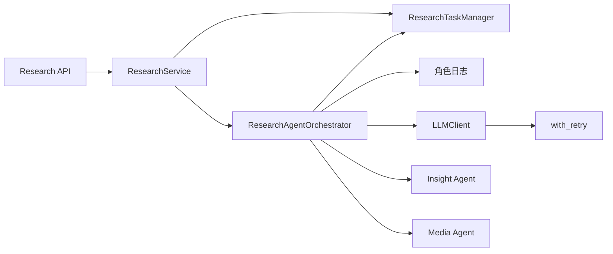
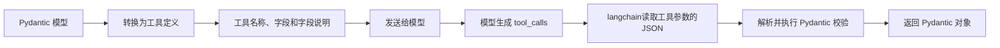
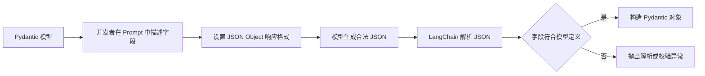
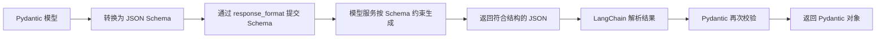
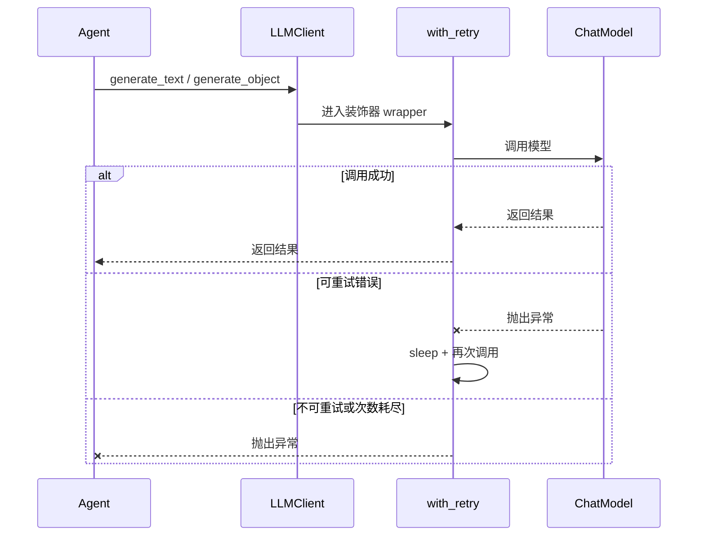
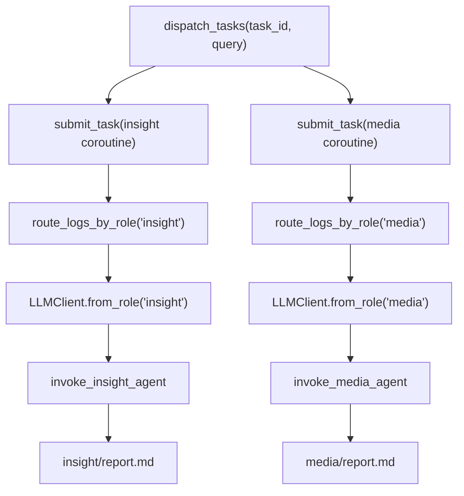
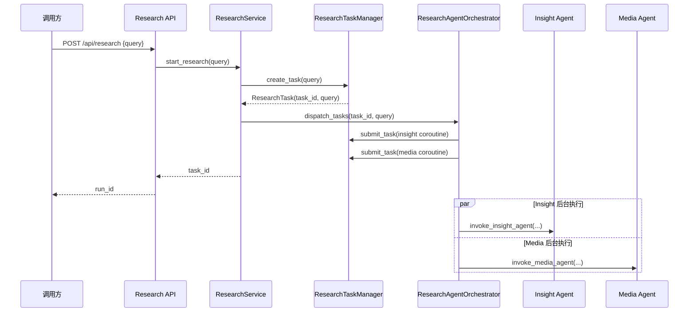

# 03_研究任务编排双 Agent 骨架

前两章已经完成项目结构和 Web 接口层的铺垫。本章继续沿着研究接口向下追踪，重点理解一次研究请求如何转化为两个并行运行的 Agent 后台任务。

本章主线如下：

```text
POST /api/research
    -> ResearchService
    -> ResearchTaskManager 创建研究任务
    -> ResearchAgentOrchestrator 分派 Agent
        -> Insight Agent
        -> Media Agent
    -> LLMClient 调用对应角色模型
```

本章聚焦六部分内容，并按以下顺序讲解：

1. 角色日志
2. LLM 客户端
3. 重试器
4. ResearchService 入口
5. ResearchAgentOrchestrator
6. ResearchTaskManager

本章暂不展开研究 Agent 内部的检索、聚类、章节总结和 Host 研判逻辑。目标是先理解两个 Agent 如何被统一创建、分派和管理。

---

## 1. 本章涉及的模块

当前运行骨架主要分布在以下文件：

```text
app/
└── services/
    └── research/
        └── research_service.py
engines/
├── common/
│   ├── llm.py
│   ├── logs.py
│   ├── retries.py
│   ├── research_tasks.py
│   └── reports.py
├── contracts/
│   ├── role_rules.py
│   └── settings.py
├── orchestration/
│   └── agent_orchestrator.py
├── insight_agent/
│   └── agent.py
└── media_agent/
    └── agent.py
```

这些文件的职责可以概括为：

| 模块 | 职责 |
|---|---|
| `logs.py` | 将不同角色的日志写入独立文件 |
| `llm.py` | 统一创建和调用大模型客户端 |
| `retries.py` | 为异步模型调用提供指数退避重试 |
| `research_service.py` | 应用层研究入口 |
| `agent_orchestrator.py` | 分派 Insight 和 Media Agent |
| `research_tasks.py` | 保存研究任务记录并管理后台协程 |
| `insight_agent/agent.py` | Insight Agent 的统一调用入口 |
| `media_agent/agent.py` | Media Agent 的统一调用入口 |

整体依赖方向如下：

researchTaskManager: 创建研究任务

ResearchAgentOrchestrator: 研究协调者，将研究任务发给InsightAgent，MediaAgent 去执行



---

## 2. 角色日志

研究任务会同时运行 Insight 和 Media 两个 Agent。两个 Agent 都会输出检索、规划、总结和模型调用日志。如果所有日志混在一个文件中，排查问题时很难判断某条日志属于哪个角色。

项目通过 `engines/common/logs.py` 中的 `route_logs_by_role()` 将日志按角色分流。

### 2.1 完整实现

```python
from contextlib import contextmanager
from pathlib import Path
from loguru import logger

from sentiment.engines.contract.settings import get_settings


# 传递角色
@contextmanager
def router_logs_by_role(role: str):
    """为指定角色临时挂一个独立日志文件,块内打出的日志只写入该角色的文件。

    用法:
        with router_logs_by_role("insight_agent"):
            logger.info(...)  # -> {LOG_DIR}/insight_agent.log
    """
    settings = get_settings()
    log_dir = Path(settings.LOG_DIR)

    # contextualize 在块内给每条日志记录写入 extra["role"],
    # 下面的 filter 正是靠这个字段判断该记录是否属于当前角色。
    # 注意:yield 必须放在 with 内部,否则块内日志不带 role,会被 filter 全部丢弃。
    with logger.contextualize(role=role):
        # add 返回 handler id,退出时用它精确移除本次新增的 sink,
        # 不会误删其他角色或全局默认的 handler。
        handler_id = logger.add(
            str(log_dir / f"{role}.log"),
            # {extra[role]} 取自上面 contextualize 注入的字段
            format="{time:YYYY-MM-DD HH:mm:ss} | {level} | [{extra[role]}] {name} - {message}",
            level="INFO",
            encoding="utf-8",
            # 单文件超过 1MB 自动轮转
            rotation="1 MB",
            # 只接收 role 匹配的记录,防止不同角色的日志串写到同一个文件
            filter=lambda record: record["extra"].get("role") == role
        )
        try:
            yield
        finally:
            # 用 finally 保证块内抛异常时也能移除 sink,避免 handler 泄漏、文件句柄不释放
            logger.remove(handler_id)
```

### 2.2 上下文管理器

`route_logs_by_role()` 是一个上下文管理器，因此调用方可以使用：

```python
with route_logs_by_role("insight"):
    logger.info("开始私域研究")
```

进入 `with` 代码块时，函数执行到 `yield`：

1. 创建日志目录。
2. 添加当前角色的文件 handler。
3. 给日志上下文绑定 `role`。

离开代码块后进入 `finally`，移除刚才创建的 handler。

这个结构能够保证：即使 Agent 执行期间抛出异常，临时日志 handler 也会被清理。

### 2.3 日志上下文

```python
with logger.contextualize(role=role):
```

这行代码会在当前上下文的日志记录中增加：

```python
record["extra"]["role"]
```

日志格式因此可以读取：

```text
[{extra[role]}]
```

最终日志类似：

```text
2026-08-03 22:00:00 | INFO | [insight] engines.insight_agent - 开始研究
```

### 2.4 日志过滤器

```python
filter=lambda record: record["extra"].get("role") == role
```

过滤器只允许当前角色的日志进入对应文件：

```text
role == insight -> insight.log
role == media   -> media.log
```

这里的 `lambda` 捕获了外层变量 `role`。创建 Insight handler 时，它会一直记住 `"insight"`；创建 Media handler 时，它会记住 `"media"`。

### 2.5 角色日志的统一管理

角色日志不是 Insight 或 Media 独有的业务逻辑，而是所有 Agent 都需要的运行设施。因此它由编排器统一使用：

```python
with route_logs_by_role(role):
    await agent_handler(...)
```

Agent 内部只负责正常调用 `logger.info()`、`logger.warning()` 或 `logger.error()`，不需要自己创建文件 handler。

---

## 3. 统一模型调用入口

两个 Agent 都需要调用大模型，但它们使用的配置可能不同：

```text
Insight Agent -> INSIGHT_ENGINE_* 配置
Media Agent   -> MEDIA_ENGINE_* 配置
Host Agent    -> HOST_* 配置
Report Engine -> REPORT_ENGINE_* 配置
```

如果每个 Agent 都直接初始化 LangChain ChatModel，就会重复处理：

- API Key
- 模型名称
- Base URL
- 模型提供商
- Prompt 消息格式
- 结构化输出

`engines/common/llm.py` 用 `LLMClient` 收口这些逻辑。

### 3.1 客户端字段

```python
class LLMClient:
    """LLM 客户端封装：统一调用与重试。"""

    def __init__(
        self,
        api_key: str,
        model_name: str,
        base_url: str,
        model_provider: str
    ) -> None:
        self.api_key = api_key
        self.model_name = model_name
        self.base_url = base_url
        self.model_provider = model_provider
```

这些字段描述一次模型客户端调用所需的基础配置。

### 3.2 按角色创建客户端

编排器不直接读取环境变量，而是调用：

```python
llm_client = LLMClient.from_role(role)
```

对应实现：在`sentiment/engines/contract/`目录下创建`agent_role.py` 模块！

```python
from dataclasses import dataclass

from typing import Literal
# 定义好角色的键 Literal限定这变量只能是其中之一
RoleKey = Literal["insight", "media", "host", "report"]

# 定义角色信息类
# 自动生成 __slots__ 的数据类，让对象更省内存、访问略快，代价是不能动态加属性、不能再用 __dict__。
@dataclass(slots=True)
class RoleInfo:
    """
    角色信息
    """
    display_name: str  # 显示名称
    config_prefix: str  # 配置前缀

# 定义角色信息
ROLE_INFOS: dict[RoleKey, RoleInfo] = {
    "insight": RoleInfo(display_name="私域检索智能体专家", config_prefix="INSIGHT_AGENT"),
    "media": RoleInfo(display_name="公域检索智能体专家", config_prefix="MEDIA_AGENT"),
    "host": RoleInfo(display_name="研判智能体专家", config_prefix="HOST_AGENT"),
    "report": RoleInfo(display_name="报告引擎智能体专家", config_prefix="REPORT_ENGINE"),
}
```

在`llm.py`中继续完成

```python
@classmethod
def from_role(cls, role: RoleKey) -> "LLMClient":
    # 1. 获取配置信息：
    settings = get_settings()
    # 2. 获取到Agent 配置信息前缀
    config_prefix = ROLE_INFOS[role].config_prefix
    # 3. 创建实例对象并返回
    return cls(
        api_key=getattr(settings, f"{config_prefix}_API_KEY"),
        model_name=getattr(settings, f"{config_prefix}_MODEL_NAME"),
        base_url=getattr(settings, f"{config_prefix}_BASE_URL"),
        model_provider=getattr(settings, f"{config_prefix}_MODEL_PROVIDER"),
    )
```

调用方只表达“当前需要哪个角色的模型”，不需要知道配置字段如何拼接。

### 3.3 文本生成

在`llm.py`模块中添加函数

```python
import asyncio
from typing import Any, TypeVar

from langchain.chat_models import init_chat_model
from langchain_core.language_models import BaseChatModel
from langchain_core.messages import SystemMessage, HumanMessage, BaseMessage
from langsmith import expect
from loguru import logger
from pydantic import BaseModel

from sentiment.engines.common.retries import with_retry
from sentiment.engines.contract.agent_role import RoleKey, ROLE_INFOS
from sentiment.engines.contract.settings import get_settings
	# 文本渲染函数
    async def generate_text(self,
                            system_prompt: str,
                            user_prompt: str) -> str:
        """流式生成纯文本,逐块收集后拼成一个字符串返回。"""
        # 1. 先构建消息内容:system 设定角色/规则,user 放具体问题
        message_context = self.build_message_context(system_prompt, user_prompt)
        # 2. 定义模型
        chat_model = self.init_chat_object_model()
        # 用列表收集再 join,避免在循环里反复做字符串拼接
        final_chunks = []
        # 3. 生成文本:astream 逐 token 返回,content 可能为空(如思考过程/结束块),需要跳过
        try:
            async for chunk in chat_model.astream(message_context):
                if text := chunk.content:
                    final_chunks.append(text)
        except Exception as exec:
            raise ValueError(f"{self.model_name}调用失败，异常信息：{str(exec)}")
        # 返回数据.
        return "".join(final_chunks)
```

`astream()，ainvoke()`。二者的区别是：

```text
ainvoke  -> 等待模型生成完全部内容后一次性返回
astream  -> 模型每生成一部分内容就返回一个 chunk
```

章节总结和最终报告通常内容较长。使用 `ainvoke()` 时，**模型生成期间连接可能长时间没有数据返回，容易触发模型网关或反向代理的空闲超时**。使用 `astream()` 后，客户端可以持续接收数据块，从而**降低长文本生成过程中的空闲超时风险**。

当前方法虽然从模型侧流式接收数据，但没有直接把 chunk 返回给上层，而是先保存到 `text_chunks`：

```python
if text := chunk.text:
    text_chunks.append(text)
```

流结束后再统一拼接：

```python
return "".join(text_chunks)
```

因此，这次替换只改变 `LLMClient` 与模型服务之间的读取方式，没有改变 `generate_text()` 对 Agent 的返回类型。Agent 得到的仍然是完整的 `str`。

如果流式读取中途发生异常，`@with_retry` 会重新执行整个 `generate_text()`。上一次调用中的 `text_chunks` 会随函数退出而丢弃，不会把未完成内容作为最终结果返回。

### 3.4 Prompt 消息格式与模型生成

模型调用前，系统会把字符串 Prompt 转成 LangChain 消息：在`llm.py`模块中添加函数

```python
    def build_message_context(self, system_prompt: str, user_prompt: str) -> list[BaseMessage]:
        return [
            SystemMessage(content=system_prompt),
            HumanMessage(content=user_prompt),
        ]
       
```

模型生成：

```python
    def init_chat_object_model(self, is_structed: bool = False) -> BaseChatModel:
        # 1. 获取到模型名称
        model_name = self.model_name.lower()
        kwargs: dict[str, Any] = {}
        # 2. 如果是结构化对象，要关闭kimi的思考模式。
        if is_structed and (model_name in "kimi" or "moonshot" in model_name):
            kwargs['extra_body'] = {
                "thinking": {
                    "type": "disabled"
                }
            }
        return init_chat_model(
            api_key=self.api_key,
            model=self.model_name,
            base_url=self.base_url,
            model_provider=self.model_provider,
            **kwargs,
        )
```

测试结果：

```python
if __name__ == '__main__':
    async def test():
        llm = LLMClient.from_role(role="media")
        result = await llm.generate_text(system_prompt="你是一个法律专家,能够回答一切法律知识",
                                         user_prompt="发生肇事逃逸应该如何判决?")
        print(result)
    asyncio.run(test())
```

### 3.5 结构化生成

在`llm.py`模块中添加函数

```python
    @with_retry
    async def generate_object(self,
                              system_prompt: str,
                              user_prompt: str,
                              structed_object: type[T]) -> T:
        """让模型按 pydantic 模型的定义返回结构化数据,调用方直接拿到该类型的实例。"""
        # 1. 构建消息
        message_context = self.build_message_context(system_prompt, user_prompt)
        # 2. 获取模型:结构化模式下可能需要关闭思考模型
        chat_model = self.init_chat_object_model(is_structed=True)
        # 3. 用 json_schema 方式约束输出结构(LangChain 会把 pydantic 模型转成 JSON Schema 发给模型)
        structed = chat_model.with_structured_output(structed_object, method="json_schema")
        try:
            result = await structed.ainvoke(message_context)
        except Exception as exec:
            raise ValueError(f"{self.model_name}调用失败，异常信息：{str(exec)}")
        # ainvoke 返回 None 说明模型没有按 schema 返回,属于异常情况,
        # 转成 ValueError 交给上层(全局异常处理器会映射成 400)
        if result is None:
            raise ValueError(f"{system_prompt} is not a structured output")
        return result
```

`generate_object()` 接收一个 Pydantic 模型类型，适用于：

- 研究章节规划
- 搜索参数规划
- Host 研判结构
- 其他需要固定字段的数据

`with_structured_output()` 支持三种结构化输出模式：

```text
function_calling  工具调用模式
json_mode         JSON 对象模式
json_schema       JSON Schema 模式
```

这里需要区分 LangChain 方法名与底层接口参数。LangChain 中的方法名是 `json_mode`，不是 `json_object`；`json_object` 是它向 OpenAI 兼容接口发送的 `response_format.type`：

```python
method="json_mode"

# 底层请求中的含义
response_format={"type": "json_object"}
```

同样，工具调用模式的正确拼写是 `function_calling`。

#### 3.5.1 工具调用模式

使用方式：

```python
structured = llm.with_structured_output(
    output_model,
    method="function_calling",
)
```

LangChain 会先把 Pydantic 模型转换成工具定义。模型不是直接返回普通正文，而是生成一次工具调用，并把结构化字段放入工具调用的 `arguments` 中。LangChain 再提取参数并构造 Pydantic 对象。



这种方式依赖模型的工具调用能力，最通用、最成熟，适合支持 Function Calling 或 Tool Calling 的模型。


#### 3.5.2 JSON 对象模式

LangChain 中使用：

```python
structured = llm.with_structured_output(
    output_model,
    method="json_mode",
)
```

底层接口会收到类似配置：

```python
response_format={"type": "json_object"}
```

这个模式主要保证模型返回合法 JSON，但不保证返回内容严格符合指定 Schema。因此 Prompt 中必须明确说明需要哪些字段、字段类型和嵌套结构做诱导。



JSON 对象模式只约束“必须是 JSON”。例如模型可能返回合法 JSON：

```json
{
  "result": "完成"
}
```

#### 3.5.3 JSON Schema 模式

使用方式：

```python
structured = llm.with_structured_output(
    output_model,
    method="json_schema",
)
```

LangChain 会把 Pydantic 模型转换成 JSON Schema，并通过模型服务的` Structured Output` 接口提交。支持该能力的模型服务会在生成阶段约束字段名称、字段类型和必填项。



与 JSON 对象模式相比，JSON Schema 模式不只是要求结果为合法 JSON，还要求模型输出与指定结构匹配。它的约束更强，但要求模型和接口供应商支持 Structured Output。

#### 3.5.4 三种模式的特点

```text
function_calling
    -> Schema 转成工具定义
    -> 模型返回工具调用参数
    -> 适合工具调用能力兼容较好的模型

json_mode
    -> 底层使用 json_object
    -> 只保证合法 JSON
    -> 字段结构主要依靠 Prompt 和本地校验

json_schema
    -> Schema 直接交给模型服务
    -> 生成阶段约束字段和类型
    -> 约束最强，但依赖供应商支持
```

#### 3.5.5  三种模式对比

| **维度**            | **function_calling**              | **json_object**                | **json_schema**                  |
| ------------------- | --------------------------------- | ------------------------------ | -------------------------------- |
| **底层依据**        | API 的 `tools` / `functions` 参数 | API 的 JSON Mode + Prompt 注入 | API 层的语法受限解码             |
| **JSON 语法保障**   | 极高（微调强化）                  | **100% 保障**                  | **100% 保障**                    |
| **Schema 字段保障** | 很高（依托微调能力）              | 较强（依赖模型理解 Prompt）    | **100% 物理级保障**              |
| **Prompt 特殊要求** | 无                                | **提示词必须包含 "JSON"**      | 无                               |
| **典型适用场景**    | 通用场景                          | 不支持 Function Call 时的兜底  | 数据敏感、对 Schema 零容忍的场景 |

### 3.6 创建底层 ChatModel-(删除)

```python
def _build_chat_model(self, is_structured: bool):
    model_name = self.model_name.lower()
    kwargs = {}
    if is_structured and ("kimi" in model_name or "moonshot" in model_name):
       kwargs["extra_body"] = {
             "thinking": {"type": "disabled"}
            }

       return init_chat_model(
            model=self.model_name,
            model_provider=self.model_provider,
            api_key=self.api_key,
            base_url=self.base_url,
            **kwargs
        )

```

- Kimi/Moonshot 使用结构化输出时关闭 thinking，避免影响 function calling。

## 4. 重试器

LLM 调用依赖外部网络服务，可能遇到：

- 短暂网络断开
- 网关超时
- 429 限流

项目通过 `engines/common/retries.py` 中的 `with_retry` 为异步函数增加统一重试。

### 4.1 RetryConfig

在`engines/common/retries.py` 模块中定义类

```python
import asyncio
from dataclasses import dataclass
from functools import wraps

from loguru import logger
@dataclass(slots=True)
class RetryConfig:
    """
    重试类属性配置
    """
    # 最大重试次数
    max_retry: int = 3
    # 初始延迟时间，单位为秒
    init_delay: float = 1.0
    # 最大延迟时间，单位为秒
    max_delay: float = 60.0
    # 延迟倍数因子
    backoff_factor: float = 2.0

    # 根据重试次数计算延迟时间
    def _computer_retry_delay(self, attempt: int) -> float:
        # 计算延迟时间
        return min(self.init_delay * (self.backoff_factor ** attempt), self.max_delay)
 
# 创建配置对象
retry_config = RetryConfig()
```

当前默认配置：

```python
# 创建配置对象
retry_config = RetryConfig()
```

对应等待时间为：

```text
第 1 次失败 -> 等待 1 秒
第 2 次失败 -> 等待 2 秒
第 3 次失败 -> 等待 4 秒
达到最大重试次数 -> 抛出最后一次异常
```

`max_delay` 用于限制最大等待时间，防止指数增长失控。

### 4.2 不应重试的错误

```python
	# 检查哪些异常需要重试：
    def _no_retryable(self, exec: Exception) -> bool:
        # 获取异常状态码
        status_code = getattr(exec, "status_code", None)
        if status_code is None:
            # 如果exec中没有状态码，则需要去响应中获取
            status_code = getattr(getattr(exec, "response", None), "status_code", None)
        # 返回是否需要重试 返回值True-不需要重试，False-需要重试
        return isinstance(status_code, int) and 400 <= status_code < 500 and status_code != 429
```

通常情况下：

- 400 表示请求错误。
- 401 表示认证失败。
- 403 表示权限不足。
- 404 表示资源不存在。

这些错误不会因为等待几秒而自行恢复，因此不重试。

429 表示请求频率受限，等待后可能恢复，所以允许重试。

### 4.3 计算下一次等待时间

```python
	# 获取延迟
    def get_retry_delay(self, exec: Exception, attempt: int, func_name: str) -> float | None:
        # 1. 不需要重试.
        if self._no_retryable(exec) or attempt >= self.max_retry - 1:
            return None
        # 2. 计算重试时间
        current_try = attempt + 1
        next_try = current_try + 1
        # 3. 获取到延迟时间
        delay = self._computer_retry_delay(attempt)
        logger.warning(f"函数{func_name} 第 {current_try} 次尝试失败：{exec}")
        logger.warning(f"将在{delay:.1f} 秒后进行第 {next_try} 次尝试....")
        # 4. 返回数据
        return delay
```

返回值有两种情况：

```text
float -> 等待指定秒数后继续重试
None  -> 停止重试并抛出异常
```

### 4.4 异步重试装饰器

在retries.py 模块最后添加.

```python
# 定义装饰器
def with_retry(func):
    # 1. 判断函数是否属于协程函数
    if not asyncio.iscoroutinefunction(func):
        raise TypeError(
            "装饰器只能修饰async函数."
        )
    # 2. 获取目标方法参数
    @wraps(func)
    async def wrapper(*args, **kwargs):
        # 3. 循环遍历
        for attempt in range(retry_config.max_retry):
            try:
                return await func(*args, **kwargs)
            except Exception as e:
                # 4.计算延迟时间
                delay = retry_config.get_retry_delay(e, attempt, func.__name__)
                if delay is None:
                    return ValueError(f"{func.__name__}函数不需要重试，异常原因：{str(e)}")
                # 5.设置延迟
                await asyncio.sleep(delay)
    return wrapper
```

使用方式：

```python
@with_retry
async def generate_text(...):
    ...
```

等价于：

```python
generate_text = with_retry(generate_text)
```

以后调用 `generate_text()` 时，实际先进入 `wrapper()`。`wrapper()` 调用原函数，失败时根据配置决定等待重试还是继续抛出异常。

### 4.5 保留原函数元信息

```python
@wraps(func)
async def wrapper(...):
    ...
```

`@wraps(func)` 会保留原函数的：

- `__name__`
- `__doc__`
- `__module__`

否则装饰后的 `generate_text.__name__` 会变成 `"wrapper"`，影响日志和调试定位。

### 4.6 LLMClient 与重试器的关系



Agent 不需要自己编写重试循环。所有模型调用遵循同一套失败策略。

---

## 5. ResearchService：应用层研究入口

Web 路由不会直接创建 Agent，而是调用 `ResearchService`。

当前实现位于：

```text
app/services/research/research_service.py
```

### 5.1 初始化编排器

```python
class ResearchService:
    """研究任务服务:创建研究运行、启动后台研究并读取各角色产物。"""
    def __init__(self) -> None:
        self._orchestrator = ResearchAgentOrchestrator()
```

`ResearchService` 持有 `ResearchAgentOrchestrator`，但不关心 Insight 和 Media 的内部运行步骤。

### 5.2 启动研究

在research_service.py 模块中

```python
    # 定义研究函数
    def research(self, query: str) -> str:
        # 调用manager中的函数创建研究任务
        research_task = research_task_manager.create_task(query)
        # 利用协调者分发任务
        self._orchestrator.dispatch_tasks(
            research_task.task_id,
            query
        )
        # 返回task_id
        return research_task.task_id
```

这个方法完成三件事：

1. 创建研究任务记录。
2. 把任务 ID 和研究主题交给编排器。
3. 立即把任务 ID 返回给调用方。

它不会等待两个 Agent 全部执行完成。

### 5.3 任务标识的即时返回

真实研究流程可能包含数据库检索、Web 搜索、多轮模型生成和文件写入。如果 HTTP 请求一直等待整个流程结束，会带来：

- 连接长期占用，请求超时
- 前端无法及时获得任务标识

因此接口只负责启动：

```text
请求进入
    -> 创建 task_id
    -> 分派后台任务
    -> 返回 task_id
```

### 5.5 Service 的边界

`ResearchService` 负责：

- 创建任务。
- 调用编排器。
- 根据任务 ID 查询结果。

它不负责：

- 初始化角色 LLM。
- 创建 Agent 协程。
- 实现 Agent 分析步骤。
- 管理 asyncio Task 集合。

这些职责分别交给编排器、Agent 和任务管理器。

---

## 6. ResearchAgentOrchestrator：双 Agent 编排

编排器位于：

```text
engines/orchestrator/agent_orchestrator.py
```

它负责把一条研究任务分派给 Insight 和 Media 两个 Agent。

### 6.1 AgentHandler 协议

```python
#,之前表示函数的参数个数与类型;,之后返回值类型 返回一个可等待的类型。
# task_id,query,role,大模型客户端，日志目录
AgentHandler = Callable[
    [
        str,
        str,
        RoleKey,
        LLMClient,
        str,
    ],
    Awaitable[None],
]
```

每个 Agent 入口都遵循同一个参数顺序：

```text
task_id           当前研究任务 ID
query             研究主题
role              角色标识
llm_client        角色对应的 LLM 客户端
output_dir        角色输出目录
progress_callback 进度回调
```

统一签名使编排器可以通过同一个字典管理不同 Agent。

### 6.2 Agent Handler 映射

```python
class ResearchAgentOrchestrator:

    def __init__(self) -> None:
        self._agent_handlers: dict[RoleKey, AgentHandler] = {
            "insight": invoke_insight_agent,
            "media": invoke_media_agent,
        }
```

映射关系为：

```text
insight -> invoke_insight_agent
media   -> invoke_media_agent
```

编排器只依赖统一入口，不依赖 Agent 内部图节点。

### 6.3 分派后台任务

```python
    def dispatch_tasks(self, task_id: str, query: str)->None:
        # """分派 Insight 与 Media 研究智能体的后台任务。"""
        for agent_role in self._agent_handlers.keys():
            research_task_manager.submit_task(self.execute_research_task(task_id, query, agent_role))
```

当前映射中有两个角色，因此会生成两个协程：

```text
_execute_role_agent(task_id, "insight", query)
_execute_role_agent(task_id, "media", query)
```

这两个协程被交给 `ResearchTaskManager.submit_task()`，注册到当前事件循环中并在后台并发执行。

### 6.4 执行单个 Agent

单角色执行逻辑集中在 `_execute_research_task`：

```python
    async def execute_research_task(self, task_id: str, query: str, role: RoleKey):
        with router_logs_by_role(role):
            # 1. 获取两个角色的llm客户端
            llm_client = LLMClient.from_role(role)
            # 2. 获取到md文件中的目录
            output_dir = get_report_dir(task_id,role)
            self._agent_handlers[role](
                task_id,
                query,
                role,
                llm_client,
                output_dir,
            )
```

当前执行的主要步骤是：

1. 进入角色日志上下文。
2. 根据角色创建 LLMClient。
3. 计算角色输出目录。
4. 找到角色对应的 Agent Handler。
5. `await` 执行 Agent。

### 6.5 为角色创建 LLMClient

```python
llm_client = LLMClient.from_role(role)
```

Insight 和 Media 会读取各自配置，但编排器使用完全相同的创建方式。

### 6.6 为角色分配输出目录

在 `common` 包下创建`report.py`

```python
from pathlib import Path

from sentiment.engines.contract.agent_role import RoleKey
from sentiment.engines.contract.settings import get_settings

# 获取输出目录
def get_report_dir(task_id: str, role: RoleKey) -> str:
    return str(Path(get_settings().RUNTIME_DIR / f"{task_id}" / f"{role}"))
```

结果类似：

```text
var/reports/task_xxx/insight/
var/reports/task_xxx/media/
```

两个 Agent 使用独立目录，不会覆盖彼此的 `report.md`。

### 6.7 调用对应 Agent

```python
await self._agent_handlers[role](
    task_id,
    query,
    role,
    llm_client,
    output_dir,
)
```

当 `role == "insight"` 时，实际调用：

```python
await invoke_insight_agent(...)
```

当 `role == "media"` 时，实际调用：

```python
await invoke_media_agent(...)
```

### 6.8 双 Agent 运行流程



### 6.9 编排器的边界

编排器负责：

- 维护 Agent Handler 映射。
- 分派后台协程。
- 创建角色 LLMClient。
- 计算角色输出目录。
- 建立角色日志上下文。
- 统一执行 Agent。

编排器不负责：

- 创建研究业务记录。
- 保存 asyncio Task 集合。
- 实现数据库或 Web 检索。
- 编写 Agent Prompt。
- 读取最终研究结果。

---

## 7. ResearchTaskManager：研究任务生命周期

`ResearchTaskManager` 位于：

```text
engines/common/research_tasks.py
```

它管理两种相关但不同的数据：

1. 研究任务记录 `ResearchTask`
2. 当前仍在运行的 asyncio Task

### 7.1 ResearchTask

```python
@dataclass(slots=True)
class ResearchTask:
    """单次研究任务的数据记录。"""
    task_id: str
    query: str
```

当前任务记录只保留必要信息：

```text
task_id  跨接口、Agent 和文件目录使用的任务标识
query    当前研究主题
```

### 7.2 Manager 内部状态

```python
class ResearchTaskManager:
    def __init__(self):
        # 1. 存储研究任务
        self.research_tasks: dict[str, ResearchTask] = {}
        # 2. 存储异步任务
        self.async_tasks: set[asyncio.Task] = set()
        
# 创建对象      
research_task_manager = ResearchTaskManager()
```

两个集合的含义不同：

```text
_tasks        保存研究业务记录
_async_tasks  保存仍可能执行中的 asyncio Task
```

### 7.3 创建研究任务

```python
    def create_task(self, query: str) -> ResearchTask:
        # 1.创建研究任务
        research_task: ResearchTask = ResearchTask(query=query, task_id=str(uuid.uuid4()))
        # 2. 存储研究任务
        self.research_tasks[research_task.task_id] = research_task
        # 3. 返回研究对象
        return research_task
```

任务 ID 示例：

```text
task_1023d3d862a64d8b93b39764b9aba836
```

它同时用于：

- 返回给前端。
- 区分不同研究任务。
- 构造报告目录。
- 查询研究记录。

### 7.4 查询研究任务

```python
    def get_research_task(self, task_id: str) -> ResearchTask:
        # 1. 根据task_id 获取研究对象
        return self.research_tasks[task_id]
```

### 7.5 提交后台协程

```python
    def submit_task(self, coro: Coroutine):
        # 1. 创建异步任务
        task = asyncio.create_task(coro)
        # 2. 存储异步任务
        self.async_tasks.add(task)
        # 3. 异步任务执行完成之后，从容器中删除任务
        task.add_done_callback(self.async_tasks.discard)
```

执行过程：

1. `asyncio.create_task()` 把协程注册到事件循环。
2. `_async_tasks.add(task)` 保存强引用。
3. 任务结束后，回调自动将它从集合移除。

`set` 很适合这里，因为：

- 不关心执行顺序。
- 不允许重复引用。
- `add()` 和 `discard()` 操作直接。
- `discard()` 在元素不存在时不会抛出异常。

### 7.6 后台任务引用管理

如果只调用：

```python
asyncio.create_task(coroutine)
```

应用层就没有统一位置掌握仍在执行的任务，保存到 `_async_tasks` 后，应用关闭时可以统一取消和等待

### 7.7 取消所有后台任务

```python
async def cancel_tasks(self):

   running_tasks = [task for task in self.async_tasks if not task.done()]

   for running_task in running_tasks:
    	running_task.cancel()
   # 第二个参数表示 不会因为有一个任务异常，导致后面任务不执行
   return  await asyncio.gather(*running_tasks,return_exceptions=True)
```

这里分为两步：

1. 对所有未完成任务调用 `cancel()`。
2. 使用 `gather()` 等待任务真正退出。

`return_exceptions=True` 可以收集取消异常，不让第一个异常中断其他任务的清理。

### 7.8 模块级单例

```python
research_task_manager = ResearchTaskManager()
```

项目中的多个模块需要共享同一份任务记录和 asyncio Task 集合：

- ResearchService 创建和查询任务。
- ResearchAgentOrchestrator 提交 Agent 协程。
- ReportService 报告生成协程。
- AppLifecycleManager 在关闭时取消任务。

因此这里使用一个进程内模块级实例

---

## 8. 两个 Agent 的统一入口

编排器最终调用的是：

```text
engines/insight_agent/agent.py
engines/media_agent/agent.py
```

两个入口拥有一致的调用骨架。

### 8.1 Insight Agent

```python
async def invoke_insight_agent(
    run_id: str,
    query: str,
    role: RoleKey,
    llm_client: LLMClient,
    output_dir: str,
):
    ...
```

### 8.2 Media Agent

```python
async def invoke_media_agent(
    run_id: str,
    query: str,
    role: RoleKey,
    llm_client: LLMClient,
    output_dir: str,
    progress_callback: ProgressCallback | None = None,
) -> None:
    ...
```

本章只关注两个入口与编排器之间的统一调用协议：

1. 参数顺序保持一致。
2. 都接收任务 ID、研究主题、角色、模型客户端、输出目录和进度回调。
3. 都可以作为 `AgentHandler` 注册到编排器。

入口函数内部的上下文创建、研究图构建和运行过程将在后续章节单独展开。

---

## 9. 完整时序



需要注意：

- HTTP 请求在后台任务完成前就返回。
- Insight 和 Media 使用同一个 `task_id`。
- 两个 Agent 使用不同角色和不同输出目录。
- Manager 统一持有后台任务，后面应用关闭顺便清理。

---

## 10. 边界总结

| 组件 | 负责 | 不负责 |
|---|---|---|
| `route_logs_by_role` | 日志上下文和角色文件分流 | Agent 业务步骤 |
| `LLMClient` | 模型配置、消息格式、文本/结构化调用 | 研究流程编排 |
| `with_retry` | 异步调用失败重试 | 决定 Agent 业务降级 |
| `ResearchService` | 创建任务、启动研究、读取结果 | 创建 Agent 运行资源 |
| `ResearchAgentOrchestrator` | 分派角色、创建 LLMClient、调用 Agent | 保存任务记录 |
| `ResearchTaskManager` | 任务记录和 asyncio Task 生命周期 | Agent 内部分析 |
| Agent 入口 | 接收编排器参数并进入对应角色流程 | HTTP 请求处理 |

---

## 11. 本章小结

本章建立了从应用入口到双 Agent 后台执行的完整骨架：

```text
ResearchService.research(query)
    -> ResearchTaskManager.create_task(query)
    -> ResearchAgentOrchestrator.dispatch_tasks(task_id, query)
        -> submit Insight coroutine
        -> submit Media coroutine
            -> route_logs_by_role(role)
            -> LLMClient.from_role(role)
            -> invoke_xxx_agent(...)
```

最重要的工程思想包括：

- 日志属于公共运行设施，由编排器统一建立角色上下文。
- 模型调用统一通过 `LLMClient`，Agent 不直接处理供应商配置。
- 重试通过装饰器统一附加到模型调用。
- Service 负责应用入口，不直接执行 Agent。
- 编排器负责分派，不保存研究业务数据。
- Manager 同时管理研究记录和后台协程生命周期。
- Insight 与 Media 遵循统一入口协议，因此可以被同一个编排器调度。

掌握这条主线后，下一章可以继续进入 Insight Agent 和 Media Agent 的 LangGraph 内部，分析它们如何规划章节、检索证据并生成固定路径下的 `report.md`。

