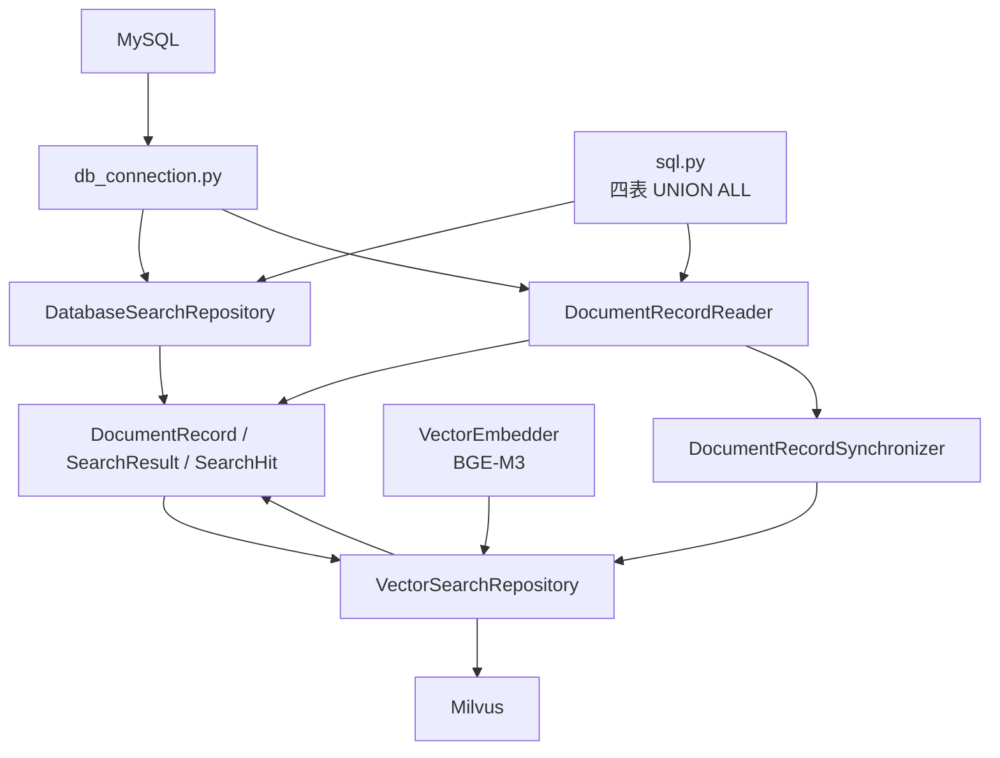
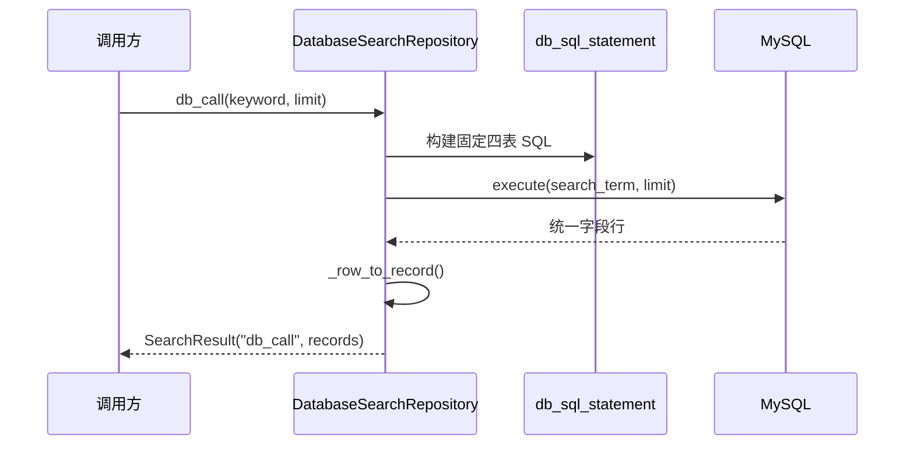
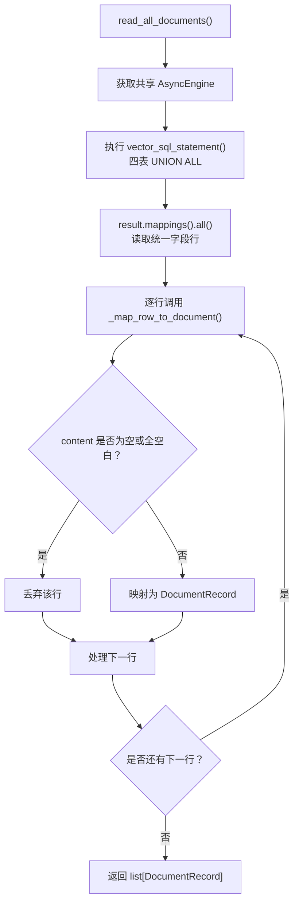
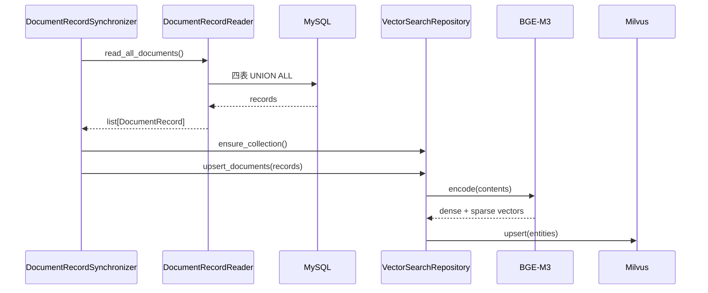
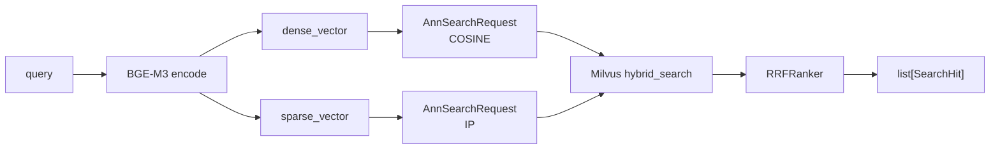

# 04_私域检索与向量混合召回

上一章已经把研究任务的运行骨架搭起来了，但是上一章中的 `InsightAgent` 还没有真正开始分析数据。它只是被编排层启动，并且拥有了统一的入口参数。

从本章开始，`InsightAgent` 要获得第一批真正可用的数据能力：**私域舆情库检索**。

当前工具层有两条独立路径：

```text
MySQL 关键词检索
   按照查询的舆情话题进行四张舆情表 UNION ALL 
    统一字段并按热度、发布时间排序
    返回 SearchResult[DocumentRecord]

Milvus 向量检索
    从 MySQL 全量读取四张表
    BGE-M3 生成 dense / sparse 向量
    Milvus hybrid_search + RRFRanker
    返回 list[SearchHit]
```

## 1. 模块结构与职责

```text
engines/insight_agent/tools/
├── db_connection.py                 # MySQL 异步引擎、会话工厂及释放
├── search_results.py                # 两条路径共享的数据契约
├── sql.py                           # 固定四表关键词/全量读取 SQL
├── db/
│   └── repository.py                # MySQL 关键词检索仓储
└── vector/
    ├── builder.py                   # Milvus collection schema 与索引
    ├── embedder.py                  # BGE-M3 dense/sparse 编码
    ├── repository.py                # Milvus 写入、混合检索与结果映射
    └── sync/
        ├── reader.py                # 全量读取 MySQL 文档
        └── synchronizer.py          # 全量同步协调器

```



## 2. 双通道检索

| 通道 | 优点 | 局限 |
| --- | --- | --- |
| MySQL 关键词检索 | 精确命中主题词、专有名词、事件名称；直接按互动热度排序 | 无法发现字面不同但语义相近的表达 |
| Milvus 混合检索 | 发现语义关联内容，并保留词项匹配能力 | 需要预先同步数据，依赖嵌入模型与向量库 |

例如：

```text
查询：高考志愿填报焦虑

MySQL 容易命中：高考、志愿、填报、焦虑
Milvus 可补充命中：选专业很迷茫、家长和孩子意见冲突
```

## 3. 共享数据契约

文件：`evidence.py`

两条通道都以 `DocumentRecord` 表示来源文档：

```python
from dataclasses import dataclass, field
from datetime import datetime


@dataclass(slots=True)
class Engagement:
    """互动指标数据模型"""
    # 点赞数 接收不同平台的点赞数
    likes: float
    # 评论数 接收不同平台的评论数
    comments: float
    # 分享数 接收不同平台的分享数
    shares: float
    # 收藏数 接收不同平台的收藏数
    collects: float
    # 回复数 接收不同平台的回复数
    replies: float


@dataclass(slots=True)
class EvidenceDocument:
    """跨 MySQL 与 Milvus 的归一化的文档记录"""
    # 平台
    platform: str
    # 表来源与哪个平台哪张表
    source_table: str
    # 来源Id 就是数据库表Id
    source_id: str
    # 来源内容，既有内容也有评论的内容
    content: str
    # 记录发布时间 create_time
    published_at: datetime | str
    # 互动链：点赞数，评论数，收藏数，分享数
    engagement: dict[str, float] = field(default_factory=dict)
    # 热度值：根据互动链的指标计算这个值
    hotness_score: float = 0.0

    # 文档的 URL
    url: str = ""
    # 文档的标题
    title: str = ""
    # 文档的来源名称
    source_name: str = ""

    @property
    def doc_id(self) -> str:
        """根据来源字段生成稳定文档标识"""
        return f"{self.platform}:{self.source_table}:{self.source_id}"


@dataclass(slots=True)
class RetrievalMeta:
    """召回过程元数据(查询词/通道/分数)"""
    # 匹配查询词列表 高考难不难（高考，难不难）
    matched_queries: list[str] = field(default_factory=list)
    # 检索通道得分
    channel_scores: dict[str, float] = field(default_factory=dict)


@dataclass(slots=True)
class EvidenceRecord:
    """一次检索中命中的舆情证据及其召回元数据"""

    document: EvidenceDocument
    retrieval: RetrievalMeta = field(default_factory=RetrievalMeta)

    @property
    def id(self) -> str:
        """快捷获取对应证据文档的唯一标识"""
        return self.document.doc_id

```

### 3.1 唯一文档 ID

```python
@property
def doc_id(self) -> str:
    return f"{self.platform}:{self.source_table}:{self.mysql_primary_key}"
```

例如：

```text
douyin:douyin_aweme:123
weibo:weibo_note_comment:456
```

该 ID 是 Milvus 主键。

### 3.2 统一互动指标

系统内部统一使用：

```text
likes / comments / shares / collects / replies
```

SQL 将不同表的原始字段投影为 `eng_likes`、`eng_comments` 等列，再由仓储映射为 `engagement` 字典。例如：

```text
douyin_aweme.liked_count              -> likes
douyin_aweme_comment.like_count       -> likes
weibo_note.shared_count               -> shares
weibo_note_comment.comment_like_count -> likes
```

### 3.3 归一化查询结果

MySQL 返回集合：

在`search_results.py` 模块中

```python
@dataclass(slots=True)
class SearchResult:
    """MySQL召回结果集合"""
    # 检索通道
    retrieval_channel: str
    # 检索结果
    retrieval_results: list[EvidenceDocument] = field(default_factory=list)
```

当前 MySQL 通道名固定为 `db_call`。

Milvus 返回命中列表：

```python
@dataclass(slots=True)
class SearchHit:
    """Milvus包含检索元数据的单条向量命中结果"""
    # 检索分数
    retrieval_score: float
    # 检索通道
    retrieval_channel: str
    # 检索文档
    retrieval_document: EvidenceDocument
```

当前向量通道名固定为 `semantic_recall`。

## 4. MySQL 连接生命周期

文件：`db_connection.py`

`DataBaseConnectionManager` 缓存并管理进程内共享的 SQLAlchemy 异步引擎：

```python
class DataBaseConnectionManager:
    def get_async_engine(self) -> AsyncEngine: ...
    def get_async_session_factory(self) -> async_sessionmaker[AsyncSession]: ...
    async def dispose_engine(self) -> None: ...
```

连接 URL 使用：

```text
mysql+aiomysql
```

读取操作通过会话工厂创建短生命周期 `AsyncSession`：

```python
session_factory = connection_manager.get_async_session_factory()
async with session_factory() as session:
    result = await session.execute(statement, parameters)
```

`DatabaseSearchRepository` 和 `DocumentRecordReader` 均采用该方式。会话工厂本身被缓存并绑定共享 `AsyncEngine`；每次调用 `session_factory()` 则创建独立会话，因此不会在并发任务间共享不安全的 `AsyncSession` 实例。

应用关闭或同步脚本结束时调用：

```python
await connection_manager.dispose_engine()
```

释放连接池并清空会话工厂缓存。

## 5. MySQL 四表关键词检索

### 5.1 查询范围

 MySQL 通道一次关键词查询固定覆盖四张表：

```text
douyin_aweme
douyin_aweme_comment
weibo_note
weibo_note_comment
```

每张表使用对应文本列 `LIKE :search_term`，再用 `UNION ALL` 合并：

```sql
ORDER BY hotness_score DESC, published_at DESC
LIMIT :limit
```

该通道的业务语义是：

> 在四张私域舆情表中寻找包含关键词的内容或评论，优先返回互动热度更高、发布时间更晚的记录。

### 5.2 四表关键词查询语句

文件：`sql.py`

`db_sql_statement()` 返回 SQLAlchemy `text()` 查询。四个 `SELECT` 被投影为统一字段：

```text
platform
source_table
mysql_primary_key
title_or_content
published_at
eng_likes / eng_comments / eng_shares / eng_collects / eng_replies
hotness_score
```

抖音内容表分支示例：

```sql
SELECT
    'douyin' AS platform,
    'douyin_aweme' AS source_table,
    id AS mysql_primary_key,
    title AS title_or_content,
    create_time AS published_at,
    liked_count AS eng_likes,
    comment_count AS eng_comments,
    share_count AS eng_shares,
    collected_count AS eng_collects,
    0 AS eng_replies,
    liked_count + comment_count * 4 + share_count * 5 + collected_count * 2
        AS hotness_score
FROM douyin_aweme
WHERE title LIKE :search_term
```

缺失的互动指标用 `0` 补齐，确保所有 `UNION ALL` 分支的列顺序和列语义一致。

### 5.3 热度规则

热度不能直接把所有互动次数相加。点赞的操作成本最低、发生频率最高；评论、回复、收藏和分享则分别代表更强的表达、讨论、留存与扩散意图。

若直接计算 `likes + comments + shares + collects + replies`，大量轻量点赞会掩盖一条内容的真实讨论度或传播力。例如，一条有 10 000 个点赞但几乎无人讨论的内容，可能排在一条被大量转发、引发评论区争论的内容之前。

因此，当前 SQL 用权重把不同互动行为换算为近似的“舆情影响信号”：

```text
分享 × 5
评论 × 4
回复 × 3
收藏 × 2
点赞 × 1
```

内容记录：

```text
hotness_score =
    likes + comments × 4 + shares × 5 + collects × 2
```

评论记录：

```text
hotness_score = likes + replies × 3
```

权重表达的不是绝对真理，而是当前业务的排序假设：

```text
分享：主动向外扩散，最能反映传播能力
评论：公开表达观点，反映讨论强度
回复：形成讨论链路，反映互动深度
收藏：表明内容具有后续留存价值
点赞：轻量认可，作为基础信号
```

**说明**：这只是一批候选记录的排序依据，实际权重应结合真实业务目标、平台分布和人工抽样结果持续校验，而不是当作固定不变的规则。

### 5.4 MySQL 检索仓储

文件：`db/repository.py`

唯一公开入口：

```python
async def db_call(self, keyword: str, limit: int = 100) -> SearchResult:
```

执行过程：



参数以绑定变量传入：

```python
{
    "search_term": f"%{keyword}%",
    "limit": limit,
}
```

### 5.5 行映射

`_row_to_record()` 将 MySQL 返回行映射为 `DocumentRecord`：

```python
DocumentRecord(
    platform=str(row["platform"]),
    source_table=str(row["source_table"]),
    mysql_primary_key=int(row["mysql_primary_key"]),
    content=str(row.get("title_or_content") or ""),
    published_at=datetime.fromtimestamp(int(row.get("published_at"))),
    engagement={...},
    hotness_score=float(row.get("hotness_score")),
)
```

## 6. Milvus collection 与 BGE-M3 编码

### 6.1 Collection schema

文件：`vector/builder.py`

collection 名称来自 `MILVUS_INSIGHT_COLLECTION`。字段包含：

```python
doc_id
platform / source_table / mysql_primary_key
content / published_at
likes / comments / shares / collects / replies
hotness_score
dense_vector
sparse_vector
```

其中：

```python
doc_id            VARCHAR，collection 主键
published_at      INT64，时间戳
dense_vector      FLOAT_VECTOR
sparse_vector     SPARSE_FLOAT_VECTOR
```

索引参数：

```python
dense_vector:
    index_type = AUTOINDEX
    metric_type = COSINE

sparse_vector:
    index_type = SPARSE_INVERTED_INDEX
    metric_type = IP
```

`MILVUS_OUTPUT_FIELDS` 定义向量检索命中时回传的标量字段，必须能完整映射回 `DocumentRecord`。

### 6.2 BGE-M3 编码器

文件：`vector/embedder.py`

`VectorEmbedder` 封装 BGE-M3：

```python
class VectorEmbedder:
    @cached_property
    def model(self) -> BGEM3FlagModel: ...

    def encode(
        self, texts: Iterable[str]
    ) -> list[tuple[list[float], dict[int, float]]]: ...
```

模型第一次使用时通过 `@cached_property` 加载；同一实例后续编码会复用模型。模型名和设备来自：

```python
INSIGHT_EMBEDDING_MODEL
INSIGHT_EMBEDDING_DEVICE
```

编码时明确请求 BGE-M3 返回稠密向量和稀释向量：

```python
model_output = self.model.encode(
    text_items,
    return_dense=True,
    return_sparse=True,
)
```

输出对应关系：

```python
dense_vecs       -> list[float]
lexical_weights  -> dict[token_id, weight]
```

稀疏向量会转换为 `dict[int, float]`，以符合 Milvus 的 `SPARSE_FLOAT_VECTOR` 要求。

## 7. MySQL 到 Milvus 的全量同步

Milvus 只能查询已同步的向量文档。

### 7.1 全量读取 SQL

文件：`sql.py`

`vector_sql_statement()` 也从四张表使用 `UNION ALL` 读取数据，但不带 `WHERE` 条件。它的文本字段统一为 `content`，以便直接向量化。

### 7.2 全量文档读取器

文件：`vector/sync/reader.py`

`read_all_documents()`：

1. 执行 `vector_sql_statement()`。
2. 将每行映射为 `DocumentRecord`。
3. 丢弃空文本或仅空白文本。

```python
async def read_all_documents(self) -> list[DocumentRecord]:
    async with self._connection_manager.get_async_engine().connect() as connection:
        result = await connection.execute(vector_sql_statement())
        rows = result.mappings().all()
    return [
        document
        for row in rows
        if (document := self._map_row_to_document(row))
    ]
```

读取与过滤流程如下：



当前实现一次性加载所有文档，后续可分批次加载。

### 7.3 全量同步器

文件：`vector/sync/synchronizer.py`

`full_sync()` 的工作流：



Milvus 客户端操作和模型编码通过 `asyncio.to_thread()` 执行，避免阻塞当前事件循环。

不要把 `asyncio.to_thread()` 与 `asyncio.create_task()` 混为一谈。它们解决的是不同问题：

| API | 适用对象 | 实际执行位置 | 场景 |
| --- | --- | --- | --- |
| `asyncio.to_thread(sync_function, ...)` | 同步函数 | 默认线程池中的工作线程 | 文件磁盘 I/O、使用 `requests` 库进行网络请求 |
| `asyncio.create_task(coroutine)` | 异步协程 | 当前事件循环线程 | 并发执行多个 `async def` 任务 |

`drop_existing=True` 时会删除并重建 collection；为 `False` 时保留 collection，并依赖稳定 `doc_id` 进行 upsert。

## 8. Milvus 仓储：写入与混合检索

文件：`vector/repository.py`

对外职责：

```text
ensure_collection()  确保 collection 与索引存在
upsert_documents()   将 DocumentRecord 向量化并写入
vector_call()        执行 dense/sparse 混合检索
```

### 8.1 写入

`upsert_documents()` 首先编码所有文档内容：

```python
embeddings = self._embedder.encode(doc.content for doc in documents)
```

然后合并业务字段与向量：

```python
{
    "doc_id": document.doc_id,
    "platform": document.platform,
    "source_table": document.source_table,
    "mysql_primary_key": document.mysql_primary_key,
    "content": document.content,
    "published_at": int(document.published_at.timestamp()),
    "dense_vector": dense_vector,
    "sparse_vector": sparse_vector,
}
```

最后调用 Milvus `upsert()`。dense 与 sparse 向量必须一起写入，否则混合检索无法正常工作。

### 8.2 查询

```python
def vector_call(
    self,
    query: str,
    limit: int,
    filter_expression: str | None = None,
) -> list[SearchHit]:
```

调用前先检查 collection 是否存在；若不存在，记录 warning 并返回空列表，不自动创建空 collection。

查询流程：



可选 `filter_expression` 会作为 Milvus `expr` 同时施加到两个搜索请求。例如：

```text
published_at >= 1750000000
```

### 8.3 RRF 融合

Milvus 调用：

```python
milvus_client.hybrid_search(
    collection_name=self.collection_name,
    reqs=[dense_request, sparse_request],
    ranker=RRFRanker(),
    limit=limit,
    output_fields=MILVUS_OUTPUT_FIELDS,
)
```

RRF根据记录在 dense、sparse 两路检索中的排名融合结果，而不是直接相加原始分数。

原因：余弦相似度和稀疏向量内积分数不共享同一数值尺度。

### 8.4 命中映射

Milvus 原始命中被映射为：

```python
SearchHit(
    retrieval_score=float(hit_dict.get("distance") or 0.0),
    retrieval_channel="semantic_recall",
    retrieval_document=DocumentRecord(...),
)
```

因此，Milvus 命中的文档仍然使用统一的 `DocumentRecord` 契约。


## 9. 模块边界

```text
db_connection.py       管理 MySQL 连接资源
sql.py                 定义四表字段归一化与查询
db/repository.py       执行 MySQL 关键词查询
vector/sync/           读取 MySQL 并协调全量同步
vector/embedder.py     只负责 BGE-M3 编码
vector/builder.py      只负责 Milvus schema 和索引
vector/repository.py   管理 Milvus 写入、混合检索与命中映射
search_results.py      定义共享数据契约
```

## 10. 本章小结

私域检索工具层已建立以下能力：

```text
MySQL：
关键词 -> 四表 UNION ALL -> 热度/时间排序 -> SearchResult[DocumentRecord]

Milvus 同步：
MySQL 四表 -> DocumentRecord -> BGE-M3 dense + sparse -> Milvus upsert

Milvus 查询：
query -> BGE-M3 dense + sparse -> hybrid_search + RRF -> list[SearchHit]
```

最重要的设计是：MySQL 查询、向量同步和 Milvus 命中映射都以 `DocumentRecord` 为统一文档契约。这样工具层能够隔离各平台表结构差异，并为下游提供统一的数据入口。
