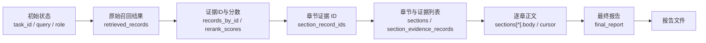
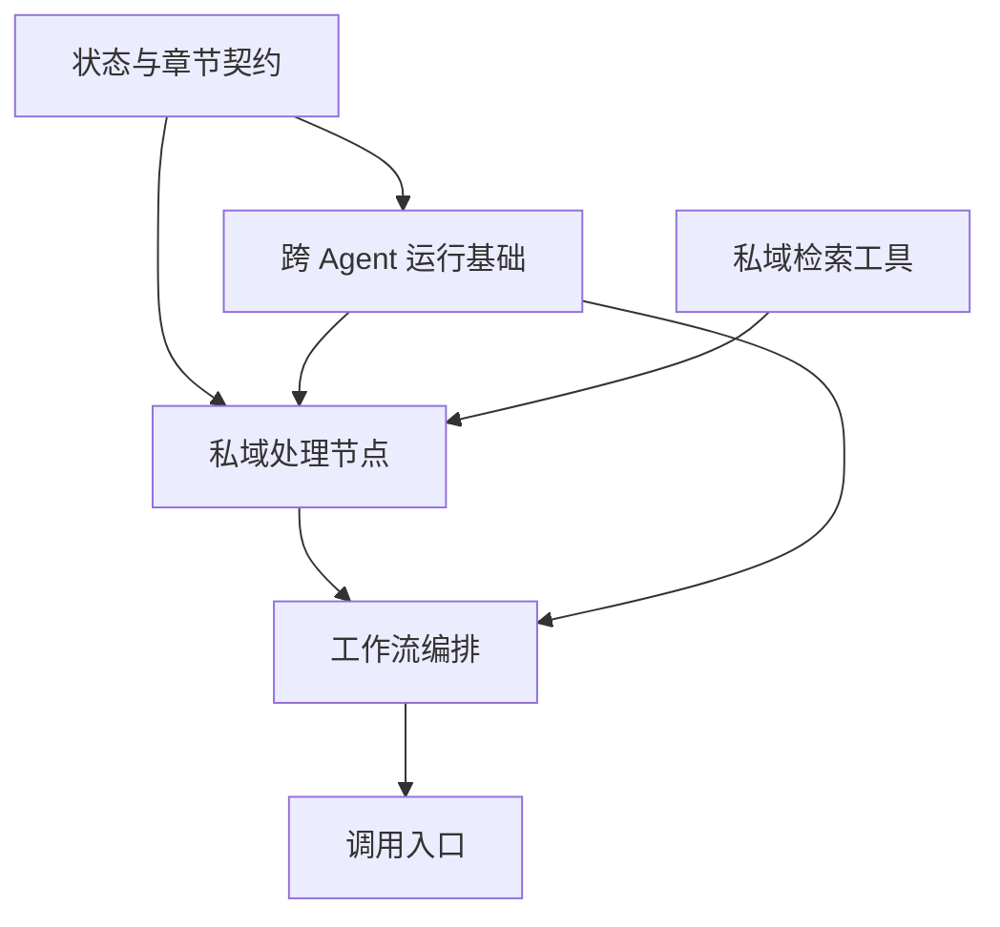
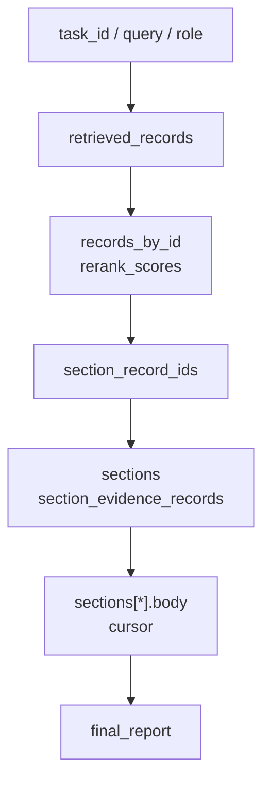
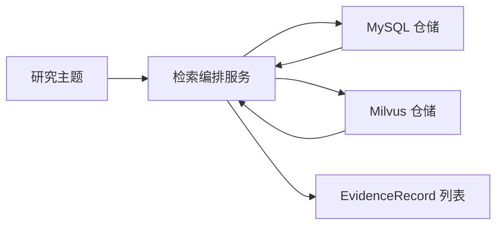
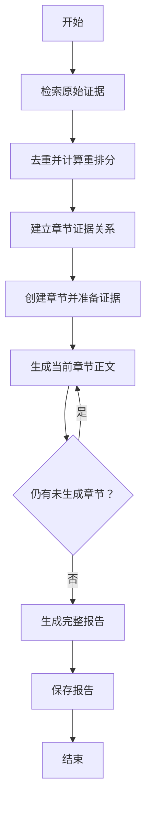

# 05_私域Agent架构搭建

## 1. 任务目标

上一章已经完成私域检索工具层：

```text
MySQL 关键词检索
    query
      -> 四表 UNION ALL
      -> SearchResult
      -> EvidenceDocument

Milvus 混合检索
    query
      -> BGE-M3 dense / sparse
      -> hybrid_search + RRFRanker
      -> SearchHit
      -> EvidenceDocument
```

工具层解决了“数据从哪里来”，但一个完整的私域Agent智能体还需要回答：

```text
检索结果怎样进入共享状态
重复证据怎样交给后续治理节点
证据怎样流向固定研究章节
章节怎样逐章生成
章节完成后怎样生成并保存报告
整条链路怎样由 LangGraph 连接起来
```

本章只搭建这条工作流的结构，不实现各个处理节点的内部实现。

本章完成后，项目将有：

```text
跨 Agent 运行上下文
跨 Agent 节点协议
跨 Agent 图状态
固定章节定义
私域研究状态
节点文件与输入输出边界
完整 LangGraph 拓扑
统一图执行入口
```

说明：

- `research_graph_state.py`、`section_definitions.py` 和 `state.py` 完成状态与配置定义。
- `retrieval_service.py` 负责连接上一章已经完成的检索能力。
- 本章会创建全部节点类，但节点执行方法的业务逻辑统一保留为 `pass`；允许先声明 Prompt、兜底文案等静态配置。
- 证据去重重排、章节路由、章节准备、章节摘要、报告生成和报告持久化将在下一章实现。

因此，本章的目标不是“立即运行完整研究”，而是先让模块边界、状态字段和执行顺序稳定下来。

## 2. 端到端处理链路

私域Agent流程分为七个阶段：

```text
  -> 证据检索
  -> 证据重排
  -> 章节路由
  -> 章节准备
  -> 逐章摘要
  -> 报告生成
  -> 报告持久化
```

对应的状态变化是：



证据在图状态中按职责拆分：

```text
retrieved_records          保存检索到的原始召回记录
records_by_id              保存去重后的证据ID
rerank_scores              保存证据 ID 对应的重排分
section_record_ids         保存章节与证据 ID 的路由关系
section_evidence_records   保存各章节最终消费的证据列表
```

## 3. 分层目录边界

本章涉及以下模块：

```text
engines/
├── common/
│   ├── research_graph_runtime.py
│   ├── section_summary.py
│   ├── agent_report_generation_node.py
│   └── report_persistence_node.py
├── contracts/
│   ├── evidence.py
│   ├── research_graph_state.py
│   └── section_definitions.py
└── insight_agent/
    ├── agent.py
    ├── graph.py
    ├── state.py
    ├── nodes/
    │   ├── evidence_retrieval_node.py
    │   ├── evidence_reranking_node.py
    │   ├── section_evidence_routing_node.py
    │   ├── section_preparation_node.py
    │   └── section_summary_node.py
    └── tools/
        └── retrieval_service.py
```

这些模块分为四层。

```text
contracts
    定义图状态和固定章节配置

common
    提供 Insight 与 Media 共用的运行上下文、
    节点协议、章节循环和报告收尾能力

insight_agent/tools
    编排 MySQL 与 Milvus 两条检索路径

insight_agent/nodes + graph
    定义私域研究各阶段节点和执行拓扑
```

依赖方向保持单向：



图编排层只负责连接节点，工具层只负责取回证据，节点层只通过状态读写连接。

## 4. 跨 Agent 运行基础

虽然本章主要搭建 Insight Agent，但运行上下文、节点调用协议、章节循环和报告收尾并不依赖私域检索逻辑，因此统一放在 `common` 包中，供 Insight 与 Media Agent 复用。

文件：

```text
engines/common/research_graph_runtime.py
```

这个模块在本章完整实现，统一解决五件事：

```text
进度更新数据结构
进度回调类型
单次研究运行上下文
节点抽象基类
图执行与章节循环路由
```

### 4.1 运行依赖与业务状态分离

`ResearchRunContext` 保存的是“本次研究运行依赖什么”，而不是“图处理出了什么”。

```text
task_id             当前研究任务标识
role                当前 Agent 角色
llm_client          LLM 调用依赖
output_dir          报告输出目录
```

这些对象不适合放入 LangGraph 状态：

- LLM Client 不是业务数据。
- 回调函数不需要在节点之间合并。
- 输出目录属于运行环境。
- 状态应尽量保持可观察、可序列化的数据结构。

**所以一定要明确区分：**

```text
ResearchRunContext  保存运行依赖
ResearchGraphState  保存业务状态
```

### 4.2 节点统一调用协议

所有研究节点都需要访问同一个上下文：

```python
class ResearchNode(ABC):
    def __init__(self, context: ResearchRunContext) -> None:
        self.context = context
```

具体节点只需要实现异步调用入口：

```python
async def __call__(self, state: ...) -> dict[str, Any]:
    ...
```

节点返回的字典表示对图状态的增量更新，而不是一份全新状态。

### 4.3 章节循环控制

五个章节不会在一个节点调用中一次性生成。图使用 `cursor` 表示当前章节位置：

```text
cursor < len(sections)
    继续执行章节摘要

cursor >= len(sections)
    进入报告生成
```

路由函数只判断状态，不生成正文，因此被 Insight 与 Media 共用。

## 5. 图状态契约

文件：

```text
engines/contracts/research_graph_state.py
```

`total=False` 表示图状态会由不同节点逐步补齐，不代表所有字段在所有阶段都可以随意缺失。其余字段按照定义的节点输入输出契约逐步产生。这里采用“渐进状态”类型，而不是把每个处理阶段再拆成一套独立 `TypedDict`。

### 5.1 渐进式章节正文生成

章节刚创建时只有：

```python
{
    "section_key": "background_overview",
    "title": "事件背景与概览",
}
```

章节摘要完成后才会增加：

```python
{
    "section_key": "background_overview",
    "title": "事件背景与概览",
    "body": "...",
}
```

因此：

```python
body: NotRequired[str]
```

表示 `body` 键可以不存在；如果存在，其值必须是字符串。

### 5.2 Agent角色扩展

Insight 的章节只需要通用章节字段，Media 的章节还会增加搜索工具和关键词。

通过泛型：

```python
ResearchGraphState[SectionStateT]
```

两类 Agent 可以共享：

```text
sections
cursor
final_report
```

同时保留各自的章节扩展类型。

## 6. 证据领域契约

文件：

```text
engines/contracts/evidence.py
```

上一章的 `DocumentRecord` 只表示 MySQL 和 Milvus 检索到的普通来源文档；进入 Agent 工作流后，这些文档将作为分析证据的内容载体，因此转换并命名为 `EvidenceDocument`，再与本次召回元数据组合成 `EvidenceRecord`。

```text
DocumentRecord
    -> EvidenceDocument
```

统一来源文档后，还不能直接把全部检索结果交给 LLM。因为报告中的五个章节职责不同，每个章节需要的数据也不同。Agent 会将每次检索命中的 `EvidenceDocument` 与查询词、检索通道和通道分数组合为 `EvidenceRecord`，再经过重排和章节路由，为每个章节筛选与其写作职责相关的数据。

这些经过筛选、用于支持 LLM 生成章节摘要的精准输入，统一称为“证据”。这里的证据只表示当前Agent可以引用的上下文材料，并不表示材料中的陈述已经被核实为事实。

四个核心模型：

```python
from dataclasses import dataclass, field
from datetime import datetime


@dataclass(slots=True)
class Engagement:
    likes: float = 0.0
    comments: float = 0.0
    shares: float = 0.0
    collects: float = 0.0
    replies: float = 0.0


@dataclass(slots=True)
class RetrievalMeta:
    matched_queries: list[str] = field(default_factory=list)
    channel_scores: dict[str, float] = field(default_factory=dict)


@dataclass(slots=True)
class EvidenceDocument:
    platform: str
    source_table: str
    source_id: str
    content: str
    published_at: datetime | str
    engagement: dict[str, float] = field(default_factory=dict)
    hotness_score: float = 0.0
    url: str = ""
    title: str = ""
    source_name: str = ""

    @property
    def id(self) -> str:
        return f"{self.platform}:{self.source_table}:{self.source_id}"


@dataclass(slots=True)
class EvidenceRecord:
    document: EvidenceDocument
    retrieval: RetrievalMeta = field(default_factory=RetrievalMeta)

    @property
    def id(self) -> str:
        return self.document.id
```

四个模型分别承担：

```text
Engagement       统一微博与抖音互动字段
RetrievalMeta    保存本次召回使用的查询词和通道分数
EvidenceDocument 保存来源文档内容
EvidenceRecord   表示某次检索命中的文档及其召回元数据
```

`EvidenceDocument` 与 `EvidenceRecord` 分开的原因是：

```text
同一文档内容相对稳定
同一文档可以被不同查询、不同通道重复命中
召回元数据属于本次检索，不属于原始文档
```

## 7. 固定章节配置

文件：

```text
engines/contracts/section_definitions.py
```

当前报告固定为五个章节：

```text
background_overview       事件背景与概览
heat_and_spread           舆情热度与传播
sentiment_and_opinion     公众情感与观点
platform_and_group_diff   平台与群体差异
deep_causes_and_impact    深层原因与影响
```

章节定义包含四类信息：

```python
@dataclass(frozen=True, slots=True)
class SectionDefinition:
    key: str
    title: str
    insight_section_guidance: str
    media_section_guidance: str
    insight_routing_keywords: tuple[str, ...] = ()

    def section_guidance_for(self, role: RoleKey) -> str:
        if role == "insight":
            return self.insight_section_guidance
        if role == "media":
            return self.media_section_guidance
        raise ValueError(f"角色不支持章节写作指导: {role}")
```

它们分别表示：

```text
key                       章节标识
title                     报告对应的展示标题
insight_section_guidance  私域Agent写作边界
media_section_guidance    公域Agent写作边界
insight_routing_keywords  私域Agent证据规则路由词
```

五个章节在模块中以有序字典保存：

```python
SECTION_DEFINITIONS: dict[str, SectionDefinition] = {
    "background_overview": SectionDefinition(...),
    "heat_and_spread": SectionDefinition(...),
    "sentiment_and_opinion": SectionDefinition(...),
    "platform_and_group_diff": SectionDefinition(...),
    "deep_causes_and_impact": SectionDefinition(...),
}
```

字典顺序就是最终报告章节顺序。后续章节准备阶段应直接遍历 `SECTION_DEFINITIONS.values()`，不让 LLM 自由创建章节。

模块同时提供三个查询入口：

```python
def find_section_definition(key: str) -> SectionDefinition | None:
    return SECTION_DEFINITIONS.get(key)


def get_section_definitions_for_role(
    role: RoleKey,
) -> list[dict[str, str]]:
    return [
        {
            "section_key": section.key,
            "title": section.title,
            "section_guidance": section.section_guidance_for(role),
        }
        for section in SECTION_DEFINITIONS.values()
    ]


def get_insight_routing_rules() -> dict[str, tuple[str, ...]]:
    return {
        section.key: section.insight_routing_keywords
        for section in SECTION_DEFINITIONS.values()
    }
```

三个入口分别服务于：

```text
按 key 查找章节
按角色获取章节写作边界
提取私域Agent证据路由规则
```

## 8. 私域Agent状态字段生命周期

文件：

```text
engines/insight_agent/state.py
```

代码如下：

```python
from engines.contracts.evidence import EvidenceRecord
from engines.contracts.research_graph_state import (
    ResearchGraphState,
    SectionState,
)


class InsightState(ResearchGraphState[SectionState], total=False):
    """LangGraph 全局状态：证据处理结果、章节列表与游标。"""

    retrieved_records: list[EvidenceRecord]
    records_by_id: dict[str, EvidenceRecord]
    rerank_scores: dict[str, float]
    section_record_ids: dict[str, list[str]]
    section_evidence_records: list[list[EvidenceRecord]]
```

状态字段按处理阶段分组。

**第一阶段，检索节点写入**：

```text
retrieved_records
```

这里保留 DB 与 Vector 两条通道的原始召回结果，暂时允许重复。

**第二阶段，重排节点写入：**

```text
records_by_id
rerank_scores
```

**第三阶段，章节路由节点写入：**

```text
section_record_ids
```

它只记录章节与证据 ID 的关系，不存储证据对象。

**第四阶段，章节准备节点写入：**

```text
sections
section_evidence_records
```

`sections[index]` 与 `section_evidence_records[index]` 使用相同索引表示同一章节。

**第五阶段，章节摘要循环更新：**

```text
sections[index].body
cursor
```

`cursor` 不需要出现在图的初始状态中。首次进入摘要节点时统一使用：

```python
cursor = state.get("cursor", 0)
```

因此它的生产契约是：

```text
键不存在
    表示尚未处理任何章节，读取值为 0

首次摘要完成
    节点写入 cursor = 1

后续每完成一章
    节点继续写入 cursor + 1
```

最后，报告生成节点写入：

```text
final_report
```

完整生命周期如下：



## 9. 私域Agent双通道检索编排

文件：

```text
engines/insight_agent/tools/retrieval_service.py
```

这个服务位于检索仓储与图节点之间：



它承担：

```text
从原始 query 构建 DB 搜索词
并发执行 DB 与 Vector 检索
把两类结果统一映射为 EvidenceRecord
保留实际命中查询和通道分数
```

本章完整接入这个服务，代码如下：

```python
import asyncio
from datetime import datetime, timedelta

import jieba.analyse

from sentiment.engines.contract.evidence import EvidenceRecord, RetrievalMeta, EvidenceDocument
from sentiment.engines.contract.settings import get_settings
from sentiment.engines.insight_agent.tools.db.repository import DatabaseSearchRepository
from sentiment.engines.insight_agent.tools.search_results import SearchHit, SearchResult
from sentiment.engines.insight_agent.tools.vector.repository import VectorSearchRepository


class RetrivalService:
    """
        创建构造函数
    """

    def __init__(self):
        self.db_repository = DatabaseSearchRepository()
        self.vector_repository = VectorSearchRepository() if get_settings().INSIGHT_VECTOR_ENABLED else None

    async def retrival_evidence(self, query: str) -> list[EvidenceRecord]:
        """
        查询两个通过结果合并获取数据
        """
        db_evidence, vector_evidence = await asyncio.gather(
            self._retrival_db_evidence(query),
            self._retrival_vector_evidence(query)
        )
        # 将两个结果集解包并返回结果
        return [*db_evidence, *vector_evidence]

    async def _retrival_vector_evidence(self, query: str) -> list[EvidenceRecord]:
        # 1. 判断是否开启了向量检索
        if self.vector_repository is None:
            return []
        # 2. 开启新线程检索
        search_hits: list[SearchHit] = await asyncio.to_thread(
            self.vector_repository.vector_call, query, 50, build_filter_expr()
        )
        # 3. 返回结果
        return [map_document_to_evidence(
            document=hit.retrieval_document,
            matched_queries=query,
            retrival_channel=hit.retrieval_channel,
            retrival_score=hit.retrieval_score,
        ) for hit in search_hits]

    async def _retrival_db_evidence(self, query: str) -> list[EvidenceRecord]:
        # 1. 对查询问题进行分词：
        terms = extract_terms(query)
        # 2. 分别用分词后的词语进行模版查询
        results: list[SearchResult] = await  asyncio.gather(
            *(self.db_repository.db_call(term, limit=20) for term in terms)
        )

        # 3. 返回结果
        return [
            map_document_to_evidence(
                document=document,
                matched_queries=term,
                retrival_channel=search_result.retrieval_channel,
                retrival_score=0.05
            )
            for term, search_result in zip(terms, results)
            for document in search_result.retrieval_results
        ]


def extract_terms(query: str) -> list[str]:
    """从查询文本中提取关键词，返回「原始查询 + 关键词」组成的词列表。

    参数:
        query: 待提取关键词的查询字符串。

    返回:
        一个字符串列表，第一项是原始查询本身，
        后面是长度在 2~4 之间、且不重复的 Top3 关键词。
    """
    # 用原始查询初始化结果列表，保证原始查询始终排在第一位
    final_terms = [query]

    # 使用 jieba 的 TF-IDF 算法提取权重最高的 3 个关键词
    for term in jieba.analyse.extract_tags(query, 3):
        # 只保留长度 2~4 的词（过滤掉单字和过长词），并去重
        if 2 <= len(term) <= 4 and term not in final_terms:
            final_terms.append(term)

    # 返回「原始查询 + 提取出的关键词」
    return final_terms

def build_filter_expr() -> str:
    """
    构建 Milvus 向量检索的时间过滤表达式。

    返回形如 "published_at>=1730000000" 的字符串，
    用于筛选出最近 N 天内发布的文档。
    """
    # 从配置中读取过滤天数 N（例如 7 天、30 天）
    days = get_settings().INSIGHT_VECTOR_FILTER_DAYS

    # 计算起始时间戳：
    # datetime.now()               -> 当前时间
    # - timedelta(days=days)       -> 往前推 days 天
    # .timestamp()                 -> 转为秒级浮点时间戳
    # int(...)                     -> 取整为秒级整数时间戳
    start_time = int((datetime.now() - timedelta(days=days)).timestamp())

    # 拼接成 Milvus 支持的过滤表达式：
    # 字段 published_at（发布时间）大于等于起始时间戳
    return f"published_at>={start_time}"


def map_document_to_evidence(document: EvidenceDocument,
                             matched_queries: str,
                             retrival_channel: str,
                             retrival_score: float,
                             ) -> EvidenceRecord:
    """
    实现数据转换
    """
    return EvidenceRecord(
        document=document,
        retrieval=RetrievalMeta(
            matched_queries=[matched_queries],
            channel_scores={retrival_channel: retrival_score}
        )
    )


async def main_test():
    retrival_service = RetrivalService()

    results = await  retrival_service.retrival_evidence(query="高考难不难")
    print(results)
    print(len(results))


if __name__ == '__main__':

    asyncio.run(main_test())

```

**检索词构建策略**

围绕用户 query 构建检索输入，常见有四种策略：

- 只使用原始 query：最稳定，但长句可能降低数据库精确命中率。
- 使用分词或关键词抽取：成本低、结果确定，适合提取事件名和主题词，但不太能覆盖同义表达。
- 使用 LLM 理解与扩展：可以生成简称、别名和相关表达，但会增加延迟，也可能引入错误词。
- 使用向量语义检索：不需要显式生成扩展词，可以召回字面不同但语义相关的内容，但依赖嵌入模型和向量库。

当前通过 `jieba.analyse.extract_tags()` 提取关键词，默认使用 TF-IDF 计算词项权重。`jieba` 的 TF-IDF 能提取具有主题代表性的关键词，但不具备真正的语义扩展能力。

基于这一特点，数据库检索保留原始 query，并使用 `jieba` 补充少量确定性关键词；Milvus 负责发现字面不同但语义相关的内容，两者形成互补。暂不使用 LLM 直接替换 `jieba`，避免增加延迟、输出不稳定，导致错误扩展词。

如果后续发现数据库召回不足，可以把轻量级 LLM 作为可选扩展：仅生成少量事件简称、主体别名或同义表达，调用失败时仍回退到原始 query 与 `jieba` 关键词。

**向量分数归一化**

Milvus 混合检索使用 `RRFRanker` 融合 dense 与 sparse 两路排名。它返回的是 RRF 排名分，而不是天然位于 `0~1` 的语义相似度。默认 `k=60` 时，两路都排第一的理论分数约为：

```text
1 / 61 + 1 / 61 ≈ 0.0328
```

而数据库命中的通道分固定为 `1.0`。如果直接把 RRF 原始分数交给后续重排，向量通道的权重会明显偏小。因此这里除以当前批次的最大分数，把第一名缩放为 `1.0`，其余结果保留相对于第一名的比例：

```text
原始分数：0.03、0.02、0.01
归一化后：1.00、0.67、0.33
```

由于 RRF 原始分数小于 `1`，除以批次最大值后分数会被放大，而不是变得更小。


图节点不需要知道 MySQL SQL、Milvus Search Request 或向量编码细节，只消费统一的 `EvidenceRecord`。检索服务仍然只负责召回和映射。

## 10. 业务节点接口占位

本章为每个处理阶段创建独立节点文件。所有节点先确定：

```text
类名
输入状态
输出字段
节点职责
```

节点执行方法统一使用 `pass`，下一章再逐个补齐；类级静态配置不代表节点已经具备执行能力。

### 10.1 原始证据接入

文件：

```text
engines/insight_agent/nodes/evidence_retrieval_node.py
```

```python
from typing import Any

from engines.common.research_graph_runtime import ResearchNode
from engines.insight_agent.state import InsightState


class EvidenceRetrievalNode(ResearchNode):
    """调用私域召回服务获取尚未合并的原始证据。"""

    async def __call__(
        self,
        state: InsightState,
    ) -> dict[str, Any]:
        pass
```

**输入：**

```text
query
role
```

**输出：**

```text
retrieved_records
```

这个节点约定只调用检索服务，不做去重和排序。

### 10.2 去重重排结果

文件：

```text
engines/insight_agent/nodes/evidence_reranking_node.py
```

```python
from typing import Any

from engines.common.research_graph_runtime import ResearchNode
from engines.insight_agent.state import InsightState


class EvidenceRerankingNode(ResearchNode):
    """合并重复召回证据并计算统一重排分。"""

    async def __call__(
        self,
        state: InsightState,
    ) -> dict[str, Any]:
        pass
```

**输入：**

```text
retrieved_records
```

**输出：**

```text
records_by_id
rerank_scores
```

### 10.3 章节证据映射

文件：

```text
engines/insight_agent/nodes/section_evidence_routing_node.py
```

```python
from typing import Any

from engines.common.research_graph_runtime import ResearchNode
from engines.insight_agent.state import InsightState


class SectionEvidenceRoutingNode(ResearchNode):
    """将重排证据路由到固定章节。"""

    async def __call__(
        self,
        state: InsightState,
    ) -> dict[str, Any]:
        pass
```

**输入：**

```text
records_by_id
```

**输出：**

```text
section_record_ids
```

### 10.4 章节输入装配

文件：

```text
engines/insight_agent/nodes/section_preparation_node.py
```

```python
from typing import Any

from engines.common.research_graph_runtime import ResearchNode
from engines.insight_agent.state import InsightState


class SectionPreparationNode(ResearchNode):
    """初始化固定章节并准备各章节证据。"""

    async def __call__(
        self,
        state: InsightState,
    ) -> dict[str, Any]:
        pass
```

**输入：**

```text
records_by_id
rerank_scores
section_record_ids
```

**输出：**

```text
sections
section_evidence_records
```

### 10.5 单章摘要内容生成

Insight 与 Media 的证据来源不同，但逐章读取状态、调用 LLM、写回正文和推进游标的流程一致，因此章节摘要的公共流程也属于跨 Agent 运行基础。

共享文件：

```text
engines/common/section_summary.py
```

本章只建立跨 Agent 摘要节点基类：

```python
from typing import Any

from engines.common.research_graph_runtime import ResearchNode


class BaseSectionSummaryNode(ResearchNode):
    """Insight 与 Media 共享的章节摘要节点基类。"""

    system_prompt: str = ""
    user_prompt_template: str = ""
    fallback_body: str = ""
    max_rendered_evidence: int = 8

    async def __call__(
        self,
        state: dict[str, Any],
    ) -> dict[str, Any]:
        pass
```

私域子类位于：

```text
engines/insight_agent/nodes/section_summary_node.py
```

```python
from engines.common.section_summary import BaseSectionSummaryNode
from engines.prompts.insight import (
    INSIGHT_SECTION_SUMMARY_SYSTEM_PROMPT,
)


class SectionSummaryNode(BaseSectionSummaryNode):
    """基于私域证据生成章节正文。"""

    system_prompt = INSIGHT_SECTION_SUMMARY_SYSTEM_PROMPT
    max_rendered_evidence = 20
```

**输入：**

```text
query
role
sections
section_evidence_records
cursor
```

**输出：**

```text
sections
cursor
```

下一章中，跨 Agent 基类将负责通用流程；私域子类只注入角色专属 Prompt 等信息。

### 10.6 报告汇总

文件：

```text
engines/common/agent_report_generation_node.py
```

```python
from typing import Any

from engines.common.research_graph_runtime import ResearchNode
from engines.contracts.research_graph_state import ResearchGraphState


class AgentReportGenerationNode(ResearchNode):
    """将章节正文整合为独立研究报告。"""

    async def __call__(
        self,
        state: ResearchGraphState[Any],
    ) -> dict[str, Any]:
        pass
```

**输入：**

```text
query
role
sections
```

**输出：**

```text
final_report
```

这个节点由 Insight 与 Media 共用，不依赖私域证据字段，只读取跨 Agent 图状态中的公共字段。

### 10.7 报告结果落盘

文件：

```text
engines/common/report_persistence_node.py
```

```python
from typing import Any

from engines.common.research_graph_runtime import ResearchNode
from engines.contracts.research_graph_state import ResearchGraphState


class ReportPersistenceNode(ResearchNode):
    """将独立研究报告保存到当前运行目录。"""

    async def __call__(
        self,
        state: ResearchGraphState[Any],
    ) -> dict[str, Any]:
        pass
```

**输入：**

```text
final_report
```

这个节点同样由 Insight 与 Media 共用，只负责持久化，不修改报告内容。

## 11. 私域Agent图拓扑

文件：

```text
engines/insight_agent/graph.py
```

虽然节点业务逻辑尚未实现，但本章可以先完成整张图的注册和连线：

```python
from typing import Any

from langgraph.graph import END, START, StateGraph

from engines.common.agent_report_generation_node import AgentReportGenerationNode
from engines.common.report_persistence_node import ReportPersistenceNode
from engines.common.research_graph_runtime import (
    SECTION_SUMMARY_LOOP_MAPPING,
    ResearchRunContext,
    route_after_section_summary,
)
from engines.insight_agent.nodes.evidence_reranking_node import EvidenceRerankingNode
from engines.insight_agent.nodes.evidence_retrieval_node import EvidenceRetrievalNode
from engines.insight_agent.nodes.section_evidence_routing_node import (
    SectionEvidenceRoutingNode,
)
from engines.insight_agent.nodes.section_preparation_node import SectionPreparationNode
from engines.insight_agent.nodes.section_summary_node import SectionSummaryNode
from engines.insight_agent.state import InsightState


def build_graph(ctx: ResearchRunContext) -> Any:
    """构建并编译私域舆情智能体的 LangGraph 工作流。"""
    graph = StateGraph(InsightState)  # type: ignore
    graph.add_node("retrieve_evidence", EvidenceRetrievalNode(ctx))  # type: ignore
    graph.add_node("rerank_evidence", EvidenceRerankingNode(ctx))  # type: ignore
    graph.add_node("route_section_evidence",SectionEvidenceRoutingNode(ctx))  # type: ignore
    graph.add_node("prepare_sections", SectionPreparationNode(ctx))  # type: ignore
    graph.add_node("summarize_sections", SectionSummaryNode(ctx))  # type: ignore
    graph.add_node("generate_agent_report",AgentReportGenerationNode(ctx))  # type: ignore
    graph.add_node("persist_agent_report",ReportPersistenceNode(ctx))  # type: ignore
    graph.add_edge(START, "retrieve_evidence")
    graph.add_edge("retrieve_evidence", "rerank_evidence")
    graph.add_edge("rerank_evidence", "route_section_evidence")
    graph.add_edge("route_section_evidence", "prepare_sections")
    graph.add_edge("prepare_sections", "summarize_sections")
    graph.add_conditional_edges(
        "summarize_sections",
        route_after_section_summary,
        SECTION_SUMMARY_LOOP_MAPPING,
    )
    graph.add_edge("generate_agent_report", "persist_agent_report")
    graph.add_edge("persist_agent_report", END)
    return graph.compile()

```

执行顺序如下：



### 11.1 架构先行

```text
节点是否缺失
节点是否依赖共享状态
状态字段能否覆盖完整流程
依赖方向是否正确
循环是否有出口
```

### 11.2 条件边与章节循环

普通边只能表达固定的一次跳转：

```text
A -> B
```

章节摘要需要根据 `cursor` 决定：

```text
继续生成下一章
或者结束循环进入报告生成
```

因此使用：

```python
graph.add_conditional_edges(
    "summarize_sections",
    route_after_section_summary,
    SECTION_SUMMARY_LOOP_MAPPING,
)
```

## 12. 私域Agent统一入口

文件：

```text
engines/insight_agent/agent.py
```

调用入口只负责组装运行上下文、构建图并启动执行：

```python
from sentiment.engines.common.llm import LLMClient
from sentiment.engines.common.research_graph_runtime import ResearchRunContext, invoke_research_graph
from sentiment.engines.contract.agent_role import RoleKey
from sentiment.engines.insight_agent.graph import build_insight_graph


async def invoke_insight_agent(
        run_id: str,
        query: str,
        role: RoleKey,
        llm_client: LLMClient,
        output_dir: str
):
    """
    insightAgent 入口
    """
    context = ResearchRunContext(
        task_id=run_id,
        role=role,
        llm_client=llm_client,
        output_dir=output_dir
    )

    await  invoke_research_graph(build_insight_graph(context),query)

```

入口不直接调用任何业务节点，也不拼装完整初始状态。初始状态由共享运行函数统一创建：

```python
{
    "run_id": context.run_id,
    "query": query,
    "role": context.role,
}
```

后续状态由图节点逐步补充。

## 13. 后续节点实现

下一章按照数据依赖顺序补齐节点。

第一步，实现原始证据接入：

```text
query
  -> InsightRetrievalService
  -> retrieved_records
```

第二步，实现证据治理：

```text
retrieved_records
  -> 去重合并
  -> 重排分
  -> records_by_id
  -> rerank_scores
```

第三步，实现章节证据组织：

```text
records_by_id
  -> 规则或语义路由
  -> section_record_ids
  -> 章节证据筛选
  -> section_evidence_records
```

第四步，实现逐章摘要：

```text
当前章节
  + 当前章节证据
  + 章节写作指导
  -> EvidenceContext
  -> LLM
  -> section.body
  -> cursor + 1
```

第五步，实现报告收尾：

```text
全部章节正文
  -> 完整报告
  -> final_report
  -> report.md
```

这个顺序保证每个节点实现时，其输入字段已经由上游节点明确产出。

## 14. 总结

本章没有实现节点内部实现，而是完成了私域Agen架构设计：

```text
跨 Agent 运行层
    ResearchRunContext
    ResearchNode
    run_research_graph
    章节循环路由

共享状态层
    SectionState
    ResearchGraphState
    固定五章节定义

私域状态层
    原始证据
    证据索引
    重排分
    章节证据关系
    章节证据列表

节点层
    检索
    重排
    路由
    准备
    摘要
    报告生成
    报告持久化

图编排层
    固定线性阶段
    章节摘要循环
    统一结束路径
```

本章最重要的不是实现，而是提前搭建架构，完成三件事：

```text
每个阶段由谁负责
每个节点读取和写入哪些状态
整条工作流按照什么顺序运行
```

在这个架构之上，下一章可以集中实现各节点业务逻辑。
